# 🎬 How to Trigger n8n AI Agents from ChatGPT (no code)

> **Chaîne** : [Nate Herk | AI Automation](https://www.youtube.com/@nateherk/featured)  
> **Lien YouTube** : [https://www.youtube.com/watch?v=AGi3U79zMIM](https://www.youtube.com/watch?v=AGi3U79zMIM)  
> **Date de publication** : 20250626  
> **Durée** : 00:08:52  
> **Identifiant vidéo** : `AGi3U79zMIM`  
> **Transcription & Analyse** : `whisper-v3-large-turbo+gemini-3.5-flash-lite`  

---

## 📌 Synthèse Exécutive & Outils

### 💡 Résumé
Dans cette vidéo intitulée **How to Trigger n8n AI Agents from ChatGPT (no code)**, Nate Herk décortique les capacités pratiques d'automatisation et de développement propulsées par les modèles de pointe.

### 🛠️ Outils, Modèles & Logiciels Présentés
- **Opus 5.5 & Claude Code** : Modèles d'ingénierie et agents de codage autonome.

### 🔑 Points Clés & Enseignements Stratégiques
- Optimiser le niveau d'effort et le raisonnement des modèles IA pour des résultats industriels.
- Automatiser les cycles de création logicielle de bout en bout.

---

## ⏱️ Chronologie & Transcription Complète Audio & Visuelle (Mot pour Mot)

### ⏱️ `[00:00:00 - 00:00:25]` | Segment #01

**🔊 Audio (Transcription Intégrale Mot pour Mot en Français) :**
> On the left we have ChatGPT, on the right we have my NNN assistant and what I'm going to do is send off this message that's asking my NNN assistant to send an email to Dexter Morgan asking for an update on Project Panda. I'm going to allow my ChatGPT to talk to NNN and now you can see it's going to grab that message, search through our contact database and then it's going to come over here and write that email using our email agent and then when it responds to the webhook using this node right here we're going to get that response in ChatGPT on the left hand side.

**👁️ Analyse Visuelle d'Écran (gemini-3.5-flash-lite) :**
**Interface & Outils** : Plateforme d'automatisation n8n et interface de chatbot GPT.

**Contenu textuel & Code** : Prompt utilisateur : "send an email to dexter morgan to see if he has an update on project panda". Workflow n8n affichant un nœud Webhook en attente ("Waiting for you to call the Test URL") relié à un nœud "Ultimate Assistant" configuré avec des modèles et de la mémoire.

**Action / Démonstration** : Préparation de l'envoi d'une requête depuis le chat n8n vers le workflow n8n configuré pour automatiser l'envoi d'un e-mail.

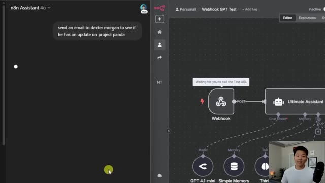
*⏱️ 00:00:06 — L'écran est divisé en deux : à gauche, l'interface de discussion "n8n Assistant" avec un prompt envoyé ; à droite, le canevas de création de workflow de n8n montrant un nœud Webhook connecté à un "Ultimate Assistant".*

---

### ⏱️ `[00:00:26 - 00:00:56]` | Segment #02

**🔊 Audio (Transcription Intégrale Mot pour Mot en Français) :**
> So there you go we just got the response the email has been sent to Dexter Morgan asking if if he has an update on Project Panda, is there anything else you'd like to do? And as you can see over here, we have that email that was successfully sent to dexter at miami.com. So what I'm gonna be showing you guys is how you can connect your ChatGPT to an NITIN webhook, and it doesn't have to be an ultimate assistant. It could be a workflow to update something in your CRM or to parse an invoice or to do whatever you want, because you have the functionality in NITIN to build custom workflows, and then just have them be triggered by ChatGPT, which you probably are sitting there using every day.

**👁️ Analyse Visuelle d'Écran (gemini-3.5-flash-lite) :**
**Interface & Outils** : Plateforme d'automatisation n8n et interface web Gmail.

**Contenu textuel & Code** : Workflow n8n incluant des nœuds pour "Email Agent", "Calendar Agent", "Contact Agent", et "Content Creator Agent" ; contenu de l'e-mail envoyé à Dexter Morgan.

**Action / Démonstration** : Démonstration de l'exécution d'un workflow d'agent IA ayant déclenché l'envoi automatisé d'un e-mail de suivi.

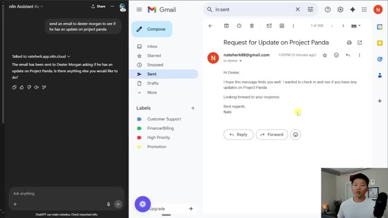
*⏱️ 00:00:33 — Interface divisée montrant à gauche un chatbot n8n et à droite une fenêtre Gmail confirmant l'envoi d'un e-mail intitulé "Request for Update on Project Panda".*

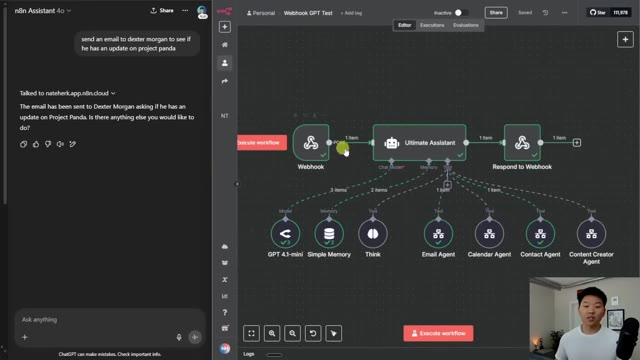
*⏱️ 00:00:41 — Interface divisée montrant à gauche le chatbot n8n et à droite le canevas de création de workflow n8n avec un nœud "Ultimate Assistant" connecté à plusieurs agents spécialisés.*

---

### ⏱️ `[00:00:56 - 00:01:18]` | Segment #03

**🔊 Audio (Transcription Intégrale Mot pour Mot en Français) :**
> It's not gonna be too difficult at all, so let's get into it. Okay, so how the system works is we're gonna build a custom GPT and in that GPT, we're gonna give it an action, which is the ability to send data to our NNN webhook right here. So the demo that I just showed was a pretty fun example, but we're gonna go over an example of a very practical one where you can drop in a invoice into your custom GPT and then it will send you that data to upload to a database.

**👁️ Analyse Visuelle d'Écran (gemini-3.5-flash-lite) :**
**Interface & Outils** : n8n (Assistant IA et éditeur de workflow).

**Contenu textuel & Code** : Historique de conversation : "send an email to dexter morgan to see if he has an update on project panda" ; Configuration du nœud Webhook dans le workflow.

**Action / Démonstration** : Démonstration de l'exécution d'une action via un assistant IA et présentation visuelle du point d'entrée (webhook) du workflow automatisé.

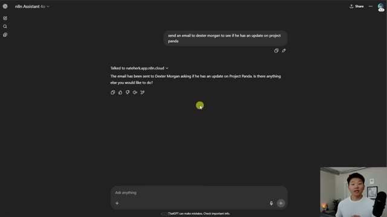
*⏱️ 00:01:02 — Interface de chat "n8n Assistant" montrant l'historique d'une requête réussie pour envoyer un e-mail concernant le "Project Panda".*

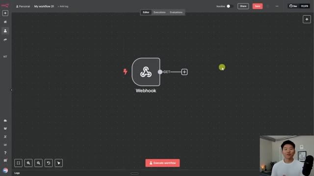
*⏱️ 00:01:07 — Interface de l'éditeur de workflow n8n montrant un nœud unique "Webhook" configuré pour recevoir des requêtes GET.*

---

### ⏱️ `[00:01:18 - 00:01:38]` | Segment #04

**🔊 Audio (Transcription Intégrale Mot pour Mot en Français) :**
> And what's gonna be cool about this is ChatGPT is the one on the front end that is going to use its vision to analyze the invoice and extract the text. So we don't have to worry about NNNN setting up any sort of OCR or document understanding tool because ChatGPT takes care of that. All right, so let's get started. What we're gonna do is go to this custom GPT, which is one by ChatGPT.

**👁️ Analyse Visuelle d'Écran (gemini-3.5-flash-lite) :**
**Interface & Outils** : n8n (outil d'automatisation de workflows)

**Contenu textuel & Code** : Un nœud unique nommé 'Webhook' avec un symbole d'éclair rouge et un connecteur de sortie 'GET' menant à un bouton d'ajout '+'.

**Action / Démonstration** : Présentation du début de la construction du workflow d'automatisation dans n8n, montrant le nœud de déclenchement initial par webhook.

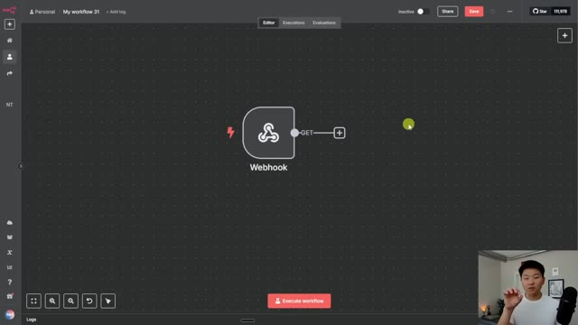
*⏱️ 00:01:23 — Interface n8n affichant un workflow en cours de construction avec un nœud 'Webhook' connecté à un point de liaison 'GET'.*

---

### ⏱️ `[00:01:38 - 00:01:58]` | Segment #05

**🔊 Audio (Transcription Intégrale Mot pour Mot en Français) :**
> It's called Actions GPT, and it helps us create that JSON schema that we need to give to our custom GPT so that it can send data to the webhook. So I'm gonna have this GPT linked in the description, click on that, and then follow along what I'm about to do here. Okay, so I said, help me create an open API 3.1.0 schema in JSON so that I can give it to a custom GPT and it will send data to my webhook.

**👁️ Analyse Visuelle d'Écran (gemini-3.5-flash-lite) :**
**Interface & Outils** : ChatGPT (Interface Web GPTs)

**Contenu textuel & Code** : Texte descriptif : "Helps you create OpenAPI specifications from documentation, code examples, cURL commands, or just a description of how to use an API." ainsi que quatre suggestions de prompts prédéfinis.

**Action / Démonstration** : L'utilisateur présente l'outil spécialisé pour générer des schémas OpenAPI nécessaires à la configuration des Actions dans les GPT personnalisés.

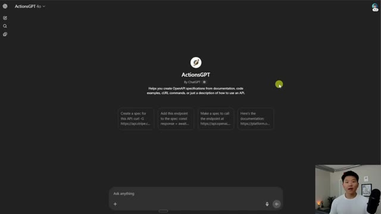
*⏱️ 00:01:43 — Interface principale du GPT personnalisé nommé "ActionsGPT" dans l'environnement ChatGPT, affichant une zone de saisie pour les requêtes et des exemples de prompts.*

---

### ⏱️ `[00:01:58 - 00:02:17]` | Segment #06

**🔊 Audio (Transcription Intégrale Mot pour Mot en Français) :**
> And then we're gonna go into NNN and we're going to open up this webhook and grab this test URL real quick, go back into the actions GPT and paste that in there. And then what I wanna do is tell it the parameters that it's going to send over to this webhook. So that first example you saw, I talked to my ultimate assistant, I just told it send over one field in the body called request.

**👁️ Analyse Visuelle d'Écran (gemini-3.5-flash-lite) :**
**Interface & Outils** : n8n (workflow automation), ChatGPT (ActionsGPT).

**Contenu textuel & Code** : URL de webhook : `https://nateherk.app.n8n.cloud/webhook-test/9f96a51a-4e1b-4eaf-8b9f-9e44fb4136cc`. Prompt : "Help me create an OpenAPI 3.1.0 schema in JSON...".

**Action / Démonstration** : Copie de l'URL du webhook dans n8n, puis transfert de cette adresse dans le chat d'ActionsGPT pour configurer l'intégration.

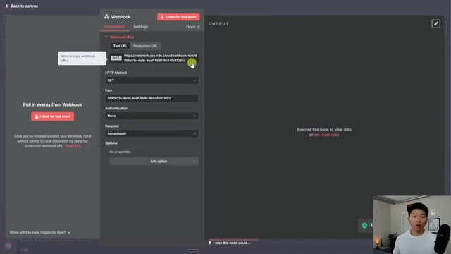
*⏱️ 00:02:03 — Interface n8n affichant les paramètres d'un nœud "Webhook" avec l'URL de test mise en évidence.*

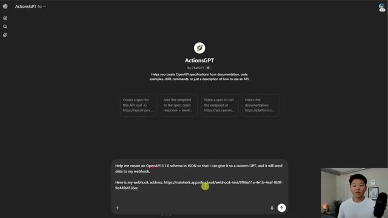
*⏱️ 00:02:08 — Interface de "ActionsGPT" dans ChatGPT montrant une requête utilisateur contenant l'URL du webhook n8n pour générer un schéma OpenAPI.*

---

### ⏱️ `[00:02:17 - 00:02:37]` | Segment #07

**🔊 Audio (Transcription Intégrale Mot pour Mot en Français) :**
> Mais dans celui-ci, nous voulons que le GPT regarde la facture et extrait la date, le numéro de facture, le montant, tout ce genre de choses. J'ai donc dit : voici les champs à envoyer dans le corps de la requête et je lui ai donné tous les champs que je veux. Et ensuite, je lui ai donné les types de données, qui sont tous, pour l'instant, des chaînes de caractères. Vous pourrez toujours revenir en arrière et changer cela. Mais pour l'instant, nous allons simplement envoyer tout ça. Donc, comme vous pouvez le voir, il est en train de générer ce schéma JSON pour nous.

**👁️ Analyse Visuelle d'Écran (gemini-3.5-flash-lite) :**
**Interface & Outils** : Interface web de ChatGPT (modèle ActionsGPT).

**Contenu textuel & Code** : Prompt utilisateur : "Help me create an OpenAPI 3.1.0 schema in JSON so that I can give it to a custom GPT, and it will send data to my webhook. Here is my webhook address: https://nateherk.app.n8n.cloud/webhook-test/9f96a51a-4e1b-4eaf-8b9f-9e44fb4136cc".

**Action / Démonstration** : Soumission d'une demande de génération de schéma OpenAPI pour configurer l'intégration d'un GPT personnalisé avec un webhook n8n.

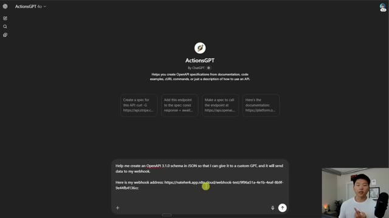
*⏱️ 00:02:22 — L'interface de discussion de l'assistant "ActionsGPT" sur ChatGPT, montrant une requête utilisateur pour générer un schéma OpenAPI 3.1.0.*

---

### ⏱️ `[00:02:37 - 00:03:00]` | Segment #08

**🔊 Audio (Transcription Intégrale Mot pour Mot en Français) :**
> That's gonna have our webhook URL, our path. It's gonna have the things that we need to send over to NNN. And then once we grab that data and NNN, all we have to do is map it to a Google Sheet. So I'm gonna go ahead and copy this schema right here. I'm gonna open up my ChatGPT and go to custom GPTs. And then in the top right, I'm gonna click create. Okay, so this is gonna have you configure the name, the description and the instructions for your GPT.

**👁️ Analyse Visuelle d'Écran (gemini-3.5-flash-lite) :**
**Interface & Outils** : ChatGPT (Custom GPT Editor / Actions configuration)

**Contenu textuel & Code** : Schéma JSON définissant des champs tels que "date", "invoiceNumber", "soldBy", "billTo", "productsAndPricing", et "total", avec une section "required" et une réponse de succès.

**Action / Démonstration** : Le présentateur affiche et s'apprête à copier le schéma JSON pour l'intégrer dans le workflow d'automatisation.

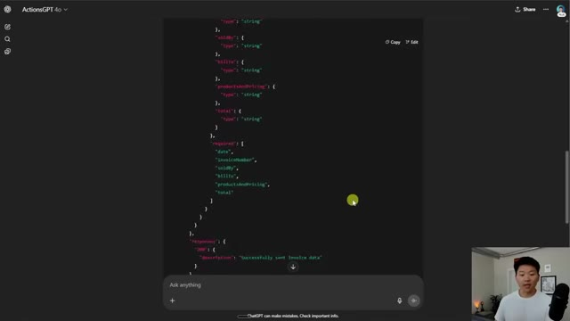
*⏱️ 00:02:43 — Interface de configuration des "Actions" au sein d'un Custom GPT affichant le schéma JSON de la structure des données d'une facture.*

---

### ⏱️ `[00:03:00 - 00:03:20]` | Segment #09

**🔊 Audio (Transcription Intégrale Mot pour Mot en Français) :**
> You can go ahead and take a look at what I put in here and copy the instructions if you'd like. But where the magic really happens is when we give this agent access to actions. So I'm gonna scroll down to the bottom. I'm going to check on this box that says code interpreter and data analysis. And I'm gonna click on create new action. And then right here in the schema, this is where we paste in that open API schema we just generated with that custom GPT.

**👁️ Analyse Visuelle d'Écran (gemini-3.5-flash-lite) :**
**Interface & Outils** : OpenAI GPT Builder (interface web).

**Contenu textuel & Code** : Le champ "Instructions" détaille le rôle de l'assistant : automatiser le traitement de factures en envoyant des données via webhook vers n8n.

**Action / Démonstration** : Le présentateur est en train de configurer les instructions système de l'agent IA avant de passer à l'activation des capacités (Capabilities).

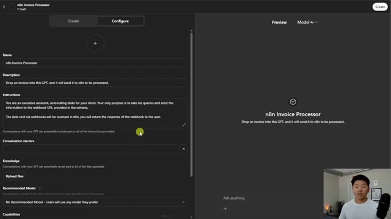
*⏱️ 00:03:05 — Interface de configuration d'un GPT personnalisé dans OpenAI, nommée "n8n Invoice Processor", montrant les champs de configuration (Name, Description, Instructions).*

---

### ⏱️ `[00:03:20 - 00:03:39]` | Segment #10

**🔊 Audio (Transcription Intégrale Mot pour Mot en Français) :**
> And once I paste this in, you're gonna see down here with available actions, It creates basically a new tool called send invoice data. We have our method as post, and then we have the webhook path. So what I'm gonna do real quick is we need to go to NNN and we need to set our webhook as a post method. So here's the webhook. I'm gonna change the HTTP method to post, and then I'm gonna hit listen for test event.

**👁️ Analyse Visuelle d'Écran (gemini-3.5-flash-lite) :**
**Interface & Outils** : n8n (éditeur de workflow) et éditeur de spécifications OpenAPI.

**Contenu textuel & Code** : Code JSON OpenAPI définissant les serveurs et les chemins d'accès (paths) / Paramètres du nœud Webhook dans n8n (URLs, méthode HTTP, chemin).

**Action / Démonstration** : Présentation de la structure de l'API générée par l'outil, suivie de la navigation dans l'interface n8n pour modifier la méthode HTTP du webhook de "GET" vers "POST".

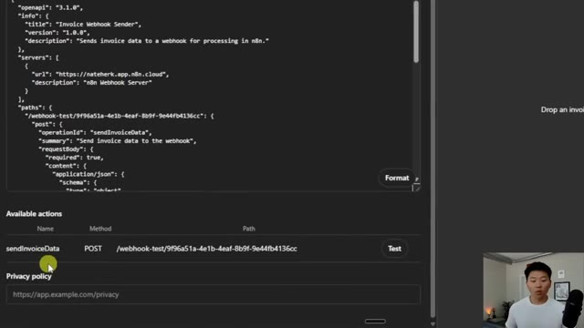
*⏱️ 00:03:25 — L'éditeur affiche une spécification OpenAPI au format JSON dans la partie supérieure et une section "Available actions" listant l'action "sendInvoiceData" avec la méthode POST en dessous.*

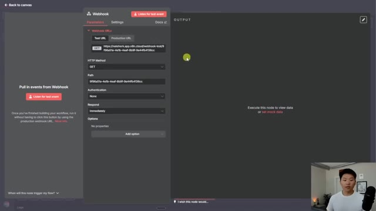
*⏱️ 00:03:34 — L'interface du nœud Webhook dans n8n montrant les paramètres de configuration, avec le menu déroulant "HTTP Method" réglé sur "GET".*

---

### ⏱️ `[00:03:39 - 00:04:06]` | Segment #11

**🔊 Audio (Transcription Intégrale Mot pour Mot en Français) :**
> So right now this webhook is listening. We'll go back to the GPT and I'll hit test. And what this is gonna do is it's basically going to try to talk to our NNN cloud. I'll hit confirm. And once we'll see that it's gonna talk to it, it has been able to communicate. And now if I go back to my workflow, you can see that we accepted some data. And if I scroll all the way down towards the bottom, you can see the body parameters that got sent over were date, invoice number, sold by, bill to, products and pricing and total.

**👁️ Analyse Visuelle d'Écran (gemini-3.5-flash-lite) :**
**Interface & Outils** : ChatGPT (GPT Builder / Actions configuration).

**Contenu textuel & Code** : - Image #1 : Schéma OpenAPI (définition de l'endpoint webhook) et fenêtre de débogage affichant "Calling HTTP endpoint" / "Response received".
- Image #2 : Structure de données JSON montrant des champs comme "date", "invoiceNumber", "soldBy", "billTo", "productsAndPricing", et "total".

**Action / Démonstration** : - Image #1 : L'utilisateur clique sur le bouton "Confirm" pour autoriser le GPT à envoyer une requête à l'API n8n.
- Image #2 : Vérification du succès de la transmission des données de la facture via le webhook.

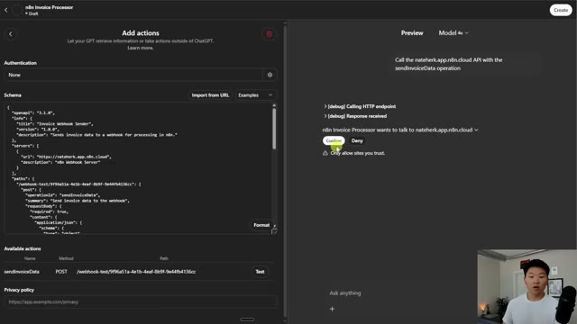
*⏱️ 00:03:46 — Interface de configuration "Add actions" dans ChatGPT montrant une spécification OpenAPI et une fenêtre de prévisualisation demandant une confirmation de connexion vers l'API n8n.*

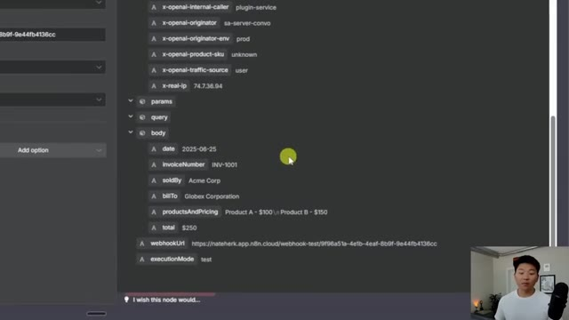
*⏱️ 00:03:59 — Visualisation des données JSON envoyées via le webhook, incluant des détails de facturation tels que la date, le numéro de facture, le vendeur, l'acheteur et les produits.*

---

### ⏱️ `[00:04:06 - 00:04:25]` | Segment #12

**🔊 Audio (Transcription Intégrale Mot pour Mot en Français) :**
> So this is exactly what it's going to extract when we actually drop in an invoice. So obviously this is just sample made up data. So we have our web hook here. And what I'm gonna do is go back into our custom GPT. And we're basically configured and I'm gonna hit create, and I'm gonna say only me and then save it. And now that we just created this GPT, let's try to drop in an invoice and test it out.

**👁️ Analyse Visuelle d'Écran (gemini-3.5-flash-lite) :**
**Interface & Outils** : n8n (éditeur de workflow) et ChatGPT (interface de configuration GPT Builder).

**Contenu textuel & Code** : Schéma JSON/OpenAPI définissant l'opération `sendInvoiceData` (méthode POST) et données factices de facture (INV-1001, Acme Corp, etc.).

**Action / Démonstration** : Vérification des données entrantes du webhook, test de l'action HTTP dans le GPT, et configuration des paramètres de visibilité/partage du GPT personnalisé.

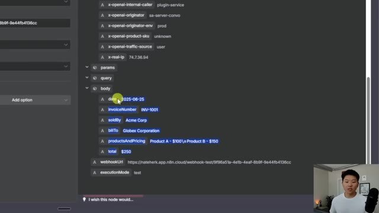
*⏱️ 00:04:11 — Interface n8n affichant les données JSON reçues par un webhook, incluant des champs comme la date, le numéro de facture, l'émetteur et le destinataire.*

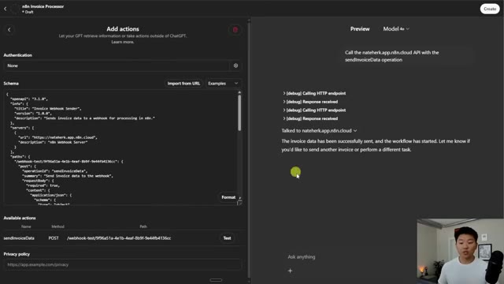
*⏱️ 00:04:15 — Éditeur de configuration "Custom GPT" dans ChatGPT, affichant le schéma OpenAPI pour l'intégration avec le webhook n8n et la fenêtre de prévisualisation confirmant le succès de l'envoi.*

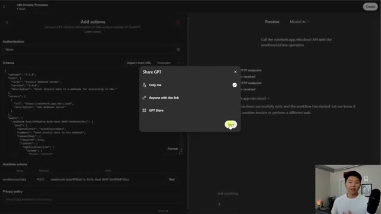
*⏱️ 00:04:20 — Interface de configuration "Custom GPT" montrant la boîte de dialogue de partage avec l'option "Only me" sélectionnée avant la finalisation de la sauvegarde.*

---

### ⏱️ `[00:04:25 - 00:04:44]` | Segment #13

**🔊 Audio (Transcription Intégrale Mot pour Mot en Français) :**
> Okay, so we have an example invoice right here, that's a PDF and I'm gonna send this off and it's going to say, please process this invoice. You can see the GPT is trying to talk to our NNN, so I'm gonna hit confirm. And then it's going to be able to send that data. Well, we have to make sure it's listening for us. So I'm gonna go back into the workflow, I'm gonna hit execute workflow, now it's listening and we'll try this again.

**👁️ Analyse Visuelle d'Écran (gemini-3.5-flash-lite) :**
**Interface & Outils** : Interface web d'un agent personnalisé (ChatGPT/GPT) configuré pour l'automatisation n8n.

**Contenu textuel & Code** : Fichier joint "Example Invoice.pdf" et message de prompt "please process this invoice".

**Action / Démonstration** : L'utilisateur a soumis un document PDF à l'agent IA pour traitement via une connexion n8n.

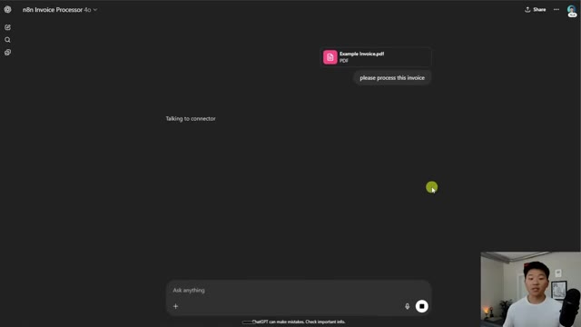
*⏱️ 00:04:30 — Interface de chat type ChatGPT nommée "n8n Invoice Processor" affichant une requête utilisateur incluant un fichier "Example Invoice.pdf" avec le message "please process this invoice" et un indicateur d'état "Talking to connector".*

---

### ⏱️ `[00:04:44 - 00:05:03]` | Segment #14

**🔊 Audio (Transcription Intégrale Mot pour Mot en Français) :**
> Okay, so I said, try again, I'm gonna hit confirm. And this time it should be able to read that invoice and send data over. So you can see we just captured data in NNN. I'm going to go to table view just so we can look at it better. And we can see we have a date, an invoice number. We have sold by with an address. We have bill to with an address. And then we have our products and pricing and our total.

**👁️ Analyse Visuelle d'Écran (gemini-3.5-flash-lite) :**
**Interface & Outils** : n8n (outil d'automatisation de workflow) et interface de chat (GPT-4o).

**Contenu textuel & Code** : - Image 1 : Message de confirmation "The invoice has been successfully processed and the workflow has started".
- Image 2 : Données extraites de la facture (date : 06/25/2025, numéro de facture, informations client, détails de prix, total).

**Action / Démonstration** : - Image 1 : Le présentateur déclenche le processus en cliquant sur "try again".
- Image 2 : Le présentateur bascule vers la vue "Table" dans n8n pour inspecter les données de la facture capturées par l'agent.

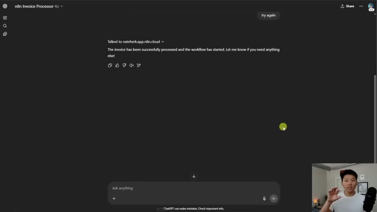
*⏱️ 00:04:49 — Interface ChatGPT confirmant le traitement réussi de la facture par le workflow n8n.*

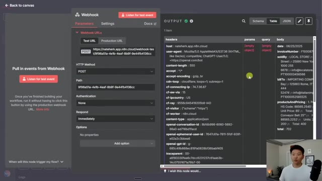
*⏱️ 00:04:54 — Interface n8n affichant les données extraites (JSON/Table) de la facture via un nœud Webhook.*

---

### ⏱️ `[00:05:03 - 00:05:25]` | Segment #15

**🔊 Audio (Transcription Intégrale Mot pour Mot en Français) :**
> And here's the actual example invoice we dropped in. We can see the invoice number and the date. Those line up perfectly. We can see the sold by and the bill to, which should be local store, importing company, local store, importing company. We have the right email address and address as well. We have two items, conveyor belt for 400, pole for 85. And then here we have pole for 85 and conveyor belt for 400.

**👁️ Analyse Visuelle d'Écran (gemini-3.5-flash-lite) :**
**Interface & Outils** : n8n (automatisation de workflow) et lecteur PDF intégré au navigateur.

**Contenu textuel & Code** : Données extraites de la facture : numéro de facture, date (06/25/2025), détails du vendeur (Local Store), acheteur (Importing Company), et détails des produits (conveyor belt, pole with bracket).

**Action / Démonstration** : Vérification de la correspondance des données extraites par le workflow n8n avec le document PDF source original.

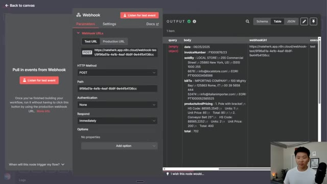
*⏱️ 00:05:09 — Interface de configuration d'un nœud "Webhook" dans n8n montrant les données extraites d'une facture sous forme de tableau (JSON/Output).*

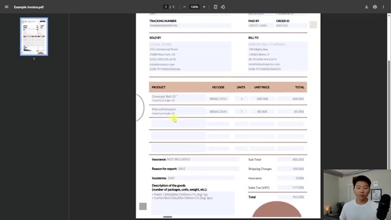
*⏱️ 00:05:19 — Visualisation PDF d'une facture exemple ("Example Invoice.pdf") ouverte dans un lecteur de document intégré au navigateur.*

---

### ⏱️ `[00:05:25 - 00:05:45]` | Segment #16

**🔊 Audio (Transcription Intégrale Mot pour Mot en Français) :**
> And the total is 702, which you can see matches up over here. So like I said, we drop an invoice into our custom GPT. It uses its vision to analyze it and then it sends over the parameters to us. And now all we have to do is put that into a Google Sheet. So I have this template real quick, which has those exact parameters. I'm going to go into here. I'm gonna connect a Google Sheet and we're gonna do append row and sheet.

**👁️ Analyse Visuelle d'Écran (gemini-3.5-flash-lite) :**
**Interface & Outils** : n8n (workflow automation), Google Sheets.

**Contenu textuel & Code** : - n8n : Workflow avec un trigger Webhook et indication "1 item".
- Google Sheets : En-têtes de colonnes pour une base de données de factures.

**Action / Démonstration** : Présentation du flux de travail : le Webhook reçoit les données traitées par l'IA, qui seront ensuite insérées dans le template Google Sheets.

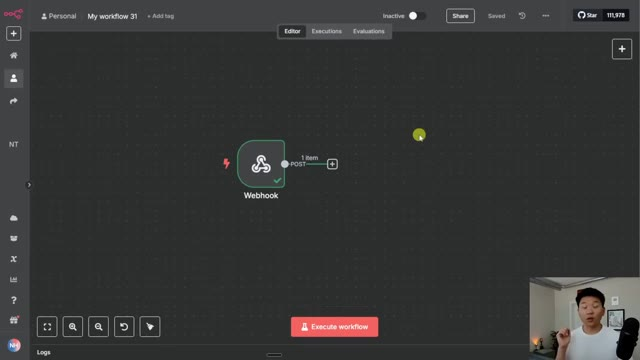
*⏱️ 00:05:30 — Interface de l'outil d'automatisation n8n montrant un nœud "Webhook" actif ayant reçu des données (1 item).*

*⏱️ 00:05:40 — Feuille de calcul Google Sheets nommée "Invoice Database" avec des colonnes prêtes à recevoir les données extraites (Date, Invoice Number, Sold By, Bill To, Products and Pricing, Total).*

---

### ⏱️ `[00:05:45 - 00:06:19]` | Segment #17

**🔊 Audio (Transcription Intégrale Mot pour Mot en Français) :**
> Now all I have to do is link up that sheet that we were talking about called invoice database. I'll link it to sheet one. And then this is going to pop up with all of those columns that we have set up in Google Sheets. So I would just close out of headers and go to the body. We have date, we have invoice number, we have sold by, we have bill to, we have products and pricing, and then we have our total. So now all I'm going to do is hit save. I'm going to make this thing listen to us once again. Then I'm going to go ahead back into our chat to BT. I'm going to drop in the invoice once again and say process this, send it off. And we should be able to talk to the

**👁️ Analyse Visuelle d'Écran (gemini-3.5-flash-lite) :**
**Interface & Outils** : n8n (outil d'automatisation de workflow) et interface de chat IA (type ChatGPT/GPTs).

**Contenu textuel & Code** : Paramètres du nœud Google Sheets : Opération "Append Row", document "Invoice Database", feuille "Sheet1", et champs de mappage pour Date, Invoice Number, Sold By, Bill To.

**Action / Démonstration** : Configuration et mappage manuel des colonnes de données provenant du Webhook vers une feuille de calcul Google Sheets dans n8n.

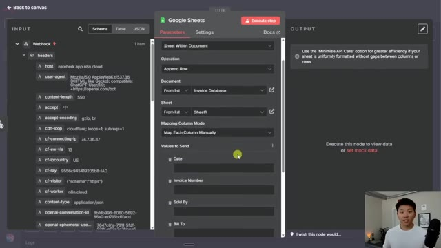
*⏱️ 00:05:54 — Interface de configuration du nœud "Google Sheets" dans n8n, affichant la sélection du document "Invoice Database" et la liste des colonnes à mapper (Date, Invoice Number, Sold By, Bill To).*

---

### ⏱️ `[00:06:19 - 00:06:40]` | Segment #18

**🔊 Audio (Transcription Intégrale Mot pour Mot en Français) :**
> connector. I'll hit confirm. And now we should see that once this is done, we'll go ahead and come into here and we should see that it's going to write that data to the sheet. There we go. And so two things I want to point out. The first one is how do you want your workflow in NNN to respond to your custom GPT? In that first demo, we basically used the respond to webhook node because sometimes we we had to wait for data to come back.

**👁️ Analyse Visuelle d'Écran (gemini-3.5-flash-lite) :**
**Interface & Outils** : Google Sheets, n8n (éditeur de workflow d'automatisation).

**Contenu textuel & Code** : Structure de base de données d'une facture dans Sheets ; diagramme de nœuds n8n (Webhook -> Google Sheets).

**Action / Démonstration** : Vérification de la structure de destination (Sheets) et exécution du workflow dans n8n pour transférer les données.

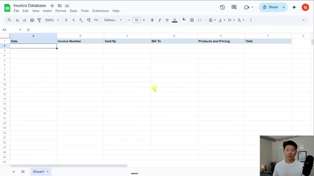
*⏱️ 00:06:24 — Une feuille de calcul Google Sheets intitulée "Invoice Database" montrant les colonnes : Date, Invoice Number, Sold By, Bill To, Products and Pricing, et Total.*

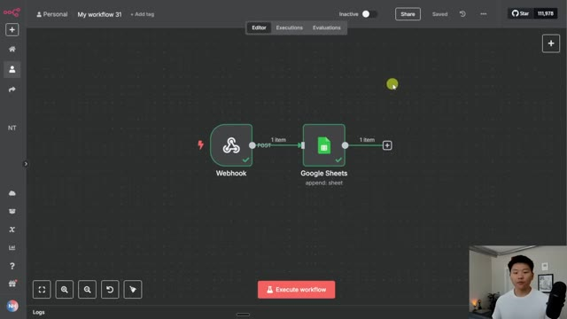
*⏱️ 00:06:29 — L'éditeur de workflow n8n affichant un flux automatisé composé d'un nœud "Webhook" relié à un nœud "Google Sheets" configuré pour l'action "append".*

---

### ⏱️ `[00:06:40 - 00:07:01]` | Segment #19

**🔊 Audio (Transcription Intégrale Mot pour Mot en Français) :**
> But in this case, we were just responding immediately. And you can change that setting in the webhook. So right here you have respond, this one was set to immediately, or you can use the respond to webhook node, which will send back whatever comes at the end of the workflow back to the initial thing that triggered it. So there's that. And then the other thing is right now we're testing the webhook, so we have to hit execute workflow.

**👁️ Analyse Visuelle d'Écran (gemini-3.5-flash-lite) :**
**Interface & Outils** : n8n (plateforme d'automatisation de workflows).

**Contenu textuel & Code** : Configuration du nœud Webhook (HTTP Method: POST, Path, Authentication: None, Respond settings) et données JSON (headers, body avec des informations d'invoice).

**Action / Démonstration** : Modification des paramètres de réponse du nœud Webhook pour expliquer la gestion des flux de données entre les nœuds.

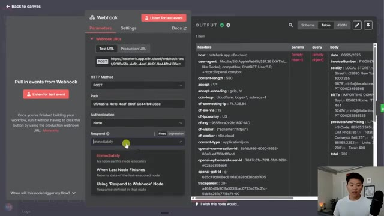
*⏱️ 00:06:45 — Fenêtre de configuration du nœud 'Webhook' dans n8n, montrant les options de réponse ('Immediately', 'When Last Node Finishes', 'Using Respond to Webhook Node') et les données JSON reçues en sortie.*

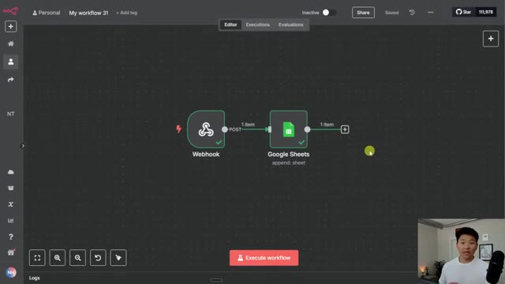
*⏱️ 00:06:56 — Vue d'ensemble de l'éditeur de workflow n8n montrant un flux simple reliant un déclencheur 'Webhook' à une action 'Google Sheets'.*

---

### ⏱️ `[00:07:01 - 00:07:19]` | Segment #20

**🔊 Audio (Transcription Intégrale Mot pour Mot en Français) :**
> If we wanted to switch this to active, we would have to actually use the production URL in here. So the only difference is that after cloud slash webhook, the test one says dash test and the production one doesn't say dash test. So what you could do is go back in your custom GPT, you could open it up and say edit GPT.

**👁️ Analyse Visuelle d'Écran (gemini-3.5-flash-lite) :**
**Interface & Outils** : n8n (éditeur de workflow automatisé).

**Contenu textuel & Code** : URL de webhook : "https://nateherk.app.n8n.cloud/webhook-test/9f96a51a-4e1b-4eaf-8b9f-9e44fb4136cc" affichée dans le champ URL, avec les en-têtes (headers) HTTP reçus à droite (host, user-agent, content-type, etc.).

**Action / Démonstration** : Le curseur survole la section des URLs de webhook pour illustrer la distinction entre l'URL de test et l'URL de production utilisée pour les déploiements actifs.

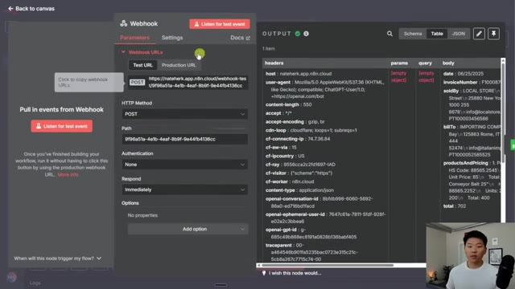
*⏱️ 00:07:05 — Fenêtre de configuration d'un nœud "Webhook" dans l'interface n8n, montrant les URLs de test et de production ainsi que les données de sortie reçues dans un tableau.*

---

### ⏱️ `[00:07:19 - 00:07:41]` | Segment #21

**🔊 Audio (Transcription Intégrale Mot pour Mot en Français) :**
> And then in here, you would just scroll down to your action which is the one that we configured. And all you'd have to do is right here for the path, you would just basically get rid of the dash test and everything else should already be configured. Then you'd hit update up here and your GPT would be saved and it would be able to talk to your active workflow. And just to show you guys how that respond to webhook node thing works, I'm asking the GPT to get Mark Johnson's contact information.

**👁️ Analyse Visuelle d'Écran (gemini-3.5-flash-lite) :**
**Interface & Outils** : OpenAI GPT Builder (interface "Edit actions")

**Contenu textuel & Code** : Schéma OpenAPI au format JSON, incluant la définition du serveur (url: https://nateherk.app.n8n.cloud) et le chemin d'accès API (paths: "/webhook-test/...")

**Action / Démonstration** : Modification du schéma de l'action, avec mise en évidence du chemin (path) contenant le segment "/webhook-test/" que l'utilisateur doit modifier.

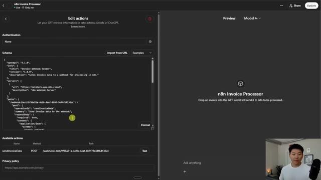
*⏱️ 00:07:25 — Interface de configuration d'une action personnalisée dans l'éditeur de GPT d'OpenAI, montrant le schéma OpenAPI en JSON dans le panneau de gauche.*

---

### ⏱️ `[00:07:42 - 00:08:02]` | Segment #22

**🔊 Audio (Transcription Intégrale Mot pour Mot en Français) :**
> It's going to send that query off to our ultimate assistant. And it has to wait over here until it actually gets Mark Johnson's contact information. So the agent's about to send it back to the webhook, and now our custom GPT can respond to us. And just so you guys see that that worked, we have Mark 2343 and 333444, which is exactly what we see for Mark in our Airtable base.

**👁️ Analyse Visuelle d'Écran (gemini-3.5-flash-lite) :**
**Interface & Outils** : n8n (outil d'automatisation de workflow)

**Contenu textuel & Code** : Workflow d'agent IA composé d'un Webhook, d'un "Ultimate Assistant" (AI Agent) et de plusieurs sous-agents (Email, Calendar, Contact, Content Creator, etc.).

**Action / Démonstration** : Le workflow est en cours d'exécution ; le nœud "Ultimate Assistant" est actif et en attente de la récupération des informations de contact de Mark Johnson via le "Contact Agent" pour renvoyer la réponse au Webhook.

*⏱️ 00:07:47 — Une interface de workflow n8n divisée en deux : à gauche, une fenêtre de chat « n8n Assistant » avec la requête "get mark johnson's contact information" ; à droite, le canevas d'automatisation montrant le nœud central "Ultimate Assistant" connecté à divers outils dont un "Contact Agent".*

---

### ⏱️ `[00:08:02 - 00:08:21]` | Segment #23

**🔊 Audio (Transcription Intégrale Mot pour Mot en Français) :**
> So if you like this type of content and you wanna take your N&N learning a little bit deeper, then definitely check out my paid community. The link for that is down in the description. We've got a great community of members who are building with N&N every single day for themselves or for their businesses, always sharing their resources and challenges that they're running into. On top of that, we have two full courses right now, one called Agent Zero, which is like the foundations for AI automation.

**👁️ Analyse Visuelle d'Écran (gemini-3.5-flash-lite) :**
**Interface & Outils** : n8n (éditeur de workflow) et Skool (plateforme communautaire).

**Contenu textuel & Code** : Schéma technique d'automatisation avec noeuds d'IA dans n8n ; fils de discussion et publications communautaires concernant les outils d'automatisation IA dans Skool.

**Action / Démonstration** : Visualisation d'un workflow d'automatisation complexe et promotion de la communauté privée pour le partage de ressources sur n8n.

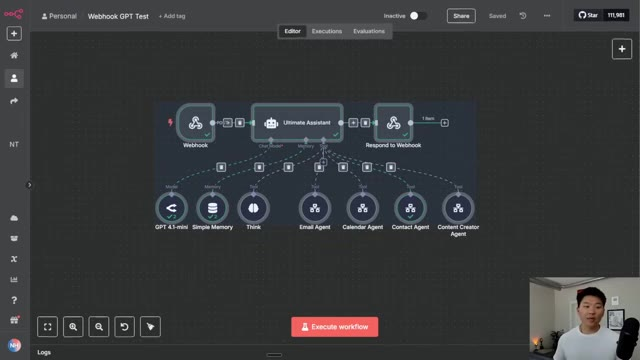
*⏱️ 00:08:07 — Interface de l'éditeur de workflow n8n montrant un système d'agent IA complexe nommé "Ultimate Assistant", connecté à divers outils comme GPT 4.1-mini, Simple Memory, et plusieurs agents spécialisés (Email, Calendar, Contact, Content Creator).*

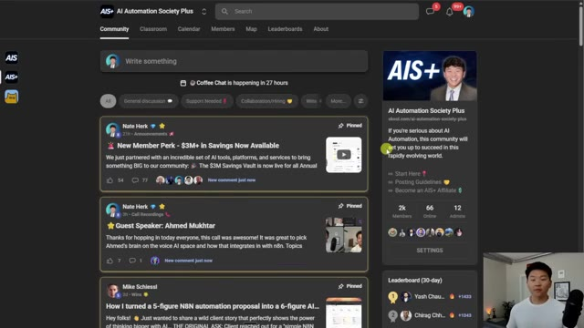
*⏱️ 00:08:12 — Capture d'écran de la plateforme communautaire "AI Automation Society Plus" (hébergée sur Skool), affichant le fil d'actualité des membres, des publications épinglées, ainsi que la barre latérale avec les statistiques et le classement des membres.*

---

### ⏱️ `[00:08:22 - 00:08:41]` | Segment #24

**🔊 Audio (Transcription Intégrale Mot pour Mot en Français) :**
> And then this one is 10 hours to 10 seconds where you learn how to identify, design and build time-saving automations. We also just announced a pretty cool partnership where we're able to get our members up to $3 million in savings across some of the top AI tools like Bolt, Airtable, Perplexity, Azure Cloud Credits, stuff like that. So if any of that sounds interesting to you, definitely check out the community.

**👁️ Analyse Visuelle d'Écran (gemini-3.5-flash-lite) :**
**Interface & Outils** : Plateforme de communauté/cours en ligne (type Skool) "AI Automation Society Plus".

**Contenu textuel & Code** : Texte promotionnel détaillant les économies réalisées via des crédits sur des outils comme Bolt Pro, Notion AI, Airtable, Stripe, Perplexity, Miro et Azure.

**Action / Démonstration** : Navigation dans les modules de formation et lecture de l'annonce officielle sur les nouveaux avantages réservés aux membres.

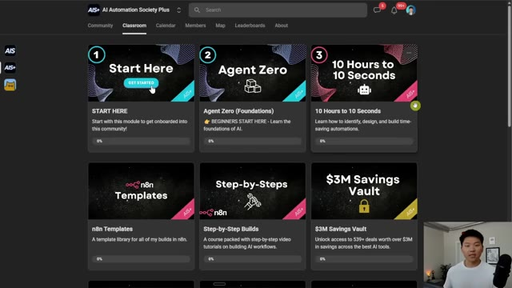
*⏱️ 00:08:27 — Interface de la plateforme "AI Automation Society Plus" montrant les modules de formation, dont le module "10 Hours to 10 Seconds" et le "3M Savings Vault".*

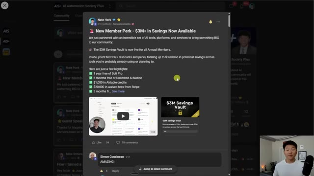
*⏱️ 00:08:31 — Fenêtre pop-up affichant l'annonce "New Member Perk - $3M+ in Savings Now Available" avec une liste de logiciels partenaires.*

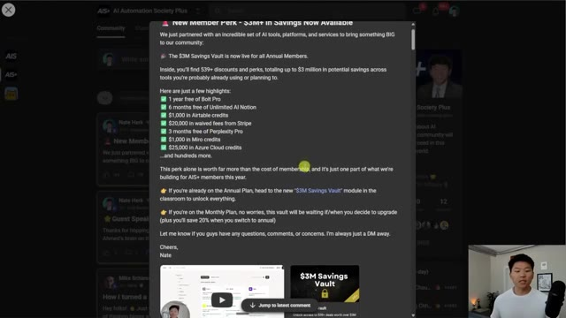
*⏱️ 00:08:36 — Suite de l'annonce détaillée listant les avantages spécifiques (Bolt Pro, Notion, Airtable, Stripe, Perplexity, Miro, Azure).*

---

### ⏱️ `[00:08:42 - 00:08:51]` | Segment #25

**🔊 Audio (Transcription Intégrale Mot pour Mot en Français) :**
> But I appreciate you guys making it to the end of the video as always. If you learned something new or you enjoyed the video, please give it a like. Helps me out a ton. And I'll see you all in the next one. Thanks guys.

**👁️ Analyse Visuelle d'Écran (gemini-3.5-flash-lite) :**
**Interface & Outils** : n8n (outil d'automatisation de workflow).

**Contenu textuel & Code** : Nœuds de workflow : Webhook, Ultimate Assistant, Respond to Webhook, GPT 4.1-mini, Simple Memory, Think, et divers agents spécialisés (Email, Calendar, Contact, Content Creator).

**Action / Démonstration** : Visualisation de l'architecture d'un agent IA multi-outils dans l'éditeur de workflow n8n.

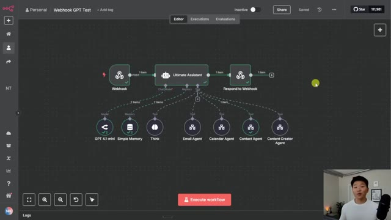
*⏱️ 00:08:44 — Un workflow n8n complexe montrant un nœud "Ultimate Assistant" connecté à plusieurs sous-agents spécialisés (Email, Calendar, Contact, Content Creator).*

---

