# 🎬 n8n Just Leveled Up RAG Agents (Reranking & Metadata)

> **Chaîne** : [Nate Herk | AI Automation](https://www.youtube.com/@nateherk/featured)  
> **Lien YouTube** : [https://www.youtube.com/watch?v=xWhX61651H8](https://www.youtube.com/watch?v=xWhX61651H8)  
> **Date de publication** : 20250628  
> **Durée** : 00:14:21  
> **Identifiant vidéo** : `xWhX61651H8`  
> **Transcription & Analyse** : `whisper-v3-large-turbo+gemini-3.5-flash-lite`  

---

## 📌 Synthèse Exécutive & Outils

### 💡 Résumé
Dans cette vidéo intitulée **n8n Just Leveled Up RAG Agents (Reranking & Metadata)**, Nate Herk décortique les capacités pratiques d'automatisation et de développement propulsées par les modèles de pointe.

### 🛠️ Outils, Modèles & Logiciels Présentés
- **Opus 5.5 & Claude Code** : Modèles d'ingénierie et agents de codage autonome.

### 🔑 Points Clés & Enseignements Stratégiques
- Optimiser le niveau d'effort et le raisonnement des modèles IA pour des résultats industriels.
- Automatiser les cycles de création logicielle de bout en bout.

---

## ⏱️ Chronologie & Transcription Complète Audio & Visuelle (Mot pour Mot)

### ⏱️ `[00:00:00 - 00:00:35]` | Segment #01

**🔊 Audio (Transcription Intégrale Mot pour Mot en Français) :**
> This new feature in N8N instantly makes your rag agents so much smarter and it takes almost no time to set up. In this video I'm going to be going over what a re-ranker is, how it makes our retrieval more accurate, and how you can easily set one up. I'll also be touching on how to use metadata when you're vectorizing documents and also retrieving documents so that by the end of this video your rag agents are instantly going to be 10 times smarter. Okay so let's get started. I'm going to real quick hop into an Excalibur draw and actually explain what's going on behind the scenes when we do rag so that we all understand how the re-ranker is going to work. So the first step with rag, obviously is we want to get our text document into a vector database. And how that works is the

**👁️ Analyse Visuelle d'Écran (gemini-3.5-flash-lite) :**
**Interface & Outils** : n8n (éditeur de workflow), outil de schéma (type Excalidraw).

**Contenu textuel & Code** : Schémas de flux RAG ; configuration de nœud n8n avec expressions JavaScript ({{ $json.ruleNumber }}) et gestion de métadonnées.

**Action / Démonstration** : Explication théorique du processus de RAG, démonstration de la configuration technique des métadonnées dans l'interface n8n.

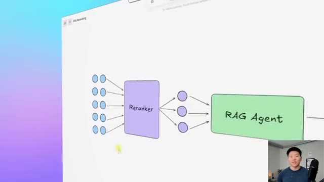
*⏱️ 00:00:09 — Schéma explicatif illustrant le rôle d'un "Reranker" dans un workflow RAG, montrant le filtrage des données vers un agent RAG.*

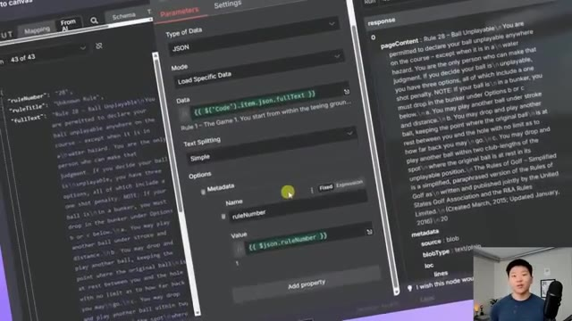
*⏱️ 00:00:17 — Interface n8n montrant la configuration d'un nœud, avec les paramètres de données JSON, le découpage de texte et l'ajout de métadonnées (ruleNumber).*

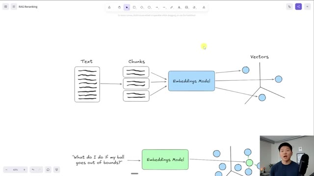
*⏱️ 00:00:26 — Schéma conceptuel du pipeline RAG : conversion de texte en "Chunks", passage par un modèle d'embeddings pour générer des vecteurs, et recherche sémantique.*

---

### ⏱️ `[00:00:35 - 00:00:57]` | Segment #02

**🔊 Audio (Transcription Intégrale Mot pour Mot en Français) :**
> document is split up into smaller manageable chunks. The chunks are then fed into an embeddings model and the embeddings model turns them into a numerical representation of the meaning of what's in this chunk. And then they get placed somewhere in that multi-dimensional space, which is our vector database. From there we go to search through it. So let's say this text document right here was the rules of golf. If we now go to ask, what do I do if my ball goes out of bounds?

**👁️ Analyse Visuelle d'Écran (gemini-3.5-flash-lite) :**
**Interface & Outils** : Excalidraw (outil de dessin collaboratif).

**Contenu textuel & Code** : Diagramme avec flux : "Text" -> "Chunks" -> "Embeddings Model" -> "Vectors". En bas, une question utilisateur est également convertie en vecteur pour trouver une correspondance dans l'espace vectoriel.

**Action / Démonstration** : Le présentateur utilise le schéma pour illustrer visuellement comment les données textuelles sont transformées en vecteurs pour être indexées dans une base de données vectorielle.

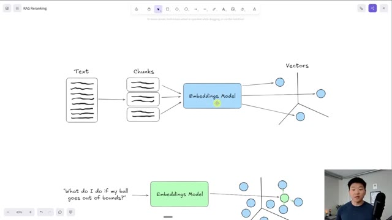
*⏱️ 00:00:40 — Schéma explicatif illustrant le processus de RAG (Retrieval-Augmented Generation) : le texte est divisé en morceaux (chunks), transformés par un modèle d'embeddings en vecteurs placés dans un espace multidimensionnel.*

---

### ⏱️ `[00:00:57 - 00:01:16]` | Segment #03

**🔊 Audio (Transcription Intégrale Mot pour Mot en Français) :**
> this question is getting embedded the same way these chunks did up here with the exact same embeddings model and then it also gets placed in that multi-dimensional vector database. So then our question gets vectorized and it's placed right here and then it basically is going to grab the nearest other vectors because that's how it knows they're similar in meaning and it's going to pull them back.

**👁️ Analyse Visuelle d'Écran (gemini-3.5-flash-lite) :**
**Interface & Outils** : Excalidraw (tableau blanc virtuel)

**Contenu textuel & Code** : Diagramme de workflow montrant : 
- Partie supérieure : Text -> Chunks -> Embeddings Model -> Espace vectoriel.
- Partie inférieure : Question utilisateur ("What do I do if my ball goes out of bounds?") -> Embeddings Model -> Localisation du point correspondant dans l'espace vectoriel.

**Action / Démonstration** : Présentation visuelle du concept théorique de recherche de similarité sémantique (RAG) dans une base de données vectorielle.

*⏱️ 00:01:02 — Schéma explicatif sur tableau blanc numérique illustrant le processus RAG : la transformation de texte en "Chunks", leur passage par un "Embeddings Model" pour devenir des vecteurs, puis la vectorisation d'une question utilisateur pour trouver les vecteurs les plus proches.*

---

### ⏱️ `[00:01:16 - 00:01:50]` | Segment #04

**🔊 Audio (Transcription Intégrale Mot pour Mot en Français) :**
> So it pulls back these three vectors in this case and then these vectors get turned back into their text-based chunks and those chunks get fed into our RAG agent which it's able to use to answer our question. And by the way, I would never hit my ball out of bounds. Anyways, what happens when we use a re-ranker is pretty cool because this allows us to basically pull back way more than just the three nearest neighbors. We can pull back 10, 20, or 30 vectors because all of these are going to get fed into the re-ranker and then it will basically look at which ones are actually the most relevant. It will assign a relevant score and then it will grab just the top three most relevant

**👁️ Analyse Visuelle d'Écran (gemini-3.5-flash-lite) :**
**Interface & Outils** : Excalidraw (outil de dessin de diagrammes).

**Contenu textuel & Code** : Diagramme illustrant le flux : "What do I do if my ball goes out of bounds?" -> Embeddings Model -> Vecteurs -> Chunks de texte -> RAG Agent -> Answer.

**Action / Démonstration** : Illustration visuelle du processus de récupération et de traitement de l'information par un agent IA pour répondre à une requête utilisateur.

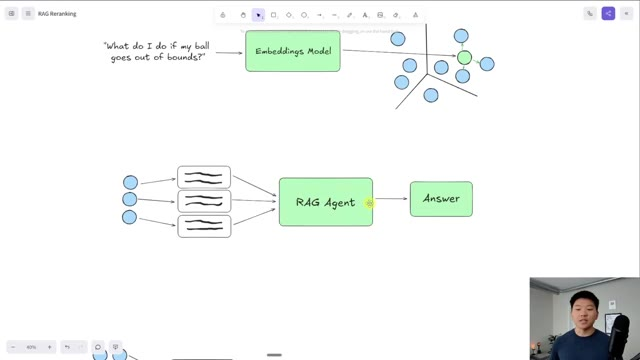
*⏱️ 00:01:25 — Schéma de workflow expliquant le fonctionnement d'un système RAG (Retrieval-Augmented Generation), montrant la transformation d'une question en embeddings, la récupération de vecteurs, et leur passage dans un agent RAG pour générer une réponse.*

---

### ⏱️ `[00:01:50 - 00:02:09]` | Segment #05

**🔊 Audio (Transcription Intégrale Mot pour Mot en Français) :**
> answers. And then those top three get fed into the agent and it will answer for us. So I know that was quick, but hopefully at least it makes sense. And now let's hop back into NNN and take a look at how we set this up. So as a prerequisite, I'm going to assume that you've already set up a flow like this and you've connected to Subabase. If you haven't, go ahead and check out this video right here where I explain how to connect and how to set that up and then come back to this video.

**👁️ Analyse Visuelle d'Écran (gemini-3.5-flash-lite) :**
**Interface & Outils** : n8n (éditeur de workflow automatisé), tableau blanc/outil de dessin (Excalidraw).

**Contenu textuel & Code** : Nœuds n8n avec des intégrations spécifiques : Supabase Vector Store, OpenAI Embeddings, Reranker Cohere, GPT 4o-mini, déclencheurs manuels, extraction de fichiers et chargement de données.

**Action / Démonstration** : Le présentateur illustre théoriquement le flux de données avant de passer à l'implémentation pratique dans l'éditeur de workflow n8n.

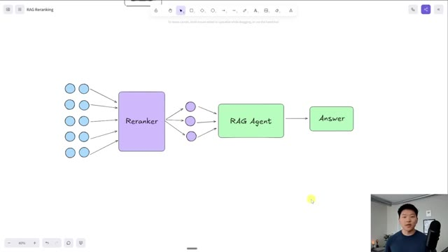
*⏱️ 00:01:55 — Un schéma conceptuel dessiné illustrant le processus de RAG avec un Reranker : des sources multiples sont filtrées par un module "Reranker" vers trois points, transmis à un "RAG Agent" pour générer une "Answer".*

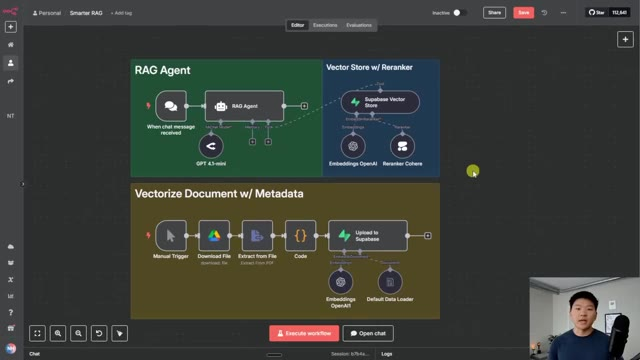
*⏱️ 00:02:00 — Capture d'écran de l'interface de travail n8n montrant un workflow complexe divisé en deux sections principales : le "RAG Agent" (connecté à Supabase/OpenAI/Cohere) et la partie "Vectorize Document w/ Metadata".*

---

### ⏱️ `[00:02:10 - 00:02:45]` | Segment #06

**🔊 Audio (Transcription Intégrale Mot pour Mot en Français) :**
> So I'm going to click into the Subabase Vector Store tool real quick, and we're going to look at two main things. The first thing is that I gave it a limit of 20, and by default, that's four. So we're basically telling the agent, you can go ahead and find 20 most relevant chunks rather than just four because we know they're going to get re-ranked and we're still only going to get the top three. And right here is the option to actually re-rank those results. So if I turn this off, what happens is it loses our connection right here to our Cohere re-ranker. But if I go ahead and turn that on, it's going to give us that connection back and we can go ahead and add a re-ranker. Right now they only have Cohere, but that's why we were able to connect it right there. And to set up Cohere,

**👁️ Analyse Visuelle d'Écran (gemini-3.5-flash-lite) :**
**Interface & Outils** : Interface web d'automatisation (nœud de configuration Supabase Vector Store).

**Contenu textuel & Code** : Paramètres du nœud : Credential "Demo 2.22.25", Operation Mode "Retrieve Documents", Table Name "documents", Limit "20", options "Include Metadata" et "Rerank Results" activées.

**Action / Démonstration** : Modification manuelle de la limite de récupération des données (top-K) de 4 à 20 pour permettre à l'agent d'extraire plus de segments de documents pertinents.

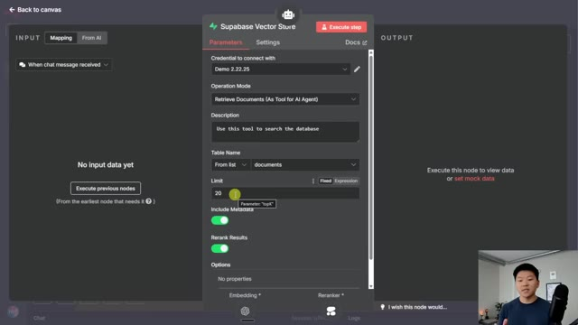
*⏱️ 00:02:18 — Interface de configuration du nœud "Supabase Vector Store" dans un outil d'automatisation de workflow (type Flowise ou similaire), montrant le réglage du paramètre "Limit" à 20.*

---

### ⏱️ `[00:02:45 - 00:03:05]` | Segment #07

**🔊 Audio (Transcription Intégrale Mot pour Mot en Français) :**
> all you have to do is go to Cohere.com. I'll leave a link for that in the description. You'll make an account and then you just need to go get a simple API key. It's really easy. and that's all you have to plug in right here. And what you can see is there's also three different models. We're gonna stick with V3.5. You could go to Cohere's Docs to figure out the difference of each model. But like I said, for today, for simplicity, we're just gonna stick with Rerank V3.5.

**👁️ Analyse Visuelle d'Écran (gemini-3.5-flash-lite) :**
**Interface & Outils** : LangFlow (éditeur de flux d'IA) et Documentation officielle Cohere (Web).

**Contenu textuel & Code** : Workflow d'agent IA : RAG Agent, Supabase Vector Store, Embeddings OpenAI, Reranker Cohere. Tableau comparatif des modèles de Rerank Cohere.

**Action / Démonstration** : Configuration d'un agent RAG par l'intégration d'un outil de reranking et consultation de la documentation pour choisir le modèle approprié.

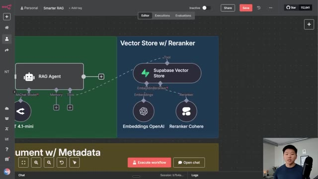
*⏱️ 00:02:50 — Interface de conception de workflow (type LangFlow) montrant un agent RAG connecté à un "Supabase Vector Store", utilisant un modèle de reranking Cohere.*

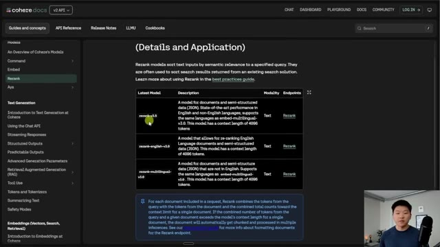
*⏱️ 00:03:00 — Page de documentation officielle de Cohere listant les différents modèles de "Rerank" (v3.5, english-v3.0, multilingual-v3.0) avec leurs descriptions techniques.*

---

### ⏱️ `[00:03:05 - 00:03:24]` | Segment #08

**🔊 Audio (Transcription Intégrale Mot pour Mot en Français) :**
> Anyways, let's test out this agent and see the Reranker in action. Real quick, I just wanted to show you guys what is in my Supabase. It actually is the Rules of Golf. So you can see we've got like 28 different rules. This isn't like a full, full sheet of the rules, but just a PDF I found. And so here's what it looks like. It's 22 pages and we used this flow down here to actually vectorize it with metadata.

**👁️ Analyse Visuelle d'Écran (gemini-3.5-flash-lite) :**
**Interface & Outils** : n8n (workflow automation), Supabase (database dashboard), lecteur PDF intégré au navigateur.

**Contenu textuel & Code** : Workflow n8n, entrées de base de données (colonnes 'content' et 'metadata'), texte des règles de golf.

**Action / Démonstration** : Démonstration du flux de données et du stockage des vecteurs pour l'agent IA.

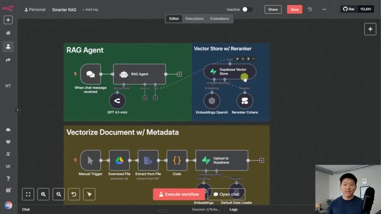
*⏱️ 00:03:10 — Interface de n8n montrant un workflow d'automatisation d'agent RAG avec Supabase et Cohere.*

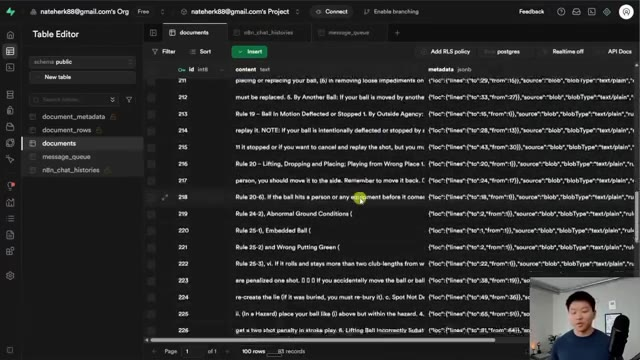
*⏱️ 00:03:15 — Interface de la base de données Supabase affichant le contenu textuel des règles de golf stockées.*

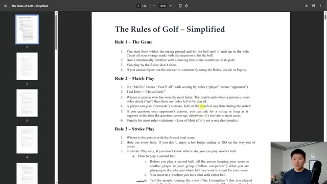
*⏱️ 00:03:19 — Visualiseur de PDF affichant le document "The Rules of Golf - Simplified".*

---

### ⏱️ `[00:03:24 - 00:03:44]` | Segment #09

**🔊 Audio (Transcription Intégrale Mot pour Mot en Français) :**
> And I'll touch on that whole metadata thing in a bit. And if you guys wanna access this exact template to play around with, as well as that PDF that I used, you can get that in my FreeSchool community. The link for that will be down in the description. All right, so I'm gonna ask this agent, how does the order of play work? We're gonna see it talk to Supabase VectorStore, and then it's gonna talk to Reranker. And now the agent's taking all that information and it's about to give us an answer.

**👁️ Analyse Visuelle d'Écran (gemini-3.5-flash-lite) :**
**Interface & Outils** : Flowise (plateforme de création de workflows IA en no-code).

**Contenu textuel & Code** : Schémas de flux logiques incluant : déclencheurs, nœuds de traitement (Download File, Extract from PDF), intégrations (Supabase Vector Store, OpenAI Embeddings, Cohere Reranker) et modèles (GPT 4o-mini).

**Action / Démonstration** : Le curseur survole un bloc dans le workflow "Vectorize Document w/ Metadata", illustrant la structure de traitement de documents et l'injection de métadonnées.

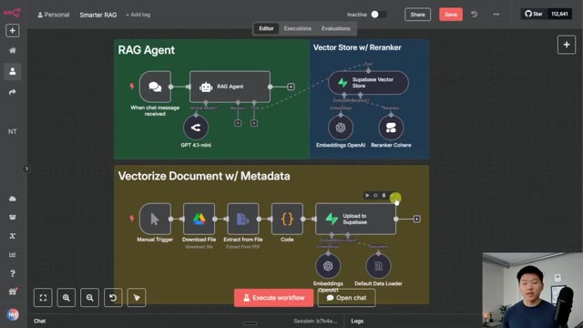
*⏱️ 00:03:29 — Interface de l'éditeur de workflows Flowise montrant deux blocs distincts : un "RAG Agent" et un processus de "Vectorize Document w/ Metadata".*

---

### ⏱️ `[00:03:44 - 00:04:18]` | Segment #10

**🔊 Audio (Transcription Intégrale Mot pour Mot en Français) :**
> So here we have the order of play in golf depends on the type of play. If it's match play, you start a whole committee or players decide who goes first. We have information about during a hole the player farthest from the hole plays Then we have what you do if it's stroke play or also if you need to do a provisional ball or another ball from the tee box So what I'm interested in here is the actual agent logs to see how this worked So I'm gonna click into the AI agent I'm gonna move this thing over to the side and open up the logs and we'll see what it did So basically what happens is it goes to the Supabase vector store because it knows that it needs to find information on golf order of play So it sends over the query order of play

**👁️ Analyse Visuelle d'Écran (gemini-3.5-flash-lite) :**
**Interface & Outils** : Plateforme d'automatisation de workflow (type n8n ou similaire) avec interface de conception de flux RAG.

**Contenu textuel & Code** : - Image 1 : Texte structuré détaillant les règles de golf (Match Play, Stroke Play, Balles provisoires). 
- Image 2 : Configuration du nœud "RAG Agent", champ "Prompt" avec variable `{{ $json.chatInput }}`, et "System Message" définissant l'IA comme experte des règles de golf.

**Action / Démonstration** : Démonstration du fonctionnement d'un agent IA répondant à une requête utilisateur sur les règles de golf via un flux RAG, avec affichage des entrées/sorties et des logs d'exécution.

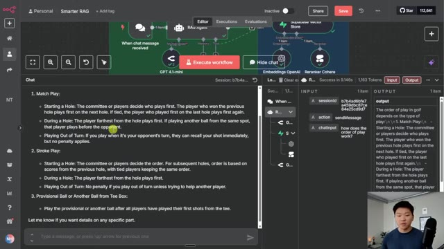
*⏱️ 00:03:53 — Interface de l'application montrant le résultat d'un chat affichant les règles du golf sur l'ordre de jeu (Match Play, Stroke Play).*

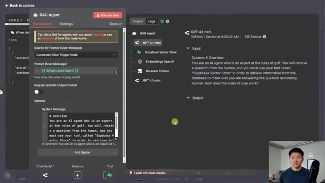
*⏱️ 00:04:09 — Configuration détaillée du "RAG Agent" avec les paramètres du prompt et le message système définissant le rôle de l'IA experte en golf.*

---

### ⏱️ `[00:04:18 - 00:04:40]` | Segment #11

**🔊 Audio (Transcription Intégrale Mot pour Mot en Français) :**
> this gets vectorized and then it's searching for the nearest vectors that are near this vector. So this gets sent off to Subabase, it gets embedded, so this is exactly what we see, this is the numerical representation of this query, and then it gets sent to the Reranker model. So here is the input to the Reranker model. If I was to scroll through here, we're gonna see that there's 20 different chunks that are sent to the Reranker model.

**👁️ Analyse Visuelle d'Écran (gemini-3.5-flash-lite) :**
**Interface & Outils** : n8n (outil d'automatisation de workflow).

**Contenu textuel & Code** : Objet JSON en entrée : `{"query": "order of play"}`. Objet JSON en sortie : `{"response": [{"type": "text", "text": "\"pageContent\":\"Rule 10 - Order of Play...\"}]}`.

**Action / Démonstration** : Visualisation des logs d'exécution du nœud Supabase Vector Store montrant la transformation de la requête utilisateur en vecteur de recherche et la récupération du contenu pertinent.

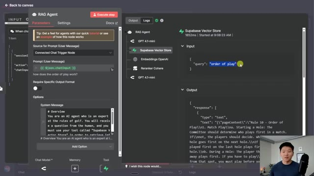
*⏱️ 00:04:23 — Interface n8n affichant les détails d'exécution d'un nœud « Supabase Vector Store » au sein d'un workflow de RAG Agent, montrant la requête textuelle convertie en entrée JSON et la réponse associée contenant les règles de golf.*

---

### ⏱️ `[00:04:40 - 00:05:14]` | Segment #12

**🔊 Audio (Transcription Intégrale Mot pour Mot en Français) :**
> And now if I close the input and we open up the output, we can see that it chooses the three most relevant ones. So now we're only looking at three and what you'll notice about each one is that they have a relevant score So right here this first chunk has a relevant score of 0.825 The second one has a relevant score of 0.41 and the third one has a relevant score of 0.17 So maybe this question wasn't a great example because the scores are pretty low But it would have been way worse of an answer if we didn't have this re-ranker And then I did another example tell me about searching for my ball once again Unrealistic my ball is gonna be in the fairway But what we can see is we get some answers back and if I go into the agent logs

**👁️ Analyse Visuelle d'Écran (gemini-3.5-flash-lite) :**
**Interface & Outils** : n8n (plateforme d'automatisation de workflows).

**Contenu textuel & Code** : Schémas de nœuds, configuration des paramètres d'agent IA, logs d'exécution JSON contenant du texte sur les règles de golf, et scores de pertinence (ex: 0.418341).

**Action / Démonstration** : Le présentateur illustre le fonctionnement d'un workflow RAG en affichant les données traitées après l'exécution d'une étape de reranking.

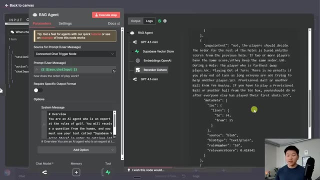
*⏱️ 00:04:48 — Vue détaillée des paramètres et de la sortie d'un nœud "RAG Agent" dans n8n, affichant le contenu extrait d'un document avec son "relevanceScore".*

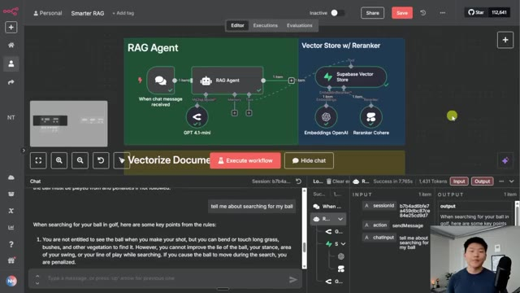
*⏱️ 00:05:05 — Interface globale de l'éditeur de workflow n8n montrant le schéma du RAG Agent, incluant le trigger de chat, le magasin vectoriel Supabase et les outils de reranking.*

---

### ⏱️ `[00:05:14 - 00:05:39]` | Segment #13

**🔊 Audio (Transcription Intégrale Mot pour Mot en Français) :**
> we can see that if we go to the re-ranker and we go to the output, it gave us the top three chunks about searching for your ball. This one has a relevant score of 0.86, this one has a relevant score of 0.74, and this one has a relevant score of 0.73. So if you think about only keeping the most high quality chunks, you could even set up some sort of filter in a different workflow where after it does the re-ranking, you're only gonna keep results where the relevant score is over like 0.7.

**👁️ Analyse Visuelle d'Écran (gemini-3.5-flash-lite) :**
**Interface & Outils** : n8n (plateforme d'automatisation de workflow).

**Contenu textuel & Code** : Panneau de gauche avec les paramètres du nœud RAG Agent (Prompt : "tell me about searching for my ball", System Message sur les règles de golf) et panneau de droite affichant le résultat brut en JSON avec le champ "relevanceScore : 0.8638634".

**Action / Démonstration** : Visualisation du résultat après exécution du nœud de re-ranking dans un pipeline RAG (Retrieval-Augmented Generation).

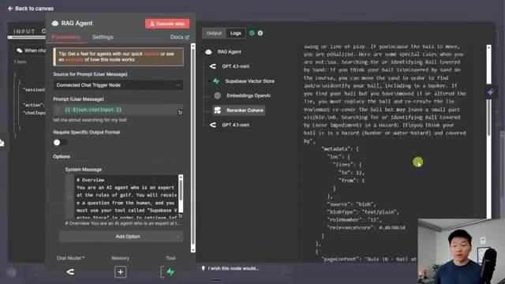
*⏱️ 00:05:20 — Une capture d'écran de l'interface de flux de travail n8n montrant la configuration d'un "RAG Agent" et les résultats de sortie du nœud "Reranker Cohere".*

---

### ⏱️ `[00:05:39 - 00:06:02]` | Segment #14

**🔊 Audio (Transcription Intégrale Mot pour Mot en Français) :**
> So just another way to think about how can I make my agents retrieval as as accurate as possible. Because one thing to think about is that the agent is basically gonna be forced to pull stuff back, even if it's not that relevant. So if you ask it some random question and it searches the vector database, it's still going to pull back the four nearest chunks, even if they're not very similar at all. And the problem with chunk-based retrieval is that we're not able to look at the contents as a whole.

**👁️ Analyse Visuelle d'Écran (gemini-3.5-flash-lite) :**
**Interface & Outils** : Flowise (interface de workflow visuel pour LLM/IA).

**Contenu textuel & Code** : Diagramme de nœuds incluant : "RAG Agent", "When chat message received", "Supabase Vector Store", "Embeddings OpenAI", "Reranker Cohere", "Manual Trigger", et "Upload to Supabase".

**Action / Démonstration** : Visualisation du workflow de construction d'un agent RAG optimisé avec un système de réordonnancement (Reranker).

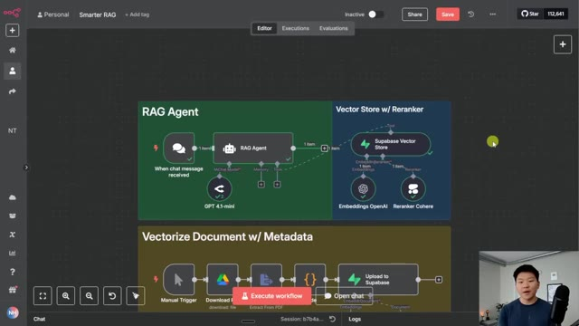
*⏱️ 00:05:45 — Une vue de l'interface de Flowise montrant deux workflows distincts : un "RAG Agent" avec un "Vector Store w/ Reranker" et un workflow séparé pour "Vectorize Document w/ Metadata".*

---

### ⏱️ `[00:06:02 - 00:06:24]` | Segment #15

**🔊 Audio (Transcription Intégrale Mot pour Mot en Français) :**
> So if we said to the agent, like, you know, can you summarize rules one through 10? It wouldn't be able to give a holistic summary of rules one through 10, because it would be querying for each of those chunks. So if it sent one query to the vector database like rules one through 10, we would get back three and it wouldn't be like a holistic summary. But maybe if it did 10 different queries, rule one, rule two, rule three, rule four, then maybe that's a little better.

**👁️ Analyse Visuelle d'Écran (gemini-3.5-flash-lite) :**
**Interface & Outils** : Lecteur de fichiers PDF (visionneuse de navigateur web).

**Contenu textuel & Code** : Texte structuré des règles de golf : "Rule 1 - The Game", "Rule 2 - Match Play", et "Rule 3 - Stroke Play", incluant des sous-points explicatifs.

**Action / Démonstration** : Affichage documentaire utilisé comme base de connaissance pour illustrer la segmentation des données dans une base vectorielle.

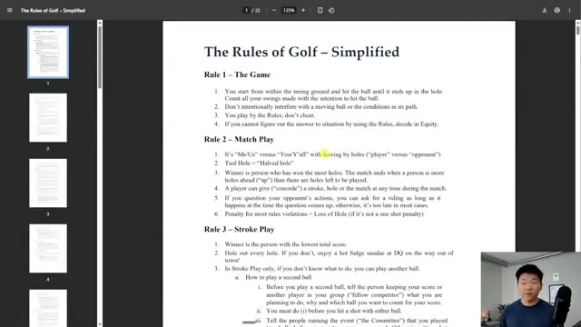
*⏱️ 00:06:07 — Une vue d'un document PDF ouvert dans une visionneuse web, présentant le texte "The Rules of Golf – Simplified" avec une liste numérotée des règles 1 à 3.*

---

### ⏱️ `[00:06:24 - 00:06:44]` | Segment #16

**🔊 Audio (Transcription Intégrale Mot pour Mot en Français) :**
> But in order to do a search like that, you definitely wanna set up metadata and you wanna have a different type of system to be able to search with metadata. So let me explain why that is. If we go over to our Supabase documents table, which is our actual vector database, what we can see is that we have all of these different chunks of data. But what you'll notice is that not every single rule fits into one chunk.

**👁️ Analyse Visuelle d'Écran (gemini-3.5-flash-lite) :**
**Interface & Outils** : n8n (workflow automation) et Supabase (Table Editor / Vector Database).

**Contenu textuel & Code** : Schémas de nœuds d'IA, extraits de règles de golf stockés dans une table SQL, objets JSON contenant des métadonnées de localisation et de source.

**Action / Démonstration** : Présentation du flux de données entre les agents IA et la base de données vectorielle, suivie d'une démonstration de la structure des données stockées.

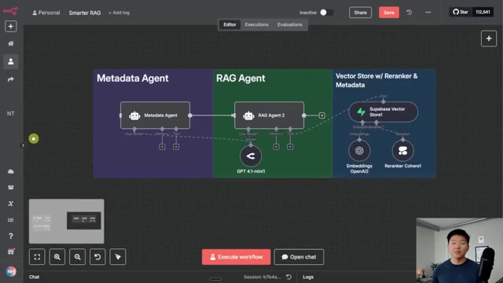
*⏱️ 00:06:29 — Interface n8n affichant un workflow automatisé avec des nœuds "Metadata Agent", "RAG Agent" et un stockage vectoriel Supabase.*

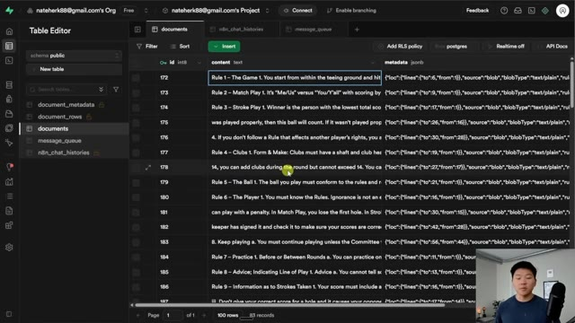
*⏱️ 00:06:34 — Interface de gestion de base de données Supabase montrant la table "documents" avec les colonnes "content" (texte des règles) et "metadata" (JSON).*

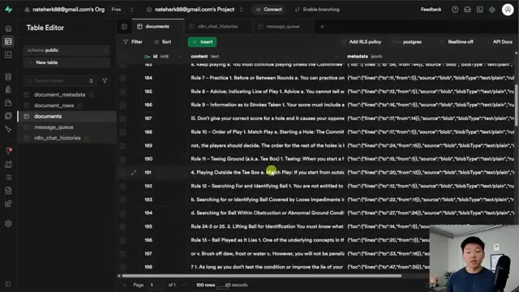
*⏱️ 00:06:39 — Suite de la visualisation de la table "documents" dans Supabase, défilant vers les entrées suivantes de la base de données.*

---

### ⏱️ `[00:06:44 - 00:07:03]` | Segment #17

**🔊 Audio (Transcription Intégrale Mot pour Mot en Français) :**
> So right here, rule one, that's one chunk, that's fine. Right here we have rule two, that's one chunk, that's fine. But here we have rule three, and it looks like rule three is actually split across three different chunks. And if we don't have metadata, there's almost no way to tell that this chunk based on the contents is part of rule three. So in this column over here, you can see it's called metadata.

**👁️ Analyse Visuelle d'Écran (gemini-3.5-flash-lite) :**
**Interface & Outils** : Supabase (Table Editor)

**Contenu textuel & Code** : Tableau de données avec les colonnes "id", "content" (texte des règles) et "metadata" (données JSON précisant la source et la localisation des lignes). On observe notamment les segments 172 à 185 avec des textes comme "Rule 1", "Rule 2", "Rule 3", etc.

**Action / Démonstration** : Le présentateur illustre visuellement la fragmentation des données textuelles en "chunks" (segments) dans la base de données, en soulignant comment la colonne "metadata" permet de suivre la continuité des informations entre les lignes.

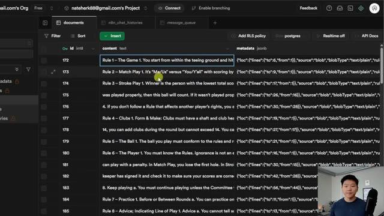
*⏱️ 00:06:49 — Une vue de l'interface de base de données Supabase affichant une table nommée "documents" contenant des segments de règles de golf et leurs métadonnées associées au format JSON.*

---

### ⏱️ `[00:07:03 - 00:07:25]` | Segment #18

**🔊 Audio (Transcription Intégrale Mot pour Mot en Français) :**
> And the only thing that I added to all of these chunks was a rule number field. So now with every single chunk that gets pulled back, we can see which rule it belongs to. So like I said, here's the only chunk for rule one. The metadata here says rule number one. But here's the third chunk for rule three, which in the actual content of it, there's no mention of rule three. But if we click into the metadata for this chunk, we can see right here, we have rule number three.

**👁️ Analyse Visuelle d'Écran (gemini-3.5-flash-lite) :**
**Interface & Outils** : Supabase (Interface de gestion de base de données SQL/Postgres).

**Contenu textuel & Code** : Données structurées en JSON dans la colonne « metadata » : `{"loc": {"lines": {"to": 17, "from": 1}}, "source": "blob", "blobType": "text/plain", "ruleNumber": "3"}`.

**Action / Démonstration** : Le présentateur manipule et affiche le contenu d'un champ JSON dans la ligne d'un tableau de données pour démontrer l'ajout du champ « ruleNumber ».

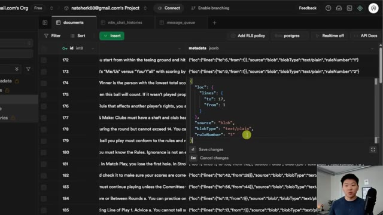
*⏱️ 00:07:09 — Interface de base de données (Supabase) affichant une table « documents » où chaque entrée contient un champ « metadata » au format JSON, incluant un champ « ruleNumber » personnalisé.*

---

### ⏱️ `[00:07:25 - 00:07:43]` | Segment #19

**🔊 Audio (Transcription Intégrale Mot pour Mot en Français) :**
> And obviously this isn't the only way to do it, but definitely be thinking about how you can add metadata tags to the data you're gonna put into your vector database. So maybe you have a bunch of different projects that you wanna put in there, but you wanna have the project name or the client's name assigned as metadata to each of the different chunks. Or maybe you have a vector database full of all of your meeting transcripts.

**👁️ Analyse Visuelle d'Écran (gemini-3.5-flash-lite) :**
**Interface & Outils** : Supabase (Table Editor).

**Contenu textuel & Code** : Lignes de données textuelles (règles de jeu) associées à des objets JSON de métadonnées contenant les clés "loc" (localisation) et "source" (type de fichier).

**Action / Démonstration** : Navigation et présentation visuelle de la structure des métadonnées stockées dans une base de données vectorielle.

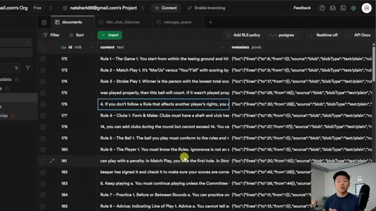
*⏱️ 00:07:30 — Interface de gestion de base de données affichant une table nommée "documents" contenant des colonnes "id", "content" et "metadata" (format JSON).*

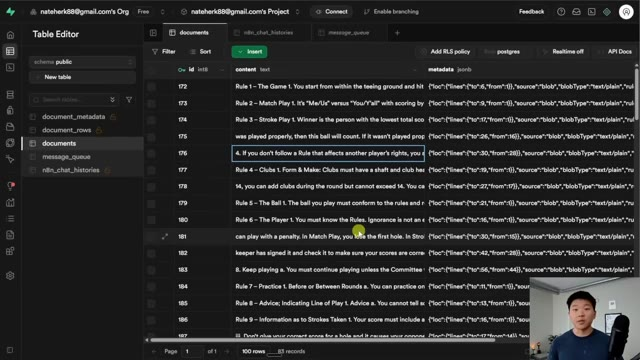
*⏱️ 00:07:34 — Vue élargie de l'interface de gestion de base de données montrant la barre latérale "Table Editor" avec la liste des tables disponibles.*

---

### ⏱️ `[00:07:43 - 00:08:04]` | Segment #20

**🔊 Audio (Transcription Intégrale Mot pour Mot en Français) :**
> What you'd probably wanna do is add a metadata field which was the date of the meeting. That way you could actually go ahead and make a query to your agent like, can you pull all my meeting transcript data from June 20th? Because without that metadata, the agent would basically be searching through the vector database for mentions in the transcript of like, hey, today's June 20th, and that's the only way to be able to actually pull that back.

**👁️ Analyse Visuelle d'Écran (gemini-3.5-flash-lite) :**
**Interface & Outils** : Supabase (Table Editor).

**Contenu textuel & Code** : Tableau de données contenant des règles de golf sous la colonne "content" et des objets JSON correspondants dans la colonne "metadata" (contenant des informations sur les lignes, sources et types de fichiers).

**Action / Démonstration** : Visualisation de la structure des données et des colonnes nécessaires pour stocker les métadonnées (comme le champ de date évoqué) afin d'optimiser les requêtes de l'agent IA.

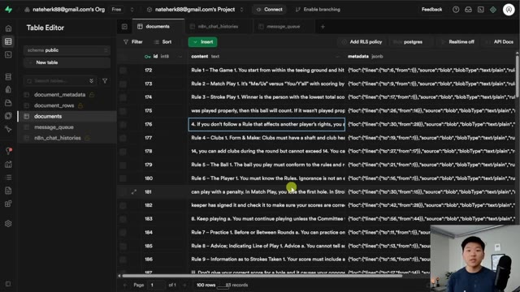
*⏱️ 00:07:48 — Interface de gestion de base de données Supabase affichant la table "documents" avec des colonnes pour le contenu textuel et les métadonnées JSONB.*

---

### ⏱️ `[00:08:04 - 00:08:23]` | Segment #21

**🔊 Audio (Transcription Intégrale Mot pour Mot en Français) :**
> So I hope that all makes sense. As you can see, even if we continue to scroll down, Here's a random chunk that has no mention of the rule number. And if we click into the metadata, it says rule number 26. And the way that we're able to add metadata is in the flow when we're vectorizing our documents. We do that right here in the default data loader. We have an option down here to add metadata. And you can add as many different properties as you want.

**👁️ Analyse Visuelle d'Écran (gemini-3.5-flash-lite) :**
**Interface & Outils** : Supabase (Table Editor) et n8n (Workflow Automation).

**Contenu textuel & Code** : Dans Supabase : colonnes "content" avec des règles de golf et "metadata" au format JSON. Dans n8n : nœuds "Manual Trigger", "Download File", "Extract from File", "Code", "Upload to Supabase", "Embeddings OpenAI" et "Default Data Loader".

**Action / Démonstration** : Navigation dans les données de la base de données et présentation visuelle de l'architecture du workflow d'automatisation pour la vectorisation de documents.

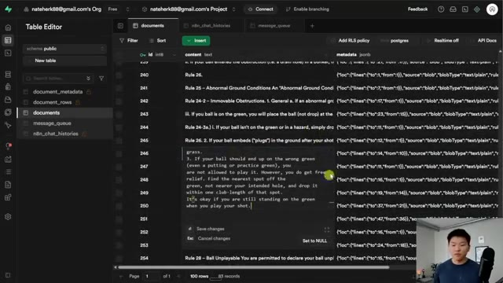
*⏱️ 00:08:08 — Interface de gestion de base de données Supabase affichant une table nommée "documents" contenant du texte de règles et des métadonnées JSON associées.*

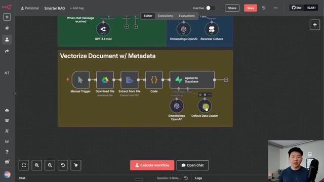
*⏱️ 00:08:18 — Interface de workflow n8n montrant un flux automatisé intitulé "Vectorize Document w/ Metadata" avec des nœuds pour le téléchargement, l'extraction et l'upload vers Supabase.*

---

### ⏱️ `[00:08:23 - 00:08:41]` | Segment #22

**🔊 Audio (Transcription Intégrale Mot pour Mot en Français) :**
> So you could also add like an ID number. You could also add like a date. All this kind of stuff. That's how we're adding metadata. And I'm sure you guys are wondering how did I actually extract the page numbers out of that PDF? So I just pulled in the execution of when I actually vectorized this data. So what happened was I downloaded the file, which was our PDF about rules of golf.

**👁️ Analyse Visuelle d'Écran (gemini-3.5-flash-lite) :**
**Interface & Outils** : n8n (outil d'automatisation de workflows).

**Contenu textuel & Code** : Champs de saisie pour "Name" et "Value" sous la section "Metadata". Le champ "Value" pour "ruleNumber" contient l'expression `{{ $json.ruleNumber }}`. Le champ "Name" en bas est rempli avec "date".

**Action / Démonstration** : Configuration des paramètres du nœud pour définir comment les métadonnées (ID, date) sont extraites ou associées aux données traitées.

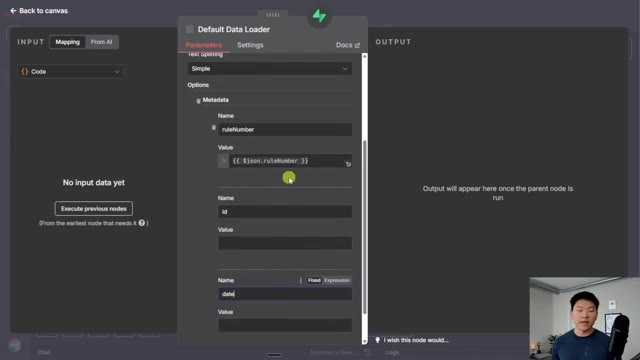
*⏱️ 00:08:28 — Interface de configuration du nœud "Default Data Loader" dans un outil d'automatisation, montrant l'ajout de métadonnées (ruleNumber, id, date).*

---

### ⏱️ `[00:08:41 - 00:09:01]` | Segment #23

**🔊 Audio (Transcription Intégrale Mot pour Mot en Français) :**
> I extracted the text from it. And as you can see, when I extract the text, the entire body of the PDF was lumped into one field. I thought about feeding it into AI to extract the page numbers, but I probably would have hit a context window. So I didn't want to do that. So what I did was I added a code node and I literally went to JSON and I just copied basically the entire text field right here.

**👁️ Analyse Visuelle d'Écran (gemini-3.5-flash-lite) :**
**Interface & Outils** : n8n (interface de workflow d'automatisation).

**Contenu textuel & Code** : Configuration du nœud "Extract from File" (Input Binary Field: "data") et résultat en format JSON contenant le texte brut extrait du fichier "Rules_of_Golf_Simplified.pdf".

**Action / Démonstration** : Le présentateur illustre le résultat de l'extraction de texte à partir d'un PDF, où tout le contenu est regroupé dans un seul champ "text" au sein d'un objet JSON.

*⏱️ 00:08:46 — Une interface de workflow d'automatisation (n8n) montrant un nœud "Extract from File" configuré pour extraire du texte à partir d'un fichier PDF, avec une fenêtre d'entrée affichant les métadonnées du fichier et une fenêtre de sortie affichant le texte extrait en format JSON.*

---

### ⏱️ `[00:09:01 - 00:09:19]` | Segment #24

**🔊 Audio (Transcription Intégrale Mot pour Mot en Français) :**
> And then I pulled up Claude and I pasted in that JSON and I said, help me write a code node for NNN. It's going to receive the JSON below as an input and I want it to split out each rule as its own item. It should split out after each time the text says rule X. And it was literally a one shot prompt. That's all I said and I got this code. So I pasted that code in here.

**👁️ Analyse Visuelle d'Écran (gemini-3.5-flash-lite) :**
**Interface & Outils** : Claude.ai (Interface de chat) et éditeur de code intégré.

**Contenu textuel & Code** : Prompt de l'utilisateur demandant un nœud de code n8n pour diviser un JSON par "Rule X" et réponse de Claude contenant le script JavaScript utilisant des expressions régulières (regex) pour traiter le texte, extraire le numéro de règle, le titre et le contenu complet.

**Action / Démonstration** : Visualisation du résultat généré par Claude : un script prêt à l'emploi pour automatiser la segmentation de données textuelles dans n8n.

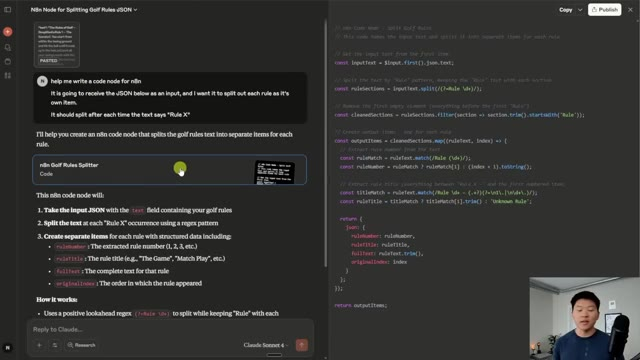
*⏱️ 00:09:06 — Interface de discussion Claude affichant une réponse avec un bloc de code JavaScript destiné à un nœud n8n, avec le code source complet affiché dans un panneau latéral à droite.*

---

### ⏱️ `[00:09:19 - 00:09:54]` | Segment #25

**🔊 Audio (Transcription Intégrale Mot pour Mot en Français) :**
> I ran it and now we have 43 items where it gives us, hey, here's the rule number, here's the rule title and here's the full text of that rule. And so as you can see, that's how we got all of this data back here with a rule number associated with each one. And so that's pretty cool. I was able to do that with zero AI. And then all I had to do was in my default data loader, I added a field called rule number, and I dragged in the rule number right there. And then I told it the actual data that we are vectorizing is just going to be the full text from this code node. So I dragged in this field right there. So we have our metadata in our vector database. But how do we actually search and filter through it? Let me show you guys a quick example

**👁️ Analyse Visuelle d'Écran (gemini-3.5-flash-lite) :**
**Interface & Outils** : Plateforme d'automatisation de workflows n8n.

**Contenu textuel & Code** : - Image 1 : Script JavaScript de transformation de données (extraction de `ruleNumber`, `ruleTitle`, `fullText`).
- Image 2 : Configuration d'un "Data Loader" avec expressions de mappage (`{{ $json.ruleNumber }}`) et affichage des métadonnées traitées.

**Action / Démonstration** : Le présentateur démontre le traitement et l'extraction structurée de règles de golf à partir d'un fichier source via des nœuds de transformation et de chargement de données dans n8n.

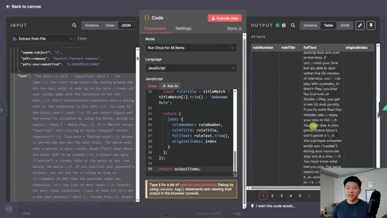
*⏱️ 00:09:28 — Interface n8n montrant un nœud "Code" en JavaScript traitant des données textuelles pour structurer des règles de golf en objets JSON.*

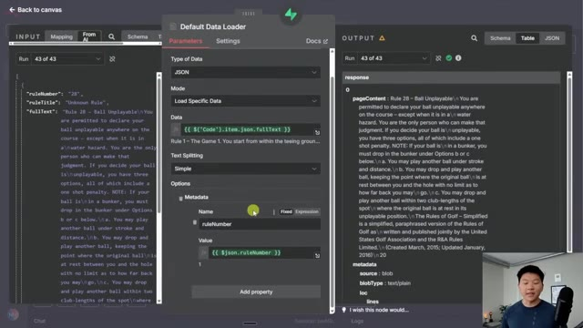
*⏱️ 00:09:37 — Interface n8n affichant un nœud "Default Data Loader" configuré pour charger des données JSON spécifiques (ruleNumber, fullText) avec l'aperçu du résultat en sortie.*

---

### ⏱️ `[00:09:54 - 00:10:26]` | Segment #26

**🔊 Audio (Transcription Intégrale Mot pour Mot en Français) :**
> of that. So right here, we have rule 27, which is about ball lost or out of bounds. What I'm going to do is chat with the agent right here and say, tell me about rule 27. I'll fire that off. And what's going to happen is once again, it's going to pull back 20 chunks. It's going to re-rank them and it's actually searching a few times. It's going to keep searching until it feels confident about rule 27. And so it comes back with our answer about rule 27. You can go ahead and fact check this if you want. But what I'm more interested in right now is understanding why did it search through the vector database three times for such a simple query? Well, let's click into the agent and let's go to the logs to understand what happened. First time it tried,

**👁️ Analyse Visuelle d'Écran (gemini-3.5-flash-lite) :**
**Interface & Outils** : n8n (outil d'automatisation de workflow)

**Contenu textuel & Code** : Prompt utilisateur "tell me about rule 27" dans le panneau de chat ; état "Executing workflow" affiché dans le bandeau supérieur.

**Action / Démonstration** : Exécution d'un workflow d'automatisation IA pour interroger une base de connaissances (RAG) sur les règles de golf.

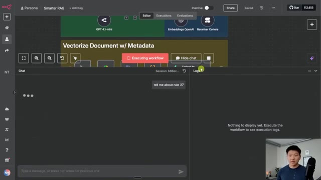
*⏱️ 00:10:02 — Interface d'un outil d'automatisation (n8n) affichant un workflow de type "Smarter RAG" avec un panneau de chat actif en bas.*

---

### ⏱️ `[00:10:26 - 00:11:01]` | Segment #27

**🔊 Audio (Transcription Intégrale Mot pour Mot en Français) :**
> it's shot off the query rule 27. And so we're looking for instances in Supabase where a chunk means rule 27. Let's click into the re-ranker to see what it chose. First one you can see was rule 28, which is already wrong. The relevance score was 0.2. The second chunk that it pulled was rule 26. That was the only content and a 0.14 relevance score. And the third one was also rule 26 with a 0.11 relevance score. So it did horrible at finding us rule 27. And I assume the same things happened in the next search, which was rule 27 once again. And then finally, the last query, it changed it to rule 27 golf. Not sure how that really changes much, but apparently it does. Because now if we go

**👁️ Analyse Visuelle d'Écran (gemini-3.5-flash-lite) :**
**Interface & Outils** : n8n (éditeur de workflow).

**Contenu textuel & Code** : Panneau de configuration du noeud "RAG Agent" avec "System Message" (expert en règles de golf) et panneau de logs affichant des objets JSON contenant des métadonnées (ruleNumber: 26, 25, 24-2) et des extraits de contenu (pageContent).

**Action / Démonstration** : Inspection des résultats renvoyés par le noeud de Reranking dans le cadre d'une requête sur la "règle 27" (Rule 27).

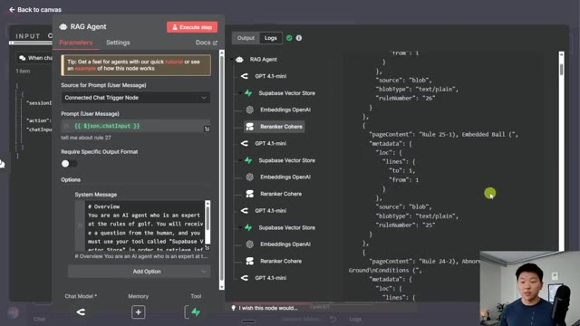
*⏱️ 00:10:35 — Interface d'un noeud "RAG Agent" dans une plateforme d'automatisation (n8n), affichant les paramètres de configuration et les logs de sortie des vecteurs récupérés.*

---

### ⏱️ `[00:11:01 - 00:11:27]` | Segment #28

**🔊 Audio (Transcription Intégrale Mot pour Mot en Français) :**
> to the re-ranker, we can see it got rule 27. It has a relevant score of 0.8, another rule 27 with a 0.73 relevant score. And I think this one looks like it's also potentially about rule 27. Maybe not. It has a pretty low relevant score. So the agent was intelligent enough to keep going until it felt confident about its answer, but that's not really the way we want to do it. And because we have metadata set up, we should be able to only isolate chunks that literally say rule number 27.

**👁️ Analyse Visuelle d'Écran (gemini-3.5-flash-lite) :**
**Interface & Outils** : Flowise (ou plateforme similaire de construction de workflows IA basés sur LangChain).

**Contenu textuel & Code** : Workflow visuel avec des nœuds pour : "RAG Agent", "GPT 4o-mini", "Supabase Vector Store", "Embeddings OpenAI", et "Reranker Cohere". Logs affichant des métadonnées de score de pertinence (ex: 0.3378598).

**Action / Démonstration** : Analyse des étapes d'exécution d'un pipeline RAG, focalisée sur le processus de reranking et la récupération de données pertinentes pour répondre à la requête sur la "règle 27" (règles de golf).

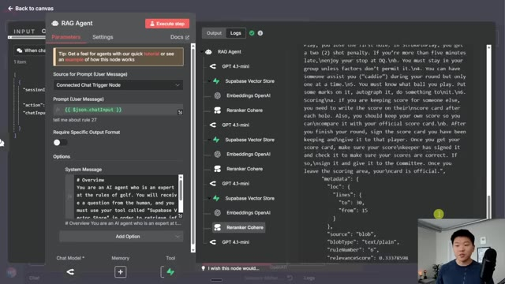
*⏱️ 00:11:07 — Vue détaillée du panneau de configuration d'un "RAG Agent" dans Flowise/LangFlow, montrant les paramètres du prompt et le journal d'exécution (logs) affichant les scores de pertinence du Reranker Cohere.*

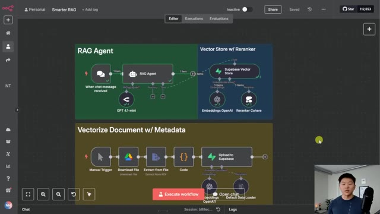
*⏱️ 00:11:20 — Vue d'ensemble du canevas de workflow montrant deux sections principales : "RAG Agent" (traitement du chat) et "Vectorize Document w/ Metadata" (ingestion de documents), avec les outils connectés (Supabase, OpenAI, Cohere).*

---

### ⏱️ `[00:11:27 - 00:12:03]` | Segment #29

**🔊 Audio (Transcription Intégrale Mot pour Mot en Français) :**
> So the way that we would go about that is in the Supabase Vector Store tool, we have an option at the bottom to add a metadata filter. And this is where we'd be able to add a filter field, we'd have to add the name and the actual value we're filtering for. And so this is obviously subject to change. So what we want to do is have the rule number in here. And then we want to have AI decide based on the human's query, what to filter. So that's why I'm going to show you guys this example over here where we're going to have one agent basically decide on the metadata filter and then the second agent will do its normal vector search. And the reason why I'm doing it like this is just because if we have this agent also decide the metadata filter, it just bugs out and this node

**👁️ Analyse Visuelle d'Écran (gemini-3.5-flash-lite) :**
**Interface & Outils** : n8n (Workflow automation platform).

**Contenu textuel & Code** : - Image #1 : Paramètres du nœud "Supabase Vector Store" (Limit: 20, Include Metadata activé, section Metadata Filter avec champs de saisie). 
- Image #2 : Diagramme de flux reliant "Metadata Agent" -> "RAG Agent 2" -> "Supabase Vector Store1" avec intégration d'OpenAI et Cohere.

**Action / Démonstration** : - Image #1 : L'utilisateur configure manuellement un filtre de métadonnées pour affiner les résultats de recherche vectorielle.
- Image #2 : Présentation de l'architecture globale du pipeline RAG pour expliquer le flux de données avant l'exécution.

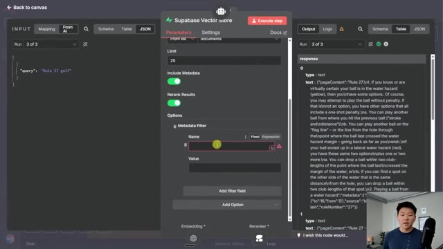
*⏱️ 00:11:36 — Interface de configuration du nœud "Supabase Vector Store" montrant les paramètres détaillés, notamment la section "Metadata Filter" avec les champs "Name" et "Value".*

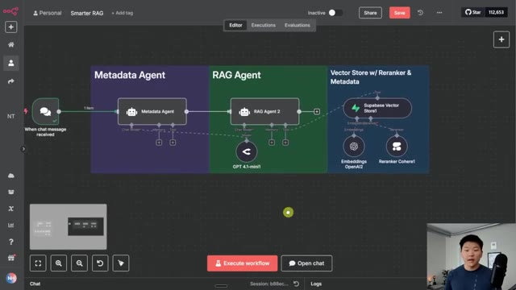
*⏱️ 00:11:54 — Vue d'ensemble du workflow "Smarter RAG" dans n8n, montrant la connexion entre les agents (Metadata Agent, RAG Agent) et le nœud Supabase Vector Store.*

---

### ⏱️ `[00:12:03 - 00:12:36]` | Segment #30

**🔊 Audio (Transcription Intégrale Mot pour Mot en Français) :**
> breaks. So right now this is the way to do it. So anyways, if I go ahead and send off the same query to this different agent now, this one is going to send off the metadata filter of rule 27. This agent's going to search through the vector database and we're going to get back our answer on the first try. So there we go. We now have information about rule 27 and this looks a lot better than that other agent. And if we click into the Supabase Vector Store node, we can see that the three different chunks it actually pulled back, they're all coming from rule 27 and they all have this metadata field of rule 27. So rule number 27, rule number 27, rule number 27. And you

**👁️ Analyse Visuelle d'Écran (gemini-3.5-flash-lite) :**
**Interface & Outils** : Flowise (interface de construction de workflows d'agents IA).

**Contenu textuel & Code** : - Image 1 : Nœuds "Metadata Agent" et "RAG Agent", journaux de chat affichant une requête sur la "rule 27".
- Image 2 : Paramètres de "Supabase Vector Store", champ "Metadata Filter", et sortie de données JSON incluant `ruleNumber: "27"`.

**Action / Démonstration** : Exécution d'un workflow automatisé où un agent traite une requête utilisateur, applique un filtre de métadonnées et interroge une base de données vectorielle (Supabase) pour récupérer les informations sur la règle 27.

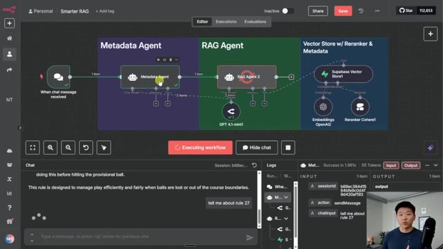
*⏱️ 00:12:11 — Interface de la plateforme Flowise montrant un workflow d'automatisation avec un "Metadata Agent" et un "RAG Agent" en cours d'exécution.*

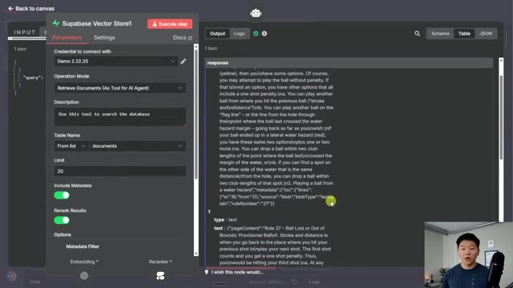
*⏱️ 00:12:27 — Interface de configuration du nœud "Supabase Vector Store" dans Flowise, affichant les paramètres de connexion et les résultats de la requête de base de données.*

---

### ⏱️ `[00:12:36 - 00:13:08]` | Segment #31

**🔊 Audio (Transcription Intégrale Mot pour Mot en Français) :**
> can see the way the metadata filter came through was we were searching for only chunks where the rule number right here equals 27. And that's how we guarantee we're looking for the right chunks. So like I said, it doesn't just have to be rule numbers. It could be a date. It could be a project name. It could be a client name It could be a different department name, whatever you want it to be And in an ideal world you have a metadata agent that's aware of all the different filters you have in your metadata So not only can it dynamically fill in the actual value you're filtering for But it can be intelligent enough to understand the query and understand. Okay for the best results

**👁️ Analyse Visuelle d'Écran (gemini-3.5-flash-lite) :**
**Interface & Outils** : n8n (outil d'automatisation de workflow low-code).

**Contenu textuel & Code** : Configuration du filtre de métadonnées : "Name": "ruleNumber", "Value": "{{ $('Metadata Agent').item.json.output }}", ainsi que les sorties JSON montrant le "ruleNumber: 27".

**Action / Démonstration** : Démonstration de la manière dont les métadonnées sont utilisées pour filtrer précisément les chunks de données lors de la recherche vectorielle.

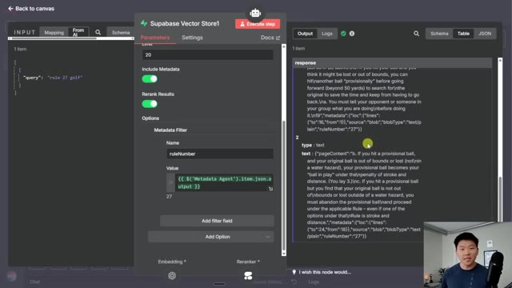
*⏱️ 00:12:44 — Interface détaillée du nœud "Supabase Vector Store" montrant la configuration du filtre de métadonnées ("ruleNumber" égal à 27) et les résultats JSON correspondants dans le volet de droite.*

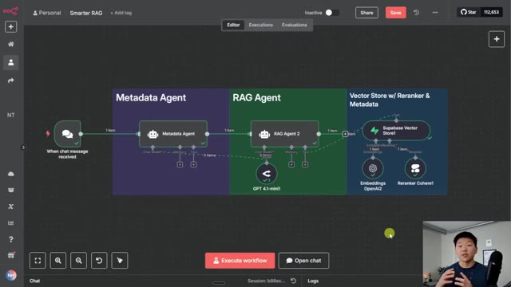
*⏱️ 00:12:52 — Vue d'ensemble du canevas de workflow montrant la chaîne de traitement complète : "Metadata Agent", "RAG Agent" et "Supabase Vector Store".*

---

### ⏱️ `[00:13:08 - 00:13:32]` | Segment #32

**🔊 Audio (Transcription Intégrale Mot pour Mot en Français) :**
> I'm going to choose the date filter and fill in the date I'm also going to filter for rule number where we just add another one and I'm also gonna fill in the rule number down here. So that would definitely be pretty cool. The best way to start to get familiar with it is just to play around with it. So I'll have all of these agents and this exact workflow in the FreeSchool community. So if you wanna download the JSON here, you can also download this PDF and you can just play around and experiment the same way that I just did it here in front of you guys.

**👁️ Analyse Visuelle d'Écran (gemini-3.5-flash-lite) :**
**Interface & Outils** : n8n (outil d'automatisation de workflows low-code).

**Contenu textuel & Code** : - Configuration des métadonnées : {"ruleNumber": "{{ $('Metadata Agent').item.json.output }}", valeur "27"}.
- Données de sortie JSON : Texte extrait concernant les règles de golf (balle dans l'eau, pénalités).
- Structure du workflow : Nœuds connectés pour le traitement RAG (Retrieval-Augmented Generation).

**Action / Démonstration** : Le présentateur configure les filtres de métadonnées à l'intérieur du nœud Supabase pour affiner la recherche vectorielle, puis navigue vers la vue d'ensemble du flux pour montrer l'architecture globale de l'agent.

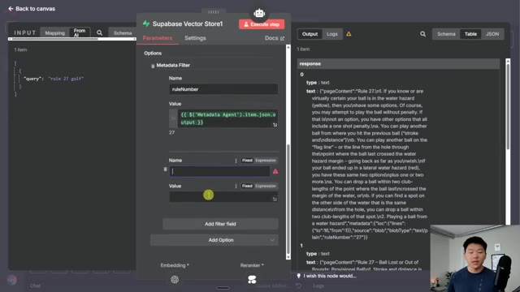
*⏱️ 00:13:14 — Gros plan sur la configuration du nœud "Supabase Vector Store1" avec des champs de filtrage de métadonnées ("ruleNumber") et une fenêtre de sortie affichant le contenu JSON extrait.*

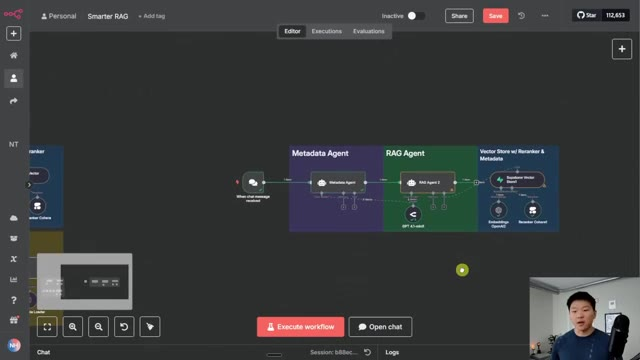
*⏱️ 00:13:20 — Vue d'ensemble du canevas d'automatisation montrant le flux de travail complet avec les nœuds "Metadata Agent", "RAG Agent" et "Vector Store".*

---

### ⏱️ `[00:13:32 - 00:13:52]` | Segment #33

**🔊 Audio (Transcription Intégrale Mot pour Mot en Français) :**
> Anyways, I don't want this video to go too long. I think it's gonna be a lot more valuable for you all to get that hands-on experience when you download this template and just play around and see how the Reranker works, see how your agent makes queries and see how the metadata filter works. And if you're looking for a more hands-on experience when you're experimenting with RAG and building stuff with NNN, then definitely check out my plus community. The link for that will be down in the description.

**👁️ Analyse Visuelle d'Écran (gemini-3.5-flash-lite) :**
**Interface & Outils** : Flowise (plateforme de création de workflows IA basée sur LangChain).

**Contenu textuel & Code** : Diagramme de flux comprenant : "Metadata Agent", "RAG Agent", "Supabase Vector Store", ainsi que des intégrations pour "GPT-4o-mini", "Embeddings OpenAI" et "Reranker Cohere".

**Action / Démonstration** : Affichage du panneau d'édition du workflow automatisé pour illustrer la configuration des agents, du filtrage par métadonnées et du système de reranking.

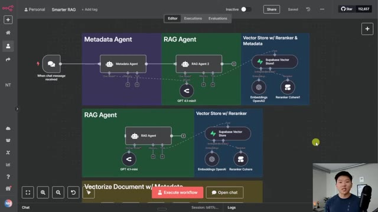
*⏱️ 00:13:37 — Une capture d'écran montrant l'interface de travail de Flowise, affichant un workflow complexe de type RAG (Retrieval-Augmented Generation) avec plusieurs agents et noeuds de stockage vectoriel.*

---

### ⏱️ `[00:13:52 - 00:14:12]` | Segment #34

**🔊 Audio (Transcription Intégrale Mot pour Mot en Français) :**
> We've got a great community of members who are always sharing their builds, sharing their challenges and supporting each other. And we also have two full courses in here, one called 8 and 0, which is the foundations for AI automation. And then we have 10 hours to 10 seconds where you learn how to identify, design and build time-saving automations. So I'd love to see you guys in the community, but that's gonna do it for today. I hope you enjoyed the video.

**👁️ Analyse Visuelle d'Écran (gemini-3.5-flash-lite) :**
**Interface & Outils** : Plateforme de formation en ligne (type Skool ou plateforme communautaire personnalisée).

**Contenu textuel & Code** : Liste des cours disponibles : "Start Here", "Agent Zero (Foundations)", "10 Hours to 10 Seconds", "n8n Templates", "Step-by-Step Builds" et "$3M Savings Vault".

**Action / Démonstration** : Navigation au sein de la section "Classroom" de la plateforme, illustrant les ressources offertes aux membres de la communauté.

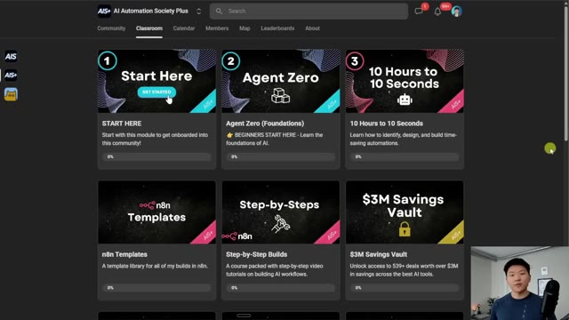
*⏱️ 00:13:57 — Interface de la plateforme "AI Automation Society Plus" montrant une grille de modules de formation, dont "Agent Zero" et "10 Hours to 10 Seconds".*

---

### ⏱️ `[00:14:12 - 00:14:21]` | Segment #35

**🔊 Audio (Transcription Intégrale Mot pour Mot en Français) :**
> I hope you learned something new. If you did, please give it a like. It definitely helps me out a ton. And as always, I appreciate you guys making it to the end of the video. I'll see you on the next one. Thanks guys.

**👁️ Analyse Visuelle d'Écran (gemini-3.5-flash-lite) :**
**Interface & Outils** : LangFlow

**Contenu textuel & Code** : Workflow composé de plusieurs nœuds : "Metadata Agent", "RAG Agent", "Supabase Vector Store", "GPT 4.5-mini", "Embeddings OpenAI" et "Reranker Cohere".

**Action / Démonstration** : Visualisation du schéma de configuration d'un pipeline d'automatisation IA, avec un bouton "Execute workflow" visible en bas du canevas.

*⏱️ 00:14:14 — Interface du logiciel LangFlow affichant un workflow complexe de RAG (Retrieval-Augmented Generation) avec des nœuds pour les agents, le stockage vectoriel et le reranking.*

---

