# 🎬 Watch Me Build an AI Resume Analysis System in 28 minutes (no code)

> **Chaîne** : [Nate Herk | AI Automation](https://www.youtube.com/@nateherk/featured)  
> **Lien YouTube** : [https://www.youtube.com/watch?v=M0s6O8xtVUE](https://www.youtube.com/watch?v=M0s6O8xtVUE)  
> **Date de publication** : 20250630  
> **Durée** : 00:28:37  
> **Identifiant vidéo** : `M0s6O8xtVUE`  
> **Transcription & Analyse** : `whisper-v3-large-turbo+gemini-3.5-flash-lite`  

---

## 📌 Synthèse Exécutive & Outils

### 💡 Résumé
Dans cette vidéo intitulée **Watch Me Build an AI Resume Analysis System in 28 minutes (no code)**, Nate Herk décortique les capacités pratiques d'automatisation et de développement propulsées par les modèles de pointe.

### 🛠️ Outils, Modèles & Logiciels Présentés
- **Opus 5.5 & Claude Code** : Modèles d'ingénierie et agents de codage autonome.

### 🔑 Points Clés & Enseignements Stratégiques
- Optimiser le niveau d'effort et le raisonnement des modèles IA pour des résultats industriels.
- Automatiser les cycles de création logicielle de bout en bout.

---

## ⏱️ Chronologie & Transcription Complète Audio & Visuelle (Mot pour Mot)

### ⏱️ `[00:00:00 - 00:00:33]` | Segment #01

**🔊 Audio (Transcription Intégrale Mot pour Mot en Français) :**
> What we're looking at today is the smart AI resume collection system that not only analyzes the candidate for strengths and weaknesses, but it will also look at the job description that they're applying for and it will tell you what's the risk here, what's the reward, what's the overall fit, and then it will give you some justification for it. This is going to be a huge time saver for recruiters during the hiring process and it's also going to keep personal bias out of the equation. So what I'm going to do today is build this right in front of you guys live. I'm going to tell you guys my thought process as I'm building it and by the end you'll have it all set up for yourself. Okay, so this is a very simple system and it's able to be customized to fit your needs.

**👁️ Analyse Visuelle d'Écran (gemini-3.5-flash-lite) :**
**Interface & Outils** : n8n (outil d'automatisation de workflow low-code)

**Contenu textuel & Code** : Nœuds de workflow : "Resume Collection", "File Type", "Word Doc", "PDF", "Text File", "Standardize Input", "Get Job Description", "Analysis & Information Extract" (incluant un "Recruiter Agent", "o4-mini" et "Structured Output Parser").

**Action / Démonstration** : Visualisation et configuration du flux de travail automatisé de recrutement ; le bouton "Execute workflow" est visible en bas de l'écran.

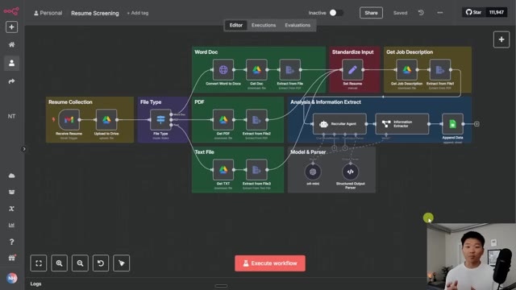
*⏱️ 00:00:08 — Interface du logiciel n8n montrant un workflow complexe d'automatisation pour le filtrage de CV, incluant la récupération de fichiers, l'extraction de données et l'utilisation d'agents IA.*

---

### ⏱️ `[00:00:33 - 00:01:07]` | Segment #02

**🔊 Audio (Transcription Intégrale Mot pour Mot en Français) :**
> And what I'm going to do first before we start building is tell you guys about how I approach anything that I want to automate and how I think about it. So this is a really important mindset shift to get in the habit of, which is basically listing out the steps that you would do manually if you wanted to complete this process. And when I start to list out the steps, I'll do that in like a Google Doc or a Google Sheets or something like that. And then I always come over to Excalajaw and I take that process map of the steps and I turn it into a wireframe. And the idea here is to understand what's the trigger, what are the different data sources, do we need to do any data transformation, where does AI come into play, and this will make it very clear kind of like what

**👁️ Analyse Visuelle d'Écran (gemini-3.5-flash-lite) :**
**Interface & Outils** : n8n (Image 1), outil de tableau blanc/diagramme type Excalidraw ou Miro (Image 2).

**Contenu textuel & Code** : Nœuds de workflow : "Resume Collection", "File Type", "Analysis & Information Extract", "Recruiter Agent" (Image 1) ; Séquence logique : "Trigger" (Gmail) -> "Download File" -> "File Type Switch" -> "Perform Analysis" (Image 2).

**Action / Démonstration** : Visualisation et explication de l'architecture d'un agent d'automatisation pour le recrutement.

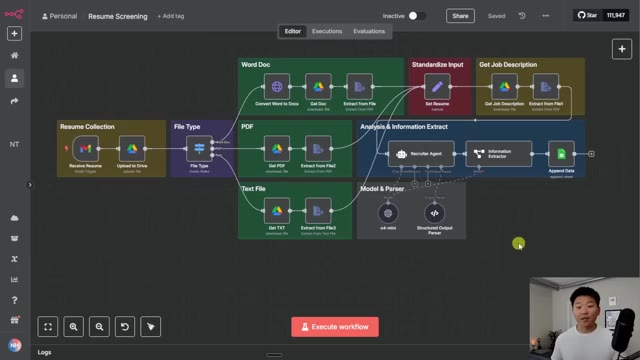
*⏱️ 00:00:41 — Interface de l'outil d'automatisation n8n montrant un workflow complexe pour le tri de CV, avec des nœuds connectés pour la collecte, le traitement des types de fichiers et l'analyse par agent IA.*

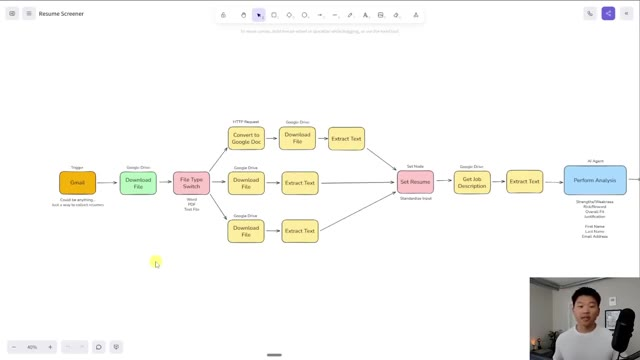
*⏱️ 00:00:58 — Diagramme de flux logique (schéma conceptuel) réalisé dans un outil de tableau blanc, illustrant les étapes théoriques du processus d'automatisation du tri des CV avant sa construction technique.*

---

### ⏱️ `[00:01:07 - 00:01:40]` | Segment #03

**🔊 Audio (Transcription Intégrale Mot pour Mot en Français) :**
> nodes we need to use, but also do I need to build an agent or can I just build a workflow? And in this case we can see that there's a decision to be made right here, which is basically what type of file is the resume, but we can make this decision without using any AI so we don't need an agent and we keep the workflow really simple. So let's real quick go through this wireframe and understand at a high level, how the system works. And if you guys want to check out my full course on process mapping, wireframing, and then getting into NNN and automating the systems, then definitely check out my plus group. The link for that is down in the description. We've got two full courses in here right now. We have agent zero, which is the foundations of AI automation. And then we have

**👁️ Analyse Visuelle d'Écran (gemini-3.5-flash-lite) :**
**Interface & Outils** : Lucidchart (ou outil de diagramme similaire)

**Contenu textuel & Code** : Schéma logique avec des blocs : "Trigger Gmail", "Download File", "File Type Switch" (avec branches pour Word, PDF, Text), "Extract Text", "Set Resume", "Get Job Description", "Perform Analysis" (AI Agent) et "Store Data".

**Action / Démonstration** : Présentation visuelle de l'architecture du workflow permettant de comparer les différentes étapes de traitement des fichiers selon leur type, avant l'intervention de l'agent IA.

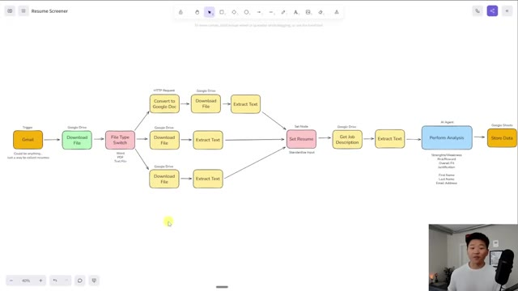
*⏱️ 00:01:15 — Un diagramme de flux de travail (workflow) détaillé pour un système de sélection de CV, montrant les étapes depuis le déclencheur Gmail jusqu'à l'analyse par un agent IA et le stockage dans Google Sheets.*

---

### ⏱️ `[00:01:40 - 00:02:08]` | Segment #04

**🔊 Audio (Transcription Intégrale Mot pour Mot en Français) :**
> 10 hours to 10 seconds where you actually learn to pick the process, map the steps, wireframe it, and then you get into NNN and start automating processes. We also just partnered up with over 500 tools and you can get up to $3 million in savings. So if you're interested in that, check out the plus group. Okay, so when it comes to wireframing, it doesn't have to be perfect, but you want to have a general idea of what you're going to build so that you get into N&N and you can just build it. You're going to save yourself a lot of time. Imagine if you opened up a Lego box for a tractor and you started trying to build the tractor without looking at the instruction manual.

**👁️ Analyse Visuelle d'Écran (gemini-3.5-flash-lite) :**
**Interface & Outils** : Plateforme de formation (Skool) pour l'Image #1, et outil de diagramme/wireframing (type Whimsical ou Miro) pour l'Image #2.

**Contenu textuel & Code** : Menu de navigation avec liste des modules de formation ; schéma logique montrant des nœuds de traitement (Trigger Gmail, Download, Extract Text, Perform Analysis) reliés par des flèches.

**Action / Démonstration** : Navigation dans le curriculum du cours pour l'Image #1, et visualisation du processus automatisé de sélection de CV pour l'Image #2.

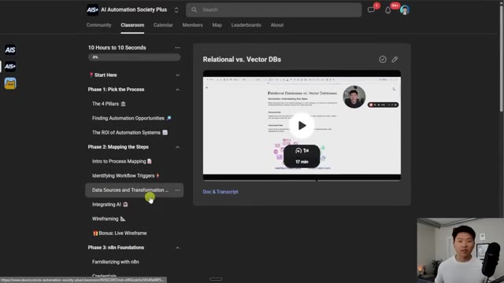
*⏱️ 00:01:47 — Interface de cours en ligne montrant le programme "10 Hours to 10 Seconds" avec une navigation structurée par phases (Pick the Process, Mapping, n8n Foundations) et une vidéo intégrée sur les bases de données relationnelles vs vectorielles.*

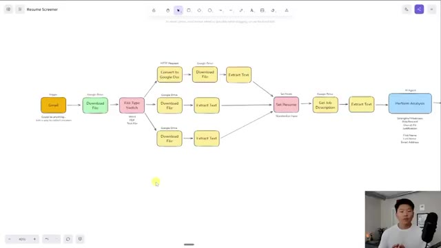
*⏱️ 00:01:54 — Diagramme de flux (workflow) détaillé pour un "Resume Screener" automatisé, illustrant le traitement de fichiers via Gmail, Google Drive, conversion de format et analyse par un agent IA.*

---

### ⏱️ `[00:02:09 - 00:02:30]` | Segment #05

**🔊 Audio (Transcription Intégrale Mot pour Mot en Français) :**
> That's kind of what building an N&N without a wireframe is like. Anyways, let's zoom in over here and just go down this path. So I knew that I needed some sort of trigger, which would be how do we actually get the resume into N&N? I decided to go with Gmail here, but you could obviously have this be a webhook if it's like a form submission, or you could have it be a new row in your air table. Whatever you want, you can obviously switch that out. We're going with Gmail for simplicity.

**👁️ Analyse Visuelle d'Écran (gemini-3.5-flash-lite) :**
**Interface & Outils** : Excalidraw (tableau blanc numérique)

**Contenu textuel & Code** : Logigramme montrant : Trigger (Gmail) -> Google Drive (Download) -> Switch (Word/PDF/Text) -> Traitements spécialisés (Google Doc, Extraction de texte).

**Action / Démonstration** : Présentation visuelle de l'architecture logique du workflow d'automatisation avant sa mise en œuvre dans n8n.

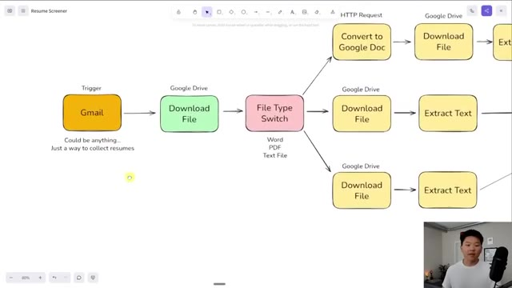
*⏱️ 00:02:14 — Un schéma de workflow "Resume Screener" dessiné sur un tableau blanc virtuel, illustrant le processus de réception de CV via Gmail suivi d'une logique de traitement conditionnel basée sur le type de fichier.*

---

### ⏱️ `[00:02:30 - 00:03:03]` | Segment #06

**🔊 Audio (Transcription Intégrale Mot pour Mot en Français) :**
> Then I basically thought about, okay, so I get this email. What do I want to do next? I want to download it and keep it somewhere. So I have a Google Drive folder that's called resumes, where we're going to store all the resumes. From there, what we need to do is we need to extract the text from the resume. And there's different ways that people may send it. It could be a Word doc. It could be a PDF. It could even be a text file. So these are the three examples we're going with here, but you could obviously customize that too. And depending on the type of file, there'll be different logic. So Word docs are the toughest. What we have to do is make an HTTP request to convert it to a Google doc so that we can then extract the text from it. If

**👁️ Analyse Visuelle d'Écran (gemini-3.5-flash-lite) :**
**Interface & Outils** : Canva (outil de design et de création de schémas)

**Contenu textuel & Code** : Logigramme logique : "Trigger" (Gmail) -> "Download File" (Google Drive) -> "File Type Switch" (Word, PDF, Text File) -> Ramifications vers "Convert to Google Doc", "Download File" et "Extract Text".

**Action / Démonstration** : Le présentateur explique visuellement les étapes du flux de travail automatisé pour la gestion des CV reçus par email.

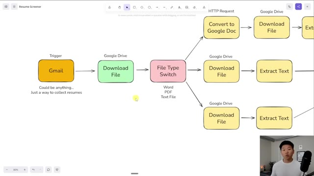
*⏱️ 00:02:38 — Un schéma de workflow sous forme de logigramme illustrant le processus automatisé de traitement des CV, depuis la réception via Gmail jusqu'à l'extraction de texte.*

---

### ⏱️ `[00:03:03 - 00:03:40]` | Segment #07

**🔊 Audio (Transcription Intégrale Mot pour Mot en Français) :**
> it's a PDF, we're going to go down this path and we'll just download it right away and then extract the text from it. And same thing with the text file. It's pretty easy. We'll just download it and extract the text. But ultimately the goal here is we just want to get that resume into text because it comes through as binary. And if it doesn't make sense right now, it completely will once we get into NADN, but just high level, this is what we're doing. And whenever we have data kind of branching off into different paths, it has to get standardized in some form so that we can pass it down the rest of the flow and it will actually make sense. So we're basically routing all of the extracted texts into one node and we'll set it as a field called resume or text just so

**👁️ Analyse Visuelle d'Écran (gemini-3.5-flash-lite) :**
**Interface & Outils** : Outil de diagramme en ligne (type Excalidraw ou similaire).

**Contenu textuel & Code** : Nœuds de workflow : "Download File" (Google Drive), "File Type Switch", "Convert to Google Doc", "Extract Text" et "Set Resume" pour standardiser l'entrée.

**Action / Démonstration** : Présentation visuelle de la logique d'automatisation pour le filtrage et la normalisation de CV entrants vers un format texte unique.

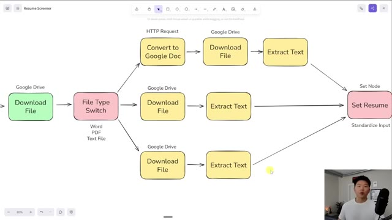
*⏱️ 00:03:12 — Diagramme de flux de travail montrant le processus de traitement de différents types de fichiers (Word, PDF, Texte) pour extraire du contenu.*

---

### ⏱️ `[00:03:40 - 00:04:15]` | Segment #08

**🔊 Audio (Transcription Intégrale Mot pour Mot en Français) :**
> we can continue on and we'll be fine. We have the resume. What we want to do now is get the job description. So I'll have a different Google doc with the job description, you know, requirements, criteria, responsibilities, that kind of stuff. We'll extract the text from the job description. And then we have our AI agent come into play where we can say, okay, here's the resume of the candidate. Here's the job description. Analyze these both and give us the strength and weaknesses, the risk and reward, the overall fit of the candidate for this job description, and then justify it. And then in our Google sheet, we also want to have their first name, last name and email address. And then that's basically the end of the process is we go to

**👁️ Analyse Visuelle d'Écran (gemini-3.5-flash-lite) :**
**Interface & Outils** : Canva (outil de tableau blanc/diagramme).

**Contenu textuel & Code** : Workflow logique : [Set Resume] -> [Get Job Description] -> [Extract Text] -> [Perform Analysis (Strengths/Weakness, Risk/Reward, Overall Fit, Justification, etc.)] -> [Store Data (Google Sheets)].

**Action / Démonstration** : Le présentateur illustre visuellement le processus logique de son automatisation, en mettant l'accent sur l'étape d'extraction du texte de la description de poste après avoir traité le CV.

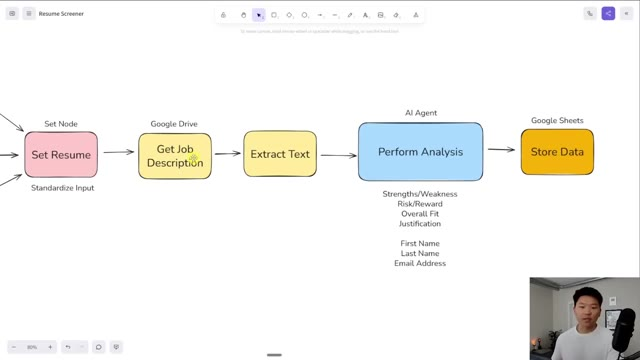
*⏱️ 00:03:49 — Schéma de workflow montrant les étapes d'automatisation pour le filtrage de CV, avec des blocs représentant les nœuds "Set Resume", "Get Job Description", "Extract Text", "Perform Analysis" et "Store Data".*

---

### ⏱️ `[00:04:15 - 00:04:49]` | Segment #09

**🔊 Audio (Transcription Intégrale Mot pour Mot en Français) :**
> Google Sheet. Now you could also end this off with like a notification to yourself in Slack or a new email, whatever it is, we're ending it here. And so I'm not saying that you can have AI just hire everybody, but you could definitely let the system run and then personally reach out to anyone that ranked high on the overall fit. Or if you're having trouble deciding between two candidates, you can come in here and see what the AI thought from a very objective standpoint, where maybe you had some implicit bias in there and you didn't realize it. So anyways, that is what the system does. That's our little wireframe. And now that we have that, let's get into NNN and build this system. All right. So we know that the trigger of this workflow is going to be Gmail. So

**👁️ Analyse Visuelle d'Écran (gemini-3.5-flash-lite) :**
**Interface & Outils** : Lucidchart (ou outil similaire de diagramme).

**Contenu textuel & Code** : Workflow : "Get Job Description" -> "Extract Text" -> "Perform Analysis" (AI Agent) -> "Store Data" (Google Sheets). Détails de l'analyse : Strengths/Weakness, Risk/Reward, Overall Fit, Justification, First Name, Last Name, Email Address.

**Action / Démonstration** : Visualisation du flux de données de l'agent IA pour le processus de recrutement.

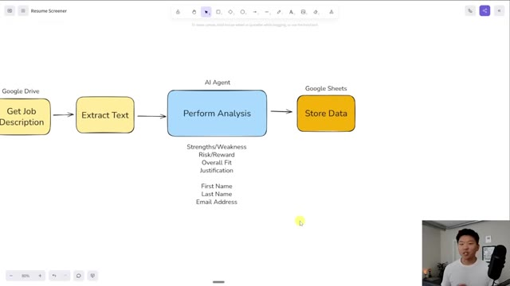
*⏱️ 00:04:24 — Schéma de workflow montrant l'automatisation du filtrage de CV, partant de Google Drive vers un agent IA, pour finir dans Google Sheets.*

---

### ⏱️ `[00:04:49 - 00:05:09]` | Segment #10

**🔊 Audio (Transcription Intégrale Mot pour Mot en Français) :**
> Je vais taper Gmail. On va prendre celui-ci et on va prendre le déclencheur « à la réception d'un message ». Donc ce que ça va faire, c'est que toutes les minutes, ça va vérifier. Et si un nouvel e-mail arrive dans cette boîte de réception, ça va le récupérer. Et je viens de m'envoyer un e-mail avec un CV d'un personnage fictif nommé Jordan Reeves, et c'est un document Word. Donc je vais cliquer sur « récupérer l'événement de test ». Et ce qui va se passer, c'est qu'on voit que l'e-mail est arrivé. Vous savez, ça dit : voici mon CV.

**👁️ Analyse Visuelle d'Écran (gemini-3.5-flash-lite) :**
**Interface & Outils** : Plateforme d'automatisation (probablement n8n ou similaire).

**Contenu textuel & Code** : Configuration du déclencheur avec les paramètres : "Credential" (Demo 4/2), "Mode" (Every Minute), et "Event" (Message Received).

**Action / Démonstration** : Configuration du trigger Gmail pour vérifier la réception de nouveaux e-mails toutes les minutes.

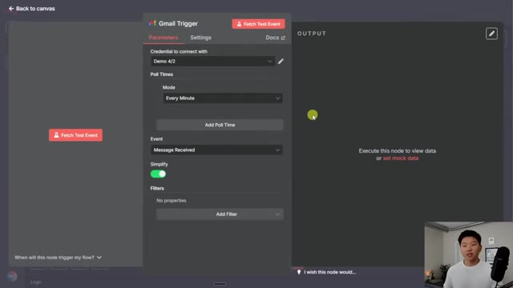
*⏱️ 00:04:54 — Interface de configuration du nœud « Gmail Trigger » au sein d'une plateforme d'automatisation de workflow.*

---

### ⏱️ `[00:05:09 - 00:05:28]` | Segment #11

**🔊 Audio (Transcription Intégrale Mot pour Mot en Français) :**
> The subject is Jordan Reeves, but we don't see the actual resume. So what you want to do is turn off simplify. You want to add an option down here that says download attachments and we check that on. And now if I run this again, we should see the binary image right here, which is Jordan Reeves resume as a Word doc. Now you also have the option right here to change the prefix.

**👁️ Analyse Visuelle d'Écran (gemini-3.5-flash-lite) :**
**Interface & Outils** : n8n (outil d'automatisation de workflow)

**Contenu textuel & Code** : Panneau latéral "Gmail Trigger" avec les options : "Credential", "Poll Times", "Event" (Message Received), et l'option "Simplify" activée. La section "OUTPUT" à droite affiche les détails d'un e-mail reçu de "Jordan Reeves".

**Action / Démonstration** : Le présentateur configure les paramètres du déclencheur Gmail pour inclure potentiellement des pièces jointes dans le flux de travail.

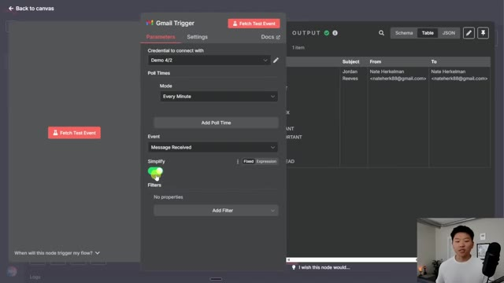
*⏱️ 00:05:14 — Fenêtre de configuration du nœud "Gmail Trigger" dans l'interface de n8n, affichant les paramètres du déclencheur et une sortie de test.*

---

### ⏱️ `[00:05:28 - 00:05:49]` | Segment #12

**🔊 Audio (Transcription Intégrale Mot pour Mot en Français) :**
> So right now it just comes through as attachment underscore zero. You could add a prefix and make it say resume underscore zero resume, whatever you want. I'm just going to keep it as the default for now. but we can see that we got our resume. And by the way, if you're having trouble with Google credentials, go ahead and check out this video that I'll tag right up here and then come back to this build. What's next according to our wireframe is to download the resume.

**👁️ Analyse Visuelle d'Écran (gemini-3.5-flash-lite) :**
**Interface & Outils** : n8n (plateforme d'automatisation de workflow).

**Contenu textuel & Code** : Paramètres du nœud : "Attachment Prefix" réglé sur "attachment_", données de sortie affichant le nom du fichier "Jordan Reeves.docx" et son type MIME.

**Action / Démonstration** : Configuration et inspection des résultats d'un trigger Gmail pour la récupération automatique de pièces jointes (CV).

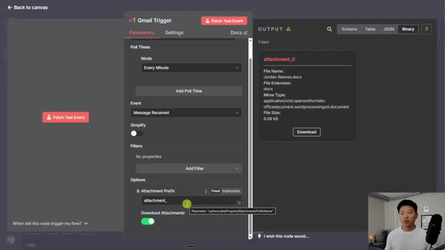
*⏱️ 00:05:34 — Fenêtre de configuration du nœud "Gmail Trigger" affichant les paramètres de réception d'e-mails, les options de préfixe de pièce jointe et les données de sortie d'un fichier "resume.docx".*

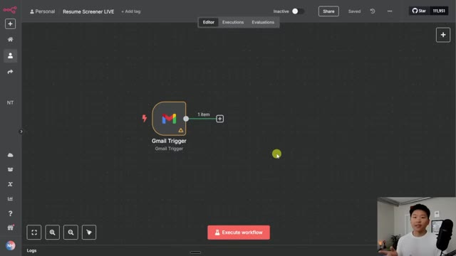
*⏱️ 00:05:44 — Vue d'ensemble du canevas de travail montrant un nœud unique "Gmail Trigger" avec une exécution réussie ("1 item") dans un flux de travail nommé "Resume Screener LIVE".*

---

### ⏱️ `[00:05:49 - 00:06:08]` | Segment #13

**🔊 Audio (Transcription Intégrale Mot pour Mot en Français) :**
> So I'm gonna click on the plus and I'm going to grab a Google drive node. And what we wanna do is upload a file to our Google drive. So we already have ourselves connected. I'm gonna choose where to put it. So I have a folder in my drive called resumes, which I will choose right there. And now we have two things to set up. The first one is the input data field name.

**👁️ Analyse Visuelle d'Écran (gemini-3.5-flash-lite) :**
**Interface & Outils** : n8n (outil d'automatisation de workflows).

**Contenu textuel & Code** : Nœud "Google Drive" avec les paramètres : Resource = File, Operation = Upload, Input Data Field Name = data, Parent Drive = My Drive, Parent Folder = / (Root folder).

**Action / Démonstration** : Le présentateur sélectionne et configure l'action "Upload" dans le nœud Google Drive pour automatiser le dépôt d'un fichier dans un dossier spécifique de son espace de stockage.

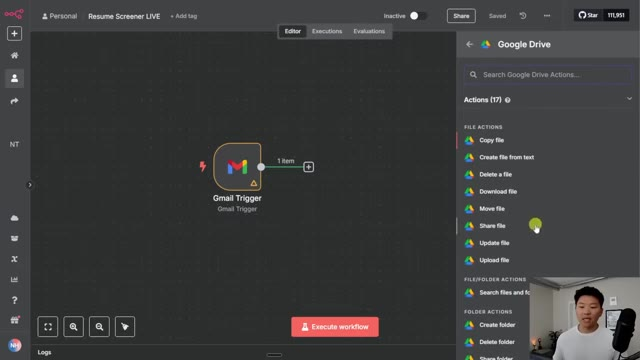
*⏱️ 00:05:53 — L'interface de n8n affichant le panneau latéral de sélection des actions Google Drive, avec une liste d'opérations disponibles comme "Upload file".*

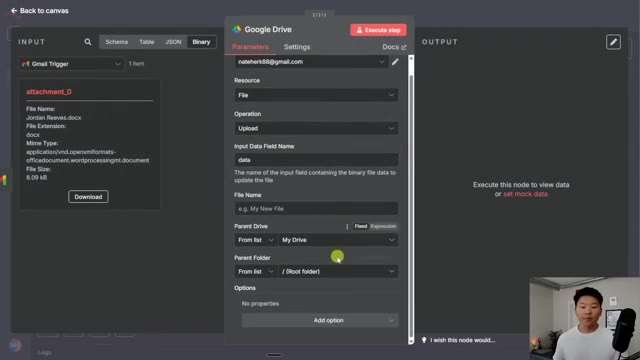
*⏱️ 00:05:58 — Le panneau de configuration détaillé du nœud Google Drive, montrant les paramètres de connexion, l'opération "Upload" sélectionnée et les champs pour choisir le dossier de destination ("My Drive" / "Root folder").*

---

### ⏱️ `[00:06:08 - 00:06:30]` | Segment #14

**🔊 Audio (Transcription Intégrale Mot pour Mot en Français) :**
> So this is basically the name of the input field containing the binary file that we wanna upload to Google Drive. And right here you can see it's called attachment underscore zero. So I'm just gonna copy that and paste that in there. And now these two things are linked. The next thing is what is the file name in Google Drive? So I'm gonna change this to an expression and I'm just gonna basically make it the person's name and then resume.

**👁️ Analyse Visuelle d'Écran (gemini-3.5-flash-lite) :**
**Interface & Outils** : n8n (outil d'automatisation de workflow).

**Contenu textuel & Code** : Panneau latéral gauche montrant les données binaires ("attachment_0", "Jordan Reeves.docx") et panneau central affichant les paramètres du nœud Google Drive (Resource: File, Operation: Upload, Input Data Field Name: "data").

**Action / Démonstration** : Le présentateur identifie et s'apprête à copier le nom du champ d'entrée ("attachment_0") pour le mapper dans la configuration du nœud Google Drive.

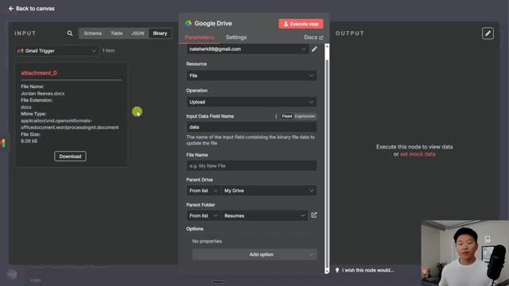
*⏱️ 00:06:13 — Interface n8n affichant la configuration d'un nœud Google Drive pour l'upload d'un fichier binaire provenant d'un déclencheur Gmail.*

---

### ⏱️ `[00:06:30 - 00:06:50]` | Segment #15

**🔊 Audio (Transcription Intégrale Mot pour Mot en Français) :**
> So I'm gonna go to JSON. Let's basically just assume that we told applicants, put your full name as the subject of the email. So I could just grab subject right here. So now it's coming through as Jordan Reeves and then I can just type in resume. So that is how the file will go into our Google Drive. So it looks like we're good to go. I'll hit execute step and we will watch this one, send it off to our Google Drive.

**👁️ Analyse Visuelle d'Écran (gemini-3.5-flash-lite) :**
**Interface & Outils** : Plateforme d'automatisation de workflow (n8n).

**Contenu textuel & Code** : Structure JSON affichant les métadonnées d'un email (expéditeur, destinataire, sujet "Jordan Reeves", contenu) et panneau de paramètres Google Drive (Resource: File, Operation: Upload, Parent Folder: Resumes).

**Action / Démonstration** : Configuration dynamique du nom du fichier de sortie en utilisant les données extraites du JSON (le sujet de l'email) pour nommer les CV dans Google Drive.

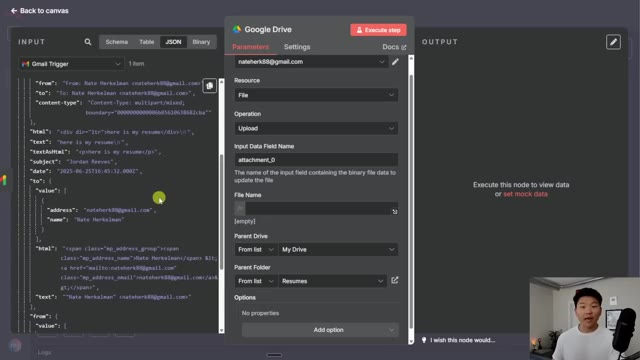
*⏱️ 00:06:35 — Interface de configuration du nœud Google Drive dans une plateforme d'automatisation (type n8n), montrant les données JSON d'un email entrant à gauche et les champs de configuration de téléchargement de fichier au centre.*

---

### ⏱️ `[00:06:50 - 00:07:09]` | Segment #16

**🔊 Audio (Transcription Intégrale Mot pour Mot en Français) :**
> And what that does is it basically gives us an ID of the file that exists in our Google Drive. So keep that in mind, we'll have to use this ID later. And just to show you guys, here's my folder called resumes and this is the new one we just got. Okay, so the next thing to do is we wanna have a switch that sends the data different ways based on the file type. So I'm gonna add a new node.

**👁️ Analyse Visuelle d'Écran (gemini-3.5-flash-lite) :**
**Interface & Outils** : n8n (outil d'automatisation de workflow), Google Drive (interface web).

**Contenu textuel & Code** : Nœud de configuration "Upload to Drive" dans n8n, ID du fichier généré (1xBKJgm...), structure de données JSON, interface de gestion de fichiers Google Drive.

**Action / Démonstration** : Vérification de l'exécution réussie du workflow dans n8n, validation de l'importation du fichier dans le dossier Google Drive cible, présentation visuelle du flux de travail automatisé.

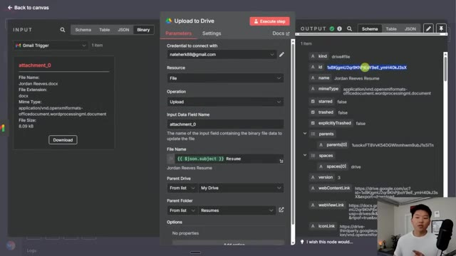
*⏱️ 00:06:55 — Interface n8n affichant le panneau latéral "Upload to Drive" avec les paramètres de configuration et la sortie (ID du fichier) générée après exécution.*

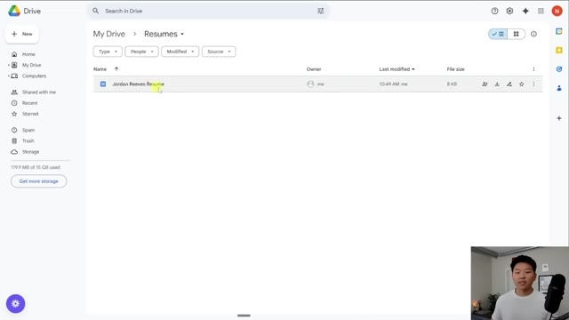
*⏱️ 00:06:59 — Interface Google Drive montrant le contenu du dossier "Resumes" avec le fichier récemment importé nommé "Jordan Reeves Resume".*

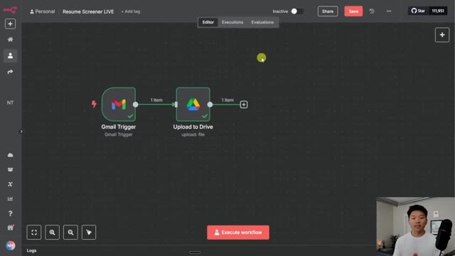
*⏱️ 00:07:04 — Canevas principal de l'outil d'automatisation n8n montrant un workflow composé de deux nœuds : "Gmail Trigger" et "Upload to Drive".*

---

### ⏱️ `[00:07:09 - 00:07:29]` | Segment #17

**🔊 Audio (Transcription Intégrale Mot pour Mot en Français) :**
> I'm gonna type in switch. And what I'm gonna do here is first of all, we're just going to worry about Word docs because that's what we have right here. And then we'll come back later and do PDF and text file. So what I'm gonna do is look on this left-hand side where we can see some metadata about that file that we just uploaded. And right here you can see application slash blah, blah, blah, XML, Office document, Word, whatever.

**👁️ Analyse Visuelle d'Écran (gemini-3.5-flash-lite) :**
**Interface & Outils** : n8n (outil d'automatisation de workflow)

**Contenu textuel & Code** : Panneau latéral gauche montrant les métadonnées JSON d'un fichier Google Drive (nom : "Jordan Reeves Resume", mimeType : "application/vnd.openxmlformats-officedocument.wordprocessingml.document"). Panneau central configurant le nœud "Switch" avec des "Routing Rules" ("value1", "is equal to", "value2").

**Action / Démonstration** : Le présentateur configure le nœud de routage conditionnel pour traiter spécifiquement les fichiers Word en fonction de leurs métadonnées.

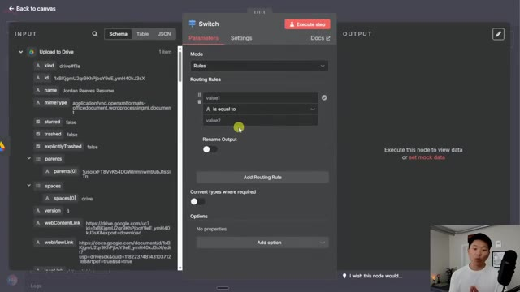
*⏱️ 00:07:14 — Interface de configuration du nœud "Switch" dans un outil d'automatisation (n8n), affichant les données d'entrée (metadata d'un fichier Google Drive) et les règles de routage.*

---

### ⏱️ `[00:07:29 - 00:07:48]` | Segment #18

**🔊 Audio (Transcription Intégrale Mot pour Mot en Français) :**
> So this basically means this is a Word doc. So I'm gonna grab MIME type right here. And basically what we're gonna say is if the MIME type variable equals this, which means WordDoc, then we're gonna go down this path. I'm gonna rename this path Word. So when we execute this, it's gonna go down this WordPath branch.

**👁️ Analyse Visuelle d'Écran (gemini-3.5-flash-lite) :**
**Interface & Outils** : n8n (outil d'automatisation de workflows).

**Contenu textuel & Code** : Expression JavaScript `{{ $json.mimeType }}` définie comme règle de routage, avec en résultat `application/vnd.openxmlformats-officedocument.wordprocessingml.document` (format Word).

**Action / Démonstration** : Configuration d'une condition logique dans le nœud "Switch" pour filtrer les documents Word afin de diriger le flux vers un chemin spécifique.

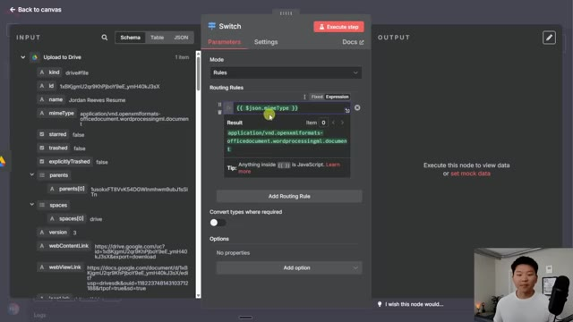
*⏱️ 00:07:33 — Interface du nœud "Switch" dans n8n, affichant la configuration d'une règle de routage basée sur le type MIME d'un fichier Google Drive.*

---

### ⏱️ `[00:07:48 - 00:08:08]` | Segment #19

**🔊 Audio (Transcription Intégrale Mot pour Mot en Français) :**
> And it's the only one right now, so maybe it seems like it's not working, but if I was to add two other routing rules, which these will be PDF and text file, and hit execute step, it will still go down that Word branch. Okay, so this next step is probably the most confusing out of the entire workflow, but it's not too bad. So let's just get past it real quick. And that is converting the Word document to a Google Doc.

**👁️ Analyse Visuelle d'Écran (gemini-3.5-flash-lite) :**
**Interface & Outils** : n8n (plateforme d'automatisation de workflow).

**Contenu textuel & Code** : - Configuration du nœud "Switch" : Output Name défini sur "Word", conditions de règle logique.
- Workflow : Nœuds connectés pour le traitement de fichiers via Gmail et Google Drive.

**Action / Démonstration** : - Configuration des règles de routage (Switch) pour diriger les fichiers selon leur type (Word, PDF, texte).
- Visualisation de l'exécution du workflow sur le canevas principal.

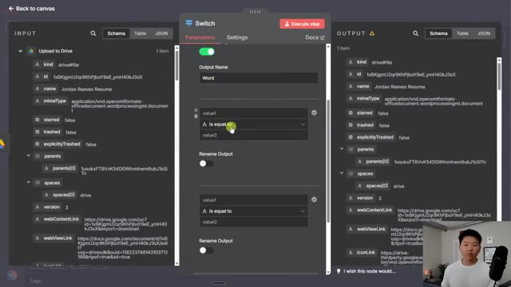
*⏱️ 00:07:53 — Interface de configuration du nœud "Switch" dans n8n, montrant les paramètres de routage avec une condition "is equal to" appliquée à un document Word.*

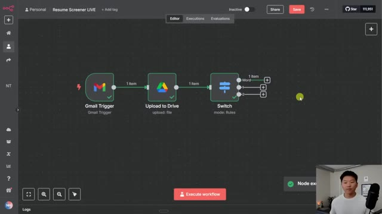
*⏱️ 00:07:58 — Vue d'ensemble du canevas n8n montrant le workflow complet : "Gmail Trigger" -> "Upload to Drive" -> "Switch", avec les branchements de sortie visibles.*

---

### ⏱️ `[00:08:08 - 00:08:28]` | Segment #20

**🔊 Audio (Transcription Intégrale Mot pour Mot en Français) :**
> The reason we have to do that is because there's all these different ways we can extract text from a document in NNN, but there's really not a great way to do it from a Word doc. So we just want to convert it. So how we do that is I'm going to add a new node right here and it's going to be an HTTP request. I'm not going to go super, super granular here, but if you want to learn more about APIs in NNN, check out this video up here.

**👁️ Analyse Visuelle d'Écran (gemini-3.5-flash-lite) :**
**Interface & Outils** : n8n (outil d'automatisation de workflow)

**Contenu textuel & Code** : Nœuds de workflow, paramètres de requête HTTP (GET, URL, Authentication), et structure de données JSON (mimeType, webContentLink).

**Action / Démonstration** : Construction et configuration d'un nœud "HTTP Request" pour traiter des fichiers au sein d'un workflow automatisé.

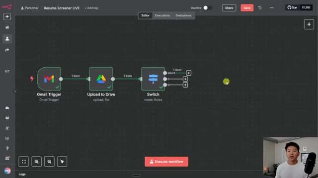
*⏱️ 00:08:13 — Interface du canevas n8n montrant un workflow en cours de construction avec les nœuds "Gmail Trigger", "Upload to Drive" et "Switch".*

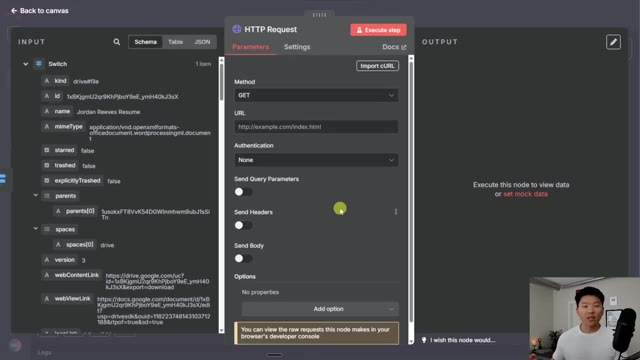
*⏱️ 00:08:23 — Fenêtre de configuration du nœud "HTTP Request" dans n8n, affichant les paramètres (Method, URL, Auth) et les données JSON en entrée.*

---

### ⏱️ `[00:08:28 - 00:08:47]` | Segment #21

**🔊 Audio (Transcription Intégrale Mot pour Mot en Français) :**
> Okay, but now that we got that out of the way, What I'm gonna do is I'm going to hit Google Drive API to convert it. So right here I have the documentation and this basically shows us the method we need to make, the endpoint we need to hit and what else we need to put in here. What I'm gonna do is copy this endpoint right here and then I'm going to go back and edit in and paste that right there.

**👁️ Analyse Visuelle d'Écran (gemini-3.5-flash-lite) :**
**Interface & Outils** : n8n (plateforme d'automatisation) et Google Cloud API Documentation.

**Contenu textuel & Code** : - Image 1 : Structure JSON d'un fichier (ID, nom, mimeType, etc.) et champs de configuration de requête HTTP (Method: GET, URL, Authentication).
- Image 2 : Documentation API Google Drive pour `Method: files.copy`, incluant l'URL `https://www.googleapis.com/drive/v2/files/{fileId}/copy` et les paramètres comme `convert` (boolean).

**Action / Démonstration** : Le présentateur passe de l'interface de travail (n8n) à la documentation de l'API pour identifier le point de terminaison et les paramètres requis afin de configurer correctement l'appel API de conversion de fichier.

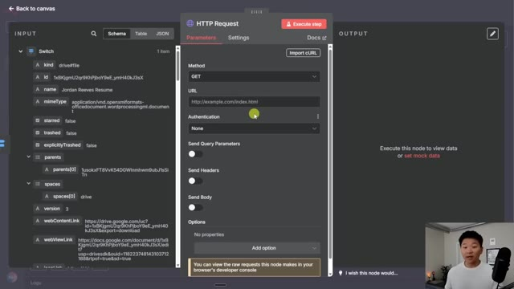
*⏱️ 00:08:33 — Interface de configuration d'un nœud "HTTP Request" dans une plateforme d'automatisation (n8n), affichant les paramètres de requête et une structure de données JSON en entrée.*

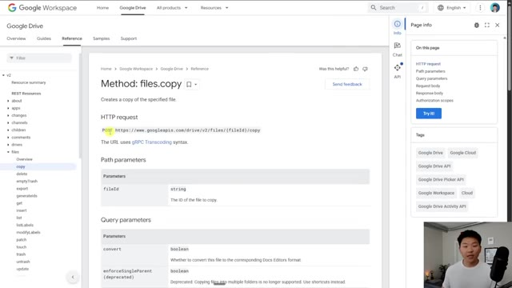
*⏱️ 00:08:38 — Documentation officielle de l'API Google Drive affichant la méthode "files.copy", incluant le point de terminaison HTTP (POST) et les paramètres de requête nécessaires.*

---

### ⏱️ `[00:08:47 - 00:09:10]` | Segment #22

**🔊 Audio (Transcription Intégrale Mot pour Mot en Français) :**
> We can also see that the endpoint required a post method. So I'm gonna make sure I change the method to post. We can see right here that the endpoint has right here a parameter for us to fill in, which is the file ID that we wanna convert. So I'm gonna delete that, I'm gonna change this to an expression, and I'm going to drag the ID from this left-hand side right into here, which tells this API which file to convert to Google Doc.

**👁️ Analyse Visuelle d'Écran (gemini-3.5-flash-lite) :**
**Interface & Outils** : n8n (outil d'automatisation de workflow).

**Contenu textuel & Code** : URL de l'API Google Drive (`https://www.googleapis.com/drive/v2/files/{fileId}/copy`), méthode définie sur "POST", et données d'entrée JSON à gauche incluant l'ID de fichier `1xBkJgmU2qr9KhPjbcY9eE_ymH40kJ3sX`.

**Action / Démonstration** : Le présentateur configure la requête HTTP en changeant la méthode en "POST" et prépare l'URL pour y insérer l'ID dynamique du fichier via une expression.

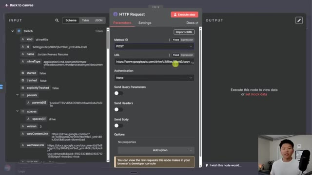
*⏱️ 00:08:53 — Interface de configuration du nœud "HTTP Request" dans l'outil d'automatisation n8n, montrant les paramètres de la requête API Google Drive.*

---

### ⏱️ `[00:09:10 - 00:09:39]` | Segment #23

**🔊 Audio (Transcription Intégrale Mot pour Mot en Français) :**
> And then the last thing we wanna do is not just make a copy of it, we wanna convert it. So if I go back to the API documentation, you can see right here we have a parameter, which is convert, which says whether to convert this file to corresponding docs editor format. So all I have to do is add in this query parameter. So I'm going to go back in here, I'm gonna add a question mark, which basically means anything after this like a filter or a setting. And I'm going to type convert equals true because it's either a true or false. And now we should be set up, but we have to authenticate ourselves.

**👁️ Analyse Visuelle d'Écran (gemini-3.5-flash-lite) :**
**Interface & Outils** : Google Drive API Documentation, n8n (outil d'automatisation workflow).

**Contenu textuel & Code** : - Image 1 : Documentation technique détaillant le paramètre `convert` (boolean).
- Image 2 : URL dans le champ HTTP Request : `https://www.googleapis.com/drive/v2/files/{{ $json.id }}/copy?convert=true`.

**Action / Démonstration** : Modification de l'URL de requête HTTP dans le workflow n8n pour ajouter le paramètre de conversion (`?convert=true`) afin de transformer dynamiquement les fichiers lors de leur copie.

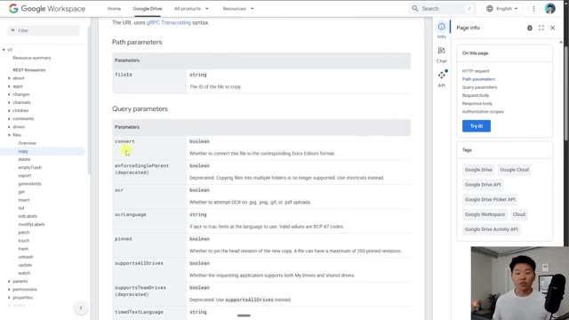
*⏱️ 00:09:17 — Documentation officielle de Google Drive API présentant le paramètre de requête 'convert' permettant la conversion automatique de fichiers.*

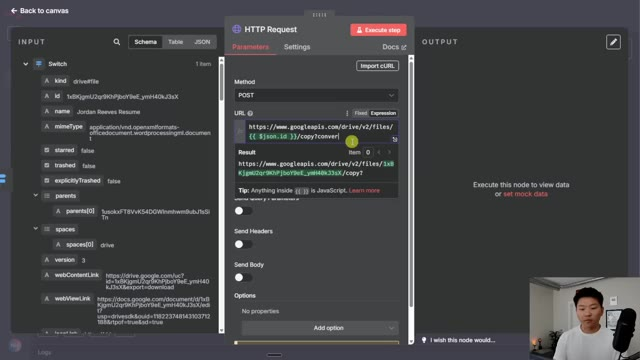
*⏱️ 00:09:32 — Interface de configuration d'un nœud "HTTP Request" dans un outil d'automatisation (n8n), où l'URL de l'API est modifiée pour inclure le paramètre de conversion.*

---

### ⏱️ `[00:09:39 - 00:10:14]` | Segment #24

**🔊 Audio (Transcription Intégrale Mot pour Mot en Français) :**
> And this is really easy because over here you've already connected to Google Drive. So all you have to do is choose predefined credential type. You'll type in here Google Drive OAuth 2. So right here. And then you're already connected with that same Google OAuth. All right. So what I'm going to do now is I'm going to hit execute step. This is basically just making a copy of our original Word doc for Jordan Reeves resume. And it's making a copy of it in our Google Drive, but as a Google doc. So if I go into my resume folder, and I hit refresh, we should see we have two of them. And this one's a Word doc. And then the one we just copied is now

**👁️ Analyse Visuelle d'Écran (gemini-3.5-flash-lite) :**
**Interface & Outils** : n8n (éditeur de workflow d'automatisation).

**Contenu textuel & Code** : Configuration du nœud HTTP Request : Méthode POST, URL avec référence à `{{json.id}}` pour Google Drive, menu de sélection « Credential Type » filtré sur « google » affichant diverses options OAuth2.

**Action / Démonstration** : Sélection du type d'authentification Google via le menu déroulant dans la configuration du nœud HTTP Request.

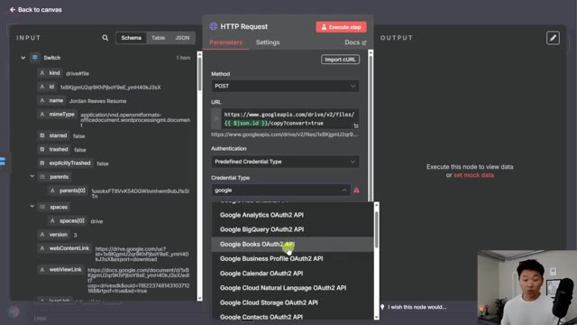
*⏱️ 00:09:47 — Interface n8n affichant la configuration d'un nœud « HTTP Request » avec le menu déroulant de sélection du type d'authentification ouvert.*

---

### ⏱️ `[00:10:14 - 00:10:34]` | Segment #25

**🔊 Audio (Transcription Intégrale Mot pour Mot en Français) :**
> a Google doc. So this is the one we can pull into NNN and actually use to get the text from it. And so just to call out basically this returns information and it gives us a different ID, which would be, sorry, there's a lot of different IDs. It would be this one right here. Not the one that's like in the parent object over here. It's not this ID, it is the one over here.

**👁️ Analyse Visuelle d'Écran (gemini-3.5-flash-lite) :**
**Interface & Outils** : Plateforme d'automatisation n8n (éditeur de workflow).

**Contenu textuel & Code** : Configuration du nœud HTTP Request pour Google Drive : URL API avec variable {{ $json.id }}, méthode POST, authentification OAuth2, et détails JSON des fichiers Google Drive (ID, mimeType, webContentLink).

**Action / Démonstration** : Le présentateur explique la configuration du nœud pour extraire l'ID du fichier Google Doc afin de l'utiliser dans les étapes suivantes du workflow.

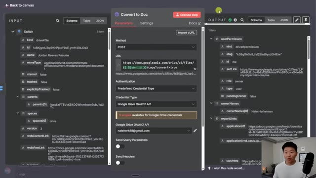
*⏱️ 00:10:19 — Une capture d'écran de l'interface de travail n8n montrant un nœud "Convert to Doc" au centre avec les données JSON d'entrée (à gauche) et les données de sortie (à droite) extraites de Google Drive.*

---

### ⏱️ `[00:10:34 - 00:10:54]` | Segment #26

**🔊 Audio (Transcription Intégrale Mot pour Mot en Français) :**
> Okay, so now that we have it in our Google Drive, the next thing we need to do is download it back into NNN. So I'm gonna click on the plus, we're gonna add a drive node, and this is going to be download file. And then we're able to use that ID to pull it in. So I'm just going to scroll down to that ID that I told you guys it was not the one in the parents. We're gonna scroll past parents and we should see right here ID.

**👁️ Analyse Visuelle d'Écran (gemini-3.5-flash-lite) :**
**Interface & Outils** : n8n (éditeur de workflow d'automatisation)

**Contenu textuel & Code** : Nœuds de workflow (Upload to Drive, Switch, Convert to Doc), paramètres du nœud Google Drive (Credential, Resource: File, Operation: Download).

**Action / Démonstration** : Ajout d'un nouveau nœud "Google Drive" au workflow pour configurer l'opération de téléchargement de fichier.

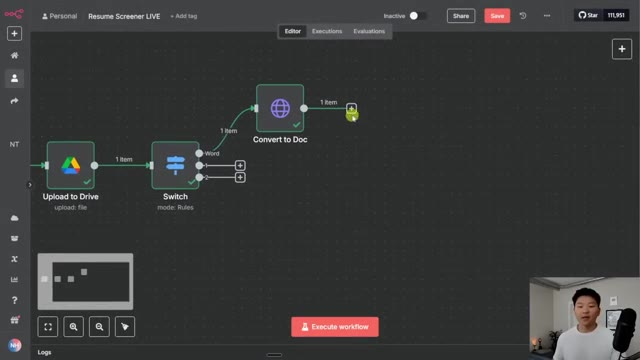
*⏱️ 00:10:39 — Interface n8n montrant un workflow avec des nœuds "Upload to Drive", "Switch" et "Convert to Doc" avec un curseur sur le point d'ajout d'un nouveau nœud.*

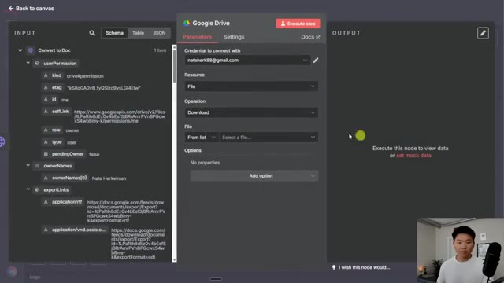
*⏱️ 00:10:44 — Fenêtre de configuration du nœud "Google Drive" dans n8n, avec les paramètres sélectionnés pour l'opération "Download".*

---

### ⏱️ `[00:10:54 - 00:11:16]` | Segment #27

**🔊 Audio (Transcription Intégrale Mot pour Mot en Français) :**
> So I'll drag that in there. And then this is an important step. What we wanna do is add an option. We wanna do a Google file conversion and add a conversion. So this is basically just saying, okay, whenever we're pulling in a Google doc, we're gonna turn it into this format, which is going to be PDF. We'll just keep it as PDF. So I know it's weird that we converted a word to a doc, and now we're converting a doc to a PDF, but just stick with me.

**👁️ Analyse Visuelle d'Écran (gemini-3.5-flash-lite) :**
**Interface & Outils** : Outil d'automatisation de workflow type n8n.

**Contenu textuel & Code** : Panneau de configuration du nœud : "Credential", "Resource: File", "Operation: Download", champ "File" avec expression dynamique `{{ $json.id }}`, et section "Options" avec le bouton "Add Conversion".

**Action / Démonstration** : Configuration du nœud Google Drive pour ajouter une règle de conversion de fichier (prélude à la sélection du format PDF).

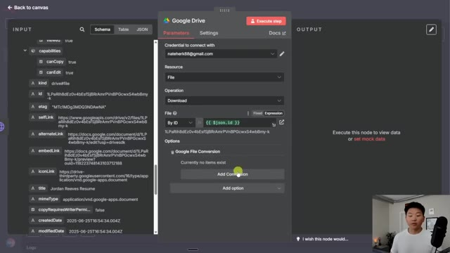
*⏱️ 00:10:59 — Interface de configuration du nœud "Google Drive" dans un outil d'automatisation de workflow (type n8n), affichant les paramètres de téléchargement de fichier et l'option de conversion.*

---

### ⏱️ `[00:11:16 - 00:11:36]` | Segment #28

**🔊 Audio (Transcription Intégrale Mot pour Mot en Français) :**
> So now we have our resume over here as a PDF, and then it's super easy. We're gonna add another node. We're gonna type extract and we're gonna be extracting text from a PDF. All we have to do is make sure that the input binary field right here matches the field right here. And when we hit execute step, we get basically all the actual text back from the resume.

**👁️ Analyse Visuelle d'Écran (gemini-3.5-flash-lite) :**
**Interface & Outils** : n8n (outil d'automatisation de workflow low-code).

**Contenu textuel & Code** : Configuration du paramètre "Input Binary Field" réglé sur "data", opération définie sur "Extract From PDF".

**Action / Démonstration** : Sélection et configuration d'un nœud d'extraction de données à partir d'un fichier PDF au sein d'un workflow automatisé.

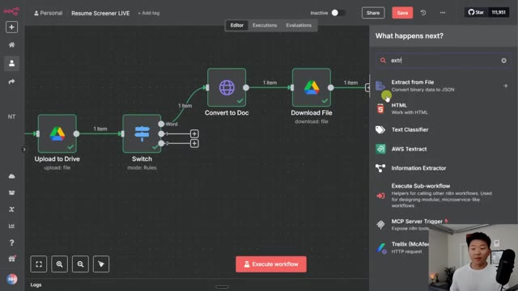
*⏱️ 00:11:21 — Interface n8n montrant le canevas de workflow avec une barre latérale ouverte pour rechercher et ajouter un nœud "Extract from File".*

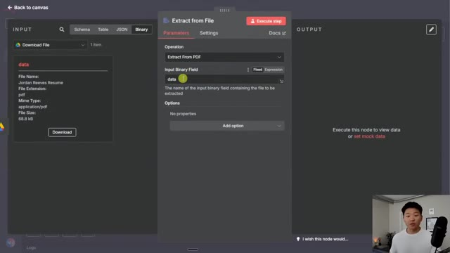
*⏱️ 00:11:26 — Interface de configuration du nœud "Extract from File" dans n8n, affichant les paramètres pour extraire le texte d'un PDF à partir du champ binaire nommé "data".*

---

### ⏱️ `[00:11:36 - 00:12:01]` | Segment #29

**🔊 Audio (Transcription Intégrale Mot pour Mot en Français) :**
> Okay, so we're just gonna continue and build the rest of the logic for the whole workflow. And then we'll come back and we'll set up PDF and text. But what's next is that we wanna standardize the input. So I'm gonna add a node and I'm gonna call this one set. We'll just call this like standardize. And all I have to do is basically, we wanna set everything that's coming in, all of the resume text, which would be down here, in one field.

**👁️ Analyse Visuelle d'Écran (gemini-3.5-flash-lite) :**
**Interface & Outils** : n8n (outil d'automatisation de workflow).

**Contenu textuel & Code** : Le workflow traite des fichiers (PDF/Word) via une série d'étapes d'extraction et de conversion. Le nœud "Standardize" est configuré avec un mode "Manual Mapping" pour définir des champs spécifiques (ex: "name") à partir des données d'entrée.

**Action / Démonstration** : Le présentateur modifie le workflow en ajoutant et configurant un nœud "Set" (renommé "Standardize") afin de normaliser les données extraites avant les étapes suivantes.

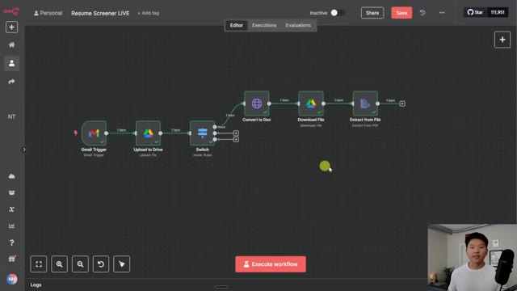
*⏱️ 00:11:42 — Vue d'ensemble du canevas de workflow montrant une chaîne de nœuds connectés (Gmail Trigger, Upload to Drive, Switch, Convert to Doc, Download File, Extract from File).*

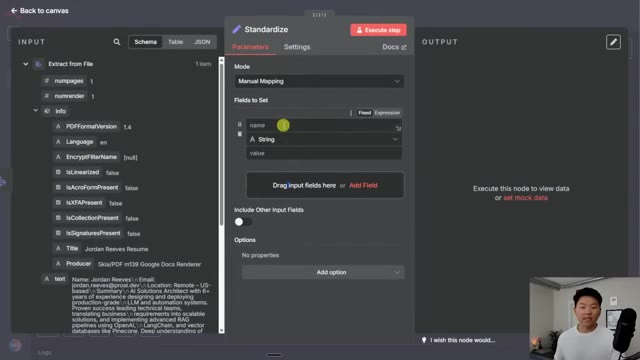
*⏱️ 00:11:54 — Gros plan sur la configuration du nœud nommé "Standardize", affichant les panneaux "INPUT" (données extraites) et les paramètres de mappage des champs.*

---

### ⏱️ `[00:12:01 - 00:12:20]` | Segment #30

**🔊 Audio (Transcription Intégrale Mot pour Mot en Français) :**
> So we're setting it to a field called text and it's being referenced as json.text. So we have to make sure later that PDFs come through, text files come through, and they all feed into this node in a field called text. So we'll set that all up later, but what I'm gonna do is just execute this step. We now have just the resume content right here.

**👁️ Analyse Visuelle d'Écran (gemini-3.5-flash-lite) :**
**Interface & Outils** : n8n (outil d'automatisation de workflows).

**Contenu textuel & Code** : Expression JavaScript `{{ $json.text }}` saisie dans le champ "Fields to Set", avec un aperçu des données extraites (nom, email, résumé du CV de Jordan Reeves).

**Action / Démonstration** : Configuration du mappage des données avant l'exécution du nœud pour standardiser le champ "text".

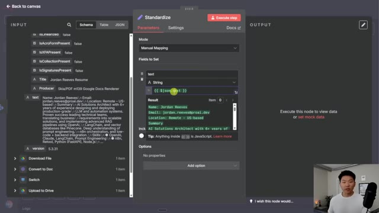
*⏱️ 00:12:06 — Interface de configuration d'un nœud "Standardize" dans un outil d'automatisation de workflow, montrant le mappage d'un champ nommé "text" utilisant une expression JSON.*

---

### ⏱️ `[00:12:20 - 00:12:41]` | Segment #31

**🔊 Audio (Transcription Intégrale Mot pour Mot en Français) :**
> What if you could turn your next product idea into a working business this weekend. As someone constantly working with AI agents, I'm always looking for ways to help improve my workflow and efficiency. And with the sponsor of today's video, Hostinger Horizons, I don't need to wait around for someone else to build a tool that will improve my workflow. They are the all-in-one AI partner. They combine design, development, and writing skills, and also integrate with the likes of Stripe and Supabase.

**👁️ Analyse Visuelle d'Écran (gemini-3.5-flash-lite) :**
**Interface & Outils** : Plateforme web Hostinger Horizons.

**Contenu textuel & Code** : Texte affiché : "What do you want to create? Type in your idea and let AI take it from there" avec une zone de saisie contenant "Build a web app to help me".

**Action / Démonstration** : Saisie d'un prompt utilisateur pour le générateur d'applications basé sur l'IA.

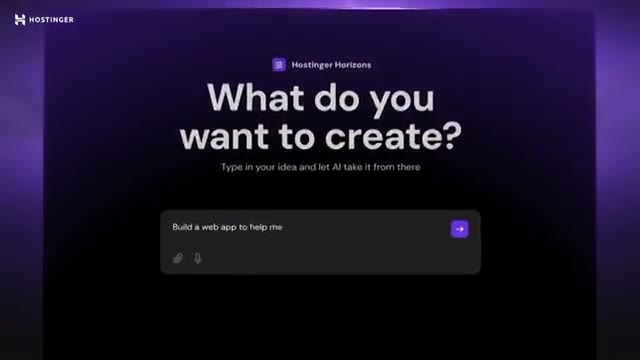
*⏱️ 00:12:36 — Interface de la plateforme "Hostinger Horizons" invitant l'utilisateur à décrire un projet à une IA.*

---

### ⏱️ `[00:12:41 - 00:13:00]` | Segment #32

**🔊 Audio (Transcription Intégrale Mot pour Mot en Français) :**
> With Horizons, I can build a web app that can fully automate many processes in my business, giving me more time to work on it instead of in it. For example, when you come to sell your AI agents and services, it's great practice to refine and improve your service using real-world feedback. But getting usable and in-depth feedback is super tedious and time-consuming. So I'm using Horizons to generate a feedback collection tool that I can send out to my clients.

**👁️ Analyse Visuelle d'Écran (gemini-3.5-flash-lite) :**
**Interface & Outils** : Hostinger Horizons (Plateforme de développement web no-code).

**Contenu textuel & Code** : Catalogue de projets : "AI projects for beginners - 30+ no-code ideas", exemples d'applications : "Restaurant reservations web app", "PPC budget tracker", "Sales pipeline tracker".

**Action / Démonstration** : Navigation sur la bibliothèque de modèles d'applications pour illustrer les capacités d'automatisation no-code.

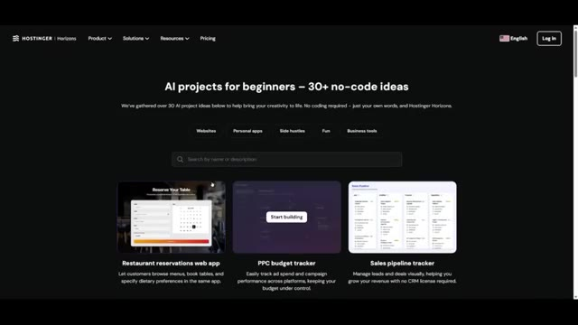
*⏱️ 00:12:51 — Interface de la plateforme "Hostinger Horizons" présentant une liste de modèles d'applications no-code, incluant des outils de réservation, de suivi budgétaire et de gestion de pipeline de vente.*

---

### ⏱️ `[00:13:00 - 00:13:20]` | Segment #33

**🔊 Audio (Transcription Intégrale Mot pour Mot en Français) :**
> I'm gonna start with one of their 30 plus no-code ideas for this, but I'll tweak it to suit my own needs. I know with AI agents, some of the people I'm selling to will be in the market for this service for the first time. So one thing I need to always understand is whether or not my service matched their expectations. I'm using a prompt here to make sure this is added to my feedback. And just like that, no code required for me to add this and it has been updated in my feedback collection tool.

**👁️ Analyse Visuelle d'Écran (gemini-3.5-flash-lite) :**
**Interface & Outils** : Outil de développement d'applications génératives basé sur l'IA (semblable à Bolt.new ou Replit Agent).

**Contenu textuel & Code** : Prompt utilisateur : "I am selling AI Agent services... I want to understand how well they understood my service, both qualitatively and quantitatively." et instructions de l'IA pour le design.

**Action / Démonstration** : Interaction avec un agent IA pour générer et modifier dynamiquement une application de collecte de feedback client.

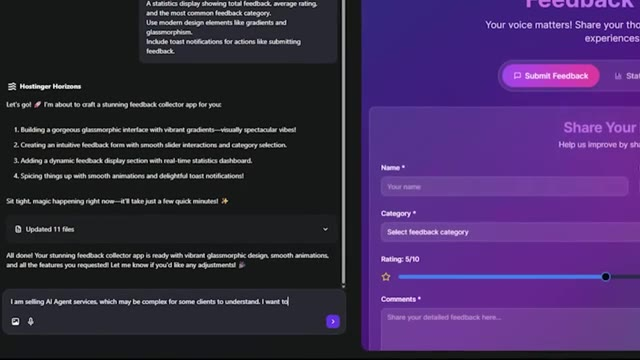
*⏱️ 00:13:10 — Interface divisée en deux : à gauche, le panneau de conversation de l'IA détaillant la création d'une application de feedback ; à droite, la prévisualisation de l'application avec un design "glassmorphic" et un formulaire de soumission.*

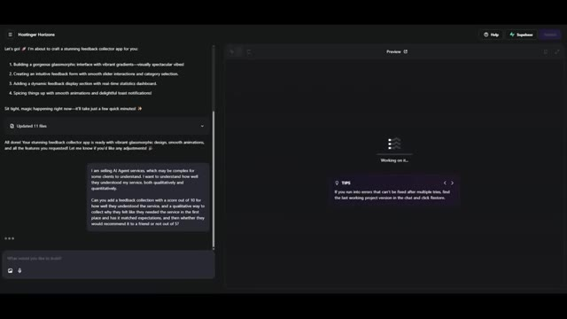
*⏱️ 00:13:15 — Interface divisée en deux : à gauche, le prompt utilisateur demandant l'ajout de fonctionnalités de mesure de satisfaction client ; à droite, le volet de prévisualisation indiquant "Working on it..." pendant la génération.*

---

### ⏱️ `[00:13:20 - 00:13:42]` | Segment #34

**🔊 Audio (Transcription Intégrale Mot pour Mot en Français) :**
> I can even change the look and feel in one prompt to match my company's branding, keeping everything clean. Once you're done, it only takes one click to go live. I'll hit the publish button right here and I'm all set. And another thing that I really like about Hostinger is that their expert support is there anytime you need it. It's around 24-7, it's multilingual, so you're never stuck for too long. Everything you need to have a great online presence is in one place, as they include email, hosting, and domains too.

**👁️ Analyse Visuelle d'Écran (gemini-3.5-flash-lite) :**
**Interface & Outils** : Plateforme de création de sites web Hostinger (Builder) et tableau de bord de statistiques d'agent IA.

**Contenu textuel & Code** : Bouton "Publish", menu de navigation "Submit Feedback", "Statistics", "View Feedback", et indicateurs chiffrés de satisfaction client.

**Action / Démonstration** : Démonstration de l'interface de publication en un clic et visualisation des données de retour d'expérience d'un agent IA.

*⏱️ 00:13:26 — Interface Hostinger montrant un éditeur web avec un bouton "Publish" en haut à droite et une grille d'options de personnalisation.*

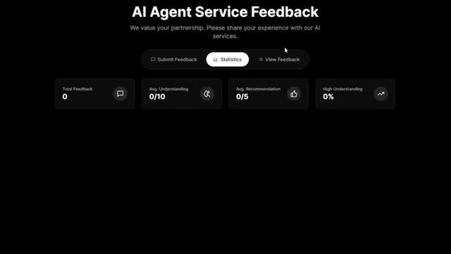
*⏱️ 00:13:31 — Tableau de bord "AI Agent Service Feedback" affichant des statistiques de performance (Feedback total, score de compréhension, recommandations).*

---

### ⏱️ `[00:13:42 - 00:14:18]` | Segment #35

**🔊 Audio (Transcription Intégrale Mot pour Mot en Français) :**
> If you want to give Horizons a try to help scale and grow your business or even to test launch a new idea, use my code NateHerk to get 10% off your first month. Okay, so what comes next after this is we want to go ahead and download the job description. So right here I have a Google Doc, which is the job title, about the role, responsibilities, qualifications, all this kind of stuff. And we need to get this into NNN so that our agent can look at it. So I'm going to add another node. We've got a lot of Google Drive nodes today, and this is going to be another download file. And I'm basically just going to choose from a list rather than giving it an ID because I know what this one's called. So I'm going to grab in job title. And obviously if you had multiple different roles, you could just come in here and switch that.

**👁️ Analyse Visuelle d'Écran (gemini-3.5-flash-lite) :**
**Interface & Outils** : n8n (outil d'automatisation de workflow)

**Contenu textuel & Code** : Nœuds de workflow : "Convert to Doc", "Download File", "Extract from File", "Standardize". Paramètres du nœud : "Credential", "Resource: File", "Operation: Download".

**Action / Démonstration** : Visualisation et configuration des paramètres d'un nœud d'automatisation pour le téléchargement et le traitement de fichiers provenant de Google Drive.

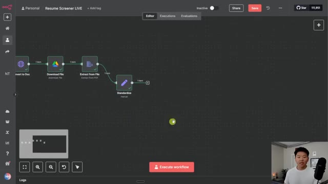
*⏱️ 00:13:51 — Interface de conception de workflow n8n montrant une séquence de nœuds connectés pour le traitement de documents (téléchargement, extraction et standardisation).*

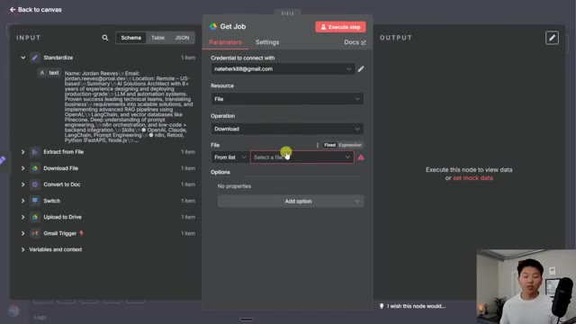
*⏱️ 00:14:09 — Interface de configuration du nœud "Get Job" dans n8n, permettant de définir les paramètres de connexion et l'opération de téléchargement de fichier via Google Drive.*

---

### ⏱️ `[00:14:18 - 00:14:44]` | Segment #36

**🔊 Audio (Transcription Intégrale Mot pour Mot en Français) :**
> And once again, I'm going to do another Google file conversion and I'm going to turn this Google doc into a PDF. We'll hit execute step and now we get the PDF. And then same thing that we did from over here. So I'm actually just going to copy and paste this node. We're going to extract text from PDF. So I'll run that. And now we're getting the actual job description right over here, job title, AI solutions architect. Okay. So we have the resume. We have the job title and description.

**👁️ Analyse Visuelle d'Écran (gemini-3.5-flash-lite) :**
**Interface & Outils** : n8n (outil d'automatisation de workflow low-code).

**Contenu textuel & Code** : Nœuds de workflow : "Get Job", "Extract from File", "Standardize" ; Configuration des paramètres : "Extract From PDF", "Input Binary Field", données JSON extraites.

**Action / Démonstration** : Le présentateur configure les paramètres d'un nœud, exécute une étape, copie/colle un nœud dans le canevas et vérifie l'extraction du texte depuis un fichier PDF.

*⏱️ 00:14:24 — Interface de configuration du nœud "Get Job" dans n8n, affichant les détails du fichier (Job Title: AI Solutions Architect) en format PDF.*

*⏱️ 00:14:31 — Vue d'ensemble du canevas de workflow n8n montrant la copie et le collage d'un nœud d'extraction de fichier.*

*⏱️ 00:14:37 — Interface de configuration du nœud "Extract from File1" dans n8n, montrant les paramètres de sortie avec le texte extrait du PDF au format JSON.*

---

### ⏱️ `[00:14:44 - 00:15:03]` | Segment #37

**🔊 Audio (Transcription Intégrale Mot pour Mot en Français) :**
> Now we want to feed it into an AI to analyze the two of them. So I'm going to click on the plus and I'm going to add an AI agent. And now that we have this AI agent, we need to set up two things, the user message and the system message. The user message is like, hey, here's dynamic information that I'm giving you. Here's our conversation.

**👁️ Analyse Visuelle d'Écran (gemini-3.5-flash-lite) :**
**Interface & Outils** : n8n (plateforme d'automatisation de workflow).

**Contenu textuel & Code** : - Flux de données : nœuds "Extract from File", "Standardize", "Get Job".
- Configuration de l'agent : champ "Prompt (User Message)" contenant `{{ $json.chatInput }}`.
- Données en entrée : JSON affichant des métadonnées de fichier PDF (Job Title: AI Solutions Architect).

**Action / Démonstration** : Le présentateur ajoute un nœud "AI Agent" à un workflow existant et ouvre son panneau de configuration pour définir le message utilisateur (prompt) qui sera traité par l'IA.

*⏱️ 00:14:49 — Interface de workflow (n8n) montrant une séquence de nœuds connectés, avec le curseur ajoutant un nouveau nœud "AI Agent" à la fin de la chaîne.*

*⏱️ 00:14:53 — Fenêtre de configuration du nœud "AI Agent" dans n8n, affichant les paramètres "Source for Prompt (User Message)" et la zone de saisie du prompt.*

---

### ⏱️ `[00:15:03 - 00:15:22]` | Segment #38

**🔊 Audio (Transcription Intégrale Mot pour Mot en Français) :**
> And so what we want to give it as a user message is the candidate's resume. And then when we add a system message, this is basically its instructions. This is its role. So in the system message, we'll say, hey, you are an expert recruiter. You're going to be given a resume. You're going to be given a job description. And you're going to output the following things to me.

**👁️ Analyse Visuelle d'Écran (gemini-3.5-flash-lite) :**
**Interface & Outils** : n8n (workflow automation platform).

**Contenu textuel & Code** : Le panneau de configuration du nœud "AI Agent" est ouvert, affichant les paramètres "Source for Prompt (User Message)" réglé sur "Connected Chat Trigger Node" et le champ "Prompt (User Message)" contenant la variable `{{ $json.chatInput }}`. À gauche, les données extraites d'un fichier PDF (JSON) sont visibles, incluant le titre du poste "AI Solutions Architect" et une description textuelle du rôle.

**Action / Démonstration** : Le curseur de la souris survole le bouton "Add Option" dans les paramètres de configuration du nœud d'agent IA.

*⏱️ 00:15:08 — Une capture d'écran de l'interface de travail n8n montrant la configuration d'un nœud "AI Agent" pour traiter des données extraites d'un PDF.*

---

### ⏱️ `[00:15:23 - 00:15:42]` | Segment #39

**🔊 Audio (Transcription Intégrale Mot pour Mot en Français) :**
> So first, let's set up the actual resume real quick. I'm going to change this to define below. And I'm going to change this to an expression. And let's just open this up full screen. I'm going to type in candidates resume and then a colon just so the agent knows what we're giving it. And all I have to do now is I'm going to go back to the node where we standardized the resume input.

**👁️ Analyse Visuelle d'Écran (gemini-3.5-flash-lite) :**
**Interface & Outils** : n8n (outil d'automatisation de workflow).

**Contenu textuel & Code** : Configuration du champ "Source for Prompt" (réglé sur "Define below"), champ "Prompt (User Message)" vide, et champ "System Message" contenant "You are a helpful assistant". À gauche, une structure de données JSON extraite d'un fichier.

**Action / Démonstration** : Le présentateur est en train de configurer le nœud de l'agent IA pour préparer l'injection des données d'un CV (candidat).

*⏱️ 00:15:27 — Interface d'édition d'un nœud "AI Agent" dans n8n, montrant les paramètres de configuration du prompt et du message système.*

---

### ⏱️ `[00:15:42 - 00:16:02]` | Segment #40

**🔊 Audio (Transcription Intégrale Mot pour Mot en Français) :**
> and I'm gonna drag in the text. So now the agent's looking at Jordan Reeves resume and his skills, all this kind of stuff. And then for the system message, when we open this up, I'm gonna make an expression, make it full screen and get rid of this. I'm gonna paste in this system message real quick. And you guys can take a screenshot of this system message and give it to ChatGPT and extract the text from it, or I'll drop it in my FreeSchool community.

**👁️ Analyse Visuelle d'Écran (gemini-3.5-flash-lite) :**
**Interface & Outils** : n8n (outil d'automatisation de workflow).

**Contenu textuel & Code** : Éditeur d'expression JavaScript `{{ $('Standardize').item.json.text }}` et panneau de prévisualisation affichant les données extraites du CV de "Jordan Reeves" (compétences, expérience, email).

**Action / Démonstration** : Le présentateur configure l'extraction et la standardisation des données du CV à l'intérieur d'un noeud d'expression dans le workflow.

*⏱️ 00:15:47 — Une fenêtre modale d'édition de noeud dans n8n montrant la configuration d'une expression pour traiter les données d'un CV.*

---

### ⏱️ `[00:16:02 - 00:16:22]` | Segment #41

**🔊 Audio (Transcription Intégrale Mot pour Mot en Français) :**
> And I'll also drop this entire workflow in my FreeSchool community. So if you wanna download it, you certainly can. That community will also be linked in the description. And what you would do is you'd come into here, you'd click on YouTube resources, or you'd search for the title of this video. And like, let's say this is a video, you would right here have the JSON file of the workflow to download. And then I'd also attach a PDF of the prompts or something like that.

**👁️ Analyse Visuelle d'Écran (gemini-3.5-flash-lite) :**
**Interface & Outils** : Plateforme communautaire Skool.

**Contenu textuel & Code** : Fichier JSON nommé « YouTube_Strategist.json » prêt à être téléchargé par les membres.

**Action / Démonstration** : Navigation dans la communauté pour localiser et télécharger le workflow sous forme de fichier JSON.

*⏱️ 00:16:07 — Interface de la plateforme communautaire « AI Automation Society » sur Skool, montrant le fil d'actualité avec des publications épinglées par Nate Herk, incluant la section « YouTube Resources ».*

*⏱️ 00:16:17 — Fenêtre contextuelle affichée après avoir cliqué sur un fichier attaché, indiquant « No preview available for YouTube_Strategist.json » avec un bouton de téléchargement bien visible.*

---

### ⏱️ `[00:16:22 - 00:16:49]` | Segment #42

**🔊 Audio (Transcription Intégrale Mot pour Mot en Français) :**
> Anyways, at a high level, I'm saying you are an expert technical recruiter specializing in AI automation and software roles. You have been given a job description and a candidate resume. Your task is to analyze the resume in relation to the job description and provide a detailed screening report. And then I told it what I wanted to do, like as far as output. So we wanted to give us candidate strengths, candidate weaknesses, the risk factor, the reward factor, an overall fit rating out of 10, and then a justification for that rating.

**👁️ Analyse Visuelle d'Écran (gemini-3.5-flash-lite) :**
**Interface & Outils** : n8n (plateforme d'automatisation de workflows).

**Contenu textuel & Code** : Configuration d'un bloc "Expression" JavaScript traitant des métadonnées de fichier (PDF) et un prompt détaillé structurant l'analyse d'un candidat : "You are an expert technical recruiter specializing in AI, automation, and software roles...".

**Action / Démonstration** : Configuration d'un agent IA au sein d'un workflow pour automatiser le criblage (screening) de CV par rapport à une fiche de poste.

*⏱️ 00:16:29 — Interface d'édition de flux de travail montrant la configuration d'un nœud d'expression traitant des données extraites d'un fichier PDF (CV) pour définir le rôle d'un recruteur technique expert en IA.*

---

### ⏱️ `[00:16:49 - 00:17:08]` | Segment #43

**🔊 Audio (Transcription Intégrale Mot pour Mot en Français) :**
> And then finally, we're giving it a variable, which is the job description. And that is exactly why we pulled it in over here and extracted the text from it. So I just dragged in this variable right here. And you can see what that comes through as is our entire job description over here. So now it has all the context it needs and it's also been system prompted. But before we can run this, we need to connect a brain.

**👁️ Analyse Visuelle d'Écran (gemini-3.5-flash-lite) :**
**Interface & Outils** : n8n (Workflow automation platform).

**Contenu textuel & Code** : Variables d'extraction de données JSON, prompt système pour un recruteur expert en IA, et syntaxe d'expression {{ $json.text }} pour l'injection dynamique des données.

**Action / Démonstration** : Configuration des paramètres d'un nœud "AI Agent" pour traiter les données extraites d'un fichier et définition des instructions de profilage pour l'IA.

*⏱️ 00:16:54 — Interface de configuration d'un nœud dans n8n montrant l'éditeur d'expression avec les variables du document extrait et le prompt système pour le recrutement technique.*

*⏱️ 00:17:03 — Interface principale du nœud "AI Agent" dans n8n, affichant les paramètres du prompt incluant la variable `{{ $json.text }}` pour le contenu du CV.*

---

### ⏱️ `[00:17:08 - 00:17:27]` | Segment #44

**🔊 Audio (Transcription Intégrale Mot pour Mot en Français) :**
> So I'm gonna click on the chat model button And I'm just gonna choose a OpenAI chat model because I wanna use a reasoning model. You don't necessarily have to do that. You can play around with different models. But for this case, I wanna go with 04 mini, and we're gonna use OpenAI's reasoning model in order to reason through everything we told it to do.

**👁️ Analyse Visuelle d'Écran (gemini-3.5-flash-lite) :**
**Interface & Outils** : n8n (outil d'automatisation de workflow)

**Contenu textuel & Code** : Menu de sélection de modèle configuré sur "gpt-4o-mini" (affiché sous la forme gpt-4.1-mini dans l'interface), avec les champs "Credential to connect with" et "Options".

**Action / Démonstration** : Le présentateur sélectionne le modèle d'IA (OpenAI GPT-4o-mini) dans les paramètres du nœud d'automatisation.

*⏱️ 00:17:13 — Fenêtre de configuration du nœud "OpenAI Chat Model" dans l'interface de n8n, affichant les paramètres de sélection du modèle.*

---

### ⏱️ `[00:17:27 - 00:17:47]` | Segment #45

**🔊 Audio (Transcription Intégrale Mot pour Mot en Français) :**
> So now that we have that set up, I can go ahead and hit this play button above the recruiter agent, and it's going to spit out that analysis. So that just finished up and we're gonna look at it, but we're gonna realize we have an issue. So it did everything we wanted. It gave us our strengths, it gave us our weaknesses, it gave everything in one field. And this would not be very easy to drag into a Google Sheet template.

**👁️ Analyse Visuelle d'Écran (gemini-3.5-flash-lite) :**
**Interface & Outils** : n8n (plateforme d'automatisation de workflow low-code).

**Contenu textuel & Code** : Workflow comprenant : "Extract from File", "Standardize", "Get Job", "Extract from File1", et "Recruiter Agent" connecté à un modèle "OpenAI Chat Model". Le panneau de configuration affiche le prompt système et le résultat généré incluant "Candidate Strengths" et "Candidate Weaknesses".

**Action / Démonstration** : Exécution d'un workflow d'agent IA dans n8n et consultation des résultats de l'analyse d'un CV par le "Recruiter Agent".

*⏱️ 00:17:32 — Interface n8n montrant un workflow d'automatisation pour le tri de CV ("Resume Screener LIVE"), avec un agent IA ("Recruiter Agent") en cours d'exécution.*

*⏱️ 00:17:37 — Interface détaillée du nœud "Recruiter Agent" dans n8n, affichant les paramètres de prompt et le résultat (Output) de l'analyse du CV en format texte.*

---

### ⏱️ `[00:17:47 - 00:18:12]` | Segment #46

**🔊 Audio (Transcription Intégrale Mot pour Mot en Français) :**
> So what we need to do is have it output everything differently. So I'm gonna click on require specific output format. And what this does is it allows us to add a structured output parser. So I'm gonna add a structured output parser and click on structured output parser. I'm gonna change the schema type to define using JSON schema. And then I'm gonna paste in this structured output parser, which once again, if you guys download the template and go to the free school, you'll be able to copy this exact template for free.

**👁️ Analyse Visuelle d'Écran (gemini-3.5-flash-lite) :**
**Interface & Outils** : n8n (plateforme d'automatisation de workflows).

**Contenu textuel & Code** : - Image 1 : Nœuds "Extract from File", "Standardize", "Get Job", "Recruiter Agent" et "OpenAI Chat Model".
- Image 2 : Structure JSON exemple {"state": "California", "cities": ["Los Angeles", "San Francisco", "San Diego"]}.

**Action / Démonstration** : - Image 1 : Visualisation de l'architecture du workflow d'automatisation.
- Image 2 : Configuration du "Structured Output Parser" pour forcer une sortie de données structurée selon un schéma JSON spécifique.

*⏱️ 00:17:53 — Interface de workflow visuel montrant un pipeline de traitement de données (Resume Screener) avec plusieurs nœuds connectés, dont un "Recruiter Agent" relié à un modèle "OpenAI Chat Model".*

*⏱️ 00:18:00 — Interface de configuration du nœud "Structured Output Parser", affichant un éditeur de schéma JSON permettant de définir le format de sortie attendu pour les données traitées par l'agent.*

---

### ⏱️ `[00:18:12 - 00:18:30]` | Segment #47

**🔊 Audio (Transcription Intégrale Mot pour Mot en Français) :**
> So basically this is just telling it how to output everything in different fields. So if I hit play and we run the exact same agent, exact same prompt, exact same resume, you'll see that it's gonna give us our strengths, weaknesses, all the stuff we asked for in different fields and we'll be able to drag it later into Google Sheets really easily.

**👁️ Analyse Visuelle d'Écran (gemini-3.5-flash-lite) :**
**Interface & Outils** : n8n (éditeur de workflow visuel).

**Contenu textuel & Code** : Workflow composé des nœuds : "Get Job" (Google Drive), "Extract from File1", "Recruiter Agent", "OpenAI Chat Model" et "Structured Output Parser".

**Action / Démonstration** : Le workflow est prêt à être exécuté manuellement via le bouton "Execute workflow" en bas de l'écran pour traiter les données du CV.

*⏱️ 00:18:16 — Interface de workflow montrant un agent de recrutement automatisé configuré avec des nœuds pour l'extraction de fichiers, un agent IA et un parseur de sortie structuré.*

---

### ⏱️ `[00:18:30 - 00:18:54]` | Segment #48

**🔊 Audio (Transcription Intégrale Mot pour Mot en Français) :**
> So there we go, it just finished up. And now we have a list of candidate strengths. It found seven things, it found four weaknesses. It said low risk factor with an explanation, high reward factor, a nine overall rating, and a justification. And it's also a lot easier to just read and look at. And so the last thing I wanna do here is we just wanna pull out the candidate's first name, last name, and email address because we don't actually have that separated yet.

**👁️ Analyse Visuelle d'Écran (gemini-3.5-flash-lite) :**
**Interface & Outils** : Interface de workflow de type plateforme d'automatisation (app.n8n.io ou similaire avec interface de configuration d'agent).

**Contenu textuel & Code** : Analyse d'un CV incluant : "risk_factor" (Low), "reward_factor" (High), "overall_fit_rating" (9) et une justification détaillée.

**Action / Démonstration** : L'agent a terminé l'exécution du processus d'analyse de données de recrutement et affiche les résultats structurés dans le panneau de droite.

*⏱️ 00:18:36 — Une interface de workflow d'automatisation montrant trois colonnes : les données d'entrée (Input), la configuration du noeud "Recruiter Agent" et les résultats (Output) générés.*

---

### ⏱️ `[00:18:54 - 00:19:13]` | Segment #49

**🔊 Audio (Transcription Intégrale Mot pour Mot en Français) :**
> We could have easily made this recruiter agent do that, but I just didn't wanna overload it with too much stuff. We wanted it to specifically focus on the analysis. And I also wanted to show you guys a cool node you can use which is called the information extractor. So this node looks at a block of text and it pulls out certain things that you define.

**👁️ Analyse Visuelle d'Écran (gemini-3.5-flash-lite) :**
**Interface & Outils** : n8n (plateforme d'automatisation de workflow low-code).

**Contenu textuel & Code** : - Workflow : Nœuds "Get Job", "Extract from File1", "Recruiter Agent", "Structured Output Parser", "OpenAI Chat Model".
- Données extraites : Liste de compétences techniques (AI solutions architecture, LLM systems, Vector DBs, LangChain, RAG pipelines, FastAPI, Node.js).
- Paramètres : Configuration du nœud "Information Extractor" (Schema Type, Attributes, Options).

**Action / Démonstration** : Le créateur montre la structure visuelle d'un workflow d'agent recruteur et détaille le fonctionnement du nœud "Information Extractor" pour traiter des données structurées.

*⏱️ 00:18:59 — Vue d'ensemble d'un workflow automatisé dans n8n, montrant le nœud "Recruiter Agent" connecté à un parseur de sortie structuré et à un modèle OpenAI.*

*⏱️ 00:19:09 — Interface de configuration du nœud "Information Extractor" dans n8n, affichant les données d'entrée "candidate_strengths" extraites du recrutement et les paramètres du schéma.*

---

### ⏱️ `[00:19:13 - 00:19:34]` | Segment #50

**🔊 Audio (Transcription Intégrale Mot pour Mot en Français) :**
> So first thing is what text to look at. I'm going to pull in the standardized resume once again. So it's looking at Jordan's resume and then we tell it what to pull out. So I'm just gonna say first name and a quick description of that is the first name of the candidate. This is gonna be a required field.

**👁️ Analyse Visuelle d'Écran (gemini-3.5-flash-lite) :**
**Interface & Outils** : n8n (interface de workflow d'automatisation)

**Contenu textuel & Code** : Panneau "Input" affichant les données textuelles du CV de "Jordan Reeves". Fenêtre modale "Information Extractor" avec les champs "Text", "Schema Type" (From Attribute Descriptions) et le bouton "Add Attribute".

**Action / Démonstration** : Configuration des paramètres du nœud pour définir les informations à extraire (ex: prénom du candidat) à partir du document source présent dans le flux de données.

*⏱️ 00:19:19 — Interface du nœud "Information Extractor" dans n8n, montrant la configuration des paramètres pour extraire des données à partir d'un CV standardisé affiché dans le panneau d'entrée (Input).*

---

### ⏱️ `[00:19:34 - 00:19:57]` | Segment #51

**🔊 Audio (Transcription Intégrale Mot pour Mot en Français) :**
> We're also gonna add last name. So I'm just gonna copy and paste this stuff down here and we're just going to say last instead of first. We will also make this one required. And then the final one will be email and we'll just say the email address of the candidate, which will also be a required field. And typically what I would do is I would just have the email address be the sender of the email that triggered it, but in this case, that was me.

**👁️ Analyse Visuelle d'Écran (gemini-3.5-flash-lite) :**
**Interface & Outils** : n8n (outil d'automatisation de workflow).

**Contenu textuel & Code** : Configuration du champ "Name" avec la valeur "lastname", type "String", et une description "the first name of the candidate".

**Action / Démonstration** : Le présentateur est en train de configurer les paramètres du nœud pour définir le champ "lastname" dans le schéma d'extraction de données.

*⏱️ 00:19:40 — Interface du nœud "Information Extractor" dans un outil d'automatisation (n8n), montrant la configuration des champs de données pour extraire des informations d'un candidat.*

---

### ⏱️ `[00:19:57 - 00:20:16]` | Segment #52

**🔊 Audio (Transcription Intégrale Mot pour Mot en Français) :**
> And I just wanna show you guys that it can pull out an email. So these are the three things that the agent's looking for. And this node uses AI to read and analyze. So I'm gonna plug in the chat model once again, just to the same one to keep things clean. And if I hit run above this information extractor, it will pull out first name, last name, and email address. All right, there we go.

**👁️ Analyse Visuelle d'Écran (gemini-3.5-flash-lite) :**
**Interface & Outils** : n8n (plateforme d'automatisation de workflow).

**Contenu textuel & Code** : Le workflow inclut des nœuds connectés : un "Recruiter Agent" relié à un "Structured Output Parser" et un "OpenAI Chat Model". Le nœud "Information Extractor" est sélectionné et en attente de configuration pour le modèle.

**Action / Démonstration** : Le présentateur est en train de configurer le nœud "Information Extractor" en connectant le modèle de chat pour permettre l'extraction automatique de données, comme l'adresse e-mail d'un candidat.

*⏱️ 00:20:02 — Une vue de l'interface de flux de travail n8n montrant un workflow de recrutement automatisé composé de plusieurs nœuds (Standardize, Get Job, Extract from File1, Recruiter Agent, et Information Extractor).*

---

### ⏱️ `[00:20:17 - 00:20:39]` | Segment #53

**🔊 Audio (Transcription Intégrale Mot pour Mot en Français) :**
> We have Jordan Reeves and Jordan.Reeves at proai.dev. Okay, so now we're pretty much done. We just have to write all the data back to our Google Sheet. So I'm gonna click on the plus. I'm gonna type in sheets, and we're gonna do append row in sheet. If you guys wanna follow along, you can download this exact template, by the way, for free. Also my FreeSchool community, and you'll make a copy, and then you can just pretty much map everything the same way I do here.

**👁️ Analyse Visuelle d'Écran (gemini-3.5-flash-lite) :**
**Interface & Outils** : Outil de construction de workflows d'IA (Type Flowise/LangFlow) et Google Sheets.

**Contenu textuel & Code** : Nœuds logiques de traitement de données (Recruiter Agent, Extractor) et structure de colonnes d'un tableur pour l'exportation de données de recrutement.

**Action / Démonstration** : Le présentateur explique la structure du workflow d'IA avant de passer à l'étape d'intégration pour enregistrer les résultats dans une feuille de calcul Google Sheets.

*⏱️ 00:20:22 — Interface de conception de workflow (type Flowise ou similaire) affichant des nœuds connectés : 'Recruiter Agent', 'Information Extractor', ainsi que des composants 'Structured Output Parser' et 'OpenAI Chat Model'.*

*⏱️ 00:20:33 — Une feuille Google Sheets vide intitulée 'Resume Screener' avec des colonnes prédéfinies : Date, Resume, First Name, Last Name, Email, Strengths, Weaknesses, Risk Factor, Reward Factor, Overall Fit, Justification.*

---

### ⏱️ `[00:20:39 - 00:21:00]` | Segment #54

**🔊 Audio (Transcription Intégrale Mot pour Mot en Français) :**
> So let's go back into our NNN. We're going to choose the document to pull from or to write into, which is resume screener. We're going to choose the sheet, which is just sheet one. And then it's going to pull up with all the columns here and we can configure what to send over. So the first thing is date. I'm going to make this an expression and I'm going to do two curly braces and do dollar sign now, which pulls up the date.

**👁️ Analyse Visuelle d'Écran (gemini-3.5-flash-lite) :**
**Interface & Outils** : n8n (workflow automation platform).

**Contenu textuel & Code** : Panneau de configuration du nœud "Google Sheets" : paramètres de connexion, sélection de ressource ("Sheet Within Document"), opération ("Append Row"), et liste des documents disponibles ("Resume Screener", "YouTube Strategist", etc.).

**Action / Démonstration** : Le présentateur sélectionne le document "Resume Screener" dans la liste déroulante pour configurer le nœud de sortie.

*⏱️ 00:20:44 — Interface n8n affichant le panneau de configuration d'un nœud Google Sheets, avec un menu déroulant ouvert permettant de sélectionner un document (ici, "Resume Screener").*

---

### ⏱️ `[00:21:01 - 00:21:22]` | Segment #55

**🔊 Audio (Transcription Intégrale Mot pour Mot en Français) :**
> I'm real quick just going to format this so it looks a little cleaner. So I'm going to do dot format, which now we have the date like this. But then also I want to add a timestamp. So I'm going to do H colon A, no, M, M space A. And that now gives us the 1107 AM. So every time a new resume comes in, we'll get the timestamp that it came in as well.

**👁️ Analyse Visuelle d'Écran (gemini-3.5-flash-lite) :**
**Interface & Outils** : n8n (éditeur de workflow no-code).

**Contenu textuel & Code** : Expression JavaScript : `{{ $now.format('yyyy-MM-dd') }}` affichée dans le champ "Date", avec une infobulle explicative sur la fonction `format(fmt)`.

**Action / Démonstration** : Le présentateur modifie le format de la date pour nettoyer les données insérées dans Google Sheets.

*⏱️ 00:21:06 — Interface de configuration du nœud Google Sheets dans n8n, affichant l'éditeur d'expression pour formater la date.*

---

### ⏱️ `[00:21:23 - 00:21:43]` | Segment #56

**🔊 Audio (Transcription Intégrale Mot pour Mot en Français) :**
> All right, and now we're gonna put in the actual resume. And by resume, I mean the link because we put it into our Google Drive. So I'm gonna do that right here where it says upload the drive. We wanna look at the output from this node because it will give us a web view link right here. So I can drag that in. And now we have a database in Google Sheets where we can see all the information about a candidate and also just go ahead and click on that resume if we want to.

**👁️ Analyse Visuelle d'Écran (gemini-3.5-flash-lite) :**
**Interface & Outils** : n8n (éditeur de workflow d'automatisation)

**Contenu textuel & Code** : Configuration du nœud Google Sheets affichant les champs : Date (avec expression {{ $now.format('yyyy-MM-dd h:mm a') }}), Resume, First Name, Last Name, Email, et Strengths.

**Action / Démonstration** : Configuration manuelle du mapping des colonnes pour envoyer les données extraites vers une feuille de calcul Google Sheets.

*⏱️ 00:21:28 — Interface d'édition de nœud n8n configurant une étape Google Sheets pour le mapping des données d'un candidat.*

---

### ⏱️ `[00:21:43 - 00:22:06]` | Segment #57

**🔊 Audio (Transcription Intégrale Mot pour Mot en Français) :**
> And then the rest of this is very, very drag and drop. We've got first name, last name and email, which we just got. So let me put these in here. And now we have the output of our recruiter agent. So I open this guy up. We can see strengths. I'm going to put in strengths. And what I'm going to do real quick is I'm just going to do a quick function to make this more readable. So at the end, I'm going to type dot join. And then in the parentheses, I'm going to do two quotes.

**👁️ Analyse Visuelle d'Écran (gemini-3.5-flash-lite) :**
**Interface & Outils** : Plateforme d'automatisation de workflow (n8n ou similaire).

**Contenu textuel & Code** : Champs de mapping : "Resume", "First Name" (valeur : {{ $json.output['first name'] }}), "Strengths", "Weaknesses", "Risk Factor", "Reward Factor". Données extraites : "first name: Jordan", "last name: Reeves", "email: jordan.reeves@proal.dev".

**Action / Démonstration** : Mapping des champs issus de l'agent "Information Extractor" vers les colonnes correspondantes d'une feuille Google Sheets.

*⏱️ 00:21:49 — Interface d'automatisation de workflow (type n8n) affichant la configuration d'un nœud Google Sheets, avec les données extraites d'un candidat à gauche.*

---

### ⏱️ `[00:22:06 - 00:22:25]` | Segment #58

**🔊 Audio (Transcription Intégrale Mot pour Mot en Français) :**
> and then I'm gonna do nn to make two new lines. And now we can see it's basically just a lot more readable. And I'm just gonna copy that dot join function because we're gonna use it again for weaknesses. If I close out of strengths, there's our weaknesses and I'm gonna do paste. So now we have that a lot cleaner as well.

**👁️ Analyse Visuelle d'Écran (gemini-3.5-flash-lite) :**
**Interface & Outils** : n8n (automatisation de workflows).

**Contenu textuel & Code** : Expression JavaScript : `{{ $('Recruiter Agent').item.json.output.candidate_strengths.join("\n\n") }}`.

**Action / Démonstration** : L'utilisateur configure des champs de données via des expressions JavaScript pour formater correctement la sortie des informations extraites par l'agent IA avant de les envoyer vers Google Sheets.

*⏱️ 00:22:11 — Interface n8n montrant l'éditeur d'expression avec une fonction .join("\n\n") appliquée aux points forts (strengths) d'un candidat, avec le résultat formaté à droite.*

*⏱️ 00:22:20 — Interface n8n montrant la configuration d'un nœud Google Sheets où l'utilisateur s'apprête à coller l'expression JS pour le champ "Weaknesses".*

---

### ⏱️ `[00:22:27 - 00:22:49]` | Segment #59

**🔊 Audio (Transcription Intégrale Mot pour Mot en Français) :**
> Now we wanna do risk factor. So what I'm gonna do is open this guy up and I'm basically just going to drag in the score. I'm gonna manually hit enter twice and then do an explanation so we can see like that. I'm going to do the exact same thing for the reward factor. So we'll do the score, enter, enter, explanation. And then we have our last ones, which are overall fit and justification for rating.

**👁️ Analyse Visuelle d'Écran (gemini-3.5-flash-lite) :**
**Interface & Outils** : n8n (outil d'automatisation de workflow)

**Contenu textuel & Code** : Arborescence JSON affichant : "risk_factor" (score: Low, explanation: "Candidate is highly aligned...") et "reward_factor" (score: High, explanation: "Best-case scenario...").

**Action / Démonstration** : Le présentateur navigue dans les données de sortie du nœud "Recruiter Agent" pour préparer l'insertion des variables "score" et "explanation" dans l'éditeur d'expression.

*⏱️ 00:22:32 — Interface d'édition d'expression dans n8n montrant la structure de données du "Recruiter Agent" avec les champs "risk_factor" et "reward_factor".*

---

### ⏱️ `[00:22:49 - 00:23:10]` | Segment #60

**🔊 Audio (Transcription Intégrale Mot pour Mot en Français) :**
> And we should be mapped up. So all I have to do now is hit execute step. We'll go into the sheet and we'll watch that data about Jordan Reeves pop in here. All right, cool. And real quick, we can see we have the strengths and weaknesses. We have the risk factor, which is low. The candidate is highly aligned with the core requirements. Worst case scenario involves a short ramp up on unfamiliar LLM providers or internal governance processes.

**👁️ Analyse Visuelle d'Écran (gemini-3.5-flash-lite) :**
**Interface & Outils** : Google Sheets.

**Contenu textuel & Code** : En-têtes de colonnes : "Date", "Resume", "First Name", "Last Name", "Email", "Strengths", "Weaknesses", "Risk Factor", "Reward Factor", "Overall Fit", et "Justification".

**Action / Démonstration** : Le présentateur s'apprête à déclencher une automatisation pour remplir automatiquement ce tableau avec les données extraites d'un candidat.

*⏱️ 00:22:54 — Une feuille de calcul Google Sheets nommée "Resume Screener" avec des colonnes prédéfinies pour l'analyse de candidatures.*

---

### ⏱️ `[00:23:10 - 00:23:33]` | Segment #61

**🔊 Audio (Transcription Intégrale Mot pour Mot en Français) :**
> We've got a high reward factor. Best case scenario is the candidate immediately drives multiple AI projects, reduces delivery time via reusable architectures, and becomes a long-term strategic leader. We've got an overall fit of nine and then some justification there. So we've done all the heavy lifting. Now all we have to do is come back in here and just set up the two other file types, which are PDF or text file.

**👁️ Analyse Visuelle d'Écran (gemini-3.5-flash-lite) :**
**Interface & Outils** : Google Sheets (Tableur) et n8n (Outil d'automatisation de workflow).

**Contenu textuel & Code** : Dans Google Sheets : texte d'évaluation du candidat ("Best-case scenario the candidate immediately drives..."). Dans n8n : nœuds connectés pour l'extraction de fichiers, traitement par agent IA et parsing de données structurées.

**Action / Démonstration** : Visualisation des résultats de sortie dans le tableau de bord Google Sheets et présentation du schéma logique du workflow d'automatisation du recrutement.

*⏱️ 00:23:16 — Une feuille Google Sheets nommée "Resume Screener" affichant les données d'analyse d'un candidat (Jordan Reeves), incluant des colonnes pour les forces, faiblesses, facteur de risque et une justification détaillée.*

*⏱️ 00:23:27 — Interface de conception de workflow sur n8n, montrant une chaîne de traitement automatisée avec des nœuds tels que "Recruiter Agent", "OpenAI Chat Model" et l'intégration finale vers Google Sheets.*

---

### ⏱️ `[00:23:33 - 00:23:54]` | Segment #62

**🔊 Audio (Transcription Intégrale Mot pour Mot en Français) :**
> Okay, so I just sent myself a new email with a different resume. So I'll test the step and now we can see we have Tara Lopez, which is a PDF. So next step, we're just gonna upload it to our drive. And then we're going to open up this switch to set up the next route, which is PDF. So once again, all I have to do is the MIME type variable right here.

**👁️ Analyse Visuelle d'Écran (gemini-3.5-flash-lite) :**
**Interface & Outils** : n8n (plateforme d'automatisation de workflows).

**Contenu textuel & Code** : Nœuds de workflow : "Gmail Trigger", "Upload to Drive", "Switch", "Convert to Doc", "Download File", "Extract from File". Données JSON : `attachment_0`, `file name: Tara Lopez.pdf`, `mimeType: application/pdf`.

**Action / Démonstration** : Analyse et configuration des nœuds du workflow pour traiter dynamiquement les fichiers reçus par email en fonction de leur extension, préparation du routage conditionnel pour les documents PDF et Word.

*⏱️ 00:23:38 — Interface du nœud "Gmail Trigger" dans n8n affichant les métadonnées d'une pièce jointe nommée "Tara Lopez.pdf".*

*⏱️ 00:23:44 — Vue d'ensemble du workflow "Resume Screener" sur le canevas n8n avec les nœuds Gmail, Google Drive, Switch et les étapes de conversion/extraction.*

*⏱️ 00:23:49 — Configuration détaillée du nœud "Switch" dans n8n, montrant les paramètres de routage basés sur le type de fichier (Word/PDF).*

---

### ⏱️ `[00:23:54 - 00:24:15]` | Segment #63

**🔊 Audio (Transcription Intégrale Mot pour Mot en Français) :**
> And we're gonna say if the MIME type equals application slash PDF, this means it's gonna go down this branch, which is called PDF. So I'll hit execute step and we can now see it goes down the PDF branch, which is right here in the middle. So that's exactly what we wanted to do. And now it's much easier than up top. We don't have to make an HTTP request. We can just download the file from Google Drive.

**👁️ Analyse Visuelle d'Écran (gemini-3.5-flash-lite) :**
**Interface & Outils** : Plateforme d'automatisation n8n.

**Contenu textuel & Code** : Expression de condition {{ $json.mimeType }} égale à "application/pdf" et structure de nœuds du workflow "Resume Screener".

**Action / Démonstration** : Configuration et exécution d'un nœud de routage conditionnel pour traiter spécifiquement les fichiers PDF dans un flux de travail automatisé.

*⏱️ 00:23:59 — Interface de configuration du nœud "Switch" dans n8n, montrant la règle conditionnelle définie sur le type MIME "application/pdf".*

*⏱️ 00:24:10 — Vue d'ensemble du workflow automatisé sur le canevas n8n montrant le flux logique entre le déclencheur Gmail, Google Drive et le nœud "Switch".*

---

### ⏱️ `[00:24:15 - 00:24:36]` | Segment #64

**🔊 Audio (Transcription Intégrale Mot pour Mot en Français) :**
> We can choose by ID and I can drag the ID in right here. And we don't even have to do a file conversion. We can literally just hit execute step. So I'll hit execute step and we will see over here we get the actual file, which is a PDF. And then once again, we're just going to extract from PDF. So I'm gonna copy the same node from earlier and now we're extracting the text out of it.

**👁️ Analyse Visuelle d'Écran (gemini-3.5-flash-lite) :**
**Interface & Outils** : n8n (plateforme d'automatisation de workflow).

**Contenu textuel & Code** : Configuration du paramètre "File" avec l'expression `{{ $json.id }}` et structure de données JSON affichée dans le volet d'entrée.

**Action / Démonstration** : Configuration et exécution manuelle d'un nœud spécifique dans le flux de travail de tri de CV.

*⏱️ 00:24:20 — Interface de configuration du nœud Google Drive pour le téléchargement d'un fichier, affichant les paramètres d'identification et l'utilisation d'une expression JSON pour le champ "File".*

*⏱️ 00:24:30 — Vue d'ensemble du canevas de workflow automatisé montrant la séquence de nœuds connectés : Switch, Download File et Extract from File.*

---

### ⏱️ `[00:24:36 - 00:24:55]` | Segment #65

**🔊 Audio (Transcription Intégrale Mot pour Mot en Français) :**
> So you can see over here, we have our resume in a field called text, which is perfect because we can now just drag it into the set node and it's going to come through, whether it is a Word doc or a PDF, it always gets standardized right here. And now the rest of the process is easy. I'm basically just gonna hit play on the Google Sheet and that's gonna run everything else, which is getting the job description.

**👁️ Analyse Visuelle d'Écran (gemini-3.5-flash-lite) :**
**Interface & Outils** : n8n (outil d'automatisation de workflow).

**Contenu textuel & Code** : Diagramme de nœuds incluant "Switch" (pour le routage Word/PDF), "Download File", "Extract from File" et "Standardize".

**Action / Démonstration** : Le présentateur explique la logique de traitement des fichiers (PDF/Word) au sein du workflow automatisé pour standardiser les données extraites des CV.

*⏱️ 00:24:41 — Interface du workflow n8n montrant un processus automatisé de tri de CV avec des nœuds de connexion pour Google Drive, conversion de documents et extraction de fichiers.*

---

### ⏱️ `[00:24:55 - 00:25:14]` | Segment #66

**🔊 Audio (Transcription Intégrale Mot pour Mot en Français) :**
> Our recruiter agent is now reasoning and giving us an analysis. It's going to extract the name and email once again, and then we'll pop over to the Google Sheet and we'll see that everything ran as expected. Okay, so here we are just waiting for this to pop in. There it goes. One thing I'll show real quick is that we could click onto this and we will see the resume.

**👁️ Analyse Visuelle d'Écran (gemini-3.5-flash-lite) :**
**Interface & Outils** : n8n (workflow automation), Google Sheets.

**Contenu textuel & Code** : Workflow n8n avec nœuds de traitement (Standardize, Get Job, Recruiter Agent, Information Extractor, Google Sheets) et tableau Google Sheets rempli avec des données de recrutement (Date, Résumé, Nom, Email, Analyse qualitative).

**Action / Démonstration** : Exécution automatisée d'un workflow d'IA qui analyse des CV et envoie les données extraites et analysées vers un tableau Google Sheets pour examen.

*⏱️ 00:25:00 — Interface de conception de workflow sur n8n montrant l'exécution en cours du "Recruiter Agent", avec le nœud mis en évidence en rouge.*

*⏱️ 00:25:10 — Une feuille Google Sheets contenant des données structurées extraites de CV (nom, email, forces, faiblesses, score d'adéquation et justification).*

---

### ⏱️ `[00:25:14 - 00:25:35]` | Segment #67

**🔊 Audio (Transcription Intégrale Mot pour Mot en Français) :**
> We can also do it up here for Jordan, as you can see. There you go, there's Jordan's resume. And we can see that Tara was rated a three on the overall fit scale. We could go ahead and look at the risk, the reward, the justification, but let's just go back into NNN and set up the last branch, which is a text file. Okay, so just sent myself a text file. Let's pull it in and see if we have Brian Chen's resume as text.

**👁️ Analyse Visuelle d'Écran (gemini-3.5-flash-lite) :**
**Interface & Outils** : Google Sheets, n8n (éditeur de workflow d'automatisation).

**Contenu textuel & Code** : Dans Google Sheets : données structurées des candidats. Dans n8n : diagramme de flux (Gmail Trigger, Google Drive, Convert to Doc, Extract from PDF).

**Action / Démonstration** : Présentation des données d'évaluation des candidats suivies d'une transition vers la configuration de l'automatisation dans n8n.

*⏱️ 00:25:20 — Une feuille de calcul Google Sheets intitulée "Resume Screener" présentant les profils de candidats (Jordan et Tara) avec des évaluations détaillées incluant forces, faiblesses, facteurs de risque et score global.*

*⏱️ 00:25:30 — L'interface de l'éditeur de workflow n8n montrant un processus d'automatisation de tri de CV, avec des nœuds connectés partant d'un "Gmail Trigger" vers divers outils de traitement de documents.*

---

### ⏱️ `[00:25:35 - 00:25:55]` | Segment #68

**🔊 Audio (Transcription Intégrale Mot pour Mot en Français) :**
> We can even view it and see the text right here. I'm going to upload it to drive and then we can set up this final switch, which is for a text file. Okay, I'm gonna open up the switch. And like I said, we've just set up this one. We're gonna do the same exact thing, drag in the mine type. We're gonna grab the result. And we're saying if the mine type variable equals text slash plain, that means it's gonna go down this branch called text.

**👁️ Analyse Visuelle d'Écran (gemini-3.5-flash-lite) :**
**Interface & Outils** : n8n (automatisation de workflows).

**Contenu textuel & Code** : - Image 1 : Workflow complet : Gmail Trigger -> Upload to Drive -> Switch (avec branches Word, PDF) -> Download/Extract nodes.
- Image 2 : Détails des données d'entrée du fichier ("Brian Chen Resume", mimeType: text/plain) et paramètres du nœud Switch (Output Name: PDF, configuration des règles "A is equal to").

**Action / Démonstration** : Le présentateur explique le fonctionnement du workflow, visualise les données extraites d'un fichier, et prépare la configuration du nœud "Switch" pour gérer différents types de fichiers (mime types).

*⏱️ 00:25:40 — Vue d'ensemble du canevas n8n montrant un workflow automatisé commençant par un "Gmail Trigger" et se terminant par plusieurs nœuds de traitement de fichiers (Convert to Doc, Download, Extract).*

*⏱️ 00:25:45 — Interface de configuration détaillée du nœud "Switch" dans n8n, affichant les données d'entrée (input) à gauche, les paramètres de routage au centre, et la zone de sortie à droite.*

---

### ⏱️ `[00:25:55 - 00:26:15]` | Segment #69

**🔊 Audio (Transcription Intégrale Mot pour Mot en Français) :**
> So we'll run it. We'll see that it goes down this final branch at the bottom. And now we basically just have to do the same thing is up here where we download the file and extract the text. All right, so I gotta get this stuff out my way. I'm gonna add a new node down here which is gonna be another drive. We're gonna download a file. We're gonna do it by ID and I'm just gonna drag in the ID from the left to right there.

**👁️ Analyse Visuelle d'Écran (gemini-3.5-flash-lite) :**
**Interface & Outils** : n8n (outil d'automatisation de workflow low-code).

**Contenu textuel & Code** : Le workflow comprend des nœuds pour "Upload to Drive", un nœud "Switch" pour gérer différents types de fichiers (Word, PDF, Text), ainsi que des nœuds "Download File" et "Extract from File" pour extraire des données avant l'étape de "Standardize".

**Action / Démonstration** : Le workflow est en cours d'exécution pour traiter les fichiers via la branche "PDF", avec le curseur positionné pour ajouter de nouveaux nœuds de traitement pour la branche inférieure.

*⏱️ 00:26:00 — Une capture d'écran de l'interface de travail n8n montrant un workflow automatisé pour le traitement de documents (Resume Screener).*

---

### ⏱️ `[00:26:15 - 00:26:35]` | Segment #70

**🔊 Audio (Transcription Intégrale Mot pour Mot en Français) :**
> And now I'm gonna execute the step and we should see we get our text file over here. Okay, there we go, text file. And now I just real quick want to extract text from it. So I'm gonna type extract. I'm going to do extract from text file. And then one thing we have to do real quick is we have to change the output field to text.

**👁️ Analyse Visuelle d'Écran (gemini-3.5-flash-lite) :**
**Interface & Outils** : n8n (éditeur de workflow d'automatisation no-code).

**Contenu textuel & Code** : Nœuds de workflow ("Download File2", "Extract from File3"), paramètres de configuration des nœuds, structures de données JSON et champs d'entrée/sortie.

**Action / Démonstration** : Exécution d'une étape de téléchargement de fichier, recherche d'une action d'extraction de texte et configuration des paramètres pour le traitement du contenu du fichier.

*⏱️ 00:26:20 — Vue détaillée du nœud "Download File2" dans l'éditeur n8n affichant les données d'entrée d'un fichier texte et confirmant l'exécution réussie.*

*⏱️ 00:26:25 — Interface globale du workflow "Resume Screener LIVE" sur n8n, montrant la sélection du bloc "Extract from File" dans le menu latéral droit.*

*⏱️ 00:26:30 — Configuration du nouveau nœud "Extract from File3" dans n8n, avec le champ "Operation" réglé sur "Extract From Text File".*

---

### ⏱️ `[00:26:35 - 00:26:54]` | Segment #71

**🔊 Audio (Transcription Intégrale Mot pour Mot en Français) :**
> Because remember when we standardize the inputs, we wanna make sure everything comes out in a field called text. And now it comes through over here. If we didn't do that, it wouldn't match up right here and we wouldn't be capturing anything. So now that we've standardized all three inputs, we know we're good to go on that front. I can once again, just hit run on this Google sheet and it will go do everything else that we already set up.

**👁️ Analyse Visuelle d'Écran (gemini-3.5-flash-lite) :**
**Interface & Outils** : n8n (workflow automation platform).

**Contenu textuel & Code** : Nœud "Extract from File3" avec champ "Destination Output Field" défini sur "text", et schéma global du workflow incluant des nœuds Google Drive, "Standardize", et "Recruiter Agent".

**Action / Démonstration** : Configuration et exécution manuelle d'un nœud d'extraction de fichier pour standardiser les données d'entrée avant traitement par l'agent IA.

*⏱️ 00:26:40 — Interface de configuration du nœud "Extract from File3" montrant les paramètres d'extraction de données binaires vers un champ texte.*

*⏱️ 00:26:49 — Vue d'ensemble du workflow complet sur la plateforme n8n, illustrant plusieurs branches de nœuds menant à un "Recruiter Agent".*

---

### ⏱️ `[00:26:54 - 00:27:14]` | Segment #72

**🔊 Audio (Transcription Intégrale Mot pour Mot en Français) :**
> So there we go, it's finishing up. Let's hop into the sheet and we will watch Brian Chen's information pop in. Unfortunately, he's only a one overall fit for this job. And as you can see, we can click into this node and we can see his text file resume, which I would never recommend to submit a resume that looks like this. And that's basically it. We just built a smart AI resume screening system.

**👁️ Analyse Visuelle d'Écran (gemini-3.5-flash-lite) :**
**Interface & Outils** : Google Sheets, Google Drive (Visionneuse de documents).

**Contenu textuel & Code** : Données de recrutement : noms des candidats, forces/faiblesses, facteurs de risque, scores d'adéquation (Overall Fit) et justifications détaillées. Texte brut du CV de Brian Chen détaillant son profil de UX Designer.

**Action / Démonstration** : Le présentateur passe de la vue d'ensemble du tableau de bord de recrutement à la consultation détaillée du CV d'un candidat spécifique (Brian Chen) pour illustrer une faible adéquation au poste.

*⏱️ 00:26:59 — Une feuille Google Sheets nommée "Resume Screener" présentant un tableau d'évaluation de candidats, avec une ligne mise en évidence pour le candidat "Brian Chen" affichant un score global de "1".*

*⏱️ 00:27:09 — Un document texte affiché dans Google Drive montrant le CV de Brian Chen, avec ses informations de contact, ses compétences en design (Figma, Webflow) et son expérience professionnelle.*

---

### ⏱️ `[00:27:14 - 00:27:40]` | Segment #73

**🔊 Audio (Transcription Intégrale Mot pour Mot en Français) :**
> Obviously there's a few ways you can come in here and customize it. You'd wanna change out the trigger to match yours. You'd wanna change the job description to match yours. And you could even change the recruiter agent if you wanna get different types of insights. And then we write it back to our database where we can now have an automated system for whenever someone submits an application, we can get a bit of a brief already done for us that we can look at after we take an initial pass-through or we can use it to help us take our initial pass-through.

**👁️ Analyse Visuelle d'Écran (gemini-3.5-flash-lite) :**
**Interface & Outils** : n8n (workflow automation), Google Sheets.

**Contenu textuel & Code** : Workflow n8n avec nœuds : "Gmail Trigger", "Upload to Drive", "Extract from File", "Recruiter Agent", "Google Sheets" ; Tableau Google Sheets contenant des analyses de candidats (Jordan, Tara, Brian) avec des scores d'adéquation et feedbacks textuels.

**Action / Démonstration** : Le présentateur explique la structure logique d'un agent de recrutement automatisé et montre le résultat final de l'automatisation dans une base de données de sortie.

*⏱️ 00:27:21 — Interface de conception de workflow sur n8n montrant un pipeline complet de traitement de CV, incluant des déclencheurs, des outils d'extraction de fichiers, un agent recruteur et une intégration Google Sheets.*

*⏱️ 00:27:33 — Tableau Google Sheets final où les données extraites et analysées des candidats sont stockées, avec des colonnes pour les points forts, points faibles, facteurs de risque et une justification détaillée de l'adéquation au poste.*

---

### ⏱️ `[00:27:40 - 00:28:00]` | Segment #74

**🔊 Audio (Transcription Intégrale Mot pour Mot en Français) :**
> So I hope you guys follow this step-by-step tutorial and you learned a lot during the process. Once again, if you wanna download the workflow, I will have this one set up for you guys with sticky notes and a full setup guide when you download it in case you just wanna hop right in and test it out. But if you enjoy this type of content and you're looking for some more structured guidance on wireframing and a full course on building automations with NNN, then definitely check out my plus community.

**👁️ Analyse Visuelle d'Écran (gemini-3.5-flash-lite) :**
**Interface & Outils** : n8n (plateforme d'automatisation de workflow).

**Contenu textuel & Code** : Diagramme logique composé de nœuds connectés : "Resume Collection", "File Type", "Word Doc", "PDF", "Text File", "Standardize Input", "Get Job Description", "Analysis & Information Extract" (incluant "Recruiter Agent"), et "Model & Parser" (utilisant o4-mini).

**Action / Démonstration** : Le workflow est affiché en mode édition, prêt à être exécuté manuellement via le bouton rouge "Execute workflow" en bas de l'écran.

*⏱️ 00:27:45 — Une capture d'écran montrant l'interface de travail de n8n avec un workflow complexe automatisant le tri de CV ("Resume Screening"). Le canevas affiche plusieurs sections colorées regroupant des nœuds pour la gestion des fichiers (Word, PDF, texte), l'extraction d'informations par un agent IA (Recruiter Agent) et l'ajout de données dans une feuille de calcul.*

---

### ⏱️ `[00:28:00 - 00:28:23]` | Segment #75

**🔊 Audio (Transcription Intégrale Mot pour Mot en Français) :**
> The link for that will be down in the description. We've got a great community of members who are using NNN every single day, building automations, sharing their wins, sharing their challenges and sharing their projects. And of course we have a classroom with two full courses right now, agent zero, which is the foundations of AI automation. And then we have 10 hours to 10 seconds where you learn how to pick the process, map the steps, NNN foundations, triggers, nodes, AI prompting, all this kind of stuff.

**👁️ Analyse Visuelle d'Écran (gemini-3.5-flash-lite) :**
**Interface & Outils** : Plateforme communautaire Skool (AI Automation Society Plus).

**Contenu textuel & Code** : Titres de cours : "Agent Zero", "10 Hours to 10 Seconds", "n8n Templates", "Step-by-Step Builds", "$3M Savings Vault". Liste de chapitres techniques incluant "Relational vs. Vector DBs", "Identifying Workflow Triggers", "Data Sources and Transformation".

**Action / Démonstration** : Navigation dans l'interface de la plateforme éducative et du forum communautaire pour présenter les ressources disponibles.

*⏱️ 00:28:05 — Interface de la plateforme "AI Automation Society Plus" montrant le flux d'actualités de la communauté avec des publications épinglées.*

*⏱️ 00:28:11 — Interface de la section "Classroom" de la plateforme listant divers modules de formation comme "Agent Zero" et "10 Hours to 10 Seconds".*

*⏱️ 00:28:17 — Vue détaillée à l'intérieur du module "10 Hours to 10 Seconds", affichant le programme structuré en phases (Pick the Process, Mapping the Steps, n8n Foundations).*

---

### ⏱️ `[00:28:23 - 00:28:37]` | Segment #76

**🔊 Audio (Transcription Intégrale Mot pour Mot en Français) :**
> Full course on NNN. Anyways, we'd love to see you guys in that community, but that's gonna do it for this video. If you enjoyed, if you learned something new, please give it a like, it definitely helps me out a ton. And as always, I appreciate you guys sticking to the end of the video with me. I will see you on the next one. Thanks so much, guys.

**👁️ Analyse Visuelle d'Écran (gemini-3.5-flash-lite) :**
**Interface & Outils** : n8n (plateforme d'automatisation de workflows).

**Contenu textuel & Code** : Workflow composé de nœuds traitant différents types de fichiers (Word, PDF, Text) connectés à un agent recruteur, un extracteur d'informations et un modèle o4-mini.

**Action / Démonstration** : Visualisation du schéma d'exécution automatisé du workflow de tri et d'analyse de candidatures.

*⏱️ 00:28:26 — Interface n8n affichant un workflow complexe d'automatisation pour le filtrage de CV (Resume Screening).*

---

