# 🎬 Build Your First Research AI Agent in 12 mins (No Code)

> **Chaîne** : [Nate Herk | AI Automation](https://www.youtube.com/@nateherk/featured)  
> **Lien YouTube** : [https://www.youtube.com/watch?v=UBx4Zudvf8s](https://www.youtube.com/watch?v=UBx4Zudvf8s)  
> **Date de publication** : 20250702  
> **Durée** : 00:12:29  
> **Identifiant vidéo** : `UBx4Zudvf8s`  
> **Transcription & Analyse** : `whisper-v3-large-turbo+gemini-3.5-flash-lite`  

---

## 📌 Synthèse Exécutive & Outils

### 💡 Résumé
Dans cette vidéo intitulée **Créez votre premier agent IA de recherche en 12 minutes (Sans code)**, Nate Herk décortique les capacités pratiques d'automatisation et de développement propulsées par les modèles de pointe.

### 🛠️ Outils, Modèles & Logiciels Présentés
- **Opus 5.5 & Claude Code** : Modèles d'ingénierie et agents de codage autonome.

### 🔑 Points Clés & Enseignements Stratégiques
- Optimiser le niveau d'effort et le raisonnement des modèles IA pour des résultats industriels.
- Automatiser les cycles de création logicielle de bout en bout.

---

## ⏱️ Chronologie & Transcription Complète Audio & Visuelle (Mot pour Mot)

### ⏱️ `[00:00:00 - 00:00:19]` | Segment #01

**🔊 Audio (Transcription Intégrale Mot pour Mot en Français) :**
> À la fin de cette vidéo, vous aurez créé votre propre agent IA de recherche sans écrire une seule ligne de code, et je pense que vous serez choqués de voir à quel point c'est simple à configurer. Je vais passer en revue tout le processus avec vous étape par étape, toutes les connexions, tous les identifiants, tout ce qui est compliqué de ce genre. J'ai même pris les devants et créé un tout nouveau compte N8N afin de pouvoir faire exactement tout ce que vous ferez si vous veniez tout juste de vous inscrire sur N8N.

**👁️ Analyse Visuelle d'Écran (gemini-3.5-flash-lite) :**
**Interface & Outils** : n8n, éditeur de workflow visuel

**Contenu textuel & Code** : Paramètres du nœud d'agent IA, messages système, blocs de code JSON

**Action / Démonstration** : Configuration et test d'un agent de recherche IA dans n8n

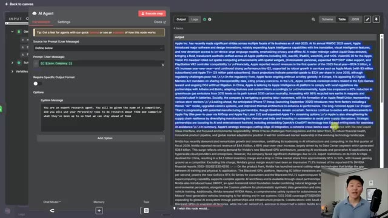
*⏱️ 00:00:05 — Interface de configuration d'un nœud d'agent IA avec le code source et le résultat des données à droite.*

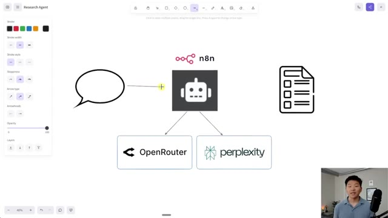
*⏱️ 00:00:10 — Schéma de workflow montrant l'intégration de n8n avec OpenRouter et Perplexity.*

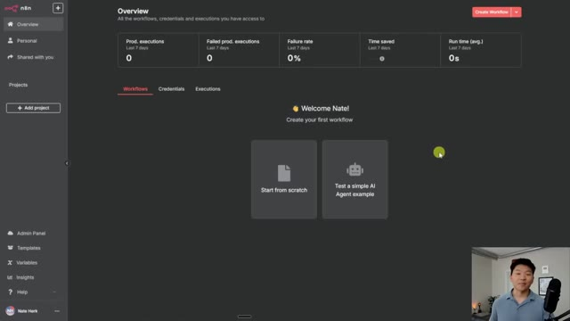
*⏱️ 00:00:15 — Tableau de bord d'accueil de la plateforme n8n pour la création de flux de travail.*

---

### ⏱️ `[00:00:20 - 00:00:44]` | Segment #02

**🔊 Audio (Transcription Intégrale Mot pour Mot en Français) :**
> Donc, si ça vous convient, allons-y. Alors, avant de plonger dans N8N et de commencer à construire, je voulais juste prendre un peu de recul très rapidement et vous expliquer, dans les grandes lignes, ce que nous faisons aujourd'hui. Il y a donc deux services auxquels nous allons devoir accéder. Le premier est OpenRouter. Le deuxième est Perplexity. OpenRouter nous permet de nous connecter à différents modèles d'IA. Cela va donc servir de cerveau pour notre agent de recherche. Et ensuite, nous allons également nous connecter à un outil appelé Perplexity, qui est en quelque sorte un outil de recherche ChatGPT sous stéroïdes.

**👁️ Analyse Visuelle d'Écran (gemini-3.5-flash-lite) :**
**Interface & Outils** : Toile numérique (type tableau blanc collaboratif).

**Contenu textuel & Code** : Logos et icônes représentant n8n, OpenRouter, Perplexity, ainsi que des icônes symbolisant une bulle de dialogue et une liste de tâches.

**Action / Démonstration** : Présentation visuelle de l'architecture du workflow et des services qui seront utilisés dans la démonstration.

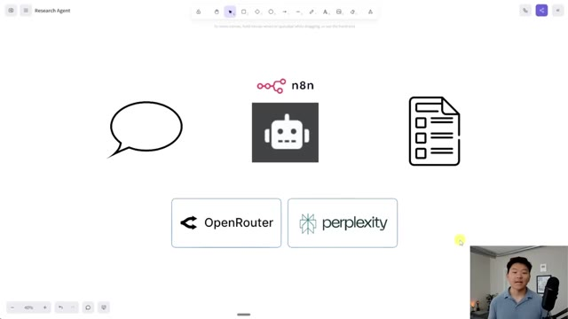
*⏱️ 00:00:26 — Un schéma explicatif sur un tableau blanc virtuel illustrant l'intégration de divers services (n8n, OpenRouter, Perplexity) pour un agent de recherche.*

---

### ⏱️ `[00:00:44 - 00:01:16]` | Segment #03

**🔊 Audio (Transcription Intégrale Mot pour Mot en Français) :**
> Donc c'est ça qui va donner à notre agent l'accès pour faire des recherches sur Internet en temps réel. Il y a donc le cerveau pour l'agent IA. Il y a l'outil que l'agent IA va utiliser. Et maintenant, comment allons-nous communiquer avec l'agent IA ? Dans l'exemple d'aujourd'hui, nous allons simplement lui envoyer un message via le chat et ensuite, il va fondamentalement faire ses recherches, utiliser son cerveau, et ensuite il va nous répondre avec une sorte de rapport de recherche. C'est donc ainsi que va fonctionner le flux d'aujourd'hui. Mais le truc génial, c'est que le déclencheur et la sortie n'ont pas besoin d'être comme ça. Une fois que nous avons construit cet agent, nous pourrions le connecter à n'importe quel processus que nous voulons. Donc peut-être qu'un nouveau prospect arrive et nous voulons faire des recherches sur le prospect. Ou peut-être que chaque jour nous avons une liste de 10 concurrents et nous voulons faire des recherches

**👁️ Analyse Visuelle d'Écran (gemini-3.5-flash-lite) :**
**Interface & Outils** : Application de tableau blanc / diagramme en ligne avec le logo n8n et les intégrations OpenRouter et Perplexity.

**Contenu textuel & Code** : Schéma d'architecture d'un agent IA connectant n8n à des services de recherche et de modèles (OpenRouter, Perplexity).

**Action / Démonstration** : Le présentateur explique l'architecture globale de l'agent IA et le rôle de chaque composant (cerveau, outil, communication).

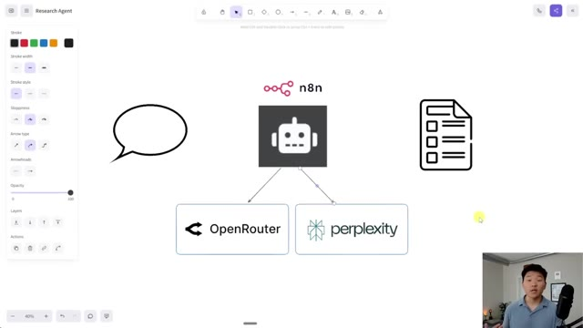
*⏱️ 00:00:52 — Schéma explicatif sur tableau blanc montrant l'architecture de l'agent IA avec n8n, OpenRouter et Perplexity.*

---

### ⏱️ `[00:01:16 - 00:01:51]` | Segment #04

**🔊 Audio (Transcription Intégrale Mot pour Mot en Français) :**
> ce qu'ils font. Il y a tellement de façons différentes d'intégrer un agent de recherche dans différents flux. Bon, maintenant que c'est fait, allons dans notre N8N, ouvrons un nouveau flux de travail et commençons avec notre agent de recherche. Bon, ce que je vais faire, c'est cliquer sur ce bouton au milieu qui dit « ajouter la première étape ». Et comme je l'ai dit, nous voulons juste discuter avec notre agent. Je vais donc choisir ici en bas sur « message de chat ». Maintenant que notre message de chat est configuré ici, nous pouvons ouvrir le chat, et c'est ici que nous pouvons taper et parler à notre agent IA et il recevra notre message. L'étape suivante consiste donc à cliquer sur ce plus après ce déclencheur de chat. Et je vais taper « agent IA » et en ajouter un par ici.

**👁️ Analyse Visuelle d'Écran (gemini-3.5-flash-lite) :**
**Interface & Outils** : n8n (plateforme d'automatisation de workflow).

**Contenu textuel & Code** : Interface utilisateur de n8n montrant la barre latérale gauche (Projects, Templates, etc.) et une zone de travail vide avec une animation de chargement au centre.

**Action / Démonstration** : Ouverture d'un nouveau flux de travail (workflow) dans n8n, en attente de l'initialisation de l'éditeur.

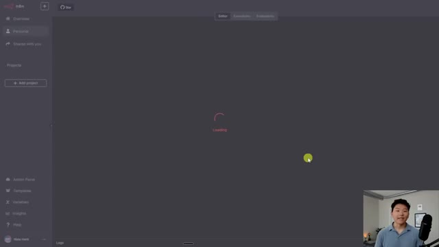
*⏱️ 00:01:25 — L'interface de n8n en cours de chargement avec un indicateur central affichant "Loading".*

---

### ⏱️ `[00:01:51 - 00:02:22]` | Segment #05

**🔊 Audio (Transcription Intégrale Mot pour Mot en Français) :**
> ici. Et maintenant, nous allons aller connecter cette première chose dont j'ai parlé, c'est-à-dire Open Router, afin de donner un cerveau à notre agent IA. Donc juste ici, modèle de chat, je vais cliquer sur le plus. Et en bas ici, je vais choisir le modèle de chat Open Router. Une fois que j'ouvre ceci, vous pouvez voir qu'il nous invite à connecter des identifiants et nous n'en avons pas pour l'instant. Et si je clique sur créer de nouveaux identifiants, il nous demande une clé API. Une clé API est fondamentalement juste un mot sophistiqué pour dire mot de passe. Donc ce que je vais faire, c'est ouvrir un nouvel onglet. Je vais taper Open Router et nous allons aller sur openrouter.ai. Vous n'avez probablement pas de compte configuré. Donc si ce n'est pas le cas, allez-y et inscrivez-vous.

**👁️ Analyse Visuelle d'Écran (gemini-3.5-flash-lite) :**
**Interface & Outils** : Interface web n8n (éditeur de workflow d'automatisation).

**Contenu textuel & Code** : Nœuds de workflow : déclencheur "When chat message received", nœud principal "AI Agent" et configuration du modèle OpenRouter Chat Model.

**Action / Démonstration** : Connexion d'un modèle OpenRouter au nœud AI Agent pour lui donner un cerveau.

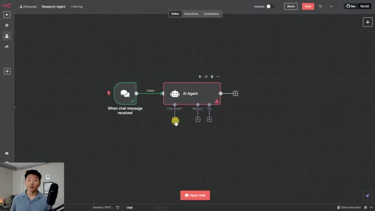
*⏱️ 00:01:59 — Vue d'ensemble d'un éditeur de workflow de type n8n avec un agent IA et ses connexions.*

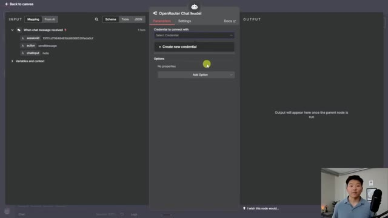
*⏱️ 00:02:06 — Panneau de configuration du modèle de chat OpenRouter ouvert dans l'interface.*

---

### ⏱️ `[00:02:22 - 00:02:42]` | Segment #06

**🔊 Audio (Transcription Intégrale Mot pour Mot en Français) :**
> Ensuite, ce que nous allons faire, c'est aller sur notre profil et nous allons aller dans clés. Donc tout ce que j'ai à faire maintenant, c'est de cliquer sur créer une clé API. Je peux nommer celle-ci, vous savez, comme vous voulez. Je vais juste appeler ça agent de recherche et maintenant je vais cliquer sur créer. Donc cela nous donne notre identifiant unique ou un mot de passe et nous allons le copier. Et vous voulez stocker cela quelque part ailleurs parce qu'il ne va plus l'afficher.

**👁️ Analyse Visuelle d'Écran (gemini-3.5-flash-lite) :**
**Interface & Outils** : Navigateur web (OpenRouter)

**Contenu textuel & Code** : Liste des clés API existantes (Elestio, course demo, demo, n8n, test) avec leurs identifiants masqués et le bouton "Create API Key" en haut à droite.

**Action / Démonstration** : Navigation vers la section des clés API pour préparer la création d'une nouvelle clé pour l'agent de recherche.

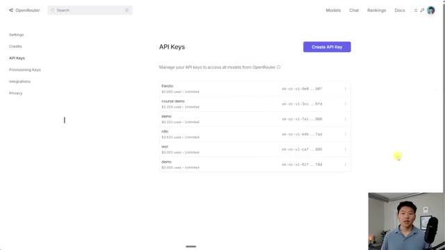
*⏱️ 00:02:27 — Interface web d'OpenRouter affichant la section de gestion des clés API avec un bouton violet "Create API Key" et une liste de clés existantes.*

---

### ⏱️ `[00:02:42 - 00:03:00]` | Segment #07

**🔊 Audio (Transcription Intégrale Mot pour Mot en Français) :**
> Et maintenant que j'ai copié cette clé, je peux revenir en arrière et modifier, et je peux la coller juste ici. Une fois que nous l'avons déposée, je vais cliquer sur enregistrer et nous devrions passer au vert, connexion testée avec succès. Donc maintenant, nous pouvons faire en sorte que notre agent IA n8n parle à Open Router et utilise ce cerveau basé sur le modèle de chat que nous choisissons. Mais très vite, revenons dans Open Router pour que je puisse simplement expliquer quelque chose.

**👁️ Analyse Visuelle d'Écran (gemini-3.5-flash-lite) :**
**Interface & Outils** : Interface web d'un outil d'automatisation de workflow (Typebot ou similaire)

**Contenu textuel & Code** : Champ de saisie "API Key *" rempli par des astérisques cachant la clé secrète, et bouton "Save"

**Action / Démonstration** : Le curseur de la souris survole le bouton "Save" pour enregistrer la clé API OpenRouter nouvellement collée.

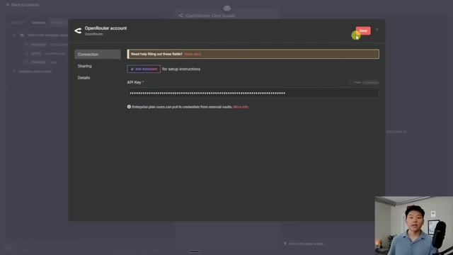
*⏱️ 00:02:46 — Fenêtre modale de configuration du compte OpenRouter montrant le champ de saisie de la clé API masquée et le bouton rouge "Save" en haut à droite, avec le présentateur en médaillon dans le coin inférieur droit.*

---

### ⏱️ `[00:03:00 - 00:03:18]` | Segment #08

**🔊 Audio (Transcription Intégrale Mot pour Mot en Français) :**
> Tout d'abord, si vous allez ici en haut sur vos crédits, c'est fondamentalement la quantité d'argent que vous avez dans votre compte Open Router. Et si vous n'avez pas de crédits là-dedans, vous ne allez pas être capable d'utiliser ce modèle d'IA comme un cerveau. Et puis la deuxième chose est que vous voulez garder votre clé API secrète parce que si quelqu'un d'autre branche votre clé API, ils vont être capables de consommer vos crédits que vous payez.

**👁️ Analyse Visuelle d'Écran (gemini-3.5-flash-lite) :**
**Interface & Outils** : Interface web OpenRouter (page Credits).

**Contenu textuel & Code** : Solde du compte affiché à 4,56 $, boutons "Add Credits", options de rechargement automatique ("Auto Top-Up") et historique des transactions récentes ($5 il y a 3 mois et 5 mois).

**Action / Démonstration** : Présentation de la section des crédits du compte OpenRouter par le présentateur visible en incrustation vidéo en bas à droite.

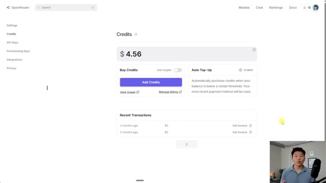
*⏱️ 00:03:04 — Capture d'écran montrant l'interface du tableau de bord OpenRouter sur la page des crédits.*

---

### ⏱️ `[00:03:18 - 00:03:36]` | Segment #09

**🔊 Audio (Transcription Intégrale Mot pour Mot en Français) :**
> Gardez donc cela à l'esprit. Mais maintenant que nous sommes connectés à OpenRouter, je peux choisir parmi une tonne de modèles de chat différents. Comme vous pouvez le voir, nous avons les modèles d'OpenAI, nous avons les modèles de Perplexity, nous avons Qwen, nous avons Anthropic, nous avons Google. Il y a des tonnes de modèles ici. Pour l'instant, je vais garder GPT-4o mini, qui offre un très bon équilibre entre faible coût et puissance. Je vais donc m'en tenir à cela pour l'instant.

**👁️ Analyse Visuelle d'Écran (gemini-3.5-flash-lite) :**
**Interface & Outils** : n8n (outil d'automatisation de workflow).

**Contenu textuel & Code** : Menu déroulant affichant divers modèles comme "openai/gpt-4", "openai/gpt-4-turbo-preview", "openai/gpt-4o-mini", etc. Les champs d'entrée incluent "sessionId", "action" et "chatInput".

**Action / Démonstration** : Le présentateur sélectionne un modèle spécifique dans la liste déroulante du nœud OpenRouter pour configurer l'IA dans le workflow.

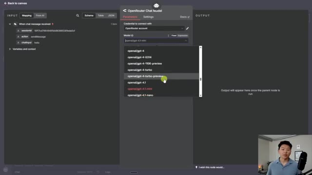
*⏱️ 00:03:22 — Une interface de configuration de nœud "OpenRouter Chat Model" au sein de n8n, affichant une liste déroulante des modèles OpenAI disponibles.*

---

### ⏱️ `[00:03:36 - 00:03:58]` | Segment #10

**🔊 Audio (Transcription Intégrale Mot pour Mot en Français) :**
> Cool, donc nous avons notre cerveau configuré. Ce que nous pourrions faire, c'est simplement parler à notre agent et nous pouvons voir qu'il va utiliser l'IA. Donc si j'ouvre juste le chat rapidement et que je dis, explique les règles du golf, quand j'envoie ça, il va être capable d'utiliser un modèle d'IA afin de réellement comprendre ce que je lui demande et d'expliquer en retour les règles du golf. Donc voici ce qu'il a répondu. Je ne vais pas tout lire, mais il nous a donné un objectif, qui est de mettre la balle dans le trou en le moins de coups possible.

**👁️ Analyse Visuelle d'Écran (gemini-3.5-flash-lite) :**
**Interface & Outils** : n8n (plateforme d'automatisation de workflow).

**Contenu textuel & Code** : Workflow composé d'un déclencheur "When chat message received", d'un nœud "AI Agent", et d'un nœud de modèle "OpenRouter Chat Model". En bas, le panneau de chat affiche un message JSON envoyé ("hello") et les logs d'exécution.

**Action / Démonstration** : Le présentateur illustre le test du workflow en ouvrant le chat intégré pour interagir avec l'agent IA configuré.

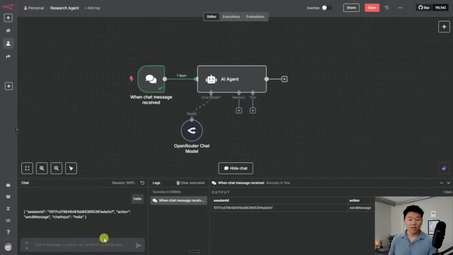
*⏱️ 00:03:41 — Une capture d'écran de l'interface n8n montrant un workflow d'automatisation avec un nœud "AI Agent" connecté à un modèle "OpenRouter Chat Model" et un déclencheur de chat.*

---

### ⏱️ `[00:03:58 - 00:04:18]` | Segment #11

**🔊 Audio (Transcription Intégrale Mot pour Mot en Français) :**
> Ça va nous donner quelques règles de base et ensuite ça passe aux pénalités et à un résumé. Donc de toute façon, nous avons validé que notre cerveau IA fonctionne. Maintenant nous devons ajouter notre outil de recherche. Donc je vais cliquer sur ce bouton plus juste en dessous de outil. Et je vais simplement chercher perplexity. Je vais cliquer sur l'outil perplexity juste ici. Et encore une fois, nous devons aller chercher un identifiant et obtenir une sorte de mot de passe.

**👁️ Analyse Visuelle d'Écran (gemini-3.5-flash-lite) :**
**Interface & Outils** : n8n (Interface graphique de gestion de workflows d'agents IA)

**Contenu textuel & Code** : Diagramme de nœuds : 'When chat message received', 'AI Agent' et 'OpenRouter Chat Model'

**Action / Démonstration** : Configuration d'un agent IA et préparation de l'ajout d'un outil de recherche via le bouton plus.

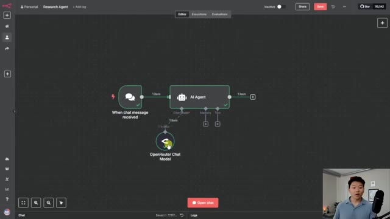
*⏱️ 00:04:03 — Un éditeur de workflow visuel montrant un nœud 'AI Agent' connecté à un modèle 'OpenRouter Chat Model' et s'apprêtant à intégrer un outil.*

---

### ⏱️ `[00:04:18 - 00:04:38]` | Segment #12

**🔊 Audio (Transcription Intégrale Mot pour Mot en Français) :**
> Donc je vais cliquer ici, cliquer sur créer de nouveaux identifiants. Et encore une fois, cela nous demande une clé API. Donc je vais ouvrir un nouvel onglet et je vais aller sur perplexity.ai. Et j'ai déjà un compte configuré. Si vous n'en avez pas, vous allez vouloir créer un compte rapidement. Ça va être très similaire. Vous allez aller en bas à gauche dans vos paramètres. Maintenant que je suis dans mes paramètres, je vais aller sur ce côté gauche jusqu'aux clés API.

**👁️ Analyse Visuelle d'Écran (gemini-3.5-flash-lite) :**
**Interface & Outils** : Navigateur web (Google Chrome supposé).

**Contenu textuel & Code** : Aucun contenu informatif ou technique n'est visible à l'écran.

**Action / Démonstration** : Transition entre deux onglets ou chargement d'une nouvelle page web.

---

### ⏱️ `[00:04:38 - 00:04:57]` | Segment #13

**🔊 Audio (Transcription Intégrale Mot pour Mot en Français) :**
> Et ici, vous pouvez voir que j'ai déjà une clé, mais ce que vous allez faire, c'est cliquer sur « créer une clé ». Et maintenant, une nouvelle va simplement s'afficher. Gardez donc simplement à l'esprit que chaque service que vous allez utiliser va probablement vous donner votre clé API d'une manière un peu différente, mais ce sera généralement la même chose. Je vais donc copier cette clé. Je vais aller dans n8n, la coller juste ici. Et quand je clique sur enregistrer, cela devrait afficher « connexion testée avec succès ».

**👁️ Analyse Visuelle d'Écran (gemini-3.5-flash-lite) :**
**Interface & Outils** : Interface web de gestion de clés API et fenêtre de configuration de compte.

**Contenu textuel & Code** : Clés API masquées (format "pplx-...") et champs de configuration de connexion d'API.

**Action / Démonstration** : Navigation vers la création d'une clé API et insertion de celle-ci dans un outil d'automatisation.

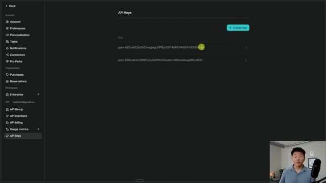
*⏱️ 00:04:42 — Interface web montrant la page de gestion des clés API avec un bouton "+ Create key" et une liste de clés existantes masquées.*

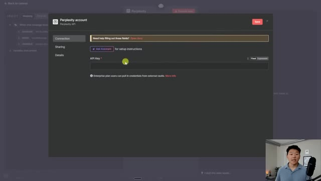
*⏱️ 00:04:52 — Interface de configuration d'un compte Perplexity montrant un champ de saisie pour la clé API.*

---

### ⏱️ `[00:04:57 - 00:05:16]` | Segment #14

**🔊 Audio (Transcription Intégrale Mot pour Mot en Français) :**
> Ici en bas, il est écrit identifiant créé avec succès. Et voilà. Il est écrit connexion testée avec succès. Donc nous sommes configurés pour Perplexity également. Et c'est la même chose avec Perplexity. Quand vous êtes ici, vous voulez aller dans votre facturation API, et vous allez devoir avoir un certain type de solde de crédit ici. Sinon, il ne pourra pas réellement faire de recherche sur le web. Donc maintenant que nous avons Perplexity connecté, nous avons plusieurs choses parmi lesquelles choisir.

**👁️ Analyse Visuelle d'Écran (gemini-3.5-flash-lite) :**
**Interface & Outils** : Interface web de configuration Perplexity et Make.com

**Contenu textuel & Code** : Champ de clé API masqué et message de succès « Connection tested successfully »

**Action / Démonstration** : Configuration et test de la connexion à l'API Perplexity

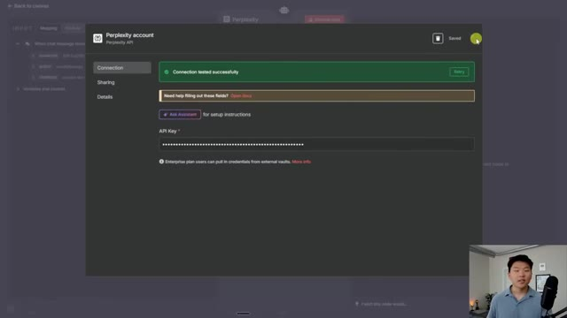
*⏱️ 00:05:02 — Fenêtre modale de configuration du compte Perplexity API montrant un message de test de connexion réussi.*

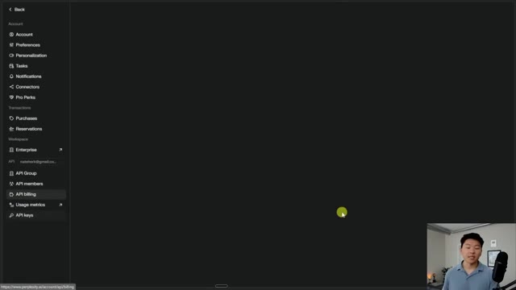
*⏱️ 00:05:06 — Interface de gestion du compte Perplexity montrant la section API billing dans le menu latéral.*

---

### ⏱️ `[00:05:16 - 00:05:35]` | Segment #15

**🔊 Audio (Transcription Intégrale Mot pour Mot en Français) :**
> Donc tout d'abord, nous avons un modèle et vous pouvez voir que nous avons R1, nous avons Sonar, Sonar Deep Research, Sonar Pro, Sonar Reasoning, Sonar Reasoning Pro. Ce sont donc simplement différents modèles de Perplexity qui affectent, vous savez, fondamentalement la profondeur et la qualité de la recherche que nous allons faire selon celui que nous choisissons. Ils vont également tous être un peu différents en ce qui concerne leur tarification.

**👁️ Analyse Visuelle d'Écran (gemini-3.5-flash-lite) :**
**Interface & Outils** : Interface web d'automatisation de workflow (type Make/n8n) avec un panneau de configuration Perplexity ouvert.

**Contenu textuel & Code** : Liste des modèles Perplexity disponibles : R1-1776, Sonar, Sonar Deep Research, Sonar Pro, Sonar Reasoning, Sonar Reasoning Pro.

**Action / Démonstration** : Sélection et visualisation des différents modèles d'intelligence artificielle disponibles pour le nœud Perplexity dans l'automatisation.

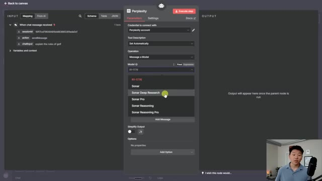
*⏱️ 00:05:21 — Interface d'un outil d'automatisation montrant les paramètres d'un nœud Perplexity avec le menu déroulant des différents modèles (R1, Sonar, Sonar Deep Research, Sonar Pro, Sonar Reasoning, Sonar Reasoning Pro).*

---

### ⏱️ `[00:05:35 - 00:05:55]` | Segment #16

**🔊 Audio (Transcription Intégrale Mot pour Mot en Français) :**
> D'accord, donc je suis allé sur Google et j'ai cherché la documentation de l'API Perplexity et je vais cliquer sur ce premier lien juste ici. Maintenant, tout ce que j'ai à faire, c'est de venir ici et de cliquer sur modèles, et cela va nous montrer ces différents modèles que nous venons juste de voir dans NNN. Donc nous pouvons voir que si nous voulons faire une recherche de base, nous pouvons utiliser ces modèles de recherche, qui sont Sonar Pro ou Sonar. Si nous voulons faire un peu de recherche, nous pouvons utiliser Sonar Deep Research.

**👁️ Analyse Visuelle d'Écran (gemini-3.5-flash-lite) :**
**Interface & Outils** : Navigateur web affichant le site de documentation de l'API Perplexity (Sonar).

**Contenu textuel & Code** : Documentation technique listant les modèles d'IA 'sonar-pro', 'sonar' et leurs descriptions associées.

**Action / Démonstration** : Navigation sur le site de documentation de l'API Perplexity et clic sur l'onglet 'Models' pour afficher les modèles disponibles.

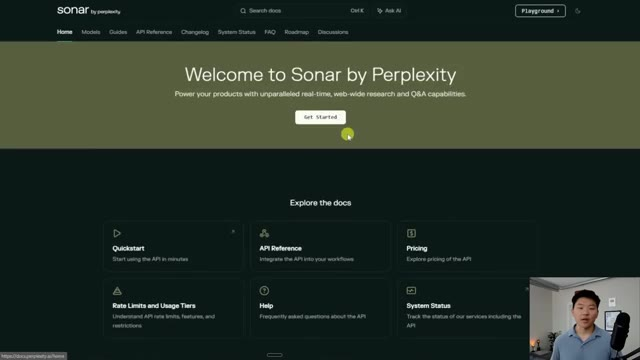
*⏱️ 00:05:40 — Page d'accueil de la documentation de l'API Perplexity (Sonar by Perplexity) affichant les sections principales comme Quickstart, API Reference et Pricing.*

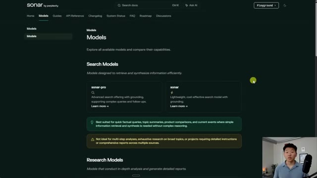
*⏱️ 00:05:45 — Page de la documentation listant les différents modèles disponibles, notamment 'sonar-pro' et 'sonar'.*

---

### ⏱️ `[00:05:55 - 00:06:20]` | Segment #17

**🔊 Audio (Transcription Intégrale Mot pour Mot en Français) :**
> Et si nous voulons faire du raisonnement, nous pouvons utiliser Sonar Reasoning Pro ou Sonar Reasoning. Selon le cas d'utilisation, vous venez ici et vous choisissez le type de modèle que vous voulez utiliser. Disons que pour l'instant, nous voulons faire un peu d'analyse approfondie et choisissons Sonar Deep Research. Je vais donc simplement revenir dans NNN et je vais choisir Sonar Deep Research. Et maintenant, je vais juste configurer un message utilisateur, qui est fondamentalement juste, vous savez, si nous faisions des recherches en ce moment même, que taperions-nous dans Google ?

**👁️ Analyse Visuelle d'Écran (gemini-3.5-flash-lite) :**
**Interface & Outils** : Interface web Perplexity et éditeur de workflow d'automatisation.

**Contenu textuel & Code** : Documentation des modèles de recherche (Research Models) et paramètres de configuration de l'API Perplexity (sélection du modèle 'Sonar Deep Research', champ texte du message).

**Action / Démonstration** : Le présentateur montre la documentation des modèles de recherche sur le site de Perplexity, puis configure le modèle 'Sonar Deep Research' dans l'outil d'automatisation.

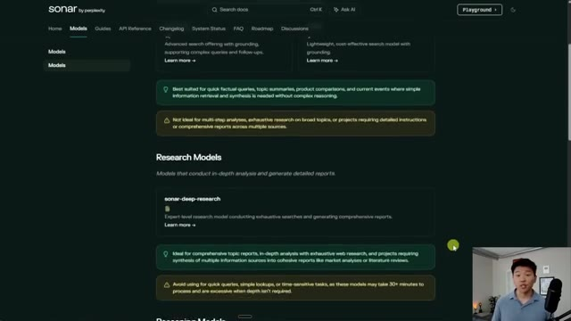
*⏱️ 00:06:01 — Interface web montrant la documentation et les options des modèles de recherche Sonar par Perplexity, avec les différentes catégories de modèles.*

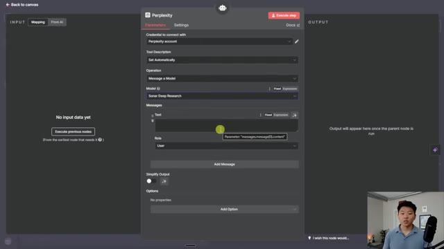
*⏱️ 00:06:14 — Interface de configuration d'un nœud d'automatisation (type Make ou n8n) pour Perplexity, montrant le choix du modèle 'Sonar Deep Research' et les paramètres de message.*

---

### ⏱️ `[00:06:20 - 00:06:39]` | Segment #18

**🔊 Audio (Transcription Intégrale Mot pour Mot en Français) :**
> Et ce qui est vraiment génial avec ça, c'est que l'agent IA sera assez intelligent pour savoir ce qu'il doit taper. Donc tout ce que j'ai à faire, c'est de cliquer sur ce bouton juste ici, qui dit, laisser le modèle définir ce paramètre. Je peux cliquer dessus. Et maintenant, l'agent IA va automatiquement remplir ceci juste ici, selon la façon dont nous interagissons avec. Je ne vais pas trop entrer dans les détails de ce que tout cela signifie. Si vous voulez voir une vidéo à ce sujet, allez voir ça juste ici.

**👁️ Analyse Visuelle d'Écran (gemini-3.5-flash-lite) :**
**Interface & Outils** : Plateforme d'automatisation de workflows (n8n ou similaire).

**Contenu textuel & Code** : Paramètres de configuration du nœud : "Credential", "Tool Description" (réglé sur "Set Automatically"), "Operation" (Message a Model), "Model" (Sonar Deep Research) et les champs pour les messages (Text, Role: User).

**Action / Démonstration** : L'utilisateur visualise les paramètres d'un nœud d'agent IA, avec une option de remplissage automatique des données ("Set Automatically") pour laisser le modèle définir les paramètres.

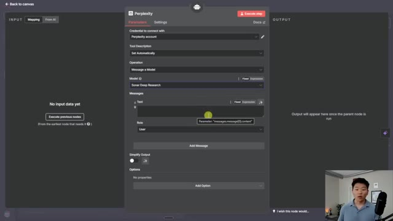
*⏱️ 00:06:25 — Une capture d'écran de l'interface de configuration d'un nœud "Perplexity" au sein d'une plateforme d'automatisation de workflow (type n8n).*

---

### ⏱️ `[00:06:39 - 00:07:01]` | Segment #19

**🔊 Audio (Transcription Intégrale Mot pour Mot en Français) :**
> Mais en bas, vous pouvez voir que nous pouvons faire comme un filtre de récence de recherche. Donc nous pourrions dire, hé, je veux seulement regarder des trucs d'aujourd'hui ou de la dernière heure. Donc vous pouvez vraiment personnaliser ces résultats. Et vous pourriez aussi, si vous le vouliez, chercher seulement certains domaines. Donc vous pourriez entrer les domaines que vous voulez rechercher et vous assurer de savoir exactement d'où vient votre information. Mais de toute façon, je vais me débarrasser de ces deux options pour l'instant. Et nous allons tout simplement lancer une recherche.

**👁️ Analyse Visuelle d'Écran (gemini-3.5-flash-lite) :**
**Interface & Outils** : Interface de workflow d'automatisation (type Make.com ou n8n) avec le panneau de configuration du module Perplexity ouvert.

**Contenu textuel & Code** : Options de configuration du modèle Sonar Deep Research avec des champs pour les messages, rôles et filtres de récence (Day, Hour, Month, Week).

**Action / Démonstration** : Le curseur sélectionne une option de filtre temporel (Hour) dans le menu déroulant de récence de recherche.

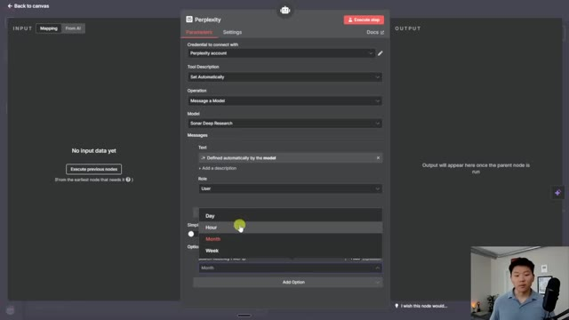
*⏱️ 00:06:45 — Interface de configuration du nœud Perplexity montrant un menu déroulant pour filtrer la récence des recherches par heure, jour, semaine ou mois.*

---

### ⏱️ `[00:07:01 - 00:07:36]` | Segment #20

**🔊 Audio (Transcription Intégrale Mot pour Mot en Français) :**
> Donc je vais cliquer sur enregistrer, et ensuite je vais lui poser une question. Et avant d'envoyer cette requête, je voulais juste souligner une autre chose, à savoir que notre agent IA n'a pas de message système. Le message système par défaut est « tu es un assistant utile ». En général, quand vous avez un agent IA dans n8n, vous voulez lui donner des instructions spécifiques comme, vous savez, « tu es un agent de recherche expert. Tu as cet outil pour faire des recherches. Tu vas faire tout ça. » Et là, je veux juste vous montrer à quel point c'est rapide et facile de configurer un agent et à quel point il est intelligent par défaut, sans même lui donner de prompt. Donc une fois qu'on lui aura donné un prompt système, il deviendrait beaucoup, beaucoup plus intelligent. Je vais donc envoyer cette question très large où j'ai dit : « Comment puis-je optimiser mon sommeil ? »

**👁️ Analyse Visuelle d'Écran (gemini-3.5-flash-lite) :**
**Interface & Outils** : n8n (éditeur de workflow d'automatisation)

**Contenu textuel & Code** : Le champ "System Message" affiche le texte par défaut : « You are a helpful assistant ». Le champ "Prompt (User Message)" contient une expression JSON : `{{ $json.chatInput }}`.

**Action / Démonstration** : L'utilisateur visualise et vérifie les paramètres de configuration du nœud AI Agent avant d'exécuter l'étape pour tester la réponse de l'IA.

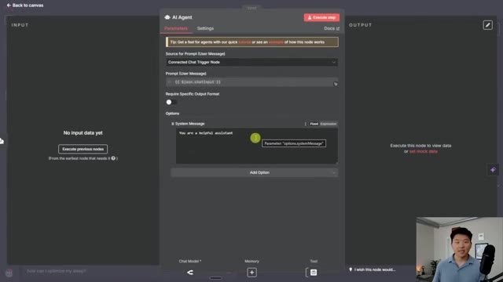
*⏱️ 00:07:10 — Une capture d'écran de l'interface de configuration du nœud "AI Agent" dans n8n, montrant les paramètres du prompt et le message système par défaut.*

---

### ⏱️ `[00:07:36 - 00:08:09]` | Segment #21

**🔊 Audio (Transcription Intégrale Mot pour Mot en Français) :**
> nous allons voir qu'il est assez intelligent pour utiliser Perplexity. En ce moment, il fait ses recherches approfondies en utilisant Sonar Deep Research. Et je reviendrai vers vous quand nous aurons ce rapport sur la façon d'optimiser le sommeil. Très bien. Donc ça vient juste de se terminer et gardez à l'esprit que si vous faites des recherches approfondies, cela va prendre un peu plus de temps que si vous faites plutôt une recherche web basique. Mais comme vous pouvez le voir, nous avons pratiquement tout ce rapport complet ici où il nous dit des choses comme la température ou ce que vous pouvez faire avant d'aller au lit afin de maintenir un horaire de sommeil cohérent, différentes routines de relaxation, le régime, l'exercice, tout ce genre de choses. Et si nous cliquons sur l'outil Perplexity, nous pouvons

**👁️ Analyse Visuelle d'Écran (gemini-3.5-flash-lite) :**
**Interface & Outils** : n8n (outil d'automatisation de workflow)

**Contenu textuel & Code** : Workflow visualisé : "When chat message received" -> "AI Agent" (relié à "OpenRouter Chat Model" et "Perplexity"). Le chat affiche le prompt "how can i optimize my sleep?".

**Action / Démonstration** : Exécution en temps réel du workflow, le nœud "AI Agent" est actif et en cours de traitement de la requête sur le sommeil.

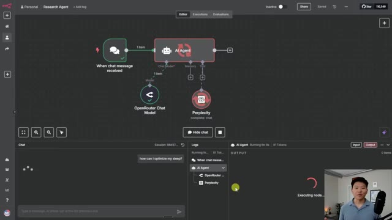
*⏱️ 00:07:44 — Interface n8n montrant un workflow d'automatisation avec un nœud "AI Agent" connecté à OpenRouter et Perplexity, avec un panneau de chat et de logs en bas.*

---

### ⏱️ `[00:08:09 - 00:08:32]` | Segment #22

**🔊 Audio (Transcription Intégrale Mot pour Mot en Français) :**
> En gros, voir toutes les différentes sources qu'il a utilisées. Vous pouvez donc voir ici qu'il a cherché parmi 20 sources. Et oui, je sais qu'il est écrit 19, mais les ordinateurs commencent à compter à partir de zéro. Donc ça fait 20 sources. Et parce que nous pouvons voir qu'il a utilisé ces 20 sources pour nous donner ce rapport, nous pourrions donner un prompt système à l'agent IA et dire : « donne-moi toujours les citations de chaque fait en indiquant d'où tu l'as tiré ». J'espère donc que vous pouvez voir à quel point cela va vous permettre de faire des recherches beaucoup plus rapidement.

**👁️ Analyse Visuelle d'Écran (gemini-3.5-flash-lite) :**
**Interface & Outils** : n8n (outil d'automatisation de workflow)

**Contenu textuel & Code** : Configuration du modèle "Sonar Deep Research", paramètres de nœud, et liste des résultats de recherche (URLs liées à l'optimisation du sommeil).

**Action / Démonstration** : Consultation et inspection des données de sortie (output) générées par l'agent IA après exécution du workflow.

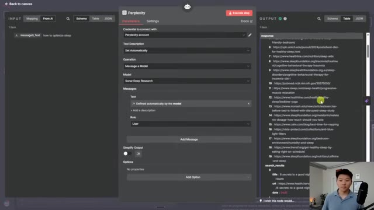
*⏱️ 00:08:15 — Interface de configuration du nœud Perplexity dans un outil d'automatisation, affichant les paramètres de sortie avec une liste numérotée de sources de recherche (de 6 à 19).*

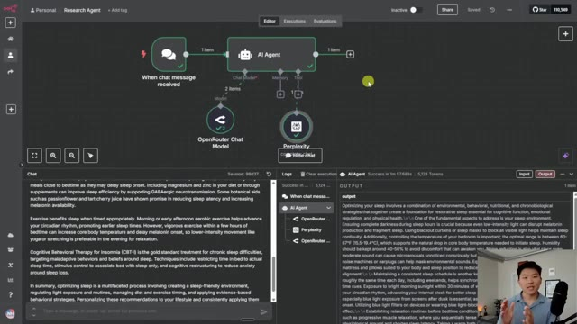
*⏱️ 00:08:26 — Vue globale du workflow d'automatisation (n8n) montrant un agent IA connecté à OpenRouter et Perplexity, avec le panneau de chat et les logs d'exécution en bas.*

---

### ⏱️ `[00:08:32 - 00:09:07]` | Segment #23

**🔊 Audio (Transcription Intégrale Mot pour Mot en Français) :**
> Bref, c'est vraiment super cool. Je veux vous montrer un autre exemple de ce que vous pouvez faire si vous ne voulez pas simplement faire des recherches en parlant à cet agent IA à chaque fois. Très bien, donc ce que je vais faire, c'est supprimer ce déclencheur de message de chat. Je vais ajouter une feuille Google Sheets, et je ne vais pas repasser sur les identifiants Google Sheets pour l'instant. Si vous voulez voir une vidéo à ce sujet, je la mettrai en lien juste ici au-dessus. Cet exemple, je veux juste le configurer très rapidement pour vous montrer toute la puissance de cet agent de recherche une fois que vous l'avez configuré. Je vais donc me connecter à ma feuille très rapidement, qui est en fait cette feuille de concurrents. Nous avons donc Apple, NVIDIA, Google et Amazon, et chaque jour, cela peut se déclencher et faire des recherches sur ce qu'ils ont fait au cours de la semaine passée ou quelque chose comme ça. Donc ce que vous pourriez même faire, c'est remplacer ce déclencheur manuel par

**👁️ Analyse Visuelle d'Écran (gemini-3.5-flash-lite) :**
**Interface & Outils** : n8n (workflow automation), Google Sheets.

**Contenu textuel & Code** : Le workflow montre un nœud "When chat message received" relié à un "AI Agent", lui-même connecté aux nœuds "OpenRouter Chat Model" et "Perplexity". Google Sheets affiche une colonne "Company" remplie de noms d'entreprises technologiques.

**Action / Démonstration** : Le présentateur manipule le workflow dans n8n pour supprimer un déclencheur, puis montre une source de données externe (Google Sheets) qui servira de base alternative pour l'automatisation.

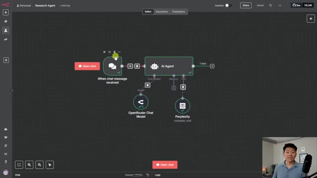
*⏱️ 00:08:41 — L'interface de création de workflows n8n affichant un agent de recherche connecté à un modèle OpenRouter et à un outil Perplexity.*

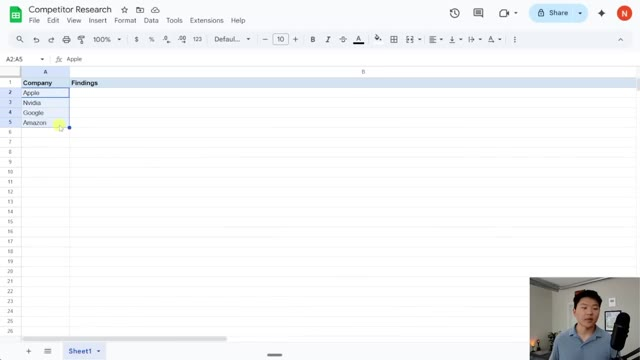
*⏱️ 00:08:59 — Une feuille de calcul Google Sheets intitulée "Competitor Research" contenant une liste de noms de grandes entreprises (Apple, Nvidia, Google, Amazon).*

---

### ⏱️ `[00:09:07 - 00:09:41]` | Segment #24

**🔊 Audio (Transcription Intégrale Mot pour Mot en Français) :**
> un déclencheur planifié pour que cela puisse s'exécuter chaque jour à minuit, et vous vous réveillerez ensuite avec de nouvelles informations et recherches sur vos concurrents. J'ai donc importé mes quatre concurrents, comme vous pouvez le voir sur le côté droit, nous avons les quatre, et ensuite tout ce que j'ai à faire est de m'assurer que l'agent peut réellement les examiner, car jusqu'à présent l'agent était juste configuré pour regarder le nœud déclencheur de chat connecté qui n'existe plus. Je changerais donc ce message utilisateur pour « définir ci-dessous », et tout ce que j'aurais à faire serait de faire glisser le concurrent depuis ce côté gauche dans ce message utilisateur juste ici. Donc maintenant nous allons examiner Apple, et c'est ici que nous pouvons ajouter un message système, et c'est vraiment très concis

**👁️ Analyse Visuelle d'Écran (gemini-3.5-flash-lite) :**
**Interface & Outils** : LangFlow (plateforme de conception de workflows pour agents IA).

**Contenu textuel & Code** : Le graphique montre les composants suivants : "Schedule Trigger", "Get Competitors" (connecté à un fichier), "AI Agent", "OpenRouter Chat Model" et "Perplexity" (utilisé comme outil/modèle de recherche).

**Action / Démonstration** : Le workflow est configuré pour automatiser quotidiennement la recherche sur les concurrents, avec un bouton "Execute workflow" visible en bas de l'écran prêt à être déclenché.

*⏱️ 00:09:16 — Une capture d'écran montrant l'interface de travail de LangFlow illustrant un workflow automatisé pour un agent de recherche. Le workflow commence par un déclencheur planifié (Schedule Trigger), suivi d'une étape de récupération de données de concurrents, connectée à un nœud central "AI Agent" relié à des modèles externes.*

---

### ⏱️ `[00:09:41 - 00:10:16]` | Segment #25

**🔊 Audio (Transcription Intégrale Mot pour Mot en Français) :**
> Par exemple, juste pour vous montrer les gars, j'ai dit : « Tu es un agent de recherche expert, on va te donner le nom d'un concurrent qui se trouve ici en haut dans le message utilisateur, et tu utiliseras ton outil Perplexity pour faire des recherches sur eux et résumer ce qu'ils ont fait afin qu'on puisse garder une longueur d'avance sur eux ». Donc ce que je peux faire, c'est y aller et cliquer sur exécuter l'étape. Ça va faire des recherches sur les quatre concurrents, pas seulement sur l'un d'entre eux. Donc ça va faire Apple, Google, Amazon et Nvidia. Et ensuite, une fois qu'on aura récupéré ce rapport de recherche, on pourra l'écrire en retour dans cette feuille Google Sheets. D'accord. Donc ça vient tout juste de se terminer et maintenant nous avons une recherche approfondie faite sur nos quatre concurrents. Donc si je clique sur l'agent IA, déplaçons ce truc un peu sur le côté. Vous pouvez voir qu'ici se trouvent nos recherches sur Apple.

**👁️ Analyse Visuelle d'Écran (gemini-3.5-flash-lite) :**
**Interface & Outils** : Plateforme d'automatisation de workflow (n8n ou similaire).

**Contenu textuel & Code** : Champ « Prompt (User Message) » contenant la variable {{ $json.Company }} et champ « System Message » définissant le rôle : « You are an expert research agent. You will be given the name of a competitor, and you will use your Perplexity tool to do research about them and summarize what they've been up to... ».

**Action / Démonstration** : Configuration des paramètres système et du prompt d'un agent IA pour une tâche de recherche concurrentielle automatisée.

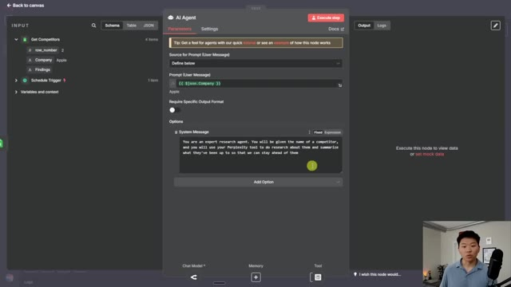
*⏱️ 00:09:50 — Interface de configuration d'un nœud « AI Agent » dans une plateforme d'automatisation de workflow (type n8n).*

---

### ⏱️ `[00:10:16 - 00:10:36]` | Segment #26

**🔊 Audio (Transcription Intégrale Mot pour Mot en Français) :**
> Voici nos recherches sur Nvidia. Voici les recherches sur Google. Et puis voici Amazon. Maintenant, tout ce que j'aurais à faire, c'est d'ajouter un autre nœud pour réécrire tout cela dans notre Google Sheet. Et je peux simplement faire cela en faisant glisser la sortie de l'agent IA dans la nouvelle colonne appelée Findings. Et si j'appuie sur exécuter sur ce nœud, ça va tout réécrire dans notre Google Sheet et nous irons jeter un coup d'œil là-bas.

**👁️ Analyse Visuelle d'Écran (gemini-3.5-flash-lite) :**
**Interface & Outils** : Outil d'automatisation de workflows de type n8n (interface par nœuds avec panneaux de configuration latéraux).

**Contenu textuel & Code** : Textes de recherche analytique sur les entreprises tech, variables d'expression (ex: `{{ $json.Company }}`) et paramètres de connexion aux APIs (Google Sheets).

**Action / Démonstration** : Démonstration de la configuration d'un workflow : l'utilisateur montre comment traiter les données de recherche d'un agent IA pour les injecter automatiquement dans un tableau Google Sheets.

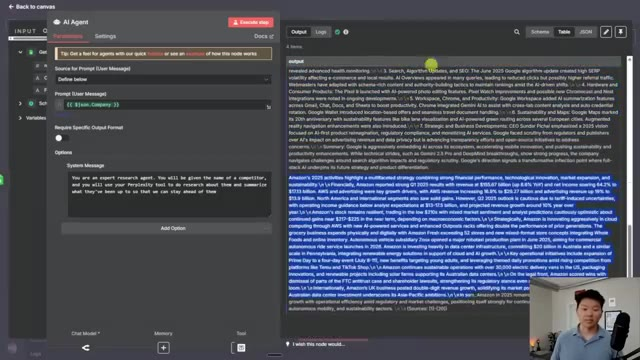
*⏱️ 00:10:21 — Interface d'un nœud "AI Agent" dans une plateforme d'automatisation, affichant une sortie textuelle détaillée contenant des recherches sur les stratégies d'entreprises (Google, Amazon).*

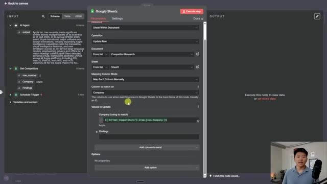
*⏱️ 00:10:26 — Configuration d'un nœud "Google Sheets" dans l'outil d'automatisation, permettant de mapper les données de sortie d'un agent IA vers une feuille de calcul spécifique ("Competitor Research").*

---

### ⏱️ `[00:10:37 - 00:11:11]` | Segment #27

**🔊 Audio (Transcription Intégrale Mot pour Mot en Français) :**
> Voici donc la feuille à partir de laquelle nous avons extrait les données. Nous avons Apple avec les résultats concernant Apple, NVIDIA avec les résultats concernant NVIDIA, et ainsi de suite pour Google et Amazon. Je sais donc que j'ai parcouru cet exemple rapidement, mais je voulais simplement vous montrer la puissance de pouvoir, chaque jour, faire des recherches sur 10 entreprises, 10 outils différents, peu importe ce que c'est, vous pouvez faire des recherches approfondies, vous pouvez faire des recherches rapides, vous pouvez faire tout ce que vous voulez avec Perplexity. Et l'agent va ensuite traiter toutes les données qu'il a obtenues de Perplexity. Et il pourrait même citer et vous montrer toutes les sources d'où il a tiré ses informations. Il s'agit donc de bien plus que de simplement pouvoir envoyer un message texte à l'agent pour qu'il fasse des recherches à votre place. Parce qu'en réalité, vous pourriez très bien aller chercher quelque chose sur Google vous-même. Il s'agit de rédiger des recherches approfondies

**👁️ Analyse Visuelle d'Écran (gemini-3.5-flash-lite) :**
**Interface & Outils** : Google Sheets, n8n (automatisation de workflow).

**Contenu textuel & Code** : Données textuelles d'analyse de marché pour Apple et Nvidia ; noeuds de workflow avec connexions logiques pour l'IA, OpenRouter et Perplexity.

**Action / Démonstration** : Le présentateur illustre la source de données (Sheets) avant de montrer le moteur d'automatisation (n8n) qui traite et met à jour ces informations via des agents IA.

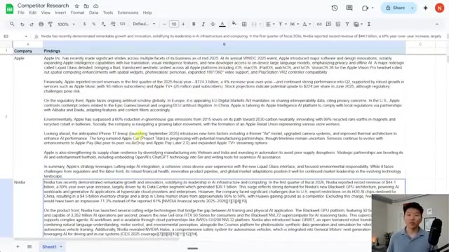
*⏱️ 00:10:45 — Une feuille Google Sheets affichant un tableau de recherche sur les concurrents (Apple, Nvidia) avec des rapports détaillés sur leurs performances financières, stratégiques et réglementaires.*

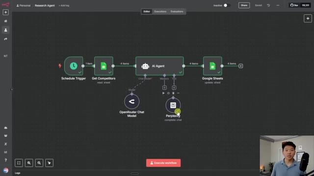
*⏱️ 00:10:54 — L'interface du logiciel n8n montrant un workflow automatisé composé d'un déclencheur, d'un noeud "Get Competitors" (Google Sheets), d'un noeud "AI Agent", et d'un outil Perplexity connecté.*

---

### ⏱️ `[00:11:11 - 00:11:31]` | Segment #28

**🔊 Audio (Transcription Intégrale Mot pour Mot en Français) :**
> des rapports où vous lui indiquez : « voici la structure que je veux. Je veux toutes les sources tout en bas. » Il s'agit d'intégrer un agent de recherche comme celui-ci dans un processus différent qui existe déjà, comme quelque chose dans votre pipeline commercial ou dans votre pipeline marketing. Donc, si vous souhaitez en savoir plus sur différents cas d'utilisation et sur la façon dont vous pouvez concrètement faire passer un processus de votre esprit à un canevas n8n comme celui-ci, n'hésitez surtout pas à jeter un œil à ma communauté.

**👁️ Analyse Visuelle d'Écran (gemini-3.5-flash-lite) :**
**Interface & Outils** : n8n (outil d'automatisation de workflows).

**Contenu textuel & Code** : Diagramme de flux comprenant : un "Schedule Trigger", un module "Get Competitors" (Google Sheets), un nœud central "AI Agent", et un nœud final "Google Sheets" pour la mise à jour des données. L'agent est connecté aux modèles "OpenRouter Chat" et "Perplexity" pour effectuer des recherches.

**Action / Démonstration** : Affichage et configuration des connexions entre l'agent IA, les outils de recherche et les feuilles de calcul pour automatiser la génération de rapports.

*⏱️ 00:11:16 — Interface d'édition de flux de travail montrant un workflow automatisé utilisant un agent de recherche IA connecté à des outils externes.*

---

### ⏱️ `[00:11:31 - 00:11:50]` | Segment #29

**🔊 Audio (Transcription Intégrale Mot pour Mot en Français) :**
> Le lien pour cela se trouve en bas dans la description. L'objectif de cette communauté est de vous faire passer de parfait débutant à la création de votre première automatisation IA, que ce soit pour vous, pour votre entreprise ou pour une autre entreprise. Nous avons ici une formidable communauté de membres qui automatisent des choses chaque jour avec NNN, partagent leurs ressources, partagent leurs problèmes, partagent leurs solutions. Et c'est vraiment génial parce que tout le monde est aussi obsédé par l'automatisation IA que vous l'êtes probablement.

**👁️ Analyse Visuelle d'Écran (gemini-3.5-flash-lite) :**
**Interface & Outils** : Skool (plateforme communautaire).

**Contenu textuel & Code** : Publications sur le fil d'actualité (Annonces, récapitulatifs hebdomadaires, demandes de support), barre latérale avec le titre "AI Automation Society Plus", statistiques (1.9k membres), et classement des membres.

**Action / Démonstration** : Navigation ou présentation de l'interface de la communauté en ligne.

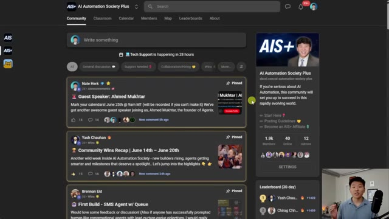
*⏱️ 00:11:36 — Interface de la plateforme communautaire Skool pour "AI Automation Society Plus", montrant le fil d'actualité avec des publications épinglées et une barre latérale présentant les informations du groupe.*

---

### ⏱️ `[00:11:51 - 00:12:12]` | Segment #30

**🔊 Audio (Transcription Intégrale Mot pour Mot en Français) :**
> Nous avons également deux cours complets. Le premier est Agent Zero, qui pose les bases de l'automatisation par IA. Donc si vous êtes un débutant complet, vous pouvez commencer ici. Et ensuite, vous passerez à « 10 hours to 10 seconds », où vous apprendrez à identifier, concevoir et créer des automatisations qui font gagner du temps. Nous avons aussi des tutoriels de création étape par étape, des modèles n8n et des appels en direct. Donc si vous ne pouvez pas y assister en direct, vous pouvez aussi regarder les enregistrements et vous assurer de toujours rester à jour.

**👁️ Analyse Visuelle d'Écran (gemini-3.5-flash-lite) :**
**Interface & Outils** : Plateforme LMS "AI Automation Society Plus" (interface web de cours en ligne).

**Contenu textuel & Code** : Noms des modules : "Agent Zero", "10 Hours to 10 Seconds", "Think Like an Automator", "n8n Triggers & Nodes", "AI Nodes & Prompting".

**Action / Démonstration** : Navigation à travers les menus et sections de la plateforme de formation pour présenter les cours disponibles.

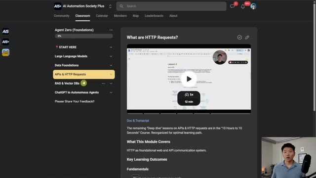
*⏱️ 00:11:56 — Interface de la plateforme "AI Automation Society Plus" montrant le module de cours "Agent Zero" avec le menu latéral des leçons (APIs, RAG, etc.) et le lecteur vidéo central.*

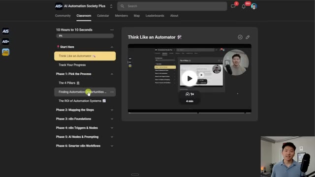
*⏱️ 00:12:01 — Interface de la plateforme "AI Automation Society Plus" survolant le cours "10 Hours to 10 Seconds" avec le détail des phases (n8n, triggers, AI nodes).*

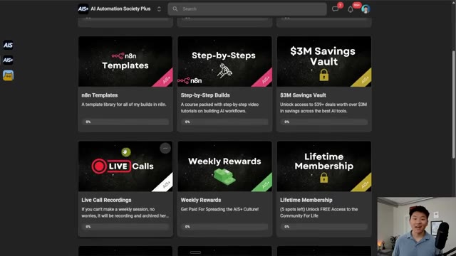
*⏱️ 00:12:06 — Tableau de bord des ressources de la communauté affichant des tuiles pour "n8n Templates", "Step-by-Step Builds", et le "Live Call Recordings".*

---

### ⏱️ `[00:12:12 - 00:12:28]` | Segment #31

**🔊 Audio (Transcription Intégrale Mot pour Mot en Français) :**
> Quoi qu'il en soit, j'adorerais vous voir dans cette communauté. C'est un environnement vraiment très sympa, mais ce sera tout pour cette vidéo. Si vous avez aimé et appris quelque chose de nouveau, s'il vous plaît, laissez un j'aime. Ça m'aide vraiment énormément. Et si vous avez aimé ce style d'enseignement, alors n'hésitez surtout pas à appuyer sur le bouton s'abonner. Comme toujours, j'apprécie vraiment que vous soyez allés jusqu'à la fin de la vidéo. Et je vous dis à la prochaine. Merci beaucoup.

**👁️ Analyse Visuelle d'Écran (gemini-3.5-flash-lite) :**
**Interface & Outils** : n8n (outil d'automatisation de workflow).

**Contenu textuel & Code** : Diagramme de flux comprenant : "Schedule Trigger", "Get Competitors" (Google Sheets), "AI Agent" (connecté à "OpenRouter Chat Model" et "Perplexity"), et un nœud final "Google Sheets" pour l'exportation.

**Action / Démonstration** : Visualisation du workflow automatisé "Research Agent" prêt à être exécuté.

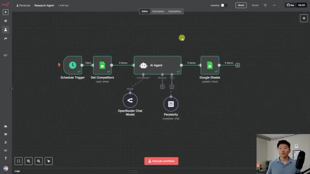
*⏱️ 00:12:16 — Un éditeur de workflow visuel montrant l'automatisation d'un agent de recherche avec des nœuds connectés (déclencheur, lecture de feuilles, agent IA, recherche Perplexity et mise à jour Google Sheets).*

---

