# 🎬 Local n8n AI Agents in 5 Minutes (FREE and no code)

> **Chaîne** : [Nate Herk | AI Automation](https://www.youtube.com/@nateherk/featured)  
> **Lien YouTube** : [https://www.youtube.com/watch?v=DcEMf2K6cPQ](https://www.youtube.com/watch?v=DcEMf2K6cPQ)  
> **Date de publication** : 20250707  
> **Durée** : 00:05:31  
> **Identifiant vidéo** : `DcEMf2K6cPQ`  
> **Transcription & Analyse** : `whisper-v3-large-turbo+gemini-3.5-flash-lite`  

---

## 📌 Synthèse Exécutive & Outils

### 💡 Résumé

Cette vidéo présentée par la chaîne *Nate Herk | AI Automation* lève le voile sur la mise en place rapide et entièrement gratuite d'agents IA exécutés localement au sein d'une instance n8n auto-hébergée. En s'appuyant sur l'écosystème open source et des outils de conteneurisation comme Docker, le créateur démontre qu'il n'est plus nécessaire de dépendre exclusivement de solutions cloud payantes ou d'APIs propriétaires onéreuses pour prototyper et faire tourner des flux de travail intelligents. La démonstration s'articule autour de l'utilisation d'Ollama, le moteur d'exécution de modèles locaux, pour injecter dynamiquement de nouveaux grands modèles de langage (LLM) directement dans l'infrastructure de développement.

Au fil de la démonstration, l'auteur illustre concrètement l'ajout de modèles de pointe ou alternatifs tels que DeepSeek R1 (et ses capacités de réflexion native) ou Qwen, en passant par de simples commandes d'administration dans le terminal du conteneur Docker (`ollama pull`). Les tests réalisés en direct dans n8n prouvent la réactivité instantanée du système et sa mise à jour en temps réel sans nécessiter de redémarrage des services, qu'il s'agisse d'exécuter de simples interactions conversationnelles ou de gérer des flux complexes.

Enfin, cette approche met en lumière l'équilibre délicat entre accessibilité financière, souveraineté des données et limitations matérielles. Si les petits modèles open source (1,5 à 1,7 milliard de paramètres) se révèlent parfaits pour des tâches textuelles basiques et l'apprentissage sans frais, l'ingénieur insiste sur la nécessité de dimensionner correctement son matériel (RAM, VRAM) et d'opter pour des modèles plus conséquents (14 à 32 milliards de paramètres) dès lors que l'on souhaite implémenter des fonctionnalités avancées comme l'appel d'outils (*tool calling*) au sein d'agents IA sophistiqués.

---

### 🛠️ Outils, Modèles & Logiciels Présentés

*   **n8n (Version auto-hébergée locale)** : Plateforme d'automatisation de flux de travail open-source exécutée localement via un kit de démarrage Docker pour orchestrer des agents IA sans code.
*   **Ollama** : Moteur open-source léger et performant permettant d'exécuter, de gérer et d'interagir facilement avec des grands modèles de langage directement sur une machine locale.
*   **Docker & Docker Compose** : Solution de conteneurisation logicielle utilisée pour isoler et exécuter l'environnement n8n ainsi que les services Ollama associés.
*   **DeepSeek R1 (1,5B)** : Modèle de langage open-source axé sur la réflexion et le raisonnement, idéal pour tester des capacités logiques avancées sur du matériel local.
*   **Qwen (1,7B)** : Série de modèles open-source performants développés par Alibaba Cloud, intégrés ici pour diversifier les options conversationnelles locales.
*   **Llama 3.2 (Latest)** : Modèle de référence léger et rapide de Meta, souvent utilisé par défaut dans les configurations de base d'Ollama.
*   **Perplexity / ChatGPT** : Assistants conversationnels tiers mentionnés pour conseiller l'utilisateur sur la compatibilité des modèles en fonction de sa configuration matérielle (RAM, VRAM).

---

### 🔑 Points Clés & Enseignements Stratégiques

*   **Accessibilité totale et coût zéro** : L'utilisation conjointe de n8n et d'Ollama en local permet de s'affranchir complètement des coûts d'API facturés à l'utilisation par les fournisseurs propriétaires.
*   **Simplicité de déploiement des modèles** : L'ajout de nouveaux LLM open-source se résume à une simple commande d'administration (`ollama pull`) exécutée au sein du conteneur Docker, démocratisant l'accès à l'ingénierie des agents.
*   **Mise à jour en temps réel** : L'intégration entre Ollama et l'interface n8n est instantanée ; l'ajout ou la suppression de modèles ne nécessite aucun redémarrage des conteneurs (`docker compose down/up`).
*   **Maîtrise des commandes fondamentales** : La gestion du catalogue de modèles locaux repose sur des commandes CLI intuitives, telles que `ollama list` pour auditer l'existant et `ollama rm` pour purger les fichiers inutiles.
*   **Adéquation entre taille du modèle et cas d'usage** : Les petits modèles (1,5 à 1,7 milliard de paramètres) conviennent parfaitement aux tests, au prototypage rapide et aux interactions conversationnelles basiques.
*   **Exigences matérielles pour l'appel d'outils (*Tool Calling*)** : Pour concevoir des agents IA autonomes capables d'exécuter des actions complexes et d'utiliser des outils, il est fortement recommandé d'utiliser des modèles d'au moins 14 à 32 milliards de paramètres.
*   **Goulot d'étranglement de la puissance locale** : Les performances des LLM locaux dépendent intrinsèquement des capacités de la machine hôte (notamment la VRAM du GPU et la RAM), contrairement aux modèles propriétaires géants (comme GPT-4 ou Claude 3.5 Sonnet).
*   **Stratégie de dimensionnement matériel** : En cas de doute sur les capacités de son ordinateur, il est conseillé de soumettre ses spécifications techniques (RAM, puissance de traitement) à un assistant IA pour identifier les limites de charge des modèles locaux.
*   **Indépendance vis-à-vis du Cloud** : L'auto-hébergement garantit une confidentialité totale des données traitées, les requêtes et les prompts ne quittant jamais la machine de l'utilisateur.
*   **Courbe d'apprentissage amoindrie** : La mise en place de structures d'agents complexes autrefois réservées aux experts en infrastructure devient accessible aux débutants grâce aux interfaces visuelles sans code de n8n.

---

## ⏱️ Chronologie & Transcription Complète Audio & Visuelle (Mot pour Mot)

### ⏱️ `[00:00:00 - 00:00:22]` | Segment #01

**🔊 Audio (Transcription Intégrale Mot pour Mot en Français) :**
> Aujourd'hui, je vais vous montrer comment vous pouvez utiliser vos agents IA N8N de manière totalement gratuite. Il y a une tonne de modèles open source différents que nous pouvons installer et utiliser, et je vais vous montrer à quel point c'est simple à configurer. Tout ce que vous avez à faire, c'est de suivre cette vidéo. Alors, commençons. Donc, comme prérequis, je pars du principe que vous avez déjà configuré votre instance N8N hébergée localement en utilisant le kit de démarrage IA auto-hébergé. Si vous ne l'avez pas fait, regardez cette vidéo que je vais épingler juste ici très rapidement, puis revenez sur cette vidéo.

**👁️ Analyse Visuelle d'Écran (gemini-3.5-flash-lite) :**
**Interface & Outils** : n8n (Interface web de création de workflows d'automatisation et d'agents IA)

**Contenu textuel & Code** : Workflow comprenant un déclencheur de chat, un agent IA et un modèle Ollama pour l'utilisation de modèles open source locaux.

**Action / Démonstration** : Présentation du diagramme de workflow n8n configuré avec Ollama pour exécuter des agents IA localement et gratuitement.

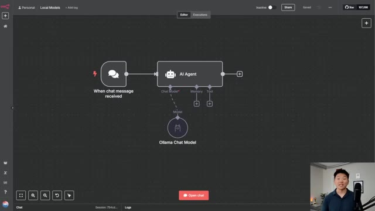
*⏱️ 00:00:06 — Capture d'écran montrant l'interface du workflow n8n avec un nœud "When chat message received" relié à un nœud "AI Agent", lui-même connecté à un modèle "Ollama Chat Model", avec la webcam du présentateur incrustée en bas à droite.*

---

### ⏱️ `[00:00:23 - 00:00:56]` | Segment #02

**🔊 Audio (Transcription Intégrale Mot pour Mot en Français) :**
> Donc une fois que vous avez tout configuré, vous pouvez voir ce que nous avons en ce moment, c'est une version complètement hébergée localement de N8N en cours d'exécution. Nous avons notre Ollama qui est un modèle local, mais ici tout ce que nous pouvons voir, c'est que nous avons llama 3.2 latest. Donc ce que nous devons faire, c'est fondamentalement aller sur Ollama et choisir parmi tous les différents modèles open source qui sont disponibles et les installer sur notre machine très rapidement et tout cela va être gratuit. Donc laissez-moi vous montrer comment nous faisons cela. Donc vous allez aller sur ollama.com, je mettrai le lien dans la description, et vous n'avez même pas besoin de venir ici et de télécharger quoi que ce soit. Allez simplement ici, cliquez sur modèles, et maintenant nous avons tous les différents modèles que nous pouvons réellement télécharger et commencer à utiliser avec nos agents IA N8N.

**👁️ Analyse Visuelle d'Écran (gemini-3.5-flash-lite) :**
**Interface & Outils** : Interface web de n8n (éditeur de workflow) et navigateur web.

**Contenu textuel & Code** : Paramètres du nœud Ollama Chat Model avec le champ Modèle configuré sur "llama3.2:latest".

**Action / Démonstration** : Configuration d'un modèle d'IA local (Ollama) à l'intérieur d'un workflow n8n.

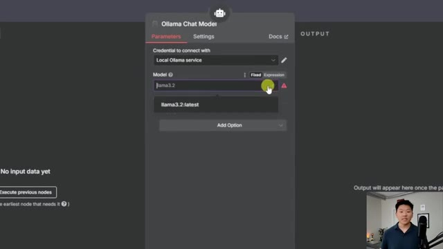
*⏱️ 00:00:31 — Capture d'écran montrant l'interface de configuration du nœud Ollama Chat Model dans n8n, avec la sélection du modèle llama3.2:latest.*

---

### ⏱️ `[00:00:56 - 00:01:16]` | Segment #03

**🔊 Audio (Transcription Intégrale Mot pour Mot en Français) :**
> Donc nous avons DeepSeek, qui a été le modèle open source le plus populaire, avec 48,1 millions de téléchargements. Nous avons tous ces autres modèles parmi lesquels choisir. Nous avons d'autres modèles Llama. Et c'est fondamentalement notre répertoire de différents modèles d'IA que nous pouvons tester gratuitement. Et juste pour vous montrer un exemple, faisons DeepSeek R1, qui est un modèle de réflexion. Et tout ce que nous allons faire, c'est que nous allons cliquer dessus. Et maintenant, nous avons quelques éléments à examiner.

**👁️ Analyse Visuelle d'Écran (gemini-3.5-flash-lite) :**
**Interface & Outils** : Interface web de catalogue de modèles d'IA.

**Contenu textuel & Code** : Liste des modèles open-source avec leurs statistiques de téléchargement (deepseek-r1 affichant 48,1M pulls).

**Action / Démonstration** : Navigation et présentation du répertoire de modèles d'IA disponibles.

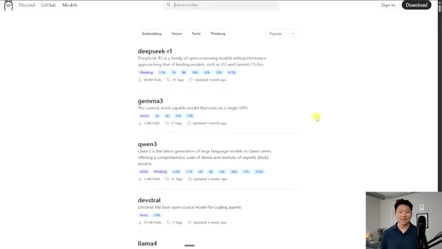
*⏱️ 00:01:01 — Capture d'écran montrant le répertoire de modèles d'IA avec deepseek-r1, gemma3, qwen3 et devstral.*

---

### ⏱️ `[00:01:16 - 00:01:50]` | Segment #04

**🔊 Audio (Transcription Intégrale Mot pour Mot en Français) :**
> Donc tout d'abord, nous avons les différents paramètres dans lesquels la version open source de DeepSeek est proposée. Nous avons donc 1,5 milliard, 7 milliards, 8 milliards, tout ce genre de choses. Et en bas, vous pouvez voir tous les différents modèles avec leurs tailles et leurs fenêtres de contexte. Et je ne suis pas vraiment un expert en matériel informatique et tout le reste. Mais ce que je ferais, c'est que j'irais sur Perplexity ou ChatGPT et je dirais, hé, voici les caractéristiques de mon ordinateur. Voici ma RAM, ma VRAM, ma puissance de traitement, tout ce genre de choses. Et je dirais, quel modèle devrais-je être capable d'utiliser ? Et juste pour référence, ceux-ci sont plutôt minuscules. Par exemple, si nous allons ici sur ma recherche Perplexity, si nous regardons certains des modèles propriétaires les plus populaires, comme GPT et Claude,

**👁️ Analyse Visuelle d'Écran (gemini-3.5-flash-lite) :**
**Interface & Outils** : Navigateur web affichant le site d'Ollama.

**Contenu textuel & Code** : Tableau listant les modèles deepseek-r1 (1.5b, 7b, 8b, 14b, 32b, 70b, 671b) avec leurs tailles en Go et fenêtres de contexte (128K/160K).

**Action / Démonstration** : Le présentateur commente les différentes tailles de modèles open source de DeepSeek affichées à l'écran.

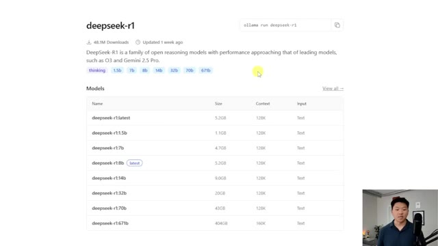
*⏱️ 00:01:25 — Page web de Ollama montrant le modèle deepseek-r1 avec la liste des différentes tailles de paramètres disponibles.*

---

### ⏱️ `[00:01:50 - 00:02:09]` | Segment #05

**🔊 Audio (Transcription Intégrale Mot pour Mot en Français) :**
> GPT-4 fait presque 1 800 milliards, ce qui est tout simplement massif. Vous savez, par exemple GPT-4-o fait 200 milliards. Claude 3.5 Sonnet tourne autour de 175 milliards. Donc ces modèles propriétaires vont être beaucoup plus rapides et plus puissants que la plupart de ces modèles open source. Cet écart se réduit lentement et un jour, il y aura des modèles open source qui seront tout aussi puissants que ceux-ci.

**👁️ Analyse Visuelle d'Écran (gemini-3.5-flash-lite) :**
**Interface & Outils** : Navigateur web affichant des pages d'information et de documentation sur les modèles d'IA.

**Contenu textuel & Code** : Texte comparatif sur le nombre de paramètres de GPT-4 (1.8 trillion), GPT-4o (200 milliards) et Claude 3.5 Sonnet (175 milliards) ; tableau des tailles des modèles DeepSeek-R1 sur Ollama.

**Action / Démonstration** : Le présentateur commente et compare les tailles de différents modèles d'intelligence artificielle propriétaires et open source.

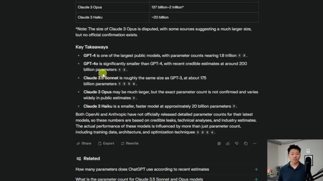
*⏱️ 00:01:55 — Page web affichant les estimations du nombre de paramètres pour différents modèles de langage propriétaires comme GPT-4, GPT-4o, et Claude 3.5 Sonnet.*

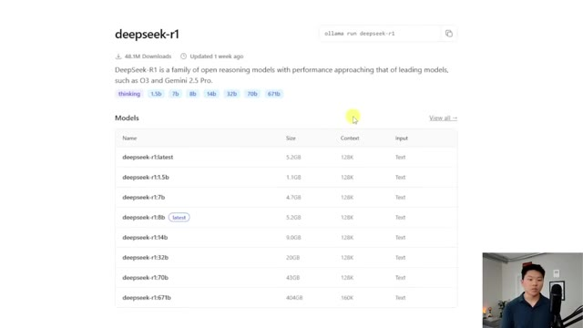
*⏱️ 00:02:04 — Page web de la bibliothèque de modèles DeepSeek-R1 montrant les différentes tailles disponibles, de 1.5b à 671b paramètres.*

---

### ⏱️ `[00:02:09 - 00:02:43]` | Segment #06

**🔊 Audio (Transcription Intégrale Mot pour Mot en Français) :**
> Mais pour l'instant, c'est le genre de limitation des modèles open source. Et vous allez aussi être limité en fonction de la machine locale réelle sur laquelle vous allez installer et exécuter ces modèles. Mais bref, maintenant que c'est fait, allons-y par exemple, dans ce cas, téléchargeons DeepSeek R1. Ça fait 1,5 milliard de paramètres. Donc tout ce que je vais faire, c'est aller de l'avant et cliquer sur ce bouton de copie ici. Donc je copie juste le nom DeepSeek tiret R1 deux-points 1,5B. Je vais ouvrir notre Docker et nous pouvons voir notre conteneur avec tous ces différents conteneurs dedans. Et ce que je vais faire, c'est en gros juste ouvrir le conteneur Ollama qui a l'image Ollama dedans. Et tout ce que j'ai à faire, c'est de cliquer sur exec.

**👁️ Analyse Visuelle d'Écran (gemini-3.5-flash-lite) :**
**Interface & Outils** : Navigateur web et application Docker Desktop

**Contenu textuel & Code** : Liste des variantes du modèle deepseek-r1 (latest, 1.5b, 7b, 8b, 14b, 32b, 70b, 671b) et liste des conteneurs Docker (self-hosted-ai-starter-kit).

**Action / Démonstration** : Présentation des différentes tailles de modèles DeepSeek-R1 disponibles sur Ollama et visualisation des services conteneurisés dans Docker.

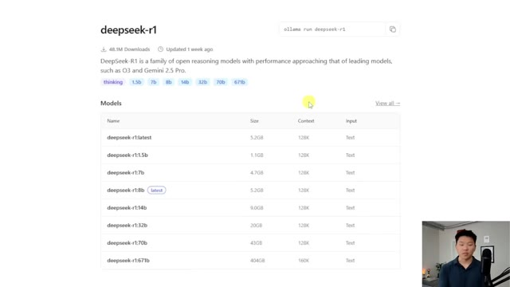
*⏱️ 00:02:18 — Page web affichant les détails du modèle DeepSeek-R1 avec les différentes tailles disponibles (1.5b, 7b, 8b, etc.) et les commandes Ollama associées.*

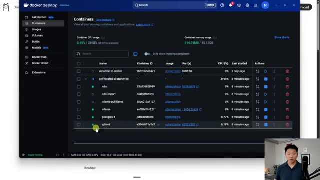
*⏱️ 00:02:34 — Interface de Docker Desktop montrant la liste des conteneurs en cours d'exécution, incluant n8n, ollama, postgres et qdrant.*

---

### ⏱️ `[00:02:43 - 00:03:17]` | Segment #07

**🔊 Audio (Transcription Intégrale Mot pour Mot en Français) :**
> Et je vais juste taper Ollama pull. Je vais juste coller ce qu'on vient de copier, c'est-à-dire DeepSeek R1. Je vais appuyer sur entrée. En ce moment, ce qu'il fait, c'est qu'il récupère DeepSeek. Il l'installe sur notre machine. Et ensuite, une fois que ce sera fait, nous pourrons y accéder dans n8n. D'accord. Nous venons donc d'obtenir notre message de réussite. Je vais retourner dans notre n8n local et ouvrir ce nœud Ollama. Et maintenant, si je clique sur cette flèche, nous voyons DeepSeek R1 juste ici. Je suis donc passé à autre chose. Maintenant, nous utilisons DeepSeek et testons simplement que ça fonctionne. Je vais juste dire, raconte-moi une blague. Et maintenant, nous n'accédons plus à notre modèle Ollama local. Nous utilisons notre

**👁️ Analyse Visuelle d'Écran (gemini-3.5-flash-lite) :**
**Interface & Outils** : Docker Desktop et n8n (éditeur de workflows d'automatisation).

**Contenu textuel & Code** : Commande `ollama pull deepseek-r1:1.5b` dans le terminal Docker et diagramme de workflow n8n (When chat message received -> AI Agent -> Ollama Chat Model).

**Action / Démonstration** : Téléchargement et installation du modèle DeepSeek R1 via Docker, suivi de sa configuration dans un workflow n8n.

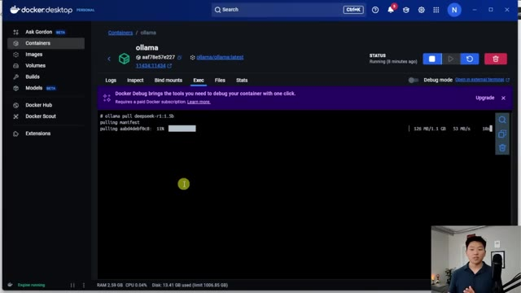
*⏱️ 00:02:51 — Interface de Docker Desktop montrant le terminal en cours d'exécution avec la commande ollama pull deepseek-r1:1.5b qui télécharge le modèle.*

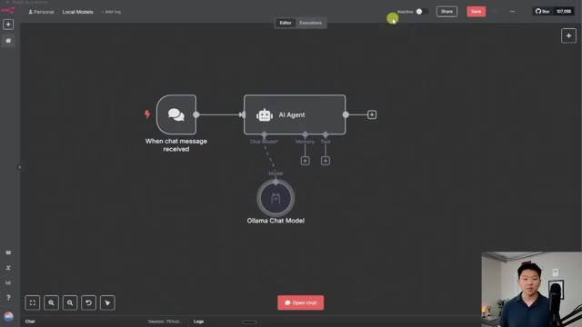
*⏱️ 00:03:08 — Interface de n8n affichant un workflow d'agent conversationnel IA connecté à un composant Ollama Chat Model.*

---

### ⏱️ `[00:03:17 - 00:03:45]` | Segment #08

**🔊 Audio (Transcription Intégrale Mot pour Mot en Français) :**
> le DeepSeek R1. Et vous pouvez le voir parce que c'est un modèle de réflexion et il a dit, réfléchis, réfléchis, pourquoi est-ce que les squelettes ne se battent pas entre eux ? Parce qu'ils n'ont pas de cran. Et donc c'est vraiment aussi simple que ça. Et maintenant tout ce qu'on aurait à faire, c'est de revenir dans Ollama, de cliquer sur modèles, et on pourrait regarder tous les différents modèles d'IA, ainsi que les différents paramètres qui sont proposés et simplement les importer dans notre Docker. Donc par exemple, disons que nous voulions importer Qwen et que je veux importer Qwen 1,7 milliard de paramètres. Je copiereis simplement le nom, irais dans notre Ollama sur Docker dans l'onglet exec.

**👁️ Analyse Visuelle d'Écran (gemini-3.5-flash-lite) :**
**Interface & Outils** : Interface n8n / workflow visuel et page web de documentation/catalogue de modèles IA.

**Contenu textuel & Code** : Blague générée par DeepSeek R1 sur les squelettes : "Why don't skeletons fight each other? Because they don't have the 'Guts'!" avec balises de pensée <think>.

**Action / Démonstration** : Démonstration de l'exécution d'un workflow d'agent IA utilisant le modèle DeepSeek R1 via Ollama.

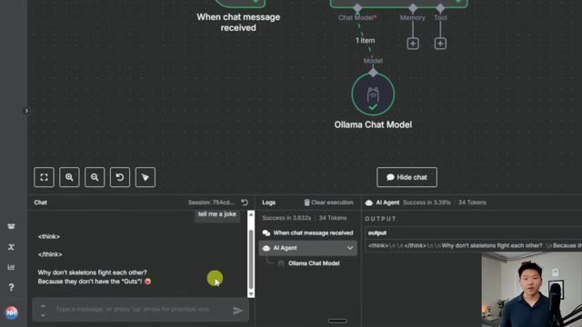
*⏱️ 00:03:24 — Interface d'un workflow visuel montrant un nœud Ollama Chat Model et un panneau de chat affichant la sortie de la blague sur les squelettes avec les balises de réflexion du modèle DeepSeek R1.*

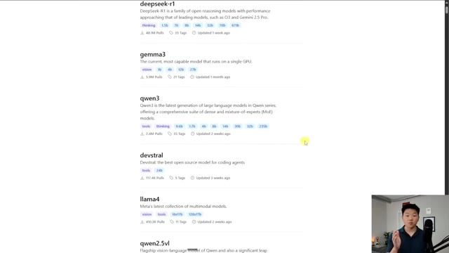
*⏱️ 00:03:31 — Page web listant différents modèles d'intelligence artificielle open source, notamment deepseek-r1, gemma3, qwen3, devstral et llama4.*

---

### ⏱️ `[00:03:45 - 00:04:19]` | Segment #09

**🔊 Audio (Transcription Intégrale Mot pour Mot en Français) :**
> nous allons dire ollama pull et je vais simplement coller cette valeur et maintenant nous allons simplement récupérer qwen juste comme ça super simple nous avons notre message de réussite je vais retourner dans n8n cliquer sur ollama et nous l'ouvrons et nous pouvons voir que maintenant nous avons notre modèle qwen 3 1.7 milliard de paramètres et c'est tellement cool parce que encore une fois cela tourne localement sur mon pc là-bas tout va être complètement gratuit et nous avons tellement d'options différentes parmi lesquelles choisir et comme je l'ai dit je ne suis pas un expert en poids de modèles et en paramètres mais gardez juste à l'esprit que je ne compterais probablement pas trop sur un modèle de 1,7 milliard de paramètres ou de 1,5 milliard de paramètres pour autre chose que des choses très basiques

**👁️ Analyse Visuelle d'Écran (gemini-3.5-flash-lite) :**
**Interface & Outils** : Docker Desktop (pour la gestion des conteneurs) et n8n (interface de workflow d'automatisation).

**Contenu textuel & Code** : - Terminal : `ollama pull deepseek-r1:1.5b`, `ollama pull qwen:1.7b`, avec logs de succès.
- n8n : champ "Model" réglé sur `qwen:1.7b`, réponse JSON affichant la génération de texte (blague sur les squelettes).

**Action / Démonstration** : Exécution de commandes dans le terminal du conteneur Docker pour télécharger de nouveaux modèles IA, suivie de la sélection et de l'utilisation du modèle 'qwen:1.7b' au sein d'un workflow n8n.

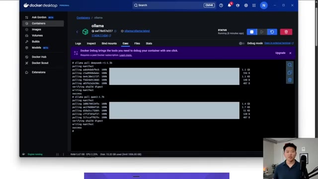
*⏱️ 00:03:54 — Interface Docker Desktop montrant l'onglet "Exec" du conteneur Ollama, affichant le journal de téléchargement réussi des modèles 'deepseek-r1:1.5b' et 'qwen:1.7b'.*

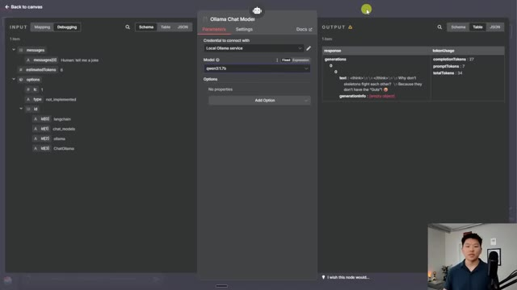
*⏱️ 00:04:02 — Interface de configuration du nœud "Ollama Chat Model" dans n8n, avec le champ "Model" configuré sur 'qwen:1.7b' et l'affichage du résultat de la requête en sortie.*

---

### ⏱️ `[00:04:19 - 00:04:37]` | Segment #10

**🔊 Audio (Transcription Intégrale Mot pour Mot en Français) :**
> utilisation conversationnelle. Si vous voulez avoir des agents avec l'appel d'outils et tout ce genre de choses en utilisant des modèles locaux, vous allez probablement en vouloir au moins environ 14 milliards ou 32 milliards. Mais encore une fois, ils sont complètement gratuits. Vous pouvez donc simplement tester autant que vous voulez. Quoi qu'il en soit, laissez-moi juste vous montrer quelques commandes utiles que vous pouvez utiliser à l'intérieur de cet exec du conteneur olama.

**👁️ Analyse Visuelle d'Écran (gemini-3.5-flash-lite) :**
**Interface & Outils** : Navigateur web (catalogue de modèles) et Docker Desktop.

**Contenu textuel & Code** : Liste de modèles open source (deepseek-r1, gemma3, qwen3, devstral) et commandes terminal de téléchargement (ollama pull deepseek-r1:1.5b, ollama pull qwen3:1.7b).

**Action / Démonstration** : Navigation dans le catalogue de modèles et téléchargement de modèles via le terminal dans Docker.

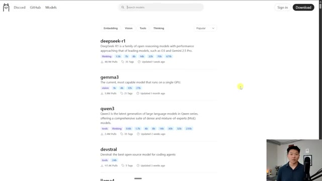
*⏱️ 00:04:24 — Capture d'écran montrant un catalogue de modèles de langage open source avec différentes tailles de paramètres.*

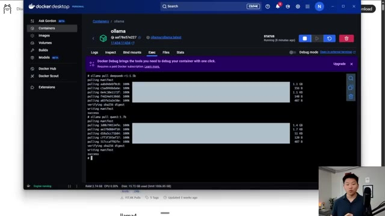
*⏱️ 00:04:33 — Interface de Docker Desktop affichant un terminal en cours d'exécution avec des commandes de téléchargement de modèles (ollama pull).*

---

### ⏱️ `[00:04:38 - 00:05:11]` | Segment #11

**🔊 Audio (Transcription Intégrale Mot pour Mot en Français) :**
> Alors, disons que vous voulez simplement voir quels modèles vous avez à disposition. Vous pouvez aller de l'avant et taper ollama list. Et cela va nous montrer, ok, vous avez qwen, deepseek et llama 3.2. Maintenant, disons que nous voulions nous débarrasser de l'un d'eux. Débarrassons-nous simplement du qwen que nous venons d'installer. Je taperais simplement ollama rm, ce qui signifie remove (supprimer). Et je pourrais simplement coller le nom du modèle que nous voulons supprimer, appuyer sur entrée. Et maintenant, il est dit que qwen est supprimé. Si je retourne dans nos modèles locaux, que nous ouvrons celui-ci, nous n'avons plus qwen. Comme vous pouvez le voir, nous avons seulement deepseek ou llama à choisir. Et c'est aussi simple que ça. Ça se met à jour en temps réel. Vous n'avez même pas besoin, vous savez, de faire docker compose down et de le relancer. Nous sommes essentiellement prêts à repartir

**👁️ Analyse Visuelle d'Écran (gemini-3.5-flash-lite) :**
**Interface & Outils** : Terminal de commandes et interface de workflow de type n8n.

**Contenu textuel & Code** : Commandes Ollama (ollama pull, ollama list) et liste des modèles locaux (qwen3:1.7b, deepseek-r1:1.5b, llama3.2).

**Action / Démonstration** : Affichage de la liste des modèles disponibles et sélection d'un modèle dans une interface de workflow.

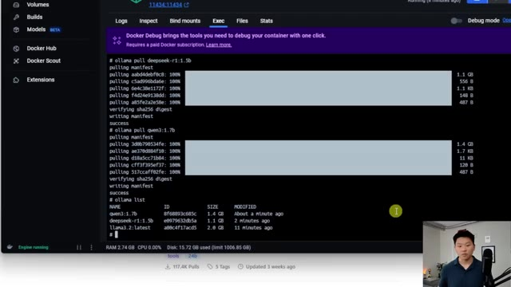
*⏱️ 00:04:46 — Vue d'un terminal intégré montrant la liste des modèles Ollama (qwen3:1.7b, deepseek-r1:1.5b, llama3.2:latest).*

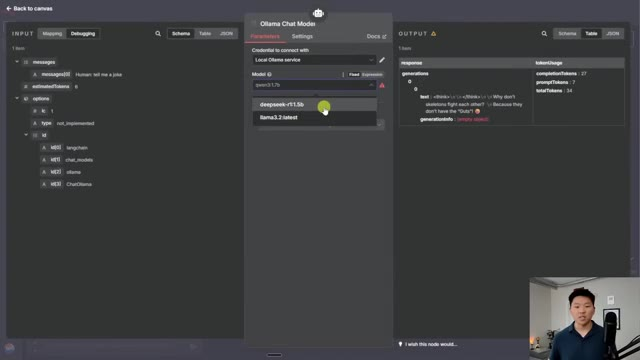
*⏱️ 00:05:03 — Interface de workflow montrant la configuration d'un nœud Ollama Chat Model avec le menu déroulant des modèles disponibles.*

---

### ⏱️ `[00:05:11 - 00:05:31]` | Segment #12

**🔊 Audio (Transcription Intégrale Mot pour Mot en Français) :**
> rapide et facile. Et comme je l'ai dit, vous avez tous ces modèles parmi lesquels choisir. Donc, c'est tout pour celui-ci. Je sais que c'était court, mais je voulais juste vous montrer à quel point il est simple et facile de faire tourner ces différents modèles locaux. Et cela peut sembler un peu intimidant au début, mais après cette vidéo, vous pouvez voir que ce n'est vraiment pas si terrible. Alors, si vous avez appris quelque chose de nouveau ou si vous avez apprécié cette vidéo, mettez un pouce bleu, ça m'aide énormément. Et je vous dis à tous à la prochaine. Merci tout le monde.

**👁️ Analyse Visuelle d'Écran (gemini-3.5-flash-lite) :**
**Interface & Outils** : Interface web n8n ou équivalent d'automatisation de workflow, panneau de chat intégré.

**Contenu textuel & Code** : Workflow comprenant les nœuds 'When chat message received', 'AI Agent' et 'Ollama Chat Model'. Sortie du chat affichant une blague : 'Why don't skeletons fight each other? Because they don't have the Guts!'.

**Action / Démonstration** : Exécution d'un workflow testant un modèle de langage local via Ollama dans un agent IA.

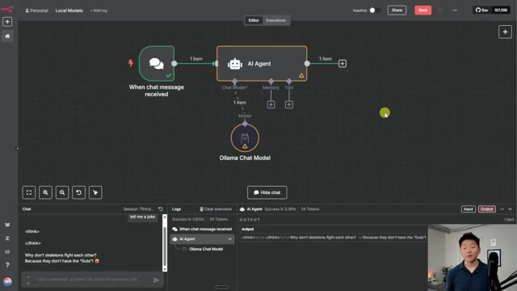
*⏱️ 00:05:16 — Interface d'un éditeur de workflow avec un nœud d'agent IA connecté à un modèle Ollama, et un panneau de chat en bas à gauche affichant une blague générée.*

---

