# 🎬 Use Parallelization to Make n8n Workflows Faster & Scalable

> **Chaîne** : [Nate Herk | AI Automation](https://www.youtube.com/@nateherk/featured)  
> **Lien YouTube** : [https://www.youtube.com/watch?v=qNW9KaLe1nY](https://www.youtube.com/watch?v=qNW9KaLe1nY)  
> **Date de publication** : 20250709  
> **Durée** : 00:11:25  
> **Identifiant vidéo** : `qNW9KaLe1nY`  
> **Transcription & Analyse** : `whisper-v3-large-turbo+gemini-3.5-flash-lite`  

---

## 📌 Synthèse Exécutive & Outils

### 💡 Résumé

Cette vidéo technique de la chaîne **Nate Herk | AI Automation** explore une technique d'automatisation avancée et pourtant sous-utilisée : la **parallélisation** dans **n8n**. Contrairement aux exécutions séquentielles traditionnelles qui traitent les flux d'éléments un par un, l'approche parallèle permet de multiplier les exécutions simultanées en s'appuyant sur des **sous-flux de travail** (*sub-workflows*). L'animateur démontre l'impact de cette configuration sur un cas concret d'analyse de données par agent IA : alors que le traitement séquentiel de quatre outils technologiques prend près d'une minute, la parallélisation réduit le temps d'exécution total de plus de moitié, passant à une vingtaine de secondes.

Au-delà du simple gain de vitesse illustré par l'analogie des fours de cuisson, la vidéo aborde l'architecture globale des flux de travail dans n8n. L'utilisation récente de fonctionnalités natives comme la conversion de nœuds en sous-flux permet d'isoler la logique, de structurer des composants réutilisables et d'optimiser l'évolutivité des architectures d'agents IA complexes. Cependant, l'ingénieur insiste sur le fait que la parallélisation n'est pas une solution universelle et nécessite de peser le pour et le contre face à des contraintes techniques précises.

Enfin, la session met en garde contre les pièges courants de l'ingénierie parallèle, tels que la saturation des limites de taux d'API (*rate limits*), la gestion granulaire des erreurs à grande échelle, et la complexité accrue du débogage lorsque des dizaines de tâches s'exécutent de concert. Des ressources complémentaires, comprenant des fichiers JSON de workflows et des documentations détaillées, sont mises à disposition des développeurs au sein d'une communauté gratuite pour faciliter l'implémentation directe de ces architectures.

### 🛠️ Outils, Modèles & Logiciels Présentés

* **n8n** : Plateforme d'automatisation de flux de travail open-source et low-code permettant de configurer des exécutions parallèles et des sous-flux modulaires.
* **Perplexity API** : Moteur de recherche propulsé par l'IA utilisé pour collecter des données et effectuer des recherches approfondies sur des outils logiciels spécifiques.
* **Google Sheets** : Feuille de calcul utilisée comme source de données initiale pour stocker et extraire les éléments à traiter par les agents d'automatisation.
* **Excalidraw** : Outil de tableau blanc virtuel employé pour schématiser et expliquer visuellement le concept théorique de la parallélisation.
* **Claude Code / Anthropic / Opus 5.5** : Écosystèmes d'intelligence artificielle et de développement logiciel associés à l'expertise technique de la chaîne (mentionnés dans le contexte global de l'ingénierie IA).

### 🔑 Points Clés & Enseignements Stratégiques

* **Définition de la parallélisation** : Technique d'ingénierie logicielle consistant à exécuter plusieurs tâches simultanément plutôt que de manière séquentielle, réduisant drastiquement la latence globale des automatisations lourdes.
* **Gain de performance mesurable** : L'utilisation de sous-flux exécutés en parallèle a permis de diviser le temps de traitement d'un lot de données par deux (de plus de 50 secondes à 22 secondes pour quatre éléments).
* **Mise en œuvre native dans n8n** : Utilisation de la fonctionnalité de conversion par clic droit pour transformer un groupe de nœuds en un sous-flux de travail indépendant et interconnecté.
* **Configuration critique pour le parallélisme** : Pour activer l'exécution simultanée, il est impératif de paramétrer l'appel du sous-flux pour qu'il s'exécute *« une fois pour chaque élément »* et de *désactiver* l'option *« attendre la fin du sous-flux de travail »*.
* **Évolutivité exponentielle** : Si le gain est modeste sur quatre éléments, l'impact sur le temps de calcul devient critique et indispensable lors du traitement de dizaines ou de centaines d'éléments (10, 20 ou 50+).
* **Gestion des limites de ressources (*Rate Limits*)** : La parallélisation agressive peut saturer les quotas d'appels des API tierces (comme Perplexity), nécessitant parfois le recours à un traitement par lots (*batching*) plutôt qu'à un flux 100 % parallèle.
* **Complexité de la gestion des erreurs** : Traiter des dizaines de requêtes en même temps complique l'isolation des pannes ; une stratégie robuste est requise pour identifier, relancer ou consigner les échecs individuels sans bloquer l'ensemble du système.
* **Dépendances logiques strictes** : Les flux hautement séquentiels où l'étape B dépend impérativement du résultat de l'étape A ne se prêtent pas à la parallélisation et nécessitent une architecture linéaire rigoureuse.
* **Défis liés au débogage** : L'éclatement d'une exécution unique en de multiples sous-exécutions simultanées complique la traçabilité et l'investigation manuelle lors de modifications ou de phases de test.
* **Modularité et réutilisabilité** : Au-delà de la vitesse, diviser les flux en sous-flux permet de créer des composants logiques réutilisables pouvant être connectés à des centaines de workflows distincts.
* **Ressources communautaires et partage de code** : L'accès à des modèles de flux pré-configurés au format JSON et à des documentations PDF permet d'accélérer l'apprentissage et le déploiement de ces architectures avancées en production.

---

## ⏱️ Chronologie & Transcription Complète Audio & Visuelle (Mot pour Mot)

### ⏱️ `[00:00:00 - 00:00:36]` | Segment #01

**🔊 Audio (Transcription Intégrale Mot pour Mot en Français) :**
> Aujourd'hui, je vais vous parler d'une technique d'automatisation dont je vois à peine quelqu'un parler sur YouTube et je ne l'ai d'ailleurs jamais abordée sur cette chaîne non plus. C'est une technique appelée la parallélisation, et elle vous permet d'exécuter des éléments en même temps afin que votre flux de travail se termine beaucoup plus rapidement et soit beaucoup plus efficace. Comprendre la parallélisation et les sous-flux de travail va vraiment faire passer votre niveau d'automatisation à la vitesse supérieure, alors dans cette vidéo, nous allons parler de ce que c'est, nous allons voir quelques exemples de la façon dont vous pouvez réellement configurer cela, nous parlerons des inconvénients et des considérations, et nous allons également parler du pourquoi et du quand vous voudriez configurer un sous-flux de travail, car la parallélisation n'est qu'une des nombreuses raisons pour lesquelles vous pourriez vouloir diviser un grand flux de travail en plusieurs sous-flux de travail. Donc je ne veux pas perdre de temps, je vais juste lancer un

**👁️ Analyse Visuelle d'Écran (gemini-3.5-flash-lite) :**
**Interface & Outils** : Interface de création de workflow (type Make ou n8n)

**Contenu textuel & Code** : Diagramme d'automatisation avec un nœud déclencheur, un nœud de récupération de données et un sous-workflow.

**Action / Démonstration** : Exécution d'un workflow d'automatisation montrant le succès du traitement des éléments.

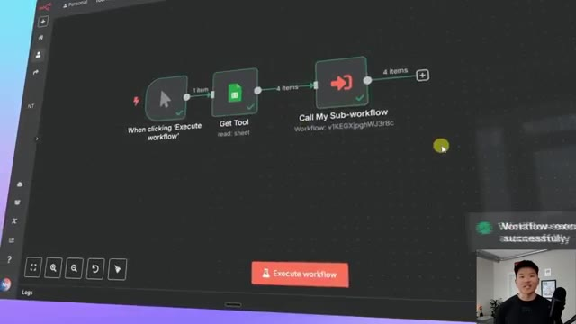
*⏱️ 00:00:09 — Un éditeur de workflow montrant un diagramme avec trois nœuds principaux : 'When clicking Execute workflow', 'Get Tool', et 'Call My Sub-workflow'.*

---

### ⏱️ `[00:00:36 - 00:00:55]` | Segment #02

**🔊 Audio (Transcription Intégrale Mot pour Mot en Français) :**
> petite démonstration visuelle pour que vous puissiez voir à quel point c'est lent quand on exécute quelque chose de séquentiel plutôt qu'en parallèle. Donc en ce moment, nous faisons des recherches sur Perplexity pour quatre outils différents qui sont stockés dans une feuille Google Sheet. C'est allé assez vite parce que l'API de Perplexity peut en fait faire cela en parallèle, mais maintenant cet agent IA va traiter chaque outil et chaque recherche un par un.

**👁️ Analyse Visuelle d'Écran (gemini-3.5-flash-lite) :**
**Interface & Outils** : Interface web de workflow / automatisation (style Langflow ou similaire).

**Contenu textuel & Code** : Nœuds connectés : 'When clicking Execute workflow', 'Get Tool' (Google Sheet), 'Perplexity Research', 'Tool Analysis Agent' et 'Update Tool'.

**Action / Démonstration** : Exécution d'un workflow d'automatisation avec des recherches sélectives ou parallèles sur des données de feuilles de calcul.

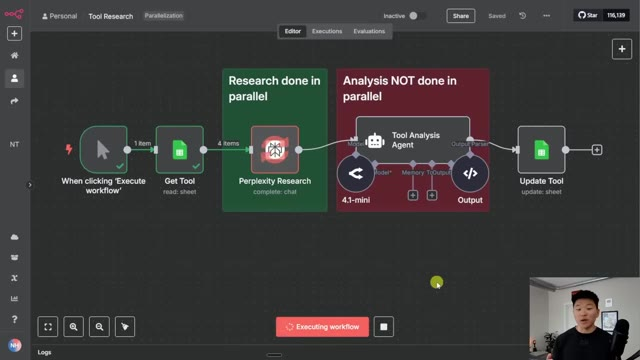
*⏱️ 00:00:40 — Interface d'un éditeur de workflow montrant un pipeline de recherche d'outils avec Perplexity et Google Sheets.*

---

### ⏱️ `[00:00:55 - 00:01:13]` | Segment #03

**🔊 Audio (Transcription Intégrale Mot pour Mot en Français) :**
> Donc en ce moment, ça travaille sur le premier outil. Comme vous pouvez le voir, ça vient de finir le premier et maintenant ça passe au deuxième. Et on peut le voir parce que si je déplace ça vers le bas, vous pouvez voir que ça n'a fait qu'un seul élément. Maintenant, ça va faire le deuxième, maintenant ça va faire le troisième, et ainsi de suite. Mais si nous avions fait tourner cet agent en parallèle, cela aurait été terminé il y a déjà environ 20 secondes.

**👁️ Analyse Visuelle d'Écran (gemini-3.5-flash-lite) :**
**Interface & Outils** : Interface web de type outil d'automatisation ou de workflow basé sur des nœuds.

**Contenu textuel & Code** : Nœuds de workflow étiquetés "Perplexity Research", "Tool Analysis Agent", et "Update Tool", avec des indicateurs de statut et de traitement de données (4 items).

**Action / Démonstration** : Exécution séquentielle ou traitement d'éléments par les différents nœuds du workflow d'automatisation.

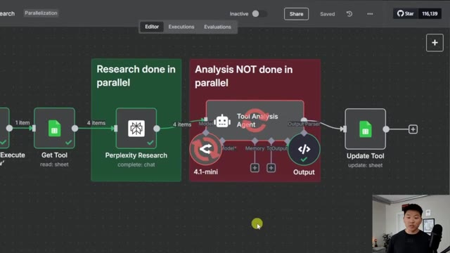
*⏱️ 00:00:59 — Interface de workflow montrant un agent d'analyse en cours d'exécution avec des blocs de recherche et de mise à jour.*

---

### ⏱️ `[00:01:13 - 00:01:35]` | Segment #04

**🔊 Audio (Transcription Intégrale Mot pour Mot en Français) :**
> Donc voilà, ça vient enfin de se terminer et ça n'a pris que quatre éléments. Imaginez si vous en aviez 10 ou 20. Donc nous allons nous plonger directement dans ce flux de travail ici et je vais transformer ceci en un flux de travail à exécution parallèle. Mais avant de faire ça, allons rapidement sur Excalidraw pour que je puisse vous expliquer ce qu'est réellement la parallélisation. Donc ce qu'est la parallélisation, à part être difficile à prononcer, c'est que vous exécutez plusieurs tâches en même temps au lieu de les faire les unes après les autres.

**👁️ Analyse Visuelle d'Écran (gemini-3.5-flash-lite) :**
**Interface & Outils** : Interface graphique de gestion de flux de travail (workflow automation) et outil de présentation de type tableau blanc / slides.

**Contenu textuel & Code** : Diagramme de workflow avec des blocs connectés et texte explicatif sur la parallélisation.

**Action / Démonstration** : Présentation et explication du concept de parallélisation et visualisation du flux de travail actuel avant modification.

*⏱️ 00:01:19 — Interface d'un outil de workflow montrant un diagramme avec différentes étapes (Get Tool, Perplexity Research, Tool Analysis Agent, Update Tool).*

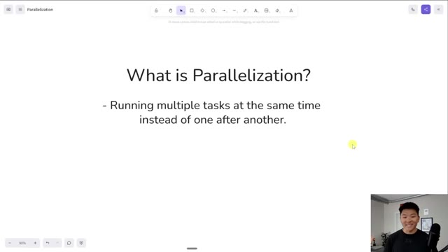
*⏱️ 00:01:30 — Une diapositive de présentation avec le titre "What is Parallelization?" et une définition textuelle.*

---

### ⏱️ `[00:01:35 - 00:01:55]` | Segment #05

**🔊 Audio (Transcription Intégrale Mot pour Mot en Français) :**
> Et cela ne se produit vraiment pas de manière native au sein de NNN. Nous avons beaucoup de chance ici parce que l'API de Perplexity prend les quatre éléments et fait essentiellement, sur leur serveur, des recherches sur les quatre en même temps. C'est donc super. Mais ce n'est pas le cas de toutes les API. Nous venons pratiquement de découvrir que Perplexity le fait. Mais comme vous pouvez le voir lorsque nous appelons le modèle de chat, il a traité ceux-ci un par un et c'était très lent.

**👁️ Analyse Visuelle d'Écran (gemini-3.5-flash-lite) :**
**Interface & Outils** : Interface web de création de workflow (type outil d'automatisation visuel).

**Contenu textuel & Code** : Nœuds de workflow : 'When clicking Execute workflow', 'Get Tool', 'Perplexity Research' (dans un cadre vert 'Research done in parallel'), 'Tool Analysis Agent' (dans un cadre rouge 'Analysis NOT done in parallel'), '4.1-mini', 'Output', et 'Update Tool'.

**Action / Démonstration** : Visualisation et explication d'un workflow automatisé combinant recherche en parallèle via l'API Perplexity et analyse par agent.

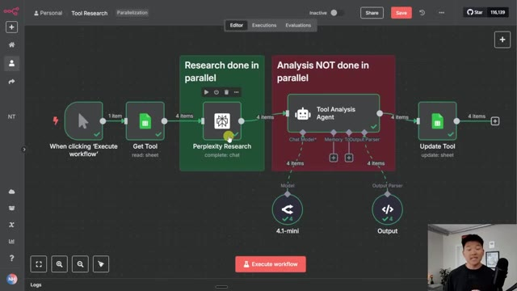
*⏱️ 00:01:40 — Capture d'écran montrant un diagramme de workflow avec des nœuds pour la recherche Perplexity et l'analyse séquentielle.*

---

### ⏱️ `[00:01:55 - 00:02:31]` | Segment #06

**🔊 Audio (Transcription Intégrale Mot pour Mot en Français) :**
> Et au cas où ce ne serait pas encore tout à fait clair, imaginez que nous voulions cuire ces trois dindes et que chacune prenne 30 minutes à cuire, mais que nous n'ayons qu'un seul four à disposition. Donc, sans parallélisation, nous cuisons la première, puis nous cuisons la deuxième, puis nous cuisons la troisième, et cela prendrait un total de 90 minutes. Mais si nous sommes capables d'utiliser la parallélisation, ce qui signifie que nous aurions trois fours qui peuvent tous fonctionner en même temps, le temps de cuisson total de ces trois dindes ne serait que de 30 minutes et ce sera tout simplement beaucoup plus efficace. J'espère donc que cette démonstration vous montre qu'il est fondamentalement évident dans certains cas d'utiliser la parallélisation. Revenons donc dans NNN et je vais simplement vous montrer à quel point c'est facile de

**👁️ Analyse Visuelle d'Écran (gemini-3.5-flash-lite) :**
**Interface & Outils** : Logiciel de présentation ou tableau blanc numérique (canvas).

**Contenu textuel & Code** : Texte 'Without parallelization' et 'With parallelization', images de fours et de dindes avec des durées.

**Action / Démonstration** : Présentation visuelle et analogie de la parallélisation informatique à l'aide de dindes et de fours.

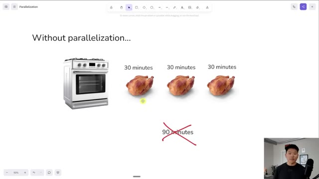
*⏱️ 00:02:04 — Schéma explicatif illustrant le concept 'Without parallelization' avec un seul four et trois dindes de 30 minutes.*

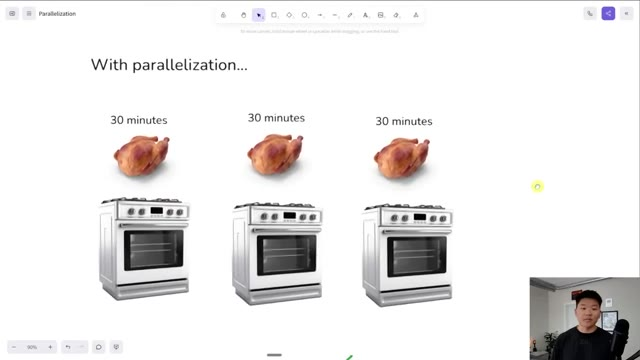
*⏱️ 00:02:13 — Schéma explicatif illustrant 'With parallelization' avec trois fours pour cuire les dindes simultanément.*

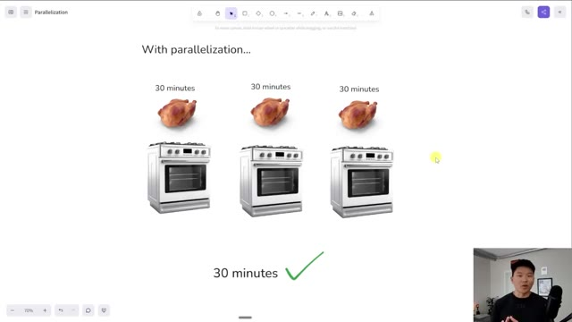
*⏱️ 00:02:22 — Suite du schéma avec la validation finale montrant un temps total de 30 minutes grâce aux trois fours.*

---

### ⏱️ `[00:02:31 - 00:02:50]` | Segment #07

**🔊 Audio (Transcription Intégrale Mot pour Mot en Français) :**
> configurer ceci. Donc, dans une mise à jour récente de n8n, ils ont ajouté cette fonctionnalité sympa où vous pouvez essentiellement sélectionner des nœuds, faire un clic droit, puis dire : je veux convertir ces sept nœuds en sous-flux de travail. Donc, si vous ne voyez pas cette option, essayez simplement de mettre à jour votre instance de n8n et vous devriez alors la voir. Et ce qui se passe, c'est que lorsque je clique sur ce bouton, cela va fondamentalement me demander de nommer mon flux de travail. Je vais juste le garder comme "mon sous-flux de travail" pour l'instant.

**👁️ Analyse Visuelle d'Écran (gemini-3.5-flash-lite) :**
**Interface & Outils** : n8n (éditeur de flux de travail)

**Contenu textuel & Code** : Diagramme de workflow avec des nœuds pour Google Sheets, Perplexity Research, un agent d'analyse d'outils et des modèles associés.

**Action / Démonstration** : Visualisation et configuration d'un flux de travail automatisé dans n8n.

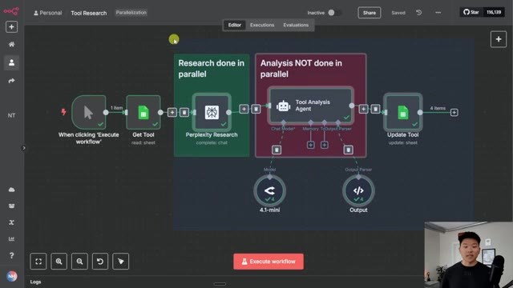
*⏱️ 00:02:36 — Interface de l'éditeur de flux de travail n8n montrant un diagramme avec plusieurs nœuds interconnectés (Get Tool, Perplexity Research, Tool Analysis Agent, Update Tool).*

---

### ⏱️ `[00:02:50 - 00:03:11]` | Segment #08

**🔊 Audio (Transcription Intégrale Mot pour Mot en Français) :**
> Et quand je clique sur confirmer, ça transforme tout ça en un sous-flux de travail et il est déjà relié juste ici et appelé par celui-ci. Et donc si je clique là-dedans, vous pouvez voir que ça transmet le nom de l'outil, ce qui est plutôt cool, c'est déjà configuré. Et je peux cliquer sur ce bouton juste ici, qui va fondamentalement nous amener à cette sous-exécution. Et nous devrions voir que tout est toujours configuré et devrait fonctionner tout à fait normalement pour nous.

**👁️ Analyse Visuelle d'Écran (gemini-3.5-flash-lite) :**
**Interface & Outils** : Éditeur de workflow visuel de type n8n ou similaire.

**Contenu textuel & Code** : Blocs fonctionnels : « When clicking 'Execute workflow' », « Get Tool » (read: sheet), et « Call My Sub-workflow ».

**Action / Démonstration** : Le présentateur explique la transformation d'un ensemble de nœuds en un sous-flux de travail interconnecté.

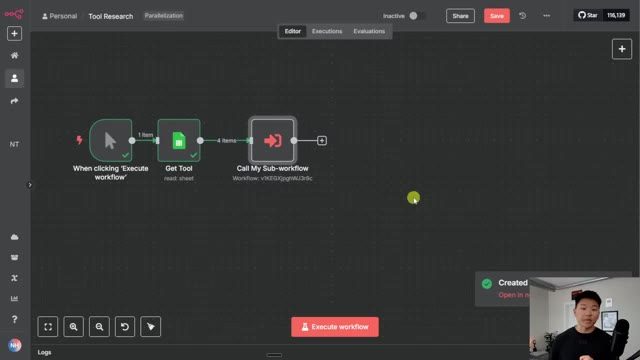
*⏱️ 00:02:56 — Interface d'un éditeur de workflow visuel montrant trois blocs connectés : un déclencheur manuel, un bloc de récupération de données Google Sheets et un sous-flux de travail (« Call My Sub-workflow »).*

---

### ⏱️ `[00:03:11 - 00:03:44]` | Segment #09

**🔊 Audio (Transcription Intégrale Mot pour Mot en Français) :**
> Mais nous n'avons pas encore terminé, car tout ce que cela fait jusqu'à présent, c'est de transmettre ces quatre outils, qui seraient Fireflies, Excalibur, Loom et Napkin, dans le sous-flux de travail. Et ensuite, le sous-flux de travail ici capturerait les quatre et ferait exactement la même chose que nous venons de voir. Donc, ce que nous avons fait, c'est que nous avons transformé ceci en un sous-flux de travail, ce qui est super, mais nous n'avons pas encore de parallélisation, car il exécuterait toujours les quatre à travers ceci et il irait un, deux, trois, quatre. Donc, pour faire en sorte que cela s'exécute réellement en parallèle, nous voulons que les quatre éléments s'exécutent comme quatre exécutions individuelles et nous voulons qu'ils s'exécutent tous en même temps. Donc, ce que je dois faire, c'est cliquer sur le nœud. Et la première chose que je vais faire est plutôt

**👁️ Analyse Visuelle d'Écran (gemini-3.5-flash-lite) :**
**Interface & Outils** : Interface web d'automatisation de type n8n ou similaire.

**Contenu textuel & Code** : Nœuds de workflow : déclencheur, nœud de lecture de données 'Get Tool' transmettant 4 éléments, et nœud d'appel de sous-flux de travail 'Call My Sub-workflow'.

**Action / Démonstration** : Le présentateur explique la configuration du flux principal qui transmet les quatre outils vers un sous-flux de travail.

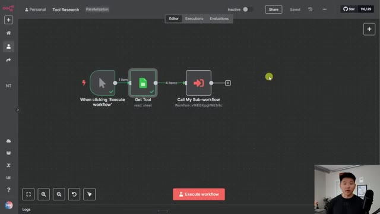
*⏱️ 00:03:19 — Vue d'ensemble d'un diagramme de workflow sur une plateforme d'automatisation, montrant trois blocs connectés : le déclencheur 'When clicking Execute workflow', une étape 'Get Tool', et un bloc 'Call My Sub-workflow' qui transmet les données.*

---

### ⏱️ `[00:03:44 - 00:04:06]` | Segment #10

**🔊 Audio (Transcription Intégrale Mot pour Mot en Français) :**
> Plutôt que de s'exécuter une seule fois avec tous les éléments, je vais choisir de s'exécuter une fois pour chaque élément, ce qui signifie qu'il va appeler le sous-flux de travail individuellement pour chaque élément. Et ensuite, une fois que nous avons modifié cela, nous devons faire une chose délicate où nous ajoutons une option et nous voulons désactiver l'attente de la fin du sous-flux de travail. Si nous laissions cette option cochée, cela enverrait essentiellement le premier, puis attendrait que celui-ci se termine, puis enverrait le deuxième et attendrait que celui-ci se termine.

**👁️ Analyse Visuelle d'Écran (gemini-3.5-flash-lite) :**
**Interface & Outils** : n8n (interface de workflow d'automatisation)

**Contenu textuel & Code** : Paramètres du nœud avec Source (Database), Workflow (My Sub-workflow), Workflow Inputs (Tool : Fireflies.ai), et le menu déroulant Mode affichant les options 'Run once with all items' et 'Run once for each item'.

**Action / Démonstration** : Sélection de l'option de configuration pour exécuter le sous-flux de travail pour chaque élément individuellement.

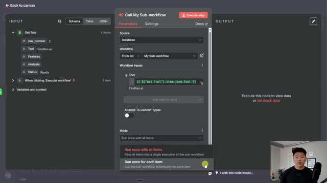
*⏱️ 00:03:50 — Configuration du nœud 'Call My Sub-workflow' dans n8n avec le menu déroulant 'Mode' ouvert pour sélectionner 'Run once for each item'.*

---

### ⏱️ `[00:04:06 - 00:04:28]` | Segment #11

**🔊 Audio (Transcription Intégrale Mot pour Mot en Français) :**
> Donc ce serait la même chose que de faire essentiellement une boucle à travers notre liste d'éléments. Et ce serait encore plus lent que la façon dont nous le faisons actuellement en envoyant les quatre éléments là-bas en même temps. Donc maintenant que nous avons configuré cela correctement, je vais l'exécuter une fois de plus. Nous allons aller dans le sous-flux de travail et cliquer sur les exécutions, et vous allez voir que les quatre éléments s'exécutent exactement en même temps et ils vont tous se terminer beaucoup plus rapidement que la façon dont nous l'avons fait précédemment.

**👁️ Analyse Visuelle d'Écran (gemini-3.5-flash-lite) :**
**Interface & Outils** : Éditeur de workflow de type n8n

**Contenu textuel & Code** : Paramètres du nœud avec Source réglée sur Database, Workflow réglé sur « My Sub-workflow », Workflow Inputs avec l'expression `{{ $('Get Tool').item.json.Tool }}`, et Mode configuré sur « Run once for each item ».

**Action / Démonstration** : Configuration des paramètres d'appel d'un sous-workflow dans l'éditeur d'automatisation.

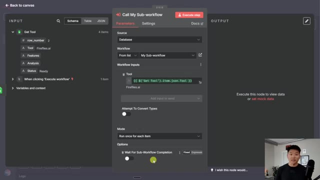
*⏱️ 00:04:11 — Interface d'un éditeur de workflow montrant la configuration d'un nœud « Call My Sub-workflow » avec des paramètres d'entrée et un panneau de prévisualisation à gauche.*

---

### ⏱️ `[00:04:28 - 00:04:49]` | Segment #12

**🔊 Audio (Transcription Intégrale Mot pour Mot en Français) :**
> Donc nous allons lancer le workflow. Il va récupérer nos outils. Il va les transmettre au sous-workflow juste ici. Je vais cliquer sur le sous-workflow et cliquer sur les exécutions, et vous pouvez voir juste ici, nous avons maintenant les quatre qui s'exécutent complètement en parallèle et ils vont tous se terminer beaucoup plus rapidement que si l'agent IA faisait une analyse sur chacun d'eux individuellement. Donc vous pouvez voir que ces quatre-là ont tous terminé et cela a pris un total de 22 secondes.

**👁️ Analyse Visuelle d'Écran (gemini-3.5-flash-lite) :**
**Interface & Outils** : Éditeur de workflow graphique (type n8n ou plateforme similaire).

**Contenu textuel & Code** : Nœuds connectés : 'Start', 'Perplexity Research', 'Tool Analysis Agent' (avec modèles 4.1-mini et Output), et 'Update Tool'.

**Action / Démonstration** : Visualisation du sous-workflow d'automatisation avant son exécution.

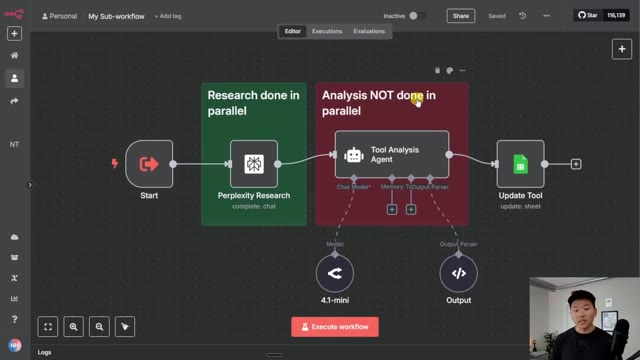
*⏱️ 00:04:33 — Interface d'un éditeur de workflow montrant un sous-workflow avec des nœuds de recherche Perplexity et d'agent d'analyse.*

---

### ⏱️ `[00:04:49 - 00:05:10]` | Segment #13

**🔊 Audio (Transcription Intégrale Mot pour Mot en Français) :**
> Vous pouvez aller dans notre feuille Google et voir que nous avons maintenant nos fonctionnalités et notre analyse sur chacun de ces quatre outils. Et juste pour vous montrer que c'est vraiment plus rapide, si je retourne dans le flux de travail principal et que nous cliquons sur les exécutions, et que nous cliquons sur l'une de celles qui s'est exécutée lorsqu'elle les faisait tourner toutes les quatre en même temps, ce qui, je crois, était celle-ci, cela a pris 51 secondes. Nous avons donc réduit le temps de traitement de moitié, voire plus de moitié.

**👁️ Analyse Visuelle d'Écran (gemini-3.5-flash-lite) :**
**Interface & Outils** : n8n (outil d'automatisation de workflows)

**Contenu textuel & Code** : Historique des exécutions (ex: Jul 8, 12:28:22 Succeeded in 16.219s) et diagramme de workflow comprenant des nœuds pour "Perplexity Research", "Tool Analysis Agent" et "Update Tool".

**Action / Démonstration** : Consultation de l'historique des exécutions et du statut des différentes étapes du flux de travail automatisé.

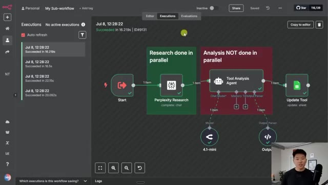
*⏱️ 00:04:54 — Capture d'écran montrant l'onglet des exécutions d'un sous-workflow dans l'interface de n8n, avec un historique des exécutions réussies sur la gauche et le diagramme du flux de travail actif au centre.*

---

### ⏱️ `[00:05:10 - 00:05:31]` | Segment #14

**🔊 Audio (Transcription Intégrale Mot pour Mot en Français) :**
> Et je sais que ça ne fait pas une énorme différence quand nous n'exécutons que quatre éléments, mais pensez-y si vous commenciez à en exécuter 10, 20, 30, vous allez gagner tellement de temps dans cette automatisation. Et rappelez-vous juste dans le nœud où vous appelez ce sous-flux de travail, pour que les choses s'exécutent en parallèle, vous devez le faire s'exécuter une fois pour chaque élément et vous devez désactiver attendre la fin du sous-flux de travail. D'accord, c'était donc si simple de voir comment nous pouvons configurer des exécutions parallèles.

**👁️ Analyse Visuelle d'Écran (gemini-3.5-flash-lite) :**
**Interface & Outils** : n8n (Interface de conception de workflows d'automatisation)

**Contenu textuel & Code** : Nœuds de workflow, paramètres de sous-flux, entrées JSON et tableau de données avec les outils (Fireflies.ai, Excalidraw, Loom, Napkin.ai).

**Action / Démonstration** : Navigation dans l'historique des exécutions et configuration des paramètres d'appel d'un sous-flux de travail pour le traitement en parallèle.

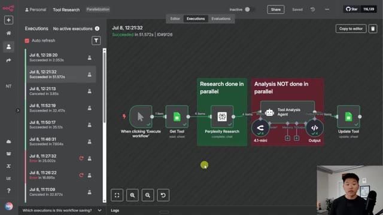
*⏱️ 00:05:15 — Vue d'ensemble d'un workflow d'automatisation montrant l'historique des exécutions et le diagramme avec des blocs de recherche et d'analyse.*

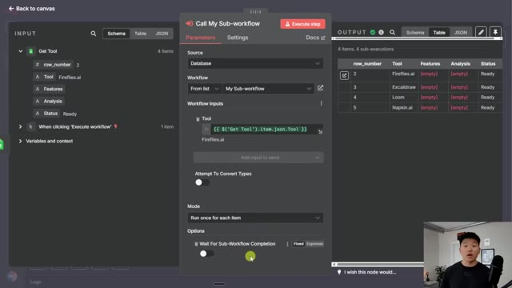
*⏱️ 00:05:26 — Configuration détaillée du nœud 'Call My Sub-workflow' avec les paramètres d'entrée et le mode d'exécution par élément.*

---

### ⏱️ `[00:05:31 - 00:05:54]` | Segment #15

**🔊 Audio (Transcription Intégrale Mot pour Mot en Français) :**
> Maintenant, parlons rapidement des inconvénients et des considérations liés à l'utilisation de la parallélisation. Donc, au début, ces quatre éléments me sont venus à l'esprit, qui étaient les limites de ressources. Donc, par exemple, dans notre flux, où nous faisons appel à Perplexity pour faire des recherches, nous pouvons avoir une limite où vous ne pouvez pas en faire plus de 20 par minute ou quelque chose comme ça. Et si vous rencontrez un problème de ce genre, vous devez alors envisager de boucler individuellement sur chaque élément ou d'envoyer des lots de 20 ou quelque chose de semblable.

**👁️ Analyse Visuelle d'Écran (gemini-3.5-flash-lite) :**
**Interface & Outils** : Application de tableau blanc (whiteboard) avec le présentateur en incrustation vidéo.

**Contenu textuel & Code** : Texte affiché : "Drawbacks & Considerations of Parallelization" suivi de quatre points : "- Resource Limits", "- Error Handling", "- Workflow Dependencies", "- Troubleshooting/Debugging".

**Action / Démonstration** : Le présentateur présente et commente la liste des points relatifs aux inconvénients de la parallélisation.

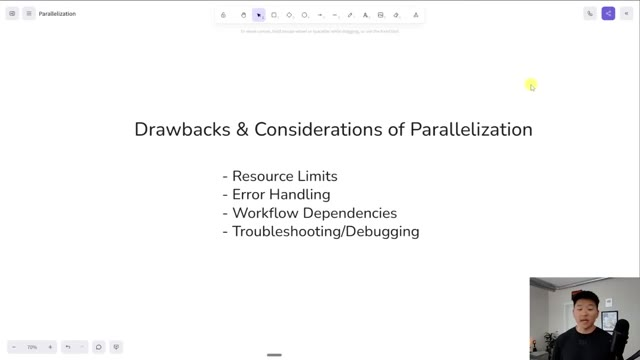
*⏱️ 00:05:36 — Une vue d'une application de tableau blanc affichant les inconvénients et considérations de la parallélisation avec une liste à puces, tandis que le présentateur apparaît dans un petit encadré en bas à droite.*

---

### ⏱️ `[00:05:54 - 00:06:30]` | Segment #16

**🔊 Audio (Transcription Intégrale Mot pour Mot en Français) :**
> Vous ne pouvez pas traiter 100 éléments tous en parallèle. Une autre chose à penser serait la gestion des erreurs. Donc si vous exécutez 50 éléments en parallèle et que l'un d'eux génère une erreur, comment gérez-vous juste celui qui a eu une erreur ? Et que voulez-vous faire du reste d'entre eux ? Ou s'ils ont tous généré une erreur en même temps, comment les remettez-vous essentiellement en file d'attente ou traitez-vous ceux qui ont eu des erreurs ? Vous avez également des dépendances de flux de travail. Donc dans cet exemple, c'était tout à fait correct. Mais parfois, si vous avez un flux assez séquentiel où vous ne pouvez pas faire l'étape C tant que l'étape B n'est pas terminée, alors vous voulez que la logique ait réellement du sens afin que s'il y a des dépendances, vous soyez toujours bon et enfin, un peu similaire au numéro deux, c'est le dépannage et le débogage.

**👁️ Analyse Visuelle d'Écran (gemini-3.5-flash-lite) :**
**Interface & Outils** : Logiciel de présentation ou tableau blanc en ligne (type Canvas).

**Contenu textuel & Code** : Texte : "Drawbacks & Considerations of Parallelization", suivi de quatre points : Resource Limits, Error Handling, Workflow Dependencies, Troubleshooting/Debugging.

**Action / Démonstration** : Le présentateur aborde et détaille les points clés liés aux limites et défis de la parallélisation, en particulier la gestion des erreurs.

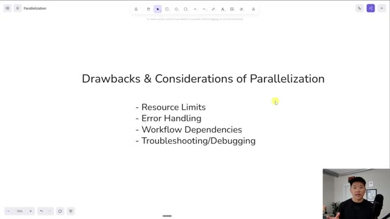
*⏱️ 00:06:03 — Une diapositive montrant les inconvénients et considérations de la parallélisation avec une liste à puces : Resource Limits, Error Handling, Workflow Dependencies, Troubleshooting/Debugging.*

---

### ⏱️ `[00:06:30 - 00:07:04]` | Segment #17

**🔊 Audio (Transcription Intégrale Mot pour Mot en Français) :**
> Tout simplement parce que si vous avez 50 éléments qui s'exécutent sous forme de 50 exécutions différentes, vous devrez en quelque sorte être capable de trouver les bonnes exécutions lorsque vous devez apporter des modifications, et là, j'essaye juste de vous lancer quelques points de haut niveau. Si vous voulez voir ce document que j'ai compilé et qui contient beaucoup plus de détails sur les sous-flux de travail et la parallélisation et des choses de ce genre, alors allez absolument voir ma communauté gratuite. Je mettrai le lien dans la publication associée à cette vidéo. Dans la communauté gratuite, vous pouvez également obtenir ce modèle si vous voulez juste faire joujou avec un peu. Et tout ce que vous avez à faire, c'est de venir ici, de chercher des ressources YouTube, ou de chercher le titre de la vidéo ici en haut dans la barre de recherche. Et genre, disons que c'était le

**👁️ Analyse Visuelle d'Écran (gemini-3.5-flash-lite) :**
**Interface & Outils** : Interface web de conception de workflow (type Langflow ou plateforme similaire).

**Contenu textuel & Code** : Blocs fonctionnels titrés "Research done in parallel" (Perplexity Research) et "Analysis NOT done in parallel" (Tool Analysis Agent, 4.1-mini, Update Tool).

**Action / Démonstration** : Visualisation et explication de l'architecture d'un workflow d'IA combinant des tâches parallèles et séquentielles.

*⏱️ 00:06:55 — Interface de conception de workflow graphique montrant un sous-flux avec des blocs de recherche en parallèle et un agent d'analyse séquentiel.*

---

### ⏱️ `[00:07:04 - 00:07:30]` | Segment #18

**🔊 Audio (Transcription Intégrale Mot pour Mot en Français) :**
> vidéo que vous regardez en ce moment même. Il y aura le PDF de ce document dont je parle, et puis aussi un fichier JSON pour le flux de travail. Donc le lien pour la communauté gratuite est en bas dans la description. D'accord, donc voilà pour les inconvénients et les considérations de la parallélisation. Et donc clairement, vous ne voulez pas toujours opter directement pour la parallélisation, mais il est vraiment important de comprendre qu'il faut quand même utiliser des sous-flux, car les sous-flux sont vraiment précieux. Voici donc quatre raisons du pourquoi et du quand les diviser en sous-flux. La première est la logique répétée.

**👁️ Analyse Visuelle d'Écran (gemini-3.5-flash-lite) :**
**Interface & Outils** : Interface de présentation / Diapositive de cours

**Contenu textuel & Code** : Texte de la diapositive : "Why & When to Break Up Workflows" avec des points sur la logique répétée, la complexité, le traitement parallèle et la gestion des erreurs.

**Action / Démonstration** : Le présentateur explique les concepts théoriques et les considérations pour structurer et diviser les workflows d'automatisation.

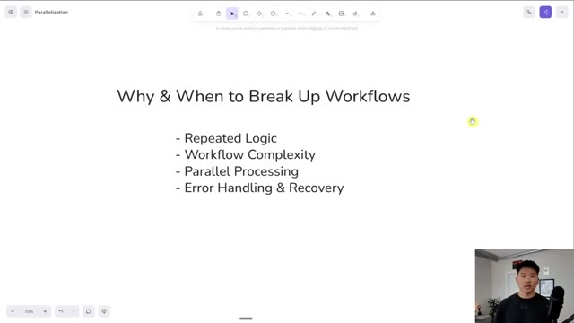
*⏱️ 00:07:17 — Diapositive montrant les raisons et moments pour diviser les workflows (répétition de logique, complexité, traitement parallèle, gestion des erreurs).*

---

### ⏱️ `[00:07:30 - 00:08:06]` | Segment #19

**🔊 Audio (Transcription Intégrale Mot pour Mot en Français) :**
> Une chose cool avec n8n, c'est qu'on peut construire ces composants réutilisables. Et un composant réutilisable, un peu comme celui-ci, où nous allons passer quelque chose à rechercher puis un agent pour l'analyser, ce sous-flux peut être relié à 100 workflows. Ça n'a pas d'importance. Il peut être relié à autant qu'on le souhaite. Et donc si nous savons que nous créons quelque chose qui a une logique répétée ou qui pourrait être réutilisé, si nous l'emballons sous forme de sous-workflow, nous pouvons alors l'appeler depuis tous ces différents endroits. Et si nous avons un jour besoin d'y aller et de changer un modèle ou de changer la requête HTTP ou de changer le prompt, nous pouvons simplement le faire en un seul endroit plutôt que d'avoir à le changer dans 100 endroits différents si nous l'avions relié à 100 workflows différents. Nous avons aussi un workflow

**👁️ Analyse Visuelle d'Écran (gemini-3.5-flash-lite) :**
**Interface & Outils** : n8n et un outil de présentation de diapositives.

**Contenu textuel & Code** : Diagramme de nœuds n8n (Start, Perplexity Research, Tool Analysis Agent, 4.1-mini, Output, Update Tool) et liste à puces sur le découpage des workflows.

**Action / Démonstration** : Le présentateur explique l'architecture d'un composant réutilisable dans un sous-flux n8n et les critères pour diviser les workflows.

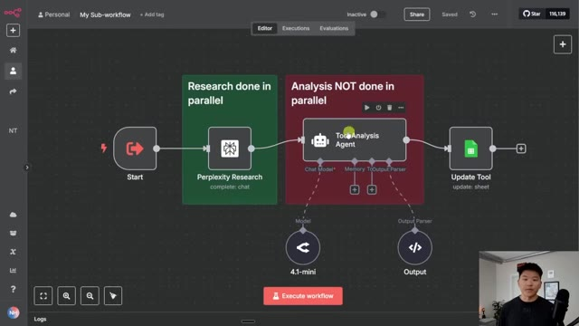
*⏱️ 00:07:39 — Vue d'un sous-flux n8n montrant un processus de recherche Perplexity suivi d'un agent d'analyse textuelle et de mise à jour.*

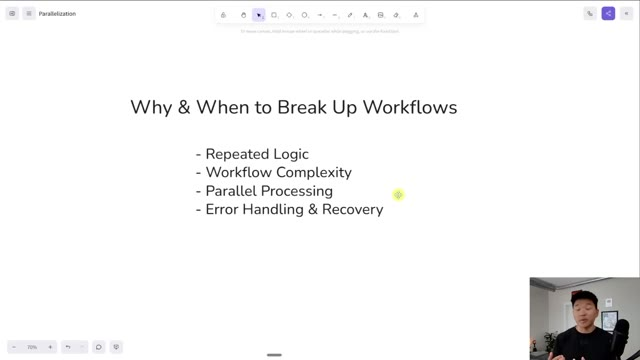
*⏱️ 00:07:48 — Une diapositive de présentation textuelle listant les raisons de diviser les workflows : Repeated Logic, Workflow Complexity, Parallel Processing, Error Handling & Recovery.*

---

### ⏱️ `[00:08:06 - 00:08:40]` | Segment #20

**🔊 Audio (Transcription Intégrale Mot pour Mot en Français) :**
> complexité. Donc si votre flux de travail devient vraiment volumineux et que vous voulez simplement le nettoyer en quelque sorte en fonction de différents modules, c'est une très bonne idée de le diviser simplement en sous-flux de travail, surtout avec la facilité qu'il y a maintenant à simplement surligner quelque chose et à le convertir en sous-flux. Surtout si vous n'êtes pas le seul à travailler sur un flux de travail, car alors vous avez toute cette question d'hygiène du flux de travail et tout peut être étiqueté et cela aura beaucoup plus de sens pour quelqu'un d'autre qui doit intervenir pour le déboguer ou l'améliorer, peu importe ce que c'est. Évidemment, nous avons le traitement parallèle, dont nous venons de parler. Et ensuite, nous avons la gestion des erreurs et la récupération. Donc, vous pouvez peut-être faire en sorte que les choses aillent toujours dans un sous-flux de travail s'il y a eu une erreur et ensuite cela peut simplement gérer cela.

**👁️ Analyse Visuelle d'Écran (gemini-3.5-flash-lite) :**
**Interface & Outils** : Logiciel de présentation ou outil de tableau blanc numérique.

**Contenu textuel & Code** : Texte listant : 'Why & When to Break Up Workflows', 'Repeated Logic', 'Workflow Complexity', 'Parallel Processing', 'Error Handling & Recovery'.

**Action / Démonstration** : Le présentateur explique les critères de division des workflows d'automatisation.

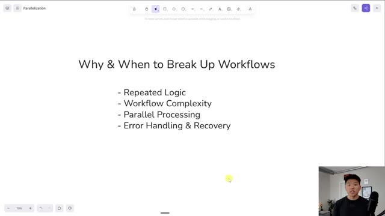
*⏱️ 00:08:14 — Une diapositive montrant les raisons et les moments pour diviser les workflows, avec une incrustation vidéo du présentateur en bas à droite.*

---

### ⏱️ `[00:08:40 - 00:09:08]` | Segment #21

**🔊 Audio (Transcription Intégrale Mot pour Mot en Français) :**
> toutes les notifications et tout ce dont vous avez besoin de faire. Mais c'est aussi beaucoup plus facile de voir quelles sections de votre flux de travail rencontrent des erreurs si vous séparez les différents composants dans des flux différents, et ensuite vous pouvez simplement comprendre, d'accord, vous savez, cette section de recherche de votre flux de travail échoue beaucoup plus que la section de manipulation des données, et maintenant vous savez un peu plus rapidement sur quoi vous devez travailler et ce que vous devez affiner. Cela aide simplement à garder tout bien divisé, séparé, et vraiment propre et organisé. Mais encore une fois, vous pouvez approfondir un peu plus la division des flux de travail dans ce document que j'ai préparé pour vous les gars.

**👁️ Analyse Visuelle d'Écran (gemini-3.5-flash-lite) :**
**Interface & Outils** : Outil de tableau blanc numérique ou logiciel de présentation (type Miro ou Canva).

**Contenu textuel & Code** : Titre : "Why & When to Break Up Workflows". Liste à puces : "- Repeated Logic", "- Workflow Complexity", "- Parallel Processing", "- Error Handling & Recovery".

**Action / Démonstration** : Présentation pédagogique illustrant les principes théoriques de l'automatisation.

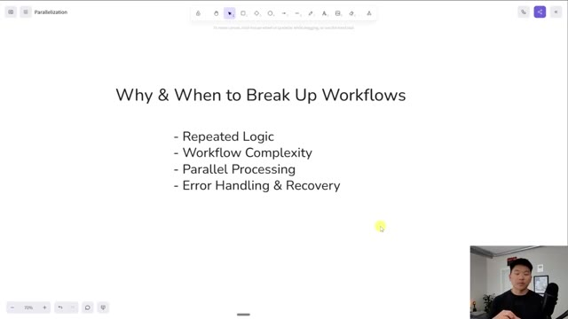
*⏱️ 00:08:47 — Une diapositive de présentation affichée sur un canevas numérique, listant les raisons pour lesquelles il est conseillé de segmenter les flux de travail (workflows).*

---

### ⏱️ `[00:09:08 - 00:09:39]` | Segment #22

**🔊 Audio (Transcription Intégrale Mot pour Mot en Français) :**
> Et juste pour vous montrer un tout dernier exemple rapide de la façon dont ce nœud fonctionne, disons que nous avons ce flux, qui ressemblait un peu à ça, et nous décidons, d'accord, cette section ici va être un composant réutilisable vraiment idéal. Donc nous allons transformer cela en sous-flux, ce que nous avons fait ici. Mais disons que nous atteignons des limites de taux sur notre nœud Google Sheet ou notre nœud Perplexity. Donc nous ne voulons pas les traiter en parallèle, mais nous voulons quand même conserver ce sous-flux de travail pour l'épurer. Mais tout ce que nous aurions à faire, c'est que nous pourrions venir dans notre flux de travail principal, nous pourrions cliquer ici, et ensuite nous pourrions simplement activer ceci, qui indique d'attendre la fin du sous-flux de travail.

**👁️ Analyse Visuelle d'Écran (gemini-3.5-flash-lite) :**
**Interface & Outils** : Interface web de construction de workflows par glisser-déposer (type n8n ou outil similaire).

**Contenu textuel & Code** : Un flux de travail nommé "Tool Research Loop" comprenant plusieurs nœuds reliés entre eux pour automatiser des recherches et des analyses d'outils.

**Action / Démonstration** : Visualisation d'un flux de travail complexe montrant comment regrouper ou analyser des sections pour créer des composants réutilisables.

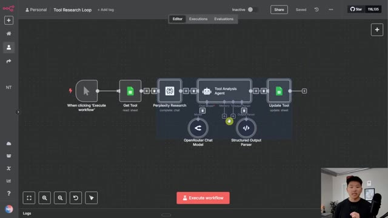
*⏱️ 00:09:16 — Capture d'écran montrant l'éditeur de flux de travail avec un diagramme composé de nœuds connectés (Get Tool, Perplexity Research, Tool Analysis Agent avec sous-nœuds, Update Tool) et le présentateur en bas à droite.*

---

### ⏱️ `[00:09:39 - 00:09:59]` | Segment #23

**🔊 Audio (Transcription Intégrale Mot pour Mot en Français) :**
> Et ça fait fondamentalement la même chose que si nous avions ajouté une boucle ici et que nous étions simplement en train de traiter ces quatre éléments un par un. Donc, juste pour vous montrer, je vais aller ici et je vais effacer les données. Je vais définir tous ces statuts sur « prêt » pour qu'ils soient réellement pris en compte dans l'automatisation. Et ensuite, nous reviendrons ici. Je vais cliquer sur « enregistrer », puis je vais exécuter ce flux de travail.

**👁️ Analyse Visuelle d'Écran (gemini-3.5-flash-lite) :**
**Interface & Outils** : Outil de workflow visuel et Google Sheets.

**Contenu textuel & Code** : Nœuds de workflow connectés et tableau de données de recherche avec des statuts « Processed ».

**Action / Démonstration** : Le présentateur montre le diagramme de workflow puis bascule vers Google Sheets pour expliquer la structure des données traitées.

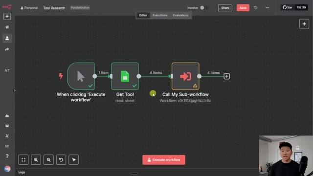
*⏱️ 00:09:44 — Interface d'un outil de workflow montrant un diagramme avec trois nœuds : « When clicking 'Execute workflow' », « Get Tool », et « Call My Sub-workflow ».*

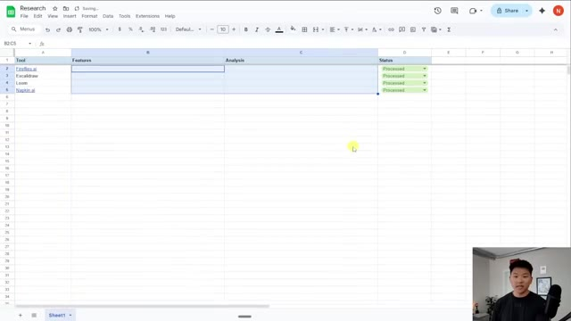
*⏱️ 00:09:49 — Un tableau Google Sheets intitulé « Research » avec des colonnes « Tool », « Features », « Analysis » et « Status », contenant des données sur des outils d'IA.*

---

### ⏱️ `[00:09:59 - 00:10:19]` | Segment #24

**🔊 Audio (Transcription Intégrale Mot pour Mot en Français) :**
> Ça va envoyer les quatre ici, mais vous allez voir que ça va les traiter un par un. Donc si je vais dans le sous-flux lui-même et que je clique dans les exécutions, vous pouvez voir que nous en avons juste un qui s'exécute en ce moment. C'est tout. Une fois que celui-ci aura terminé, il va alors se déclencher et lancer le deuxième. J'espère donc que vous pouvez voir comment cela transforme fondamentalement tout cela en lots de un et les envoie simplement un par un.

**👁️ Analyse Visuelle d'Écran (gemini-3.5-flash-lite) :**
**Interface & Outils** : Interface web de gestion de workflows et d'agents IA (type plateforme d'automatisation visuelle).

**Contenu textuel & Code** : Noms des blocs du workflow : 'Research done in parallel', 'Analysis NOT done in parallel', 'Tool Analysis Agent', 'Update Tool'.

**Action / Démonstration** : Navigation de l'éditeur de workflow vers l'onglet des exécutions pour observer l'état d'exécution en temps réel.

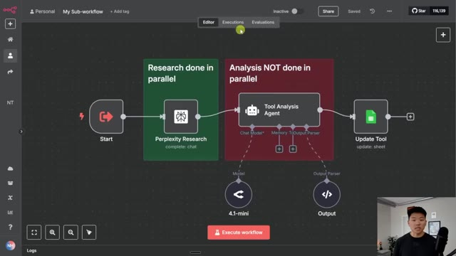
*⏱️ 00:10:04 — Interface d'un éditeur de workflow montrant un sous-flux avec les blocs 'Start', 'Perplexity Research', 'Tool Analysis Agent' et 'Update Tool'.*

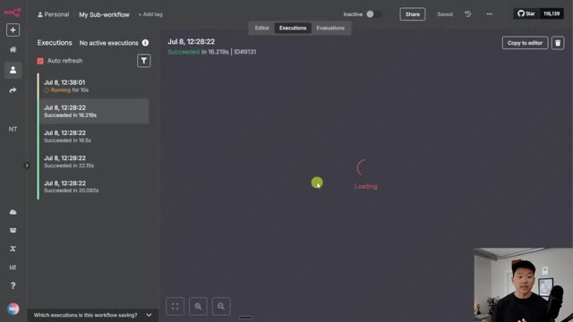
*⏱️ 00:10:09 — Onglet 'Executions' de l'interface de workflow affichant l'historique des exécutions passées et une exécution en cours (« Running for 10s »).*

---

### ⏱️ `[00:10:19 - 00:10:42]` | Segment #25

**🔊 Audio (Transcription Intégrale Mot pour Mot en Français) :**
> Vous pouvez donc voir que le premier vient juste de se terminer et maintenant il traite le deuxième. Cela va donc prendre environ 20 secondes pour chacun. Ça va donc prendre une minute, ce qui est une exécution beaucoup plus longue que de les faire tous se terminer en 20 secondes en même temps. Mais c'est un moyen de nous protéger contre l'atteinte de certaines limites de débit. Donc, si vous avez trouvé cette vidéo intéressante et que vous voulez approfondir différentes techniques d'automatisation un peu plus avancées, alors jetez définitivement un œil à ma communauté payante.

**👁️ Analyse Visuelle d'Écran (gemini-3.5-flash-lite) :**
**Interface & Outils** : n8n (Interface web de gestion de workflows et d'automatisation)

**Contenu textuel & Code** : Historique des exécutions dans le panneau de gauche avec des durées (ex: 19.859s, 16.219s) et diagramme de workflow avec des nœuds de recherche et d'analyse.

**Action / Démonstration** : Visualisation et suivi en direct de l'exécution séquentielle ou parallèle des différentes étapes du workflow d'automatisation.

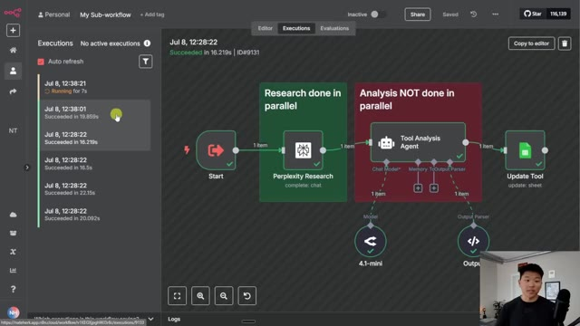
*⏱️ 00:10:25 — Capture d'écran montrant l'interface n8n avec l'historique des exécutions d'un sous-workflow affichant le statut de différentes tâches en parallèle (Perplexity Research, Tool Analysis Agent, Update Tool).*

---

### ⏱️ `[00:10:42 - 00:11:02]` | Segment #26

**🔊 Audio (Transcription Intégrale Mot pour Mot en Français) :**
> Le lien pour cela se trouve dans la description. Nous avons une super communauté de membres qui créent avec N8N chaque jour, qui partagent toujours leurs ressources et partagent les défis auxquels ils font face. Nous avons deux formations complètes ici. L'une s'appelle Agent Zero, ce qui est parfait pour les débutants. C'est comme les bases de l'automatisation par IA. Et ensuite, vous passez de cela à 10 heures en 10 secondes, où vous apprenez à identifier, concevoir et créer des automatisations qui font gagner du temps.

**👁️ Analyse Visuelle d'Écran (gemini-3.5-flash-lite) :**
**Interface & Outils** : Navigateur web affichant la plateforme communautaire Skool (AI Automation Society Plus).

**Contenu textuel & Code** : Publications de membres, fils de discussion et vignettes des modules de formation ("Start Here", "Agent Zero", "10 Hours to 10 Seconds", "n8n Templates", etc.).

**Action / Démonstration** : Navigation sur la plateforme de la communauté pour présenter les ressources et les formations disponibles.

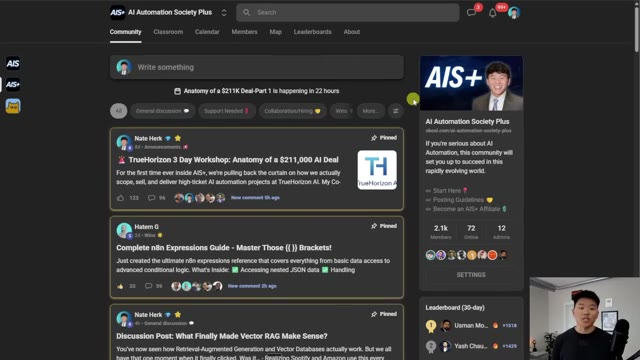
*⏱️ 00:10:47 — Capture d'écran montrant l'interface de la communauté "AI Automation Society Plus" (Skool) avec les publications de discussion et le panneau latéral.*

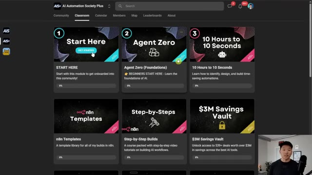
*⏱️ 00:10:52 — Capture d'écran de l'onglet "Classroom" de la communauté montrant les différentes formations disponibles, dont "Agent Zero".*

---

### ⏱️ `[00:11:02 - 00:11:23]` | Segment #27

**🔊 Audio (Transcription Intégrale Mot pour Mot en Français) :**
> Donc si tout cela vous intrigue et que vous voulez être entouré de plus de 2000 personnes partageant les mêmes idées, alors allez absolument jeter un œil à la communauté. Et j'ai pu faire toute cette promo pour School pendant que cela tournait encore de manière séquentielle, ce qui montre bien à quel point il est plus rapide de faire du parallèle. Bref, ça va être tout pour celui-ci les gars. Si vous avez apprécié la vidéo ou appris quelque chose de nouveau, veuillez lui donner un pouce bleu. Ça m'aide vraiment énormément. Et comme toujours, je vous remercie d'être arrivés jusqu'à la fin de la vidéo.

**👁️ Analyse Visuelle d'Écran (gemini-3.5-flash-lite) :**
**Interface & Outils** : Plateforme Skool (Image 1) et interface d'automatisation/workflow de type n8n (Image 2).

**Contenu textuel & Code** : Publications de communauté sur l'automatisation IA (Image 1) et diagramme de workflow séquentiel avec des appels de sous-workflows (Image 2).

**Action / Démonstration** : Présentation de la communauté Skool puis affichage d'un workflow d'automatisation séquentiel.

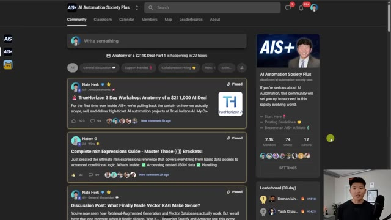
*⏱️ 00:11:07 — Capture d'écran montrant l'interface de la communauté Skool "AI Automation Society Plus" avec des publications épinglées et le présentateur en médaillon vidéo.*

*⏱️ 00:11:12 — Interface d'un éditeur de workflow avec trois nœuds connectés : "When clicking 'Execute workflow'", "Get Tool" et "Call My Sub-workflow".*

---

### ⏱️ `[00:11:23 - 00:11:25]` | Segment #28

**🔊 Audio (Transcription Intégrale Mot pour Mot en Français) :**
> Je vous vois dans la prochaine. Merci, les gars.

**👁️ Analyse Visuelle d'Écran (gemini-3.5-flash-lite) :**
**Interface & Outils** : n8n (Interface graphique de workflow)

**Contenu textuel & Code** : Nœuds connectés : 'When clicking 'Execute workflow'', 'Get Tool' (read: sheet), et 'Call My Sub-workflow' (Workflow: v1KEGXJpg hWJ3r8c).

**Action / Démonstration** : Affichage du diagramme de workflow complet avant la fin de la vidéo.

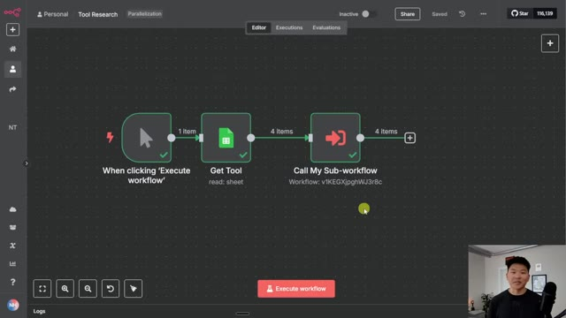
*⏱️ 00:11:23 — Un diagramme de workflow n8n montrant un déclencheur 'Execute workflow', un nœud 'Get Tool' pour Google Sheets, et un nœud 'Call My Sub-workflow', avec le présentateur visible en bas à droite.*

---

