# 🎬 Build Anything With Grok 4 and n8n AI Agents

> **Chaîne** : [Nate Herk | AI Automation](https://www.youtube.com/@nateherk/featured)  
> **Lien YouTube** : [https://www.youtube.com/watch?v=FFH3uQDk2yU](https://www.youtube.com/watch?v=FFH3uQDk2yU)  
> **Date de publication** : 20250710  
> **Durée** : 00:10:33  
> **Identifiant vidéo** : `FFH3uQDk2yU`  
> **Transcription & Analyse** : `whisper-v3-large-turbo+gemini-3.5-flash-lite`  

---

## 📌 Synthèse Exécutive & Outils

### 💡 Résumé

Cette vidéo présentée par la chaîne *Nate Herk | AI Automation* explore l'arrivée sur le marché de **Grok 4**, lancé par xAI le 9 juillet 2025, et démontre son intégration pratique au sein des flux de travail d'automatisation et d'agents IA sur **n8n**. Le modèle s'impose comme un mastodonte de l'intelligence artificielle grâce à ses **1,7 mille milliards de paramètres**, surpassant de nombreux concurrents de premier plan (comme GPT-4, Gemini Ultra et Claude 4) sur des benchmarks exigeants en mathématiques, sciences et programmation. Bien que sa fenêtre de contexte soit limitée à 256 000 jetons et que son coût ou sa vitesse brute ne soient pas toujours les plus optimisés du marché, ses capacités de raisonnement de niveau postdoctoral en font un choix redoutable pour des analyses complexes.

Dans la partie démonstrative, la vidéo illustre la configuration de Grok 4 dans n8n via un nœud de modèle de chat natif xAI ou en passant par un routeur centralisé comme OpenRouter. Un premier test simple avec un outil de recherche (Perplexity) montre le succès de l'agent, qui exploite le modèle pour mener des recherches approfondies et structurées sans prompt système initial complexe. Toutefois, des défis techniques apparaissent lors de scénarios multi-outils plus avancés combinant Tavily et Perplexity, où le modèle génère parfois un JSON invalide pour l'appel d'outils, nécessitant des ajustements de formatage de réponse ou le recours à des intermédiaires d'API.

L'analyse met ainsi en lumière le potentiel immense de Grok 4 pour l'automatisation intelligente tout en soulignant les frictions pratiques inhérentes à l'intégration de modèles ultra-puissants dans des environnements d'orchestration sans code basés sur LangChain.

---

### 🛠️ Outils, Modèles & Logiciels Présentés

* **Grok 4** : Dernier modèle phare de xAI fondé par Elon Musk, doté de 1,7 mille milliards de paramètres et excellant dans le raisonnement logique, les mathématiques et le code.
* **n8n** : Plateforme d'automatisation de flux de travail sans code utilisée pour orchestrer les agents IA et connecter différents outils via des nœuds dédiés.
* **OpenRouter** : Plateforme d'agrégation d'API permettant de centraliser la facturation, le suivi des consommations et l'accès à de multiples modèles d'IA, dont Grok 4.
* **Perplexity (Sonar)** : Outil de recherche web et de génération de réponses basé sur l'IA, intégré comme outil de recherche dans l'agent n8n.
* **Tavily** : Moteur de recherche optimisé pour les agents IA et les LLM, utilisé pour alimenter les assistants en données web en temps réel.
* **Claude Code / Claude 4 Opus** : Modèles d'Anthropic mentionnés à titre de comparaison comparative en matière de performances et de taille de paramètres.
* **ChatGPT / OpenAI GPT-4** : Modèles de référence utilisés pour le diagnostic d'erreurs de parsing et de compatibilité JSON au sein des flux n8n.

---

### 🔑 Points Clés & Enseignements Stratégiques

* **Montée en puissance de xAI** : Le lancement de Grok 4 redéfinit les standards de l'industrie avec 1,7 mille milliards de paramètres, positionnant l'architecture parmi les plus complexes jamais construites aux côtés de GPT-4.
* **Performances académiques de pointe** : Le modèle surpasse ses rivaux sur des examens de haut niveau, atteignant des scores records aux tests de physique/astronomie (GPQA) et de mathématiques (AIME avec 95/100).
* **Compétence avérée en génie logiciel** : Avec un score SWE de 72 à 75 %, Grok 4 s'avère particulièrement pertinent pour les tâches de codage et d'ingénierie logicielle du monde réel.
* **Limites de la fenêtre de contexte** : Malgré sa puissance de calcul, Grok 4 se contente d'une fenêtre de 256 000 jetons, ce qui le place derrière certains concurrents offrant un à deux millions de jetons.
* **Intégration native simplifiée dans n8n** : L'utilisation de Grok 4 dans les flux d'automatisation ne nécessite qu'un nœud de modèle de chat XAI, une clé API valide et la sélection de la version `Grok 4 0709`.
* **Succès des appels d'outils simples** : Couplé à un outil de recherche comme Perplexity, l'agent est capable de planifier, d'exécuter et de synthétiser des rapports documentés de manière autonome, même sans prompt système élaboré.
* **Gestion des erreurs de syntaxe JSON** : Les architectures d'agents basées sur LangChain (comme n8n) peuvent rencontrer des échecs d'analyse d'arguments si le LLM renvoie un format d'appel d'outil non conforme.
* **Stratégies de mitigation des erreurs d'outils** : Pour contrer les difficultés de formatage, l'ingénieur peut forcer un format de réponse JSON et expliciter la consigne directement dans le prompt système de l'agent.
* **Centralisation via OpenRouter** : L'utilisation d'intermédiaires d'API comme OpenRouter est une bonne pratique d'ingénierie pour unifier la facturation, les rechargements de crédits et l'analyse de plusieurs modèles sous une seule interface.
* **Arbitrage coût-performance** : Grok 4 n'est pas le modèle le plus économique du marché ; son intégration doit donc se justifier par des besoins critiques en matière de raisonnement complexe, d'analyse financière ou de mathématiques avancées.

---

## ⏱️ Chronologie & Transcription Complète Audio & Visuelle (Mot pour Mot)

### ⏱️ `[00:00:00 - 00:00:18]` | Segment #01

**🔊 Audio (Transcription Intégrale Mot pour Mot en Français) :**
> Aujourd'hui, nous allons parler du nouveau meilleur modèle d'IA au monde, Grok 4. Nous allons décortiquer ce que c'est, pourquoi c'est important. Nous allons examiner les benchmarks et le comparer à d'autres modèles. Et enfin, je vais vous montrer comment le connecter réellement à N8N pour alimenter vos agents IA et vos automatisations IA afin de les rendre encore plus intelligents. Aussi, j'ai une nouvelle souris. Elle a une forme ergonomique, donc ça ne fait pas mal à mon poignet.

**👁️ Analyse Visuelle d'Écran (gemini-3.5-flash-lite) :**
**Interface & Outils** : n8n (éditeur de workflows d'automatisation et interface de chat)

**Contenu textuel & Code** : Nœuds de workflow n8n (« Ultimate Assistant », « Grok Agent », « xAI Grok Chat Model », « Perplexity », etc.) et texte de rapport de recherche sur Grok 4.

**Action / Démonstration** : Construction d'un agent IA sous n8n intégrant Grok 4 et exécution d'une recherche sur l'intelligence artificielle.

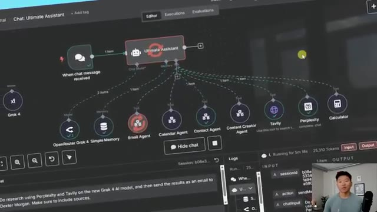
*⏱️ 00:00:05 — Vue d'ensemble d'un workflow N8N complexe centré sur un nœud d'assistant IA avec de multiples outils connectés.*

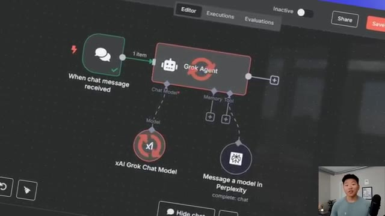
*⏱️ 00:00:09 — Gros plan sur un workflow N8N plus simple reliant un déclencheur de chat à un agent Grok et à un modèle xAI.*

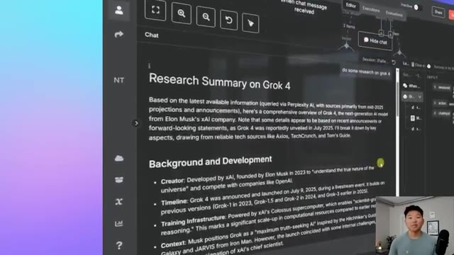
*⏱️ 00:00:14 — Interface de chat N8N affichant un rapport de recherche détaillé généré sur le modèle Grok 4.*

---

### ⏱️ `[00:00:18 - 00:00:38]` | Segment #02

**🔊 Audio (Transcription Intégrale Mot pour Mot en Français) :**
> Donc, plutôt emballé par ça. Bref, je ne veux pas perdre de temps. Plongeons directement dans le vif du sujet. Donc, le 9 juillet 2025, XAI a lancé Grok 4. Et aujourd'hui, je vais vous montrer comment nous pouvons connecter cela à nos automatisations NNN. Mais avant de plonger dans NNN, parlons rapidement de ce qu'est Grok 4 et pourquoi c'est un si gros événement. Il s'agit donc du dernier modèle d'intelligence artificielle de XAI, qui était l'entreprise fondée par Elon Musk.

**👁️ Analyse Visuelle d'Écran (gemini-3.5-flash-lite) :**
**Interface & Outils** : Présentation vidéo / Diapositive graphique

**Contenu textuel & Code** : Logos de 'Grok' et 'n8n' avec un 'x' au milieu

**Action / Démonstration** : Le présentateur introduit le sujet de l'intégration entre Grok et n8n.

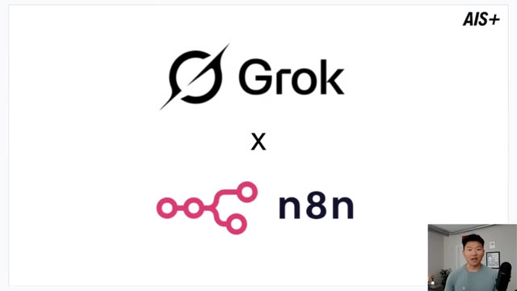
*⏱️ 00:00:23 — Une diapositive illustrant le sujet de la vidéo avec les logos de Grok et de n8n reliés par un symbole 'x', avec le présentateur en médaillon dans le coin inférieur droit.*

---

### ⏱️ `[00:00:38 - 00:00:58]` | Segment #03

**🔊 Audio (Transcription Intégrale Mot pour Mot en Français) :**
> Il est conçu pour être plus intelligent, plus rapide et plus performant que les modèles d'IA précédents, visant à surpasser des concurrents tels que GPT-4 d'OpenAI, Gemini de Google, et Claude d'Anthropic, ainsi que d'autres modèles fermés de ce type. C'est un événement important pour ces trois principales raisons, la première étant la taille. Grok 4 possède 1,7 mille milliards de paramètres, et l'on peut un peu voir cela comme les neurones de l'IA.

**👁️ Analyse Visuelle d'Écran (gemini-3.5-flash-lite) :**
**Interface & Outils** : Présentation textuelle (diapositive) et incrustation vidéo du présentateur.

**Contenu textuel & Code** : Texte définissant Grok 4 comme le dernier modèle d'IA de xAI fondé par Elon Musk, visant à surpasser GPT-4 et Gemini, avec la date de sortie au 9 juillet 2025.

**Action / Démonstration** : Présentation du sujet et lecture du texte explicatif par le présentateur.

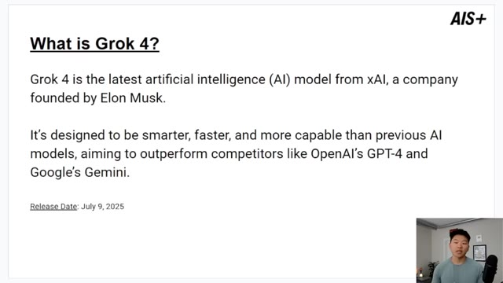
*⏱️ 00:00:43 — Une diapositive explicative montrant le texte de définition de Grok 4 avec le présentateur en médaillon en bas à droite.*

---

### ⏱️ `[00:00:58 - 00:01:19]` | Segment #04

**🔊 Audio (Transcription Intégrale Mot pour Mot en Français) :**
> Et cela en fait l'un des modèles d'IA les plus grands et les plus complexes jamais construits. Nous avons GPT-4, qui compte environ 1,8 mille milliards. Et puis Gemini Ultra est autour d'un mille milliards. Et Claude 4 n'est qu'autour de 500 milliards. Je dis « n'est que » comme si c'était petit. C'est quand même massif. Et juste pour mettre cela en contexte, si vous avez regardé ma vidéo sur la façon d'installer un modèle d'IA local pour tourner dans n8n, ce que nous avons fait dans celle-ci était un DeepSeek d'environ 1,5 milliard de paramètres.

**👁️ Analyse Visuelle d'Écran (gemini-3.5-flash-lite) :**
**Interface & Outils** : Logiciel de présentation de diapositives.

**Contenu textuel & Code** : Texte comparatif sur les modèles d'IA : Grok 4 (1.7 trillion), GPT-4 (~1.8 trillion), Gemini Ultra (~1 trillion), Claude 4 (~500 billion).

**Action / Démonstration** : Le présentateur explique les différentes caractéristiques et tailles des modèles d'intelligence artificielle à l'aide d'une diapositive.

*⏱️ 00:01:03 — Une diapositive de présentation titrée 'Why is Grok 4 a Big Deal?' listant la taille (1,7 trillion de paramètres avec comparaison GPT-4, Gemini Ultra, Claude 4), l'intelligence et la vitesse, avec une petite incrustation vidéo du présentateur en bas à droite.*

---

### ⏱️ `[00:01:19 - 00:01:38]` | Segment #05

**🔊 Audio (Transcription Intégrale Mot pour Mot en Français) :**
> J'ai fait des essais avec environ 14 milliards ou 32 milliards pour des appels d'outils très basiques, mais tu ne pourrais pas vraiment faire tourner quelque chose comme 500 milliards de paramètres sur, du moins, mon PC que j'ai juste là en bas. Quoi qu'il en soit, c'est incroyablement intelligent. Maintenant, prenez cela avec des pincettes car cela a été dit par Elon, mais c'est décrit comme étant supérieur au niveau de doctorat dans chaque matière.

**👁️ Analyse Visuelle d'Écran (gemini-3.5-flash-lite) :**
**Interface & Outils** : Logiciel de présentation de diapositives avec incrustation vidéo du présentateur.

**Contenu textuel & Code** : Texte sur la taille du modèle (Grok 4 à 1,7 trillion de paramètres, comparé à GPT-4, Gemini Ultra et Claude 4) et sur ses capacités cognitives supérieures au niveau doctoral.

**Action / Démonstration** : Présentation des spécifications techniques de différents grands modèles linguistiques (LLM).

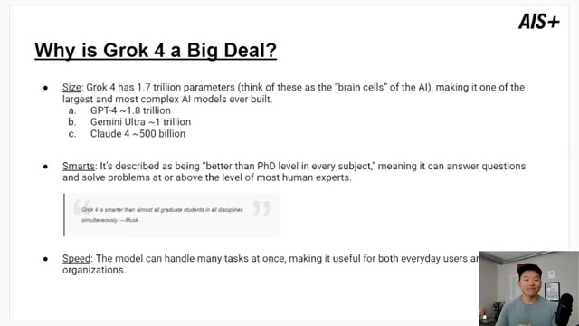
*⏱️ 00:01:24 — Une diapositive de présentation montrant le titre 'Why is Grok 4 a Big Deal?' avec des détails sur la taille, l'intelligence et la vitesse des modèles d'IA, tandis que le présentateur apparaît en médaillon dans le coin inférieur droit.*

---

### ⏱️ `[00:01:38 - 00:02:13]` | Segment #06

**🔊 Audio (Transcription Intégrale Mot pour Mot en Français) :**
> Et puis juste ici, nous avons une autre citation d'Elon : Grok 4 est plus intelligent que presque tous les étudiants diplômés dans toutes les disciplines simultanément. Donc nous n'allons pas nous plonger dans la politique de xAI et d'Elon, je ne fais que vous exposer les faits. Et ensuite, nous avons la vitesse. Le modèle peut gérer de nombreuses tâches à la fois, ce qui le rend utile tant pour les utilisateurs quotidiens que pour les grandes organisations. Et bien sûr, nous allons passer sur NNN et le soumettre à un test rapide avec un agent IA. Mais regardons maintenant quelques benchmarks réels de ce modèle, parce que nous voulons le comparer à d'autres modèles propriétaires de premier plan. Le premier que nous allons examiner est ses performances au HLE, c'est-à-dire le dernier examen de l'humanité, qui est un test ultra difficile conçu avec des questions de mathématiques, de science et de sciences humaines, conçu pour être difficile même pour

**👁️ Analyse Visuelle d'Écran (gemini-3.5-flash-lite) :**
**Interface & Outils** : Présentation diapositive (logiciel de type PowerPoint/Keynote).

**Contenu textuel & Code** : Texte explicatif sur Grok 4, comparaison de paramètres et graphiques de benchmarks (Scaling HLE - Test time).

**Action / Démonstration** : Le présentateur commente les caractéristiques et les performances de Grok 4 affichées à l'écran.

---

### ⏱️ `[00:02:13 - 00:02:48]` | Segment #07

**🔊 Audio (Transcription Intégrale Mot pour Mot en Français) :**
> experts. Grok 4, sans aucun outil, a obtenu 25 %, et avec des outils en mode multi-agents, a obtenu 44,4 %. Et ce n'est pas que je sache vraiment ce que ces pourcentages signifient, mais ce que nous savons, c'est qu'il a obtenu un score supérieur à celui des précédents modèles d'IA de premier plan comme OpenAI et Google. Et en regardant d'autres benchmarks ici, tout ce qui est en orange est un modèle Grok 4. Et vous pouvez voir qu'il surpasse pratiquement tous les autres. Nous avons Grok 4 sans outils, nous avons Grok 4, et puis nous avons Grok 4 heavy. Et je vais juste en mentionner deux, qui seront tout d'abord le GPQA, qui correspond aux questions de physique et d'astronomie de niveau universitaire. C'est un test avec des questions scientifiques difficiles et Grok 4 a obtenu 87.

**👁️ Analyse Visuelle d'Écran (gemini-3.5-flash-lite) :**
**Interface & Outils** : Présentation vidéo avec diapositive explicative et notes textuelles.

**Contenu textuel & Code** : Graphiques de performance, scores de benchmarks (GPQA, HIME, LCB, HMMT, USAMO) et explications textuelles des scores de Grok 4.

**Action / Démonstration** : Présentation des résultats de benchmarks et comparaison des performances des modèles d'IA.

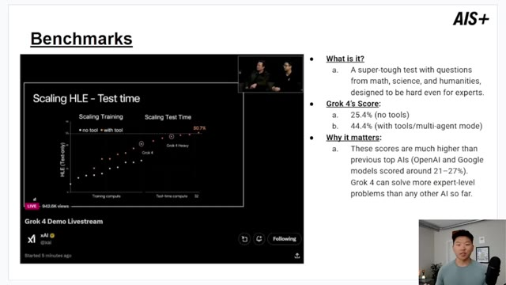
*⏱️ 00:02:22 — Diapositive présentant le benchmark HLE de Grok 4 avec des graphiques de performance et des notes explicatives sur les scores obtenus.*

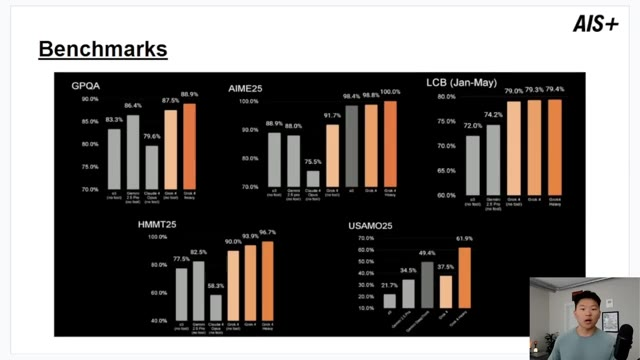
*⏱️ 00:02:30 — Diapositive montrant plusieurs graphiques de benchmarks comparatifs (GPQA, AIME25, LCB, HMMT25, USAMO25) évaluant différents modèles d'IA dont Grok 4.*

---

### ⏱️ `[00:02:48 - 00:03:06]` | Segment #08

**🔊 Audio (Transcription Intégrale Mot pour Mot en Français) :**
> à 88 %, ce qui est supérieur aux 86 % de Google Gemini et bien supérieur aux 79 % de Claude 4 Opus d'Anthropic. Et ensuite, nous avons l'AIME, qui est l'American Invitational Mathematics Examination, un test de mathématiques difficile destiné aux meilleurs lycéens, et Grok 4 a obtenu 95 sur 100, ce qui est mieux que la plupart des humains et des autres modèles d'IA.

**👁️ Analyse Visuelle d'Écran (gemini-3.5-flash-lite) :**
**Interface & Outils** : Présentation vidéo avec graphiques de benchmarks de modèles d'IA.

**Contenu textuel & Code** : Graphiques en barres comparant les scores (en pourcentage) de o3, Gemini 2.5 Pro, Claude 4 Opus, Grok 4 et Grok 4 Heavy sur différents tests.

**Action / Démonstration** : Le présentateur commente et analyse les résultats des tests de performance affichés à l'écran.

---

### ⏱️ `[00:03:06 - 00:03:42]` | Segment #09

**🔊 Audio (Transcription Intégrale Mot pour Mot en Français) :**
> Et c'est vraiment cool parce que traditionnellement, nous savons plus ou moins que les modèles d'IA ne sont pas très bons en mathématiques, mais Grok 4 est excellent pour résoudre des problèmes mathématiques complexes étape par étape, et c'est cool parce que tous les modèles d'IA s'améliorent lentement et sûrement en mathématiques. Et ensuite, un autre truc vraiment cool que nous avons, c'est le benchmark SWE ou les questions de génie logiciel. Cela évalue des tâches de codage et de développement logiciel du monde réel, ce qui est quelque chose pour lequel l'IA est utilisée très intensément en ce moment dans le monde réel. Grok 4 a obtenu un score de 72 à 75 %, ce qui est légèrement meilleur que les autres meilleurs modèles d'IA, comme vous pouvez le voir ici en bas avec ce tableau récapitulatif. Mais qu'est-ce que tout cela signifie ? Et pourquoi les gens disent-ils que c'est le nouveau meilleur modèle d'IA au monde ? Eh bien, ça va

**👁️ Analyse Visuelle d'Écran (gemini-3.5-flash-lite) :**
**Interface & Outils** : Présentation visuelle (diapositives) avec graphiques statistiques et tableaux de données.

**Contenu textuel & Code** : Scores de performance pour les modèles Grok 4, Claude Opus et OpenAI o3 sur des tests mathématiques et de programmation.

**Action / Démonstration** : Le présentateur commente les résultats comparatifs des modèles d'IA sur les graphiques affichés.

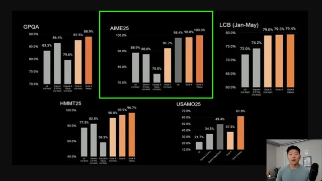
*⏱️ 00:03:15 — Graphiques de performance montrant les résultats comparatifs de plusieurs modèles d'IA (dont Grok 4) sur divers benchmarks mathématiques comme AIME25 et GPQA.*

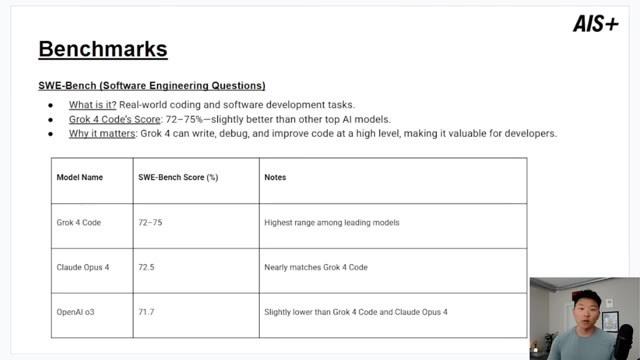
*⏱️ 00:03:24 — Tableau de présentation des performances SWE-Bench comparant Grok 4 Code, Claude Opus 4 et OpenAI o3 sur des tâches de génie logiciel.*

---

### ⏱️ `[00:03:42 - 00:04:18]` | Segment #10

**🔊 Audio (Transcription Intégrale Mot pour Mot en Français) :**
> être utilisé dans de nombreuses industries, bien sûr, les affaires, la santé, l'éducation, la programmation, le service client et bien d'autres encore. Et c'est très important parce que Grok 4 est vraiment, vraiment intelligent. Il peut travailler en équipe, il comprend mieux, et il va être vraiment facile à utiliser. Maintenant, bien sûr, il y a d'autres modèles d'IA qui surpassent Grok dans certains critères. Nous avons par exemple la fenêtre de contexte, Grok 4 n'a que 256 000 jetons, tandis que d'autres en ont jusqu'à un million ou 2 millions. Ce n'est définitivement pas le modèle le moins cher. Vous pouvez donc en trouver des moins chers chez OpenAI et Google, des choses comme ça. Et il y a vraiment des modèles qui sont plus rapides pour traiter l'information. Donc dans l'ensemble, selon chaque critère, ce n'est pas le meilleur, mais c'est un vraiment,

**👁️ Analyse Visuelle d'Écran (gemini-3.5-flash-lite) :**
**Interface & Outils** : Présentation PowerPoint ou diapositive graphique.

**Contenu textuel & Code** : Texte bullet-points détaillant l'impact de Grok 4 dans différents secteurs industriels.

**Action / Démonstration** : Le présentateur commente les points affichés à l'écran concernant les applications de Grok 4.

---

### ⏱️ `[00:04:18 - 00:04:51]` | Segment #11

**🔊 Audio (Transcription Intégrale Mot pour Mot en Français) :**
> très puissant comme modèle. Et bien sûr, pourquoi voulons-nous utiliser ceci dans un constructeur de flux de travail sans code comme NNN ? Parce que nous pouvons connecter ce modèle d'IA à nos automatisations d'IA existantes pour voir s'il peut les rendre plus intelligentes, avec une meilleure analyse, peut-être même effectuer certaines fonctions auxquelles nous n'aurions pas fait confiance à d'autres modèles d'IA, comme analyser des données financières ou quelque chose de ce genre. Il y a donc des tonnes de cas d'utilisation, j'ai hâte de voir ce que vous allez inventer en utilisant Grok4, mais passons directement à NNN pour que je puisse vous montrer comment l'utiliser réellement, surtout si vous voulez l'utiliser pour l'appel d'outils. Bon, alors probablement la façon la plus simple de l'utiliser serait, dans NNN, vous avez un agent IA, vous ajoutez un modèle de chat,

**👁️ Analyse Visuelle d'Écran (gemini-3.5-flash-lite) :**
**Interface & Outils** : Présentation visuelle (diapositive) avec un encart vidéo du présentateur.

**Contenu textuel & Code** : Texte explicatif sur l'utilisation de Grok 4 dans n8n, énumérant plusieurs cas d'usage : analyse de données, réponses intelligentes, création de contenu, aide au codage et chatbots IA.

**Action / Démonstration** : Le présentateur explique les avantages de l'intégration de Grok 4 dans des flux de travail n8n sans code.

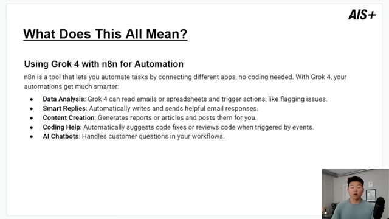
*⏱️ 00:04:26 — Une diapositive explicative intitulée "What Does This All Mean?" détaillant l'utilisation de Grok 4 avec n8n pour l'automatisation, avec le présentateur visible en vignette dans le coin inférieur droit.*

---

### ⏱️ `[00:04:51 - 00:05:25]` | Segment #12

**🔊 Audio (Transcription Intégrale Mot pour Mot en Français) :**
> et vous faites simplement défiler vers le bas pour récupérer un modèle de chat XAI Grok. Vous auriez alors juste besoin d'aller dans votre console d'administration sur Grok. Vous pourriez venir ici, créer un compte, ajouter quelques informations de facturation, aller dans les clés API juste ici. Et ensuite, tout ce que vous auriez à faire, c'est d'en créer une nouvelle, puis de copier cette clé API et de l'ajouter juste ici comme nouvel identifiant. Ensuite, lorsque vous ouvrez la liste des modèles, vous pouvez voir qu'ici, nous sommes capable de choisir Grok 4 0709, qui correspondait au 9 juillet lorsqu'il a été lancé. Et ensuite, nous pouvons aller de l'avant et parler à Grok, dire simplement, bonjour, Grok. Et nous pouvons voir qu'il va utiliser son cerveau de chat juste ici. Et il utilise Grok 4 afin de nous répondre. Bonjour, je suis Grok, construit par XAI.

**👁️ Analyse Visuelle d'Écran (gemini-3.5-flash-lite) :**
**Interface & Outils** : Console d'administration xAI et interface de workflow d'automatisation

**Contenu textuel & Code** : Menus de configuration d'API xAI et paramètres du modèle xAI Grok Chat Model (grok-2-vision-1212)

**Action / Démonstration** : Navigation dans la console xAI pour récupérer les clés API et configuration d'un nœud de chat Grok

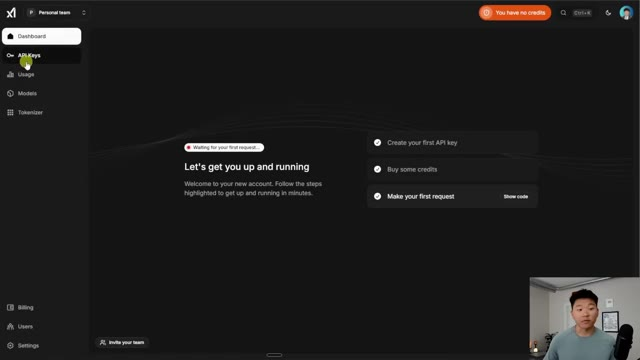
*⏱️ 00:04:59 — Capture montrant le tableau de bord xAI avec le menu latéral où l'utilisateur clique sur la section 'API Keys'.*

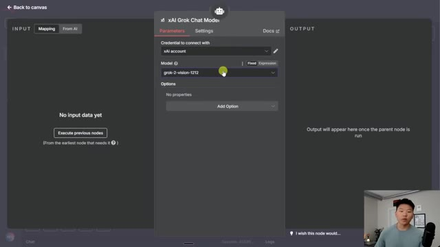
*⏱️ 00:05:08 — Capture montrant un modèle de chat XAI Grok configuré dans une interface d'automatisation avec le modèle 'grok-2-vision-1212'.*

---

### ⏱️ `[00:05:25 - 00:05:58]` | Segment #13

**🔊 Audio (Transcription Intégrale Mot pour Mot en Français) :**
> Qu'avez-vous en tête aujourd'hui ? Disons donc que je voulais ajouter un outil rapide pour faire un peu de recherche et que nous ajoutons un outil Perplexity. Tout ce que je vais faire très rapidement ici, c'est changer ceci pour sonar. Je vais faire en sorte que le modèle choisisse le message réel à envoyer. Et si vous voulez regarder une analyse plus approfondie dans une vidéo sur Perplexity, je vais l'épingler juste ici. Mais cela devrait déjà être configuré très facilement et j'espère que je n'aurai même pas à prompter l'agent pour qu'il l'utilise. Essayons donc. Je vais donc lui dire de faire des recherches sur Grok4 et ce que nous allons voir se produire, c'est qu'il réfléchit à ce qu'il doit faire en ce moment et qu'il va essayer d'utiliser cet outil. Voilà, vous pouvez voir qu'il a réussi à appeler notre outil Perplexity et maintenant il réfléchit à la manière de nous répondre. Et il vient de terminer. Vous pouvez voir que cela a pris environ deux

**👁️ Analyse Visuelle d'Écran (gemini-3.5-flash-lite) :**
**Interface & Outils** : n8n (éditeur de workflow d'automatisation IA)

**Contenu textuel & Code** : Nœud Perplexity configuré avec le modèle "Sonar" et un message défini automatiquement par le modèle.

**Action / Démonstration** : Configuration des paramètres du nœud Perplexity pour l'outil de recherche dans le workflow d'agent IA.

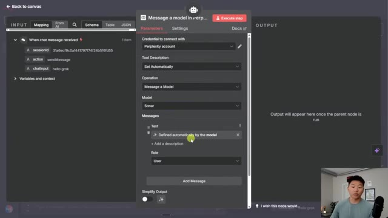
*⏱️ 00:05:33 — Gros plan sur le panneau de configuration d'un nœud Perplexity avec les paramètres du modèle Sonar configurés.*

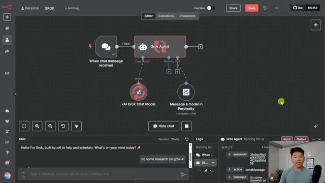
*⏱️ 00:05:50 — Vue d'ensemble du workflow d'automatisation montrant l'agent Grok relié à un modèle xAI et à un outil Perplexity.*

---

### ⏱️ `[00:05:58 - 00:06:32]` | Segment #14

**🔊 Audio (Transcription Intégrale Mot pour Mot en Français) :**
> minutes. Donc, espérons que nous avons ici des recherches assez approfondies, ce qui semble être le cas. Nous avons un historique et un développement, des fonctionnalités clés, l'état de la version et la disponibilité, des comparaisons, des défis et des critiques. Et nous avons également trois sources ici sur lesquelles nous pouvons cliquer, et nous avons une autre source juste là. Gardez à l'esprit qu'il n'y a pas eu de prompt système dans l'agent. Regardons un autre exemple où nous allons utiliser Grok4 avec notre assistant ultime pour effectuer des recherches en utilisant à la fois Tavily et Perplexity afin, encore une fois, de rechercher Grok4 et de l'envoyer par e-mail à Dexter Morgan. Il y a donc beaucoup d'éléments mobiles ici et beaucoup de choses qui doivent se produire. Et le problème auquel nous sommes confrontés ici est que nous obtenons cet échec d'analyse des arguments de l'outil.

**👁️ Analyse Visuelle d'Écran (gemini-3.5-flash-lite) :**
**Interface & Outils** : Tableau de bord d'agent IA (interface web)

**Contenu textuel & Code** : Texte de recherche structuré sur Grok 4 (Challenges and Criticisms, Sources and Further Reading) et panneau d'exécution affichant les entrées/sorties (sessionId, action: sendMessage, chatInput: do some research on grok 4).

**Action / Démonstration** : Affichage et navigation dans les résultats d'une recherche approfondie générée par un agent d'IA.

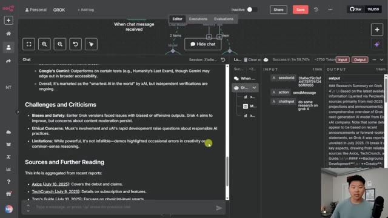
*⏱️ 00:06:07 — Interface d'un tableau de bord d'agent IA montrant les sections de recherche sur Grok 4, avec des détails sur les défis, critiques et sources, ainsi qu'un panneau latéral affichant les données d'entrée et de sortie.*

---

### ⏱️ `[00:06:32 - 00:06:56]` | Segment #15

**🔊 Audio (Transcription Intégrale Mot pour Mot en Français) :**
> d'un message d'erreur de modèle de chat. Et si je balance ça dans ChatGPT, parce que je ne sais pas exactement ce que ça veut dire, ça nous dit en gros que le modèle d'IA, qui est Grok4, a renvoyé une réponse pour appeler l'outil qui n'était pas un JSON valide. Et ensuite le NNN, qui est en quelque sorte construit au-dessus de Langchain, n'a pas pu l'analyser et l'envoyer dans notre outil. Et le problème, je pense, est dû à la requête HTTP Tavli, parce qu'on vient de voir Grok utiliser Perplexity, où si je clique ici, vous pouvez voir qu'on envoie un corps JSON.

**👁️ Analyse Visuelle d'Écran (gemini-3.5-flash-lite) :**
**Interface & Outils** : ChatGPT (interface web), Interface de workflow d'automatisation d'agents IA (type n8n).

**Contenu textuel & Code** : Message d'erreur : "Failed to parse tool arguments from chat model response... SyntaxError: Unexpected non-whitespace character after JSON", prompt demandant d'analyser l'erreur sur Grok 4.

**Action / Démonstration** : Explication et analyse textuelle d'un bug de parsing JSON dans un agent IA en utilisant ChatGPT, puis visualisation du workflow associé.

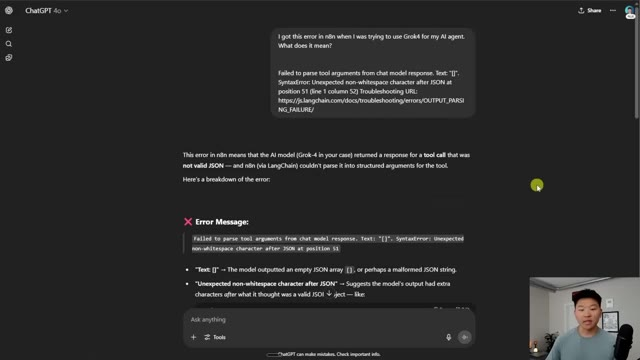
*⏱️ 00:06:38 — Capture d'écran de l'interface de ChatGPT affichant l'analyse d'une erreur de modèle d'IA liée à l'analyse syntaxique JSON.*

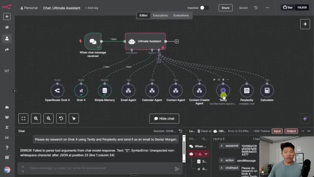
*⏱️ 00:06:50 — Interface graphique d'un workflow de type agent (n8n ou similaire) montrant les connexions entre divers outils et modèles (OpenRouter Grok 4, Tavily, etc.).*

---

### ⏱️ `[00:06:56 - 00:07:18]` | Segment #16

**🔊 Audio (Transcription Intégrale Mot pour Mot en Français) :**
> Donc peut-être que le modèle a des difficultés avec ça. Alors ce que j'ai pensé faire, c'est venir dans le modèle de chat juste ici et ensuite, en gros, ajouter un format de réponse, puis envoyer ceci sous forme de JSON, ce qui devrait garantir que le message que le modèle génère est un JSON valide. Donc je jette ça là-dedans et ensuite ça dit que nous devons inclure JSON dans le prompt. Alors je viens dans le prompt système de l'assistant ultime et ensuite dans la section des outils, je dis, hé, envoie du JSON aux outils.

**👁️ Analyse Visuelle d'Écran (gemini-3.5-flash-lite) :**
**Interface & Outils** : Interface web d'automatisation (type n8n) avec un panneau de configuration de modèle IA.

**Contenu textuel & Code** : Paramètres du modèle "grok-4-0709", options "Add Option", et dans le volet de sortie (Output) les détails de la réponse JSON avec un "finish_reason : tool_calls".

**Action / Démonstration** : Configuration des paramètres du modèle Grok 4 et observation du résultat d'exécution dans le panneau latéral.

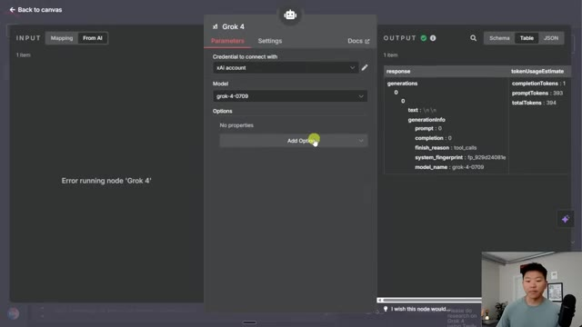
*⏱️ 00:07:02 — Interface d'un nœud d'automatisation (Grok 4) montrant les paramètres de configuration et la sortie de test avec une erreur de génération.*

---

### ⏱️ `[00:07:18 - 00:07:53]` | Segment #17

**🔊 Audio (Transcription Intégrale Mot pour Mot en Français) :**
> Et maintenant, si je veux essayer d'envoyer cette requête exacte une fois de plus, nous verrons ce qui se passe. Et ce qui se passe cette fois-ci, c'est que nous n'obtenons pas d'erreur, mais il n'a toujours pas été capable d'utiliser ces outils. Donc ce que je vais faire ici, c'est qu'au lieu d'utiliser Grok, je vais simplement utiliser OpenRouter pour me connecter à Grok 4 également. Et j'aime faire cela dans les deux cas, car maintenant j'ai un seul endroit pour mes informations de facturation et un seul endroit à gérer en ce qui concerne le rechargement des crédits et la consultation de mes analyses. Et donc tout ce que vous auriez à faire ici, c'est d'aller sur openrouter.ai, vous vous inscririez, vous iriez dans les modèles et vous pouvez voir ici même que nous avons Grok 4 comme modèle. C'est aussi là que vous pouvez comprendre sa fenêtre de contexte, son prix par jeton d'entrée, de sortie, et d'autres choses de ce genre. Et ensuite

**👁️ Analyse Visuelle d'Écran (gemini-3.5-flash-lite) :**
**Interface & Outils** : Interface de workflow d'automatisation et OpenRouter

**Contenu textuel & Code** : Nœuds de workflow connectés à un assistant central et liste de modèles IA (Mistral, Venice, xAI Grok) sur OpenRouter.

**Action / Démonstration** : Navigation et configuration d'un agent IA et exploration des modèles disponibles sur OpenRouter.

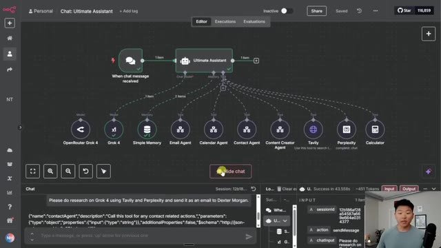
*⏱️ 00:07:27 — Interface d'un workflow d'agent conversationnel montrant divers outils connectés (Email, Calendar, Tavily, Perplexity) et le panneau de chat en bas.*

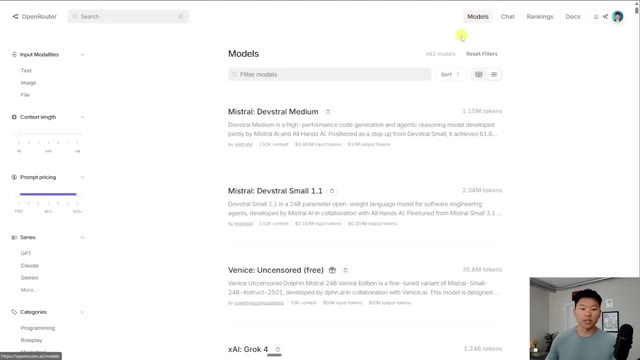
*⏱️ 00:07:44 — Interface web d'OpenRouter listant différents modèles de langage avec leurs caractéristiques et leur tarification.*

---

### ⏱️ `[00:07:53 - 00:08:25]` | Segment #18

**🔊 Audio (Transcription Intégrale Mot pour Mot en Français) :**
> tout ce que j'ai à faire, c'est de venir ici, d'aller dans mes clés, d'en créer une nouvelle, puis de brancher cette clé dans mon système et d'ajouter un identifiant Open Router. Et maintenant que nous avons connecté Open Router à Grok 4, je vais envoyer ce message qui dit : fais des recherches en utilisant Perplexity et Tavily sur le nouveau modèle d'IA Grok 4, puis envoie les résultats sous forme d'e-mail à Dexter Morgan. Il y a donc beaucoup de choses qui doivent se produire. Il doit faire des recherches ici, là, il doit obtenir les coordonnées de Dexter Morgan et lui envoyer la copie finale. Nous allons donc voir comment il s'en sort. Voilà, c'est fait. Maintenant, il appelle ces outils, Tavily, Perplexity, l'agent de contact, et ensuite il va procéder à l'envoi de cet e-mail.

**👁️ Analyse Visuelle d'Écran (gemini-3.5-flash-lite) :**
**Interface & Outils** : Interface web de construction de workflows d'agents IA (type Flowise ou équivalent).

**Contenu textuel & Code** : Nœuds de workflow incluant "When chat message received", "Ultimate Assistant", "OpenRouter Grok 4", "Simple Memory", "Email Agent", "Tavily", et un prompt de test dans le chat : "Do research using Perplexity and Tavily on the new Grok 4 AI model..."

**Action / Démonstration** : Connexion du modèle OpenRouter Grok 4 au workflow et préparation de l'envoi d'un message de test pour effectuer des recherches.

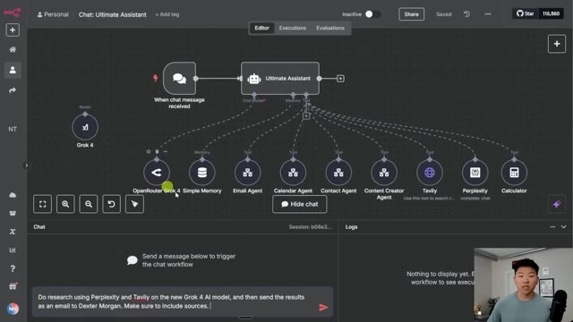
*⏱️ 00:08:01 — Interface d'un éditeur de workflow d'agent IA montrant la connexion d'OpenRouter Grok 4 à l'assistant principal avec divers outils connectés et une zone de chat en bas.*

---

### ⏱️ `[00:08:25 - 00:08:44]` | Segment #19

**🔊 Audio (Transcription Intégrale Mot pour Mot en Français) :**
> Maintenant vous pouvez voir que ça appelle cet agent de messagerie. Très bien, donc ça vient juste de se terminer et je vais aller dans ma boîte mail et aller dans le dossier des messages envoyés. Et vous pouvez voir que c'est l'e-mail que nous venons de recevoir qui a été envoyé à Dexter à Miami.com. Nous avons une tonne de recherches ici même de Perplexity et vous pouvez voir qu'il y a cinq sources en bas. Et ensuite nous avons aussi un bref résumé de Tavoli avec trois sources.

**👁️ Analyse Visuelle d'Écran (gemini-3.5-flash-lite) :**
**Interface & Outils** : Gmail (interface web)

**Contenu textuel & Code** : E-mail intitulé "Research on the New Grok 4 AI Model" envoyé à dexter avec des détails sur les fonctionnalités et performances du modèle.

**Action / Démonstration** : Consultation de l'e-mail envoyé dans le dossier des messages envoyés pour vérifier le résultat de l'automatisation.

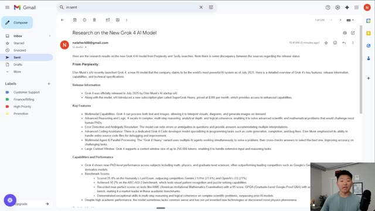
*⏱️ 00:08:30 — Boîte de réception Gmail montrant un e-mail envoyé avec des recherches sur le nouveau modèle IA Grok 4.*

---

### ⏱️ `[00:08:44 - 00:09:03]` | Segment #20

**🔊 Audio (Transcription Intégrale Mot pour Mot en Français) :**
> Il est même indiqué que les résultats de Tavoli semblent se concentrer davantage sur les récentes mises à propos des versions existantes de Grok plutôt que sur Grok 4. Cette information entre donc en quelque sorte en contradiction avec celle de Perplexity, ce qui est une bonne chose que nous ayons utilisé deux sources. Mais je tiens à souligner ici que cette exécution a pris cinq minutes et qu'il a en fait fallu environ trois minutes avant même qu'il ne décide d'appeler le moindre outil pour commencer.

**👁️ Analyse Visuelle d'Écran (gemini-3.5-flash-lite) :**
**Interface & Outils** : Interface web de Gmail et éditeur de workflow d'agent IA.

**Contenu textuel & Code** : Texte d'un e-mail comparant les informations de Perplexity et de Tavily sur Grok 4, avec des liens vers des sources.

**Action / Démonstration** : Présentation des résultats de recherche et des données comparatives sur Grok 4 provenant de différents outils de recherche.

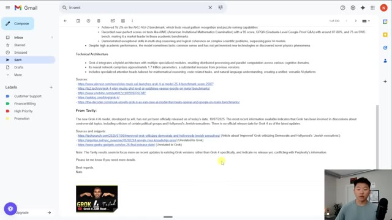
*⏱️ 00:08:48 — Image montrant un e-mail rédigé dans Gmail détaillant l'architecture technique, les sources et les résultats de Tavily concernant le modèle d'IA Grok 4.*

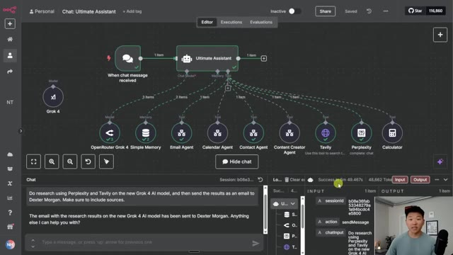
*⏱️ 00:08:58 — Image montrant un diagramme de flux d'un agent IA nommé 'Ultimate Assistant' avec divers outils connectés dont Tavily et Perplexity.*

---

### ⏱️ `[00:09:03 - 00:09:22]` | Segment #21

**🔊 Audio (Transcription Intégrale Mot pour Mot en Français) :**
> Et c'est vraiment intéressant parce que si je vais dans mes exécutions et que je fais défiler vers le bas, nous pouvons voir celle-ci juste ici qui a pris une minute et 40 secondes. J'ai en fait envoyé exactement la même requête juste pour tester cela, où je lui ai demandé de faire des recherches pour utiliser Perplexity et Tavily sur Grok 4, puis de l'envoyer comme e-mail à Dexter Morgan. Donc la même requête, mais celle que je viens de vous montrer en direct a pris presque trois fois plus de temps.

**👁️ Analyse Visuelle d'Écran (gemini-3.5-flash-lite) :**
**Interface & Outils** : Interface web d'un outil d'automatisation et de gestion d'agents IA (type n8n ou plateforme similaire).

**Contenu textuel & Code** : Liste des exécutions avec leur statut (Succeeded, Canceled, Error) et durée (ex: 1m 40.542s), et un diagramme de workflow avec des nœuds connectés à l'assistant.

**Action / Démonstration** : Le curseur de la souris survole l'historique des exécutions pour analyser les performances des différents tests du workflow.

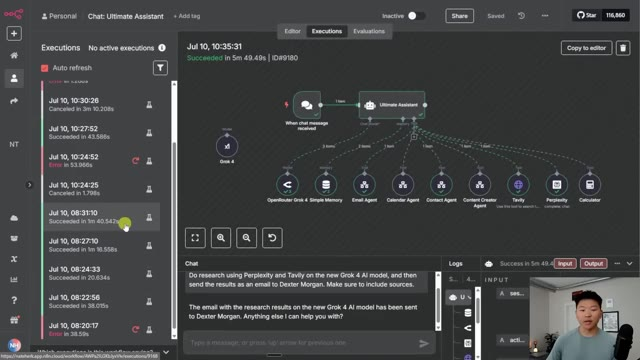
*⏱️ 00:09:08 — Capture d'écran montrant l'historique des exécutions d'un workflow d'agent IA dans une interface web, avec un panneau latéral listant plusieurs exécutions datées du 10 juillet, et le diagramme du workflow visible au centre.*

---

### ⏱️ `[00:09:22 - 00:09:40]` | Segment #22

**🔊 Audio (Transcription Intégrale Mot pour Mot en Français) :**
> Donc ce que cela me dit, c'est que, vous savez, Grok 4 est nouveau, tout le monde est en train de spammer les serveurs. Et donc selon l'heure de la journée et selon le nombre de requêtes que Grok 4 reçoit en ce moment, cela peut faire varier votre vitesse. Et aussi si nous venons ici et regardons le coût, vous pouvez voir que cette exécution que nous venons de faire, elle nous a coûté environ 12 cents.

**👁️ Analyse Visuelle d'Écran (gemini-3.5-flash-lite) :**
**Interface & Outils** : Interface web d'automatisation d'agents et tableau de bord OpenRouter.

**Contenu textuel & Code** : Diagramme d'agent IA "Ultimate Assistant" avec des connexions vers Grok 4, OpenRouter, et divers agents spécialisés (Email, Calendar, etc.) ; tableau de statistiques d'utilisation des modèles d'IA avec horodatages, tokens et vitesses en tokens par seconde (tps).

**Action / Démonstration** : Navigation et analyse des performances des exécutions d'agents IA et des vitesses de réponse du modèle Grok 4 sur OpenRouter.

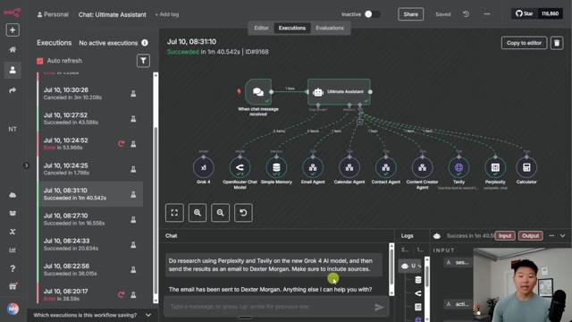
*⏱️ 00:09:26 — Image montrant un tableau de bord d'agent IA avec un workflow complexe connectant divers outils et modèles (dont Grok 4).*

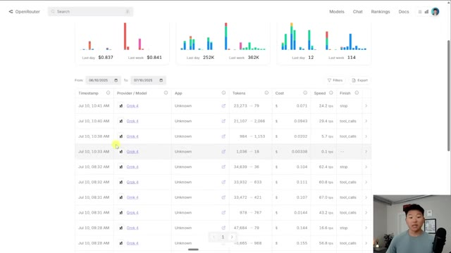
*⏱️ 00:09:35 — Image montrant le tableau de bord OpenRouter affichant l'historique des requêtes, les modèles utilisés (Grok 4), les tokens et la vitesse de traitement (tps).*

---

### ⏱️ `[00:09:40 - 00:10:02]` | Segment #23

**🔊 Audio (Transcription Intégrale Mot pour Mot en Français) :**
> Et c'est parce qu'on transmettait beaucoup de jetons, car on fait des recherches avec Perplexity et Tavoli. Donc toute cette information est renvoyée au modèle Grok pour être traitée. Ce n'est clairement pas le modèle le moins cher et vous pouvez voir qu'il n'est pas incroyablement rapide, mais j'ai vraiment aimé la façon dont il a raisonné et la façon dont il a fondamentalement structuré ses résultats. Et vous pourriez facilement traiter ces éléments différemment avec un autre modèle, puis envoyer ce résumé à Grok pour qu'il soit traité plus en profondeur.

**👁️ Analyse Visuelle d'Écran (gemini-3.5-flash-lite) :**
**Interface & Outils** : n8n (Interface de conception de workflows d'automatisation)

**Contenu textuel & Code** : Workflow "Ultimate Assistant" connectant un modèle Grok à divers agents et outils (Tavily, Perplexity, Email, Calendar).

**Action / Démonstration** : Visualisation et explication d'un workflow d'agent IA complexe intégrant des recherches via Tavily et Perplexity.

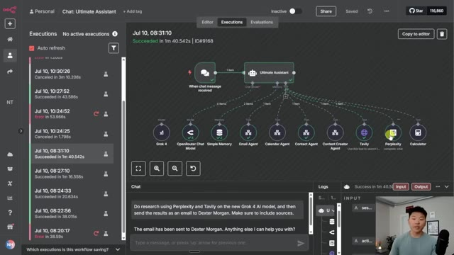
*⏱️ 00:09:45 — Vue du tableau de bord n8n montrant un workflow complexe d'assistant IA avec des connexions vers Tavily et Perplexity.*

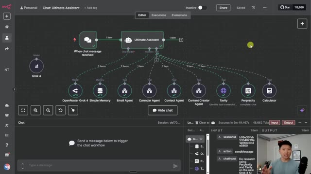
*⏱️ 00:09:51 — Vue de l'éditeur de workflow n8n montrant les nœuds de l'assistant IA et ses outils connectés.*

---

### ⏱️ `[00:10:02 - 00:10:32]` | Segment #24

**🔊 Audio (Transcription Intégrale Mot pour Mot en Français) :**
> Et c'est une façon de réduire vos coûts et d'économiser des jetons. Si vous cherchez à approfondir votre apprentissage avec NNN, à découvrir des stratégies d'ingénierie contextuelle comme celle-ci, à économiser des jetons de cette façon, alors consultez absolument ma communauté payante. Le lien pour y accéder se trouve dans la description. C'est un excellent endroit pour vous entourer de personnes partageant les mêmes idées qui utilisent NNN tous les jours. Et bien sûr, nous avons une section de cours où vous pouvez apprendre les bases ainsi que la manière d'identifier, de concevoir et de créer des automatisations qui font gagner du temps. Alors si vous avez aimé la vidéo ou si vous avez appris quelque chose de nouveau, n'hésitez pas à lui donner un j'aime. Ça m'aide vraiment beaucoup. Et comme toujours, je vous remercie d'être arrivés jusqu'à la fin de la vidéo. Je vous vois dans la prochaine. Merci à tous.

**👁️ Analyse Visuelle d'Écran (gemini-3.5-flash-lite) :**
**Interface & Outils** : Interface web de workflow visuel et plateforme communautaire Skool.

**Contenu textuel & Code** : Diagramme de nœuds représentant un agent IA "Ultimate Assistant" relié à des outils de recherche, de calcul et de messagerie.

**Action / Démonstration** : Navigation entre la présentation du workflow technique et la promotion de la communauté payante en ligne.

*⏱️ 00:10:10 — Vue d'un éditeur de workflow visuel montrant un assistant IA connecté à divers outils (OpenRouter, mémoire, agents email, calendrier, etc.).*

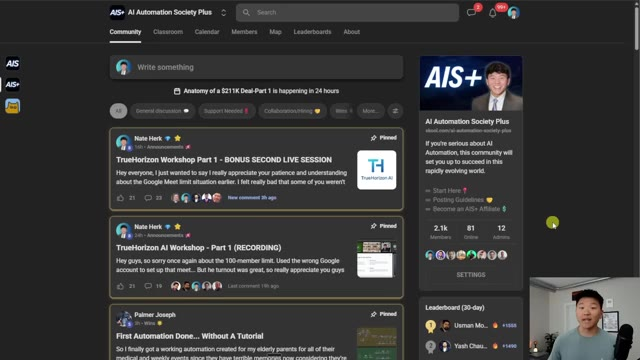
*⏱️ 00:10:17 — Interface de la communauté payante "AI Automation Society Plus" sur la plateforme Skool montrant des discussions et des ateliers.*

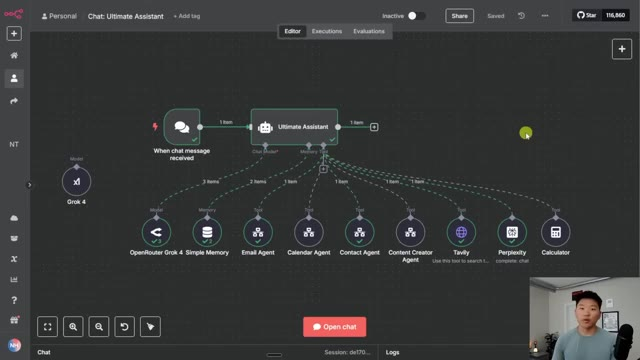
*⏱️ 00:10:25 — Vue de l'éditeur de workflow visuel avec l'assistant IA et ses connexions d'outils, identique à l'image 1.*

---

