# 🎬 Unlock the Next Evolution of Agents with Human-like Memory (n8n + zep)

> **Chaîne** : [Nate Herk | AI Automation](https://www.youtube.com/@nateherk/featured)  
> **Lien YouTube** : [https://www.youtube.com/watch?v=kNsX2qu8jHY](https://www.youtube.com/watch?v=kNsX2qu8jHY)  
> **Date de publication** : 20250714  
> **Durée** : 00:16:20  
> **Identifiant vidéo** : `kNsX2qu8jHY`  
> **Transcription & Analyse** : `whisper-v3-large-turbo+gemini-3.5-flash-lite`  

---

## 📌 Synthèse Exécutive & Outils

### 💡 Résumé

Cette vidéo, présentée par Nate Herk pour sa chaîne *AI Automation*, plonge au cœur de la prochaine évolution des agents conversationnels : l'intégration de graphes de connaissances pour structurer la mémoire à long terme. Contrairement aux approches traditionnelles limitées à une fenêtre de contexte glissante (stockant uniquement les derniers messages), l'utilisation de graphes relationnels permet à l'agent d'encoder, d'analyser et de parcourir les connexions sémantiques entre différentes entités (utilisateurs, préférences, outils, lieux). La démonstration illustre la capacité d'un agent propulsé par Zep et orchestré via n8n à recouper des informations contextuelles complexes — comme un déménagement imminent ou des centres d'intérêt — pour générer des réponses hautement personnalisées sans nécessiter de réinjection manuelle de contexte.

Cependant, cette puissance mémorielle soulève un défi critique en ingénierie logicielle : l'explosion des coûts et de la consommation de jetons. À mesure que le graphe de connaissances s'enrichit et que l'agent y extrait l'intégralité des faits et des entités à chaque interaction, la charge en tokens s'envole, alourdissant inutilement le modèle de langage. Pour résoudre ce goulet d'étranglement financier et architectural, Nate Herk introduit une méthodologie d'optimisation avancée : contourner les intégrations natives figées au profit de requêtes HTTP directes vers les points de terminaison de Zep. Cette approche chirurgicale permet de filtrer et de récupérer uniquement les sous-ensembles de données les plus pertinents du graphe utilisateur, garantissant un équilibre parfait entre persistance cognitive et efficacité opérationnelle.

### 🛠️ Outils, Modèles & Logiciels Présentés

* **n8n** : Plateforme d'automatisation des flux de travail (workflow automation) utilisée pour orchestrer l'agent IA, gérer les déclencheurs de messagerie (Telegram) et connecter les modules de mémoire.
* **Zep** : Solution spécialisée de mémoire et de graphes de connaissances (Knowledge Graph Memory) pour les agents IA, permettant de stocker et d'interroger les relations sémantiques à long terme et l'historique des sessions.
* **Telegram** : Canal de messagerie instantanée utilisé comme interface utilisateur pour interagir en temps réel avec l'agent IA et tester les capacités conversationnelles.
* **OpenRouter** : Plateforme d'agrégation de modèles de langage (LLM) servant de passerelle d'inférence pour suivre la consommation exacte de jetons par requête.

### 🔑 Points Clés & Enseignements Stratégiques

* **Limitation des mémoires conversationnelles classiques** : Les mémoires à court terme basées sur des fenêtres de contexte glissantes (5 à 15 interactions) s'avèrent incapables de retenir des informations contextuelles durables sur l'utilisateur ou son entreprise.
* **Apport des graphes de connaissances** : L'utilisation de graphes relationnels permet à l'agent de naviguer à travers un réseau d'entités interconnectées pour comprendre des concepts complexes et des préférences implicites.
* **Personnalisation contextuelle dynamique** : Un agent doté d'un graphe utilisateur est capable d'anticiper les besoins et de générer des réponses ultra-ciblées (ex. : idées de contenu sur-mesure) sans que l'utilisateur n'ait à réexpliciter son historique.
* **Visualisation et traçabilité** : Des plateformes comme Zep offrent des interfaces graphiques permettant d'auditer les nœuds d'utilisateurs, les résumés et les relations sémantiques (liens d'appartenance, d'utilisation ou de préférence).
* **Croissance organique de la base de connaissances** : Au fil des discussions, l'agent enrichit automatiquement le graphe en extrayant de nouvelles entités et relations, rendant l'assistant de plus en plus intelligent à chaque session.
* **Le piège de l'explosion des jetons (Token Bloat)** : L'injection systématique de l'intégralité du graphe de connaissances et de l'historique des faits dans le contexte du LLM provoque une augmentation drastique et linéaire des coûts d'API.
* **Surcoût d'inférence mesurable** : Suivre les métriques d'OpenRouter démontre que des graphes denses et non filtrés consomment rapidement des centaines, voire des milliers de jetons superflus par simple requête de chat.
* **Dépassement des limites des intégrations natives** : Les modules d'intégration "clés en main" dans les outils d'automatisation manquent souvent de paramètres de configuration avancés, limitant le contrôle de l'ingénieur sur la récupération des données.
* **Recours aux requêtes HTTP personnalisées** : Interfacer les plateformes de mémoire via des requêtes API directes offre un contrôle granulaire sur les points de terminaison (*endpoints*) et les charges utiles (*payloads*).
* **Stratégie d'extraction chirurgicale** : L'ingénierie d'automatisation moderne exige de ne requêter que les éléments du graphe sémantique strictement pertinents pour la requête en cours, réduisant drastiquement l'empreinte en jetons.

---

## ⏱️ Chronologie & Transcription Complète Audio & Visuelle (Mot pour Mot)

### ⏱️ `[00:00:00 - 00:00:18]` | Segment #01

**🔊 Audio (Transcription Intégrale Mot pour Mot en Français) :**
> Aujourd'hui, je vais vous parler de la prochaine évolution des agents IA, à savoir les graphes de connaissances pour la mémoire à long terme. Lorsque nous configurons ces graphes relationnels, nos agents sont capables de les parcourir, de comprendre les relations entre différentes entités et différentes choses dont vous avez parlé par le passé, et de les utiliser pour être réellement beaucoup plus intelligents. Je vais donc vous montrer à quel point il est facile de configurer tout cela. Je vais vous expliquer ce qui se passe.

**👁️ Analyse Visuelle d'Écran (gemini-3.5-flash-lite) :**
**Interface & Outils** : Interface web de gestion de workflow et tableau de bord de graphe de connaissances Zep Memory.

**Contenu textuel & Code** : Nœuds de workflow, déclencheur Telegram, agent IA, blocs de mémoire, et graphe relationnel avec nœuds (Nate, n8n, etc.) et arêtes textuelles.
[DESC_IMAGE_3] Navigation et exploration interactive du graphe de connaissances relationnel des entités mémorisées par l'agent IA.

**Action / Démonstration** : Explications face caméra et démonstration conceptuelle.

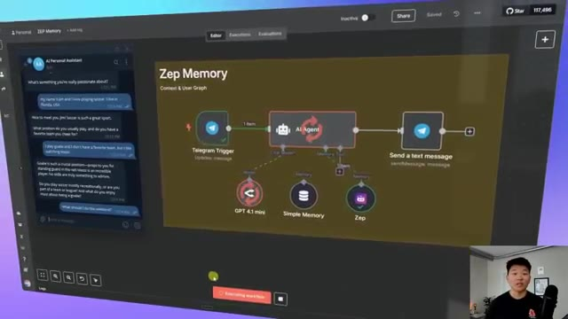
*⏱️ 00:00:05 — Interface de workflow d'automatisation (type n8n ou Make) montrant le nœud Zep Memory avec une discussion Telegram.*

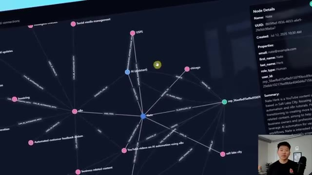
*⏱️ 00:00:09 — Visualisation d'un graphe de connaissances (knowledge graph) relationnel affichant les connexions entre différentes entités avec un panneau de détails de nœud.*

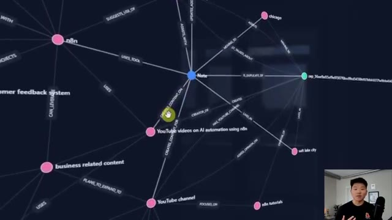
*⏱️ 00:00:14 — Gros plan sur le graphe de connaissances relationnel montrant les liens entre les entités et les nœuds autour du créateur.*

---

### ⏱️ `[00:00:18 - 00:00:55]` | Segment #02

**🔊 Audio (Transcription Intégrale Mot pour Mot en Français) :**
> Et une autre chose que je voulais dire, c'est que les graphes relationnels comme ceux-ci peuvent devenir très coûteux très rapidement si vous ne les gérez pas. Je vais donc vous montrer également comment j'ai configuré ce système pour m'assurer que nous ne faisons pas simplement flamber les crédits d'API. Si tout cela vous convient, commençons. La première fois que vous avez configuré la mémoire de votre agent IA, vous l'avez sans doute fait avec la mémoire simple qui se contente de la stocker dans N8N, ce qui fonctionne très bien. Car si j'envoie ce message, l'agent va essentiellement vérifier la mémoire, voir si nous avons discuté, et il va également stocker notre interaction dans la mémoire. Ainsi, maintenant que je viens de dire à l'agent que mon nom est Nate, je peux aller de l'avant et dire quel est mon nom. Il va vérifier la mémoire, voir que mon nom est Nate, puis nous répondre et dire que votre nom est Nate. Et c'est formidable parce que cela permet à notre agent d'avoir un contexte.

**👁️ Analyse Visuelle d'Écran (gemini-3.5-flash-lite) :**
**Interface & Outils** : Interface web de Zep Memory / constructeur de workflow d'agents IA

**Contenu textuel & Code** : Diagrammes de flux avec nœuds : Telegram Trigger, User Graph, Code2, AI Agent 3, Add Memory1, Send a text message2, connectés à des modèles (GPT-4.1 mini) et mémoires (Postgres, Zep)

**Action / Démonstration** : Présentation et explication du fonctionnement des graphes relationnels et de la configuration du système d'automatisation IA

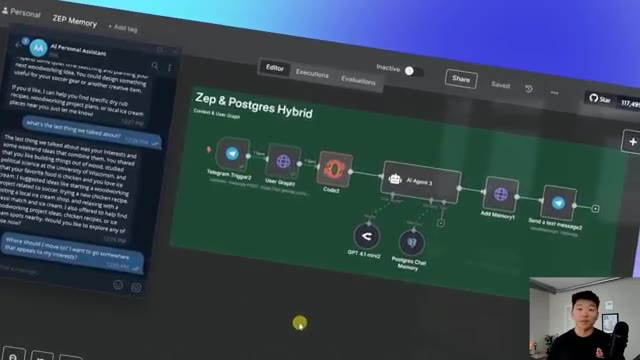
*⏱️ 00:00:27 — Interface d'un éditeur de workflow montrant un graphe complexe avec Zep et Postgres Hybrid, incluant des déclencheurs Telegram et des agents IA.*

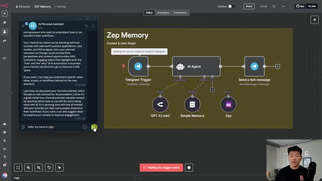
*⏱️ 00:00:37 — Interface de test montrant une conversation Telegram à gauche et un diagramme de workflow simplifié 'Zep Memory' à droite avec un agent IA connectant GPT-4.1 mini, Simple Memory et Zep.*

---

### ⏱️ `[00:00:55 - 00:01:29]` | Segment #03

**🔊 Audio (Transcription Intégrale Mot pour Mot en Français) :**
> fenêtre pour se souvenir de ce qui se passe tout au long de l'interaction. Mais la limitation ici est qu'elle examine uniquement les interactions passées. Donc si je vais dans les journaux et que nous cliquons sur la mémoire simple, nous pouvons voir ce qu'elle fait, c'est qu'elle examine notre interaction passée, qui était bonjour, je m'appelle Nate. Bonjour, Nate. Et puis à la fin, elle stocke tout cela à nouveau. Donc maintenant, elle a ceci à regarder la prochaine fois que nous lui parlerons. Mais le problème avec ce système, c'est qu'il n'y a aucun aspect de mémoire à long terme, parce que l'agent ne peut regarder que les cinq, dix ou quinze dernières interactions, quelque chose comme ça. Et si nous voulons que l'agent se souvienne de choses concernant notre entreprise ou de nous personnellement, de nos préférences, des choses comme ça, alors nous voulons mettre en place une forme de mémoire à long terme

**👁️ Analyse Visuelle d'Écran (gemini-3.5-flash-lite) :**
**Interface & Outils** : Interface graphique de type n8n / plateforme d'automatisation d'agents IA.

**Contenu textuel & Code** : Configuration du nœud AI Agent, variables de prompt et journaux d'exécution affichant l'historique des messages utilisateur.

**Action / Démonstration** : Exploration des journaux d'exécution de la mémoire simple d'un agent IA pour analyser les interactions passées.

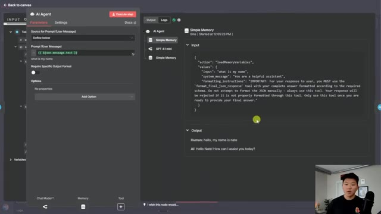
*⏱️ 00:01:03 — Interface d'un Agent IA montrant les paramètres de configuration à gauche et les journaux (logs) de Simple Memory à droite.*

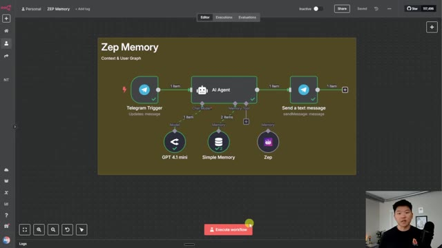
*⏱️ 00:01:20 — Vue d'ensemble du workflow d'automatisation sur une plateforme de type n8n, montrant le déclencheur Telegram, l'agent IA, GPT-4 mini, Simple Memory et Zep.*

---

### ⏱️ `[00:01:29 - 00:02:02]` | Segment #04

**🔊 Audio (Transcription Intégrale Mot pour Mot en Français) :**
> mémoire. Donc la façon dont nous allons faire cela aujourd'hui est avec un graphe relationnel utilisateur, et nous allons utiliser ZEPP pour le faire. Laissez-moi vous montrer un très rapide exemple, si je connecte simplement la mémoire à ZEPP plutôt qu'à la mémoire simple, et je vais lancer une requête. Très bien, donc je ne sais pas pourquoi ça tourne en rond. Je pense que c'est juste un bug. Notre Telegram nous écoute et nous sommes connectés à la mémoire ZEPP. Donc je vais envoyer quel genre de vidéos devrais-je faire ce mois-ci. L'agent regarde dans notre graphe de relations. Il cherche à voir ce dont nous avons parlé lors des quelques interactions précédentes, et maintenant il va nous répondre parce qu'il sait des choses sur moi et sur ma chaîne YouTube. Donc vous pouvez voir que nous avons reçu un message assez long.

**👁️ Analyse Visuelle d'Écran (gemini-3.5-flash-lite) :**
**Interface & Outils** : Interface web de type éditeur de flux/workflow (n8n ou similaire)

**Contenu textuel & Code** : Diagramme de workflow intitulé 'Zep Memory' avec des composants 'Telegram Trigger', 'AI Agent', 'GPT 4.1 mini', 'Simple Memory' et 'Zep'.

**Action / Démonstration** : Le présentateur connecte la mémoire Zep au nœud de l'agent IA dans le workflow.

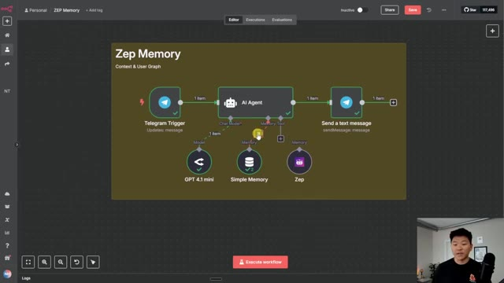
*⏱️ 00:01:37 — Interface d'un éditeur de workflow montrant un diagramme avec un déclencheur Telegram, un agent IA et un nœud d'envoi de message, ainsi que des options de mémoire dont Zep.*

---

### ⏱️ `[00:02:02 - 00:02:25]` | Segment #05

**🔊 Audio (Transcription Intégrale Mot pour Mot en Français) :**
> Ça dit simplement, excellente question, Nate. Puisque tu élargis ta chaîne YouTube, qui passe de tutoriels purs et d'événements à du contenu sur l'automatisation de l'IA lié aux affaires, qui devrait arriver bientôt, et que tu déménages à Chicago bientôt, voici une liste personnalisée d'idées de vidéos que tu peux créer ce mois-ci qui mélangent ces thèmes et plaisent à ton public cible de propriétaires d'entreprise, d'entrepreneurs et de spécialistes du marketing. Et ce que vous pouvez voir, les gars, c'est que je n'ai donné aucun de ces contextes. Il a été capable de les extraire directement grâce à notre graphe d'utilisateurs.

**👁️ Analyse Visuelle d'Écran (gemini-3.5-flash-lite) :**
**Interface & Outils** : Interface web de Zep Memory / n8n et application de chat Telegram.

**Contenu textuel & Code** : Un échange de chat affichant une liste d'idées de vidéos personnalisées pour YouTube, ainsi qu'un diagramme de workflow reliant Telegram Trigger, un agent IA (GPT 4.1 mini), Simple Memory et Zep.

**Action / Démonstration** : Visualisation d'un workflow d'automatisation IA et de la réponse textuelle générée par l'assistant concernant les idées de contenu pour la chaîne.

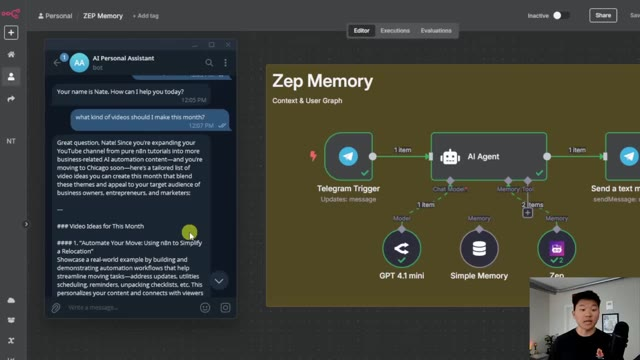
*⏱️ 00:02:08 — Capture d'écran montrant une interface de workflow avec un assistant personnel Telegram d'un côté et un schéma de type n8n/diagramme de mémoire (Zep Memory) de l'autre, avec le présentateur en médaillon dans le coin inférieur droit.*

---

### ⏱️ `[00:02:25 - 00:02:44]` | Segment #06

**🔊 Audio (Transcription Intégrale Mot pour Mot en Français) :**
> Et je ne vais pas tout lire, mais en gros, automatiser votre déménagement, en utilisant NNN pour simplifier une réinstallation, le top cinq des cas d'usage de l'automatisation par IA pour les petites entreprises, tout ce genre de choses qui me correspond vraiment très bien parce que ça me comprend en tant que personne. Et juste pour vous montrer à quoi ça ressemble en arrière-plan, je vais aller sur Zep très rapidement. Et ce dans quoi je me trouve en ce moment, c'est mon graphe de relation utilisateur.

**👁️ Analyse Visuelle d'Écran (gemini-3.5-flash-lite) :**
**Interface & Outils** : n8n (éditeur de workflow) et interface de messagerie Telegram

**Contenu textuel & Code** : Idées de vidéos : 'Automate Your Move: Using n8n to Simplify a Relocation' et 'Top 5 AI Automation Use Cases for Small Businesses in 2024'.

**Action / Démonstration** : Visualisation d'un flux d'automatisation IA et d'un assistant virtuel générant du contenu.

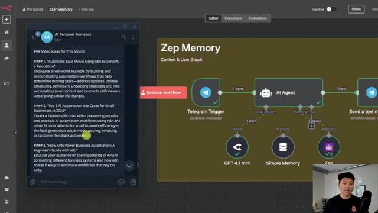
*⏱️ 00:02:30 — Un diagramme de workflow n8n combinant un déclencheur Telegram, un agent IA (avec modèles GPT-4.1 mini, Simple Memory, Zep) et une interface de chat Telegram affichant des idées de vidéos générées.*

---

### ⏱️ `[00:02:44 - 00:03:07]` | Segment #07

**🔊 Audio (Transcription Intégrale Mot pour Mot en Français) :**
> Donc vous pouvez voir ici c'est moi, je suis l'entité principale de cet utilisateur, et j'ai toutes ces différentes relations. Et vous pouvez voir qu'entre chacune, ça vous dit fondamentalement quelle est cette relation. Donc juste ici nous avons Nate et nous avons NNN, and the connection is que j'utilise cet outil. Nous pouvons aussi voir que j'ai des vidéos YouTube sur l'automatisation de l'IA en utilisant NNN, qui utilise NNN, et Nate crée du contenu sur des vidéos YouTube.

**👁️ Analyse Visuelle d'Écran (gemini-3.5-flash-lite) :**
**Interface & Outils** : Application web de visualisation de graphe (User Relationship Graph).

**Contenu textuel & Code** : Nœuds interconnectés représentant des concepts, des entités et des relations (ex: Nate, AI, automatisation, Chicago) avec des libellés de connexion textuels.

**Action / Démonstration** : Le présentateur commente la visualisation des données et des connexions entre les différentes entités du graphe.

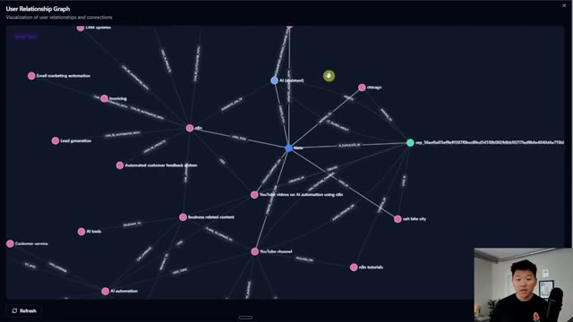
*⏱️ 00:02:50 — Un graphique de relations utilisateur montrant des nœuds connectés par des lignes étiquetées, avec le présentateur visible en incrustation dans le coin inférieur droit.*

---

### ⏱️ `[00:03:07 - 00:03:26]` | Segment #08

**🔊 Audio (Transcription Intégrale Mot pour Mot en Français) :**
> Nous avons toutes ces autres choses concernant NNN, qui peuvent être automatisées avec le marketing par e-mail, qui peuvent être automatisées avec la facturation. Et donc, plus nous discutons avec notre agent IA, plus il devient intelligent, car il ajoute davantage de relations et en sait tout simplement plus sur moi et sur mon entreprise. Je peux même cliquer sur moi-même, l'utilisateur, et il me donnera un petit résumé. Je peux également cliquer sur les différentes entités, qui sont les éléments en rose.

**👁️ Analyse Visuelle d'Écran (gemini-3.5-flash-lite) :**
**Interface & Outils** : Application web de visualisation de graphe de relations (User Relationship Graph) avec incrustation vidéo du présentateur en bas à droite.

**Contenu textuel & Code** : Nœuds interconnectés affichant "n8n", "AI (assistant)", "Invoicing", "Email marketing automation", "Lead generation" et "Nate" avec des relations telles que "CAN_BE_AUTOMATED_WITH".

**Action / Démonstration** : Navigation et exploration visuelle du graphe de relations de l'agent IA.

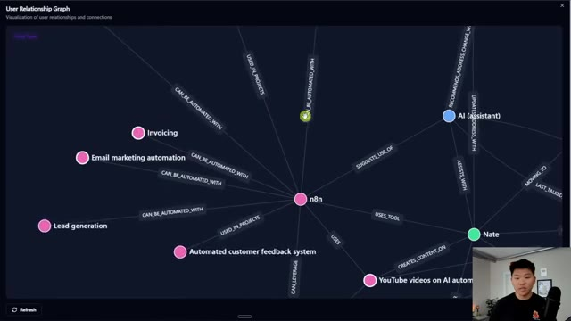
*⏱️ 00:03:12 — Un graphique de relations montrant les connexions entre l'outil n8n, l'IA et diverses automatisations comme l'e-mailing et la facturation.*

---

### ⏱️ `[00:03:26 - 00:03:45]` | Segment #09

**🔊 Audio (Transcription Intégrale Mot pour Mot en Français) :**
> Par exemple, si je clique sur NNN, cela dira que Nate Herc est un YouTubeur qui se concentre sur l'automatisation de l'IA en utilisant NNN. Et je pourrais descendre ici vers les propriétaires d'entreprise et cela dirait que l'entité propriétaires d'entreprise englobe les individus qui possèdent ou gèrent des entreprises intéressées par des outils comme NNN. C'était donc juste un exemple rapide. Et je sais que cela peut paraître un peu intimidant parce que j'ai beaucoup de données ici.

**👁️ Analyse Visuelle d'Écran (gemini-3.5-flash-lite) :**
**Interface & Outils** : Application web de visualisation de graphe de connaissances / relations

**Contenu textuel & Code** : Nœuds reliés représentant des entités comme n8n, Nate, CRM updates, Invoicing, et résumé textuel dans le panneau latéral Node Details.

**Action / Démonstration** : Exploration visuelle du graphe de relations et sélection du nœud n8n pour afficher sa description détaillée.

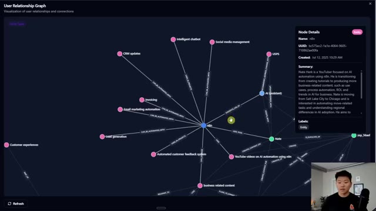
*⏱️ 00:03:31 — Un graphique de relations interactif affichant des nœuds interconnectés (User Relationship Graph) avec un panneau latéral détaillant les informations sur le nœud sélectionné (n8n).*

---

### ⏱️ `[00:03:45 - 00:04:10]` | Segment #10

**🔊 Audio (Transcription Intégrale Mot pour Mot en Français) :**
> Donc ce qu'on va faire, c'est que je vais supprimer ça et on va configurer un nouvel utilisateur et un nouveau graphe et tout le reste ensemble pour que vous puissiez voir comment l'agent les remplit. Très bien, donc je viens de supprimer l'utilisateur et je vais retourner dans mon n8n ici et on va commencer à discuter avec cet agent et maintenant il n'aura plus aucun souvenir de nous et on va recommencer à zéro. Très bien, donc je dis bonjour, pose-moi des questions pour apprendre à me connaître et il n'y a rien dans la mémoire comme vous pouvez le voir, il va revenir et nous poser quelques questions.

**👁️ Analyse Visuelle d'Écran (gemini-3.5-flash-lite) :**
**Interface & Outils** : Zep Web App, n8n Workflow Automation

**Contenu textuel & Code** : Configuration utilisateur Zep et diagramme de workflow n8n (Telegram Trigger, AI Agent, GPT 4.1 mini, Simple Memory, Zep, Send a text message)

**Action / Démonstration** : Suppression d'un utilisateur dans l'interface Zep puis bascule vers l'éditeur de workflow n8n pour configurer un nouvel utilisateur et un nouveau graphe.

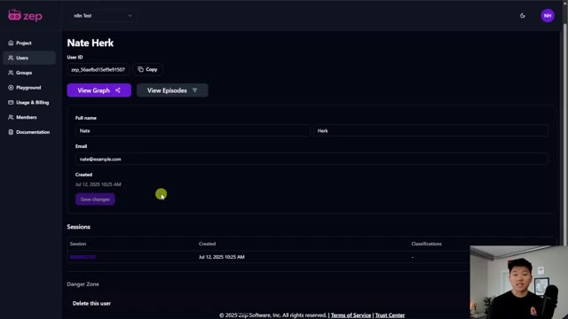
*⏱️ 00:03:51 — L'interface web de Zep montrant les détails d'un utilisateur nommé Nate Herk avec son ID, son profil et la zone de danger pour supprimer l'utilisateur.*

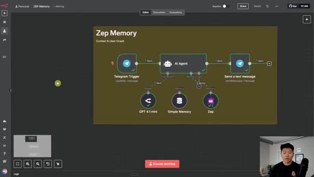
*⏱️ 00:03:58 — L'interface n8n affichant un workflow de démonstration nommé "Zep Memory" avec un nœud Telegram Trigger, un AI Agent, un modèle GPT 4.1 mini, Simple Memory et Zep.*

---

### ⏱️ `[00:04:10 - 00:04:29]` | Segment #11

**🔊 Audio (Transcription Intégrale Mot pour Mot en Français) :**
> Donc je réponds à l'agent en disant, mon nom est Jim, j'adore jouer au football et je vis en Floride aux États-Unis. Et comme vous pouvez le voir, il va nous poser plus de questions, mais très rapidement, allons sur ZEPP et voyons si nous avons un nouvel utilisateur créé. Si je fais juste un rafraîchissement, nous devrions voir que nous avons maintenant cet utilisateur. Et si je clique sur l'utilisateur, nous avons deux choses à regarder. La première est les sessions.

**👁️ Analyse Visuelle d'Écran (gemini-3.5-flash-lite) :**
**Interface & Outils** : n8n et Zep Dashboard

**Contenu textuel & Code** : Diagramme de workflow n8n avec déclencheur Telegram, Agent IA, GPT-4.1 mini, Simple Memory et Zep. Interface Zep affichant "No users yet".

**Action / Démonstration** : Navigation depuis le workflow n8n vers l'interface de l'application Zep pour vérifier la création d'un nouvel utilisateur suite aux interactions sur Telegram.

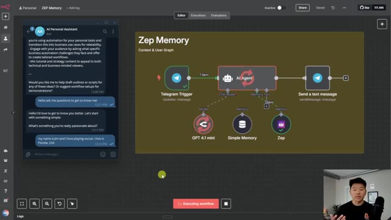
*⏱️ 00:04:15 — Vue d'un workflow n8n montrant un assistant personnel Telegram interagissant avec un modèle IA et la mémoire Zep.*

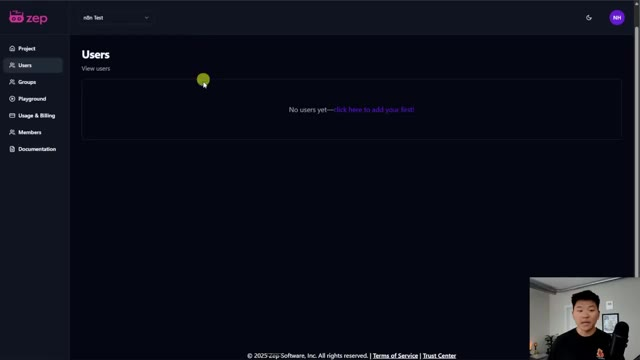
*⏱️ 00:04:19 — Capture de l'interface de gestion de l'application Zep affichant la liste des utilisateurs, actuellement vide.*

---

### ⏱️ `[00:04:29 - 00:04:49]` | Segment #12

**🔊 Audio (Transcription Intégrale Mot pour Mot en Français) :**
> Donc ces sessions fonctionnent fondamentalement de la même manière où nous avons ce contexte où il va stocker ces paires de ce qu'était le message humain et de ce qu'était la réponse de l'IA. Donc nous allons toujours obtenir cette fenêtre de contexte en utilisant ZEPP. Mais ensuite, si je clique dans le graphe, c'est là que nous allons avoir ce graphe de connaissances avec différentes relations qui commencent à se former. Donc c'est nous, c'est l'utilisateur. Vous pouvez voir que le résumé indique que l'identifiant d'utilisateur vide s'appelle Jim.

**👁️ Analyse Visuelle d'Écran (gemini-3.5-flash-lite) :**
**Interface & Outils** : Interface web de Zep (plateforme de gestion de contexte pour l'IA)

**Contenu textuel & Code** : Tableau des messages affichant les rôles (Human, AI), le contenu textuel des conversations et les horodatages correspondants.

**Action / Démonstration** : Consultation de l'historique des messages et du contexte stocké dans une session Zep.

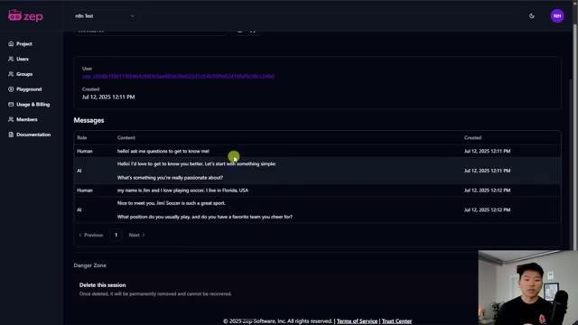
*⏱️ 00:04:34 — Capture d'écran de l'interface web de Zep montrant l'historique des messages d'une session avec des paires de questions humaines et de réponses de l'IA.*

---

### ⏱️ `[00:04:49 - 00:05:09]` | Segment #13

**🔊 Audio (Transcription Intégrale Mot pour Mot en Français) :**
> Il est intéressé par le football. Donc nous avons ceci ici, qui est un like. Nous avons ceci en bas, qui est vit en Floride. Et ensuite nous avons notre assistant IA juste ici. D'accord, donc je vais en envoyer un autre qui dit : je joue gardien de but. Je n'ai pas d'équipe favorite, mais j'aime regarder Messi. Donc encore une fois, il effectue une recherche dans un historique de contexte. Il effectue une recherche dans des informations à notre sujet. Et ensuite, il va ajouter d'autres informations dans notre graphe de connaissances.

**👁️ Analyse Visuelle d'Écran (gemini-3.5-flash-lite) :**
**Interface & Outils** : Interface web Zep Memory, interface de chat Telegram, éditeur de workflow visuel.

**Contenu textuel & Code** : Graphe de relations avec détails de nœuds ('Florida, USA') et conversation de chat avec l'assistant IA.

**Action / Démonstration** : Visualisation du graphe de mémoire utilisateur et des relations extraites par l'agent IA.

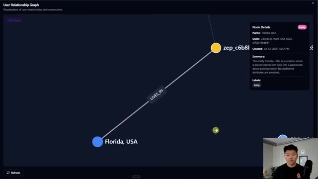
*⏱️ 00:04:54 — Graphe de relations utilisateur montrant les nœuds 'Florida, USA' et 'zep_c6b8' reliés par la relation 'LIVES_IN'.*

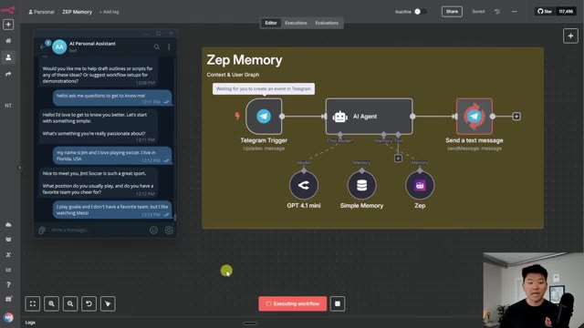
*⏱️ 00:04:59 — Interface de workflow montrant un assistant Telegram à gauche et le schéma du workflow Zep Memory à droite.*

---

### ⏱️ `[00:05:09 - 00:05:27]` | Segment #14

**🔊 Audio (Transcription Intégrale Mot pour Mot en Français) :**
> Alors, laissez-moi actualiser. Et nous avons plus de relations maintenant. Nous, en tant qu'utilisateurs, jouons le rôle de gardien de but, aimons regarder Messi. comme vous pouvez le voir, ça va continuer, continuer à grandir. Et à mesure qu'il en apprend davantage, il va créer ces relations plus sophistiquées qu'il pourra ensuite rappeler. Et juste pour vous montrer à quoi tout cela ressemble, je vais fondamentalement juste envoyer : qu'est-ce que je devrais faire ce week-end ?

**👁️ Analyse Visuelle d'Écran (gemini-3.5-flash-lite) :**
**Interface & Outils** : Interface web de visualisation de graphe de connaissances / base de données vectorielle (type Zep).

**Contenu textuel & Code** : Nœuds reliés par des arêtes étiquetées (PLAYS_POSITION, LIVES_IN, LIKES_WATCHING, USES) autour d'un identifiant utilisateur central.

**Action / Démonstration** : Le présentateur commente la mise à jour et l'évolution du graphe de relations des utilisateurs.

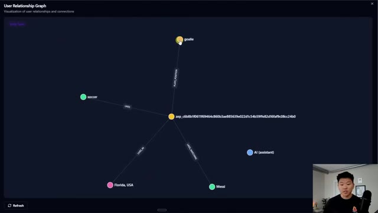
*⏱️ 00:05:13 — Un graphe de relations utilisateur (User Relationship Graph) montrant des nœuds connectés tels que 'goalie', 'soccer', 'Messi', et 'Florida, USA'.*

---

### ⏱️ `[00:05:27 - 00:06:00]` | Segment #15

**🔊 Audio (Transcription Intégrale Mot pour Mot en Français) :**
> Il va obtenir des informations sur nous et nous dire ce que nous devriez faire. Ce sera probablement quelque chose en rapport avec le football ou peut-être quelque chose lié à la Floride, comme aller à la plage. L'agent a donc répondu par : hé Jim, puisque tu adores jouer au football et que tu es gardien de but, que dirais-tu de combiner ta passion avec un peu de divertissement ? Rejoins un match de football ou une opposition, pratique des exercices de gardien de but, explore un nouveau parc ou une nouvelle plage puisque tu es en Floride, bla, bla, bla, exactement comme je l'avais prédit. Mais maintenant, ce dont je veux parler, c'est du problème de cette approche. Parce qu'à mesure que tu obtiens de plus en plus de souvenirs et de relations différentes dans ton graphe de connaissances ZEP, ton agent va consommer tes jetons

**👁️ Analyse Visuelle d'Écran (gemini-3.5-flash-lite) :**
**Interface & Outils** : Interface web Zep Memory, application de messagerie Telegram, composants d'automatisation de flux de travail.

**Contenu textuel & Code** : Schéma de workflow reliant un déclencheur Telegram, un agent IA, GPT 4.1 mini, Simple Memory et Zep, avec le texte de la conversation affichant les conseils de l'agent sur le football en Floride.

**Action / Démonstration** : Présentation de la réponse générée par l'agent IA basée sur la mémoire contextuelle, suggérant des activités de football et de plein air en Floride.

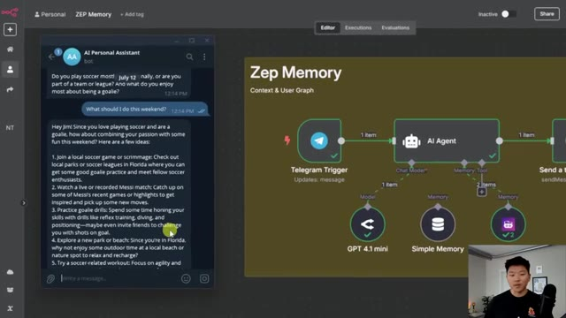
*⏱️ 00:05:35 — Vue d'ensemble de l'interface Zep Memory montrant un workflow d'agent IA à droite et une conversation Telegram en cours à gauche avec la réponse de l'agent.*

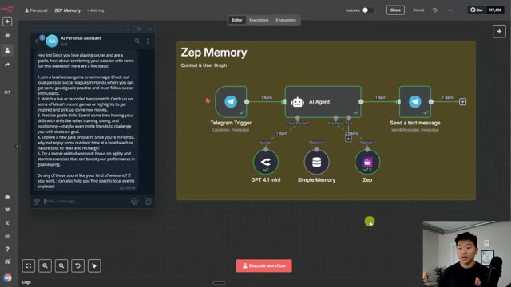
*⏱️ 00:05:51 — Vue similaire montrant le workflow complet avec le déclencheur Telegram, l'agent IA, le modèle GPT 4.1 mini, Simple Memory et le nœud Zep.*

---

### ⏱️ `[00:06:00 - 00:06:19]` | Segment #16

**🔊 Audio (Transcription Intégrale Mot pour Mot en Français) :**
> parce qu'il va envoyer tellement de contexte à chaque fois. Donc, quand je clique sur l'agent IA et que nous allons dans les journaux de l'agent, lorsqu'il atteint ZEP, nous pouvons essentiellement voir qu'il va récupérer ce résumé sur Jim. Et ensuite aussi tous ces différents faits. Donc toutes les différentes entités que nous avons, il va les commenter. Donc Messi. Messi est un joueur de football admiré par Jim.

**👁️ Analyse Visuelle d'Écran (gemini-3.5-flash-lite) :**
**Interface & Outils** : Interface web d'automatisation de type n8n ou similaire.

**Contenu textuel & Code** : Paramètres du nœud AI Agent avec un prompt utilisateur contenant la variable `{{ $json.message.text }}` et un message de sortie adressé à 'Jim' suggérant des activités autour du football.

**Action / Démonstration** : Consultation des paramètres et de la sortie du nœud de l'agent IA.

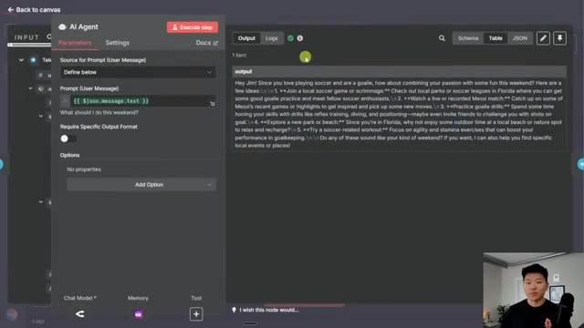
*⏱️ 00:06:04 — Interface d'un workflow d'automatisation montrant les paramètres d'un nœud 'AI Agent' avec le panneau de configuration à gauche et le résultat de la sortie à droite, ainsi qu'une vidéo incrustée du présentateur en bas à droite.*

---

### ⏱️ `[00:06:19 - 00:06:47]` | Segment #17

**🔊 Audio (Transcription Intégrale Mot pour Mot en Français) :**
> Gardien de but. Jim est un joueur de football qui joue gardien de but en Floride, aux États-Unis, en Floride, tout ce genre de choses. Et ensuite, nous obtenons également l'historique du contexte avec voici le premier message que nous nous sommes envoyé, voici le deuxième, voici le troisième, tout ce genre de choses. Il y a donc deux choses qui se passent. Nous recherchons dans le graphe utilisateur des informations sur l'utilisateur, des mémoires à long terme, et ensuite nous recherchons l'historique du contexte, l'historique de la conversation, pour la mémoire à court terme. Et tout ce contexte est transmis à notre modèle de chat, qui va simplement traiter un grand nombre de jetons.

**👁️ Analyse Visuelle d'Écran (gemini-3.5-flash-lite) :**
**Interface & Outils** : Interface d'automatisation de workflow (n8n), panneau de configuration de l'AI Agent, onglets Parameters, Settings, Docs, et zone de logs.

**Contenu textuel & Code** : Variable `{{ $json.message.text }}`, historique de discussion entre l'humain (Jim, gardien de but en Floride) et l'assistant IA, modules Zep et GPT 4.1 mini.

**Action / Démonstration** : Visualisation des paramètres et des logs d'un agent IA traitant l'historique contextuel de la conversation utilisateur.

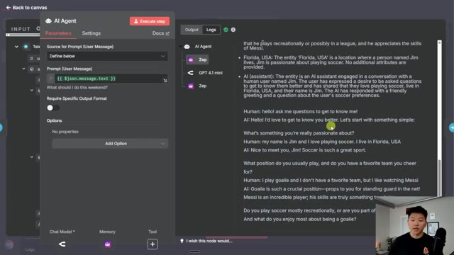
*⏱️ 00:06:26 — Capture d'écran montrant l'interface d'un nœud "AI Agent" dans un outil d'automatisation (type n8n), affichant les paramètres du prompt et l'historique de conversation textuel (Zep / GPT 4.1 mini) avec les détails sur Jim, le football et la Floride.*

---

### ⏱️ `[00:06:48 - 00:07:23]` | Segment #18

**🔊 Audio (Transcription Intégrale Mot pour Mot en Français) :**
> Donc si je clique sur OpenRouter juste ici, vous pouvez voir que celui-ci a pris 838 jetons au total. J'ai donc ajouté encore plus d'informations à ce graphe. Nous avons des éléments comme l'Université du Wisconsin, de la glace, du poulet, ce genre de choses. Et rappelez-vous à quel point mon précédent graphe était grand, celui que nous venons de supprimer et qui parlait de moi. Pensez au nombre de jetons bien plus élevé que celui-ci consommait à chaque fois que nous parlions à l'agent. Donc maintenant, je vais vous montrer une méthode différente que j'ai inventée pour pouvoir réellement extraire les éléments les plus pertinents du graphe utilisateur plutôt que de tout prendre en même temps. Et cela va vraiment réduire considérablement la quantité de jetons que vous envoyez à votre modèle d'IA. Très bien, donc ce que nous faisons ici, c'est que nous accédons au Zep

**👁️ Analyse Visuelle d'Écran (gemini-3.5-flash-lite) :**
**Interface & Outils** : Interface web de Zep Memory et outil de visualisation de graphe de relations.

**Contenu textuel & Code** : Nœuds de données du graphe de relations utilisateur et schéma de workflow d'agent IA avec Telegram et modèles LLM.

**Action / Démonstration** : Présentation et explication du graphe de relations utilisateur enrichi et du workflow d'automatisation.

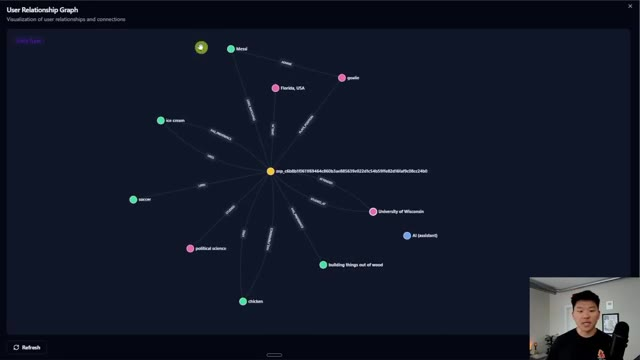
*⏱️ 00:06:56 — Un graphe de relations utilisateur (User Relationship Graph) montrant des connexions entre différentes entités telles que Messi, Florida, University of Wisconsin et Chicken.*

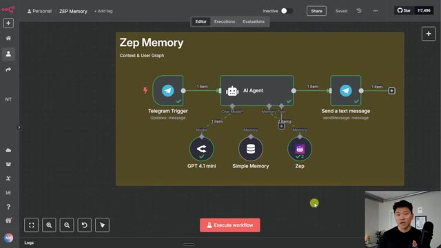
*⏱️ 00:07:14 — Une interface de workflow montrant Zep Memory avec un agent IA connectant Telegram Trigger, GPT 4.1 mini, Simple Memory et Zep.*

---

### ⏱️ `[00:07:23 - 00:07:57]` | Segment #19

**🔊 Audio (Transcription Intégrale Mot pour Mot en Français) :**
> mémoire, mais nous le faisons par le biais de requêtes HTTP. Parce qu'ici haut, lorsque nous le faisons via l'intégration native ici bas, il n'y vraiment aucun paramètre avec lequel nous pouvons jouer. Tout ce que nous pouvons entrer, c'est notre clé, donc nous n'avons pas beaucoup de contrôle. Mais grâce à différentes requêtes HTTP, nous pouvons atteindre différents points de terminaison et nous avons beaucoup plus de contrôle. Donc, une fois que nous envoyons un message à notre agent sur Telegram, il va récupérer l'historique de la conversation, il va récupérer le graphe d'utilisateur réel, et il va le filtrer ici bas et ne récupérer que les trois faits les plus pertinents en fonction du message réel qui a été envoyé. Et ensuite, nous allons fusionner tout cela ensemble, le donner à l'agent IA, et ensuite il va nous répondre sans avoir à traiter autant de

**👁️ Analyse Visuelle d'Écran (gemini-3.5-flash-lite) :**
**Interface & Outils** : n8n (Interface de conception de workflows d'automatisation)

**Contenu textuel & Code** : Nœuds de workflow n8n (Telegram Trigger, Context Window, User Graph, Code, Merge, AI Agent, Add Memory, Send a text message) et paramètres de configuration du nœud Zep.

**Action / Démonstration** : Navigation et explication de la structure du workflow d'automatisation et des paramètres de l'intégration Zep.

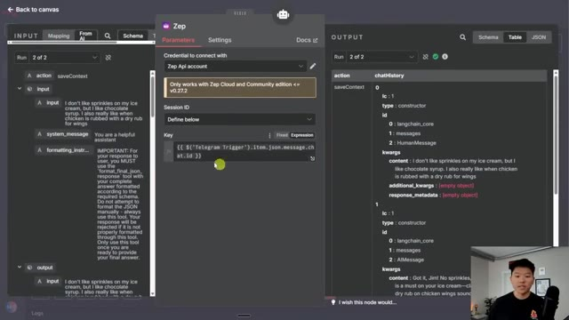
*⏱️ 00:07:31 — Configuration d'un nœud Zep avec ses paramètres et les données de sortie affichées.*

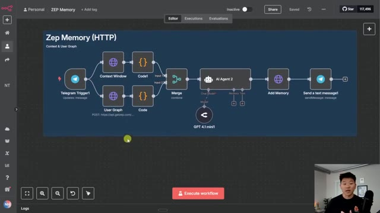
*⏱️ 00:07:40 — Vue d'ensemble du workflow "Zep Memory (HTTP)" montrant l'enchaînement des nœuds depuis Telegram jusqu'à l'agent IA.*

---

### ⏱️ `[00:07:57 - 00:08:16]` | Segment #20

**🔊 Audio (Transcription Intégrale Mot pour Mot en Français) :**
> des jetons. Et puis tout ce que nous avons à faire, c'est de rajouter la mémoire pour que nous puissions continuer à nous assurer que le graphe utilisateur et aussi l'historique de conversation sont précis. Et ensuite, nous renvoyons le message sur Telegram. Très bien, alors je vais lui demander de m'aider à planifier mes activités du week-end. Nous allons voir cela récupérer l'historique de conversation. Nous allons voir cela chercher dans le graphe utilisateur, et maintenant, cela va nous créer un message puis mettre à jour cette mémoire dans le graphe utilisateur.

**👁️ Analyse Visuelle d'Écran (gemini-3.5-flash-lite) :**
**Interface & Outils** : Interface web de création de workflows graphiques pour agents IA (style Flowise ou Langflow).

**Contenu textuel & Code** : Workflow complet intitulé "Zep Memory (HTTP)" composé de blocs connectés : Telegram Trigger1, Context Window, User Graph, nœuds de code, Merge, AI Agent 2 relié à GPT 4.1 mini1, Add Memory et Send a text message1.

**Action / Démonstration** : Le présentateur explique et survole le nœud "Add Memory" dans le workflow pour l'intégrer au système de gestion de la mémoire et du graphe utilisateur.

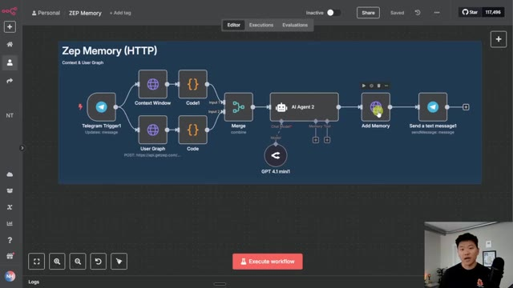
*⏱️ 00:08:02 — Capture d'écran montrant l'interface d'un éditeur de workflow avec le projet "Zep Memory (HTTP)" intégrant des nœuds Telegram, Context Window, User Graph, un agent IA et un nœud d'ajout de mémoire.*

---

### ⏱️ `[00:08:16 - 00:08:36]` | Segment #21

**🔊 Audio (Transcription Intégrale Mot pour Mot en Français) :**
> Et ensuite, nous allons voir combien de jetons cela a réellement exécuté. Vous pouvez donc voir que cela nous a donné une réponse très personnalisée basée sur les informations qui se trouvent dans notre graphe de connaissances. Et maintenant, jetons un coup d'œil à ce qui s'est passé dans ce flux réel. La première chose qu'il fait, c'est d'aller chercher l'historique de la conversation en utilisant l'ID de session de notre chat Telegram. Je fais donc une requête GET vers ces points de terminaison et j'injecte l'ID de session.

**👁️ Analyse Visuelle d'Écran (gemini-3.5-flash-lite) :**
**Interface & Outils** : n8n (éditeur de flux de travail) et interface Telegram.

**Contenu textuel & Code** : Workflow comprenant un déclencheur Telegram, un contexte utilisateur (Zep Memory), un agent IA et un nœud d'envoi de message.

**Action / Démonstration** : Visualisation du résultat de l'exécution du flux de travail et de la réponse personnalisée générée.

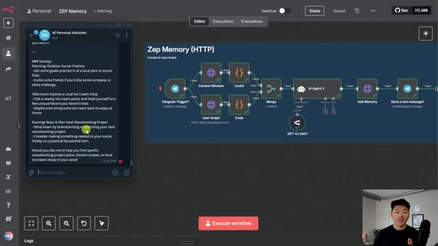
*⏱️ 00:08:21 — Interface montrant un flux de travail n8n avec un widget de chat Telegram sur la gauche affichant une réponse personnalisée basée sur le graphe de connaissances.*

---

### ⏱️ `[00:08:36 - 00:08:55]` | Segment #22

**🔊 Audio (Transcription Intégrale Mot pour Mot en Français) :**
> Et puis ici, je dis simplement, je veux seulement récupérer 10 conversations, donc c'est fondamentalement juste cinq interactions. Et vous pouvez voir que ça nous arrive de cette manière vraiment, vraiment désordonnée parce que ça a toutes ces métadonnées. Donc ce que j'ai fait, c'est que j'ai injecté tout ça dans un nœud de code et j'ai fait en sorte que ça nettoie tout simplement. Donc maintenant, nous obtenons un seul élément avec toutes les conversations.

**👁️ Analyse Visuelle d'Écran (gemini-3.5-flash-lite) :**
**Interface & Outils** : Interface de type n8n ou plateforme d'automatisation de flux de travail.

**Contenu textuel & Code** : Paramètres de requête avec "limit" défini sur "10" et données JSON dans le panneau de sortie avec des métadonnées de messages.

**Action / Démonstration** : Configuration des paramètres d'une étape d'exécution pour limiter le nombre de conversations récupérées.

*⏱️ 00:08:41 — Interface d'un nœud d'automatisation avec un panneau INPUT à gauche montrant des données structurées, un panneau central de paramètres « Context Window » avec le paramètre de limite défini à 10, et un panneau OUTPUT à droite affichant les données JSON brutes.*

---

### ⏱️ `[00:08:55 - 00:09:15]` | Segment #23

**🔊 Audio (Transcription Intégrale Mot pour Mot en Français) :**
> Et je vous ai dit de nombreuses fois, je ne sais pas coder. Ce que je fais, c'est que je prends essentiellement le JSON entrant lorsque je sais que je vais utiliser un nœud de code pour le nettoyer, je le copie, je vais dans Claude Et comme vous pouvez le voir ici, j'ai littéralement dit, aide-moi à écrire un nœud de code dans N8N qui recevra ce schéma JSON, colle le schéma. Et puis je dis, j'ai besoin que ce nœud de code extrait chaque message humain et chaque message IA sous forme de paire.

**👁️ Analyse Visuelle d'Écran (gemini-3.5-flash-lite) :**
**Interface & Outils** : n8n (éditeur de workflow) et interface web de Claude.

**Contenu textuel & Code** : Code source JavaScript pour le traitement de messages JSON, données JSON brutes et prompt textuel destiné à Claude.

**Action / Démonstration** : Copie des données JSON entrantes d'un workflow n8n pour les coller dans Claude et générer le code de transformation.

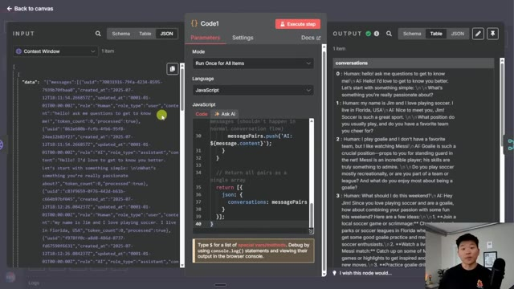
*⏱️ 00:09:00 — Interface n8n montrant un nœud de code JavaScript avec les données JSON en entrée et le résultat en sortie, et le présentateur en médaillon.*

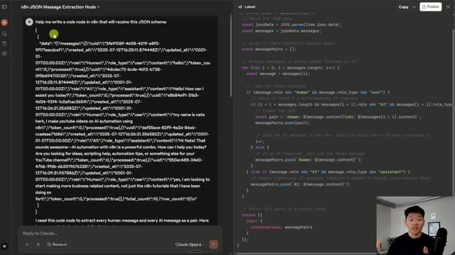
*⏱️ 00:09:05 — Interface de Claude (Artifacts/Projet) montrant un prompt avec un schéma JSON et du code JavaScript généré dans le panneau de droite.*

---

### ⏱️ `[00:09:15 - 00:09:35]` | Segment #24

**🔊 Audio (Transcription Intégrale Mot pour Mot en Français) :**
> Voici un exemple de sortie souhaitée pour l'entrée. Ensuite, je lui ai donné un extrait de l'entrée qui a réellement été trouvé juste ici. Et puis j'ai dit, quand tu obtiens ceci, je veux que cela me soit renvoyé. Donc, nettoie-le simplement. Et puis il crache le code, je le mets là et voilà. Bref, maintenant nous avons l'historique de conversation entièrement nettoyé. Et puis, avant de le fusionner, nous devons aller récupérer des informations dans le graphe utilisateur.

**👁️ Analyse Visuelle d'Écran (gemini-3.5-flash-lite) :**
**Interface & Outils** : Interface web n8n et assistant Claude Opus 4

**Contenu textuel & Code** : Code JavaScript de parsing de messages JSON, structure d'entrée/sortie de données n8n

**Action / Démonstration** : Explication du code généré par l'IA et insertion dans un nœud n8n

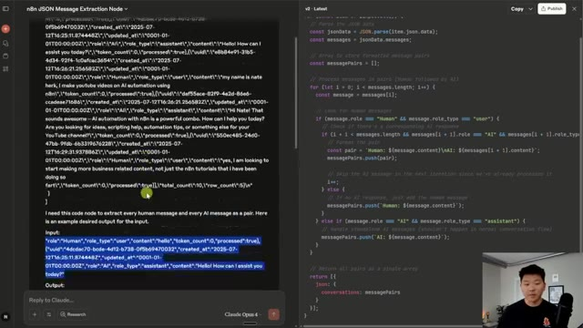
*⏱️ 00:09:20 — Vue partagée montrant à gauche une interface de chat (Claude Opus 4) avec du code JSON, et à droite un éditeur affichant du code JavaScript de traitement de messages.*

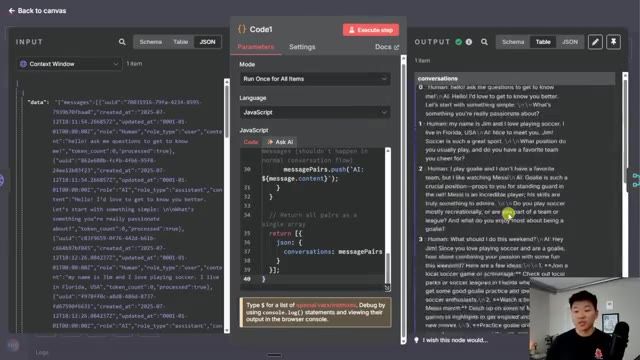
*⏱️ 00:09:30 — Interface du workflow n8n montrant un nœud de code JavaScript au centre, avec l'entrée JSON à gauche et le résultat formaté (conversations) à droite.*

---

### ⏱️ `[00:09:35 - 00:09:56]` | Segment #25

**🔊 Audio (Transcription Intégrale Mot pour Mot en Français) :**
> Donc encore une fois, je fais une requête HTTP vers l'API de Zep. Et ensuite dans le corps de la requête, je peux être un peu plus précis parce qu'on lui donne l'identifiant utilisateur dans lequel chercher. On lui donne la requête pour fouiller dans le graphe de l'utilisateur, qui dans ce cas disait, aide-moi à planifier mes activités de week-end. On lui dit de ne ramener que trois faits et ils doivent avoir un score de pertinence d'au moins 0,7 ou plus.

**👁️ Analyse Visuelle d'Écran (gemini-3.5-flash-lite) :**
**Interface & Outils** : n8n (interface de workflow d'automatisation)

**Contenu textuel & Code** : Code JSON de requête API vers Zep contenant "user_id", "query", "scope", "limit", et le champ dynamique du message Telegram.

**Action / Démonstration** : Configuration d'un nœud HTTP Request dans n8n pour interroger le graphe utilisateur de l'API Zep en utilisant les données entrantes d'un déclencheur Telegram.

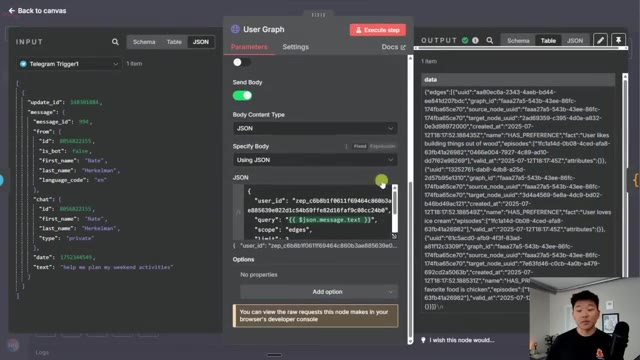
*⏱️ 00:09:40 — Vue d'ensemble d'un nœud de workflow dans une interface d'automatisation (n8n), montrant la configuration d'une requête HTTP pour l'API Zep avec le corps de la requête JSON et le résultat de sortie.*

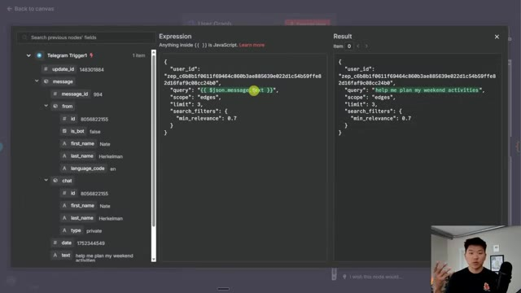
*⏱️ 00:09:46 — Gros plan sur l'éditeur d'expressions JSON dans n8n, illustrant le mappage dynamique du texte du message Telegram ({{ $json.message.text }}) vers la requête de recherche du graphe utilisateur.*

---

### ⏱️ `[00:09:56 - 00:10:27]` | Segment #26

**🔊 Audio (Transcription Intégrale Mot pour Mot en Français) :**
> Donc cela en soi réduit déjà l'utilisation de tokens parce que ça ne ramène pas chaque fait individuel qui existe dans notre graphe d'utilisateurs. Mais encore une fois, ça ressort vraiment de manière brouillonne et ça consommerait juste plus de tokens. J'ai donc fait exactement la même chose, j'ai injecté ça dans un nœud de code, et maintenant on obtient simplement trois faits intéressants ici. On fusionne ces deux éléments ensemble, on l'injecte dans l'agent IA, et ce que je fais, c'est que je donne le message provenant de Telegram comme message utilisateur, mais ensuite dans le système de message, je dis tu es un assistant serviable, voici quelques informations supplémentaires concernant Nate, et vraiment dans ce cas-ci, ça devrait être Jim.

**👁️ Analyse Visuelle d'Écran (gemini-3.5-flash-lite) :**
**Interface & Outils** : Interface graphique d'automatisation de type nœuds (workflow builder type n8n)

**Contenu textuel & Code** : Code JSON d'entrée (update_id, message, from, chat, text), paramètres de requête JSON avec un champ user_id, et un JSON de sortie contenant un objet 'data' avec des 'edges' et des nœuds du graphe utilisateur.

**Action / Démonstration** : Configuration et visualisation des données d'entrée et de sortie d'un nœud d'appel API ou d'automatisation manipulant un graphe d'utilisateurs.

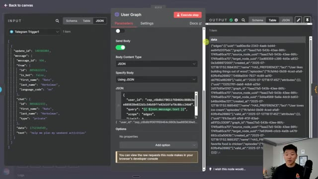
*⏱️ 00:10:04 — Interface d'un outil d'automatisation montrant trois panneaux : Input (déclencheur Telegram au format JSON), les paramètres d'un nœud nommé 'User Graph', et Output affichant les données structurées JSON résultantes.*

---

### ⏱️ `[00:10:27 - 00:11:03]` | Segment #27

**🔊 Audio (Transcription Intégrale Mot pour Mot en Français) :**
> Et ensuite, vous voyez les trois faits qui ont été extraits et qui étaient les plus pertinents par rapport à la requête ont déclenché le flux de travail. Et ensuite, nous avons dit, voici les cinq interactions les plus importantes avec Nate, où nous avons les interactions réelles en bas. Donc maintenant, cet agent a un contexte complet sur certains souvenirs à long terme concernant nous, nos interactions passées, et il ne reçoit pas tout. Et il ne va pas faire exploser nos jetons. Nous allons rajouter ces souvenirs pour qu'ils aillent dans l'historique de la conversation et dans le graphe utilisateur, et ensuite nous envoyer un message sur Telegram. Et rapidement, jetons un œil à l'utilisation réelle des jetons pour cette exécution. Donc celle-ci a pris 1045 jetons. Donc si nous gardons juste ce chiffre en tête rapidement et que nous remontons à ce flux de travail et que nous le relançons par l'autre méthode.

**👁️ Analyse Visuelle d'Écran (gemini-3.5-flash-lite) :**
**Interface & Outils** : n8n (éditeur de workflows d'automatisation)

**Contenu textuel & Code** : Expressions JavaScript pour l'injection de contexte, prompts système avec variables dynamiques (facts, conversations), et structure du workflow n8n (Telegram -> Context Window / User Graph -> Merge -> AI Agent 2 -> Add Memory -> Telegram).

**Action / Démonstration** : Configuration et explication des nœuds d'IA et de fusion de données pour alimenter un assistant intelligent avec la mémoire utilisateur de Zep.

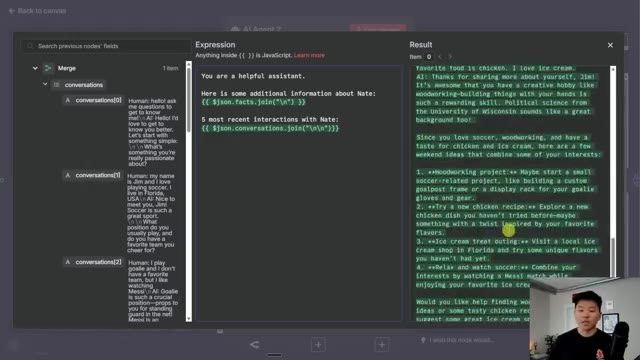
*⏱️ 00:10:36 — Gros plan sur le panneau de configuration d'un nœud d'expression montrant du texte formaté avec les faits et conversations extraits de Zep Memory.*

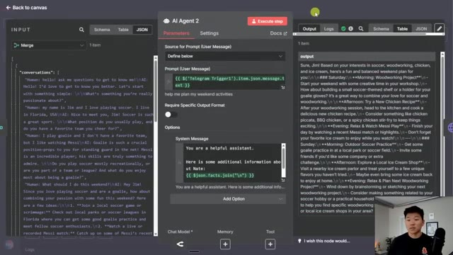
*⏱️ 00:10:45 — Vue détaillée de l'interface d'un agent IA (AI Agent 2) avec ses paramètres de prompt, le message système intégrant les données contextuelles et les résultats de sortie.*

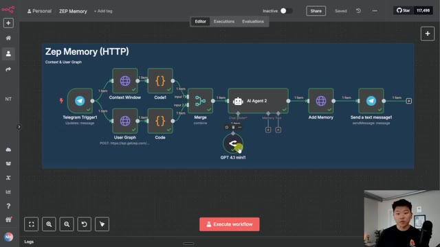
*⏱️ 00:10:54 — Vue d'ensemble du workflow d'automatisation n8n intègrant Telegram, Zep Memory, des nœuds de code et un modèle GPT-4.*

---

### ⏱️ `[00:11:03 - 00:11:27]` | Segment #28

**🔊 Audio (Transcription Intégrale Mot pour Mot en Français) :**
> d'utiliser ZEPP, comparons. J'ai donc envoyé exactement le même message : aide-moi à planifier mes activités de week-end, et si nous cliquons sur les jetons, nous pouvons voir qu'il en a utilisé presque 2,5 fois plus, soit 2 403. Et c'est parce que 2 000 d'entre eux étaient les jetons de l'invite réelle, car si je clique sur les journaux et que nous allons voir ce qui est revenu de ZEPP, il a dû traiter tout ceci qui n'était que tellement de faits qui n'importaient pas vraiment pour ce cas d'utilisation.

**👁️ Analyse Visuelle d'Écran (gemini-3.5-flash-lite) :**
**Interface & Outils** : Interface web d'un outil de workflow d'automatisation IA (type Make ou Zepp) avec un nœud de configuration LLM.

**Contenu textuel & Code** : Paramètres du modèle OpenAI/gpt-4.1-mini connecté via OpenRouter, avec les données d'utilisation des jetons visibles dans le panneau de droite (totalTokens : 2403, promptTokens : 2094, completionTokens : 309).

**Action / Démonstration** : Comparaison de l'utilisation des jetons et affichage des résultats du nœud LLM dans le workflow.

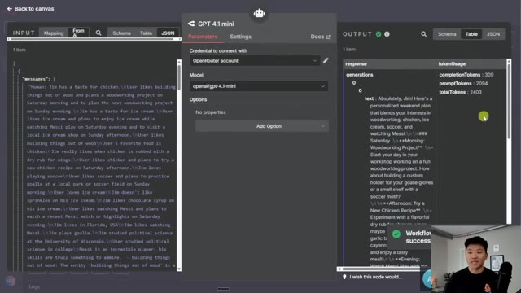
*⏱️ 00:11:09 — Capture d'écran montrant une interface de workflow avec un panneau de configuration pour le modèle GPT-4.1 mini et les détails d'utilisation des jetons affichés dans le panneau de sortie.*

---

### ⏱️ `[00:11:27 - 00:11:51]` | Segment #29

**🔊 Audio (Transcription Intégrale Mot pour Mot en Français) :**
> Toutes ces mémoires à long terme ne sont tout simplement pas nécessaires à chaque fois que l'agent réfléchit à quelque chose. J'espère donc que vous comprenez pourquoi il est réellement utile de pouvoir diviser et de ne récupérer que ce qui est le plus pertinent. Et soit dit en passant, si vous voulez télécharger ce flux de travail pour pouvoir le tester, tout ce que vous avez à faire est d'aller dans ma communauté FreeSchool. Le lien pour cela se trouve dans la description. Une fois que vous serez ici, vous n'aurez plus qu'à venir en haut et chercher le titre de la vidéo ou à cliquer sur les ressources YouTube et à trouver la publication associée à cette vidéo.

**👁️ Analyse Visuelle d'Écran (gemini-3.5-flash-lite) :**
**Interface & Outils** : n8n (éditeur de workflow)

**Contenu textuel & Code** : Nœuds de workflow : Telegram Trigger, AI Agent, GPT 4.1 mini, Simple Memory, Zep et Send a text message.

**Action / Démonstration** : Présentation et explication du fonctionnement de la mémoire d'un agent IA avec Zep dans un workflow n8n.

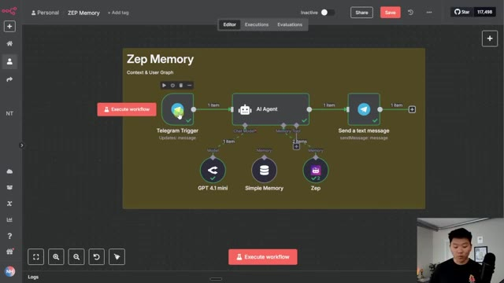
*⏱️ 00:11:33 — Capture montrant un diagramme de workflow sur n8n avec un agent IA relié à Zep Memory, GPT 4.1 mini et Telegram Trigger.*

---

### ⏱️ `[00:11:51 - 00:12:11]` | Segment #30

**🔊 Audio (Transcription Intégrale Mot pour Mot en Français) :**
> Et quand vous cliquez sur cette publication, il y aura un fichier JSON juste ici à télécharger et vous pourrez vous configurer très rapidement. Mais il y a une chose que vous n'avez peut-être pas remarquée à propos de cette exécution. Et la seule raison pour laquelle je l'ai remarquée, c'est parce que je la construisais et je jouais avec. Et le problème ici, c'est que lorsque nous faisons une recherche dans la fenêtre de contexte, ça ne va pas réellement récupérer les cinq plus récents.

**👁️ Analyse Visuelle d'Écran (gemini-3.5-flash-lite) :**
**Interface & Outils** : Interface communautaire web et plateforme d'automatisation de workflows n8n

**Contenu textuel & Code** : Fichier JSON de configuration de workflow et diagramme de nœuds n8n connectant des services (Telegram, Zep Memory, agent IA avec GPT-4)

**Action / Démonstration** : Présentation du fichier de configuration à télécharger et explication du fonctionnement du workflow d'automatisation n8n

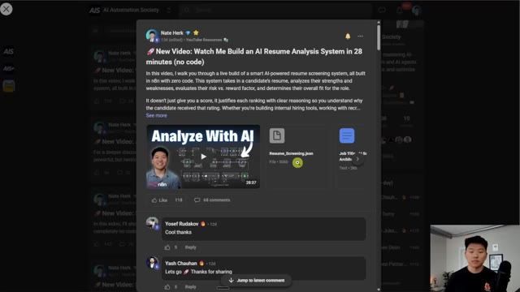
*⏱️ 00:11:56 — Capture montrant une publication communautaire avec un fichier JSON de configuration à télécharger (Resume_Screening.json).*

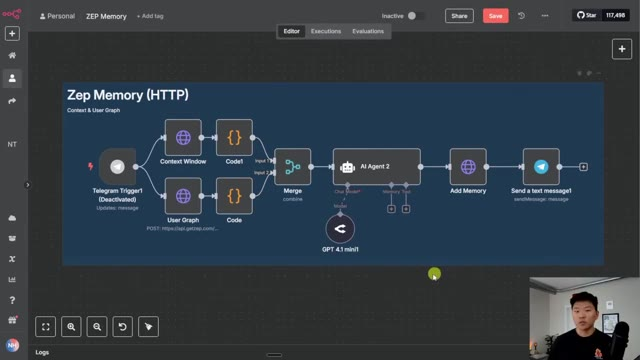
*⏱️ 00:12:01 — Vue d'un diagramme de workflow n8n intitulé "Zep Memory (HTTP)" montrant des nœuds Telegram, des blocs de code et un agent IA.*

---

### ⏱️ `[00:12:11 - 00:12:34]` | Segment #31

**🔊 Audio (Transcription Intégrale Mot pour Mot en Français) :**
> Il récupère les cinq premiers enregistrements de notre ZEP actuel. Ici, je demande simplement à l'agent : de quoi avons-nous parlé en dernier ? Et il récupère la fenêtre de contexte. Et si nous cliquons dans l'historique de conversation réel qu'il ramène, nous pouvons voir que le premier qu'il a récupéré était cette première interaction où j'ai dit : bonjour, posez-moi des questions pour mieux me connaître. Et vous vous souvenez les gars, la dernière chose que nous avons dite à notre agent était : aide-nous à planifier notre week-end, mais nous ne voyons cela nulle part ici.

**👁️ Analyse Visuelle d'Écran (gemini-3.5-flash-lite) :**
**Interface & Outils** : Interface de workflow low-code / constructeur d'agents IA (type Make/n8n ou similaire).

**Contenu textuel & Code** : Code JavaScript pour parser les messages de la fenêtre de contexte et structure JSON des conversations.

**Action / Démonstration** : Exécution du workflow et affichage des résultats du contexte récupéré par l'agent.

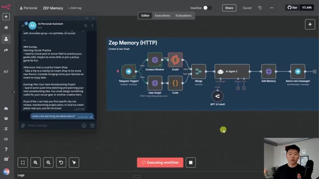
*⏱️ 00:12:17 — Vue d'ensemble du workflow d'automatisation avec Zep Memory et Telegram montrant l'exécution en cours.*

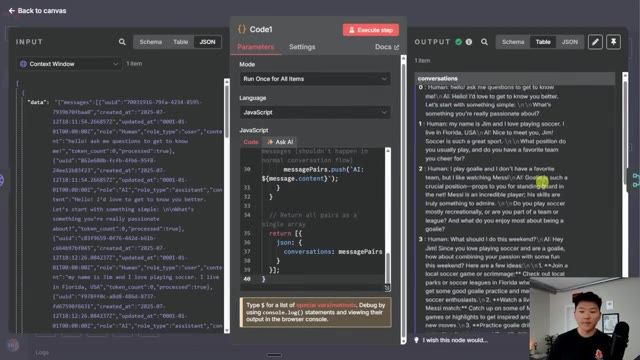
*⏱️ 00:12:28 — Gros plan sur le nœud de code JavaScript et les panneaux d'entrées/sorties montrant l'historique des conversations.*

---

### ⏱️ `[00:12:34 - 00:12:56]` | Segment #32

**🔊 Audio (Transcription Intégrale Mot pour Mot en Français) :**
> Et j'ai fait des recherches et j'ai compris que lorsque je configurais cette requête, il n'y a aucun paramètre qui nous permet réellement d'inverser l'ordre de la façon dont nous récupérons nos messages de session. Donc si je vais dans ZEP et que nous regardons notre session actuelle, vous pouvez voir que si nous allons à la page suivante, nous avons bien tous ces messages les plus récents, mais lorsque nous faisons cette requête HTTP, ça ne récupère pas à partir d'ici.

**👁️ Analyse Visuelle d'Écran (gemini-3.5-flash-lite) :**
**Interface & Outils** : Interface n8n et tableau de bord ZEP

**Contenu textuel & Code** : Paramètres de requête HTTP avec name 'limit' et value '10', ainsi que JSON de sortie avec des messages de session.

**Action / Démonstration** : Navigation et explication de la configuration des paramètres de requête et des sessions ZEP.

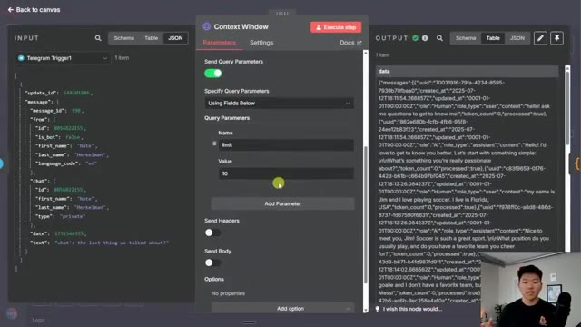
*⏱️ 00:12:39 — Configuration d'une requête HTTP avec un paramètre de limite dans une interface de type n8n montrant les données d'entrée et de sortie JSON.*

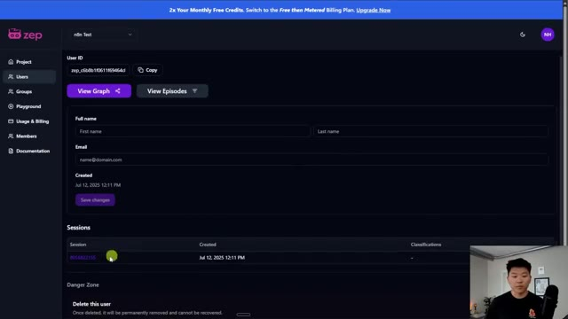
*⏱️ 00:12:45 — Interface de la plateforme ZEP montrant les détails d'un utilisateur et la liste des sessions disponibles.*

---

### ⏱️ `[00:12:56 - 00:13:15]` | Segment #33

**🔊 Audio (Transcription Intégrale Mot pour Mot en Français) :**
> Ça commence fondamentalement tout en haut et ça progresse ensuite vers le bas. Donc la solution de contournement consisterait à importer tout l'historique de la conversation, puis à inverser en quelque sorte l'ordre et à ne diviser que ceux que l'on veut, mais cela semble juste un peu plus complexe. Donc ce que j'ai décidé de faire, c'est d'utiliser une méthode hybride où nous allons utiliser Zep pour le graphe utilisateur pour la mémoire à long terme.

**👁️ Analyse Visuelle d'Écran (gemini-3.5-flash-lite) :**
**Interface & Outils** : n8n ou outil de workflow similaire dans le navigateur.

**Contenu textuel & Code** : Diagramme avec des nœuds tels que Telegram Trigger, Context Window, User Graph, Code, Merge, AI Agent 2, Add Memory et Send a text message.

**Action / Démonstration** : Le présentateur explique la structure séquentielle et le flux de données du workflow d'automatisation.

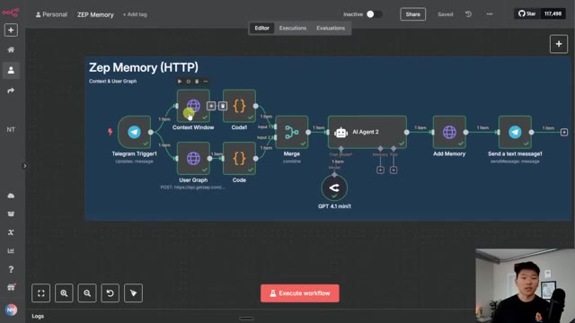
*⏱️ 00:13:01 — Interface de workflow montrant un diagramme de processus d'automatisation avec Zep Memory, Telegram et un agent IA.*

---

### ⏱️ `[00:13:15 - 00:13:39]` | Segment #34

**🔊 Audio (Transcription Intégrale Mot pour Mot en Français) :**
> Et ensuite, nous allons simplement utiliser Postgres pour l'historique de conversation de cette fenêtre de contexte. Donc, juste comme dernière démo, je vais envoyer ce message qui dit : où est-ce que je devrais déménager ? Je veux aller quelque part qui correspond à mes centres d'intérêt. Le flux de travail recherche les faits de mémoire à long terme les plus pertinents à notre sujet. Il va mettre à jour la mémoire de chat Postgres pour la mémoire à court terme, et ensuite il va rajouter de la mémoire à ZEP parce que nous voulons toujours nous assurer que le graphe utilisateur reste entièrement à jour.

**👁️ Analyse Visuelle d'Écran (gemini-3.5-flash-lite) :**
**Interface & Outils** : Interface web d'automatisation (style workflow visuel type n8n) combinée à une simulation de chat Telegram et à la vue de la caméra du présentateur en bas à droite.

**Contenu textuel & Code** : Le diagramme de workflow montre des nœuds (Telegram Trigger, User Graph, Code, AI Agent 3 relié à GPT-4.1 mini et Postgres Chat Memory, Add Memory, Send a text message). Dans la fenêtre de chat, le message affiché est : "Where should I move to? I want to go somewhere that appeals to my interests".

**Action / Démonstration** : Le présentateur montre le flux de travail et s'apprête à envoyer le message dans Telegram pour tester l'historique de conversation stocké dans Postgres.

*⏱️ 00:13:21 — Capture d'écran montrant l'interface d'un outil d'automatisation avec un diagramme de workflow "Zep & Postgres Hybrid" sur la droite et une fenêtre de chat Telegram sur la gauche où le message sur le déménagement est en cours de saisie.*

---

### ⏱️ `[00:13:39 - 00:13:58]` | Segment #35

**🔊 Audio (Transcription Intégrale Mot pour Mot en Français) :**
> Et comme vous pouvez le voir, la réponse que nous obtenons est basée sur votre intérêt pour le football, les sciences politiques et votre amour pour les recettes de poulet, voici quelques villes où vous pourriez vouloir emménager. Et si nous jetons un œil au contexte que l'agent reçoit réellement, il obtient des informations supplémentaires sur nous, qui vont être les trois faits. Il reçoit le message de l'utilisateur, puis il va chercher dans Postgres cette mémoire à court terme.

**👁️ Analyse Visuelle d'Écran (gemini-3.5-flash-lite) :**
**Interface & Outils** : n8n (éditeur de workflows d'automatisation)

**Contenu textuel & Code** : Workflow n8n intitulé "Zep & Postgres Hybrid" avec un nœud "AI Agent 3", un panneau d'entrée JSON contenant des faits sur l'utilisateur ("User likes soccer..."), et des instructions de prompt système.

**Action / Démonstration** : Navigation et explication du fonctionnement interne de l'agent IA et du contexte transmis dans le workflow n8n.

*⏱️ 00:13:44 — Vue d'ensemble d'un workflow n8n montrant un assistant virtuel Telegram avec l'interface de chat ouverte à gauche affichant des recommandations de villes basées sur les intérêts.*

*⏱️ 00:13:49 — Gros plan sur la configuration d'un nœud d'agent IA dans n8n, montrant les paramètres du prompt, le message système et les données JSON d'entrée contextuelles.*

---

### ⏱️ `[00:13:58 - 00:14:17]` | Segment #36

**🔊 Audio (Transcription Intégrale Mot pour Mot en Français) :**
> Quelque chose d'autre que je voulais aborder rapidement, c'était la façon dont fonctionnent les ID de session et comment vous pourriez vraiment faire évoluer ces types d'agents avec ce type de mémoire pour les rendre applicables à différents cas d'utilisation du monde réel. Donc, comme vous l'avez vu, ce que nous faisions, c'est que nous utilisions l'ID de session du déclencheur Telegram. J'enregistrais donc mon ID de chat Telegram comme ID de session.

**👁️ Analyse Visuelle d'Écran (gemini-3.5-flash-lite) :**
**Interface & Outils** : Interface web de workflow / plateforme d'automatisation (type n8n)

**Contenu textuel & Code** : Diagrammes de workflow intitulés "Zep Memory" (avec Telegram Trigger, AI Agent, GPT 4.1 mini, Simple Memory, Zep) et "Zep Memory (HTTP)"

**Action / Démonstration** : Présentation et visualisation de l'architecture d'un agent IA connecté à un système de mémoire Zep et à Telegram

*⏱️ 00:14:03 — Capture d'écran montrant une interface de workflow d'automatisation avec un schéma représentant l'intégration de Zep Memory et de l'agent IA, avec une petite fenêtre vidéo du présentateur en bas à droite.*

---

### ⏱️ `[00:14:17 - 00:14:37]` | Segment #37

**🔊 Audio (Transcription Intégrale Mot pour Mot en Français) :**
> Et c'est comme ça que Zep savait qu'il me parlait à chaque fois. Donc pour les besoins de l'exemple, je vais venir ici et changer l'ID de session tout simplement à un, parce que c'est un élément unique différent. Et ensuite, laissez-moi parler à cet agent rapidement. D'accord, donc je viens de dire à l'agent : bonjour, je m'appelle Mike. Et comme vous avez pu le voir, nous avons défini l'ID de session sur un. C'est donc un utilisateur complètement différent dans Zep.

**👁️ Analyse Visuelle d'Écran (gemini-3.5-flash-lite) :**
**Interface & Outils** : Interface de workflow (type n8n) avec une fenêtre modale de configuration du nœud Zep.

**Contenu textuel & Code** : Expression affichée dans le champ Key pour la Session ID : `{{ $('Telegram Trigger').item.json.message.chat.id }}`.

**Action / Démonstration** : Configuration des paramètres de l'identifiant de session (Session ID) pour l'intégration de la mémoire Zep.

*⏱️ 00:14:22 — Fenêtre de configuration du nœud Zep Memory dans une interface de workflow avec un champ de Session ID.*

---

### ⏱️ `[00:14:37 - 00:15:01]` | Segment #38

**🔊 Audio (Transcription Intégrale Mot pour Mot en Français) :**
> Et si je vais sur Zep, vous pouvez voir que voici l'utilisateur. Et si je visualise le graphe, c'était celui que nous venions juste de faire ensemble pour Jim. Et maintenant, si je rafraîchis ma section utilisateurs, nous allons voir un autre qui vient juste d'apparaître que nous venons de créer. Et si je visualise ce graphe, il est complètement nouveau et il va concerner Mike. La raison pour laquelle je voulais vous montrer ça, c'est pour que vous compreniez que cet agent va être capable d'avoir un stockage à long terme et une mémoire uniques pour chaque personne individuelle en fonction de cet identifiant de session.

**👁️ Analyse Visuelle d'Écran (gemini-3.5-flash-lite) :**
**Interface & Outils** : Interface web Zep et interface de workflow n8n

**Contenu textuel & Code** : Tableau des utilisateurs dans Zep et nœuds connectés dans le diagramme de workflow n8n (Telegram Trigger, AI Agent, GPT 4.1 mini, Simple Memory, Zep, Send a text message).

**Action / Démonstration** : Navigation et présentation des sections utilisateurs et des flux d'automatisation connectés à Zep.

*⏱️ 00:14:43 — Interface web de Zep montrant la liste des utilisateurs enregistrés avec leurs ID, sessions et dates de création.*

*⏱️ 00:14:55 — Interface n8n affichant un workflow de démonstration nommé "Zep Memory" avec un déclencheur Telegram, un agent IA et un nœud de mémoire Zep.*

---

### ⏱️ `[00:15:01 - 00:15:22]` | Segment #39

**🔊 Audio (Transcription Intégrale Mot pour Mot en Français) :**
> Donc si le déclencheur était Gmail, nous pourrions stocker l'adresse e-mail de la personne qui envoie l'e-mail comme ID de session. Ainsi, chaque fois qu'un nouveau e-mail arrive, l'agent sera capable de les rechercher dans ZEP, de consulter tous leurs souvenirs et de leur répondre en conséquence. Et je pense que ça va devenir vraiment puissant lorsque vous commencez à mélanger ce type de mémoire de graphe d'utilisateurs relationnels avec un tas d'appels d'outils et avec un peu plus d'autonomie, ça pourrait devenir vraiment cool.

**👁️ Analyse Visuelle d'Écran (gemini-3.5-flash-lite) :**
**Interface & Outils** : n8n (éditeur de workflow d'automatisation)

**Contenu textuel & Code** : Diagramme de flux de données reliant les nœuds : Telegram Trigger -> AI Agent -> Send a text message, avec des connexions secondaires vers les modèles GPT-4o mini, Simple Memory et Zep.

**Action / Démonstration** : Visualisation et édition du workflow de l'agent IA qui utilise la mémoire Zep pour traiter des contextes utilisateur.

*⏱️ 00:15:06 — Une capture d'écran de l'interface de n8n montrant un workflow d'automatisation centré sur "Zep Memory". Le workflow connecte un déclencheur Telegram à un agent IA, qui interagit avec GPT-4o mini, une base de mémoire simple et Zep, avant d'envoyer un message en réponse.*

---

### ⏱️ `[00:15:22 - 00:15:43]` | Segment #40

**🔊 Audio (Transcription Intégrale Mot pour Mot en Français) :**
> Vous pourriez avoir un agent d'intégration qui se souvient de choses sur chaque personne qui s'intègre. Vous auriez un bot d'éducation ou de tutorat qui se souvient de quelque chose sur tous les étudiants et de la façon dont ils aiment apprendre. Il y a des tonnes de cas d'utilisation. Bon, alors nous avons décortiqué la mémoire ZEP. Nous avons décortiqué la différence entre la mémoire à court terme et la mémoire à long terme. Nous avons parlé de la façon d'optimiser un peu tout cela pour le coût et de nous assurer également que nous avons toujours une bonne mémoire à court terme.

**👁️ Analyse Visuelle d'Écran (gemini-3.5-flash-lite) :**
**Interface & Outils** : Interface web de type n8n ou plateforme d'automatisation de workflows d'agents IA.

**Contenu textuel & Code** : Workflow intitulé 'Zep Memory' avec des nœuds pour 'Telegram Trigger', 'AI Agent', 'GPT 4.1 mini', 'Simple Memory', 'Zep', et 'Send a text message'.

**Action / Démonstration** : Visualisation et configuration du schéma de workflow pour illustrer les cas d'utilisation de la mémoire d'agents IA.

*⏱️ 00:15:27 — Un diagramme de workflow interactif montrant l'intégration de Zep Memory avec un agent IA, connectant un déclencheur Telegram, un modèle de langage (GPT), et des outils de mémoire.*

---

### ⏱️ `[00:15:43 - 00:16:03]` | Segment #41

**🔊 Audio (Transcription Intégrale Mot pour Mot en Français) :**
> Et si vous voulez aller encore plus loin dans votre apprentissage et discuter de tout cela un peu plus en profondeur, alors consultez absolument ma communauté payante. Le lien pour celle-ci se trouvera dans la description. Nous avons une super communauté de membres qui créent avec NIDN chaque jour, et nous avons ici deux cours complets : Agent Zero, qui constitue les bases de l'automatisation par IA, et puis 10 heures en 10 secondes, où vous apprenez à identifier, concevoir et créer des automatisations qui font gagner du temps.

**👁️ Analyse Visuelle d'Écran (gemini-3.5-flash-lite) :**
**Interface & Outils** : Plateforme communautaire web (Skool - AI Automation Society Plus)

**Contenu textuel & Code** : Publications de la communauté, fils de discussion, modules de formation et templates n8n (Start Here, Agent Zero, 10 Hours to 10 Seconds, etc.)

**Action / Démonstration** : Navigation à l'écran dans l'interface de la communauté payante pour en présenter le contenu et les ressources aux spectateurs.

*⏱️ 00:15:48 — Capture d'écran montrant l'interface principale de la communauté payante "AI Automation Society Plus" (AIS+) sur Skool, affichant le fil d'actualité des discussions et des publications épinglées.*

*⏱️ 00:15:58 — Capture d'écran montrant la section "Classroom" de la communauté AIS+ avec différents modules de formation et templates n8n disponibles pour les membres.*

---

### ⏱️ `[00:16:03 - 00:16:20]` | Segment #42

**🔊 Audio (Transcription Intégrale Mot pour Mot en Français) :**
> Alors, j'adorerais vous voir dans cette communauté, ou vous pouvez rejoindre la gratuite si vous voulez télécharger absolument chaque modèle que j'ai montré sur YouTube, y compris celui que vous regardez juste ici. Mais ce sera tout pour cette vidéo. Si vous avez aimé ou appris quelque chose de nouveau, s'il vous plaît mettez un j'aime. Ça m'aidera énormément. Et comme toujours, j'apprécie que vous soyez allés jusqu'à la fin de la vidéo. Je vous retrouve tous dans la prochaine. Merci beaucoup, les gars.

**👁️ Analyse Visuelle d'Écran (gemini-3.5-flash-lite) :**
**Interface & Outils** : Skool (plateforme de communauté), Langflow (éditeur de workflows d'IA)

**Contenu textuel & Code** : Publications de communauté, discussions, et trois workflows Langflow ("Zep Memory", "Zep Memory (HTTP)", "Zep & Postgres Hybrid") combinant des blocs Telegram, IA Agent et mémoire.

**Action / Démonstration** : Présentation de la communauté en ligne et des modèles de workflows disponibles au téléchargement.

*⏱️ 00:16:07 — Capture d'écran montrant l'interface de la communauté en ligne "AI Automation Society" sur la plateforme Skool, avec le présentateur visible en médaillon en bas à droite.*

*⏱️ 00:16:11 — Capture d'écran montrant l'éditeur de workflows Langflow avec trois schémas différents liés à Zep Memory, avec le présentateur en bas à droite.*

---

