# 🎬 n8n Webhook Security: Learn This Before It’s Too Late

> **Chaîne** : [Nate Herk | AI Automation](https://www.youtube.com/@nateherk/featured)  
> **Lien YouTube** : [https://www.youtube.com/watch?v=3FfCRbq3XMs](https://www.youtube.com/watch?v=3FfCRbq3XMs)  
> **Date de publication** : 20250718  
> **Durée** : 00:08:31  
> **Identifiant vidéo** : `3FfCRbq3XMs`  
> **Transcription & Analyse** : `whisper-v3-large-turbo+gemini-3.5-flash-lite`  

---

## 📌 Synthèse Exécutive & Outils

### 💡 Résumé
Cette vidéo, présentée par la chaîne Nate Herk | AI Automation, s'attaque à un angle mort critique de l'ingénierie des flux d'automatisation : la sécurisation des points de terminaison (webhooks) n8n. Par défaut, un webhook actif est accessible publiquement, exposant l'infrastructure à des abus malveillants, des consommations excessives d'API payantes (OpenAI, OpenRouter) et des fuites de données sensibles connectées aux bases de connaissances ou CRM. L'intervenant démontre l'ampleur de la vulnérabilité en illustrant comment un appel non authentifié via Postman peut immédiatement interagir avec un agent conversationnel.

Pour parer à ces risques, la vidéo détaille l'implémentation pratique de trois méthodes d'authentification progressives au sein de n8n : l'authentification par en-tête (Header Auth), l'authentification basique (Basic Auth) et l'authentification par jeton Web JSON (JWT). À travers des démonstrations en direct couplées à l'outil Postman et à la plateforme JWT.io, Nate Herk montre non seulement comment bloquer les accès non autorisés, mais aussi comment injecter et exploiter une charge utile (payload) enrichie pour router dynamiquement les requêtes selon le profil de l'utilisateur (par exemple, distinguer un administrateur d'un utilisateur standard).

L'objectif de cette masterclass technique est d'offrir aux développeurs et aux architectes d'automatisation des clés de décision pragmatiques pour choisir le niveau de sécurité adapté à leurs agents vocaux, leurs chatbots ou leurs webhooks publics. En s'appuyant sur ces configurations, les ingénieurs peuvent prévenir efficacement les surcoûts financiers massifs, structurer les accès selon des critères d'identité précis et distribuer des jetons dotés de limites temporelles ou de privilèges contextuels.

### 🛠️ Outils, Modèles & Logiciels Présentés
* **n8n** : Plateforme d'automatisation de flux de travail (workflow automation) open-source et low-code utilisée pour concevoir les webhooks et orchestrer les agents IA.
* **Postman** : Logiciel de test d'API incontournable employé pour simuler des requêtes HTTP (POST) et valider les réponses du serveur selon différents protocoles d'authentification.
* **JWT.io** : Outil de développement en ligne permettant de décoder, vérifier et générer des jetons web JSON (JWT) pour configurer les signatures cryptographiques et les charges utiles.
* **Anthropic / Claude / Opus 5.5 (Mention contextuelle)** : Écosystème de modèles de langage de pointe souvent orchestré derrière les agents IA automatisés par des webhooks.
* **OpenAI & OpenRouter** : Fournisseurs de grands modèles de langage (LLM) dont la surconsommation non autorisée représente le risque financier immédiat d'un webhook non protégé.
* **FreeSchool & Communauté Payante** : Plateformes de partage communautaire de Nate Herk hébergeant les ressources pédagogiques, les modèles de flux n8n téléchargeables et l'arbre de décision technique.

### 🔑 Points Clés & Enseignements Stratégiques
* **La vulnérabilité critique des webhooks par défaut** : Tout webhook n8n configuré sans authentification (réglé sur « aucune ») expose publiquement une URL de production, permettant à n'importe quel acteur malveillant de déclencher des boucles de requêtes, de saturer les agents IA et d'engendrer des factures colossales auprès des fournisseurs de LLM.
* **L'élargissement de la surface d'attaque** : Au-delà du risque financier lié aux tokens d'API, un webhook non sécurisé relié à un agent doté d'outils (CRM, bases de connaissances, bases de données) compromet l'intégrité et la confidentialité des données d'entreprise.
* **L'obscurité du chemin ne suffit pas** : Bien qu'utiliser une URL de webhook complexe (contenant des chaînes aléatoires plutôt qu'un nom simple comme « /nate ») complique les tentatives de devinette, cela ne constitue en aucun cas une barrière de sécurité robuste face à une interception réseau.
* **Méthode 1 : L'authentification par en-tête (Header Auth)** : Similaire au fonctionnement des clés API classiques (type Perplexity ou OpenWeather), elle exige l'envoi d'une paire clé-valeur personnalisée (ex: clé `key`, valeur `12345`) dans les en-têtes de la requête pour valider l'accès au serveur backend.
* **Méthode 2 : L'authentification de base (Basic Auth)** : Repose sur un couple nom d'utilisateur et mot de passe traditionnels ; elle s'avère particulièrement pertinente pour s'interfacer rapidement avec des systèmes hérités (legacy systems) disposant déjà de ce mécanisme intégré.
* **Arbitrage entre En-tête et Authentification Basique** : L'authentification par en-tête offre une flexibilité et une universalité supérieures, car la quasi-totalité des clients HTTP et des scripts personnalisés permettent d'injecter facilement des en-têtes personnalisés lors des requêtes POST.
* **Méthode 3 : L'authentification JWT (JSON Web Token)** : Méthode la plus avancée et puissante, elle combine une signature cryptographique secrète (ex: algorithme HS256) et une charge utile (payload) intégrée pour authentifier l'appelant tout en transportant des métadonnées contextuelles.
* **L'enrichissement contextuel via la charge utile JWT** : L'utilisation de JWT permet de transmettre dynamiquement des informations sur l'utilisateur (nom, e-mail, statut d'administrateur, numéro de téléphone) directement dans la requête transmise au webhook.
* **Routage intelligent et conditionnel dans n8n** : Grâce aux données capturées dans le payload JWT (par exemple, `admin == true` ou `admin == false`), le flux n8n peut segmenter et acheminer intelligemment les utilisateurs vers des sous-agents dotés de privilèges différenciés.
* **Gouvernance et traçabilité des accès** : Les jetons JWT facilitent le suivi précis de la fréquence d'utilisation, des horaires de connexion et de l'identité des collaborateurs ou clients accédant aux services automatisés de l'entreprise.
* **Contrôle temporel des sessions** : Les jetons web JSON peuvent être configurés pour intégrer des limites d'expiration strictes (validité d'une journée, par exemple), réduisant la fenêtre de vulnérabilité en cas de compromission d'un jeton.
* **Accessibilité des ressources pédagogiques** : L'ensemble des modèles de flux n8n abordés dans la vidéo, accompagnés de l'arbre de décision méthodologique, sont mis à disposition de la communauté via la plateforme FreeSchool de Nate Herk pour une mise en pratique immédiate.

---

## ⏱️ Chronologie & Transcription Complète Audio & Visuelle (Mot pour Mot)

### ⏱️ `[00:00:00 - 00:00:32]` | Segment #01

**🔊 Audio (Transcription Intégrale Mot pour Mot en Français) :**
> Si vous ne protégez pas vos webhooks, vous vous exposez au risque de vous réveiller avec une facture de 500 dollars ou de divulguer vos informations sensibles, ce genre de choses. Donc aujourd'hui, je vais vous parler des trois méthodes pour configurer l'authentification des webhooks. Ça va être super simple. Je vais vous montrer un exemple pour chacune d'entre elles et vous dire quand utiliser chacune. Bon, alors quand nous avons un webhook qui déclenche en gros notre flux de travail n8n, ce que nous avons, c'est une URL de production lorsque notre webhook est actif. Et cela signifie que n'importe qui accédant à ce point de terminaison ici peut atteindre notre flux de travail, le lancer et y effectuer des actions. Et donc évidemment, le risque immédiat est que quelqu'un puisse envoyer un message

**👁️ Analyse Visuelle d'Écran (gemini-3.5-flash-lite) :**
**Interface & Outils** : n8n (Interface de workflow d'automatisation)

**Contenu textuel & Code** : URL de webhook POST (https://nateherk.app.n8n.cloud/webhook/...), méthode HTTP POST, champ d'authentification réglé sur "JWT Auth".

**Action / Démonstration** : Configuration des paramètres d'authentification d'un nœud Webhook dans un workflow d'automatisation.

*⏱️ 00:00:08 — Interface n8n montrant un workflow de protection de webhook avec un guide de décision sur l'authentification.*

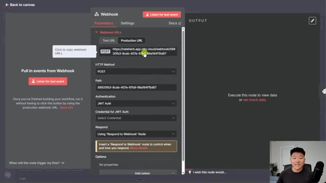
*⏱️ 00:00:24 — Panneau de configuration d'un nœud Webhook dans n8n avec les paramètres d'authentification JWT.*

---

### ⏱️ `[00:00:32 - 00:00:57]` | Segment #02

**🔊 Audio (Transcription Intégrale Mot pour Mot en Français) :**
> votre agent un million de fois et votre agent enverrait un million de requêtes à OpenAI ou OpenRouter ou quel que soit le modèle de chat que vous utilisez et vous devriez assumer ce coût. Mais il y a aussi le risque que l'agent soit connectée à différents outils et différents systèmes qui accèdent à vos bases de données ou vos bases de connaissances ou votre CRM. Donc de toute façon, c'est pourquoi dans votre webhook, vous voulez probablement avoir un chemin assez robuste pour que ce ne soit pas juste comme Nate et que les gens puissent le deviner.

**👁️ Analyse Visuelle d'Écran (gemini-3.5-flash-lite) :**
**Interface & Outils** : n8n (éditeur de workflows d'automatisation)

**Contenu textuel & Code** : Nœuds de workflow n8n (Webhook, AI Agent, OpenRouter Chat Model, Respond to Webhook) et panneau de configuration des paramètres du Webhook.

**Action / Démonstration** : Présentation de la structure d'un agent IA dans n8n et configuration des paramètres d'un webhook d'entrée.

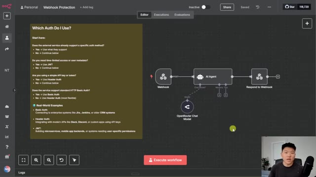
*⏱️ 00:00:38 — Vue d'ensemble d'un workflow n8n montrant un déclencheur Webhook connecté à un nœud AI Agent, lié lui-même à un modèle OpenRouter Chat et à un nœud Respond to Webhook.*

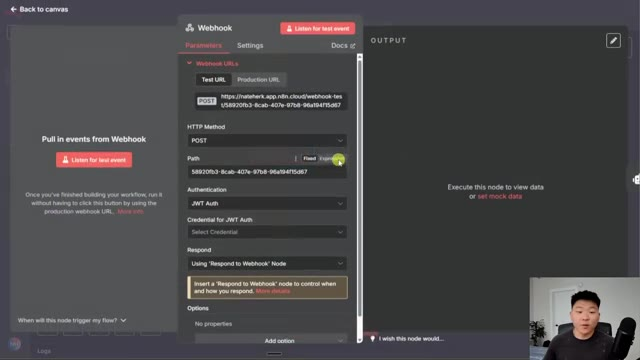
*⏱️ 00:00:51 — Panneau de configuration des paramètres du nœud Webhook dans l'interface n8n, affichant l'URL de test, la méthode HTTP POST et les options d'authentification JWT.*

---

### ⏱️ `[00:00:57 - 00:01:18]` | Segment #03

**🔊 Audio (Transcription Intégrale Mot pour Mot en Français) :**
> Mais si quelqu'un réussit à intercepter votre webhook accessible publiquement, ce que vous pouvez faire, c'est que nous pouvons configurer une authentification. Et nous avons le choix entre l'authentification basique, par en-tête, ou JWT. Je vais donc vous montrer un exemple concret où je configure toutes ces différentes authentifications. Et nous parlerons du moment où vous voudriez utiliser chacune d'elles. Donc, juste pour vous montrer comment cela fonctionne initialement avec un webhook, lorsque vous le configurez par défaut, l'authentification est réglée sur aucune.

**👁️ Analyse Visuelle d'Écran (gemini-3.5-flash-lite) :**
**Interface & Outils** : Interface web de l'outil d'automatisation n8n.

**Contenu textuel & Code** : URL du webhook de test, méthode HTTP (POST), chemin et menu déroulant des options d'authentification.

**Action / Démonstration** : Le curseur sélectionne l'option "JWT Auth" dans le menu déroulant des paramètres d'authentification du webhook.

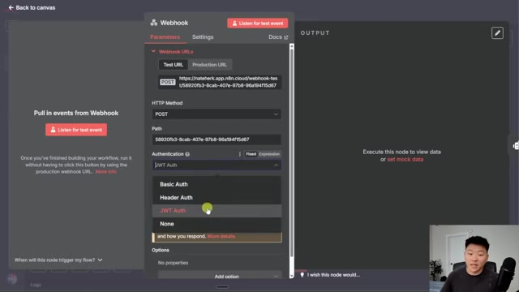
*⏱️ 00:01:02 — Panneau de configuration d'un nœud Webhook dans n8n, montrant le menu déroulant des options d'authentification (Basic Auth, Header Auth, JWT Auth, None).*

---

### ⏱️ `[00:01:18 - 00:01:40]` | Segment #04

**🔊 Audio (Transcription Intégrale Mot pour Mot en Français) :**
> Et ce qui se passe, c'est que je vais utiliser cette URL de test. Nous allons faire en sorte que notre flux de travail n8n écoute si quelqu'un accède à cette adresse webhook. Et je peux aller sur Postman, qui nous permet simplement d'envoyer des requêtes. Je vais en ajouter une nouvelle. Nous allons envoyer une requête POST à l'URL de mon webhook. Et ensuite, je vais juste envoyer très rapidement un message dans le corps. Donc la clé sera « message » et le corps sera « bonjour ».

**👁️ Analyse Visuelle d'Écran (gemini-3.5-flash-lite) :**
**Interface & Outils** : Interface web n8n et application Postman

**Contenu textuel & Code** : Workflow n8n (Webhook, AI Agent, OpenRouter Chat Model, Respond to Webhook) et interface de requête HTTP Postman (méthode GET, champ d'URL, paramètres, en-têtes)

**Action / Démonstration** : Configuration et écoute d'un webhook dans n8n, puis création d'une nouvelle requête dans Postman pour tester l'appel du webhook.

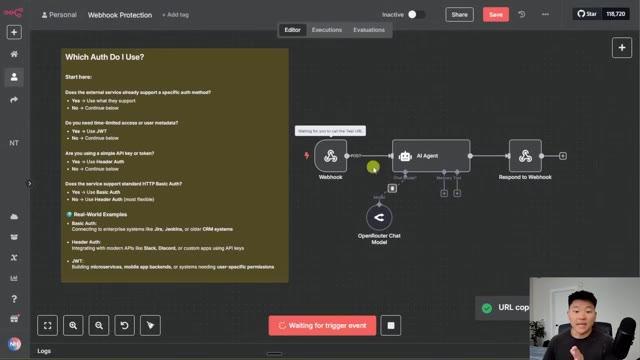
*⏱️ 00:01:24 — Vue du flux de travail n8n montrant un déclencheur Webhook connecté à un nœud AI Agent et à un nœud Respond to Webhook, en attente d'un appel de test.*

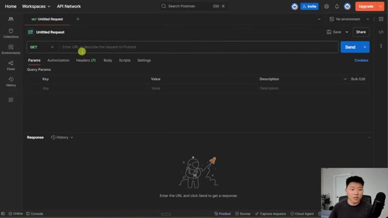
*⏱️ 00:01:29 — Interface de l'application Postman montrant une nouvelle requête GET sans titre prête à recevoir une URL de test.*

---

### ⏱️ `[00:01:40 - 00:01:59]` | Segment #05

**🔊 Audio (Transcription Intégrale Mot pour Mot en Français) :**
> Donc, si j'envoie ceci à NNN, vous pouvez voir que ça va le récupérer. L'agent va utiliser notre argent pour le traiter, puis répondre à la requête Postman, qui dit : bonjour, comment puis-je vous aider aujourd'hui ? Et donc, le fait est que n'importe qui ayant ce webhook, si le flux de travail est actif, pourrait fondamentalement parler à mon agent. Donc, la première méthode dont nous allons parler consiste à utiliser une authentification par en-tête.

**👁️ Analyse Visuelle d'Écran (gemini-3.5-flash-lite) :**
**Interface & Outils** : n8n, Postman

**Contenu textuel & Code** : URL webhook n8n, requête POST avec corps de message "hello", réponse JSON contenant "output": "Hello! How can I assist you today?"

**Action / Démonstration** : Test d'une requête HTTP POST via Postman pour déclencher un agent IA configuré dans un workflow n8n.

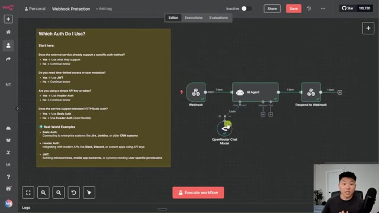
*⏱️ 00:01:45 — Vue d'un workflow n8n montrant les nœuds Webhook, AI Agent et Respond to Webhook, avec un panneau textuel explicatif sur l'authentification.*

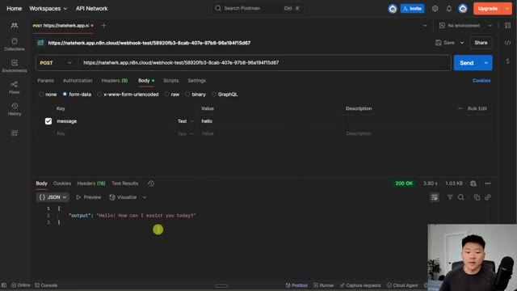
*⏱️ 00:01:50 — Interface de Postman montrant une requête POST envoyée vers une URL de webhook n8n avec la réponse JSON reçue (« Hello! How can I assist you today? »).*

---

### ⏱️ `[00:01:59 - 00:02:18]` | Segment #06

**🔊 Audio (Transcription Intégrale Mot pour Mot en Français) :**
> Donc tout ce que je vais faire, c'est venir dans le webhook ici. Je vais choisir l'authentification par en-tête, et je vais en créer une nouvelle. Et la façon la plus simple de voir les choses, c'est de dire que vous utilisez une API comme Perplexity, OpenWeather, ou peu importe ce que vous utilisez. En général, vous devez envoyer une sorte de clé API ou de mot de passe, et c'est cela qui vous authentifie réellement pour utiliser leur serveur.

**👁️ Analyse Visuelle d'Écran (gemini-3.5-flash-lite) :**
**Interface & Outils** : n8n (interface d'automatisation de workflows)

**Contenu textuel & Code** : URL de webhook de test, méthode POST, champ d'authentification défini sur Header Auth, et volet de résultats (Output) listant les en-têtes HTTP reçus (host, user-agent, content-type, etc.).

**Action / Démonstration** : Sélection et configuration des paramètres d'authentification par en-tête pour le nœud Webhook.

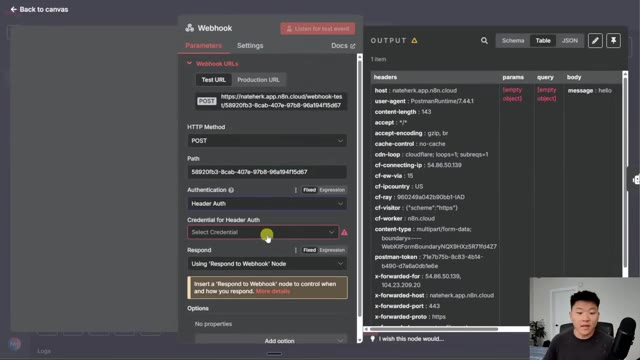
*⏱️ 00:02:04 — Configuration d'un nœud Webhook dans l'interface de n8n avec les paramètres de la méthode HTTP (POST), l'authentification réglée sur Header Auth et le volet de sortie affichant les en-têtes de test reçus.*

---

### ⏱️ `[00:02:18 - 00:02:37]` | Segment #07

**🔊 Audio (Transcription Intégrale Mot pour Mot en Français) :**
> Donc dans ce cas, faites simplement semblant d'être le serveur. Nous configurons un serveur avec des informations de backend auxquelles l'utilisateur souhaite accéder. Et pour que l'utilisateur y accède, il doit disposer de nos informations d'authentification d'en-tête. Je vais donc créer une nouvelle authentification d'en-tête. Le nom, je vais juste mettre "key". Et pour la valeur, je mets juste "1, 2, 3, 4, 5". Je vais enregistrer cela.

**👁️ Analyse Visuelle d'Écran (gemini-3.5-flash-lite) :**
**Interface & Outils** : Interface web n8n (outil d'automatisation de workflows).

**Contenu textuel & Code** : Paramètres du webhook, en-têtes HTTP (headers), champs de configuration d'authentification par en-tête (Name et Value).

**Action / Démonstration** : Configuration de l'authentification par en-tête (Header Auth) sur un nœud Webhook dans n8n.

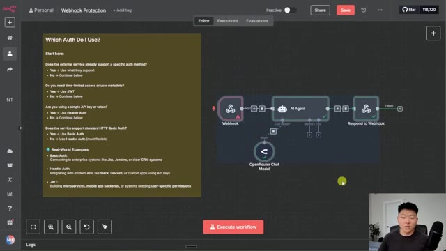
*⏱️ 00:02:23 — Vue globale du workflow n8n avec un nœud Webhook et un guide de documentation textuel sur l'authentification.*

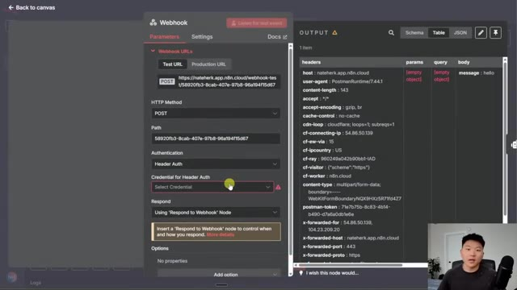
*⏱️ 00:02:28 — Panneau de configuration du nœud Webhook dans n8n, montrant les paramètres de méthode HTTP et la sélection de l'authentification par en-tête (Header Auth).*

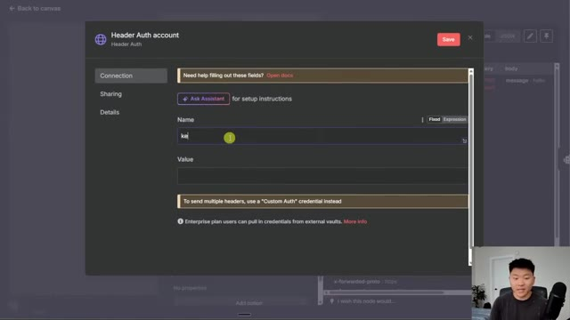
*⏱️ 00:02:33 — Fenêtre modale de création de compte "Header Auth" dans n8n avec les champs pour saisir le nom (clé) et la valeur des en-têtes d'authentification.*

---

### ⏱️ `[00:02:37 - 00:02:57]` | Segment #08

**🔊 Audio (Transcription Intégrale Mot pour Mot en Français) :**
> Et maintenant, pour que quelqu'un puisse accéder à notre webhook, il devrait saisir cette authentification par en-tête exacte. Notre flux de travail est donc maintenant à notre écoute. Et je vais continuer et simplement essayer d'envoyer cette requête sans authentification par en-tête. Et il est indiqué que les données d'autorisation sont erronées. Mais si je vais dans la section des en-têtes juste ici et que nous en ajoutons un nouveau où je saisis la clé, et je saisis un, deux, trois, quatre, cinq.

**👁️ Analyse Visuelle d'Écran (gemini-3.5-flash-lite) :**
**Interface & Outils** : n8n (éditeur de workflow) et Postman (client API)

**Contenu textuel & Code** : URL de webhook n8n, corps de requête POST avec la clé 'message' et la valeur 'hello', et réponse HTTP '403 Forbidden' avec le message 'Authorization data is wrong!'.

**Action / Démonstration** : Test d'envoi d'une requête POST sans en-tête d'authentification valide vers le webhook n8n depuis Postman, entraînant un refus d'accès.

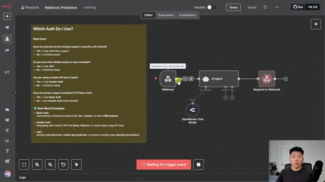
*⏱️ 00:02:42 — Interface n8n montrant un workflow de webhook en attente d'un événement déclencheur et un panneau d'aide explicatif sur l'authentification.*

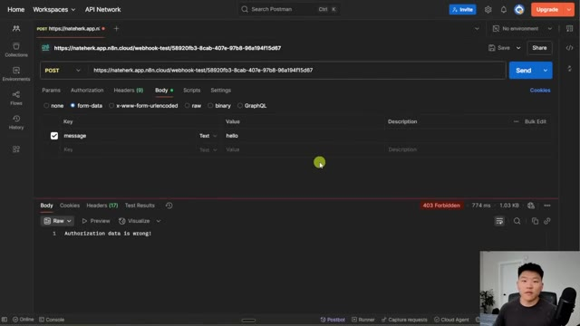
*⏱️ 00:02:47 — Interface de Postman affichant une requête POST vers le webhook n8n avec un corps de message et une réponse '403 Forbidden' indiquant une erreur d'authentification.*

---

### ⏱️ `[00:02:57 - 00:03:19]` | Segment #09

**🔊 Audio (Transcription Intégrale Mot pour Mot en Français) :**
> Maintenant, si j'envoie ceci, nous pouvons voir que notre flux de travail NNN a récupéré cette information, il l'a traitée, et il nous a renvoyé la réponse, bonjour, comment puis-je vous aider aujourd'hui ? C'est donc la première méthode, qui est l'authentification par en-tête, très simple à configurer, et nous avons fondamentalement une clé et une valeur. Maintenant, parlons de la méthode suivante, qui va être l'authentification de base. L'authentification de base est donc très similaire car elle ressemble toujours à une paire clé-valeur, mais il s'agit plutôt d'un nom d'utilisateur et d'un mot de passe.

**👁️ Analyse Visuelle d'Écran (gemini-3.5-flash-lite) :**
**Interface & Outils** : Postman et n8n (Interface d'automatisation de flux de travail)

**Contenu textuel & Code** : Requête HTTP POST avec en-tête d'authentification (clé: 12345) et réponse JSON {"output": "Hello! How can I assist you today?"}.

**Action / Démonstration** : Envoi d'une requête API testée dans Postman pour valider l'authentification par en-tête vers le flux de travail n8n.

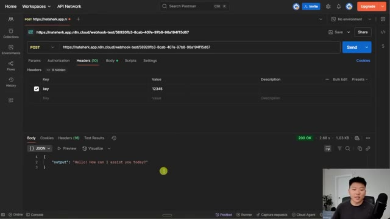
*⏱️ 00:03:02 — Interface Postman montrant une requête POST vers n8n avec la réponse JSON réussie (200 OK) contenant le message "Hello! How can I assist you today?".*

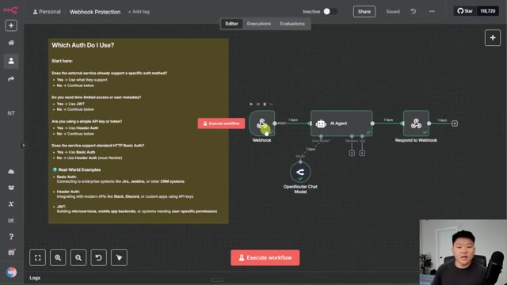
*⏱️ 00:03:14 — Interface n8n affichant le workflow de protection de webhook avec les nœuds Webhook, AI Agent et Respond to Webhook.*

---

### ⏱️ `[00:03:19 - 00:03:40]` | Segment #10

**🔊 Audio (Transcription Intégrale Mot pour Mot en Français) :**
> Donc, si je vais dans l'authentification de base et que nous en créons une nouvelle, vous pouvez voir qu'on nous invite à configurer un nom d'utilisateur et un mot de passe. Et donc, je mets « test » comme utilisateur, je mets « 12345 » encore une fois comme mot de passe, et nous allons enregistrer ceci. Et maintenant, si notre flux de travail est en train d'écouter pour nous et que nous allons dans Postman, et que nous n'envoyons aucun en-tête ni aucune authentification de base, encore une fois, il va dire que l'autorisation est requise.

**👁️ Analyse Visuelle d'Écran (gemini-3.5-flash-lite) :**
**Interface & Outils** : n8n (interface web) et Postman

**Contenu textuel & Code** : Champs de configuration d'authentification Basic Auth (Username/Password) et requête HTTP POST avec réponse JSON.

**Action / Démonstration** : Configuration et enregistrement des identifiants d'authentification de base dans n8n.

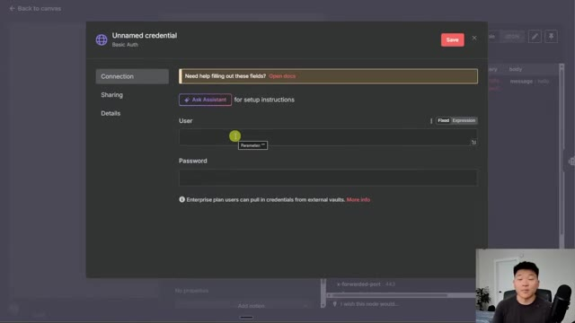
*⏱️ 00:03:24 — Interface n8n montrant la fenêtre modale de configuration des identifiants d'authentification de base (Basic Auth) avec les champs 'User' et 'Password'.*

---

### ⏱️ `[00:03:40 - 00:04:04]` | Segment #11

**🔊 Audio (Transcription Intégrale Mot pour Mot en Français) :**
> Donc nous irions dans l'autorisation, nous choisirions un type d'authentification, ce sera basique, et ensuite nous entrons notre nom d'utilisateur et notre mot de passe. Et maintenant que j'ai entré cela, je peux procéder à l'envoi de cette requête, et elle va la récupérer, la traiter, et nous allons obtenir la réponse ici, qui est, bonjour, comment puis-je vous aider aujourd'hui ? Donc la principale différence entre une authentification par en-tête et une authentification basique est simplement que certaines plates-formes, certains systèmes hérités ont fondamentalement déjà une authentification basique intégrée.

**👁️ Analyse Visuelle d'Écran (gemini-3.5-flash-lite) :**
**Interface & Outils** : Postman et n8n

**Contenu textuel & Code** : URL de webhook n8n, configuration d'authentification basique et schéma de workflow avec agent IA.

**Action / Démonstration** : Configuration des paramètres d'authentification HTTP basique pour tester l'envoi d'une requête vers le webhook.

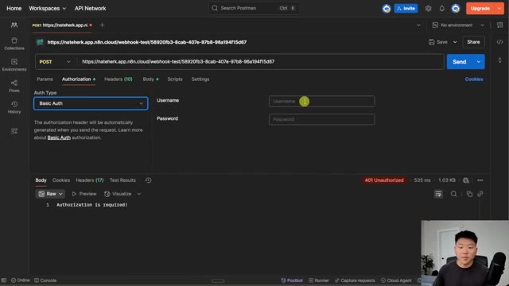
*⏱️ 00:03:46 — Interface Postman montrant la configuration de l'authentification basique (Basic Auth) avec les champs nom d'utilisateur et mot de passe.*

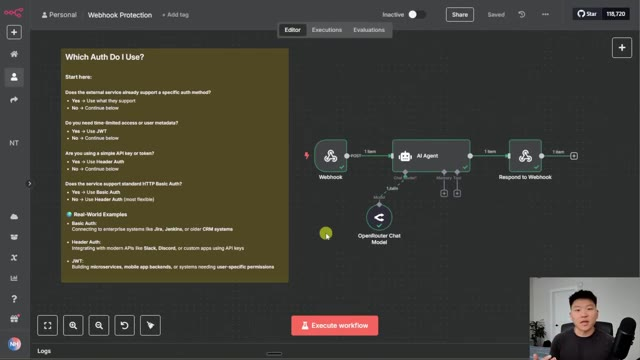
*⏱️ 00:03:58 — Interface n8n montrant un workflow de protection de webhook avec un guide textuel sur les différents types d'authentification.*

---

### ⏱️ `[00:04:04 - 00:04:28]` | Segment #12

**🔊 Audio (Transcription Intégrale Mot pour Mot en Français) :**
> Il est donc beaucoup plus facile de configurer cela et d'envoyer des données à votre webhook. Mais les authentifications par en-tête sont un peu plus universelles et personnalisables, car vous pouvez presque toujours configurer des en-têtes à envoyer lorsque vous effectuez une requête. Mais encore une fois, j'ai comme un petit arbre de décision ici pour que vous puissiez déterminer quel type de méthode d'authentification vous devez utiliser. Et enfin, la dernière méthode, qui peut sembler un peu plus complexe, mais que nous allons rendre vraiment simple, est l'authentification par jeton JWT ou jeton web JSON.

**👁️ Analyse Visuelle d'Écran (gemini-3.5-flash-lite) :**
**Interface & Outils** : n8n (Interface web d'automatisation de workflows)

**Contenu textuel & Code** : Un panneau textuel "Which Auth Do I Use?" avec des questions/réponses sur les méthodes d'authentification (Basic Auth, Header Auth, JWT) et des exemples concrets, ainsi qu'un diagramme de workflow intégrant un agent IA.

**Action / Démonstration** : Le présentateur explique les différentes méthodes d'authentification pour les webhooks en s'appuyant sur le guide affiché à l'écran.

*⏱️ 00:04:10 — Interface d'un éditeur de workflow avec un panneau explicatif sur l'authentification des webhooks à gauche et un schéma de nœuds n8n à droite (Webhook, AI Agent, OpenRouter Chat Model, Respond to Webhook).*

---

### ⏱️ `[00:04:28 - 00:04:47]` | Segment #13

**🔊 Audio (Transcription Intégrale Mot pour Mot en Français) :**
> Et ce qui est génial avec les jetons web JSON, c'est que ça vous permet de capturer une charge utile, donc vous pouvez aussi voir qui y accède, quel est leur email, est-ce qu'ils sont admin, et ensuite, sur la base de toutes ces informations, vous pouvez leur donner accès à différentes choses. Vous pouvez aussi suivre les sessions, donc vous pouvez voir combien de fois quelqu'un accède à votre serveur backend ou peu importe ce que c'est. Laissez-moi donc vous montrer comment configurer ça.

**👁️ Analyse Visuelle d'Écran (gemini-3.5-flash-lite) :**
**Interface & Outils** : n8n (éditeur de workflow d'automatisation)

**Contenu textuel & Code** : Nœuds connectés : Webhook, AI Agent (relié à un modèle OpenRouter Chat Model), et Respond to Webhook. Une section textuelle sur la gauche pose des questions décisionnelles sur l'authentification ("Which Auth Do I Use?").

**Action / Démonstration** : Présentation et explication d'un workflow n8n impliquant la protection par webhook et l'utilisation potentielle de jetons JWT.

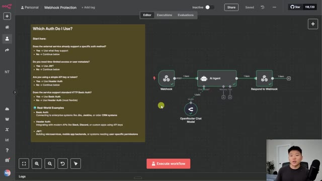
*⏱️ 00:04:33 — Un diagramme de workflow n8n intitulé "Webhook Protection" s'affiche à l'écran, accompagné d'une note textuelle détaillant les méthodes d'authentification (Basic Auth, Header Auth, JWT) et d'un aperçu vidéo du présentateur en bas à droite.*

---

### ⏱️ `[00:04:47 - 00:05:05]` | Segment #14

**🔊 Audio (Transcription Intégrale Mot pour Mot en Français) :**
> Comme je le disais, c'est un peu plus complexe que le simple en-tête. Et donc je suis sur JWT.io, qui nous permet simplement de créer ces jetons web JSON. Donc ce qui se passe ici, c'est qu'on lui indique l'algorithme et le type. Ne vous préoccupez donc pas vraiment de ça. Nous créons une charge utile à envoyer. Donc à chaque fois que quelqu'un accède à notre webhook, nous verrons aussi son nom, s'il est administrateur ou non.

**👁️ Analyse Visuelle d'Écran (gemini-3.5-flash-lite) :**
**Interface & Outils** : Navigateur web affichant le site JWT.io (JWT Debugger)

**Contenu textuel & Code** : Un éditeur JWT contenant trois sections à gauche (Header avec {"alg": "HS256", "typ": "JWT"}, Payload avec des données utilisateur, et Secret) et le jeton encodé généré à droite.

**Action / Démonstration** : Le présentateur explique la structure d'un jeton JWT en montrant l'en-tête (header), la charge utile (payload) et la signature sur l'outil en ligne JWT.io.

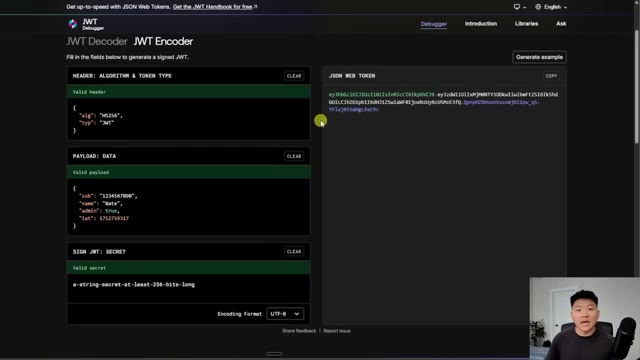
*⏱️ 00:04:51 — Capture d'écran montrant l'interface du site web JWT.io pour la création et le décodage de jetons Web JSON, avec le présentateur visible en incrustation dans le coin inférieur droit.*

---

### ⏱️ `[00:05:05 - 00:05:25]` | Segment #15

**🔊 Audio (Transcription Intégrale Mot pour Mot en Français) :**
> Nous pourrions aussi mettre par exemple un e-mail, un numéro de téléphone, tout ce que nous voulons dans cette charge utile. Et ensuite, nous créons fondamentalement ce secret. Et c'est un peu comme une signature numérique qui indique que cette personne a bien accès à notre webhook. Et une fois que nous l'avons inséré, nous obtenons un jeton web JSON qui comporte différents éléments et qui est essentiellement encodé pour dire qui y accède et pour envoyer la bonne charge utile.

**👁️ Analyse Visuelle d'Écran (gemini-3.5-flash-lite) :**
**Interface & Outils** : Interface web de JWT Debugger (jwt.io)

**Contenu textuel & Code** : Blocs de configuration JSON pour le header (HS256, JWT), le payload (sub, name, admin, iat), et la chaîne secrète de signature ("a-string-secret-at-least-256-bits-long").

**Action / Démonstration** : Le présentateur explique la structure d'un JWT en montrant les différentes sections (en-tête, charge utile, secret de signature).

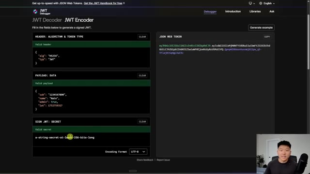
*⏱️ 00:05:10 — Interface web du débogueur/encodeur JWT montrant les sections Header, Payload, Sign JWT (Secret) et le token JSON généré sur la droite.*

---

### ⏱️ `[00:05:25 - 00:05:45]` | Segment #16

**🔊 Audio (Transcription Intégrale Mot pour Mot en Français) :**
> Donc, pour configurer cela dans NNN, ce que je vais faire, c'est que je vais copier ce secret, notre signature ici en bas. Nous allons aller dans le webhook et nous allons choisir l'authentification JWT. Maintenant, quand je vais en créer une nouvelle, vous pouvez voir que nous avons besoin d'un type de clé et d'un algorithme. Donc, juste ici, nous allons le garder comme phrase secrète en HS256, ce qui est en quelque sorte la méthode la plus courante.

**👁️ Analyse Visuelle d'Écran (gemini-3.5-flash-lite) :**
**Interface & Outils** : Débogueur JWT en ligne et interface de l'outil d'automatisation n8n.

**Contenu textuel & Code** : Paramètres de configuration d'un token JWT (algorithme HS256, secret, payload) et paramètres du webhook n8n.

**Action / Démonstration** : Copie du secret JWT et configuration de l'authentification JWT sur le nœud webhook dans n8n.

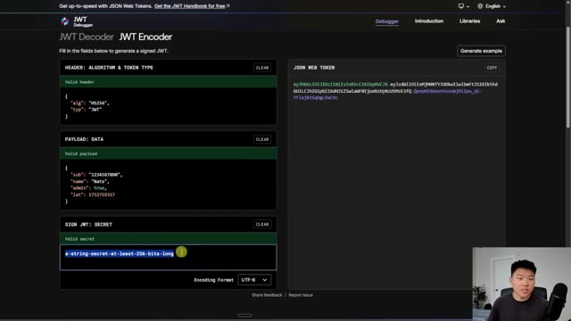
*⏱️ 00:05:30 — Interface web d'un débugger JWT affichant l'en-tête, le payload et le secret de signature.*

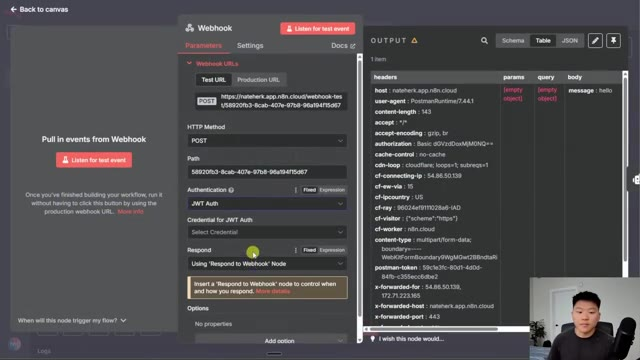
*⏱️ 00:05:35 — Interface n8n montrant la configuration d'un nœud Webhook avec l'authentification réglée sur JWT Auth.*

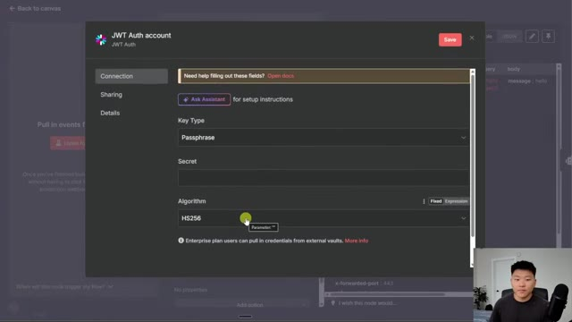
*⏱️ 00:05:40 — Fenêtre modale de configuration des identifiants JWT Auth dans n8n, montrant les champs Key Type, Secret et Algorithm.*

---

### ⏱️ `[00:05:45 - 00:06:10]` | Segment #17

**🔊 Audio (Transcription Intégrale Mot pour Mot en Français) :**
> Vous pouvez également voir ici que nous avons l'algorithme HS256. Et donc rappelez-vous que j'ai copié cette clé ici en bas. C'est ce que nous allons mettre ici comme secret. Et maintenant que nous avons configuré ce secret, je peux cliquer sur enregistrer et maintenant nous avons notre authentification JWT configurée. Donc si nous avons le flux de travail qui écoute à nouveau pour nous et que je retourne dans JWT.io, ce serait mon jeton Web, qui est unique pour moi, Nate, un administrateur.

**👁️ Analyse Visuelle d'Écran (gemini-3.5-flash-lite) :**
**Interface & Outils** : Interface web de configuration d'authentification et outil de débogage JWT (jwt.io).

**Contenu textuel & Code** : Configuration du JWT Auth (Key Type: Passphrase, Secret, Algorithm: HS256) et structure JSON du token (Header, Payload avec données utilisateur, Secret et JWT généré).
[DESC_IMAGE_1] Configuration des paramètres d'authentification JWT (algorithme HS256 et secret).
[DESC_IMAGE_2] Affichage d'un débuggeur/encodeur JWT montrant la structure d'un jeton avec l'algorithme HS256.

**Action / Démonstration** : Explications face caméra et démonstration conceptuelle.

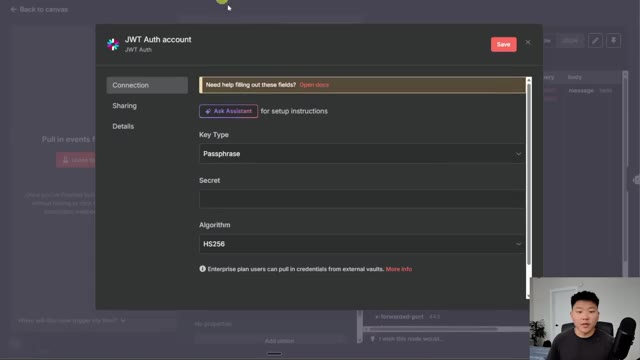
*⏱️ 00:05:51 — Fenêtre de configuration d'authentification JWT affichant les champs Key Type, Secret et Algorithm réglé sur HS256, avec le présentateur incrusté en bas à droite.*

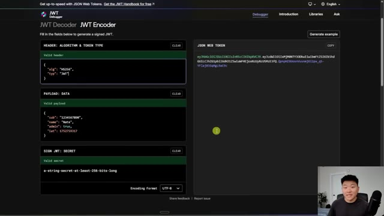
*⏱️ 00:06:04 — Interface d'un outil de débogage et d'encodage JWT (jwt.io) montrant le Header (algorithme HS256), le Payload, la clé secrète et le jeton JSON Web Token généré à droite.*

---

### ⏱️ `[00:06:10 - 00:06:33]` | Segment #18

**🔊 Audio (Transcription Intégrale Mot pour Mot en Français) :**
> Donc je vais copier ceci juste ici. Je vais retourner dans Postman. Nous allons changer l'authentification de base et nous allons en fait utiliser un jeton du porteur plutôt qu'un porteur JWT, car cela nous permet de simplement insérer un jeton complet, ce qui est exactement ce que je viens de copier dans JWT.io. Donc maintenant, si j'envoie ceci à NNN, cela va le capturer et le traiter, et nous renvoyer une réponse, qui est encore une fois : bonjour, comment puis-je vous aider aujourd'hui ?

**👁️ Analyse Visuelle d'Écran (gemini-3.5-flash-lite) :**
**Interface & Outils** : Postman et l'interface n8n

**Contenu textuel & Code** : URL de webhook n8n, options de configuration d'authentification (Basic Auth, Bearer Token, JWT Bearer), et diagramme de workflow d'automatisation.

**Action / Démonstration** : Sélection du type d'authentification Bearer Token dans Postman et visualisation du workflow dans n8n.

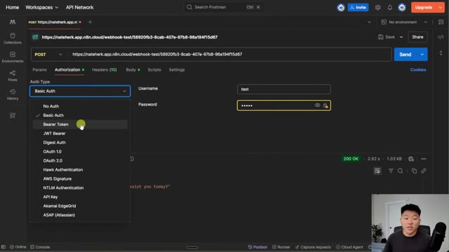
*⏱️ 00:06:16 — L'interface de Postman montrant la sélection du type d'authentification pour une requête HTTP POST vers un webhook n8n.*

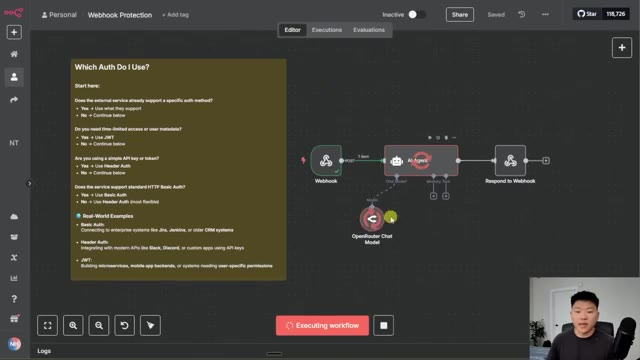
*⏱️ 00:06:27 — L'éditeur de workflow n8n montrant un schéma avec un Webhook, un Agent IA et un nœud OpenRouter Chat Model.*

---

### ⏱️ `[00:06:33 - 00:06:55]` | Segment #19

**🔊 Audio (Transcription Intégrale Mot pour Mot en Français) :**
> Mais ce qui est génial avec ça, c'est que si nous allons à la réponse du webhook réel qui a été capturée et que nous faisons défiler tout en bas vers la droite, nous pouvons voir que nous avons capturé cette charge utile JWT. Et c'est là que nous pouvons voir les informations sur qui a réellement fait cette requête. Donc ce que nous pourrions faire avec ça, c'est en gros dire, d'accord, si admin est égal à vrai, je vais l'envoyer ici en haut à cet agent qui a un accès administrateur.

**👁️ Analyse Visuelle d'Écran (gemini-3.5-flash-lite) :**
**Interface & Outils** : n8n (Interface web de gestion de workflows)

**Contenu textuel & Code** : URL du webhook POST, méthode HTTP POST, authentification JWT, et en-têtes HTTP (headers) affichant un jeton d'authentification (Bearer token).

**Action / Démonstration** : Consultation des données de sortie et de la charge utile JWT capturée par le nœud webhook dans n8n.

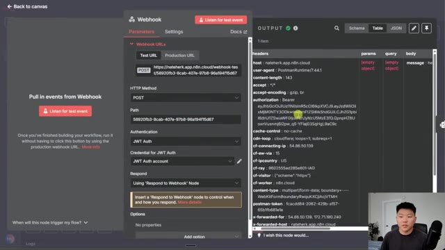
*⏱️ 00:06:39 — Capture d'écran montrant l'interface du nœud Webhook dans n8n avec les paramètres de configuration à gauche et le panneau des données de sortie (Output) affichant les en-têtes de la requête, notamment le jeton d'autorisation JWT.*

---

### ⏱️ `[00:06:55 - 00:07:17]` | Segment #20

**🔊 Audio (Transcription Intégrale Mot pour Mot en Français) :**
> Mais si admin est égal à faux, ils vont descendre ici vers cet agent qui n'a pas d'accès administrateur. Vous pourriez aussi commencer à voir, vous savez, Lequel de mes employés accède à ce service et combien de fois y accèdent-ils ? À quelles heures y accèdent-ils ? Vous pouvez les rechercher dans votre système en vous basant sur leur adresse e-mail. Et ensuite, vous pouvez voir à quoi ils devraient réellement avoir accès et les acheminer vers le bon agent. Il y a aussi des choses plus complexes que vous pouvez faire, comme vous pouvez configurer leur jeton pour qu'il ne fonctionne que pendant un jour, ou vous pouvez y mettre une sorte de limite de temps.

**👁️ Analyse Visuelle d'Écran (gemini-3.5-flash-lite) :**
**Interface & Outils** : Interface web de l'outil d'automatisation n8n.

**Contenu textuel & Code** : Un schéma logique avec les nœuds Webhook, AI Agent, OpenRouter Chat Model et Respond to Webhook.

**Action / Démonstration** : Le présentateur explique le fonctionnement du workflow d'automatisation basé sur des conditions d'authentification.

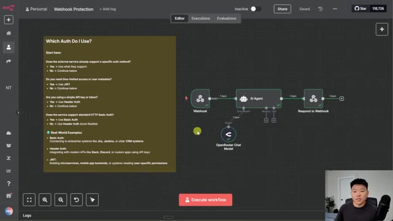
*⏱️ 00:07:01 — Un diagramme de workflow sur n8n montrant un Webhook connectant un agent IA (AI Agent) et un modèle OpenRouter Chat Model.*

---

### ⏱️ `[00:07:17 - 00:07:38]` | Segment #21

**🔊 Audio (Transcription Intégrale Mot pour Mot en Français) :**
> Je ne vais pas vraiment entrer dans les détails de tout ça pour l'instant, mais je voulais vraiment vous sensibiliser à cela au moment où vous configurez, vous savez, vos agents vocaux, vos automatisations de messages directs ou peu importe ce que c'est, où vous avez un webhook auquel le public peut accéder. Et vous voulez vous assurer qu'ils n'en abusent pas. Et comme toujours, si vous voulez télécharger ce modèle, juste pour pouvoir l'essayer et examiner cet arbre de décision, tout ce que vous avez à faire est d'aller dans ma communauté FreeSchool.

**👁️ Analyse Visuelle d'Écran (gemini-3.5-flash-lite) :**
**Interface & Outils** : n8n (éditeur de workflow d'automatisation)

**Contenu textuel & Code** : Nœuds de workflow : Webhook, AI Agent, OpenRouter Chat Model, Respond to Webhook. Texte explicatif sur l'authentification API (Basic Auth, Header Auth, JWT).

**Action / Démonstration** : Présentation du schéma de workflow n8n intégrant un webhook public et un agent IA.

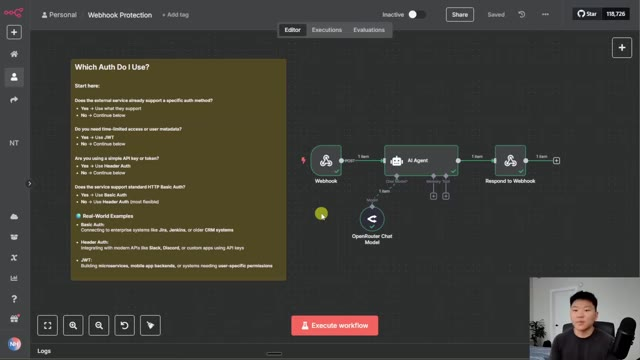
*⏱️ 00:07:22 — Interface d'un éditeur de workflow montrant un diagramme avec un nœud Webhook relié à un agent IA et une réponse Webhook, avec un panneau d'aide explicatif sur l'authentification.*

---

### ⏱️ `[00:07:38 - 00:07:59]` | Segment #22

**🔊 Audio (Transcription Intégrale Mot pour Mot en Français) :**
> Le lien pour cela se trouvera dans la description. Une fois sur place, vous chercherez ici le titre de cette vidéo, ou vous pouvez cliquer sur les ressources YouTube et faire défiler jusqu'à ce que vous le trouviez. Disons que c'est la publication associée à cette vidéo. Vous pourrez cliquer dessus. Vous verrez la vidéo YouTube juste ici. Et puis vous aurez aussi le fichier juste ici à télécharger. Et si vous souhaitez explorer des sujets plus complexes comme celui-ci, ou si vous êtes débutant et que vous cherchez des conseils structurés, alors consultez absolument ma communauté payante.

**👁️ Analyse Visuelle d'Écran (gemini-3.5-flash-lite) :**
**Interface & Outils** : Plateforme de communauté en ligne (type Skool)

**Contenu textuel & Code** : Publications sur la communauté, liens vers les ressources YouTube, fichiers de workflow JSON, commentaires d'utilisateurs.

**Action / Démonstration** : Navigation et clic sur une publication spécifique pour accéder aux ressources associées (vidéo et fichier JSON).

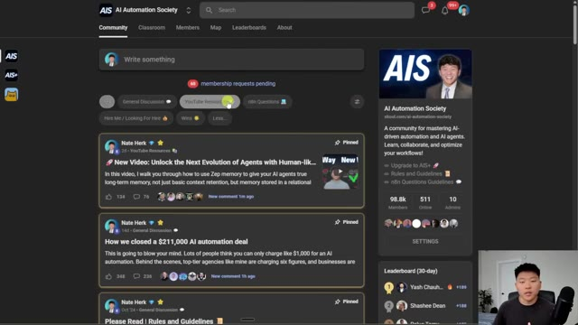
*⏱️ 00:07:43 — Vue d'ensemble de la plateforme de communauté AI Automation Society montrant les différents salons de discussion et publications.*

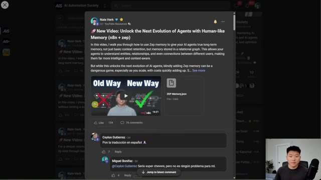
*⏱️ 00:07:48 — Gros plan sur une publication spécifique de Nate Herk contenant une vidéo et un fichier JSON téléchargeable (ZEP Memory.json).*

---

### ⏱️ `[00:07:59 - 00:08:17]` | Segment #23

**🔊 Audio (Transcription Intégrale Mot pour Mot en Français) :**
> Le lien pour cela est également dans la description. Nous avons une super communauté de membres qui partagent leurs réussites et les défis auxquels ils font face chaque jour. Nous avons une section de cours complète, "agent zéro", qui pose les bases de l'automatisation par IA. Et ensuite, "de 10 heures à 10 secondes", où vous apprenez à identifier, concevoir et créer des automatisations qui font gagner du temps. Donc, quoi qu'il en soit, nous serions ravis de vous voir dans ces communautés, mais c'est tout pour aujourd'hui.

**👁️ Analyse Visuelle d'Écran (gemini-3.5-flash-lite) :**
**Interface & Outils** : Navigateur web affichant la plateforme communautaire Skool (AI Automation Society Plus).

**Contenu textuel & Code** : Titres de modules de formation et publications de la communauté axés sur l'automatisation par l'IA et n8n.
[DESC_IMAGE_2] Le présentateur navigue dans la section des cours de sa communauté pour présenter les modules "Agent Zero" et "10 Hours to 10 Seconds".

**Action / Démonstration** : Explications face caméra et démonstration conceptuelle.

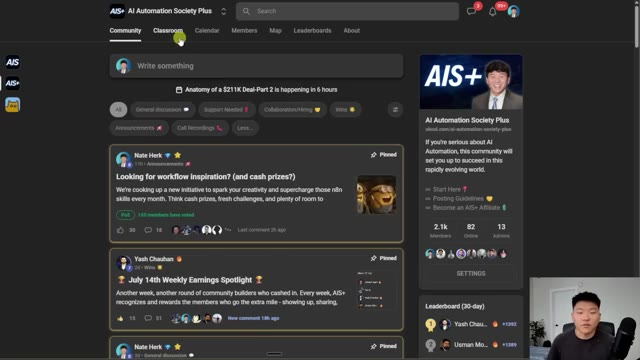
*⏱️ 00:08:03 — Capture d'écran de la communauté "AI Automation Society Plus" montrant le fil d'actualité général avec des publications d'utilisateurs et le présentateur en médaillon vidéo.*

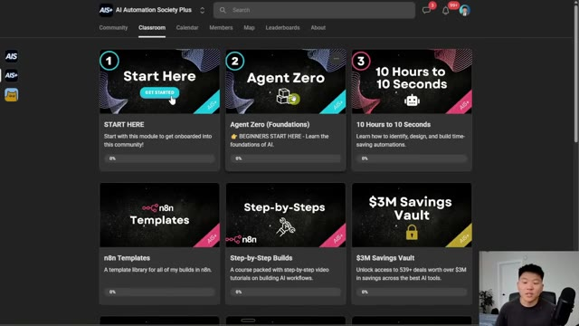
*⏱️ 00:08:08 — Capture d'écran de la section "Classroom" de la plateforme, affichant les différents modules de cours disponibles (Start Here, Agent Zero, 10 Hours to 10 Seconds, n8n Templates, etc.).*

---

### ⏱️ `[00:08:17 - 00:08:31]` | Segment #24

**🔊 Audio (Transcription Intégrale Mot pour Mot en Français) :**
> Je sais que c'était rapide, mais je voulais m'assurer de partager ceci pour que vous soyez conscients de ce qui pourrait arriver si vous ne protégez pas vos webhooks. Alors si vous avez aimé, ou si vous avez appris quelque chose de nouveau, veuillez mettre un pouce bleu, ça m'aide vraiment énormément. Et comme toujours, je vous remercie d'être arrivés jusqu'à la fin de la vidéo. Je vous vois à la prochaine. Merci les gars.

**👁️ Analyse Visuelle d'Écran (gemini-3.5-flash-lite) :**
**Interface & Outils** : n8n (Interface web de gestion de workflows)

**Contenu textuel & Code** : Nœuds de workflow : Webhook, AI Agent, OpenRouter Chat Model, Respond to Webhook. Texte explicatif "Which Auth Do I Use?".

**Action / Démonstration** : Présentation du workflow complet de protection des webhooks.

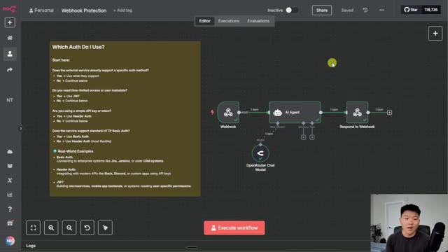
*⏱️ 00:08:21 — Un diagramme de workflow sur n8n montrant un Webhook connecté à un agent IA (OpenRouter Chat Model) et une réponse de webhook, avec un panneau explicatif sur l'authentification à gauche.*

---

