# 🎬 From Zero to RAG Agent: Full Beginner's Course (no code)

> **Chaîne** : [Nate Herk | AI Automation](https://www.youtube.com/@nateherk/featured)  
> **Lien YouTube** : [https://www.youtube.com/watch?v=cCD303XsUjI](https://www.youtube.com/watch?v=cCD303XsUjI)  
> **Date de publication** : 20250721  
> **Durée** : 00:22:39  
> **Identifiant vidéo** : `cCD303XsUjI`  
> **Transcription & Analyse** : `whisper-v3-large-turbo+gemini-3.5-flash-lite`  

---

## 📌 Synthèse Exécutive & Outils

### 💡 Résumé

Cette vidéo proposée par la chaîne *Nate Herk | AI Automation* offre un guide complet et accessible aux débutants pour concevoir et déployer de zéro un agent IA doté de capacités RAG (Retrieval-Augmented Generation), le tout sans écrire la moindre ligne de code. L'objectif pédagogique est de démystifier l'architecture des agents intelligents en démontrant qu'il est possible d'interagir dynamiquement avec des bases de connaissances documentaires complexes — en l'occurrence, un guide officiel des règles du golf de 22 pages. L'approche privilégie une explication visuelle et conceptuelle rigoureuse, abordant aussi bien la théorie des espaces vectoriels que la mise en place pratique des flux d'automatisation.

Sur le plan technique, la démonstration est scindée en deux grands piliers architecturaux : la construction d'un pipeline RAG d'ingestion (qui extrait un document depuis Google Drive, le segmente en morceaux, génère des *embeddings* et les stocke) et le développement de l'agent RAG conversationnel proprement dit (qui associe un déclencheur de chat, la vectorisation des requêtes utilisateur et l'inférence par un modèle d'IA). L'utilisation conjointe de la plateforme no-code *n8n* et de l'infrastructure relationnelle et vectorielle *Supabase* (propulsée par PostgreSQL) permet d'obtenir un système unifié, capable d'assurer à la fois la recherche sémantique de précision et la mémoire à court terme de l'agent.

Au-delà du cas d'usage spécifique du traitement de PDF, la méthodologie présentée met en lumière l'immense flexibilité des architectures RAG dans l'écosystème de l'automatisation moderne. Les sources de données et les déclencheurs ne se limitent pas à des fichiers statiques ou à des interfaces de chat, mais peuvent s'intégrer à des flux d'entreprise dynamiques (CRM HubSpot, bases Airtable, flux e-mails ou soumissions de formulaires). Cette approche outillée permet ainsi aux créateurs de systèmes et aux ingénieurs d'automatisation de concevoir rapidement des assistants contextuels robustes, prêts pour la production industrielle.

### 🛠️ Outils, Modèles & Logiciels Présentés

* **n8n** : Plateforme d'automatisation de flux de travail par glisser-déposer (no-code), utilisée pour orchestrer l'ensemble du pipeline d'ingestion RAG et l'agent conversationnel.
* **Supabase** : Infrastructure cloud open-source basée sur PostgreSQL, servant à la fois de base de données relationnelle et de magasin de vecteurs (*vector store*) pour stocker les *embeddings* et gérer la mémoire.
* **Google Drive** : Solution de stockage cloud utilisée pour héberger et récupérer le document source initial (le PDF des règles du golf).
* **Modèle d'embeddings** : Composant algorithmique chargé de transformer les segments de texte et les requêtes utilisateur en vecteurs numériques situés dans un espace multidimensionnel sémantique.
* **PostgreSQL** : Système de gestion de base de données relationnelle sous-jacent à Supabase, garantissant la persistance des données et le support des extensions vectorielles.

### 🔑 Points Clés & Enseignements Stratégiques

* **Définition pragmatique du RAG** : Le *Retrieval-Augmented Generation* ne se résume pas à l'utilisation stricte de bases de données vectorielles ; il s'agit fondamentalement d'un mécanisme de récupération d'informations externes ciblées pour permettre à un modèle de générer des réponses factuelles et précises.
* **Fonctionnement des espaces vectoriels** : Les bases de données vectorielles organisent les concepts textuels sous forme de points dans un espace multidimensionnel en fonction de leur sémantique, rapprochant naturellement les idées similaires (comme les fruits ou les animaux) pour faciliter la recherche par similarité.
* **Architecture en deux temps** : Un système RAG complet requiert impérativement de dissocier le pipeline d'ingestion des données (chargement, découpage, *embedding*, vectorisation) de l'agent conversationnel d'interrogation (requête, vectorisation de la question, recherche de proximité, génération).
* **Granularité du découpage (*Chunking*)** : Le texte source doit être segmenté en morceaux cohérents avant d'être vectorisé, chaque fragment obtenant un emplacement unique dans l'espace vectoriel correspondant à sa thématique spécifique (entreprise, finances, marketing).
* **Cohérence des modèles d'incorporation** : Il est impératif d'utiliser exactement le même modèle d'embeddings pour vectoriser le document d'origine lors de l'ingestion et pour transformer les requêtes ultérieures de l'utilisateur afin de garantir la correspondance sémantique.
* **Approche unifiée avec Supabase** : L'utilisation de Supabase offre l'avantage stratégique d'un système « deux en un », combinant un magasin de vecteurs performant et une base de données relationnelle (PostgreSQL) gérant simultanément la mémoire à court terme de l'agent.
* **Agilité des sources de données** : Les données alimentant la base vectorielle ne proviennent pas nécessairement de documents statiques ; elles peuvent être alimentées dynamiquement par de nouveaux enregistrements CRM (HubSpot), des bases Airtable ou des flux d'e-mails entrants.
* **Diversité des déclencheurs d'agents** : Un agent RAG ne doit pas obligatoirement être piloté par un chat interactif ; il peut s'automatiser en arrière-plan à la réception d'un message, lors de la soumission d'un formulaire, ou via des routines temporelles (résumés matinaux).
* **Accessibilité du No-Code** : L'ingénierie des agents IA modernes s'affranchit de la complexité syntaxique du code grâce à des environnements visuels comme *n8n*, permettant de prototyper et déployer des architectures RAG complexes avec seulement quelques nœuds logiques.
* **Richesse des ressources communautaires** : Pour faciliter l'apprentissage pratique, la mise à disposition de ressources partagées (via des plateformes comme FreeSchool) permet aux utilisateurs de répliquer pas à pas les environnements de test présentés.

---

## ⏱️ Chronologie & Transcription Complète Audio & Visuelle (Mot pour Mot)

### ⏱️ `[00:00:00 - 00:00:24]` | Segment #01

**🔊 Audio (Transcription Intégrale Mot pour Mot en Français) :**
> À la fin de cette vidéo, vous aurez créé votre propre agent IA RAG, même si vous partez de zéro, sans avoir à écrire une seule ligne de code. Nous allons donc tout décortiquer, je vais vous l'expliquer aussi simplement que possible, nous allons parcourir la construction étape par étape, et à la fin, je pense que vous serez vraiment choqué de voir à quel point tout cela est plus simple que vous ne le pensiez au départ. Ne perdons pas de temps et entrons dans le vif du sujet. Je voulais donc commencer par une brève définition du RAG, puisque c'est probablement un terme que vous entendez mais que vous ne comprenez peut-être pas complètement.

**👁️ Analyse Visuelle d'Écran (gemini-3.5-flash-lite) :**
**Interface & Outils** : n8n (outil d'automatisation de workflows visuels)

**Contenu textuel & Code** : Nœuds de workflow : "When clicking 'Execute workflow'", "Download file", "Supabase Vector Store", "Embeddings OpenAI", "Default Data Loader"

**Action / Démonstration** : Exécution d'un flux d'automatisation pour télécharger un fichier, générer des embeddings et les stocker dans une base de données vectorielle Supabase.

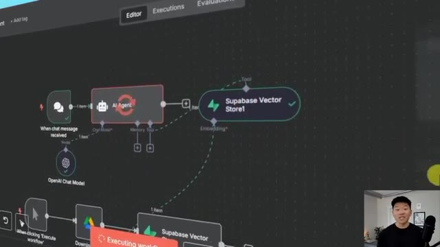
*⏱️ 00:00:06 — Vue rapprochée d'un workflow n8n montrant un Agent IA et un stockage vectoriel Supabase en cours d'exécution.*

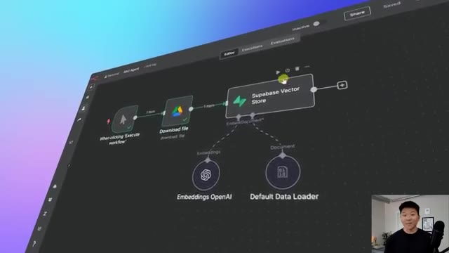
*⏱️ 00:00:12 — Interface de l'éditeur n8n affichant un workflow de RAG avec téléchargement de fichier et Supabase Vector Store.*

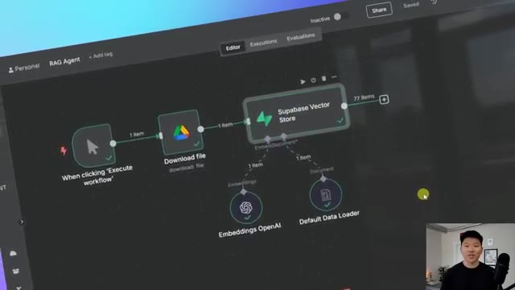
*⏱️ 00:00:18 — Workflow n8n complété montrant le traitement réussi du chargement de données vers le stockage vectoriel Supabase.*

---

### ⏱️ `[00:00:25 - 00:00:50]` | Segment #02

**🔊 Audio (Transcription Intégrale Mot pour Mot en Français) :**
> Donc, RAG signifie Retrieval Augmented Generation, et la façon la plus simple d'y penser est de récupérer des informations afin de répondre à une question avec précision. Donc si quelqu'un vous demande combien de pieds il y a dans un mile et que vous ne le savez pas, vous feriez probablement une recherche sur Google, vous récupéreriez cette réponse, et ensuite vous lui répondriez. Et donc quand je dis agent RAG, nous construisons fondamentalement juste un agent IA intelligent qui a accès à différentes sources de données afin que lorsque vous lui posez une question, il soit capable de chercher l'information, de chercher la bonne réponse, et ensuite de vous fournir une réponse.

**👁️ Analyse Visuelle d'Écran (gemini-3.5-flash-lite) :**
**Interface & Outils** : Diapositive de présentation avec un schéma en blocs.

**Contenu textuel & Code** : Texte « Retrieval Augmented Generation » et trois blocs représentant R (Retrieval), A (Augmented) et G (Generation).

**Action / Démonstration** : Le présentateur explique la signification et le fonctionnement du RAG à l'aide du schéma.

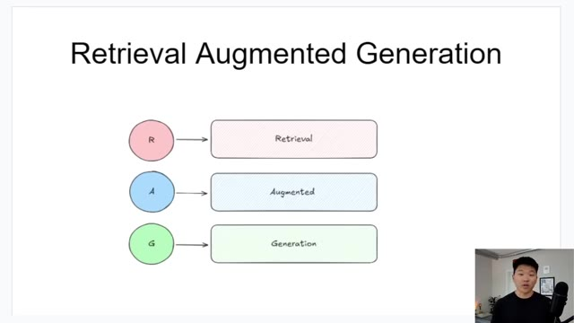
*⏱️ 00:00:31 — Schéma explicatif illustrant les trois lettres du RAG : R pour Retrieval, A pour Augmented, G pour Generation, avec le présentateur en médaillon en bas à droite.*

---

### ⏱️ `[00:00:50 - 00:01:26]` | Segment #03

**🔊 Audio (Transcription Intégrale Mot pour Mot en Français) :**
> Donc je voulais juste clarifier ça parce que je pense que beaucoup de gens associent le RAG explicitement aux bases de données vectorielles, mais ce n'est absolument pas le cas. Le RAG signifie simplement obtenir plus d'informations pour générer intelligemment une réponse. Cependant, aujourd'hui, nous allons construire un agent RAG qui fonctionne avec une base de données vectorielle. Si vous ne comprenez pas ce qu'est une base de données vectorielle, ne vous inquiétez pas. Voici ce que c'est. Une base de données vectorielle est un espace multidimensionnel où nous avons différents vecteurs partout. Et ce sont tous les points que vous voyez ici. Et tous ces vecteurs représentent différents morceaux de texte, et ils sont placés dans cet espace en fonction de leur sens. Donc ici, nous avons pomme et banane. Donc tous les vecteurs qui se trouvent dans cette zone ont probablement un rapport avec

**👁️ Analyse Visuelle d'Écran (gemini-3.5-flash-lite) :**
**Interface & Outils** : Logiciel de présentation de diapositive.

**Contenu textuel & Code** : Texte du titre 'Retrieval Augmented Generation' et blocs colorés définissant R, A et G.

**Action / Démonstration** : Présentation conceptuelle et définition théorique du RAG.

*⏱️ 00:00:59 — Diapositive explicative montrant le titre 'Retrieval Augmented Generation' avec un schéma détaillant les trois lettres R (Retrieval), A (Augmented) et G (Generation), tandis que le présentateur apparaît en médaillon dans le coin inférieur droit.*

---

### ⏱️ `[00:01:26 - 00:01:48]` | Segment #04

**🔊 Audio (Transcription Intégrale Mot pour Mot en Français) :**
> fruits. Et puis de ce côté-ci, nous avons loup, chien et chat. Donc tous les vecteurs de ce côté de la base de données vectorielles ont probablement un rapport avec les animaux. Et juste ici, vous pouvez voir une requête qui arrive, c'est chaton, et elle est placée près des autres animaux. Mais je vais expliquer tout le concept des requêtes dans quelques diapositives. Quoi qu'il en soit, j'ai dit que nous allions configurer une base de données vectorielles pour notre agent IA. Et pour ce faire, nous devons configurer deux choses différentes pour ce RAG vectoriel.

**👁️ Analyse Visuelle d'Écran (gemini-3.5-flash-lite) :**
**Interface & Outils** : Présentation visuelle (diapositive pédagogique)

**Contenu textuel & Code** : Représentation spatiale à trois axes avec des points verts et des étiquettes textuelles de mots-clés, et le titre "Vector Database".

**Action / Démonstration** : Le présentateur explique le positionnement des vecteurs dans l'espace multidimensionnel et l'intégration d'une requête ("Query_Kitten") proche des concepts d'animaux.

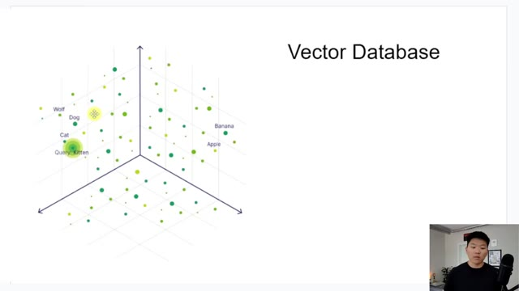
*⏱️ 00:01:31 — Schéma explicatif en 3D illustrant le fonctionnement d'une base de données vectorielle avec des points représentant des concepts (Wolf, Dog, Cat, Query_Kitten, Banana, Apple).*

---

### ⏱️ `[00:01:48 - 00:02:24]` | Segment #05

**🔊 Audio (Transcription Intégrale Mot pour Mot en Français) :**
> Le premier va être un pipeline RAG, ce qui signifie fondamentalement simplement que nous devons intégrer des données dans notre base de données vectorielle. Et puis la deuxième partie va être l'agent RAG proprement dit, où c'est à ce moment-là que nous pouvons réellement parler aux données de notre base de données vectorielle. Donc la première partie de ce que nous faisons ici est le pipeline RAG. Et c'est vraiment simple, alors laissez-moi vous l'expliquer. Voici donc une visualisation d'un pipeline RAG. Nous commençons par un document texte, et c'est ce que nous voulons mettre à l'intérieur de notre base de données vectorielle. Ensuite, nous devons faire trois choses. Nous devons le découper en morceaux pour que tous les morceaux soient divisés en différents morceaux, et chacun de ces morceaux est ce qui va être associé à un vecteur, l'un de ces points sur le graphique. Une fois qu'il est découpé en morceaux, nous le faisons passer par des embeddings

**👁️ Analyse Visuelle d'Écran (gemini-3.5-flash-lite) :**
**Interface & Outils** : Diapositive de présentation pédagogique avec illustration vectorielle et texte.

**Contenu textuel & Code** : Texte affiché : "Vector RAG", "1) RAG Pipeline - a) Get data into Vector DB", "2) RAG Agent - a) 'Talk' to the Vector DB".

**Action / Démonstration** : Le présentateur explique les deux grandes parties de la vidéo : l'intégration des données dans la base de données vectorielle et la création de l'agent RAG.

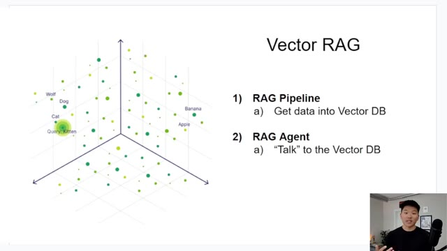
*⏱️ 00:01:57 — Schéma explicatif illustrant le fonctionnement d'un 'Vector RAG' avec d'un côté un espace vectoriel en 3D et de l'autre les étapes clés du projet.*

---

### ⏱️ `[00:02:24 - 00:02:54]` | Segment #06

**🔊 Audio (Transcription Intégrale Mot pour Mot en Français) :**
> modèle et cela signifie essentiellement que nous transformons ce texte en un tas de nombres. Et ensuite avec ces nombres, avec ces embeddings, nous sommes capables de vectoriser l'information et c'est ainsi qu'ils sont placés en fonction du sens. Donc dans ce cas, nous pouvons juste faire comme si le premier morceau du haut concerne les informations de l'entreprise, le morceau du milieu concerne les finances, et puis le morceau du bas concerne le marketing. C'est donc pour cela qu'ils sont placés dans des zones différentes dans cette base de données vectorielle. Et nous allons construire notre pipeline RAG et notre agent RAG dans un logiciel appelé n8n qui nous permet de glisser-déposer, sans code, super facile.

**👁️ Analyse Visuelle d'Écran (gemini-3.5-flash-lite) :**
**Interface & Outils** : Schéma/Diagramme explicatif (type présentation)

**Contenu textuel & Code** : Diagramme avec les étapes : "RAG Pipeline", "Document", "Chunks", "Embeddings Model", "Vectors" et la séquence "Chunk -> Embed -> Vectorize".

**Action / Démonstration** : Le présentateur explique le fonctionnement des embeddings et de la vectorisation de l'information en fonction du sens.

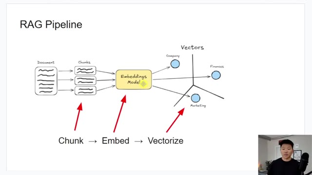
*⏱️ 00:02:32 — Schéma explicatif illustrant un pipeline RAG montrant la transformation de documents en chunks, puis leur passage dans un modèle d'embedding pour aboutir à une vectorisation sémantique.*

---

### ⏱️ `[00:02:54 - 00:03:13]` | Segment #07

**🔊 Audio (Transcription Intégrale Mot pour Mot en Français) :**
> Et c'est à cela que ça va finir par ressembler dans NNN. Donc c'est super simple. Nous allons récupérer notre document depuis Google Drive. Et ensuite, une fois que nous l'avons, nous devons découper en segments, intégrer et vectoriser. Nous allons donc utiliser ce chargeur de données pour le découper en segments, ce modèle d'intégrations pour l'intégrer, et ensuite le nœud Supabase pour le vectoriser et le placer dans notre base de données vectorielle. Et comme vous pouvez le voir, c'est une configuration vraiment simple.

**👁️ Analyse Visuelle d'Écran (gemini-3.5-flash-lite) :**
**Interface & Outils** : n8n (outil d'automatisation de workflows)

**Contenu textuel & Code** : Workflow n8n intitulé "RAG Pipeline" avec les nœuds : New Document (Google Drive), Download file (Google Drive), Upload to Supabase, Default Data Loader et Embeddings OpenAI. Légende en bas : "Chunk -> Embed -> Vectorize".

**Action / Démonstration** : Présentation du diagramme et explication des étapes du pipeline RAG dans n8n.

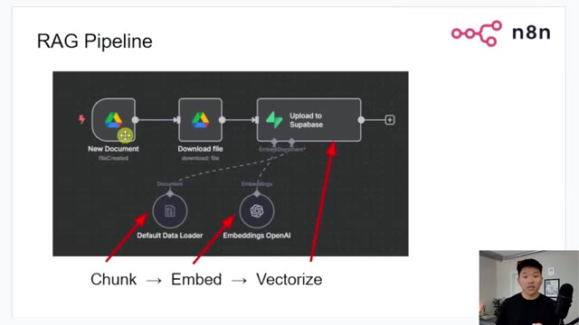
*⏱️ 00:02:59 — Schéma d'un pipeline RAG sur l'interface n8n montrant la récupération d'un document Google Drive, le découpage et l'intégration vers Supabase.*

---

### ⏱️ `[00:03:13 - 00:03:35]` | Segment #08

**🔊 Audio (Transcription Intégrale Mot pour Mot en Français) :**
> Il n'y a que cinq nœuds différents et aucun codage ne sera requis. Maintenant, la deuxième partie du système, une fois que nos données sont réellement dans cette base de données vectorielles, c'est que nous devons construire un agent qui peut lui parler. Voici donc une visualisation du fonctionnement d'un agent RAG, et c'est un processus très similaire. L'agent est donc déclenché lorsque nous faisons une requête. C'est donc ainsi que cela commencerait. Disons que dans ce cas, notre requête est : quelle est la mission de l'entreprise X ?

**👁️ Analyse Visuelle d'Écran (gemini-3.5-flash-lite) :**
**Interface & Outils** : Logiciel de présentation ou diagramme explicatif (type schéma dessiné à la main).

**Contenu textuel & Code** : Schéma du RAG Agent avec les étapes : Query (déclencheur), Embeddings Model, Vectors (base vectorielle), LLM Query et Response.

**Action / Démonstration** : Le présentateur explique la structure visuelle d'un agent RAG et les différents composants du flux de données.

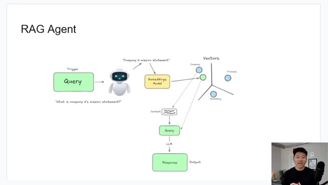
*⏱️ 00:03:18 — Schéma explicatif illustrant le fonctionnement d'un agent RAG avec une requête, un modèle d'embedding, une base vectorielle et une réponse LLM.*

---

### ⏱️ `[00:03:35 - 00:03:59]` | Segment #09

**🔊 Audio (Transcription Intégrale Mot pour Mot en Français) :**
> L'agent prend ensuite cette requête et l'envoie essentiellement au modèle d'incorporation pour qu'elle soit incorporée et transformée en chiffres. Et nous la faisons passer par le même modèle d'incorporation que plus tôt dans le pipeline afin que tout soit cohérent et corresponde. Une fois cette requête incorporée, elle est pour ainsi dire vectorisée et placée dans cette base de données vectorielles. Et vous pouvez voir ici, puisque nous avons posé des questions sur la mission de l'entreprise X, qu'elle est placée près de l'autre vecteur qui concernait les informations sur l'entreprise.

**👁️ Analyse Visuelle d'Écran (gemini-3.5-flash-lite) :**
**Interface & Outils** : Schéma/diagramme illustratif (style dessin animé/croquis)

**Contenu textuel & Code** : Textes et blocs : "RAG Agent", "Query", "Embed", "Embeddings Model", "Vectors", "Response", ainsi que des flèches rouges pointant vers les étapes clés du processus.

**Action / Démonstration** : Le présentateur explique visuellement le parcours d'une requête utilisateur à travers le modèle d'incorporation dans un pipeline RAG.

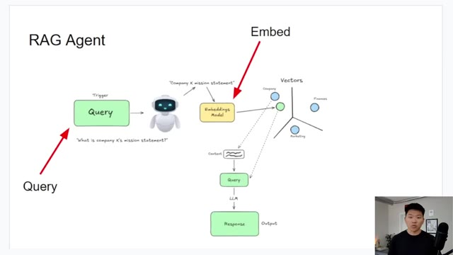
*⏱️ 00:03:41 — Schéma explicatif illustrant le fonctionnement d'un agent RAG, montrant le traitement d'une requête transmise à un modèle d'incorporation (embeddings) pour générer des vecteurs.*

---

### ⏱️ `[00:03:59 - 00:04:19]` | Segment #10

**🔊 Audio (Transcription Intégrale Mot pour Mot en Français) :**
> À partir de là, nous extrayons le vecteur de l'entreprise parce qu'il est proche de celui-ci. Nous extrayons la requête réelle qui a été posée au départ. Et ensuite, l'agent IA utilise son cerveau d'IA pour générer une réponse pour nous. Et c'est pourquoi, dans cette diapositive, nous avions la requête égale chaton. Et c'est ainsi que nous savons qu'il a été placé près d'autres vecteurs liés aux animaux. Alors, à quoi est-ce que cela va ressembler quand nous entrerons dans NNN ?

**👁️ Analyse Visuelle d'Écran (gemini-3.5-flash-lite) :**
**Interface & Outils** : Diapositive de présentation avec schéma technique animé ou annoté.

**Contenu textuel & Code** : Diagramme légendé avec les blocs 'Query', 'Embeddings Model', 'Vectors' et 'Response'.

**Action / Démonstration** : Explication visuelle du fonctionnement d'un agent RAG et du traitement des requêtes vectorielles.

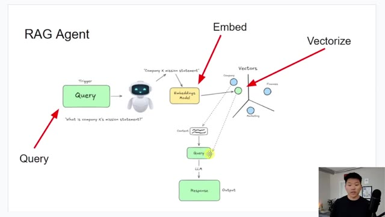
*⏱️ 00:04:04 — Schéma explicatif d'un agent RAG montrant le processus de requête, d'incorporation (embeddings), de recherche vectorielle et de génération de réponse par un LLM.*

---

### ⏱️ `[00:04:19 - 00:04:40]` | Segment #11

**🔊 Audio (Transcription Intégrale Mot pour Mot en Français) :**
> Comme vous pouvez le voir, encore une fois, ce n'est pas trop difficile. Nous avons un déclencheur de chat juste ici, et c'est ainsi que nous pouvons parler à l'agent et nous le déclenchons avec une requête. À partir de là, l'agent prend notre requête et doit l'envoyer au modèle d'incorporation pour être incorporée. Après cela, il va la renvoyer à Supabase pour être vectorisée. L'agent va ensuite examiner notre requête d'origine, les informations vectorisées, puis il va utiliser son cerveau pour générer une réponse pour nous.

**👁️ Analyse Visuelle d'Écran (gemini-3.5-flash-lite) :**
**Interface & Outils** : n8n workflow builder

**Contenu textuel & Code** : Nœuds n8n : "When chat message received" (déclencheur), "RAG Agent", "OpenRouter Chat Model", "Embeddings OpenAI1", "Supabase Vector Store1".

**Action / Démonstration** : Présentation du flux de données du déclencheur de chat vers l'agent RAG et les modèles d'incorporation.

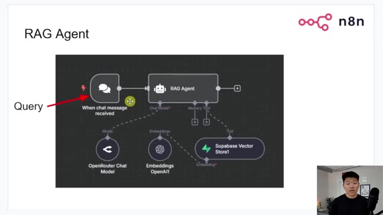
*⏱️ 00:04:25 — Schéma de workflow n8n montrant un Agent RAG relié à un déclencheur de chat (Query), un modèle OpenRouter Chat, des embeddings OpenAI et une base vectorielle Supabase.*

---

### ⏱️ `[00:04:40 - 00:04:59]` | Segment #12

**🔊 Audio (Transcription Intégrale Mot pour Mot en Français) :**
> Et pour ce cas d'usage spécifique, le document que nous allons vectoriser va être un PDF de 22 pages passant en revue les règles du golf. Donc encore une fois, ce processus consiste à découper le document en morceaux, nous allons l'intégrer et le vectoriser, et c'est ainsi qu'il entre dans notre base de données vectorielle. Et une fois que nous avons toutes les informations dans la base de données vectorielle, nous pouvons dialoguer avec elle par l'intermédiaire de notre agent IA.

**👁️ Analyse Visuelle d'Écran (gemini-3.5-flash-lite) :**
**Interface & Outils** : Présentation visuelle / Diagramme conceptuel

**Contenu textuel & Code** : Texte "The Rules of Golf - Simplified", flèches de flux, texte "Vectorize", icône de base de données, icônes de bulles de discussion (chat)

**Action / Démonstration** : Le présentateur explique graphiquement le processus de découpage, d'intégration et de vectorisation d'un document PDF vers une base de données.

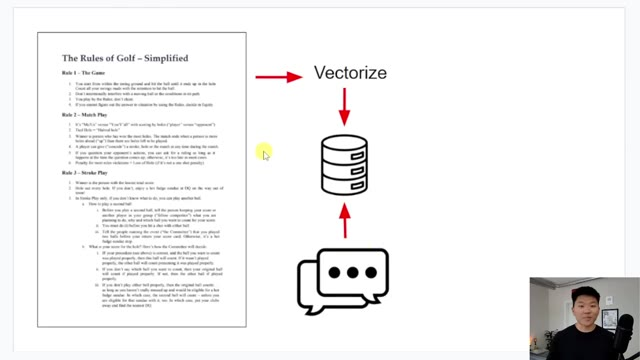
*⏱️ 00:04:45 — Schéma explicatif illustrant le processus de vectorisation d'un document PDF ("The Rules of Golf - Simplified") vers une base de données avec des icônes de requêtes textuelles.*

---

### ⏱️ `[00:04:59 - 00:05:19]` | Segment #13

**🔊 Audio (Transcription Intégrale Mot pour Mot en Français) :**
> Donc c'est l'exemple que nous allons construire ensemble aujourd'hui. Mais juste pour qu'on puisse prendre du recul rapidement, la source de données réelle pour la base de données vectorielle ne doit pas toujours être un document textuel. Et la façon dont nous parlons à notre agent ne doit pas toujours être un déclencheur de chat. Les sources de données peuvent être tout ce que nous voulons. Cela peut être chaque fois qu'un nouvel enregistrement ou un nouveau ticket dans HubSpot est soumis, nous le transformons en vecteur.

**👁️ Analyse Visuelle d'Écran (gemini-3.5-flash-lite) :**
**Interface & Outils** : Présentation vidéo avec schémas explicatifs.

**Contenu textuel & Code** : Schémas d'architecture de flux de données vectorielles et d'intégration d'API.
[DESC_IMAGE_1] [DESC_IMAGE_2] Présentation des concepts de sources de données alternatives pour les bases de données vectorielles.

**Action / Démonstration** : Explications face caméra et démonstration conceptuelle.

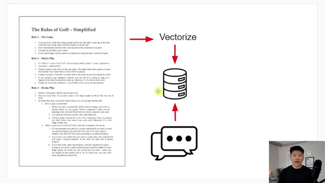
*⏱️ 00:05:04 — Schéma conceptuel montrant la vectorisation d'un document textuel (Règles de golf) vers une base de données vectorielle.*

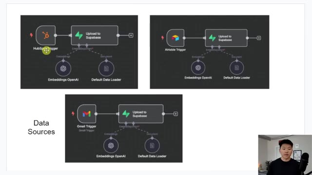
*⏱️ 00:05:14 — Diagrammes de flux montrant différentes sources de données (HubSpot, Airtable, Gmail) se connectant à Supabase via des embeddings OpenAI.*

---

### ⏱️ `[00:05:19 - 00:05:39]` | Segment #14

**🔊 Audio (Transcription Intégrale Mot pour Mot en Français) :**
> Cela pourrait être un déclencheur Airtable. Cela pourrait être chaque e-mail que nous recevons, nous voulons le mettre dans une base de données vectorielle. Il y a des tonnes de cas d'utilisation différents. C'est la même chose avec le déclencheur d'agent. Cela pourrait être quelque chose où l'agent ne fonctionne que lorsque nous lui parlons et que nous lui envoyons un message texte. Ou cela pourrait aussi être, d'accord, chaque fois que je reçois un e-mail, je veux que l'agent lise l'e-mail, recherche des informations dans ma base de données vectorielle, puis réponde pour moi.

**👁️ Analyse Visuelle d'Écran (gemini-3.5-flash-lite) :**
**Interface & Outils** : Présentation vidéo avec schémas de workflows d'automatisation (style Flowise / Langflow / n8n)

**Contenu textuel & Code** : Schémas de flux de données montrant HubSpot, Airtable, Gmail triggers, Supabase, OpenAI Embeddings, et RAG Agents.

**Action / Démonstration** : Le présentateur explique les différents cas d'utilisation et types de déclencheurs pour l'ingestion de données et les agents IA.

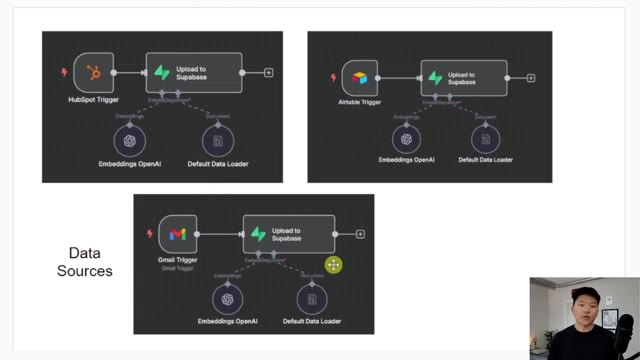
*⏱️ 00:05:24 — Diapositive présentant différentes sources de données pour l'automatisation, avec des workflows connectant des déclencheurs (HubSpot, Airtable, Gmail) à Supabase et OpenAI Embeddings.*

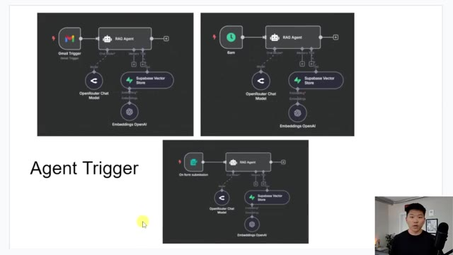
*⏱️ 00:05:29 — Diapositive illustrant les déclencheurs d'agents (« Agent Trigger ») avec des workflows intégrant des agents RAG connectés à OpenRouter, Supabase Vector Store et OpenAI Embeddings.*

---

### ⏱️ `[00:05:39 - 00:05:58]` | Segment #15

**🔊 Audio (Transcription Intégrale Mot pour Mot en Français) :**
> Ou alors, ça pourrait juste être chaque matin, l'agent va se déclencher, regarder dans la base de données vectorielle et m'envoyer une sorte de résumé. Ou l'agent pourrait aussi être déclenché par quelque chose comme la soumission d'un formulaire. Il y a donc de nombreuses façons d'intégrer le RAG et les agents RAG dans n'importe quel type de flux que vous cherchez à automatiser. Et enfin, je voulais juste aborder rapidement, il existe différents fournisseurs pour les bases de données vectorielles et ils ont tous, en gros, leurs forces et leurs faiblesses.

**👁️ Analyse Visuelle d'Écran (gemini-3.5-flash-lite) :**
**Interface & Outils** : Diaporama de présentation avec diagrammes de workflows (type n8n) et logos de bases de données vectorielles.

**Contenu textuel & Code** : Schémas de workflows d'agents IA avec déclencheurs (Gmail Trigger, 6am, On form submission), agent RAG, OpenRouter Chat Model et Supabase Vector Store ; logos de Pinecone, Qdrant et Supabase.

**Action / Démonstration** : Le présentateur explique les différentes manières de déclencher un agent IA intégrant un RAG (déclencheur horaire, email, formulaire) et présente les différentes options de bases de données vectorielles.

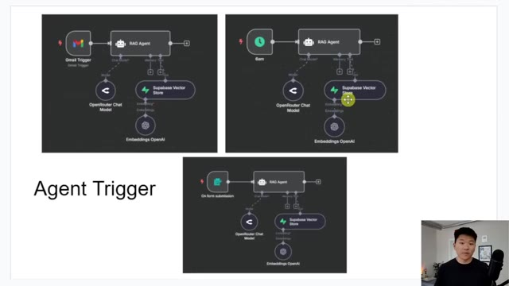
*⏱️ 00:05:44 — Présentation de trois diagrammes de workflows différents montrant divers déclencheurs (Gmail, horaire 6h, soumission de formulaire) connectés à un agent RAG.*

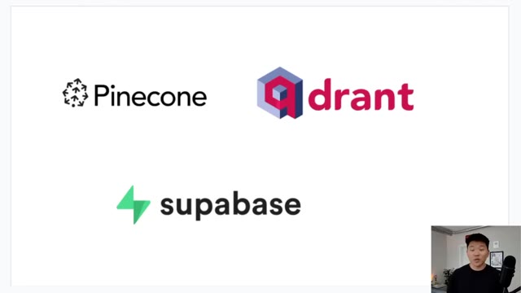
*⏱️ 00:05:53 — Écran affichant les logos de trois bases de données vectorielles populaires : Pinecone, Qdrant et Supabase.*

---

### ⏱️ `[00:05:59 - 00:06:18]` | Segment #16

**🔊 Audio (Transcription Intégrale Mot pour Mot en Français) :**
> Ce qu'on utilise aujourd'hui, c'est Supabase. Je ne vais pas trop entrer dans les détails exacts de pourquoi je choisis Supabase aujourd'hui. Il a bien plus que de simples capacités de base de données vectorielle. Il nous permet aussi de faire des choses de base de données relationnelle. Et ce qu'on va faire aujourd'hui, c'est qu'on va utiliser Supabase pour le magasin de vecteurs qui est construit sur Postgres SQL donc c'est en quelque sorte un deux en un et on va utiliser Postgres SQL pour notre mémoire à court terme.

**👁️ Analyse Visuelle d'Écran (gemini-3.5-flash-lite) :**
**Interface & Outils** : Diapositive de présentation / PowerPoint

**Contenu textuel & Code** : Logos de Pinecone, Qdrant et Supabase

**Action / Démonstration** : Présentation des options de bases de données vectorielles

---

### ⏱️ `[00:06:18 - 00:06:37]` | Segment #17

**🔊 Audio (Transcription Intégrale Mot pour Mot en Français) :**
> Donc je vais vous montrer tout ça à tous. Allons sur Supabase et configurons ça. Très bien, nous y voilà sur supabase.com et si vous n'avez jamais configuré ça auparavant, ne vous inquiétez pas. Nous allons voir ça ensemble. Ce que je vais faire, c'est simplement cliquer ici sur ce bouton vert qui dit « démarrer votre projet ». Vous pouvez voir que j'ai déjà un projet configuré mais ce que je vais faire, c'est simplement aller de l'avant et en créer un nouveau. Je vais pouvoir lancer celui-ci gratuitement.

**👁️ Analyse Visuelle d'Écran (gemini-3.5-flash-lite) :**
**Interface & Outils** : Navigateur web affichant supabase.com

**Contenu textuel & Code** : Texte principal : "Build in a weekend, Scale to millions" et bouton vert "Start your project".

**Action / Démonstration** : Le présentateur navigue sur le site web de Supabase avant de lancer la configuration d'un projet.

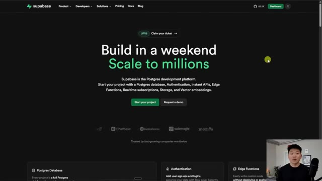
*⏱️ 00:06:23 — Page d'accueil officielle du site web de Supabase montrant le slogan principal et les fonctionnalités de la plateforme.*

---

### ⏱️ `[00:06:37 - 00:07:00]` | Segment #18

**🔊 Audio (Transcription Intégrale Mot pour Mot en Français) :**
> Je vais juste appeler celui-ci test. Et ensuite, je dois me donner un mot de passe pour la base de données. Donc, je me suis donné un mot de passe, et n'oubliez pas ce mot de passe, car nous allons évidemment devoir l'utiliser plus tard pour connecter n8n à notre Supabase. Très bien, donc pour l'instant, vous pouvez voir que notre projet est en train de se lancer, et cela va finir par devenir vert. Donc, pendant que nous attendons que cela se configure, passons sur n8n et créons un nouveau flux de travail afin que nous puissions commencer tout ce pipeline RAG.

**👁️ Analyse Visuelle d'Écran (gemini-3.5-flash-lite) :**
**Interface & Outils** : Navigateur web (Interface Supabase)

**Contenu textuel & Code** : Formulaire 'Create a new project' avec le nom de projet réglé sur 'test' et un mot de passe sécurisé.

**Action / Démonstration** : Saisie du nom du projet et définition du mot de passe de la base de données avant la création du projet.

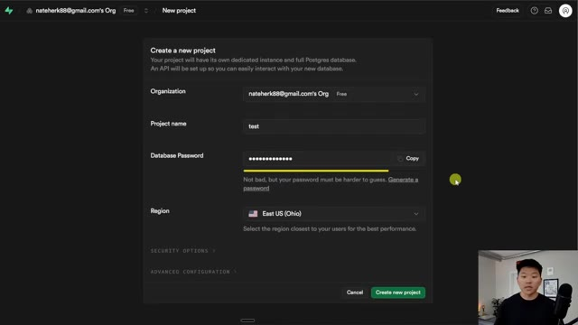
*⏱️ 00:06:43 — Formulaire de création d'un nouveau projet Supabase avec les champs pour l'organisation, le nom du projet ('test'), le mot de passe de la base de données masqué, et le choix de la région.*

---

### ⏱️ `[00:07:01 - 00:07:21]` | Segment #19

**🔊 Audio (Transcription Intégrale Mot pour Mot en Français) :**
> Donc comme je vous l'ai dit les gars, ce qu'on va mettre dans notre base de données vectorielle aujourd'hui c'est ce PDF qui est dans mon Google Drive appelé "Les Règles de Golf Simplifiées", et c'est un PDF de 22 pages. Très rapidement, les gars, je me suis dit que ce serait une meilleure expérience de suivre cette vidéo en utilisant exactement le même PDF que j'ai là, juste pour que vous puissiez suivre tout ce que je fais étape par étape. Donc je mettrai un lien vers ce PDF dans ma communauté FreeSchool.

**👁️ Analyse Visuelle d'Écran (gemini-3.5-flash-lite) :**
**Interface & Outils** : Google Drive / Visionneuse de PDF

**Contenu textuel & Code** : Fichiers Google Drive incluant "Rules_of_Golf_Simplified.pdf", "From Zero to Your First RAG Agent", et texte des règles de golf.

**Action / Démonstration** : Sélection et ouverture du fichier PDF "Rules_of_Golf_Simplified.pdf" depuis Google Drive.

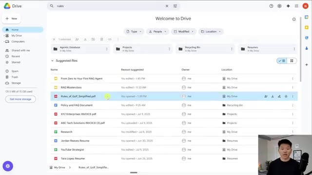
*⏱️ 00:07:06 — Vue de Google Drive montrant la liste des fichiers, avec le fichier "Rules_of_Golf_Simplified.pdf" sélectionné.*

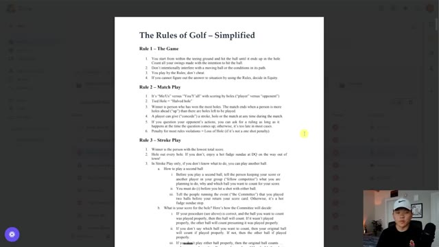
*⏱️ 00:07:11 — Aperçu du document PDF "The Rules of Golf - Simplified" affiché à l'écran.*

---

### ⏱️ `[00:07:21 - 00:07:40]` | Segment #20

**🔊 Audio (Transcription Intégrale Mot pour Mot en Français) :**
> Le lien pour cela sera dans la description. Vous rejoindrez la FreeSchool, et ensuite, quand vous arriverez ici, cherchez simplement ici le titre de la vidéo ou allez dans les ressources YouTube, et lorsque vous trouverez la publication associée à la vidéo, vous verrez qu'il y aura des ressources juste ici. C'était donc un mauvais exemple, mais dans celui-ci, vous pouvez voir qu'il y a un fichier JSON, et c'est ici que je joindrai le PDF à votre disposition.

**👁️ Analyse Visuelle d'Écran (gemini-3.5-flash-lite) :**
**Interface & Outils** : Navigateur web affichant la plateforme communautaire Skool (AI Automation Society).

**Contenu textuel & Code** : Publications de la communauté, listes de discussion, et fichiers de ressources associés à la vidéo (JSON, texte).

**Action / Démonstration** : Navigation dans la communauté Skool et sélection d'une publication pour accéder aux ressources de la vidéo.

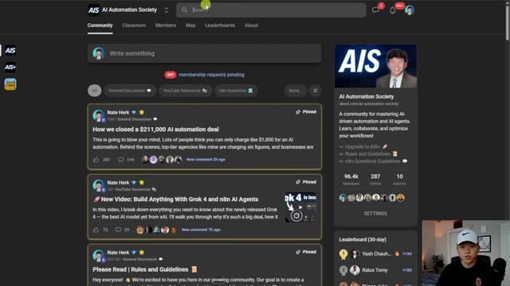
*⏱️ 00:07:26 — Vue d'ensemble de la plateforme Skool "AI Automation Society" montrant la page de communauté avec divers messages et épingles.*

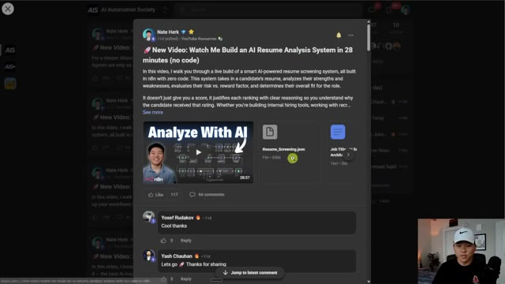
*⏱️ 00:07:35 — Affichage d'une publication spécifique sur Skool contenant une vidéo intégrée et des fichiers de ressources téléchargeables (comme "Resume_Screening.json").*

---

### ⏱️ `[00:07:40 - 00:08:02]` | Segment #21

**🔊 Audio (Transcription Intégrale Mot pour Mot en Français) :**
> Donc, pour que nous puissions accéder à ce PDF, nous allons devoir nous connecter à Google Drive et l'éditer. Donc, ce que je vais faire très rapidement, c'est appuyer sur la touche tabulation. Je vais taper Google Drive. J'ai mal orthographié Google un tout petit peu. Je clique dessus, et ensuite je vais ouvrir les actions, ce qui va être de télécharger le fichier. Maintenant que je suis dans ce nœud, tout ce que j'ai à faire, c'est me connecter à mon compte Google. Si vous ne savez pas comment faire ou si vous n'avez pas encore configuré cela, allez jeter un œil à cette vidéo.

**👁️ Analyse Visuelle d'Écran (gemini-3.5-flash-lite) :**
**Interface & Outils** : Application web de construction de workflows (type n8n).

**Contenu textuel & Code** : Espace de travail vide avec une grille de points, un menu latéral à gauche et un bouton "+" central pour ajouter la première étape.

**Action / Démonstration** : Le présentateur navigue dans l'interface pour préparer l'ajout d'une intégration Google Drive.

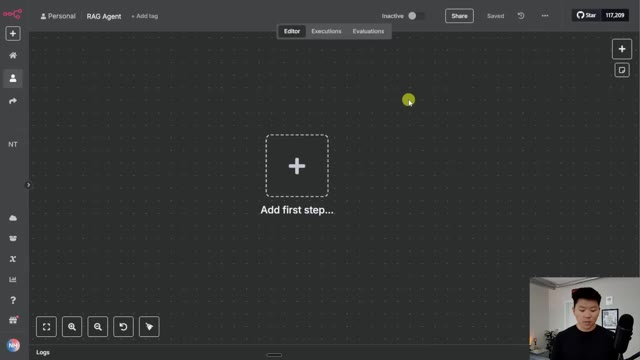
*⏱️ 00:07:46 — Interface d'un éditeur de workflow avec un espace de travail vide et un bouton central pour ajouter une première étape ("Add first step...").*

---

### ⏱️ `[00:08:02 - 00:08:21]` | Segment #22

**🔊 Audio (Transcription Intégrale Mot pour Mot en Français) :**
> Je parcours tout cela étape par étape. Ça prendra environ trois minutes. Une fois que vous aurez terminé et que vous serez connecté à votre Google Drive, tout ce que nous allons faire, c'est parcourir notre liste de différents documents dans notre compte. Et le nôtre s'appelait Règles du golf. Donc je vais taper « règle » et nous devrions le voir apparaître juste là. Et maintenant, je vais pouvoir importer ce PDF. Donc si j'exécute l'étape, nous devrions pouvoir le voir s'afficher sur ce côté droit.

**👁️ Analyse Visuelle d'Écran (gemini-3.5-flash-lite) :**
**Interface & Outils** : Application de workflow (n8n ou similaire)

**Contenu textuel & Code** : Paramètres du nœud "Download file" avec le compte Google Drive connecté ("nateherk88@gmail.com"), la ressource "File", l'opération "Download", et le champ de sélection de fichier ("From list", "Select a file...").

**Action / Démonstration** : Configuration des paramètres d'un nœud Google Drive pour sélectionner un fichier à télécharger depuis la liste.

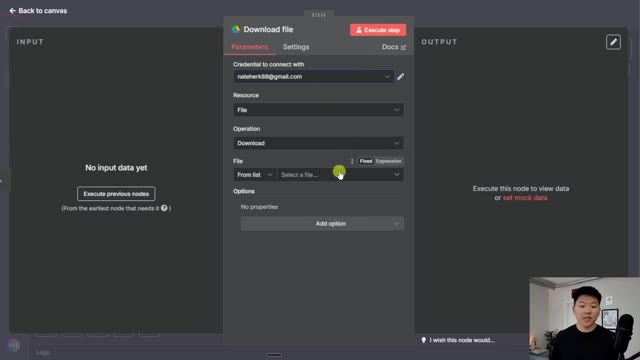
*⏱️ 00:08:07 — Interface d'un nœud de configuration dans une application de workflow montrant les paramètres de téléchargement d'un fichier depuis Google Drive.*

---

### ⏱️ `[00:08:21 - 00:08:42]` | Segment #23

**🔊 Audio (Transcription Intégrale Mot pour Mot en Français) :**
> Et voilà. C'est nos données binaires, qui constituent notre PDF des Règles du Golf. Et ce que vous remarquerez également, c'est que lorsque vous avez exécuté ce nœud, cela a automatiquement ajouté ceci en cliquant sur le déclencheur d'exécution du flux de travail, ce qui signifie fondamentalement que chaque fois que je clique sur ce bouton en bas, cela va exécuter le reste des nœuds que nous avons reliés. Nous avons donc notre PDF ici et tout ce que nous avons à faire ensuite, c'est de l'insérer dans Supabase.

**👁️ Analyse Visuelle d'Écran (gemini-3.5-flash-lite) :**
**Interface & Outils** : n8n (éditeur de workflow visuel)

**Contenu textuel & Code** : Nœuds de workflow : 'When clicking Execute workflow' et 'Download file' reliés par une flèche indiquant le passage de 1 item.

**Action / Démonstration** : Exécution d'un flux de travail pour télécharger un fichier depuis Google Drive.

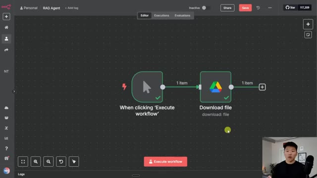
*⏱️ 00:08:26 — Interface d'un éditeur de workflow avec deux nœuds connectés : un déclencheur 'When clicking Execute workflow' et un nœud Google Drive 'Download file'.*

---

### ⏱️ `[00:08:42 - 00:09:06]` | Segment #24

**🔊 Audio (Transcription Intégrale Mot pour Mot en Français) :**
> Donc ça va être super simple. Je vais cliquer sur ce bouton plus après Google Drive. Je vais taper Supabase et nous pouvons voir que nous avons Supabase et c'est là que nous avons nos tables relationnelles et tout, mais ce que nous voulons faire, c'est accéder à un magasin de vecteurs. Je vais donc cliquer sur Supabase Vector Store. Je vais cliquer sur ajouter des documents au magasin de vecteurs. Et maintenant, ce que nous allons devoir faire, c'est configurer notre identifiant Supabase et également dans Supabase, créer une table de base de données vectorielle.

**👁️ Analyse Visuelle d'Écran (gemini-3.5-flash-lite) :**
**Interface & Outils** : Interface web de workflow (style n8n ou similaire) avec intégration de Supabase Vector Store.

**Contenu textuel & Code** : Nœuds de workflow connectés, recherche de composants "supa", et paramètres de configuration du magasin de vecteurs Supabase.

**Action / Démonstration** : Sélection et configuration d'un nœud Supabase Vector Store dans le workflow.

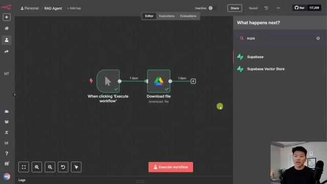
*⏱️ 00:08:48 — Interface d'un outil de workflow montrant un canvas avec des nœuds connectés ("When clicking 'Execute workflow'" et "Download file") et un panneau de recherche latéral affichant "Supabase" et "Supabase Vector Store".*

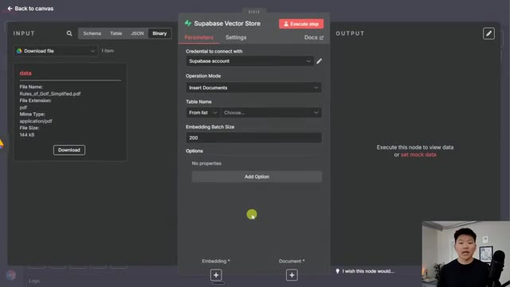
*⏱️ 00:09:00 — Panneau de configuration du nœud "Supabase Vector Store" affichant les paramètres de connexion, le mode d'opération, le nom de la table et la taille du lot d'embedding.*

---

### ⏱️ `[00:09:06 - 00:09:27]` | Segment #25

**🔊 Audio (Transcription Intégrale Mot pour Mot en Français) :**
> Donc, afin de créer notre identifiant Supabase, je vais ouvrir ce menu déroulant et cliquer sur "créer un nouvel identifiant". Et ce qu'il nous demande, c'est un hôte et un secret de rôle de service. Donc tout ce que j'ai à faire, c'est de retourner dans Supabase. Vous pouvez voir maintenant que l'état de notre projet est vert, tout va bien. Et sur ce côté gauche, je vais aller tout en bas dans les paramètres. Ici, je vais faire défiler tout en bas sur ce côté gauche jusqu'à l'API de données.

**👁️ Analyse Visuelle d'Écran (gemini-3.5-flash-lite) :**
**Interface & Outils** : Plateforme d'automatisation (nœud de connexion Supabase) et interface web de Supabase.

**Contenu textuel & Code** : Champs de saisie pour "Host" et "Service Role Secret" dans l'image 1 ; interface de bienvenue de Supabase avec des exemples de tables SQL dans l'image 2.

**Action / Démonstration** : Configuration des credentials (identifiants) pour relier l'outil d'automatisation à l'instance de base de données Supabase.

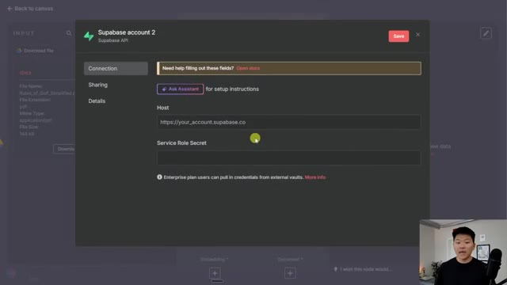
*⏱️ 00:09:11 — Fenêtre contextuelle dans une plateforme d'automatisation (type workflow) demandant la configuration des identifiants Supabase via un "Host" et un "Service Role Secret".*

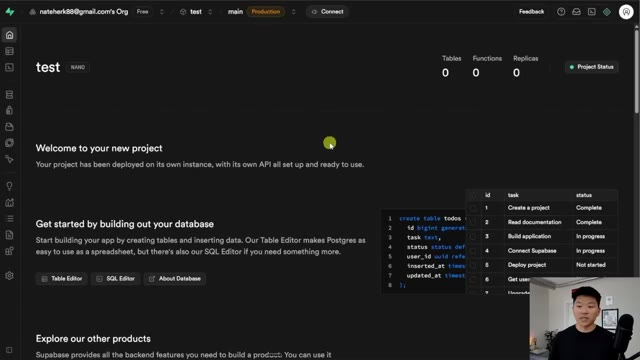
*⏱️ 00:09:17 — Tableau de bord principal de Supabase montrant un nouveau projet "test" avec des options pour accéder à l'éditeur de table, l'éditeur SQL et les paramètres du projet.*

---

### ⏱️ `[00:09:27 - 00:09:48]` | Segment #26

**🔊 Audio (Transcription Intégrale Mot pour Mot en Français) :**
> Et ensuite, juste ici, cette URL de projet est en fait notre hôte. Donc je vais cliquer sur copier. Nous allons retourner dans n8n et nous allons coller l'hôte juste là. Et ensuite, afin d'obtenir notre clé secrète de rôle de service, nous allons retourner dans Supabase. Je vais cliquer sur le côté gauche juste ici, là où il est écrit clés API. Et puis ce bouton juste ici, la clé secrète de rôle de service, vous cliquerez sur afficher, vous la copierez, et ensuite vous la collerez dans la section.

**👁️ Analyse Visuelle d'Écran (gemini-3.5-flash-lite) :**
**Interface & Outils** : n8n (éditeur de workflow) et Supabase (tableau de bord de gestion de projet).

**Contenu textuel & Code** : URL de projet Supabase : `https://ikzfgbmfitkrbkoaehkh.supabase.co`.

**Action / Démonstration** : Copie de l'URL du projet depuis Supabase pour l'intégrer ultérieurement dans la configuration du nœud n8n.

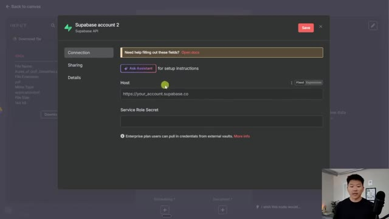
*⏱️ 00:09:33 — Fenêtre de configuration d'un nœud "Supabase" dans n8n, affichant les champs "Host" et "Service Role Secret" à remplir.*

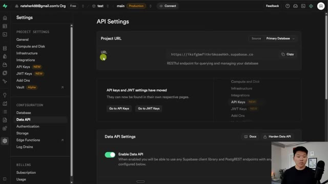
*⏱️ 00:09:38 — Page des paramètres "Data API" dans le tableau de bord Supabase, mettant en évidence le champ "Project URL" avec un bouton pour copier l'adresse.*

---

### ⏱️ `[00:09:49 - 00:10:21]` | Segment #27

**🔊 Audio (Transcription Intégrale Mot pour Mot en Français) :**
> Donc je viens juste de copier cette clé, je l'ai collée ici. Et maintenant si je clique sur enregistrer, nous devrions être connectés à Supabase. Ensuite, c'est toujours une bonne pratique de nommer ce identifiant, soit avec votre email, soit avec la date, ou peu importe ce que c'est, juste pour pouvoir les garder tous séparés. Nous nous sommes donc officiellement connectés à Supabase, et maintenant ce que nous devons faire, c'est configurer une table. Si je clique ici, vous pouvez voir qu'il n'y a pas de tables dans notre compte. Cela peut sembler technique, mais ça va être super facile. Vous allez juste cliquer sur Documents ici. Vous allez faire défiler un tout petit peu vers le bas où il y a un guide de démarrage rapide pour configurer votre base de données vectorielle. Et puis une fois que nous arrivons sur cette page, tout ce que nous avons à faire est de faire défiler un peu vers le bas et de copier cette commande SQL juste

**👁️ Analyse Visuelle d'Écran (gemini-3.5-flash-lite) :**
**Interface & Outils** : n8n (interface de workflow automation).

**Contenu textuel & Code** : URL de l'hôte Supabase (https://lkzfgbmfitkrbkoaehkh.supabase.co) et champ masqué pour le « Service Role Secret ».

**Action / Démonstration** : Validation de la connexion à la base de données Supabase après saisie des identifiants API dans le nœud n8n.

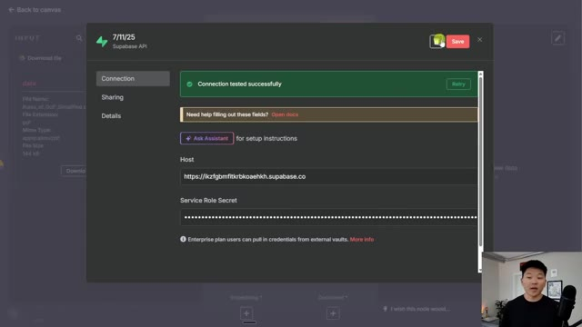
*⏱️ 00:09:57 — Fenêtre modale de configuration d'un nœud « Supabase API » dans l'interface n8n, affichant un message de confirmation « Connection tested successfully » en vert.*

---

### ⏱️ `[00:10:21 - 00:10:57]` | Segment #28

**🔊 Audio (Transcription Intégrale Mot pour Mot en Français) :**
> ...ici et retourner dans notre Supabase. Et sur le côté gauche, nous allons aller dans l'éditeur SQL. Une fois que cela s'ouvre, nous allons simplement cliquer sur « new SQL snippet », coller ça là-dedans. Pas besoin de changer quoi que ce soit, puis cliquez sur exécuter. Et cela va en gros nous créer une base de données vectorielle appelée documents. Si vous avez déjà exécuté cette commande auparavant et que vous souhaitez créer une table différente, tout ce que vous avez à faire est de supprimer ces deux premières lignes qui disent « create extension vector » parce que vous avez déjà créé l'extension. Et ensuite, juste ici où il est écrit « create table documents », vous allez simplement changer ce nom. Au lieu de documents, vous mettrez le nom que vous voulez pour votre table. Et ensuite, vous n'aurez plus qu'à changer chaque occurrence dans le reste de

**👁️ Analyse Visuelle d'Écran (gemini-3.5-flash-lite) :**
**Interface & Outils** : Interface web Supabase (éditeur SQL).

**Contenu textuel & Code** : Code SQL de la fonction de recherche de similarité vectorielle avec des instructions SELECT, FROM documents et ORDER BY.

**Action / Démonstration** : Collage et préparation de la requête SQL avant exécution dans Supabase.

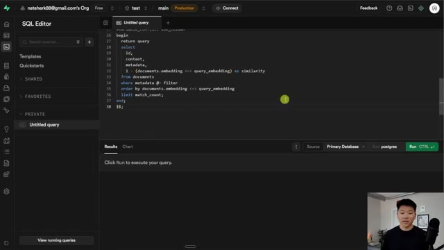
*⏱️ 00:10:30 — L'éditeur SQL de Supabase affichant une requête de recherche vectorielle avec la fonction 'match_documents'.*

---

### ⏱️ `[00:10:57 - 00:11:29]` | Segment #29

**🔊 Audio (Transcription Intégrale Mot pour Mot en Français) :**
> La commande où vous voyez « documents », vous mettrez tout ce que vous avez tapé juste ici pour le nom de votre table. Mais maintenant, si je vais sur le côté gauche et que je vais dans l'éditeur de table, vous pouvez voir que nous avons une table juste ici appelée « documents », et elle attend qu'on y mette nos vecteurs. Donc, de retour dans n8n, je peux ouvrir ceci et nous devrions voir, si on rafraîchit simplement cette liste, peut-être qu'on devrait voir notre table juste ici appelée « documents ». Et je ne veux pas vous embrouiller, les gars. Donc si vous avez suivi toutes les étapes que je viens de faire, vous n'aurez pas à vous soucier de ça. Mais si vous avez créé une table différente, disons que vous avez créé une table appelée « test », vous vous assurerez simplement de modifier ceci juste ici pour que cela corresponde à match_test.

**👁️ Analyse Visuelle d'Écran (gemini-3.5-flash-lite) :**
**Interface & Outils** : Supabase (Table Editor) et n8n (éditeur de workflow).

**Contenu textuel & Code** : Noms de tables SQL ('documents'), configuration de nœud d'automatisation, métadonnées de fichier PDF ('Rules_of_Golf_Simplified.pdf').

**Action / Démonstration** : Navigation dans l'éditeur de base de données Supabase et configuration des paramètres d'insertion de documents dans le nœud n8n.

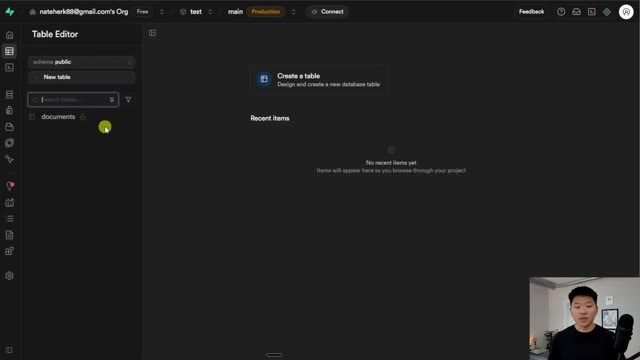
*⏱️ 00:11:05 — Interface de l'éditeur de table (Table Editor) dans Supabase montrant une liste de tables existantes dans le schéma 'public', avec la table nommée 'documents' visible dans la barre latérale gauche.*

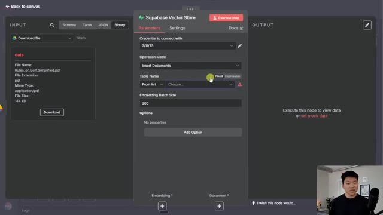
*⏱️ 00:11:13 — Interface de configuration du nœud 'Supabase Vector Store' dans un outil d'automatisation (n8n), affichant les paramètres de connexion, le mode d'opération 'Insert Documents' et le champ 'Table Name' en attente de sélection.*

---

### ⏱️ `[00:11:29 - 00:11:53]` | Segment #30

**🔊 Audio (Transcription Intégrale Mot pour Mot en Français) :**
> plutôt que de faire correspondre des documents avec des tirets bas. Et maintenant que nous nous sommes connectés ici, nous devons juste faire deux choses de plus. Nous devons découper en segments puis intégrer afin de pouvoir réellement vectoriser. La première chose que nous allons faire est de découper en segments. Et pour ce faire, nous allons cliquer sur ce plus juste ici sous document. Cela va nous ouvrir des chargeurs de documents. Et je vais choisir le chargeur de données par défaut. Ce qui se passe ici, c'est que nous disons simplement à Supabase, voici ce que je veux vectoriser et voici comment je veux que tu le découpes.

**👁️ Analyse Visuelle d'Écran (gemini-3.5-flash-lite) :**
**Interface & Outils** : Interface web de workflow d'automatisation (n8n ou outil similaire).

**Contenu textuel & Code** : Blocs de workflow : "When clicking 'Execute workflow'", "Download file" et "Supabase Vector Store".

**Action / Démonstration** : Le présentateur explique la configuration des nœuds du workflow pour le traitement des documents et l'intégration vectorielle.

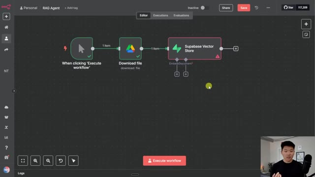
*⏱️ 00:11:35 — Interface d'un constructeur de workflow (type n8n) montrant un diagramme avec trois blocs connectés : déclencheur de clic, téléchargement de fichier et stockage vectoriel Supabase.*

---

### ⏱️ `[00:11:54 - 00:12:13]` | Segment #31

**🔊 Audio (Transcription Intégrale Mot pour Mot en Français) :**
> Et la bonne nouvelle, c'est qu'on peut fondamentalement laisser le découpage de texte aussi simple. Donc, il se découpe tous les mille caractères avec un chevauchement de 200 caractères. Si vous vouliez obtenir quelque chose de plus personnalisé, vous pourriez toujours en créer un personnalisé, vous savez, de 500 caractères, 2 000 caractères, tout ce que vous voulez. Mais pour l'instant, nous allons simplement faire au plus simple. Et puis, une autre chose qui est un peu délicate, c'est que nous devons lui dire quel document regarder pour l'intégrer réellement.

**👁️ Analyse Visuelle d'Écran (gemini-3.5-flash-lite) :**
**Interface & Outils** : Interface web de construction de workflow (Flowise ou similaire)

**Contenu textuel & Code** : Paramètres du 'Default Data Loader' : Type de Data (JSON), Mode (Load All Input Data), Text Splitting (Simple - Splits every 1000 characters with a 200 character overlap, ou Custom).

**Action / Démonstration** : Configuration des paramètres de chargement des données et sélection du mode de découpage du texte (Text Splitting).

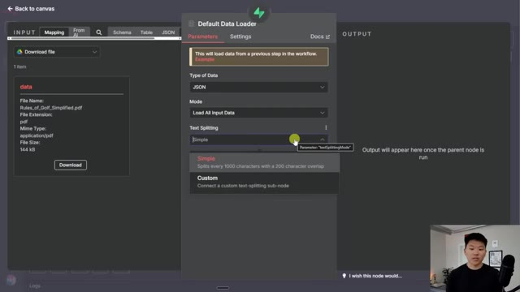
*⏱️ 00:11:59 — Interface d'un workflow montrant les paramètres du nœud 'Default Data Loader' avec un menu déroulant ouvert pour le découpage de texte (Text Splitting) réglé sur 'Simple'.*

---

### ⏱️ `[00:12:14 - 00:12:32]` | Segment #32

**🔊 Audio (Transcription Intégrale Mot pour Mot en Français) :**
> Et c'est défini par défaut sur JSON. Et nous ne pouvons pas faire cela parce que notre PDF est juste ici. Et si vous remarquez en haut juste ici, ce PDF est stocké sous forme binaire. Nous voulons donc changer le type de données en binaire. Maintenant, nous devrions être totalement prêts en ce qui concerne le chargement des données et le découpage en segments. Donc, maintenant que notre découpage en segments est configuré, nous avons juste besoin de connecter notre modèle d'incorporations.

**👁️ Analyse Visuelle d'Écran (gemini-3.5-flash-lite) :**
**Interface & Outils** : Interface web de workflow / automatisation (Type Flowise ou Langflow)

**Contenu textuel & Code** : Paramètres du nœud "Default Data Loader" : Type of Data (réglé sur JSON), Mode (Load All Input Data), Text Splitting (Simple). Aperçu du fichier à gauche : Rules_of_Golf_Simplified.pdf, mime type application/pdf, 144 kB.

**Action / Démonstration** : Configuration des paramètres du "Default Data Loader" pour changer le type de données du fichier PDF.

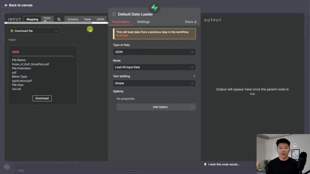
*⏱️ 00:12:18 — Interface d'un outil de workflow affichant le panneau de configuration d'un nœud "Default Data Loader" avec les paramètres de données et un aperçu du fichier PDF.*

---

### ⏱️ `[00:12:33 - 00:13:01]` | Segment #33

**🔊 Audio (Transcription Intégrale Mot pour Mot en Français) :**
> Donc je vais cliquer sur le bouton plus juste ici. Je vais cliquer sur embeddings OpenAI. Et si vous n'avez pas de compte OpenAI, tout ce que vous avez à faire est de cliquer sur créer de nouveaux identifiants et vous avez juste besoin d'une clé API. Donc ce que vous devez faire est d'aller sur OpenAI API afin de créer un compte. C'est différent du simple fait d'avoir un abonnement ChatGPT car vous devrez ajouter des informations de facturation à votre compte OpenAI API. Et une fois que vous arrivez ici, vous irez simplement sur votre tableau de bord, vous cliquerez sur clés API, et vous créerez une nouvelle clé. Et tout ce que vous avez à faire est de copier cette clé, puis vous la collerez juste là et vous serez connecté.

**👁️ Analyse Visuelle d'Écran (gemini-3.5-flash-lite) :**
**Interface & Outils** : Interface graphique d'automatisation de workflow (n8n ou similaire) et tableau de bord de la plateforme OpenAI.

**Contenu textuel & Code** : Menus de configuration des identifiants API, liste des clés API OpenAI existantes avec leurs noms, masquage des clés secrètes et dates de création.
[DESC_IMAGE_2] Sélection et configuration des identifiants OpenAI dans l'outil d'automatisation, puis navigation vers le tableau de bord OpenAI pour la gestion des clés API.

**Action / Démonstration** : Explications face caméra et démonstration conceptuelle.

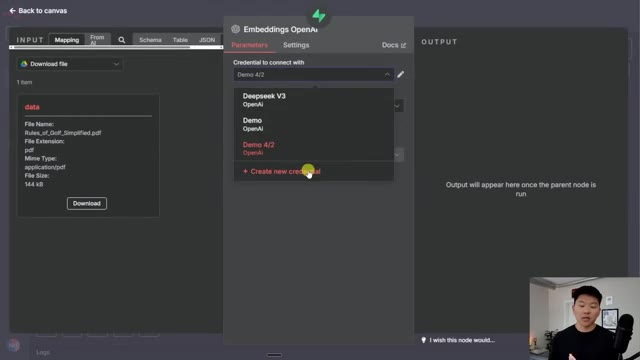
*⏱️ 00:12:40 — Interface d'un outil d'automatisation montrant les paramètres du nœud d'embeddings OpenAI avec le menu déroulant des identifiants et l'option de création de nouveaux identifiants.*

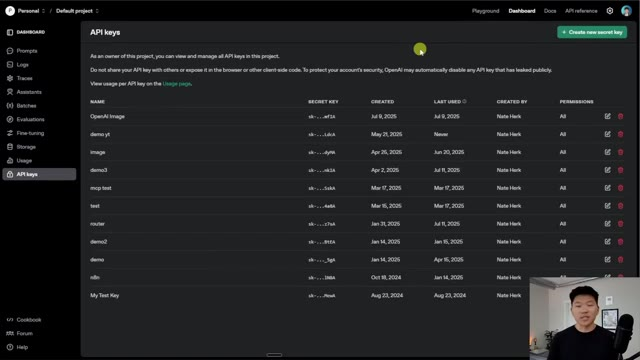
*⏱️ 00:12:47 — Tableau de bord du site web d'OpenAI affichant la section de gestion des clés API avec la liste des clés existantes et le bouton pour en créer une nouvelle.*

---

### ⏱️ `[00:13:01 - 00:13:27]` | Segment #34

**🔊 Audio (Transcription Intégrale Mot pour Mot en Français) :**
> Et maintenant tout ce que nous avons à faire est de choisir le modèle text embedding three small. Si vous avez suivi toutes mes étapes, vous devriez être prêts. Mais si vous avez configuré une base de données vectorielle avec des dimensions différentes, vous devrez vous assurer que celles-ci correspondent ici même. Mais je ne veux pas vous embrouiller les gars. Si vous avez fait ce que j'ai fait, alors vous n'aurez pas du tout à toucher à ça. D'accord, donc tout a l'air d'être configuré, je vais cliquer sur le bouton de lecture au-dessus de notre magasin de vecteurs. Et ce que cela fait, c'est que ça découpe en segments, ça intègre, et maintenant enfin ça vectorise, tout comme nous l'avons vu plus tôt sur cette diapositive.

**👁️ Analyse Visuelle d'Écran (gemini-3.5-flash-lite) :**
**Interface & Outils** : n8n (Interface de workflow d'automatisation)

**Contenu textuel & Code** : Modèle configuré : text-embedding-3-small, Identifiant : Demo 4/2

**Action / Démonstration** : Sélection du modèle d'embedding OpenAI pour traiter les données du fichier PDF téléchargé.

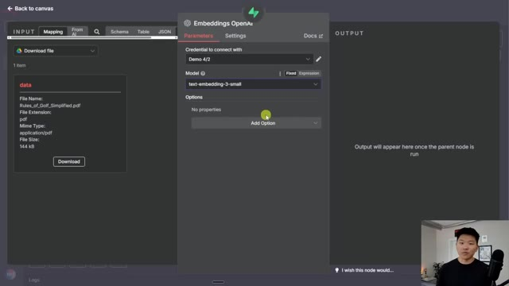
*⏱️ 00:13:08 — Configuration du nœud Embeddings OpenAI dans n8n avec la sélection du modèle text-embedding-3-small.*

---

### ⏱️ `[00:13:27 - 00:14:02]` | Segment #35

**🔊 Audio (Transcription Intégrale Mot pour Mot en Français) :**
> Et ce que vous pouvez voir, c'est que nous avons obtenu 77 vecteurs. Donc ce PDF de 22 pages que nous regardions juste ici, il a fini par être divisé et découpé en 77 vecteurs différents. Donc si je vais dans ma table Supabase et qu'on lui laisse une petite seconde, voilà. Nous devrions avoir 77 lignes d'informations sur les règles du golf. Et si vous voulez voir les données qui se trouvent réellement dans chaque vecteur, vous regarderiez cette colonne appelée contenu. Et si j'ouvre ceci, vous pouvez voir, voici le premier vecteur. Les règles du golf simplifiées. Règle numéro un, vous commencez le partie dans l'aire de départ et frappez la balle jusqu'à ce qu'elle finisse dans le trou, bla, bla, bla. Donc voici ce premier vecteur, voici ce 10e vecteur, et

**👁️ Analyse Visuelle d'Écran (gemini-3.5-flash-lite) :**
**Interface & Outils** : Lecteur PDF et interface de gestion de base de données Supabase (Table Editor).

**Contenu textuel & Code** : Document PDF de 22 pages sur les règles du golf et tableau de données Supabase listant 77 enregistrements avec colonnes id, content, metadata et embedding (vecteurs).

**Action / Démonstration** : Présentation du document PDF source puis basculement vers l'interface Supabase pour montrer les vecteurs générés issus du découpage du document.

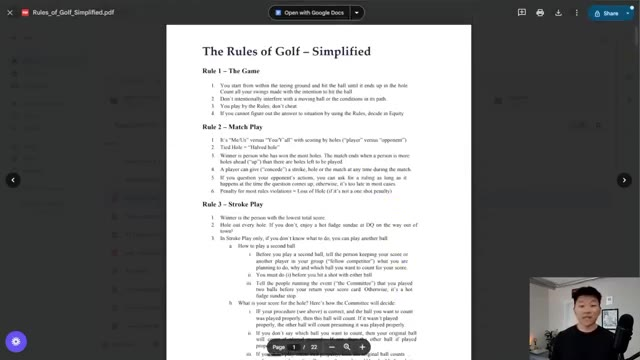
*⏱️ 00:13:36 — Aperçu d'un document PDF intitulé « The Rules of Golf - Simplified » affiché à l'écran, avec le présentateur visible en bas à droite.*

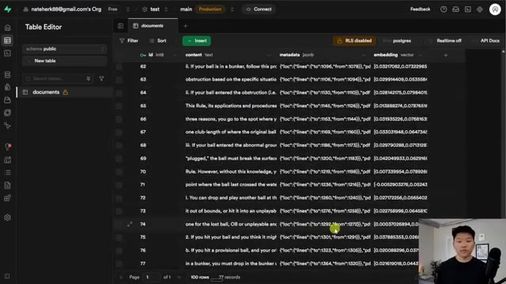
*⏱️ 00:13:45 — Interface de la base de données Supabase montrant une table « documents » contenant des lignes de texte extraites, des métadonnées et des vecteurs d'embedding.*

---

### ⏱️ `[00:14:02 - 00:14:36]` | Segment #36

**🔊 Audio (Transcription Intégrale Mot pour Mot en Français) :**
> alors voici, vous savez, le 41e vecteur. Dans cette colonne, nous avons des métadonnées. Et puis dans cette colonne, nous avons la représentation numérique réelle, qui est notre vecteur deembedding. Nous avons donc nos données ici, ce qui était la première étape, c'était le pipeline RAG. Maintenant, retournons dans N8N et créons un agent IA qui peut réellement interagir avec les informations qui se trouvent ici. Donc ce que je vais faire, c'est appuyer sur tab et je vais taper AI agent et récupérer cet agent juste là. Maintenant, comme nous l'avons mentionné, la façon dont nous voulons déclencher cet agent est simplement par le biais d'une conversation. Je vais donc récupérer un déclencheur de chat, qui est juste ici. Et ensuite, tout ce que j'ai à faire, c'est de connecter ce déclencheur de chat directement à

**👁️ Analyse Visuelle d'Écran (gemini-3.5-flash-lite) :**
**Interface & Outils** : Supabase (Table Editor) et interface de workflow d'IA (Flowise / n8n)

**Contenu textuel & Code** : Table de base de données relationnelle/vectorielle contenant des chunks de texte, des métadonnées et des tableaux de vecteurs numériques.

**Action / Démonstration** : Navigation et explication de la structure de stockage des données pour le pipeline RAG (contenu, métadonnées, embeddings).

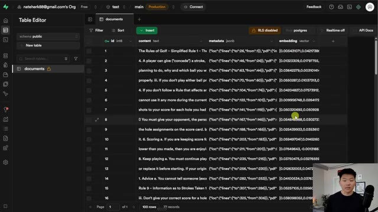
*⏱️ 00:14:11 — Vue d'une base de données Supabase affichant une table nommée 'documents' avec des colonnes pour le contenu textuel, les métadonnées JSON et les vecteurs d'embedding.*

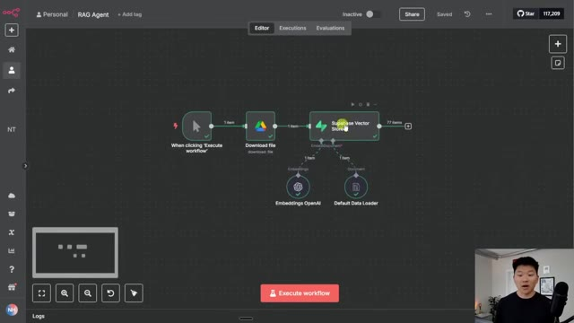
*⏱️ 00:14:19 — Interface de workflow d'automatisation (style n8n/Flowise) nommée 'RAG Agent' montrant les nœuds de téléchargement de fichiers, de stockage vectoriel Supabase, et d'embeddings OpenAI.*

---

### ⏱️ `[00:14:36 - 00:14:57]` | Segment #37

**🔊 Audio (Transcription Intégrale Mot pour Mot en Français) :**
> l'avant de l'agent. Et maintenant, il sera capable de recevoir nos messages lorsque nous lui parlons. Maintenant, nous devons connecter un cerveau à notre agent IA. Donc, si je clique sur le plus sous le modèle de chat, je vais faire défiler vers le bas ici et prendre le modèle de chat OpenAI, juste parce que si vous configurez tout cela pour la première fois, vous savez déjà comment y arriver et obtenir votre clé API. Et vous avez déjà configuré ce identifiant. Et maintenant, nous devons simplement choisir un modèle à utiliser. Je vais m'en tenir à GPT 4.1 mini.

**👁️ Analyse Visuelle d'Écran (gemini-3.5-flash-lite) :**
**Interface & Outils** : Interface web de construction de workflows par glisser-déposer (type n8n).

**Contenu textuel & Code** : Nœuds graphiques : 'When chat message received', 'AI Agent', 'Download file', 'Supabase Vector Store', 'Embeddings OpenAI'.

**Action / Démonstration** : Visualisation et configuration du diagramme de workflow pour l'agent IA.

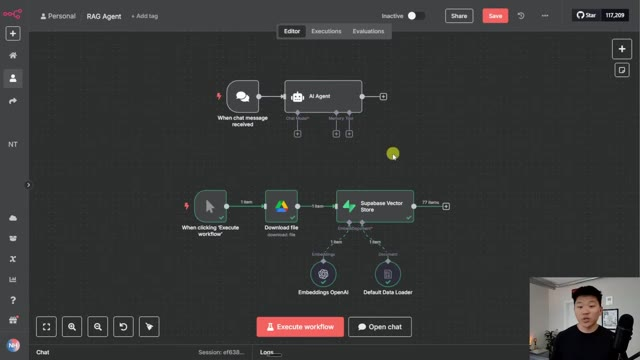
*⏱️ 00:14:41 — Interface de workflow montrant un agent IA relié à un nœud de réception de message et un flux de données Supabase Vector Store.*

---

### ⏱️ `[00:14:57 - 00:15:33]` | Segment #38

**🔊 Audio (Transcription Intégrale Mot pour Mot en Français) :**
> Et maintenant, notre agent a un cerveau. Et la dernière étape consiste simplement à lui donner un outil pour qu'il puisse réellement chercher dans cette base de données vectorielle. Nous allons donc cliquer sur outil. Nous allons taper Supabase vector store. L'opération est déjà configurée pour récupérer des documents en tant qu'outil pour l'agent IA. Pour la description, je vais simplement dire : appeler cet outil pour rechercher les règles du golf. C'est donc juste moi qui dis à l'agent ce que fait cet outil et quand l'utiliser. Et puis encore une fois, nous devons simplement choisir la bonne table à parcourir, qui dans notre cas s'appelle documents. Et puis la limite correspond fondamentalement au nombre de vecteurs que vous voulez qu'il ramène réellement ? Pour l'instant, nous allons nous en tenir

**👁️ Analyse Visuelle d'Écran (gemini-3.5-flash-lite) :**
**Interface & Outils** : Interface n8n de création de workflows d'agents IA.

**Contenu textuel & Code** : Recherche du module 'Supabase Vector Store' et configuration des paramètres de l'outil (Operation Mode : Retrieve Documents).

**Action / Démonstration** : Sélection et configuration de l'outil Supabase Vector Store pour l'intégrer au workflow de l'agent.

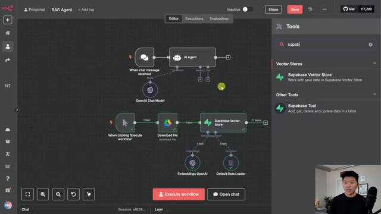
*⏱️ 00:15:06 — Vue d'ensemble du workflow de l'agent RAG avec le panneau latéral de recherche d'outils montrant Supabase.*

*⏱️ 00:15:15 — Fenêtre de configuration du nœud Supabase Vector Store montrant les paramètres comme le mode d'opération et le nom de la table.*

---

### ⏱️ `[00:15:33 - 00:16:00]` | Segment #39

**🔊 Audio (Transcription Intégrale Mot pour Mot en Français) :**
> avec quatre. Et puis la dernière chose que nous devons faire est en fait de connecter un autre modèle d'incorporation, parce que comme vous le savez, la requête doit également être incorporée. Et quelque chose de vraiment simple, c'est que nous avons déjà un modèle d'incorporation configuré ici en bas. Je peux donc simplement faire glisser celui-ci dans exactement le même que celui d'en bas. Vous n'êtes pas obligé de faire ça. Vous pourriez en ajouter un nouveau, mais juste pour vous montrer qu'ils utilisent le même, je vais faire comme ça. Donc, sans même donner à notre agent aucune sorte d'instructions ou de système prompt, testons cela et voyons comment ça fonctionne.

**👁️ Analyse Visuelle d'Écran (gemini-3.5-flash-lite) :**
**Interface & Outils** : Interface web de construction de workflows (type n8n ou plateforme similaire de RAG agent)

**Contenu textuel & Code** : Nœuds de workflow : When chat message received, AI Agent, Supabase Vector Store, OpenAI Chat Model, Embeddings OpenAI, Default Data Loader, et When clicking 'Execute workflow'.

**Action / Démonstration** : Connexion des différents nœuds et composants du workflow pour configurer l'agent RAG et son modèle d'incorporation.

*⏱️ 00:15:40 — Un éditeur de workflow visuel montrant la construction d'un agent RAG avec des nœuds pour un modèle de chat OpenAI, un magasin de vecteurs Supabase et des embeddings.*

---

### ⏱️ `[00:16:00 - 00:16:32]` | Segment #40

**🔊 Audio (Transcription Intégrale Mot pour Mot en Français) :**
> Très bien. Nous voici donc dans le PDF concernant les règles du golf. Et ce que je vais faire, c'est simplement l'interroger sur les règles d'entraînement. Je vais donc me contenter de dire : qu'ai-je le droit de faire pour m'entraîner ? Voyons si l'agent comprend que nous parlons de golf et qu'il doit utiliser la base de données vectorielle Supabase, ce qu'il a fait. Et maintenant, il va prendre cette information et nous renvoyer une réponse. Ensuite, nous allons fondamentalement valider si elle est correcte ou non. Donc, juste ici, nous obtenons notre réponse. Selon les règles du golf concernant l'entraînement, avant ou entre les tours, vous pouvez vous entraîner sur le parcours le jour de chaque match. Vous ne pouvez pas vous entraîner sur le parcours le jour d'un tournoi en stroke-play ou avant un barrage sur le parcours.

**👁️ Analyse Visuelle d'Écran (gemini-3.5-flash-lite) :**
**Interface & Outils** : Interface web d'automatisation de workflow (type n8n)

**Contenu textuel & Code** : Workflow d'agent RAG avec les blocs : "When chat message received", "AI Agent", "OpenAI Chat Model" et "Supabase Vector Store", et un message dans le chat : "what am i allowed to do for practice".

**Action / Démonstration** : Saisie et préparation de l'envoi de la question sur les règles d'entraînement dans le chat du workflow de l'agent RAG.

*⏱️ 00:16:08 — Interface d'un constructeur de workflow d'agent IA (type n8n) montrant un RAG agent connecté à un modèle OpenAI et une base de données vectorielle Supabase, avec le panneau de chat en bas à gauche où le prompt de test est saisi.*

---

### ⏱️ `[00:16:33 - 00:16:52]` | Segment #41

**🔊 Audio (Transcription Intégrale Mot pour Mot en Français) :**
> Et aussi pendant la partie, vous ne pouvez pas frapper un coup d'entraînement en jouant un trou ou entre les trous. Et si nous allons voir le PDF, vous pouvez voir que c'est à peu près mot pour mot ce que nous cherchions. Et juste pour vous montrer ce qui s'est réellement passé dans les coulisses, vous pouvez cliquer sur l'agent et vous pouvez cliquer sur les journaux. Et cela va nous montrer exactement ce qui vient de se passer. Donc l'humain a demandé à l'agent IA, qu'ai-je le droit de faire pour m'entraîner ?

**👁️ Analyse Visuelle d'Écran (gemini-3.5-flash-lite) :**
**Interface & Outils** : n8n (Interface de workflow d'automatisation IA)

**Contenu textuel & Code** : Workflow RAG Agent, nœuds OpenAI Chat Model, Supabase Vector Store, Embeddings OpenAI, et logs de chat.

**Action / Démonstration** : Test du workflow RAG Agent et visualisation des paramètres du nœud et de l'historique d'exécution.

*⏱️ 00:16:37 — Interface n8n montrant un workflow RAG Agent avec un chat interactif affichant les règles de golf.*

*⏱️ 00:16:47 — Interface n8n montrant les paramètres du nœud 'AI Agent' et les détails d'exécution du modèle OpenAI Chat.*

---

### ⏱️ `[00:16:52 - 00:17:11]` | Segment #42

**🔊 Audio (Transcription Intégrale Mot pour Mot en Français) :**
> C'est ce qui a déclenché le flux de travail. L'agent utilise la base de données vectorielle Supabase et envoie la requête sur les règles d'entraînement au golf. Et ensuite, ceci est intégré en utilisant le modèle d'incorporation juste ici. Et puis ce que nous obtenons en retour après que cela a été incorporé, c'est la réponse, qui consiste en ces quatre vecteurs différents, qui représentent le contenu réel dans la base de données vectorielle.

**👁️ Analyse Visuelle d'Écran (gemini-3.5-flash-lite) :**
**Interface & Outils** : Interface web de n8n (éditeur de workflow d'automatisation IA).

**Contenu textuel & Code** : Paramètres du nœud AI Agent avec le prompt utilisateur `{{ $json.chatInput }}` et la requête "practice rules in golf" envoyée à Supabase Vector Store.

**Action / Démonstration** : Visualisation des logs et de l'exécution du nœud interrogeant la base de données vectorielle Supabase.

*⏱️ 00:16:57 — Interface d'un éditeur de workflow montrant les détails d'exécution d'un nœud d'agent IA avec Supabase Vector Store.*

---

### ⏱️ `[00:17:11 - 00:17:30]` | Segment #43

**🔊 Audio (Transcription Intégrale Mot pour Mot en Français) :**
> Donc, l'agent IA va examiner tout ce contexte et il va réfléchir à la question qui a été posée au départ. Et ensuite, il va réellement nous donner un résultat, qui est ce que nous avons vu ici dans la section des messages de chat. Donc maintenant que nous avons validé que l'agent IA peut parcourir la base de données vectorielle Supabase, nous avons un problème, c'est qu'il n'a pas de mémoire. Donc nous venons littéralement de lui poser des questions sur les règles du golf.

**👁️ Analyse Visuelle d'Écran (gemini-3.5-flash-lite) :**
**Interface & Outils** : Interface web d'automatisation de workflows n8n.

**Contenu textuel & Code** : Paramètres du nœud AI Agent, modèle OpenAI Chat Model, stockage vectoriel Supabase Vector Store, et affichage de la sortie textuelle générée par l'agent.

**Action / Démonstration** : Configuration et validation de l'exécution d'un nœud d'agent IA interrogeant une base de données vectorielle.

*⏱️ 00:17:16 — Gros plan sur les paramètres et les résultats d'exécution du nœud AI Agent dans l'interface de n8n.*

*⏱️ 00:17:25 — Vue d'ensemble du workflow complet d'un agent RAG dans n8n, montrant la structure de traitement des documents et du chat.*

---

### ⏱️ `[00:17:30 - 00:17:52]` | Segment #44

**🔊 Audio (Transcription Intégrale Mot pour Mot en Français) :**
> Mais maintenant, si je le lui demandais — donc je ne peux pas faire un coup d'essai entre les trous — il devrait être capable d'utiliser simplement sa mémoire, parce qu'il vient juste de chercher cela, et de nous répondre. Mais ce qu'il va faire, c'est qu'il va relancer une recherche dans la base de données vectorielles, parce qu'il traite chacun de nos messages comme une conversation complètement individuelle et unique. Donc, ça va, parce qu'il a encore trouvé la bonne réponse, mais l'idéal serait qu'il puisse parcourir sa mémoire et se rendre compte qu'on vient juste de parler de ça.

**👁️ Analyse Visuelle d'Écran (gemini-3.5-flash-lite) :**
**Interface & Outils** : Interface graphique web de type éditeur de workflow d'automatisation (n8n ou similaire).

**Contenu textuel & Code** : Nœuds de workflow connectés (OpenAI Chat Model, Supabase Vector Store), panneau de chat affichant une conversation sur les règles de golf, et panneau de logs d'exécution.

**Action / Démonstration** : Exécution d'un workflow de RAG et affichage de la réponse générée par l'agent dans le chat en bas à gauche.

*⏱️ 00:17:36 — Interface d'un constructeur de workflow montrant un agent RAG en cours d'exécution avec un panneau de chat interactif et des logs en temps réel.*

---

### ⏱️ `[00:17:52 - 00:18:17]` | Segment #45

**🔊 Audio (Transcription Intégrale Mot pour Mot en Français) :**
> Je n'ai pas besoin de chercher quoi que ce soit. Je peux simplement leur fournir une réponse. Donc, la façon dont nous allons configurer cette mémoire, c'est que nous allons utiliser Postgres parce que nous avons déjà configuré tout notre truc Supabase. Je vais donc cliquer sur le plus sous mémoire juste ici. Et vous pouvez voir que nous pourrions utiliser une mémoire simple qui stockerait tout dans NNN. Mais si nous voulons pouvoir parcourir les différentes interactions que nous avons avec notre agent IA et stocker cela dans Supabase, ce que nous allons faire, c'est nous connecter à une mémoire de chat Postgres.

**👁️ Analyse Visuelle d'Écran (gemini-3.5-flash-lite) :**
**Interface & Outils** : Interface web d'automatisation de type n8n (éditeur de workflow RAG Agent).

**Contenu textuel & Code** : Blocs de workflow : "When chat message received", "AI Agent", "OpenAI Chat Model", et "Supabase Vector Store".

**Action / Démonstration** : Présentation du schéma de configuration de la mémoire de l'agent utilisant Supabase.

*⏱️ 00:17:59 — Interface de workflow montrant un agent IA connecté à un modèle OpenAI et à un stockage vectoriel Supabase.*

---

### ⏱️ `[00:18:17 - 00:18:39]` | Segment #46

**🔊 Audio (Transcription Intégrale Mot pour Mot en Français) :**
> Donc, la première chose que nous devons réellement faire cependant, c'est nous connecter à notre identifiant Postgres. Donc, pour configurer cet identifiant, je vais ouvrir le menu déroulant, cliquer sur créer un nouvel identifiant. Et vous pouvez voir que c'généralement un petit peu différent de ce premier de Supabase, mais suivez simplement ce que je fais et vous serez prêts. Je vais aller dans Supabase et en haut de l'écran, vous pouvez voir qu'il y a un bouton de connexion. Donc, je vais cliquer dessus et je vais simplement faire un peu défiler vers le bas là où nous avons, juste ici, le pooler de transactions.

**👁️ Analyse Visuelle d'Écran (gemini-3.5-flash-lite) :**
**Interface & Outils** : n8n et Supabase (tableaux de bord web)

**Contenu textuel & Code** : Paramètres de configuration d'un nœud n8n (Postgres Chat Memory) et données tabulaires de base de données Supabase (colonnes text, jsonb, vector).

**Action / Démonstration** : Configuration d'un identifiant Postgres pour connecter le nœud n8n à la base de données.

*⏱️ 00:18:22 — Interface n8n montrant un nœud Postgres Chat Memory avec le menu déroulant des identifiants (Credentials) ouvert et l'option '+ Create new credential' mise en avant.*

*⏱️ 00:18:34 — Interface Supabase affichant l'éditeur de table (Table Editor) avec une table nommée 'documents' contenant des colonnes id, content, metadata et embedding.*

---

### ⏱️ `[00:18:39 - 00:19:03]` | Segment #47

**🔊 Audio (Transcription Intégrale Mot pour Mot en Français) :**
> Je vais cliquer juste ici sur afficher les paramètres et ensuite nous devons juste récupérer quelques-uns de ces éléments. Donc le premier va être l'hôte. Je vais copier l'hôte et nous allons retourner dans NNN et juste le coller ici. La base de données, je peux laisser Postgres parce que si vous pouvez voir juste ici, la base de données est Postgres, mais l'utilisateur, nous allons copier ceci et y retourner et le coller en tant qu'utilisateur.

**👁️ Analyse Visuelle d'Écran (gemini-3.5-flash-lite) :**
**Interface & Outils** : Supabase dashboard et n8n (éditeur de workflow)

**Contenu textuel & Code** : Paramètres de connexion Postgres : hôte (aws-0-us-east-2.pooler.supabase.com), nom de base de données (postgres) et utilisateur.

**Action / Démonstration** : Copie des paramètres de connexion depuis Supabase pour les coller dans la configuration du nœud Postgres de l'outil d'automatisation.

*⏱️ 00:18:45 — L'interface de Supabase affichant les paramètres de connexion à la base de données (Transaction pooler) avec l'hôte visible.*

*⏱️ 00:18:51 — L'interface de configuration du nœud Postgres (Postgres account 2) dans une plateforme d'automatisation (n8n), montrant le champ Host rempli.*

*⏱️ 00:18:57 — L'interface de Supabase montrant les détails des paramètres de connexion (hôte, port, base de données, utilisateur).*

---

### ⏱️ `[00:19:03 - 00:19:23]` | Segment #48

**🔊 Audio (Transcription Intégrale Mot pour Mot en Français) :**
> Le mot de passe va être le mot de passe que vous avez configuré lorsque vous avez créé votre projet un peu plus tôt dans la vidéo. Donc, laissez-moi taper ça rapidement. Et puis, la dernière chose que nous devons faire, c'est le port, que, si nous retournons dans cet écran, nous pouvons voir juste ici, nous avons le port 6543. Donc, tout ce que j'ai à faire, c'est de venir ici, de coller ça là. Et puis, si nous cliquons sur enregistrer, nous devrions passer au vert, connexion testée avec succès.

**👁️ Analyse Visuelle d'Écran (gemini-3.5-flash-lite) :**
**Interface & Outils** : Interface web d'automatisation (n8n) et tableau de bord Supabase.

**Contenu textuel & Code** : Paramètres de connexion de base de données PostgreSQL : nom de base (postgres), utilisateur, mot de passe masqué, port (6543).

**Action / Démonstration** : Saisie des identifiants et configuration du port de connexion pour la base de données PostgreSQL.

*⏱️ 00:19:08 — Configuration d'un compte Postgres dans une interface d'automatisation (n8n), avec les champs Database, User et Password.*

*⏱️ 00:19:13 — Affichage des paramètres de connexion Supabase (Transaction pooler) montrant le port 6543 et les informations d'identification.*

*⏱️ 00:19:18 — Configuration du port de connexion Postgres dans l'interface n8n avec la valeur 6543 renseignée.*

---

### ⏱️ `[00:19:23 - 00:19:41]` | Segment #49

**🔊 Audio (Transcription Intégrale Mot pour Mot en Français) :**
> Et donc, une fois que nous commençons à discuter avec notre agent, encore une fois, il va stocker non seulement ce que nous demandons à l'agent, mais il va également stocker la réponse de l'agent dans une autre table de Supabase. Laissez-moi donc discuter avec l'agent et je vous montrerai cela. Donc maintenant, si je parle à mon agent et que je dis : bonjour, je m'appelle Nate, nous allons l'envoyer. Il va vérifier si nous lui avons déjà parlé auparavant.

**👁️ Analyse Visuelle d'Écran (gemini-3.5-flash-lite) :**
**Interface & Outils** : Application web n8n (éditeur de workflow)

**Contenu textuel & Code** : Nœuds connectés : "When chat message received", "AI Agent", "Supabase Vector Store", "OpenAI Chat Model", "Postgres Chat Memory", et une section de chargement de données.

**Action / Démonstration** : Visualisation du schéma d'architecture du workflow RAG avant le test de discussion avec l'agent.

*⏱️ 00:19:28 — Capture d'écran montrant l'interface d'un outil de workflow d'automatisation (n8n) avec un diagramme de RAG Agent comprenant des nœuds Supabase, OpenAI et Postgres Chat Memory.*

---

### ⏱️ `[00:19:41 - 00:20:00]` | Segment #50

**🔊 Audio (Transcription Intégrale Mot pour Mot en Français) :**
> Il va maintenant nous répondre. Et nous pouvons voir que si je vais dans Supabase, il va y avoir une nouvelle table juste ici. Si je rafraîchis ça rapidement, appelée NNN Chat Histories. Et si je clique dedans, elle va fondamentalement contenir le contenu humain. Donc à chaque fois qu'on lui parle, elle va stocker ça ici. Et ensuite elle va aussi stocker la réponse de l'agent IA à chaque fois.

**👁️ Analyse Visuelle d'Écran (gemini-3.5-flash-lite) :**
**Interface & Outils** : Supabase (Interface Web de gestion de base de données PostgreSQL)

**Contenu textuel & Code** : Tableau de données avec les colonnes id, content, metadata et embedding, contenant des extraits de texte issus de documents PDF.

**Action / Démonstration** : Consultation et navigation dans les tables de la base de données Supabase.

*⏱️ 00:19:46 — Interface Supabase affichant le tableau de bord de la base de données avec l'éditeur de tables et la liste des tables à gauche.*

---

### ⏱️ `[00:20:00 - 00:20:24]` | Segment #51

**🔊 Audio (Transcription Intégrale Mot pour Mot en Français) :**
> Et donc maintenant, si je venais dans l'agent IA et que je disais : quel est mon nom ? Il va regarder dans la mémoire Postgres et ensuite il sera capable de nous répondre parce qu'il a réellement cette fenêtre de contexte. Votre nom est Nate, comment puis-je vous aider aujourd'hui ? Deux choses cependant, à garder à l'esprit très rapidement. La première est que dans cette mémoire de chat Postgres, la longueur de la fenêtre de contexte est de cinq. Donc à chaque fois que nous lui parlons, il va seulement se souvenir des cinq interactions les plus récentes, mais vous avez la possibilité d'ajuster cette longueur de fenêtre de contexte.

**👁️ Analyse Visuelle d'Écran (gemini-3.5-flash-lite) :**
**Interface & Outils** : Interface web de l'outil d'automatisation n8n (éditeur de workflow visuel).

**Contenu textuel & Code** : Nœuds de workflow n8n (AI Agent, OpenAI Chat Model, Postgres Chat Memory, Supabase Vector Store), logs d'exécution JSON et interface de chat interactive.

**Action / Démonstration** : Exécution du workflow d'agent IA testant la récupération de mémoire et la configuration des paramètres de la base de données Postgres.

*⏱️ 00:20:06 — Vue d'ensemble du workflow n8n montrant un Agent IA connecté à un modèle OpenAI, une mémoire Postgres et Supabase, avec le panneau de chat en bas affichant l'interaction et la question 'what's my name'.*

*⏱️ 00:20:18 — Gros plan sur les paramètres du nœud 'Postgres Chat Memory' dans n8n, affichant la configuration de la session, le nom de la table et la longueur de la fenêtre de contexte.*

---

### ⏱️ `[00:20:24 - 00:20:45]` | Segment #52

**🔊 Audio (Transcription Intégrale Mot pour Mot en Français) :**
> mais ensuite l'IA se contenterait de traiter plus de tokens. Et puis une autre chose à garder à l'esprit, dans Postgres, ce qu'il fait c'est qu'il va stocker ces messages avec un ID de session, et c'est comme ça qu'il effectue la recherche. Donc si nous allons dans NNN et que nous effaçons la session, il va démarrer une nouvelle session et il ne s'en souviendra plus. Donc si je dis maintenant, quel est mon nom ? Il ne pourra pas obtenir cette information parce qu'il cherche à travers un ID de session différent.

**👁️ Analyse Visuelle d'Écran (gemini-3.5-flash-lite) :**
**Interface & Outils** : n8n (interface web de gestion de workflows d'automatisation et d'IA)

**Contenu textuel & Code** : Workflow comprenant les nœuds : "When chat message received", "AI Agent", "OpenAI Chat Model", "Postgres Chat Memory", et "Supabase Vector Store1". En bas, une fenêtre de chat affiche l'historique d'une conversation avec le bot.

**Action / Démonstration** : Présentation du fonctionnement du stockage de la mémoire de discussion par ID de session dans Postgres au sein d'un agent IA.

*⏱️ 00:20:29 — Un diagramme de workflow n8n montrant un RAG Agent avec un modèle OpenAI, une mémoire Postgres Chat Memory et un magasin vectoriel Supabase.*

---

### ⏱️ `[00:20:45 - 00:21:09]` | Segment #53

**🔊 Audio (Transcription Intégrale Mot pour Mot en Français) :**
> Je n'ai pas accès à vos informations personnelles. Et ensuite, si je vais dans la table Supabase et que je rafraîchis, nous pouvons voir que ces deux interactions que nous venons d'avoir avaient un ID de session différent de ces quatre précédentes. Ce n'est donc pas un gros problème, car pour l'instant nous sommes simplement en train de discuter avec l'agent en utilisant ce déclencheur de chat. Mais si vous utilisiez Gmail, ou un message texte, ou quelque chose du genre, vous pourriez stocker l'ID de session sous forme d'adresse e-mail ou de numéro de téléphone de quelqu'un.

**👁️ Analyse Visuelle d'Écran (gemini-3.5-flash-lite) :**
**Interface & Outils** : Supabase Table Editor et interface n8n Cloud (Workflow d'agent IA).

**Contenu textuel & Code** : Table de base de données relationnelle contenant les colonnes id, session_id et message au format JSONB.

**Action / Démonstration** : Consultation et vérification des identifiants de session (session_id) dans la table Supabase après une interaction avec le chatbot n8n.

*⏱️ 00:20:51 — Interface de Supabase affichant l'éditeur de table avec les enregistrements de l'historique de chat n8n (n8n_chat_histories).*

*⏱️ 00:20:57 — Interface du workflow n8n (RAG Agent) avec le panneau de chat interactif ouvert en bas affichant la réponse de l'agent.*

---

### ⏱️ `[00:21:09 - 00:21:34]` | Segment #54

**🔊 Audio (Transcription Intégrale Mot pour Mot en Français) :**
> Et c'est ainsi que l'agent pouvait réellement conserver tout ce contexte avec cette personne individuelle. D'accord, vous venez donc officiellement de créer votre premier pipeline RAG où vous avez introduit des données dans une base de données vectorielle et vous avez construit un agent RAG qui peut également interagir avec les données qui s'y trouvent. Il y a de nombreuses façons d'élargir ce type de système. Je dirais que la prochaine étape consisterait à le rendre un peu plus dynamique, de sorte que chaque fois que vous déposez un nouveau document dans un dossier Google Drive, il soit automatiquement poussé vers Supabase.

**👁️ Analyse Visuelle d'Écran (gemini-3.5-flash-lite) :**
**Interface & Outils** : n8n (outil d'automatisation de workflow).

**Contenu textuel & Code** : Nœuds de workflow : "When chat message received", "AI Agent", "Supabase Vector Store", "OpenAI Chat Model", "Postgres Chat Memory", "Download file", "Embeddings OpenAI" et "Default Data Loader".

**Action / Démonstration** : Le workflow est affiché en mode édition, prêt à être exécuté pour traiter des données vers la base de données vectorielle.

*⏱️ 00:21:15 — Un diagramme de workflow complet dans l'interface n8n illustrant un agent RAG avec deux sections : la gestion des messages de chat (OpenAI et Postgres Memory) et l'ingestion de documents vers Supabase.*

---

### ⏱️ `[00:21:34 - 00:22:00]` | Segment #55

**🔊 Audio (Transcription Intégrale Mot pour Mot en Français) :**
> Et ensuite, créer un deuxième pipeline ici où, à chaque fois que vous mettez à jour ce document, cela supprime fondamentalement les anciens vecteurs, ceux qui sont obsolètes, et ensuite, cela place les nouveaux dans la base de données vectorielles. Et c'est ainsi que vous pouvez vous assurer que les informations que l'agent consulte réellement et utilise pour vous répondre sont exactes, en temps réel et pertinentes. Ensuite, une autre chose que vous voudriez faire est d'avoir un système différent ici où, à chaque fois qu'un fichier est supprimé, cela va également supprimer tous ces vecteurs de la base de données afin que vous puissiez garder toute la base de données très propre.

**👁️ Analyse Visuelle d'Écran (gemini-3.5-flash-lite) :**
**Interface & Outils** : Interface web d'automatisation de workflow (type N8N ou outil similaire).

**Contenu textuel & Code** : Workflow d'automatisation composé de blocs : Google Drive Trigger, File ID, Delete a row, Download file, Embeddings OpenAI et Supabase Vector Store.

**Action / Démonstration** : Présentation et explication du pipeline de mise à jour et de synchronisation des documents avec la base de données vectorielle.

*⏱️ 00:21:40 — Capture d'écran montrant le diagramme de workflow sur une plateforme d'automatisation avec un pipeline vert intitulé 'File Updated' gérant la suppression des anciens vecteurs et l'ajout des nouveaux.*

---

### ⏱️ `[00:22:00 - 00:22:18]` | Segment #56

**🔊 Audio (Transcription Intégrale Mot pour Mot en Français) :**
> Donc si vous êtes intéressés par voir ce genre de construction, faites-le-moi savoir dans les commentaires et j'adorerais faire une vidéo YouTube pour couvrir à quel point ce serait simple à configurer. Mais j'ai aussi juste fait une construction en direct de ce système dans ma communauté payante. Le lien pour cela sera dans la description. C'est une très super communauté de membres qui construisent avec NNN et partagent leurs défis et leurs victoires chaque jour. Nous avons aussi deux cours complets ici.

**👁️ Analyse Visuelle d'Écran (gemini-3.5-flash-lite) :**
**Interface & Outils** : Flowise (ou plateforme similaire de construction de workflow No-Code)

**Contenu textuel & Code** : Diagramme de flux logique divisé en quatre sections : RAG Agent, New Docs, Delete Docs et File Updated, utilisant des intégrations Google Drive, OpenAI et Supabase Vector Store.

**Action / Démonstration** : Présentation visuelle de l'architecture d'un agent RAG automatisé pour la gestion et la synchronisation de documents avec une base de données vectorielle.

*⏱️ 00:22:04 — Interface de développement de workflow avec des nœuds connectés (RAG Agent, New Docs, Delete Docs, File Updated) intégrés à Supabase.*

---

### ⏱️ `[00:22:18 - 00:22:37]` | Segment #57

**🔊 Audio (Transcription Intégrale Mot pour Mot en Français) :**
> L'un s'appelle Agent Zero, qui est comme les fondations de l'automatisation par IA, et ensuite 10 heures à 10 secondes où vous apprenez à identifier, concevoir et créer des automatisations qui font gagner du temps. Quoi qu'il en soit, j'aimerais beaucoup vous voir dans cette communauté, mais c'est tout pour celui-ci. Si vous avez aimé la vidéo ou si vous avez appris quelque chose de nouveau, n'hésitez pas à mettre un pouce bleu, ça m'aide vraiment énormément. Et comme toujours, je vous remercie d'être arrivés jusqu'à la fin de la vidéo.

**👁️ Analyse Visuelle d'Écran (gemini-3.5-flash-lite) :**
**Interface & Outils** : AI Automation Society (Skool), n8n.

**Contenu textuel & Code** : Noms des modules de formation sur la plateforme et schéma logique de flux de travail (workflow) avec des nœuds de type "Chat message", "AI Agent", "Supabase Vector Store" et "Download file".

**Action / Démonstration** : Présentation du catalogue de formations de la communauté, puis démonstration technique de la structure d'un agent IA complexe via l'interface visuelle de n8n.

*⏱️ 00:22:23 — Interface de la plateforme "AI Automation Society Plus" montrant une série de modules de formation sous forme de tuiles (Start Here, Agent Zero, 10 Hours to 10 Seconds, n8n Templates, etc.).*

*⏱️ 00:22:32 — Éditeur de workflow n8n affichant un agent RAG ("RAG Agent") avec ses nœuds connectés : déclencheurs, modèles OpenAI, mémoire Postgres et intégrations Supabase Vector Store.*

---

### ⏱️ `[00:22:37 - 00:22:40]` | Segment #58

**🔊 Audio (Transcription Intégrale Mot pour Mot en Français) :**
> Je vous retrouve tous dans la prochaine. Merci beaucoup, les gars.

**👁️ Analyse Visuelle d'Écran (gemini-3.5-flash-lite) :**
**Interface & Outils** : n8n

**Contenu textuel & Code** : Nœuds de workflow : When chat message received, AI Agent, OpenAI Chat Model, Postgres Chat Memory, Supabase Vector Store, Download file.

**Action / Démonstration** : Visualisation du workflow complet de l'agent RAG avant la conclusion de la vidéo.

*⏱️ 00:22:37 — Un diagramme de workflow sur n8n montrant un agent RAG connecté à un modèle OpenAI, une mémoire Postgres et un stockage vectoriel Supabase.*

---

