# 🎬 Beginner’s Guide to Metadata: Make Your RAG Agents Smarter

> **Chaîne** : [Nate Herk | AI Automation](https://www.youtube.com/@nateherk/featured)  
> **Lien YouTube** : [https://www.youtube.com/watch?v=lnm0PMi-4mE](https://www.youtube.com/watch?v=lnm0PMi-4mE)  
> **Date de publication** : 20250723  
> **Durée** : 00:15:14  
> **Identifiant vidéo** : `lnm0PMi-4mE`  
> **Transcription & Analyse** : `whisper-v3-large-turbo+gemini-3.5-flash-lite`  

---

## 📌 Synthèse Exécutive & Outils

### 💡 Résumé

Cette vidéo proposée par la chaîne *Nate Herk | AI Automation* constitue un guide pratique et approfondi sur l'utilisation stratégique des métadonnées pour décupler les performances et la précision des agents RAG (Retrieval-Augmented Generation). L'analyste y démontre, à travers un cas d'usage concret basé sur l'indexation et l'interrogation de transcriptions YouTube, comment le simple stockage de données textuelles vectorisées s'avère insuffisant sans un enrichissement contextuel rigoureux. En associant chaque segment de texte à des métadonnées structurées — telles que l'URL, le titre de la vidéo et les horodatages précis —, l'agent IA gagne en fiabilité, en transparence et en utilité, en étant capable de citer ses sources exactes et de fournir des liens cliquables vers le contenu d'origine.

La démonstration technique s'appuie sur un pipeline d'automatisation complet orchestré pour ingérer, nettoyer et standardiser des flux de données brutes. L'auteur illustre notamment l'utilisation combinée d'outils de web scraping (Apify) et de nœuds de code intelligents générés avec l'aide de Claude pour segmenter et regrouper par lots les objets JSON en blocs cohérents. Ce processus permet de préserver la chronologie des fragments tout en les préparant pour une vectorisation et un stockage optimisés dans une base de données vectorielle (Supabase), démontrant ainsi comment l'ingénierie des données en amont conditionne l'intelligence finale de l'agent.

### 🛠️ Outils, Modèles & Logiciels Présentés

* **Anthropic / Claude** : Modèle de langage conversationnel de pointe utilisé ici comme assistant de développement pour concevoir, rédiger et itérer sur les scripts de code nécessaires au nettoyage et au regroupement des données JSON.
* **Claude Code** : Environnement de développement et d'assistance logicielle haut niveau facilitant l'implémentation de logiques programmatiques complexes au sein des pipelines d'automatisation.
* **Opus 5.5** : Modèle avancé de la gamme Anthropic mobilisé pour résoudre des tâches de structuration de données textuelles et de génération de code contextuel.
* **Apify** : Plateforme de web scraping et d'automatisation web utilisée pour extraire de manière programmatique les transcriptions brutes et les métadonnées temporelles des vidéos YouTube.
* **n8n** : Outil d'automatisation de flux de travail (*workflow automation*) open-source et low-code employé pour orchestrer l'ensemble du pipeline d'ingestion, de transformation par nœuds de code, d'indexation et de mise à jour des sources.
* **Supabase** : Base de données relationnelle et vectorielle open-source servant de magasin de vecteurs (*vector store*) pour stocker les embeddings textuels et leurs métadonnées associées.
* **Excalidraw** : Outil de tableau blanc virtuel interactif utilisé pour schématiser et visualiser l'architecture de la recherche vectorielle et l'impact structurel des métadonnées sur les fragments textuels.

### 🔑 Points Clés & Enseignements Stratégiques

* **Définition fondamentale des métadonnées** : Les métadonnées se résument à « des données sur des données » ; elles englobent des attributs contextuels tels que la date, l'auteur, le département, le nom de fichier, l'URL ou l'horodatage d'une source.
* **Neutralité sémantique des métadonnées** : Les métadonnées n'ont aucun impact sur la signification sémantique d'un fragment textuel et ne modifient en rien son positionnement géométrique au sein de l'espace vectoriel de la base de données.
* **Dissociation entre recherche et enrichissement** : Lors d'une requête RAG, la recherche vectorielle s'effectue strictement sur la base de la similarité sémantique du texte, tandis que les métadonnées sont récupérées *a posteriori* pour injecter du contexte additionnel à l'agent.
* **Transparence et traçabilité accrues** : L'enrichissement par métadonnées permet à l'agent RAG d'étayer ses réponses avec des sources réelles, éliminant les hallucinations textuelles et renforçant drastiquement la confiance des utilisateurs finaux.
* **Capacité de filtrage granulaire** : L'utilisation de métadonnées structurées permet d'appliquer des filtres de recherche stricts (par exemple, limiter la recherche à une vidéo ou une source spécifique), optimisant ainsi la pertinence des résultats avant même la phase de génération.
* **Standardisation des données brutes issues du web** : Le traitement de données non structurées (comme les objets JSON issus de scrapers) nécessite une phase de nettoyage programmatique rigoureuse pour fusionner ou segmenter les chaînes de caractères de manière cohérente.
* **Segmentation par lots intelligente** : Regrouper des objets de données par blocs (par exemple, 20 objets de transcription à la fois) permet de conserver un équilibre optimal entre la granularité du contexte et la taille des vecteurs générés.
* **Préservation de la chronologie temporelle** : Pour les contenus vidéo ou audio, l'ingénierie des métadonnées doit capturer dynamiquement l'heure de début et l'heure de fin calculée (via la durée) de chaque segment pour garantir des horodatages précis.
* **Synergie entre LLM et automatisation low-code** : L'utilisation de modèles comme Claude pour rédiger à la volée le code JavaScript/Python des nœuds de transformation dans des outils comme n8n accélère considérablement le prototypage de pipelines RAG complexes.
* **Organisation et segmentation logiques** : Au-delà de la simple recherche, les métadonnées structurent l'architecture de la base de données vectorielle, facilitant la maintenance, l'audit et la mise à jour des connaissances de l'agent au fil du temps.

---

## ⏱️ Chronologie & Transcription Complète Audio & Visuelle (Mot pour Mot)

### ⏱️ `[00:00:00 - 00:00:22]` | Segment #01

**🔊 Audio (Transcription Intégrale Mot pour Mot en Français) :**
> Aujourd'hui, je vais vous parler des différentes manières d'utiliser les métadonnées pour rendre vos agents RAG beaucoup plus intelligents. Non seulement les métadonnées nous permettent d'organiser et de filtrer nos données, mais elles nous permettent également de les enrichir afin d'obtenir beaucoup plus de contexte sur les segments que nous consultons. Si cela ne vous paraît pas encore très clair, ne vous inquiétez pas, nous allons tout décomposer. Je vais présenter quelques exemples concrets et, à la fin, vous réfléchirez certainement à la manière dont vous pouvez appliquer les métadonnées à votre propre cas d'usage.

**👁️ Analyse Visuelle d'Écran (gemini-3.5-flash-lite) :**
**Interface & Outils** : Application web d'agent RAG et application de tableau blanc (Whiteboard)

**Contenu textuel & Code** : Schéma d'embedding vectoriel, texte de réponse avec requête "What's the difference between a relational database and a vector database?" et métadonnées associées.

**Action / Démonstration** : Présentation d'une démo d'agent RAG et explication schématique du fonctionnement des embeddings et métadonnées.

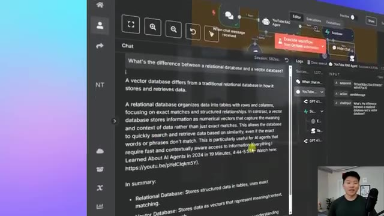
*⏱️ 00:00:06 — Interface de l'application affichant le chat d'un agent RAG avec une réponse détaillée sur les bases de données vectorielles et relationnelles.*

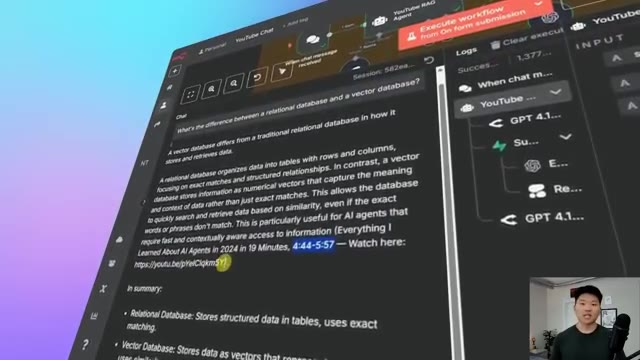
*⏱️ 00:00:11 — Vue rapprochée de l'interface montrant une réponse textuelle du chat incluant un lien vidéo YouTube avec un horodatage précis (4:44-5:57).*

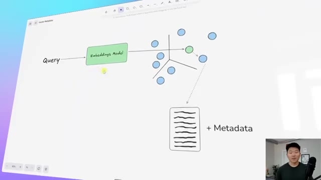
*⏱️ 00:00:17 — Schéma explicatif dessiné sur une application de type tableau blanc montrant un modèle d'embedding recevant une requête et l'association de métadonnées.*

---

### ⏱️ `[00:00:23 - 00:00:43]` | Segment #02

**🔊 Audio (Transcription Intégrale Mot pour Mot en Français) :**
> Très bien, donc je ne veux pas perdre de temps. Nous allons commencer par une courte démo afin que je puisse vous montrer à quoi ressemble cette histoire de métadonnées en parlant à notre agent RAG de transcription YouTube. Je vais donc envoyer ce message qui dit : quelle est la différence entre une base de données relationnelle et une base de données vectorielle ? Notre agent va effectuer une recherche dans Supabase. Il va utiliser un ré-classeur pour trier ces résultats. Et maintenant, nous allons obtenir notre réponse basée sur une transcription YouTube.

**👁️ Analyse Visuelle d'Écran (gemini-3.5-flash-lite) :**
**Interface & Outils** : Interface web d'un outil de conception de flux de travail d'agents IA (type Flowise ou Langflow).

**Contenu textuel & Code** : Diagramme de workflow avec des blocs 'When chat message received', 'YouTube RAG Agent', 'GPT-4o-mini', 'Supabase', et un pipeline de transcription avec 'On form submission', 'Get Transcript', 'Supabase Vector Store' et 'Append row in sheet'.

**Action / Démonstration** : Présentation visuelle de l'architecture du workflow et de l'agent RAG de transcription YouTube.

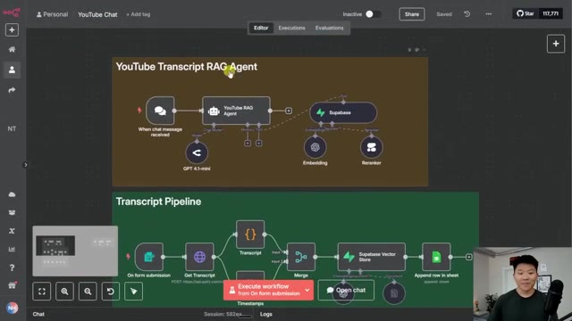
*⏱️ 00:00:28 — Interface de workflow montrant deux sections principales : 'YouTube Transcript RAG Agent' et 'Transcript Pipeline', avec des nœuds connectés pour la gestion des messages de chat, le modèle GPT, Supabase et l'indexation.*

---

### ⏱️ `[00:00:43 - 00:01:17]` | Segment #03

**🔊 Audio (Transcription Intégrale Mot pour Mot en Français) :**
> Et vous pouvez voir que non seulement notre agent a été capable de chercher et de trouver une réponse pour nous, mais il nous a aussi donné la vidéo YouTube exacte d'où il a tiré ces données, et l'horodatage exact d'où il a tiré ces données. Et ensuite, nous pouvons aussi aller ici et cliquer sur le lien si nous voulons regarder la vidéo complète. Et la seule raison pour laquelle il a été capable de nous donner ce contexte supplémentaire, c'est parce que nous avons enrichi les blocs avec ces informations dans les métadonnées. C'est donc le cas d'utilisation que nous abordons dans cette vidéo. Mais les métadonnées signifient essentiellement des données sur des données. Donc, peu importe ce que vous chargez, vous pouvez l'enrichir avec des métadonnées comme la date, le département, l'auteur, le nom du fichier ou la taille du fichier.

**👁️ Analyse Visuelle d'Écran (gemini-3.5-flash-lite) :**
**Interface & Outils** : n8n (interface de workflow d'automatisation)

**Contenu textuel & Code** : Diagrammes de nœuds d'automatisation, agent RAG YouTube, requêtes de base de données vectorielle Supabase, et interface de chat affichant une réponse avec lien YouTube et horodatage.

**Action / Démonstration** : Navigation et démonstration du fonctionnement de l'agent RAG et visualisation des résultats de recherche avec sources vidéo.

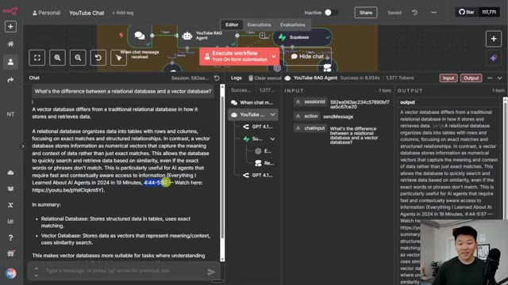
*⏱️ 00:00:52 — Interface n8n montrant un workflow de chat YouTube RAG avec les résultats de recherche, le lien source et l'horodatage précis dans le panneau de chat.*

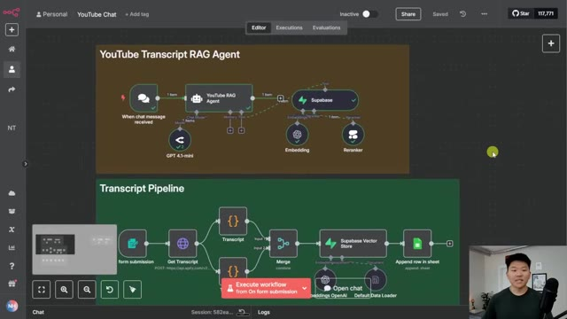
*⏱️ 00:01:09 — Vue d'ensemble du workflow n8n séparé en deux blocs : "YouTube Transcript RAG Agent" et "Transcript Pipeline" avec Supabase et les embeddings.*

---

### ⏱️ `[00:01:18 - 00:01:37]` | Segment #04

**🔊 Audio (Transcription Intégrale Mot pour Mot en Français) :**
> Quoi que vous vouliez avant que je décortique ce pipeline où nous récupérons les données de transcription, en les préparant, en les standardisant, puis en les enrichissant avec des métadonnées pour les vectoriser, passons rapidement sur Excalidraw pour que je puisse vous expliquer très vite pourquoi les métadonnées sont importantes et comment elles fonctionnent avec la recherche vectorielle. Si vous suivez ma chaîne depuis un moment maintenant, vous avez probablement déjà vu cette visualisation exacte sur Excalidraw, mais dans tous les cas, passons-la en revue rapidement.

**👁️ Analyse Visuelle d'Écran (gemini-3.5-flash-lite) :**
**Interface & Outils** : n8n (éditeur de workflow) et Excalidraw.

**Contenu textuel & Code** : Nœuds de workflow n8n (On form submission, Get Transcript, Transcript, Timestamps, Merge, Supabase Vector Store) et schéma de vectorisation Excalidraw (Text -> Chunks -> Embeddings Model -> Vectors).

**Action / Démonstration** : Le présentateur navigue entre l'éditeur de workflow n8n et le tableau blanc Excalidraw pour expliquer la logique du pipeline de transcription et de vectorisation.

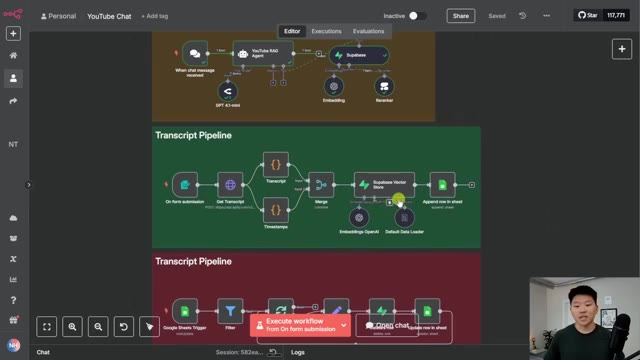
*⏱️ 00:01:22 — Vue d'ensemble d'un workflow n8n montrant le pipeline de transcription avec des nœuds connectés.*

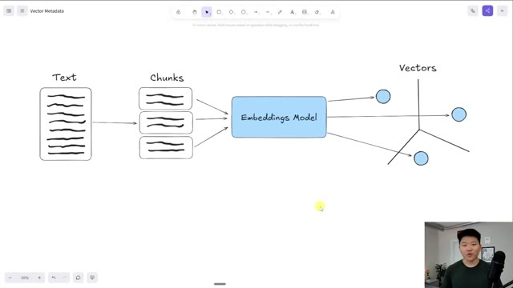
*⏱️ 00:01:32 — Schéma explicatif sur Excalidraw illustrant le processus de vectorisation à partir d'un texte découpé en morceaux passant par un modèle d'embedding.*

---

### ⏱️ `[00:01:37 - 00:02:00]` | Segment #05

**🔊 Audio (Transcription Intégrale Mot pour Mot en Français) :**
> Et je vais également faire en sorte que cet exemple reste pertinent par rapport à celui que nous allons utiliser chez NNN, juste pour que tout reste cohérent. Donc ce par quoi nous commençons ici, c'est notre transcription. Et ensuite, ce qui se passe, c'est que nous devons la découper en morceaux et la passer dans un modèle d'incorporation afin qu'elle soit transformée en différents vecteurs. Et chacun de ces points ou points vectoriels est fondamentalement associé à un morceau de la transcription. Donc la transcription pourrait avoir 20 morceaux, 30 morceaux, 50 morceaux, tout dépend de la durée de la vidéo.

**👁️ Analyse Visuelle d'Écran (gemini-3.5-flash-lite) :**
**Interface & Outils** : Tableau blanc numérique / outil de schématisation (type Excalidraw)

**Contenu textuel & Code** : Schéma textuel et graphique montrant les étapes : Text -> Chunks -> Embeddings Model -> Vectors

**Action / Démonstration** : Le présentateur explique visuellement le processus de découpage en morceaux (chunks) et de vectorisation du texte.

*⏱️ 00:01:43 — Schéma explicatif illustrant le pipeline de vectorisation : un document texte (« Text ») est découpé en segments (« Chunks »), puis envoyé vers un modèle d'embedding (« Embeddings Model ») pour générer des vecteurs (« Vectors »).*

---

### ⏱️ `[00:02:00 - 00:02:26]` | Segment #06

**🔊 Audio (Transcription Intégrale Mot pour Mot en Français) :**
> Et donc le problème ici, c'est que sans métadonnées, quand nous examinons ce morceau spécifique, nous ne savons en fait pas de quelle vidéo YouTube il provient. Donc si nous mettons trois transcriptions de vidéos YouTube dans notre base de données vectorielle, la transcription A, la transcription B et la transcription C, avec des métadonnées, nous pouvons donner à chaque morceau des informations supplémentaires, comme le titre de la vidéo complète dont il provient, ou l'URL de la vidéo complète dont il provient, ou l'horodatage de ce morceau spécifique dans la transcription.

**👁️ Analyse Visuelle d'Écran (gemini-3.5-flash-lite) :**
**Interface & Outils** : Tableau blanc numérique / outil de dessin (ex: Excalidraw ou similaire).

**Contenu textuel & Code** : Schéma avec les étapes : "Text" -> "Chunks" -> "Embeddings Model" -> "Vectors" (représentés par des points dans un espace vectoriel).

**Action / Démonstration** : Le présentateur explique visuellement le pipeline de vectorisation du texte, du document brut jusqu'aux vecteurs stockés.

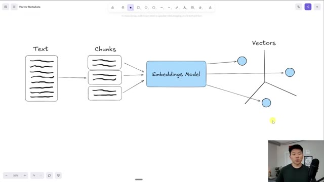
*⏱️ 00:02:06 — Schéma explicatif dessiné à la main montrant le processus de transformation du texte brut en vecteurs via un modèle d'embedding, avec le présentateur visible en incrustation dans le coin inférieur droit.*

---

### ⏱️ `[00:02:26 - 00:02:48]` | Segment #07

**🔊 Audio (Transcription Intégrale Mot pour Mot en Français) :**
> Et sans ce type de métadonnées, nous n'aurions aucune idée du type d'informations que nous recevons en retour et nous n'aurions honnêtement pas autant confiance lorsque notre agent nous répond, car il ne peut pas étayer ses dires avec une source réelle. Et puis, une dernière chose à garder à l'esprit, c'est que les métadonnées ne sont que des données sur des données. Les métadonnées n'ont donc aucun effet sur la signification réelle du fragment, elles n'ont aucun effet sur l'endroit où le fragment est placé dans la base de données vectorielle.

**👁️ Analyse Visuelle d'Écran (gemini-3.5-flash-lite) :**
**Interface & Outils** : Outil de tableau blanc numérique ou logiciel de dessin de diagrammes.

**Contenu textuel & Code** : Schéma avec des blocs de texte étiquetés A, B et C pointant vers un espace vectoriel 3D, détaillant les métadonnées de sortie (Title, URL, Timestamp).

**Action / Démonstration** : Présentation visuelle et explication du fonctionnement des métadonnées vectorielles.

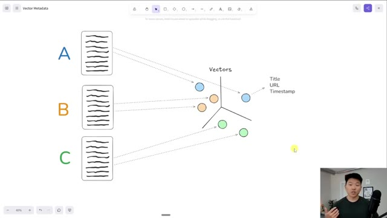
*⏱️ 00:02:32 — Schéma explicatif illustrant la conversion de documents textuels (A, B, C) en vecteurs tridimensionnels avec des métadonnées associées telles que le titre, l'URL et le code temporel.*

---

### ⏱️ `[00:02:48 - 00:03:08]` | Segment #08

**🔊 Audio (Transcription Intégrale Mot pour Mot en Français) :**
> Donc, lorsque nous faisons des recherches dans notre base de données vectorielle, la requête est convertie en vecteur, elle est introduite dans la base de données vectorielle, puis le segment le plus proche, ou les quelques segments les plus proches, selon la configuration que vous avez choisie, sont récupérés uniquement sur la base de la signification réelle de la transcription. Mais ensuite, une fois que nous récupérons la transcription et que nous réalisons qu'elle est pertinente par rapport à la requête, nous intégrons les métadonnées et nous les examinons pour obtenir plus de contexte.

**👁️ Analyse Visuelle d'Écran (gemini-3.5-flash-lite) :**
**Interface & Outils** : Outil de tableau blanc / diagramme en ligne (type Excalidraw)

**Contenu textuel & Code** : Schéma montrant "Query" entrant dans un "Embeddings Model", puis se dirigeant vers un espace vectoriel à plusieurs dimensions contenant des points bleus et un point vert, menant à un document avec des métadonnées.

**Action / Démonstration** : Le présentateur explique visuellement comment une requête est transformée en vecteur et comparée aux données stockées pour trouver les segments les plus proches.

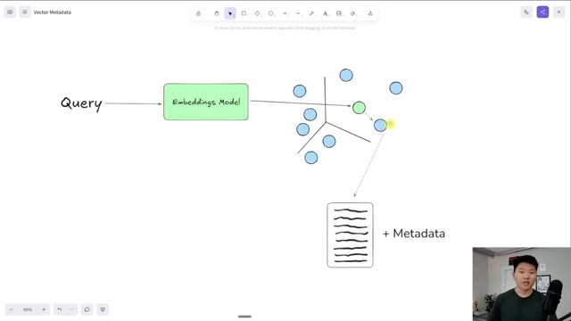
*⏱️ 00:02:53 — Schéma explicatif illustrant le fonctionnement d'une base de données vectorielle avec une requête convertie par un modèle d'embeddings.*

---

### ⏱️ `[00:03:08 - 00:03:30]` | Segment #09

**🔊 Audio (Transcription Intégrale Mot pour Mot en Français) :**
> Et ensuite, bien sûr, vous pouvez faire des choses comme le filtrage de métadonnées où vous pourriez dire, d'accord, vous savez, j'ai les transcriptions A, B et C dans ma base de données vectorielle, mais pour ce cas précis, je veux seulement regarder la transcription C parce que je sais que c'est la vidéo dont je veux extraire des informations. Les trois grands avantages d'avoir des métadonnées pour le RAG de votre base de données vectorielle sont donc que vous pouvez obtenir plus de contexte lorsque vous récupérez des éléments. Vous pouvez garder vos données un peu plus organisées et segmentées.

**👁️ Analyse Visuelle d'Écran (gemini-3.5-flash-lite) :**
**Interface & Outils** : Application de tableau blanc / diagramme en ligne (ex: Excalidraw)

**Contenu textuel & Code** : Diagramme illustrant les transcriptions A, B et C converties en vecteurs colorés (bleu, orange, vert) reliés à des métadonnées.

**Action / Démonstration** : Présentation visuelle du concept de filtrage de métadonnées et de vecteurs par le présentateur.

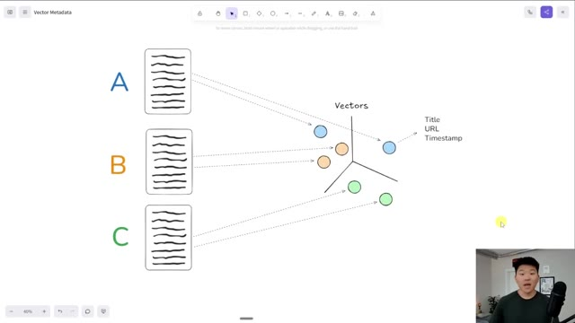
*⏱️ 00:03:13 — Schéma explicatif montrant la conversion de documents A, B et C en vecteurs dans un espace vectoriel avec des métadonnées (Title, URL, Timestamp).*

---

### ⏱️ `[00:03:31 - 00:04:03]` | Segment #10

**🔊 Audio (Transcription Intégrale Mot pour Mot en Français) :**
> Et puis bien sûr, vous pouvez filtrer en utilisant les métadonnées pour ne récupérer que ce que vous voulez. Maintenant que c'est fait, sautons dans NNN et jetons un coup d'œil à ces différents pipelines et à la façon dont les métadonnées fonctionnent réellement. D'accord. Nous venons donc de voir la fonctionnalité de chat où nous discutons avec Supabase. Examinons maintenant le pipeline réel des transcriptions pour voir comment nous faisons entrer les données dans notre magasin vectoriel Supabase avec des métadonnées. Donc, avant d'exécuter ce pipeline, laissez-moi aller très rapidement dans Supabase pour vous montrer la transcription qui s'y trouve actuellement. C'est cette vidéo YouTube que vous avez vue dans la démo. Mais comme vous pouvez le voir, chacun de ces différents segments,

**👁️ Analyse Visuelle d'Écran (gemini-3.5-flash-lite) :**
**Interface & Outils** : n8n (interface de workflow d'automatisation)

**Contenu textuel & Code** : Diagrammes de flux avec des nœuds pour "On form submission", "Get Transcript", "Supabase Vector Store", et "Append row in sheet".

**Action / Démonstration** : Le présentateur montre l'interface de n8n pour expliquer le fonctionnement des différents pipelines et l'utilisation des métadonnées.

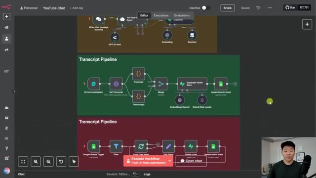
*⏱️ 00:03:47 — L'interface de n8n présentant plusieurs workflows automatisés liés au traitement de transcriptions et à des bases de données vectorielles (Supabase).*

---

### ⏱️ `[00:04:03 - 00:04:35]` | Segment #11

**🔊 Audio (Transcription Intégrale Mot pour Mot en Français) :**
> nous avons le contenu, qui est juste du texte. Et ensuite, dans les métadonnées de chacun, nous avons l'horodatage de l'endroit d'où provient ce morceau. Nous avons le titre de la vidéo, et ensuite nous avons l'URL de la vidéo. C'est donc exactement ce qui arrive à chaque vidéo YouTube que nous traitons dans notre base de données. D'accord, j'ai configuré ceci pour qu'il se déclenche essentiellement lors de la soumission d'un formulaire si nous voulons intégrer une vidéo dans notre base de données. Je vais donc cliquer sur exécuter le flux de travail. Cela va ouvrir ce formulaire qui nous invite à insérer un titre de vidéo et une URL. Je vais donc insérer cette vidéo d'Anthropic où ils sont assis sur un canapé et parlent de conseils pour construire une IA efficace

**👁️ Analyse Visuelle d'Écran (gemini-3.5-flash-lite) :**
**Interface & Outils** : Supabase Table Editor et n8n Workflow Automation

**Contenu textuel & Code** : Structure de table SQL/PostgreSQL avec colonnes id, content, metadata (JSONB) et embedding.

**Action / Démonstration** : Navigation et explication du stockage des métadonnées et transcriptions YouTube dans la base de données.

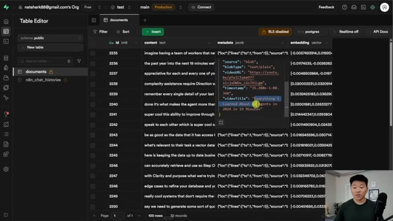
*⏱️ 00:04:11 — Vue d'une base de données Supabase affichant le contenu textuel des transcriptions et leurs métadonnées JSON (URL, horodatages, titre vidéo).*

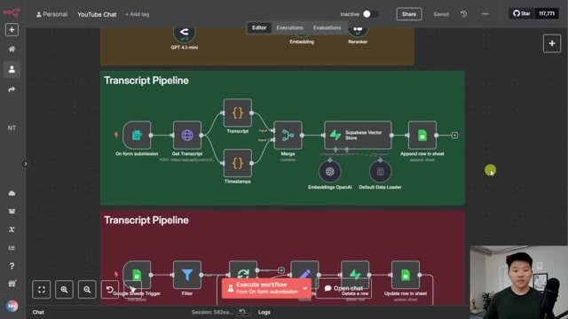
*⏱️ 00:04:19 — Vue d'un workflow n8n (« Transcript Pipeline ») montrant le traitement des données de transcription YouTube vers Supabase.*

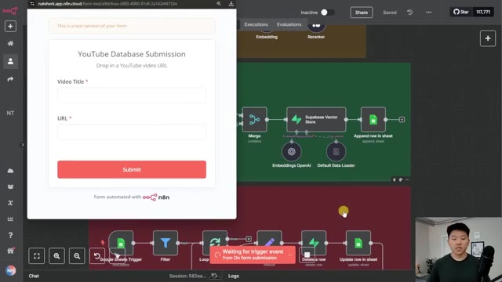
*⏱️ 00:04:27 — Affichage d'un formulaire de soumission de URL de vidéo YouTube associé au workflow n8n.*

---

### ⏱️ `[00:04:35 - 00:04:56]` | Segment #12

**🔊 Audio (Transcription Intégrale Mot pour Mot en Français) :**
> agents. Ce qui se passe d'abord, c'est que nous allons utiliser Apify afin de scraper la transcription YouTube. Nous allons rassembler la transcription YouTube complète. Nous allons récupérer les horodatages, tout fusionner, et c'est ensuite cela qui est réellement vectorisé. Et cela nous met également à jour dans notre Google Sheet. Ainsi, nous pouvons venir ici très rapidement et voir quelles vidéos existent actuellement dans notre base de données vectorielle. Et maintenant, plongeons dans chacun de ces nœuds pour que vous puissiez voir ce qui se passe.

**👁️ Analyse Visuelle d'Écran (gemini-3.5-flash-lite) :**
**Interface & Outils** : Interface graphique de type plateforme de construction de workflows IA (ex: Flowise) et Google Sheets.

**Contenu textuel & Code** : Nœuds de workflow : On form submission, Get Transcript (Apify), Transcript, Timestamps, Merge, Supabase Vector Store, Embeddings OpenAI. Tableur Google Sheets avec colonnes Title, URL, Status, Transcript.

**Action / Démonstration** : Exécution du pipeline de workflow pour scraper, fusionner et vectoriser les transcriptions YouTube.

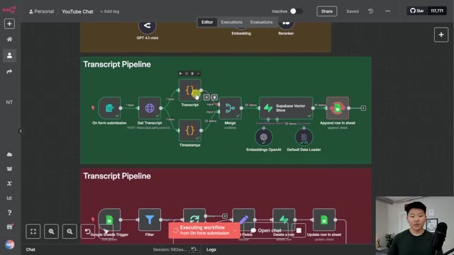
*⏱️ 00:04:40 — Vue d'un workflow de type low-code/no-code (Flowise ou similaire) montrant le pipeline de transcription avec Apify, Supabase Vector Store et la vectorisation des données.*

---

### ⏱️ `[00:04:56 - 00:05:16]` | Segment #13

**🔊 Audio (Transcription Intégrale Mot pour Mot en Français) :**
> La première est notre requête HTTP vers Apify pour extraire la transcription. C'est une requête vraiment simple. On lui donne fondamentalement juste l'URL de la vidéo, qui vient directement d'ici à partir de la soumission du formulaire réel. Et ensuite, ce qu'elle nous donne, c'est ce genre d'élément bizarre où nous avons comme des centaines d'objets dedans et chaque objet a un temps de départ, une durée, puis du texte.

**👁️ Analyse Visuelle d'Écran (gemini-3.5-flash-lite) :**
**Interface & Outils** : Interface web d'automatisation (workflow builder)

**Contenu textuel & Code** : Panneau de configuration "Get Transcript" affichant les paramètres de requête HTTP, les champs de saisie pour le jeton (token) et l'URL de la vidéo (videoUrl), ainsi que la sortie JSON contenant les segments de transcription (start, dur, text).

**Action / Démonstration** : Configuration d'une requête HTTP vers l'API d'Apify pour extraire la transcription d'une vidéo YouTube à partir des données de soumission d'un formulaire.

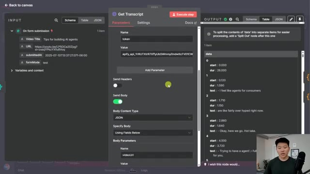
*⏱️ 00:05:01 — Capture d'écran montrant l'interface d'un outil d'automatisation avec un panneau de configuration HTTP pour récupérer une transcription via Apify.*

---

### ⏱️ `[00:05:16 - 00:05:35]` | Segment #14

**🔊 Audio (Transcription Intégrale Mot pour Mot en Français) :**
> Et donc c'est vraiment divisé et ce n'est pas exactement de la façon dont nous le voulions. Et d'ailleurs, si vous téléchargez ce modèle et que vous voulez vous configurer, tout ce que vous aurez à faire est d'aller sur Appify et d'entrer votre propre clé API Appify juste ici. Quand vous arrivez sur Appify, assurez-vous d'utiliser le code 30nateherk pour obtenir 30 % de réduction pendant trois mois. Et ensuite, vous descendrez ici dans vos paramètres, vous cliquerez sur API et intégrations.

**👁️ Analyse Visuelle d'Écran (gemini-3.5-flash-lite) :**
**Interface & Outils** : Interface web d'automatisation (type workflow/canvas) et interface de la plateforme Apify.

**Contenu textuel & Code** : URL d'API Apify (`https://api.apify.v2/acts/...`), paramètres de requête avec jeton d'authentification, et catalogue d'acteurs Apify.

**Action / Démonstration** : Configuration d'un nœud d'appel API dans un workflow et navigation dans le store Apify pour illustrer l'utilisation des clés API.

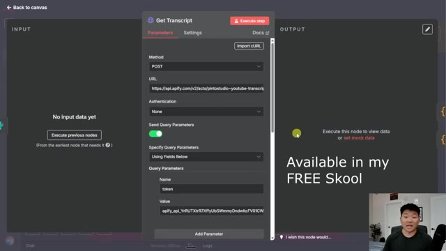
*⏱️ 00:05:21 — Interface d'un outil d'automatisation montrant la configuration d'un nœud HTTP "Get Transcript" avec les paramètres de requête et la clé API Apify.*

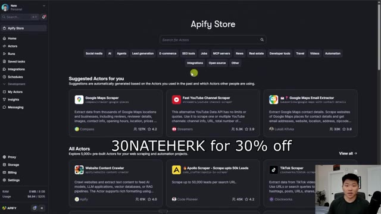
*⏱️ 00:05:30 — Interface de la boutique Apify (Apify Store) présentant différents acteurs (Actors) disponibles pour l'automatisation et le scraping.*

---

### ⏱️ `[00:05:35 - 00:06:01]` | Segment #15

**🔊 Audio (Transcription Intégrale Mot pour Mot en Français) :**
> Et puis juste ici, c'est là que vous allez copier votre clé API personnelle. Et ensuite, vous avez juste à la coller, comme je l'ai dit, juste ici. Assurez-vous simplement de garder cette clé privée parce que c'est un peu comme votre mot de passe. Donc à partir de là, ce que j'ai décidé de faire, c'est que je voulais le nettoyer et obtenir une seule chaîne de tout le contexte complet. J'ai donc décidé d'utiliser un nœud de code pour cela. Maintenant, ce que j'ai fait ici dans ce nœud de code, juste pour vous montrer mon processus de pensée, je viens ici et je réalise, ok, j'ai ce JSON entrant et je veux utiliser du code pour le nettoyer.

**👁️ Analyse Visuelle d'Écran (gemini-3.5-flash-lite) :**
**Interface & Outils** : Interface de type n8n ou plateforme d'automatisation visuelle de workflows d'agents IA.

**Contenu textuel & Code** : Paramètres de nœud d'API, code JavaScript de traitement de texte et données JSON structurées.

**Action / Démonstration** : Configuration des paramètres d'authentification et visualisation de la structure globale du pipeline de traitement.

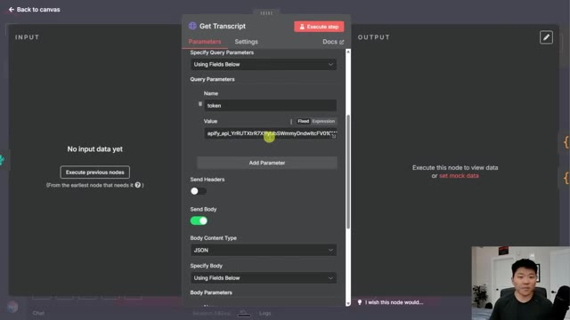
*⏱️ 00:05:42 — Configuration d'un nœud d'API avec l'insertion d'une clé API personnelle (token) pour le service de transcription.*

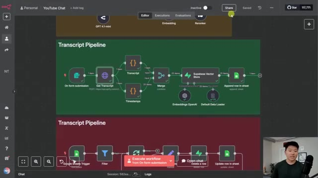
*⏱️ 00:05:48 — Vue d'ensemble du workflow complet d'automatisation nommé 'Transcript Pipeline' montrant les différents blocs connectés.*

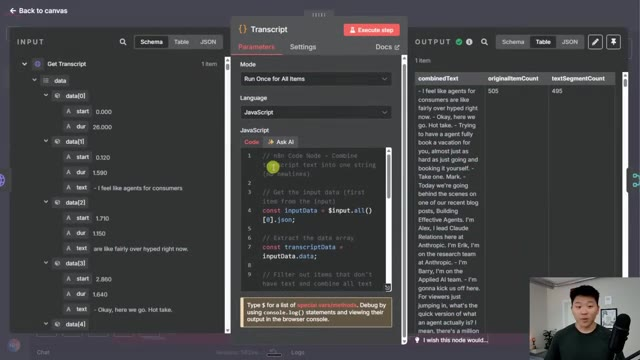
*⏱️ 00:05:55 — Éditeur de code JavaScript intégré au workflow affichant le traitement des données de transcription textuelle.*

---

### ⏱️ `[00:06:01 - 00:06:22]` | Segment #16

**🔊 Audio (Transcription Intégrale Mot pour Mot en Français) :**
> Ce que je vais faire, c'est que je vais simplement copier un peu de ce JSON juste ici, juste pour que je puisse comprendre le schéma. Et ensuite, je vais sur Claude et je dis : aide-moi à écrire un nœud de code dans n8n qui recevra ce schéma JSON entrant. Je colle le schéma. Et ensuite, je dis : j'ai besoin qu'il sépare tout le texte en une seule chaîne géante parce que nous traitons une transcription. Donc je veux que tout le texte s'enchaîne comme une seule chaîne dans un seul élément.

**👁️ Analyse Visuelle d'Écran (gemini-3.5-flash-lite) :**
**Interface & Outils** : n8n (outil d'automatisation de workflow) et l'interface web de Claude (Claude.ai).

**Contenu textuel & Code** : - Image 1 : Code JavaScript manipulant les données `transcriptData` (méthodes `filter`, `map`, `join` et `replace` pour fusionner du texte).
- Image 2 : Prompt : "Help me write a code node in n8n that will receive this incoming JSON", suivi d'un exemple de structure de données JSON (champs start, dur, text).

**Action / Démonstration** : Copie du schéma JSON depuis n8n vers Claude pour obtenir un script personnalisé permettant de traiter et d'extraire le texte des segments de transcription.

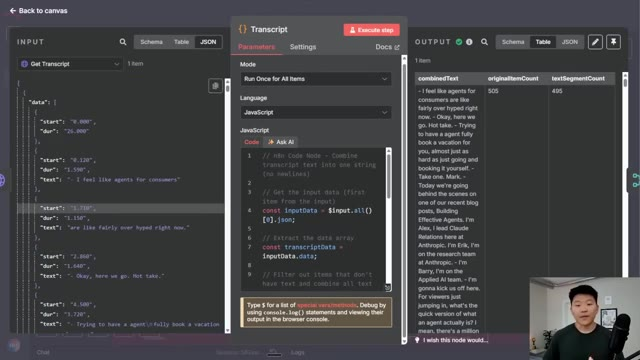
*⏱️ 00:06:07 — Interface n8n avec un nœud "Code" ouvert au centre, affichant le script JavaScript de traitement de données JSON et l'aperçu du résultat.*

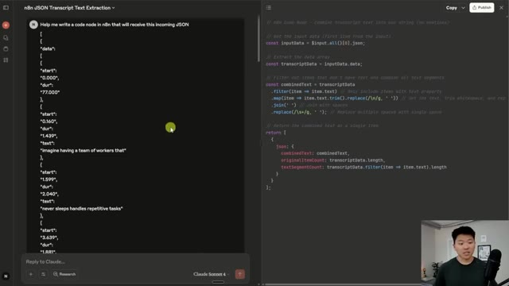
*⏱️ 00:06:12 — Interface de chat Claude avec un prompt demandant de générer un nœud de code pour n8n à partir d'un schéma JSON, affiché dans une vue scindée.*

---

### ⏱️ `[00:06:22 - 00:06:44]` | Segment #17

**🔊 Audio (Transcription Intégrale Mot pour Mot en Français) :**
> Il crache le code. Je le colle, je l'essaie. Et devinez quoi ? On obtient un seul élément, qui est la transcription entière dans une seule chaîne de caractères. C'est donc exactement ce qu'on voulait. Mais ce n'est pas exactement l'information que je voulais réellement vectoriser et découper, car tout comme nous l'avons vu dans cette visualisation, nous ne connaîtrions alors pas les horodatages de chaque zone qui a été découpée.

**👁️ Analyse Visuelle d'Écran (gemini-3.5-flash-lite) :**
**Interface & Outils** : n8n (éditeur de workflow et nœud de code JavaScript)

**Contenu textuel & Code** : Code JavaScript pour combiner les segments de transcription du nœud n8n en une seule chaîne de caractères (combinedText).

**Action / Démonstration** : Exécution d'un nœud de code JavaScript dans n8n pour fusionner le texte d'un transcript.

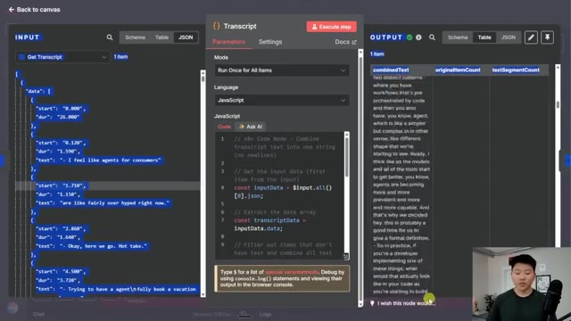
*⏱️ 00:06:28 — Interface d'un nœud de code JavaScript dans n8n montrant l'entrée JSON avec les segments de transcription, le code JavaScript au centre et la sortie combinée.*

---

### ⏱️ `[00:06:44 - 00:07:05]` | Segment #18

**🔊 Audio (Transcription Intégrale Mot pour Mot en Français) :**
> Donc ce que j'ai décidé de faire, c'est un autre nœud de code. Et cette fois, je voulais réellement tout diviser, mais en gardant les horodatages relatifs à chaque morceau de transcription. J'ai donc fait exactement la même chose ici. J'ai copié le schéma. Je suis allé dans mon Claude et j'ai pratiquement dit, ce que je veux faire maintenant, c'est regrouper 20 objets de données à la fois. Et je veux que les horodatages restent réellement pertinents pour chaque morceau.

**👁️ Analyse Visuelle d'Écran (gemini-3.5-flash-lite) :**
**Interface & Outils** : n8n, Claude (interface web)

**Contenu textuel & Code** : Code JavaScript pour le traitement des horodatages de transcription et requêtes textuelles sur Claude.

**Action / Démonstration** : Explication du code n8n et utilisation de Claude pour générer ou modifier le script de découpage des horodatages.

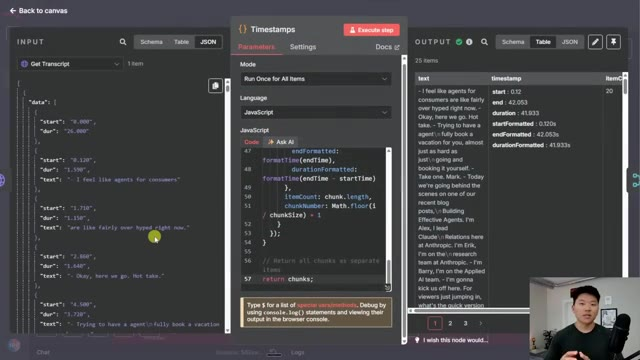
*⏱️ 00:06:49 — Interface n8n montrant un nœud JavaScript avec des données JSON en entrée et en sortie.*

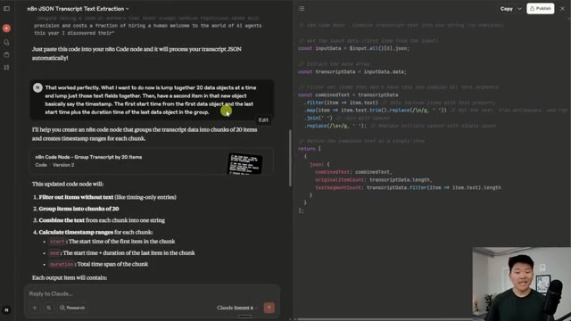
*⏱️ 00:07:00 — Interface de l'assistant Claude à gauche avec un prompt et du code JavaScript affiché à droite.*

---

### ⏱️ `[00:07:05 - 00:07:38]` | Segment #19

**🔊 Audio (Transcription Intégrale Mot pour Mot en Français) :**
> Donc cela n'a peut-être pas beaucoup de sens. Je préfère juste venir ici et vous montrer ce que je veux dire par là. Le nœud de transcription produit donc différents objets appelés "data", et chaque objet "data" possède un temps de départ, une durée, puis le texte réel dans ce petit objet. Ce que je dis fondamentalement à Claude de faire, c'est que je veux regrouper 20 objets "data" à la fois. Et ensuite, lorsque je regroupe ces objets "data", je veux que vous récupériez et combiniez tous les champs de texte ensemble. Mais afin de garder l'horodatage pertinent, je veux récupérer le premier temps de départ de ce premier objet "data".

**👁️ Analyse Visuelle d'Écran (gemini-3.5-flash-lite) :**
**Interface & Outils** : Interface de workflow (n8n ou similaire), éditeur de code JavaScript intégré.

**Contenu textuel & Code** : Structure de données JSON montrant des tableaux `data` avec les propriétés `start`, `dur` et `text`, ainsi qu'un script JavaScript de traitement des timestamps.

**Action / Démonstration** : Navigation et explication de la structure des données de transcription et du code de formatage des timestamps.

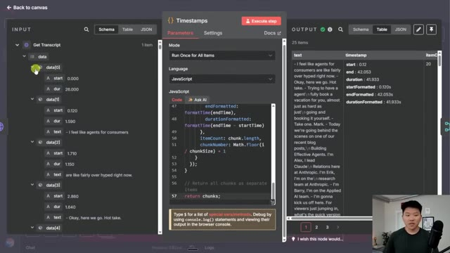
*⏱️ 00:07:13 — Vue détaillée de l'interface d'un nœud de workflow montrant les données d'entrée structurées avec des objets de transcription, le panneau de configuration JavaScript au centre, et le tableau des résultats en sortie sur la droite.*

---

### ⏱️ `[00:07:38 - 00:07:58]` | Segment #20

**🔊 Audio (Transcription Intégrale Mot pour Mot en Français) :**
> Et ensuite, à partir du dernier, ce que je veux faire, c'est obtenir l'heure de début plus la durée, ce qui équivaudrait à l'heure de fin. Et ensuite, vous pouvez voir sur ce côté droit, nous obtenons 25 segments de transcription différents, et chaque segment a une heure de début formatée et une heure de fin formatée. C'est donc pour cela que nous obtenons nos superbes segments à vectoriser qui comportent nos véritables horodatages avec eux.

**👁️ Analyse Visuelle d'Écran (gemini-3.5-flash-lite) :**
**Interface & Outils** : Interface web d'automatisation (style n8n ou workflow similaire) avec un éditeur de code JavaScript au centre.

**Contenu textuel & Code** : Code JavaScript manipulant des objets avec des propriétés 'start', 'end', 'duration' et 'formatTime' pour des segments de transcription.

**Action / Démonstration** : Configuration et explication du code de formatage des horodatages et de calcul de la durée de fin dans un nœud d'automatisation.

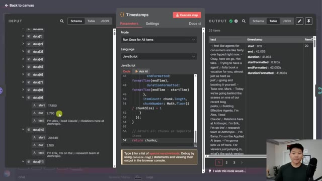
*⏱️ 00:07:43 — Interface d'un outil d'automatisation montrant les données d'entrée, un bloc de code JavaScript pour traiter des horodatages de transcription, et les données de sortie.*

---

### ⏱️ `[00:07:59 - 00:08:17]` | Segment #21

**🔊 Audio (Transcription Intégrale Mot pour Mot en Français) :**
> Donc ça a fonctionné à merveille. Je suis en train de tout regrouper, puis nous l'envoyons dans Supabase. Et la seule chose vraiment spéciale qui se passe ici se trouve dans le chargeur de données par défaut. C'est ici que nous lui indiquons quelles données vectoriser. Et c'est aussi ici que nous lui donnons les trois champs de métadonnées, le titre de la vidéo, l'horodatage et l'URL de la vidéo. La première chose est donc les données à vectoriser réellement.

**👁️ Analyse Visuelle d'Écran (gemini-3.5-flash-lite) :**
**Interface & Outils** : Flowise (ou interface similaire de construction de workflows d'IA)

**Contenu textuel & Code** : Diagramme de pipeline avec des nœuds comme 'On form submission', 'Get Transcript', 'Supabase Vector Store' et panneau de configuration de chargeur de données.

**Action / Démonstration** : Le présentateur explique le fonctionnement du chargeur de données par défaut et comment les données sont préparées pour être vectorisées dans Supabase.

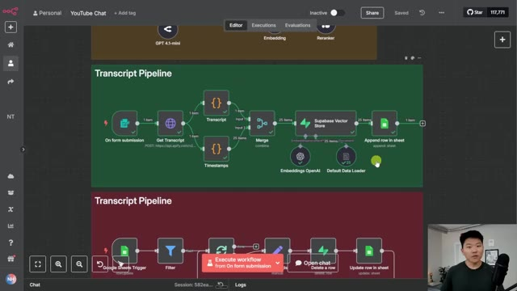
*⏱️ 00:08:03 — Vue d'ensemble du workflow de traitement de transcriptions sur une plateforme d'automatisation visuelle, montrant les nœuds interconnectés.*

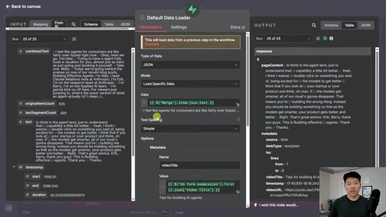
*⏱️ 00:08:08 — Gros plan sur le panneau de configuration du nœud 'Default Data Loader' montrant les paramètres de chargement des données JSON et de vectorisation.*

---

### ⏱️ `[00:08:17 - 00:08:38]` | Segment #22

**🔊 Audio (Transcription Intégrale Mot pour Mot en Français) :**
> Je ne voulais pas faire toutes les données d'entrée. Nous voulions charger des données très spécifiques, qui seraient juste le texte qui a réellement été découpé avec des horodatages. Nous ne voulions pas vectoriser l'intégralité du texte combiné. Donc ensuite, pour chacun de ces morceaux, nous voulions donner les métadonnées. Donc pour le titre de la vidéo, je suis juste aller dans la soumission de formulaire et j'ai glissé le titre de la vidéo. Pour l'URL de la vidéo, j'ai fait la même chose à partir d'ici, j'ai glissé l'URL de la vidéo.

**👁️ Analyse Visuelle d'Écran (gemini-3.5-flash-lite) :**
**Interface & Outils** : Application web d'automatisation de flux de travail (style interface n8n ou similaire).

**Contenu textuel & Code** : Expression de chargement spécifique de données textuelles avec horodatages et métadonnées (`{{ $('Merge').item.json.text }}`).

**Action / Démonstration** : Configuration et sélection du mode de chargement de données spécifiques (« Load Specific Data ») pour traiter les segments de texte et leurs horodatages.

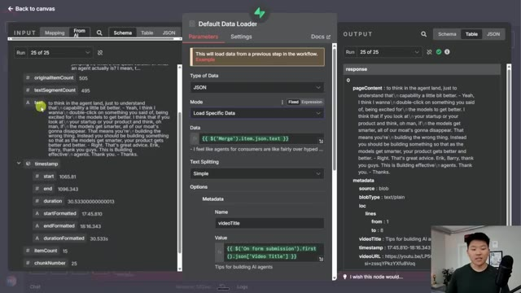
*⏱️ 00:08:22 — Interface d'un outil d'automatisation montrant la configuration d'un nœud « Default Data Loader » avec des données JSON à gauche, les paramètres de chargement au centre, et la sortie (output) à droite.*

---

### ⏱️ `[00:08:38 - 00:09:00]` | Segment #23

**🔊 Audio (Transcription Intégrale Mot pour Mot en Français) :**
> Mais ensuite, pour l'horodatage, ce que j'ai dû faire, c'est simplement aller à notre nœud de fusion où nous avons tout rassemblé. Et ensuite, je voulais intégrer l'heure de début formatée, puis j'ai ajouté manuellement un tiret, et ensuite j'ai intégré l'heure de fin formatée. Donc maintenant, nous obtenons une plage d'environ 40 secondes pour chacun de nos segments. Et maintenant que nous avons tout dans notre base de données vectorielle et enrichi, nous l'écrivons dans notre feuille Google Sheets. Nous pouvons donc voir une encore fois, voici les vidéos qui existent dans notre base de données vectorielle.

**👁️ Analyse Visuelle d'Écran (gemini-3.5-flash-lite) :**
**Interface & Outils** : Interface web d'automatisation de type workflow (style n8n ou Flowise).

**Contenu textuel & Code** : Expressions JavaScript de type `{{ $('Merge').item.json.timestamp.startFormatted }}` combinées pour créer un format d'horodatage.

**Action / Démonstration** : Configuration des propriétés d'un nœud pour insérer dynamiquement les heures de début et de fin formatées.

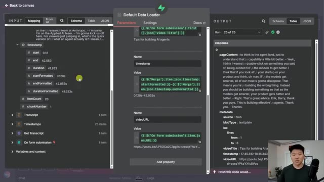
*⏱️ 00:08:44 — Gros plan sur l'interface de configuration d'un nœud de données montrant l'expression pour formater les horodatages de début et de fin.*

---

### ⏱️ `[00:09:00 - 00:09:33]` | Segment #24

**🔊 Audio (Transcription Intégrale Mot pour Mot en Français) :**
> Et d'ailleurs, si vous voulez vous faire une meilleure idée et télécharger ce flux de travail, vous pouvez le faire gratuitement. Vous avez juste à rejoindre ma communauté School gratuite. Le lien pour cela sera en bas dans la description. Vous chercherez ensuite le titre de cette vidéo ou vous pourrez cliquer sur Ressources YouTube, et le post associé à cette vidéo aura le flux de travail juste ici à télécharger. Il y aura aussi un lien juste ici vers ce modèle de Google Sheet si vous voulez simplement importer exactement le même pour n'avoir rien d'autre à configurer. OK, super. Donc maintenant ce qu'on peut faire, c'est discuter avec notre agent et voir s'il peut réellement accéder à cette nouvelle vidéo. Donc je vais envoyer cette requête qui demande : que dit l'équipe d'Anthropic sur la construction efficace d'agents ?

**👁️ Analyse Visuelle d'Écran (gemini-3.5-flash-lite) :**
**Interface & Outils** : Skool, interface n8n

**Contenu textuel & Code** : Workflow n8n 'YouTube Transcript RAG Agent' avec intégration Supabase, Embedding, et nœud Reranker.

**Action / Démonstration** : Présentation et navigation dans le workflow n8n et la communauté de téléchargement.

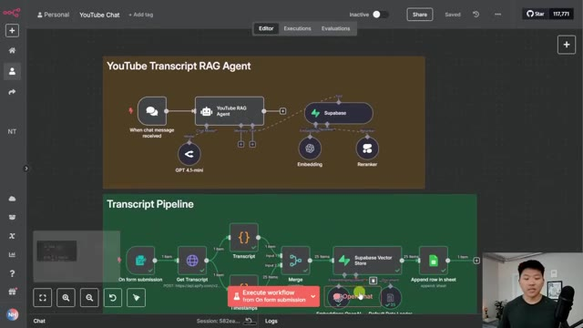
*⏱️ 00:09:25 — Interface n8n montrant un workflow complet de 'YouTube Transcript RAG Agent' et 'Transcript Pipeline' avec des connexions de données.*

---

### ⏱️ `[00:09:33 - 00:10:07]` | Segment #25

**🔊 Audio (Transcription Intégrale Mot pour Mot en Français) :**
> Nous allons voir le système parcourir Supabase et, espérons-le, il est capable de tirer des enseignements de cette nouvelle vidéo que nous venons d'insérer dans notre base de données. Donc il vient de répondre : L'équipe d'Anthropic partage plusieurs conseils sur la création efficace d'agents. Voici le premier conseil de cette vidéo à partir du repère temporel 12 à 42 avec le lien de notre vidéo YouTube. Vous pouvez voir que nous obtenons d'autres informations ici en bas, et cela provient de bien plus tard dans cette vidéo, donc de 17:45 à 18:16, et puis bien sûr, cela nous donne quelques points supplémentaires. Mais vous pouvez voir que le système extrait les informations de la bonne vidéo et qu'il nous montre aussi exactement d'où il tire ces données. Très bien, maintenant que vous avez vu comment cela fonctionne, avant d'arriver au pipeline en bas pour

**👁️ Analyse Visuelle d'Écran (gemini-3.5-flash-lite) :**
**Interface & Outils** : Interface web n8n (outil d'automatisation et de workflow d'agents IA)

**Contenu textuel & Code** : Workflow d'agent RAG utilisant Supabase, GPT-4.1-mini, des embeddings et un reranker, avec une requête de chat sur la création d'agents par Anthropic.

**Action / Démonstration** : Exécution du workflow n8n et affichage de la réponse générée par l'agent dans le module de chat interactif.

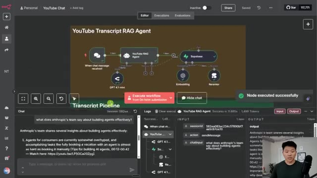
*⏱️ 00:09:42 — Vue d'ensemble de l'interface n8n montrant le workflow du "YouTube Transcript RAG Agent" avec le panneau de chat affichant la réponse de l'IA sur les conseils d'Anthropic.*

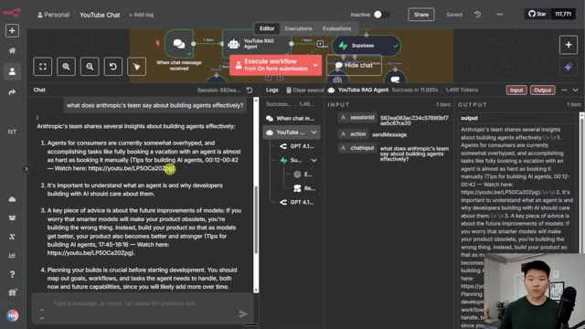
*⏱️ 00:09:50 — Gros plan sur le panneau de chat de l'interface n8n affichant la réponse complète et structurée de l'agent RAG à propos des conseils d'Anthropic pour créer des agents efficaces.*

---

### ⏱️ `[00:10:07 - 00:10:43]` | Segment #26

**🔊 Audio (Transcription Intégrale Mot pour Mot en Français) :**
> en fait de supprimer automatiquement les transcriptions de notre base de données vectorielle, je voulais parler du fait que maintenant que nous avons deux vidéos YouTube dans notre base de données vectorielle, et si nous voulions effectuer une recherche et dire, je veux seulement que tu cherches dans cette seule vidéo. Eh bien, c'est là que nous utiliserions le filtrage par métadonnées, car nous pouvons littéralement dire, effectue une recherche dans notre base de données vectorielle pour ceci, mais ne renvoie que les lignes où le titre de la vidéo est égal à cela. Donc, pour faire cela, j'ai une configuration différente ici, qui est notre agent RAG avec une soumission de formulaire afin d'effectuer le filtrage par métadonnées. Nous interagissons donc avec celui-ci via une soumission de formulaire. Je vais ouvrir le formulaire juste ici, et il va nous demander une vidéo YouTube à parcourir, puis nous pourrons

**👁️ Analyse Visuelle d'Écran (gemini-3.5-flash-lite) :**
**Interface & Outils** : Éditeur de workflow de type n8n / plateforme d'automatisation d'agents IA, avec la vidéo du présentateur en bas à droite.

**Contenu textuel & Code** : Diagrammes de flux connectant des modules (déclencheur, agent YouTube RAG, Supabase, Transcript Pipeline, Get Transcript, Merge, Supabase Vector Store, Embeddings OpenAI).

**Action / Démonstration** : Présentation et explication visuelle de l'architecture du workflow d'automatisation des transcriptions et de la base de données vectorielle.

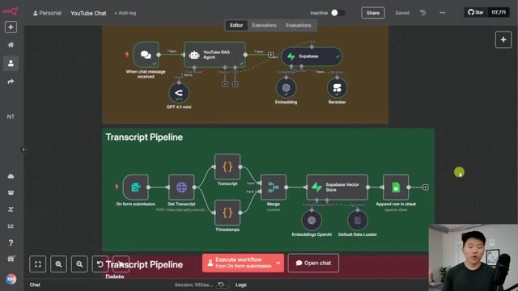
*⏱️ 00:10:16 — Capture d'écran montrant l'interface d'un éditeur de workflow avec deux blocs principaux : un agent RAG YouTube en haut et un pipeline de transcription en bas.*

---

### ⏱️ `[00:10:43 - 00:11:17]` | Segment #27

**🔊 Audio (Transcription Intégrale Mot pour Mot en Français) :**
> donnez-lui une requête. Donc je dis que je veux seulement parcourir cette vidéo de conseils pour créer des agents IA par Anthropic, et je veux juste trois points clés. Donc je vais envoyer ça. Notre agent va prendre ça, chercher dans Supabase uniquement les segments où le titre de la vidéo correspond à ce que nous venons d'y mettre. Et puis il va nous donner une réponse. Et aussi, celui-ci ne va pas répondre dans le chat parce que nous lui avons parlé via une soumission de formulaire. Donc je dois juste cliquer sur l'agent pour lire la réponse. C'est parti. Voici trois points clés de la vidéo de conseils pour créer des agents IA. Le premier est que lors de la création d'agents, il est important de concevoir votre produit de sorte que, à mesure que les modèles d'IA s'améliorent, votre produit s'améliore également. Le deuxième conseil concerne

**👁️ Analyse Visuelle d'Écran (gemini-3.5-flash-lite) :**
**Interface & Outils** : Interface de workflow d'agents IA (type n8n ou plateforme similaire de construction de flux d'IA).

**Contenu textuel & Code** : Workflow RAG Agent avec filtre de métadonnées, connexions GPT 4.1-mini et Supabase Vector Store, affichant les trois points clés extraits d'une vidéo sur la création d'agents IA.

**Action / Démonstration** : Exécution du workflow et affichage des résultats générés par l'agent à partir de la requête utilisateur sur la transcription YouTube.

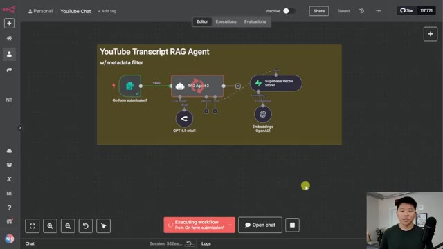
*⏱️ 00:10:51 — Vue d'ensemble du workflow "YouTube Transcript RAG Agent" montrant les différentes étapes connectées avec un modèle GPT et un magasin de vecteurs Supabase.*

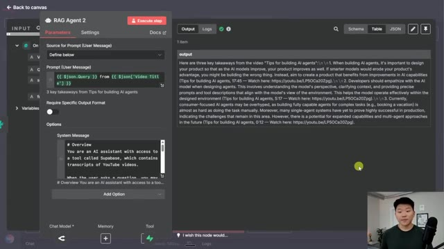
*⏱️ 00:11:08 — Panneau de configuration du nœud "RAG Agent 2" avec les paramètres du prompt utilisateur et le résultat généré affichant trois points clés.*

---

### ⏱️ `[00:11:17 - 00:11:37]` | Segment #28

**🔊 Audio (Transcription Intégrale Mot pour Mot en Français) :**
> développeurs et ça vient de 5:17 dans cette vidéo. Et puis le dernier conseil vient de cette même vidéo, bien sûr, et à partir de la 12e seconde. Alors rappelez-vous juste que ce n'est pas parfait. Et si vous vouliez vraiment trois points clés ou un grand résumé, vous ne voudriez probablement pas opter pour une approche de recherche vectorielle, car ce morceau n'a toujours pas le contexte global de tous les morceaux combinés.

**👁️ Analyse Visuelle d'Écran (gemini-3.5-flash-lite) :**
**Interface & Outils** : Interface de type n8n ou plateforme d'automatisation de workflows IA.

**Contenu textuel & Code** : Schéma de workflow RAG comprenant des nœuds de traitement de requêtes YouTube, un agent RAG, un modèle LLM (GPT 4.1-mini) et une base de données vectorielle Supabase.

**Action / Démonstration** : Visualisation du workflow global et inspection des paramètres de configuration et des résultats textuels générés par l'agent IA.

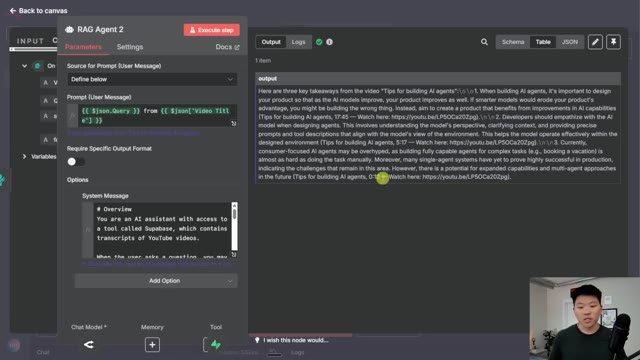
*⏱️ 00:11:22 — Configuration d'un nœud "RAG Agent 2" avec affichage de la sortie textuelle générée à droite.*

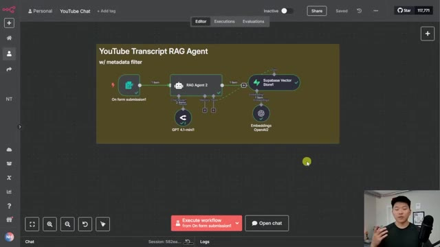
*⏱️ 00:11:27 — Vue d'ensemble d'un workflow nommé "YouTube Transcript RAG Agent" connectant différents modules (formulaire, agent RAG, GPT-4o-mini, Supabase Vector Store).*

---

### ⏱️ `[00:11:37 - 00:12:12]` | Segment #29

**🔊 Audio (Transcription Intégrale Mot pour Mot en Français) :**
> Mais le point que j'essayais de faire valoir ici, c'est que c'est ainsi que vous pouvez réellement contrôler quels segments vous examinez, car dans ce nœud de base de données vectorielle basé sur Supabase, nous avons un filtre de métadonnées. Et c'est là que nous disons de ne récupérer des segments que si le titre de la vidéo est égal à cette entrée dynamique, qui, dans notre cas, est tout ce que nous avons saisi dans cette soumission de formulaire. Très bien. Et puis la dernière partie, c'est que nous avons ce petit pipeline pour supprimer des éléments si nous n'en voulons plus dans notre base de données vectorielle. Disons donc que nous en avons assez de discuter avec cette vidéo YouTube de Nate et que nous voulons la retirer de notre base de données vectorielle. Tout ce que nous aurions à faire, c'est de venir ici et de changer le statut pour « supprimer ». Et ensuite, ce flux de travail va se déclencher s'il est actif.

**👁️ Analyse Visuelle d'Écran (gemini-3.5-flash-lite) :**
**Interface & Outils** : Éditeur de workflow n8n et Google Sheets

**Contenu textuel & Code** : Paramètres du nœud Supabase Vector Store avec filtre de métadonnées (videoTitle) et expression JSON associée.

**Action / Démonstration** : Configuration des filtres de métadonnées pour contrôler les segments de données interrogés.

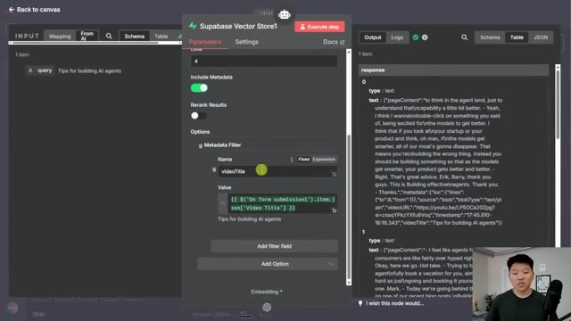
*⏱️ 00:11:46 — Configuration du nœud Supabase Vector Store dans l'éditeur de workflow n8n montrant le filtre de métadonnées.*

---

### ⏱️ `[00:12:12 - 00:12:34]` | Segment #30

**🔊 Audio (Transcription Intégrale Mot pour Mot en Français) :**
> flux de travail parce que nous avons mis à jour une ligne. Cela va s'assurer que ça va seulement traiter les lignes où le statut est égal à supprimer. Donc laissez-moi juste lancer ceci et vous montrer les gars. Et ensuite nous configurons la boucle au cas où vous y allez et que vous en cochez genre cinq comme supprimer, ça ira de l'avant et traitera les cinq. Donc vous pouvez voir que c'est and très rapide. Ça a déjà fini. Et si je vais sur ce Google Sheet, vous pouvez voir que ceci est maintenant marqué comme supprimé.

**👁️ Analyse Visuelle d'Écran (gemini-3.5-flash-lite) :**
**Interface & Outils** : Interface graphique de l'outil d'automatisation n8n.

**Contenu textuel & Code** : Workflow n8n intitulé "Transcript Pipeline - Delete" avec les nœuds : Google Sheets Trigger, Filter, Loop Over Items, Edit Fields, Delete a row, et Update row in sheet.

**Action / Démonstration** : Le présentateur s'apprête à cliquer sur le bouton rouge "Execute workflow" pour tester le flux de suppression.

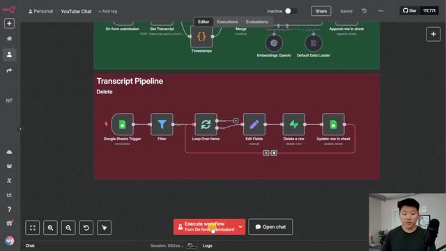
*⏱️ 00:12:18 — Un éditeur de workflow montrant un pipeline de suppression avec Google Sheets Trigger, un filtre, une boucle, l'édition de champs et la suppression de lignes.*

---

### ⏱️ `[00:12:34 - 00:12:54]` | Segment #31

**🔊 Audio (Transcription Intégrale Mot pour Mot en Français) :**
> Et si je vais dans notre base de données vectorielle et que nous rafraîchissons ceci, nous devrions voir que ce premier morceau ici n'aura pas le titre YouTube de tout ce que j'ai appris sur la construction d'agents, cette vidéo que nous venons de supprimer. Donc maintenant notre base de données vectorielle est à jour. Donc juste pour vous montrer comment cela fonctionne, le déclencheur se déclenche lorsqu'une ligne est mise à jour, mais il va quand même récupérer tout ce qui se trouve sur cette feuille.

**👁️ Analyse Visuelle d'Écran (gemini-3.5-flash-lite) :**
**Interface & Outils** : Supabase Table Editor et n8n.

**Contenu textuel & Code** : Lignes de données textuelles et métadonnées JSON, diagramme de flux de données.

**Action / Démonstration** : Visualisation de la base de données vectorielle après mise à jour et consultation du workflow de suppression.

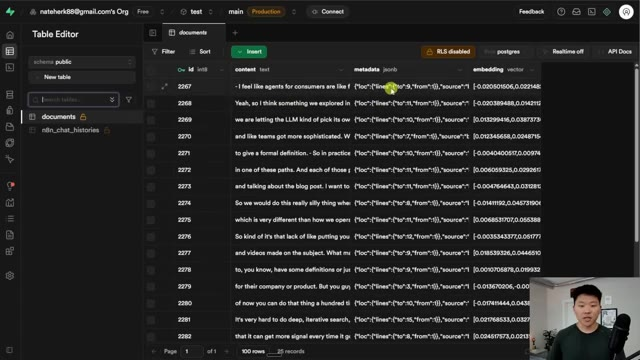
*⏱️ 00:12:39 — Base de données vectorielle affichant les colonnes 'content', 'metadata' et 'embedding'.*

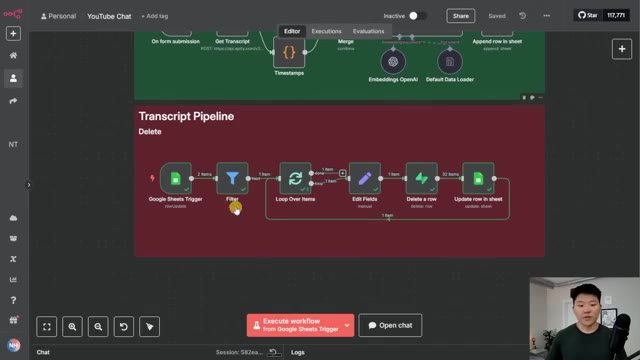
*⏱️ 00:12:49 — Interface de workflow n8n montrant la section 'Transcript Pipeline' avec les nœuds de suppression.*

---

### ⏱️ `[00:12:54 - 00:13:19]` | Segment #32

**🔊 Audio (Transcription Intégrale Mot pour Mot en Français) :**
> Donc ensuite ce que nous faisons c'est que nous passons dans un filtre et nous disons simplement, si la colonne de statut est égale à supprimer, alors nous allons le garder. Et c'est pourquoi il a gardé cette vidéo, mais il n'a pas gardé les astuces pour créer des agents IA. Donc nous allons seulement en fait supprimer celle que nous avons marquée comme supprimée. Ensuite nous avons la boucle. Nous n'avons qu'un seul élément dans ce cas, donc ça n'a pas d'importance. Mais ensuite nous faisons une définition juste pour nous assurer de définir l'URL de la vidéo parce que c'est ce que nous allons utiliser comme notre filtre de métadonnées pour supprimer des vecteurs.

**👁️ Analyse Visuelle d'Écran (gemini-3.5-flash-lite) :**
**Interface & Outils** : Outil d'automatisation de type workflow visuel (interface similaire à n8n).

**Contenu textuel & Code** : Conditions de filtrage ($ { $json.Status } est égal à Remove) et paramètres de mappage de champs pour l'URL.

**Action / Démonstration** : Explication et configuration des étapes du filtre et de la boucle dans le workflow d'automatisation des transcripts.

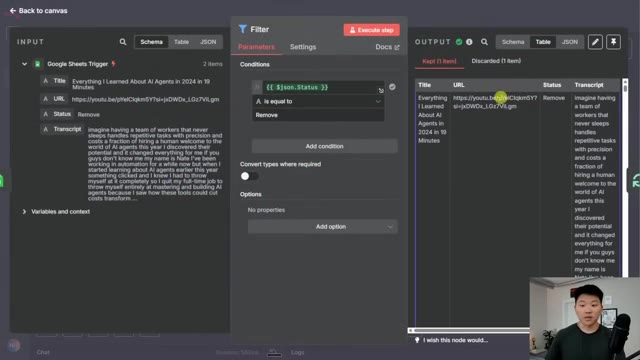
*⏱️ 00:13:00 — Configuration du nœud de filtrage (Filter) dans l'interface de l'outil d'automatisation montrant la condition de statut égal à 'Remove'.*

*⏱️ 00:13:07 — Vue d'ensemble du workflow d'automatisation nommé 'Transcript Pipeline' avec plusieurs nœuds connectés (Google Sheets Trigger, Filter, Loop Over Items, Edit Fields, etc.).*

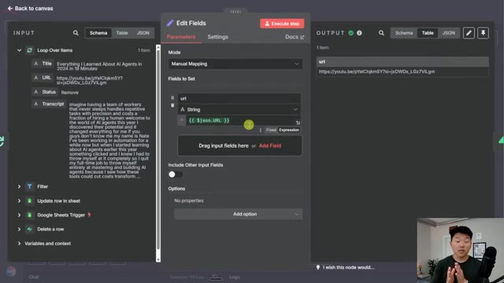
*⏱️ 00:13:13 — Configuration du nœud d'édition de champs (Edit Fields) dans le workflow montrant le mappage manuel de la variable URL.*

---

### ⏱️ `[00:13:19 - 00:13:39]` | Segment #33

**🔊 Audio (Transcription Intégrale Mot pour Mot en Français) :**
> Donc nous avons notre URL juste ici de la vidéo YouTube. Et ensuite, nous allons dans un nœud Supabase où nous allons supprimer une ligne. Nous la supprimons de cette table que nous avions configurée. Et ensuite, nous disons en gros : ne supprimez que les lignes où, dans les métadonnées, le champ appelé URL de la vidéo est égal à ceci, qui est l'URL dynamique de la vidéo YouTube que nous venons de définir.

**👁️ Analyse Visuelle d'Écran (gemini-3.5-flash-lite) :**
**Interface & Outils** : n8n (éditeur de workflow)

**Contenu textuel & Code** : Paramètres du nœud Supabase configurés pour une opération de suppression (Delete) sur la table 'documents', avec un filtre basé sur l'URL de la vidéo dans les métadonnées.

**Action / Démonstration** : Configuration des paramètres du nœud Supabase pour supprimer des lignes en fonction de l'URL de la vidéo.

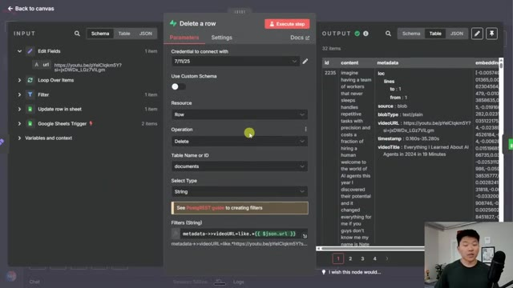
*⏱️ 00:13:24 — Interface d'un nœud de workflow montrant la configuration pour supprimer une ligne dans Supabase avec un filtre sur les métadonnées.*

---

### ⏱️ `[00:13:39 - 00:13:59]` | Segment #34

**🔊 Audio (Transcription Intégrale Mot pour Mot en Français) :**
> Et donc ça revient vers nous et ça dit, ok, nous avons trouvé 32 vecteurs où le champ de métadonnées de l'URL de la vidéo était égal à cette chaîne de caractères. Et donc nous allons juste tous les supprimer. Ça va de l'avant et ça les supprime. Et ensuite nous mettons à jour dans notre feuille Google Sheet que cette URL a été marquée comme supprimée. Donc c'est le système complet que je voulais partager avec vous les gars aujourd'hui.

**👁️ Analyse Visuelle d'Écran (gemini-3.5-flash-lite) :**
**Interface & Outils** : Outil d'automatisation de type workflow / no-code

**Contenu textuel & Code** : Configuration du nœud "Delete a row" avec la table "documents" et un filtre PostgREST ciblant l'URL de la vidéo dans les métadonnées.

**Action / Démonstration** : Configuration et visualisation du processus de suppression des vecteurs associés à une URL de vidéo spécifique.

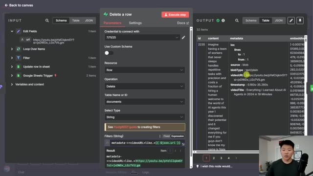
*⏱️ 00:13:44 — Interface d'un outil d'automatisation montrant la configuration d'un nœud pour supprimer une ligne avec un filtre basé sur les métadonnées de l'URL de la vidéo.*

---

### ⏱️ `[00:13:59 - 00:14:19]` | Segment #35

**🔊 Audio (Transcription Intégrale Mot pour Mot en Français) :**
> Si vous téléchargez ce modèle gratuitement, vous pourrez manipuler tout cela et simplement le tester et voir, vous savez, comment vous pourriez commencer à utiliser des métadonnées pour votre cas d'utilisation spécifique, parce que ce sera toujours différent pour différents types de données. Mais la clé, en réalité, c'est ce pipeline RAG juste ici, où vous allez traiter différents types d'entrées, mais pour chaque entrée, vous devez savoir exactement ce que vous voulez.

**👁️ Analyse Visuelle d'Écran (gemini-3.5-flash-lite) :**
**Interface & Outils** : Outil de flux de travail / éditeur de graphes (type Flowise ou similaire) avec une vue d'ensemble de plusieurs workflows.

**Contenu textuel & Code** : Diagrammes de flux : "YouTube Transcript RAG Agent", "YouTube Transcript RAG Agent w/ metadata filter", "Transcript Pipeline", et "Transcript Pipeline Delete".

**Action / Démonstration** : Présentation globale des différents flux de travail disponibles dans le modèle à télécharger et à manipuler.

*⏱️ 00:14:04 — Interface d'un outil d'automatisation de flux de travail affichant quatre blocs de processus différents liés à des agents RAG de transcription YouTube et à des pipelines de données.*

---

### ⏱️ `[00:14:19 - 00:14:38]` | Segment #36

**🔊 Audio (Transcription Intégrale Mot pour Mot en Français) :**
> Donc dans ce cas, je savais que chaque fois que j'obtiens une transcription, je veux l'intégralité, je veux les horodatages, et ensuite je vais savoir exactement quels champs vont être des métadonnées. Et donc une fois que vous avez mis au point ce pipeline où vous prenez des données, vous les préparez, vous les standardisez, tout est prévisible, alors vous pouvez vraiment commencer à enrichir toutes ces données dans une base de données pour les récupérer.

**👁️ Analyse Visuelle d'Écran (gemini-3.5-flash-lite) :**
**Interface & Outils** : Interface web de type outil de workflow d'automatisation (façon Langflow ou similaire).

**Contenu textuel & Code** : Nœuds connectés : 'On form submission', 'Get Transcript', 'Transcript', 'Timestamps', 'Merge', 'Supabase Vector Store', 'Append row in sheet'.

**Action / Démonstration** : Le présentateur explique les différentes étapes du pipeline de traitement des transcriptions et des métadonnées.

*⏱️ 00:14:24 — Vue d'ensemble d'un workflow visuel montrant le pipeline de transcription avec différentes étapes de traitement des données.*

---

### ⏱️ `[00:14:38 - 00:15:00]` | Segment #37

**🔊 Audio (Transcription Intégrale Mot pour Mot en Français) :**
> Et si vous cherchez à approfondir certains de ces sujets et que vous recherchez une expérience plus pratique, alors je vous recommande vivement de consulter ma communauté payante. Le lien pour cela se trouve également dans la description. Nous avons une super communauté de membres qui partagent et construisent toujours avec N&M chaque jour. Et nous avons deux cours complets. L'un s'appelle Agent Zero, qui sont les bases de l'automatisation par IA. Et ensuite nous avons 10 heures en 10 secondes où vous apprenez comment identifier, concevoir et créer des automatisations qui font gagner du temps.

**👁️ Analyse Visuelle d'Écran (gemini-3.5-flash-lite) :**
**Interface & Outils** : Navigateur web affichant la plateforme communautaire Skool (AI Automation Society Plus).

**Contenu textuel & Code** : Publications de membres, fils de discussion, modules de cours (Start Here, Agent Zero, 10 Hours to 10 Seconds, n8n Templates, Step-by-Step Builds, $3M Savings Vault).

**Action / Démonstration** : Navigation visuelle à travers l'interface de la communauté payante pour en présenter le contenu.

*⏱️ 00:14:43 — Capture d'écran montrant l'interface de la communauté payante 'AI Automation Society Plus' (sur Skool), avec le fil d'actualité, les publications des membres et le présentateur en médaillon.*

*⏱️ 00:14:54 — Capture d'écran montrant la section 'Classroom' de la même communauté, affichant divers modules de formation (Start Here, Agent Zero, Templates n8n, etc.).*

---

### ⏱️ `[00:15:00 - 00:15:14]` | Segment #38

**🔊 Audio (Transcription Intégrale Mot pour Mot en Français) :**
> Donc j'adorerais vous voir les gars dans cette communauté, mais c'est tout pour celui-ci. J'espère que vous avez tous apprécié ou appris quelque chose de nouveau. Si c'est le cas, j'apprécierais vraiment un pouce bleu, ça m'aide énormément. Et comme toujours, je vous remercie d'être arrivés jusqu'à la fin de la vidéo. Je vous verrai tous dans la prochaine. Merci les gars.

**👁️ Analyse Visuelle d'Écran (gemini-3.5-flash-lite) :**
**Interface & Outils** : Interface web de construction de workflows (type Langflow ou équivalent).

**Contenu textuel & Code** : Diagrammes de flux : "YouTube Transcript RAG Agent" et "Transcript Pipeline" avec différents nœuds de traitement, bases de données vectorielles et intégrations.

**Action / Démonstration** : Visualisation globale de l'interface des workflows d'automatisation IA avant la conclusion de la vidéo.

*⏱️ 00:15:03 — Un éditeur de workflows d'agents IA montrant plusieurs pipelines colorés, avec le présentateur visible en incrustation vidéo dans le coin inférieur droit.*

---

