# 🎬 Building an AI Agent Swarm in n8n Just Got So Easy

> **Chaîne** : [Nate Herk | AI Automation](https://www.youtube.com/@nateherk/featured)  
> **Lien YouTube** : [https://www.youtube.com/watch?v=vpyllOeLhs4](https://www.youtube.com/watch?v=vpyllOeLhs4)  
> **Date de publication** : 20250725  
> **Durée** : 00:25:39  
> **Identifiant vidéo** : `vpyllOeLhs4`  
> **Transcription & Analyse** : `whisper-v3-large-turbo+gemini-3.5-flash-lite`  

---

## 📌 Synthèse Exécutive & Outils

### 💡 Résumé

Cette vidéo de la chaîne Nate Herk | AI Automation explore l'utilisation des essaims (ou escadrons) d'agents IA au sein de la plateforme d'automatisation n8n, démontrant comment un système multi-agents complexe peut être conçu sans nécessiter de compétences avancées en programmation. Grâce à des cas d'usage pratiques — comme l'analyse de performances de vidéos YouTube, la récupération de données de contact, la consultation météorologique, l'envoi d'e-mails et la planification d'événements de calendrier — l'auteur illustre l'efficacité d'une architecture où un agent orchestrateur central délégue des tâches ciblées à des sous-agents spécialisés. 

L'élément central de cette démonstration repose sur la mise à jour n8n (version 1.103 et ultérieures), qui permet de centraliser l'ensemble des agents et de leurs flux de travail sur un seul et même écran. Cette centralisation offre une visibilité totale sur l'exécution des processus, facilitant le suivi des actions menées, la traçabilité des entrées/sorties et la consommation précise des jetons (tokens) par tâche. Le système combine ainsi réactivité, flexibilité d'ingénierie et modularité, permettant d'ajuster dynamiquement les modèles de langage et les instructions système selon la criticité des opérations.

### 🛠️ Outils, Modèles & Logiciels Présentés

* **n8n** : Plateforme d'automatisation des flux de travail (workflow automation) qui intègre désormais nativement la gestion centralisée d'essaims d'agents IA sur un seul écran (depuis la version 1.103).
* **Telegram** : Interface utilisateur mobile et de bureau utilisée comme canal d'entrée pour envoyer des instructions vocales ou textuelles aux agents.
* **GPT-4.1 Mini** : Modèle de langage principal et économique utilisé pour alimenter les différents agents du système et piloter la logique d'orchestration.
* **Google Sheets** : Outil de journalisation (logging) centralisé permettant de consigner l'historique des exécutions, les entrées, les sorties, les actions entreprises et le nombre de jetons consommés.
* **Perplexity** : Moteur de recherche conversationnel et d'intelligence artificielle utilisé par les agents pour effectuer des recherches approfondies sur le web.
* **Google Calendar** : Outil de gestion d'agenda automatisé pour la création d'événements et la planification de réunions avec des participants.

### 🔑 Points Clés & Enseignements Stratégiques

* **Architecture multi-agents centralisée** : La version 1.103 de n8n révolutionne la conception des flux de travail en éliminant le besoin de sous-flux opaques, permettant de regrouper tous les agents dans une interface visuelle unique.
* **Rôle de l'agent orchestrateur** : L'agent parent fait office de superviseur ; sa charge cognitive est réduite car il se contente de router les requêtes vers le sous-agent spécialisé pertinent plutôt de jongler directement avec des dizaines d'outils bruts.
* **Spécialisation des instructions système** : Chaque sous-agent possède son propre "cerveau" et ses propres instructions système (system prompts), ce qui garantit des résultats plus précis, cohérents et de meilleure qualité.
* **Modularité et optimisation des coûts** : L'architecture permet d'assigner des modèles de langage différents selon la complexité des tâches, en combinant des modèles économiques (comme Google Flash ou GPT-4.1 Mini) pour les actions simples et des modèles plus avancés (comme Anthropic) pour la rédaction de contenu qualitatif.
* **Gestion flexible de la mémoire et des sessions** : Les agents peuvent fonctionner de manière autonome sur des tâches ponctuelles sans contexte partagé, ou être reliés à un même identifiant de session (comparable à un contact téléphonique) pour conserver un fil conversationnel unifié.
* **Traçabilité et auditabilité totales** : L'enregistrement systématique des actions dans Google Sheets offre une visibilité granulaire sur chaque étape du processus, incluant le texte d'entrée, la réponse, les outils activés et le coût en jetons.
* **Optimisation des flux complexes** : Un essaim d'agents gère efficacement des scénarios séquentiels lourds (extraction de données, recherche web, rédaction d'e-mails et planification d'agenda) sans intervention humaine.
* **Élimination des barrières techniques** : La mise en place de systèmes multi-agents puissants est désormais accessible aux utilisateurs non-codeurs grâce à la disposition visuelle intuitive de n8n.
* **Granularité du suivi des jetons** : Le monitoring précis de la consommation des jetons par exécution (allant généralement de 5 000 à 8 500 jetons selon la complexité) permet d'optimiser les coûts opérationnels des automatisations.
* **Robustesse face aux imprécisions** : Les sous-agents disposent d'une autonomie décisionnelle suffisante pour interpréter une instruction légèrement erronée (par exemple, substituer un outil de recherche par un autre équivalent) et mener la tâche à bien.

---

## ⏱️ Chronologie & Transcription Complète Audio & Visuelle (Mot pour Mot)

### ⏱️ `[00:00:00 - 00:00:20]` | Segment #01

**🔊 Audio (Transcription Intégrale Mot pour Mot en Français) :**
> Aujourd'hui, je vais vous montrer comment vous pouvez automatiser n'importe quoi avec des essaims d'agents N8N. Ce type de système multi-agents est incroyablement puissant et vous n'avez besoin d'aucune expérience préalable en codage pour en configurer un. Je vais donc passer en revue quelques exemples en direct de moi utilisant cet essaim d'agents exécutifs. Ensuite, je vais parler de la façon dont cela fonctionne, de la façon dont je l'ai construit, et je vais également vous donner tout ce dont vous avez besoin pour configurer cela pour vous-même de manière entièrement gratuite.

**👁️ Analyse Visuelle d'Écran (gemini-3.5-flash-lite) :**
**Interface & Outils** : Interface graphique N8N (éditeur de workflows)

**Contenu textuel & Code** : Nœuds de workflow connectés incluant Telegram Trigger, AI Agent, Email Agent, Calendar Agent, YouTube Agent, et divers modèles GPT

**Action / Démonstration** : Présentation d'un système multi-agents complexe et interconnecté dans N8N

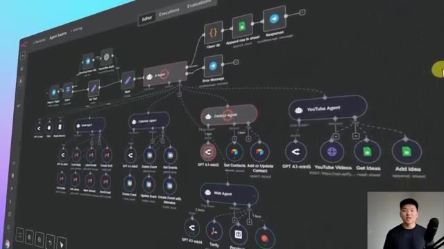
*⏱️ 00:00:05 — Vue d'ensemble d'un workflow N8N complexe représentant un essaim d'agents IA, avec le présentateur en médaillon dans le coin inférieur droit.*

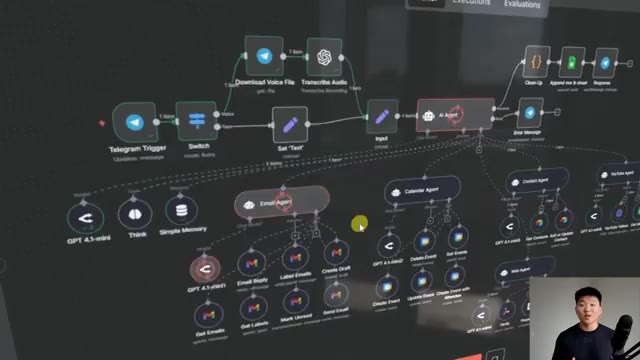
*⏱️ 00:00:10 — Zoom avant sur le diagramme de workflow N8N montrant le routeur principal et plusieurs agents spécialisés (Email, Calendar, YouTube).*

---

### ⏱️ `[00:00:20 - 00:00:54]` | Segment #02

**🔊 Audio (Transcription Intégrale Mot pour Mot en Français) :**
> Donc assurez-vous de rester jusqu'à la fin et je vais vous montrer comment vous pouvez y accéder. Très bien, j'ai donc ouvert Telegram sur mon téléphone et je vais envoyer un message à notre agent. Trouve-moi quatre vidéos YouTube très performantes sur N8N, puis envoie-les par e-mail à Dexter Morgan. Et enfin, fais-moi aussi savoir quel temps il fait aujourd'hui à Chicago. Très bien, je viens de l'envoyer et maintenant notre agent va essentiellement récupérer cet audio transcrit et il va maintenant décider entre ses cinq agents différents lesquels appeler. Vous pouvez donc déjà voir qu'il a fini d'appeler l'agent web pour obtenir la météo. Il a appelé l'agent de contact pour obtenir l'adresse e-mail de Dexter Morgan et maintenant il appelle l'agent YouTube afin de réellement

**👁️ Analyse Visuelle d'Écran (gemini-3.5-flash-lite) :**
**Interface & Outils** : n8n (éditeur de workflow)

**Contenu textuel & Code** : Nœuds de workflow n8n incluant Telegram Trigger, Switch, AI Agent, Email Agent, Calendar Agent, Contact Agent, YouTube Agent, Web Agent et différents modèles de langage connectés.

**Action / Démonstration** : Visualisation du workflow n8n de l'agent swarm en attente d'un événement déclencheur depuis Telegram.

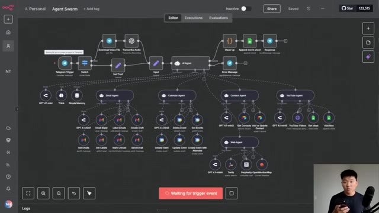
*⏱️ 00:00:29 — Capture d'écran montrant le diagramme complexe d'un workflow n8n (Agent Swarm) avec plusieurs sous-agents (Email Agent, Calendar Agent, Contact Agent, YouTube Agent, Web Agent) et un encart vidéo du présentateur en bas à droite tenant son téléphone.*

---

### ⏱️ `[00:00:54 - 00:01:27]` | Segment #03

**🔊 Audio (Transcription Intégrale Mot pour Mot en Français) :**
> trouver des vidéos YouTube qui ont de très bonnes performances et qui parlent de NNN. C'est donc ça la puissance d'un escadron d'agents. Cet agent parent orchestrateur principal, tout ce qu'il a à faire, c'est de comprendre, bon, j'ai cinq agents différents, lesquels est-ce que je dois utiliser ? Plutôt que de dire, bon, j'ai genre 30 outils, quels outils est-ce que j'utilise ? Et ce cadre rend nos résultats plus cohérents et de meilleure qualité parce que chaque agent est très spécialisé. Et maintenant que l'agent a tout ce dont il a besoin, il décide, bon, maintenant je peux appeler l'agent e-mail pour envoyer cet e-mail à Dexter Morgan. Vous pouvez donc voir qu'il vient de déclencher cet e-mail avec l'outil d'envoi d'e-mail et maintenant il va consigner tous ses résultats et nous répondre sur Telegram.

**👁️ Analyse Visuelle d'Écran (gemini-3.5-flash-lite) :**
**Interface & Outils** : Interface web de type constructeur de flux / tableau de bord d'agents IA (Agent Swarm)

**Contenu textuel & Code** : Nœuds de workflows connectés incluant Telegram Trigger, un agent parent AI Agent, et plusieurs sous-agents (Email Agent, Calendar Agent, Contact Agent, YouTube Agent, Web Agent) reliés à des modèles et services (GPT-4.1-mini, Think, Simple Memory).

**Action / Démonstration** : Exécution d'un workflow d'agents (« Executing workflow ») avec visualisation des connexions entre l'agent orchestrateur et les différents agents spécialisés.

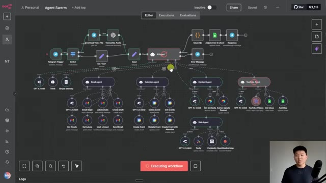
*⏱️ 00:01:02 — Capture d'écran montrant l'interface d'un outil de workflow d'agents IA (Agent Swarm) avec un diagramme complexe reliant un agent orchestrateur parent à plusieurs sous-agents spécialisés (Email, Calendar, Contact, YouTube, Web).*

---

### ⏱️ `[00:01:27 - 00:02:03]` | Segment #04

**🔊 Audio (Transcription Intégrale Mot pour Mot en Français) :**
> Très bien, donc je viens de terminer, j'ai reçu mon message Telegram en retour, mais je vais juste l'afficher sur mon bureau pour que vous puissiez le voir vous aussi. Il disait : « J'ai trouvé quatre vidéos très performantes sur N8N et je les ai envoyées par e-mail à Dexter Morgan. J'ai également inclus la météo d'aujourd'hui à Chicago, qui est un ciel nuageux avec une température de 81 degrés. » Si je regarde dehors en ce moment, je peux voir que le ciel est effectivement couvert. Lorsque je bascule sur ma messagerie, nous pouvons voir qu'on vient juste d'en envoyer un à dexter@miami.com et qu'il contient quatre vidéos très performantes sur N8N. Chacune d'elles inclut le titre, la chaîne, un lien vers la vidéo complète, le nombre de vues, le nombre de likes et la durée de la vidéo en question. C'est donc génial. Ça a fait ce qu'on voulait. Ça a appelé le bon

**👁️ Analyse Visuelle d'Écran (gemini-3.5-flash-lite) :**
**Interface & Outils** : n8n (éditeur de workflow), Telegram (application de messagerie), et Gmail (interface web).

**Contenu textuel & Code** : Messages de chat Telegram affichant les réponses de l'agent IA et e-mail contenant des liens vers des vidéos YouTube ainsi que des données météorologiques.

**Action / Démonstration** : Présentation des résultats du workflow d'automatisation et de l'e-mail généré automatiquement par l'agent IA.

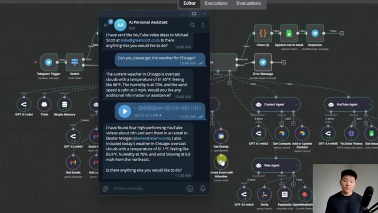
*⏱️ 00:01:36 — Interface n8n affichant un diagramme de workflow complexe avec une fenêtre de chat Telegram par-dessus montrant les interactions avec l'assistant personnel IA.*

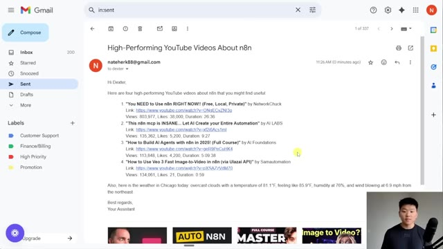
*⏱️ 00:01:54 — Interface Gmail montrant un e-mail envoyé avec les résultats de recherche de vidéos YouTube sur n8n et la météo de Chicago.*

---

### ⏱️ `[00:02:03 - 00:02:21]` | Segment #05

**🔊 Audio (Transcription Intégrale Mot pour Mot en Français) :**
> agents, mais non seulement il a fait les bonnes tâches, mais il a aussi tout enregistré pour que nous puissions regarder et avoir une visibilité totale. C'est donc exactement ce qui se passe dans cette partie du flux de travail. Donc si je me dirige vers cette Google Sheet, vous pouvez voir que nous avons l'heure de l'exécution. Nous avons les entrées, nous avons les sorties, nous avons les actions qui ont été prises, et aussi le nombre de jetons qui ont été utilisés.

**👁️ Analyse Visuelle d'Écran (gemini-3.5-flash-lite) :**
**Interface & Outils** : n8n / Interface de conception de workflow d'agents IA et Google Sheets.

**Contenu textuel & Code** : Diagramme de flux d'automatisation avec des nœuds pour divers outils (Email Agent, Calendar Agent, Contact Agent, YouTube Agent) et logs textuels JSON dans Google Sheets.

**Action / Démonstration** : Présentation de l'architecture du workflow d'agents IA et démonstration des journaux d'activité enregistrés dans le tableur.

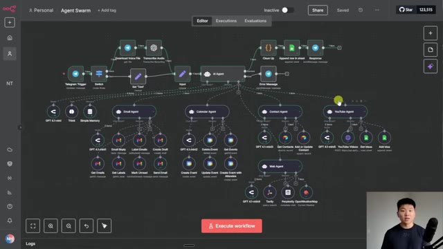
*⏱️ 00:02:07 — Vue d'ensemble d'un diagramme de workflow complexe pour un agent d'IA multi-agents, affichant des connexions entre différents modules (Telegram, Gmail, Calendar, YouTube, Web, etc.).*

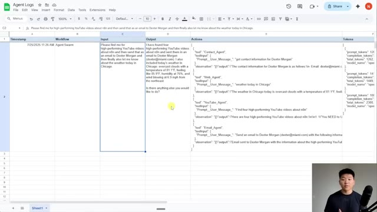
*⏱️ 00:02:17 — Affichage d'un tableau Google Sheets nommé 'Agent Logs' montrant l'historique des exécutions, les entrées, sorties et actions des agents d'IA.*

---

### ⏱️ `[00:02:21 - 00:02:55]` | Segment #06

**🔊 Audio (Transcription Intégrale Mot pour Mot en Français) :**
> Donc, dans les actions, c'est vraiment génial parce qu'on peut voir qu'en premier, il a appelé l'agent de contact et il a pour ainsi dire récupéré l'adresse e-mail de Dexter Morgan, qui était dexter arobase miami point com. Ensuite, il est allé sur l'agent web pour obtenir la météo à Chicago et il a obtenu la météo. Ensuite, il a utilisé l'agent YouTube pour trouver quatre vidéos YouTube performantes sur NNN et enfin, il a appelé l'agent e-mail pour envoyer cet e-mail à Dexter Morgan. Et on peut voir qu'il a appelé différents agents, qu'il y avait différents prompts qu'il devait exécuter et cela nous a coûté un total ici de 5 000 jetons en utilisant GPT 4 point 1 mini. C'est donc un petit système sympa, vous pouvez donc voir quelles actions vos agents appellent et des choses comme ça.

**👁️ Analyse Visuelle d'Écran (gemini-3.5-flash-lite) :**
**Interface & Outils** : Google Sheets / Tableau de bord d'agent

**Contenu textuel & Code** : JSON détaillé listant les appels d'outils (Contact_Agent, Web_Agent, YouTube_Agent, Email_Agent), les entrées de prompts, les observations (ex: e-mail de Dexter Morgan, météo à Chicago) et la consommation de jetons (tokens).

**Action / Démonstration** : Analyse des étapes d'exécution et des appels d'outils successifs de l'agent IA affichés dans le tableur.

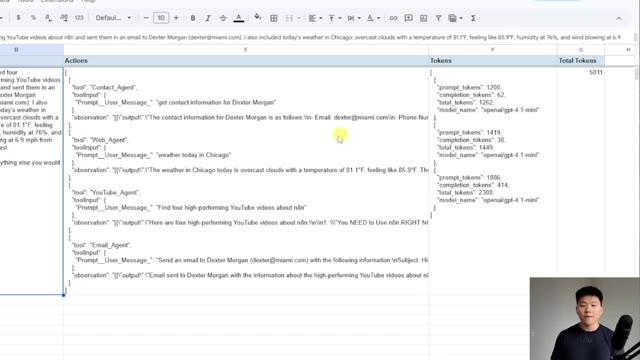
*⏱️ 00:02:30 — Un tableau affichant les détails des actions, jetons et métadonnées d'exécution d'un agent IA, avec le présentateur en bas à droite.*

---

### ⏱️ `[00:02:55 - 00:03:31]` | Segment #07

**🔊 Audio (Transcription Intégrale Mot pour Mot en Français) :**
> Mais revenons-en au flux de travail et laissez-moi commencer par décortiquer le fonctionnement réel. Donc, si vous avez déjà regardé ma chaîne, vous êtes peut-être tombé sur cette vidéo où j'ai créé un assistant personnel ultime, ce qui ressemble un peu à ce que nous examinons aujourd'hui. La principale différence ici, c'est que N8N vient de publier une mise à jour qui nous permet de conserver tous nos agents dans le même flux de travail, plutôt que dans cette version où l'assistant ultime appelle ce sous-flux de travail et où l'on ne peut pas vraiment voir ce qui se passe. Et c'est fondamentalement le flux de travail qu'il appelle. Grâce à cette mise à jour, qui était la version 1.103, nous pouvons désormais garder tous nos agents au même endroit et nous pouvons observer visuellement tout se dérouler sur le même écran. Et ce qui est génial avec un cadre de type essaim où

**👁️ Analyse Visuelle d'Écran (gemini-3.5-flash-lite) :**
**Interface & Outils** : Interface web d'un outil de workflow d'agents IA (type Flowise ou similaire) avec une vue sur l'éditeur de flux.

**Contenu textuel & Code** : Diagramme de workflow affichant un "Parent Agent" relié à divers nœuds : déclencheur Telegram, transcription audio, modèles OpenRouter, mémoire simple, ainsi que plusieurs sous-workflows "Children" (Email Agent, Calendar Agent, Contact Agent, Content Creator Agent) et un nœud "Think".

**Action / Démonstration** : Présentation et explication du schéma d'architecture du flux de travail de l'assistant personnel par le créateur visible en incrustation vidéo en bas à droite.

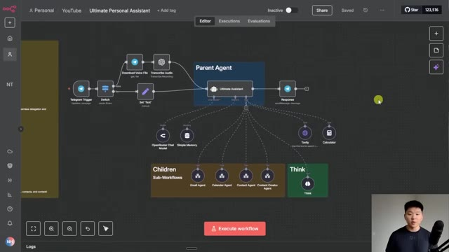
*⏱️ 00:03:04 — Capture d'écran montrant l'interface d'un outil d'automatisation de type workflow avec un diagramme complexe d'agent IA nommé « Ultimate Personal Assistant ».*

---

### ⏱️ `[00:03:31 - 00:04:04]` | Segment #08

**🔊 Audio (Transcription Intégrale Mot pour Mot en Français) :**
> nous avons différents agents pour chaque tâche différente, le principal doit seulement réfléchir à : d'accord, si l'utilisateur veut quelque chose en rapport avec l'e-mail, je ne vais pas me soucier des outils, je vais juste l'envoyer à l'agent d'e-mail et l'agent d'e-mail s'occupera de tout. Parce que comme vous pouvez le voir ici, chaque agent a son propre cerveau. Ils ont chacun leurs propres modèles de chat. Et cela signifie qu'ils ont aussi chacun leurs propres instructions système. Nous sommes donc capables de diviser toutes les instructions système et de rendre le travail de chaque agent très spécifique et d'augmenter la qualité de leurs résultats. Cela nous donne également la flexibilité d'avoir différents modèles de chat pour différents agents. Dans ce cas, j'utilise GPT 4.1

**👁️ Analyse Visuelle d'Écran (gemini-3.5-flash-lite) :**
**Interface & Outils** : Interface web d'automatisation de type n8n

**Contenu textuel & Code** : Diagramme de workflow avec des nœuds de déclenchement Telegram, des blocs de traitement et une architecture hiérarchique d'agents IA (modèles GPT, mémoire, outils spécifiques pour les e-mails, le calendrier, etc.)

**Action / Démonstration** : Le présentateur explique l'architecture d'un essaim d'agents où le routeur principal délègue les tâches spécifiques (comme la gestion des e-mails) à des sous-agents dédiés.

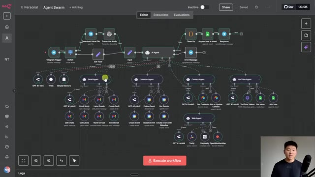
*⏱️ 00:03:39 — Vue d'ensemble d'un workflow complexe d'essaim d'agents (Agent Swarm) dans une interface de type n8n, montrant un agent principal (AI Agent) connectant différents sous-agents spécialisés (Email Agent, Calendar Agent, Contact Agent, YouTube Agent).*

---

### ⏱️ `[00:04:04 - 00:04:23]` | Segment #09

**🔊 Audio (Transcription Intégrale Mot pour Mot en Français) :**
> mini pour tous. Mais si quelque chose est vraiment simple, comme par exemple récupérer des coordonnées, nous pourrions remplacer celui-ci par un modèle moins cher comme Google Flash. Et si vous remarquez que vos e-mails ressemblent trop à de l'intelligence artificielle et que vous voulez qu'ils soient mieux écrits, vous pourriez peut-être passer à quelque chose comme un modèle Anthropic plus coûteux. Ainsi, non seulement vous avez plus de flexibilidad, mais comme je l'ai dit, des résultats de meilleure qualité.

**👁️ Analyse Visuelle d'Écran (gemini-3.5-flash-lite) :**
**Interface & Outils** : Interface web de type outil de workflow d'automatisation d'agents IA.

**Contenu textuel & Code** : Nœuds de workflow pour Telegram, des agents spécialisés (Email Agent, Calendar Agent, Contact Agent, YouTube Agent, Web Agent) et des modèles (GPT-4.1-mini).

**Action / Démonstration** : Visualisation et explication de l'architecture d'un essaim d'agents IA dans l'interface de workflow.

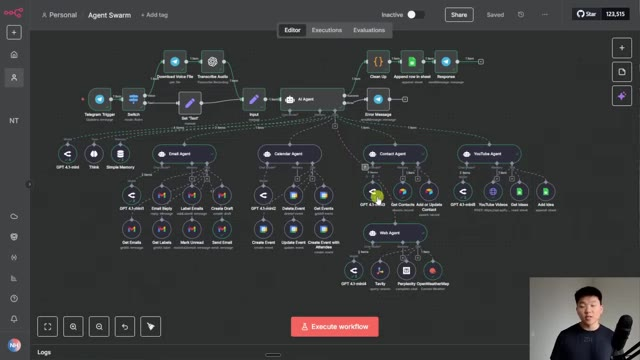
*⏱️ 00:04:09 — Un diagramme complexe de workflow d'agents IA montrant une structure en essaim avec plusieurs nœuds interconnectés.*

---

### ⏱️ `[00:04:24 - 00:04:42]` | Segment #10

**🔊 Audio (Transcription Intégrale Mot pour Mot en Français) :**
> Et donc si vous vous dites, ok, il y a donc six agents différents, il y a six mémoires différentes, ils ne vont pas travailler de manière très cohérente en tant qu'équipe. Eh bien, vous auriez tort. Ce que nous pouvons faire, c'est de relier les six agents à la même mémoire. Dans ce cas-ci, je ne le fais pas simplement parce que le travail de chacun de ces sous-agents est super spécifique à une tâche ponctuelle comme l'envoi d'un e-mail, la création d'un événement, la réalisation de recherches.

**👁️ Analyse Visuelle d'Écran (gemini-3.5-flash-lite) :**
**Interface & Outils** : Interface web d'automatisation de type n8n ou workflow visuel.

**Contenu textuel & Code** : Nœuds de workflow : Telegram Trigger, AI Agent, Email Agent, Calendar Agent, Contact Agent, YouTube Agent, Web Agent et connexions de mémoire.

**Action / Démonstration** : Présentation visuelle de l'architecture d'un essaim d'agents IA interconnectés dans l'éditeur de workflow.

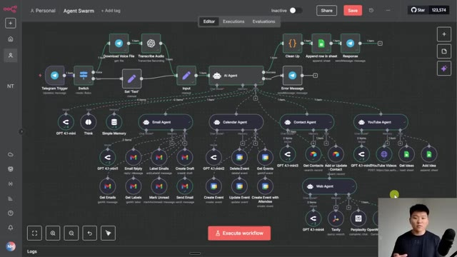
*⏱️ 00:04:28 — Un diagramme de workflow complexe représentant un essaim d'agents IA (Agent Swarm) avec des nœuds pour Telegram, des agents IA spécialisés et des connexions vers divers outils.*

---

### ⏱️ `[00:04:42 - 00:05:01]` | Segment #11

**🔊 Audio (Transcription Intégrale Mot pour Mot en Français) :**
> Donc ils n'ont pas vraiment besoin d'un contexte complet. Mais comme vous pouvez le voir, chaque agent a la capacité d'ajouter de la mémoire, tout comme notre agent principal ici présent a de la mémoire. Et la façon dont cette mémoire fonctionne, c'est qu'elle est stockée sur la base d'un identifiant de session. Et je ne veux pas trop entrer dans les détails techniques ici, mais dites-vous simplement qu'un identifiant de session, c'est comme un contact. Dans votre téléphone, vous avez différents contacts et avec chaque contact, vous avez différentes conversations.

**👁️ Analyse Visuelle d'Écran (gemini-3.5-flash-lite) :**
**Interface & Outils** : Interface web n8n (éditeur de workflows d'agents IA)

**Contenu textuel & Code** : Nœuds de workflow n8n : "Agent Swarm", "Email Agent", "Calendar Agent", "Simple Memory", options de mémoire (MongoDB, Motorhead, Postgres, Redis, Zep)

**Action / Démonstration** : Configuration des options de mémoire pour les agents individuels dans le workflow n8n.

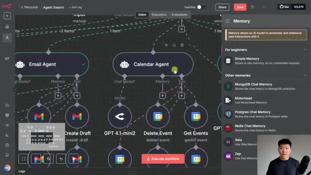
*⏱️ 00:04:47 — Vue rapprochée d'un workflow n8n montrant un "Calendar Agent" et un panneau latéral de configuration de la mémoire ("Memory") avec différentes options comme Simple Memory, MongoDB, Postgres, etc.*

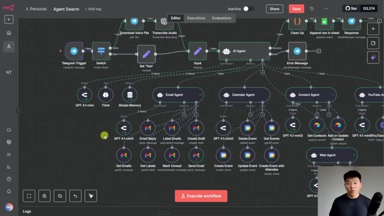
*⏱️ 00:04:51 — Vue d'ensemble d'un workflow n8n complexe d'agents IA ("Agent Swarm") avec plusieurs agents connectés (Email Agent, Calendar Agent, Contact Agent, Web Agent).*

---

### ⏱️ `[00:05:01 - 00:05:22]` | Segment #12

**🔊 Audio (Transcription Intégrale Mot pour Mot en Français) :**
> Donc, tant que nous avons tous les agents reliés au même identifiant de session pour leur mémoire, ils regarderont tous la même conversation lorsqu'ils passeront à l'action. Donc, selon la situation, vos agents peuvent avoir besoin d'être tous liés ensemble avec une sorte d'identifiant de session pour la mémoire. Mais dans ce cas, où chaque agent reçoit simplement une tâche, fait le travail, puis continue sa journée, nous n'avons pas besoin qu'ils soient reliés ensemble.

**👁️ Analyse Visuelle d'Écran (gemini-3.5-flash-lite) :**
**Interface & Outils** : Interface web de type n8n ou outil similaire d'automatisation de flux de travail par IA.

**Contenu textuel & Code** : Nœuds de workflow connectés incluant "Telegram Trigger", "AI Agent", "Email Agent", "Calendar Agent", "Contact Agent", "YouTube Agent" et "Web Agent", ainsi que des connexions de mémoire.

**Action / Démonstration** : Visualisation et explication de l'architecture d'un essaim d'agents interconnectés partageant une mémoire commune.

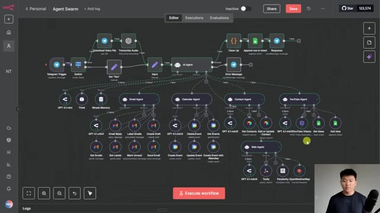
*⏱️ 00:05:06 — Un diagramme de workflow complexe représentant un essaim d'agents IA (Agent Swarm) avec de multiples nœuds interconnectés (Telegram, AI Agent, Email Agent, Calendar Agent, etc.).*

---

### ⏱️ `[00:05:22 - 00:05:56]` | Segment #13

**🔊 Audio (Transcription Intégrale Mot pour Mot en Français) :**
> Mais la raison pour laquelle je voulais mentionner cela, c'est qu'par le passé, lorsque vous vouliez transmettre une variable, comme un identifiant de session de l'agent principal à un sous-agent, vous deviez la transmettre en tant que variable séparée. Mais ici, c'est vraiment facile parce que tout est dans le même flux de travail. Je pourrais facilement ajouter une mémoire à l'agent de messagerie et tout ce que j'aurais à faire, c'est de faire référence à l'identifiant de chat du déclencheur Telegram réel que j'utilisais dans la mémoire précédente. Donc maintenant que c'est lié, nous aurions fondamentalement notre sous-agent de messagerie et notre agent principal qui regardent toujours la même conversation. Ils sont donc fondamentalement liés. Faisons un dernier exemple qui est encore un peu plus complexe pour montrer

**👁️ Analyse Visuelle d'Écran (gemini-3.5-flash-lite) :**
**Interface & Outils** : Interface web d'automatisation de type n8n ou similaire.

**Contenu textuel & Code** : Nœuds de workflow comprenant Telegram Trigger, AI Agent, Email Agent, Calendar Agent, Contact Agent, YouTube Agent, et Web Agent, avec leurs connexions de données et modèles associés (GPT-4o-mini).

**Action / Démonstration** : Visualisation et explication de l'architecture d'un essaim d'agents (Agent Swarm) et de la transmission de variables entre l'agent principal et ses sous-agents.

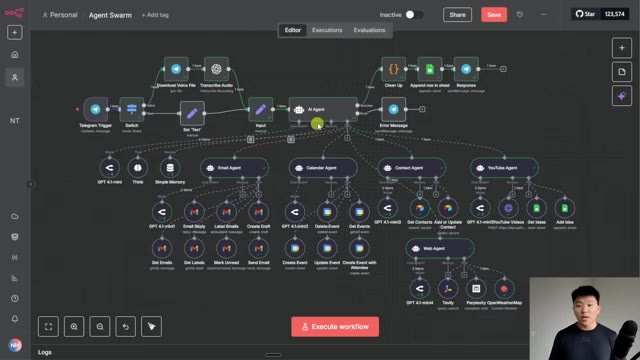
*⏱️ 00:05:30 — Un diagramme de workflow complexe représentant un système d'agents IA interconnectés avec divers outils et sous-agents (Email, Calendar, Contact, YouTube, Web Agent) reliés à un agent principal.*

---

### ⏱️ `[00:05:56 - 00:06:26]` | Segment #14

**🔊 Audio (Transcription Intégrale Mot pour Mot en Français) :**
> vous les gars comment l'agent gère ça. Très bien, donc notre agent écoute. Je vais lui envoyer un autre message sur Telegram. S'il vous plaît, obtenez mes idées de vidéos YouTube de la base de données. Faites des recherches sur elles avec Tavoli et ensuite envoyez ce résumé de recherche dans un e-mail à Michael Scott et ensuite créez un événement de calendrier pour aujourd'hui à 16h pour passer en revue cette recherche avec Michael Scott. Très bien, donc je vais l'envoyer. C'est une tâche assez lourde, donc nous allons voir comment l'agent la gère. Il va devoir appeler plusieurs agents différents ici. Vous pouvez voir qu'il appelle l'agent YouTube pour obtenir nos idées.

**👁️ Analyse Visuelle d'Écran (gemini-3.5-flash-lite) :**
**Interface & Outils** : Interface web de gestion de workflows et d'agents IA (Agent Swarm) avec un encart vidéo du présentateur en bas à droite.

**Contenu textuel & Code** : Nœuds de workflow incluant Telegram Trigger, AI Agent, Email Agent, YouTube Agent, Tavily, Perplexity et divers outils de traitement.

**Action / Démonstration** : Le workflow est en cours d'exécution, en attente d'un événement déclencheur (bouton rouge « Waiting for trigger event »).

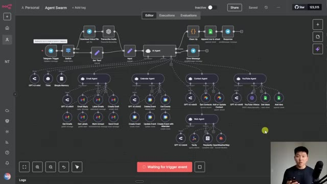
*⏱️ 00:06:03 — Un diagramme complexe de flux de travail d'un agent IA (« Agent Swarm ») montrant divers nœuds et sous-agents (Email, Calendar, Contact, YouTube, Web) connectés entre eux.*

---

### ⏱️ `[00:06:26 - 00:06:50]` | Segment #15

**🔊 Audio (Transcription Intégrale Mot pour Mot en Français) :**
> Il a appelé l'agent de contact pour obtenir les coordonnées de Michael Scott. Et maintenant, il appelle l'agent web et il va faire des recherches sur ces idées de vidéos YouTube. Je crois que je lui ai dit d'utiliser Tavoli, mais il a probablement retranscrit ça un petit peu mal. Du coup, il a décidé d'utiliser Perplexity, mais c'est tout à fait correct. L'agent a pris la décision et il va faire des recherches sur nos idées de vidéos YouTube dans les deux cas. Il est en train de terminer cette recherche et maintenant il va appeler l'agent de messagerie et l'agent de calendrier pour créer cet événement dans le calendrier et envoyer cet e-mail.

**👁️ Analyse Visuelle d'Écran (gemini-3.5-flash-lite) :**
**Interface & Outils** : Interface graphique de conception de workflows d'agents IA (type plateforme d'automatisation visuelle).

**Contenu textuel & Code** : Diagramme d'architecture d'agent avec divers nœuds : Telegram, AI Agent, Email Agent, Calendar Agent, Contact Agent, YouTube Agent, et Web Agent reliés à des outils comme Tavily et Perplexity.

**Action / Démonstration** : Le workflow est en cours d'exécution (bouton "Executing workflow" actif en bas).

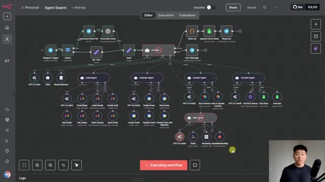
*⏱️ 00:06:32 — Vue d'ensemble d'un workflow complexe d'agents IA montrant les connexions entre l'agent principal, l'agent de contact et l'agent web avec les outils associés.*

---

### ⏱️ `[00:06:50 - 00:07:09]` | Segment #16

**🔊 Audio (Transcription Intégrale Mot pour Mot en Français) :**
> Bon, alors je viens juste de terminer d'appeler l'agent de calendrier et tout est terminé. Je vais maintenant passer à notre email et nous allons y jeter un rapide coup d'œil. Bon, alors voici notre email envoyé à mike at greatscott.com. Nous avons trois idées de vidéos YouTube différentes, et vous pouvez voir Inbox to Action, Auto Scrape Leads, YouTube Content Engine. Ce sont les idées de vidéos qui existaient déjà dans ma base de données d'idées de vidéos YouTube.

**👁️ Analyse Visuelle d'Écran (gemini-3.5-flash-lite) :**
**Interface & Outils** : n8n / Agent Swarm (interface web) et Gmail.

**Contenu textuel & Code** : Workflow complexe avec des sous-agents (Email, Calendar, Contact, Web, YouTube) et un e-mail détaillant trois idées de projets (Inbox to Action, Auto-Scrape Leads, YouTube Content Engine).

**Action / Démonstration** : Visualisation du workflow en cours d'exécution puis transition vers la lecture de l'e-mail généré par l'agent.

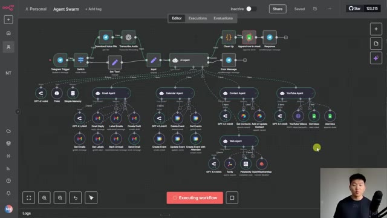
*⏱️ 00:06:55 — Vue d'ensemble d'un diagramme de workflow complexe d'agents IA (Agent Swarm) avec de multiples nœuds interconnectés.*

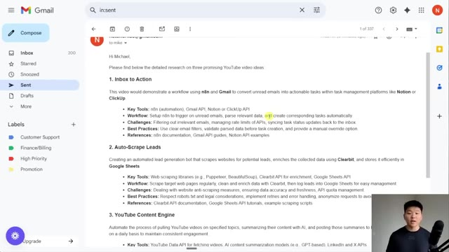
*⏱️ 00:07:00 — Interface de Gmail affichant un e-mail envoyé à mike@greatscott.com contenant trois idées de vidéos YouTube.*

---

### ⏱️ `[00:07:10 - 00:07:31]` | Segment #17

**🔊 Audio (Transcription Intégrale Mot pour Mot en Français) :**
> Et pour chacune de ces vidéos, ce qu'il a fait, c'est qu'il a utilisé Perplexity pour faire des recherches et m'aide essentiellement à comprendre comment je peux créer ces différents flux de travail pour une vidéo YouTube. Et si vous vous en souvenez, nous avons demandé à l'agent de créer également un événement dans le calendrier avec Michael Scott. Donc si je vais dans mon calendrier, nous devrions voir que nous avons un briefing de recherche de révision sur les idées de vidéos YouTube à 16 h. Et nous avons ajouté Mike de Great Scott comme participant à l'événement.

**👁️ Analyse Visuelle d'Écran (gemini-3.5-flash-lite) :**
**Interface & Outils** : Gmail, Google Calendar (Navigateur web)

**Contenu textuel & Code** : E-mail détaillant des idées de vidéos YouTube (Inbox to Action, Auto-Scrape Leads, YouTube Content Engine) avec outils et workflows associés.

**Action / Démonstration** : Présentation des résultats de recherche et des tâches planifiées générées par l'agent.

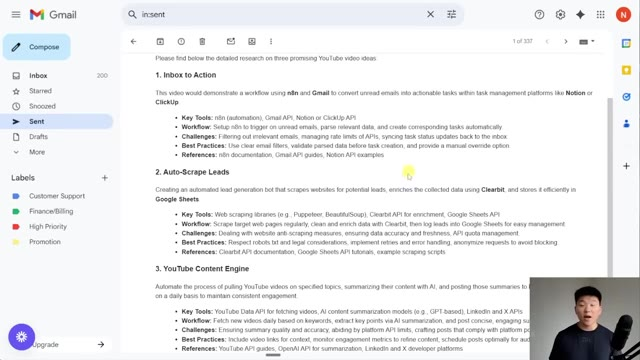
*⏱️ 00:07:15 — Interface Gmail affichant un e-mail contenant des propositions de flux de travail pour des vidéos YouTube, avec le présentateur en médaillon.*

*⏱️ 00:07:25 — Interface Google Agenda montrant un événement planifié lié aux idées de recherche de vidéos YouTube, avec le présentateur en médaillon.*

---

### ⏱️ `[00:07:31 - 00:07:51]` | Segment #18

**🔊 Audio (Transcription Intégrale Mot pour Mot en Français) :**
> Et bien sûr, la dernière pièce du puzzle ici est que l'agent aurait dû tout consigner dans Google Sheets. Donc, si nous venons ici, nous pouvons voir que nous avons eu une nouvelle exécution à 11 h 36. Nous avons l'entrée, nous avons la sortie, nous avons les outils qui ont été appelés, qui dans ce cas étaient les cinq agents utilisés dans cette exécution. Et puis celui-ci nous a coûté un total de 8 500 jetons. Je ne veux donc pas perdre toute la vidéo à faire la démonstration de tous les différents cas d'utilisation.

**👁️ Analyse Visuelle d'Écran (gemini-3.5-flash-lite) :**
**Interface & Outils** : Google Sheets

**Contenu textuel & Code** : Tableau avec des données de journalisation : horodatage '7/25/2025 11:36 AM', workflow 'Agent Swarm', entrée utilisateur demandant des recherches et des e-mails, sortie détaillée de l'agent, et actions listées au format JSON.

**Action / Démonstration** : Consultation et présentation des journaux d'exécution de l'agent IA enregistrés automatiquement dans le tableur.

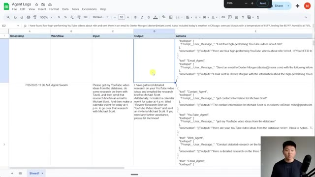
*⏱️ 00:07:36 — Un tableau Google Sheets intitulé 'Agent Logs' montrant les journaux d'exécution d'un agent IA avec les colonnes Timestamp, Workflow, Input, Output et Actions.*

---

### ⏱️ `[00:07:51 - 00:08:11]` | Segment #19

**🔊 Audio (Transcription Intégrale Mot pour Mot en Français) :**
> J'espère que vous voyez à quel point cet essaim d'agents est génial et puissant. Et maintenant, ce que nous allons faire, c'est en construire un ensemble, étape par étape. Juste une toute petite version de celui-ci pour que vous puissiez avoir un aperçu de la façon dont vous pouvez venir ici et construire votre propre essaim d'agents exécutifs. Très bien, nous voici donc sur une nouvelle toile vierge. Et ce que je vais faire, c'est appuyer sur la touche tabulation et je vais récupérer un agent IA. Nous avons donc ici notre agent IA.

**👁️ Analyse Visuelle d'Écran (gemini-3.5-flash-lite) :**
**Interface & Outils** : n8n (éditeur de workflow visuel)

**Contenu textuel & Code** : Nœuds interconnectés représentant des déclencheurs Telegram, des agents IA spécialisés (Email Agent, Calendar Agent, Contact Agent, YouTube Agent, Web Agent), des modèles de langage (GPT 4.1-mini) et des intégrations d'applications (Gmail, Google Sheets, Tavit, Perplexity).

**Action / Démonstration** : Présentation globale et explication de l'architecture d'un essaim d'agents interconnectés.

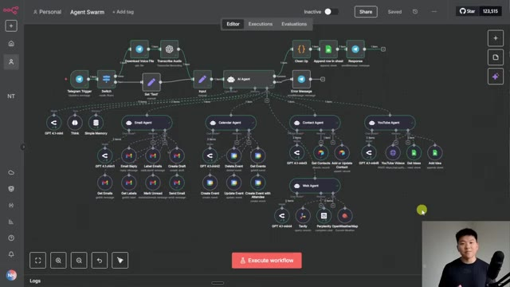
*⏱️ 00:07:56 — Capture d'écran montrant l'interface graphique d'un outil de type workflow ou low-code (n8n) avec un diagramme complexe représentant un essaim d'agents IA ("Agent Swarm"). Le présentateur apparaît en médaillon dans le coin inférieur droit.*

---

### ⏱️ `[00:08:11 - 00:08:32]` | Segment #20

**🔊 Audio (Transcription Intégrale Mot pour Mot en Français) :**
> Et la première chose que nous devons faire est de connecter un modèle de chat, qui va essentiellement être le cerveau de l'agent IA. Et donc ce que j'aime faire, c'est utiliser Open Router. Donc si vous allez sur OpenRouter.ai, allez-y et créez un compte. Et en haut à droite, ce que vous allez vouloir faire, c'est aller dans vos clés. Ici, vous pourrez créer une clé API, ce qui est en quelque sorte un mot savant pour un mot de passe. Et ce que vous allez faire, c'est créer votre clé API, donnez-lui le nom que vous voulez.

**👁️ Analyse Visuelle d'Écran (gemini-3.5-flash-lite) :**
**Interface & Outils** : Interface graphique de workflow d'agent IA (type Flowise ou similaire) et site web OpenRouter.

**Contenu textuel & Code** : Nœuds de workflow 'When chat message received' et 'AI Agent' avec connecteurs 'Chat Model*', 'Memory', 'Tool' ; Page d'accueil OpenRouter 'The Unified Interface For LLMs'.

**Action / Démonstration** : Présentation du workflow de l'agent IA et navigation vers le site OpenRouter pour connecter un modèle de chat.

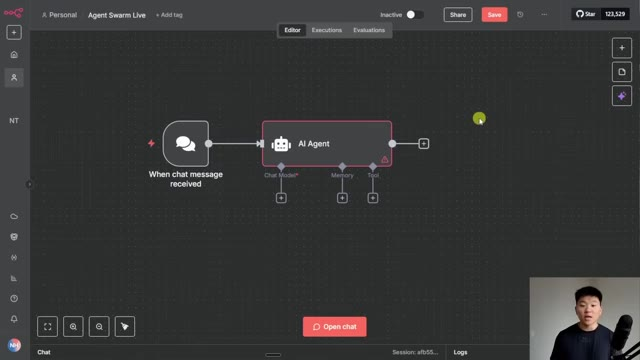
*⏱️ 00:08:16 — Interface de workflow d'agent IA montrant un déclencheur de message de chat connecté à un bloc 'AI Agent' avec des connexions pour le modèle de chat, la mémoire et les outils.*

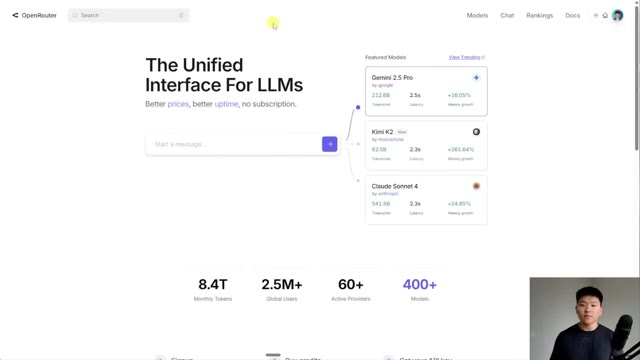
*⏱️ 00:08:21 — Page d'accueil du site web OpenRouter présentant l'interface unifiée pour les LLM avec les modèles phares listés.*

---

### ⏱️ `[00:08:32 - 00:08:51]` | Segment #21

**🔊 Audio (Transcription Intégrale Mot pour Mot en Français) :**
> Et ensuite, une fois que vous avez créé cela, vous allez obtenir cette valeur unique, que vous allez copier. Une fois que vous aurez copié cette valeur, vous allez aller dans NNN, ajouter un modèle de chat. Vous allez faire défiler vers le bas jusqu'à Open Router. Et tout ce que vous avez à faire, c'est de créer un nouveau compte. Et vous allez coller votre clé API juste ici. Une fois que vous aurez enregistré, ça devrait devenir vert. Et fondamentalement, cela nous indique que notre agent a accès à une sorte de cerveau.

**👁️ Analyse Visuelle d'Écran (gemini-3.5-flash-lite) :**
**Interface & Outils** : Interface web OpenRouter et interface de workflow n8n

**Contenu textuel & Code** : Clé API masquée et paramètres du nœud OpenRouter Chat Model (sélection du compte et du modèle)

**Action / Démonstration** : Copie de la clé API générée sur OpenRouter puis configuration du modèle de chat dans l'outil de workflow n8n

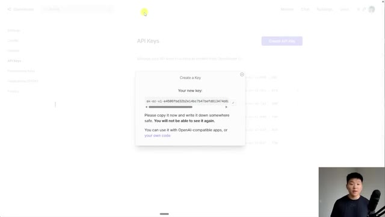
*⏱️ 00:08:37 — Interface web affichant une fenêtre modale de création de clé API OpenRouter avec la clé nouvellement générée.*

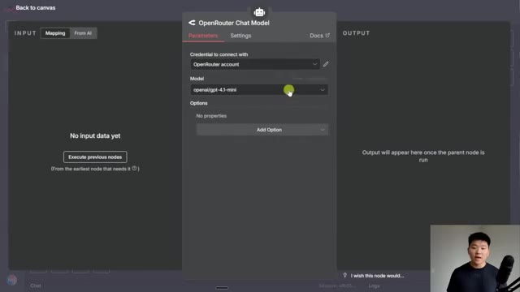
*⏱️ 00:08:42 — Interface de workflow (n8n) montrant les paramètres d'un nœud OpenRouter Chat Model avec le champ de sélection du modèle.*

---

### ⏱️ `[00:08:51 - 00:09:11]` | Segment #22

**🔊 Audio (Transcription Intégrale Mot pour Mot en Français) :**
> Assurez-vous simplement que dans Open Router, vous avez inséré vos informations de facturation, sinon vous ne pourrez pas l'utiliser. Et donc maintenant, si je clique sur ce nœud, je peux fondamentalement choisir quel modèle de chat je veux utiliser. Et comme vous pouvez le voir, il y en a une tonne. C'est donc pour cela que j'aime utiliser Open Router. Donc à partir d'ici, ce que nous allons faire, c'est ajouter notre premier agent, qui va être un agent de messagerie. Je vais fondamentalement ajouter cet agent comme un outil.

**👁️ Analyse Visuelle d'Écran (gemini-3.5-flash-lite) :**
**Interface & Outils** : Interface web de type Flowise ou équivalent pour la construction de flux d'IA.

**Contenu textuel & Code** : Nœuds de workflow : 'When chat message received', 'AI Agent' et 'OpenRouter Chat Model'.

**Action / Démonstration** : Configuration du modèle de chat OpenRouter relié au nœud principal de l'agent IA.

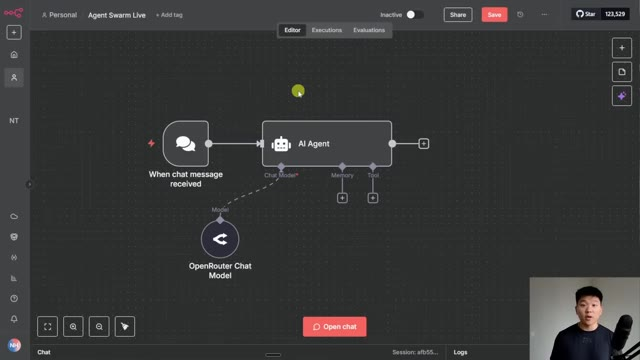
*⏱️ 00:08:56 — Interface de workflow d'agents IA montrant un nœud 'AI Agent' connecté à un nœud 'OpenRouter Chat Model'.*

---

### ⏱️ `[00:09:12 - 00:09:38]` | Segment #23

**🔊 Audio (Transcription Intégrale Mot pour Mot en Français) :**
> Et maintenant, ce que nous pouvons faire, plûtot que ce que nous avions l'habitude de faire dans cette version de l'Ultimate Assistant, où nous appelions un sous-flux de travail comme un outil, ce que nous sommes capables de faire, c'est littéralement de taper agent IA, et nous pouvons ajouter un agent IA comme outil. Nous avons donc un agent entier intégré juste ici et nous allons devoir connecter un modèle de chat. Nous devrons faire toutes les autres choses. Donc maintenant, cet agent principal est fondamentalement juste en charge de ce sous-agent. Donc encore une fois, très rapidement, je vais ajouter un cerveau à ce type. Je vais donc faire défiler vers le bas jusqu'à open router et nous avons déjà nos identifiants configurés.

**👁️ Analyse Visuelle d'Écran (gemini-3.5-flash-lite) :**
**Interface & Outils** : Interface web de type n8n ou plateforme d'automatisation d'agents IA

**Contenu textuel & Code** : Nœuds de workflow : 'When chat message received', 'AI Agent', et 'OpenRouter Chat Model'. Panneau latéral avec les outils disponibles.

**Action / Démonstration** : Configuration d'un agent IA dans le canevas de l'éditeur de workflows.

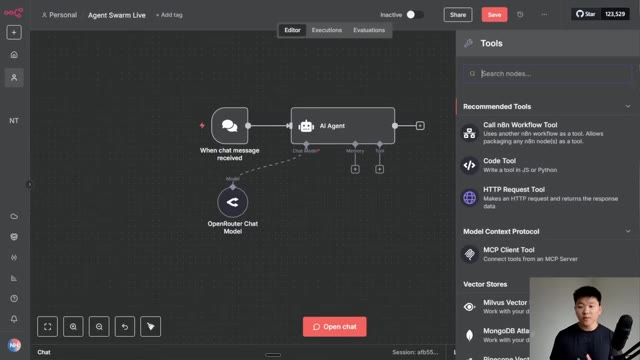
*⏱️ 00:09:18 — Interface d'un éditeur de flux de travail montrant un nœud 'AI Agent' connecté à un déclencheur de chat et un modèle OpenRouter.*

---

### ⏱️ `[00:09:38 - 00:10:11]` | Segment #24

**🔊 Audio (Transcription Intégrale Mot pour Mot en Français) :**
> Donc c'est aussi simple que ça. Donc comme je l'ai dit, nous allons faire de cet agent un agent de messagerie. Donc je vais simplement l'appeler agent de messagerie. Je vais y mettre une description qui dit agent de messagerie pour effectuer des actions avec les e-mails. Et puis ce que je vais faire pour le message utilisateur, c'est que je vais simplement cliquer sur ce bouton juste ici qui permet au modèle de définir ce paramètre. Ce que cela signifie, c'est que lorsque l'agent principal décide, d'accord, je vais utiliser l'agent de messagerie, il va fondamentalement dire, voici ce que tu fais. Et c'est ce qui se passe juste ici dans le message utilisateur. Et juste pour vous montrer un exemple de cela pour que ce soit un peu plus clair, nous avions cet agent principal, n'est-ce pas ? Et il a décidé

**👁️ Analyse Visuelle d'Écran (gemini-3.5-flash-lite) :**
**Interface & Outils** : n8n (outil d'automatisation de flux de travail).

**Contenu textuel & Code** : Formulaire de paramétrage incluant les champs "Description" ("AI Agent that can call other tools"), "Prompt (User Message)" et des options pour le modèle de chat, la mémoire et les outils.

**Action / Démonstration** : L'utilisateur est en train de configurer les paramètres de l'agent IA en saisissant sa description et son prompt de fonctionnement.

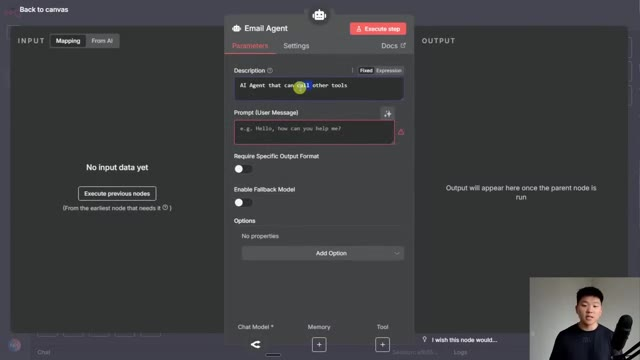
*⏱️ 00:09:46 — Interface de configuration d'un nœud "Email Agent" dans un outil d'automatisation de workflow (type n8n).*

---

### ⏱️ `[00:10:11 - 00:10:30]` | Segment #25

**🔊 Audio (Transcription Intégrale Mot pour Mot en Français) :**
> pour appeler l'agent YouTube. Et donc quand il a appelé l'agent YouTube, il a rempli le message utilisateur avec obtenir mes idées de vidéos YouTube depuis la base de données. Donc c'est fondamentalement juste l'agent principal qui dit à ce sous-agent quoi faire. Et si ce n'est pas encore tout à fait rentré, regardons aussi l'agent de contact. L'agent principal a dit, ok, je vais t'utiliser, monsieur l'agent de contact.

**👁️ Analyse Visuelle d'Écran (gemini-3.5-flash-lite) :**
**Interface & Outils** : n8n (éditeur de workflows d'automatisation et d'agents IA)

**Contenu textuel & Code** : Configuration du "YouTube Agent", message utilisateur configuré pour "get my YouTube video ideas from the database", et diagramme complet d'agents interconnectés.

**Action / Démonstration** : Explication du fonctionnement des sous-agents et de la transmission des instructions depuis l'agent principal vers l'agent YouTube.

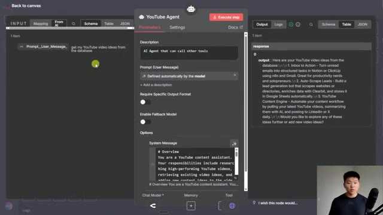
*⏱️ 00:10:16 — Gros plan sur la configuration détaillée d'un "YouTube Agent" dans un outil d'automatisation visuel, montrant les paramètres d'entrée et de sortie avec des exemples de requêtes.*

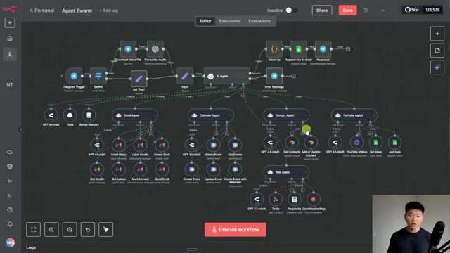
*⏱️ 00:10:25 — Vue d'ensemble d'un workflow complexe d'agents IA ("Agent Swarm") avec de multiples sous-agents interconnectés (Email, Calendar, Contact, YouTube).*

---

### ⏱️ `[00:10:30 - 00:10:49]` | Segment #26

**🔊 Audio (Transcription Intégrale Mot pour Mot en Français) :**
> Et ce que je veux que tu fasses, c'est d'obtenir les coordonnées de Michael Scott. D'accord, j'espère donc que tout cela est clair maintenant. Et maintenant, ce que nous devons faire, c'est simplement connecter un outil de messagerie à notre agent de messagerie. Je vais donc cliquer sur « outil ». Je vais taper « outil Gmail ». Et maintenant, nous devons également configurer cet élément. Donc, si vous ne vous êtes jamais connecté à l'un de vos outils Google auparavant, je vais lier une vidéo juste ici où j'explique comment cela fonctionne.

**👁️ Analyse Visuelle d'Écran (gemini-3.5-flash-lite) :**
**Interface & Outils** : Plateforme de construction d'agents IA (interface web de type no-code/flow-builder).

**Contenu textuel & Code** : Diagramme de flux comprenant les nœuds "When chat message received", "AI Agent", "Email Agent", ainsi que les modèles "OpenRouter Chat Model" et "OpenRouter Chat Model 1".

**Action / Démonstration** : Le présentateur explique la configuration du workflow, notamment la connexion entre les agents, et s'apprête à cliquer sur l'option de configuration des outils ("Tool") pour l'agent de messagerie.

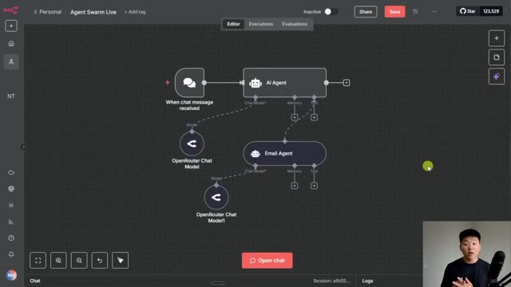
*⏱️ 00:10:35 — Une interface de workflow visuel (type plateforme d'automatisation d'agents) montrant deux agents ("AI Agent" et "Email Agent") connectés à des modèles OpenRouter et des points d'entrée de chat.*

---

### ⏱️ `[00:10:50 - 00:11:11]` | Segment #27

**🔊 Audio (Transcription Intégrale Mot pour Mot en Français) :**
> Mais ensuite, une fois que vous aurez terminé cela, revenez ici et nous configurerons cet outil Gmail. Donc, de la même manière que ce que nous venons de faire avec ce message d'utilisateur, je vais essentiellement laisser l'agent IA décider à qui il est destiné, quel est l'objet et quel est le corps du message réel. Je vais aussi rapidement changer le type d'e-mail en texte et je vais ajouter une option en bas, qui nous permet de désactiver l'attribution NNN au bas d'un e-mail.

**👁️ Analyse Visuelle d'Écran (gemini-3.5-flash-lite) :**
**Interface & Outils** : n8n (outil d'automatisation de workflow)

**Contenu textuel & Code** : Formulaire de configuration : Credential "Demo 4/2", Tool Description "Set Automatically", Resource "Message", Operation "Send", champs "To" (info@example.com), "Subject" (Hello World!), "Email Type" (HTML), et champ "Message" vide.

**Action / Démonstration** : Le curseur survole le menu déroulant de la ressource ("Resource") pour valider ou modifier la configuration du nœud d'envoi d'e-mail.

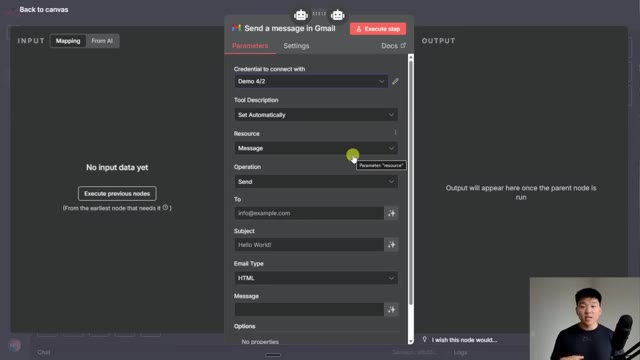
*⏱️ 00:10:55 — Interface de configuration du nœud Gmail dans l'outil d'automatisation n8n, montrant les paramètres de l'action "Send a message".*

---

### ⏱️ `[00:11:11 - 00:11:31]` | Segment #28

**🔊 Audio (Transcription Intégrale Mot pour Mot en Français) :**
> Et c'est aussi simple que ça. Nous avons déjà configuré cet outil Gmail. Donc ce que je vais faire, c'est que je vais discuter avec cet agent pour voir s'il est capable d'envoyer un e-mail. Et une chose que je tiens à vous signaler, les gars, c'est que nous n'avons mis aucune instruction système dans aucun des agents. C'est donc juste pour réitérer à quel point il est facile de construire ce genre de choses de nos jours. Lorsque vous commencez à créer plus d'agents et plus d'outils, vous devrez y ajouter des instructions système.

**👁️ Analyse Visuelle d'Écran (gemini-3.5-flash-lite) :**
**Interface & Outils** : Flowise (plateforme de workflow pour agents IA).

**Contenu textuel & Code** : Diagramme de nœuds comprenant : "When chat message received", "AI Agent", "Email Agent", "OpenRouter Chat Model", et le nœud d'intégration "Send a message in Gmail".

**Action / Démonstration** : Le présentateur explique la configuration du workflow pour tester la capacité de l'agent à envoyer un e-mail sans instruction système spécifique.

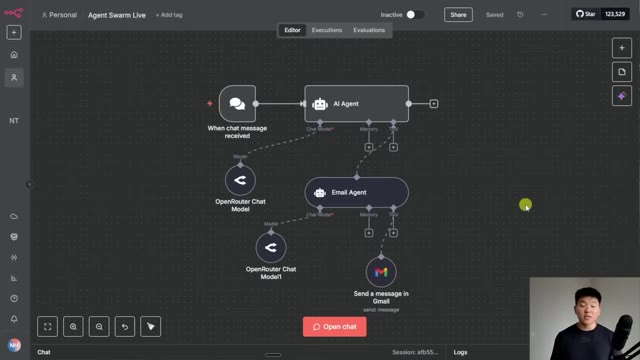
*⏱️ 00:11:16 — Workflow visuel montrant la configuration d'un agent IA capable d'envoyer des e-mails via Gmail dans l'interface de Flowise.*

---

### ⏱️ `[00:11:32 - 00:11:55]` | Segment #29

**🔊 Audio (Transcription Intégrale Mot pour Mot en Français) :**
> Comme vous pouvez le voir dans cet agent principal, il a un grand prompt système juste ici où nous expliquons : voici votre travail, voici les outils dont vous disposez, voici vos instructions. Et puis, chaque sous-agent a également un prompt. Donc, à ce sous-agent e-mail, nous lui disons en gros : voici vos outils, voici quand utiliser chacun d'eux. Mais comme je l'ai dit, par souci de simplicité, juste pour vous montrer comment nous commençons à construire ce genre de choses, je n'ai même pas encore de prompt système dans aucun de ces agents.

**👁️ Analyse Visuelle d'Écran (gemini-3.5-flash-lite) :**
**Interface & Outils** : Interface web d'automatisation de type n8n (Agent Swarm Live)

**Contenu textuel & Code** : Prompts système d'agents IA, définitions de rôles, instructions et configuration d'outils (Gmail, OpenRouter)

**Action / Démonstration** : Présentation de l'architecture d'un système multi-agents avec un agent principal et des sous-agents spécialisés

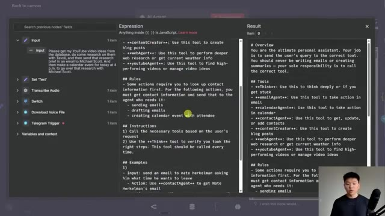
*⏱️ 00:11:37 — Vue détaillée du prompt système de l'agent principal dans l'interface de l'outil d'automatisation.*

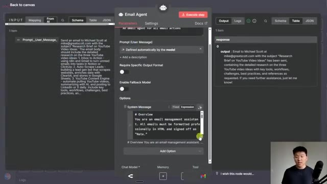
*⏱️ 00:11:43 — Configuration du sous-agent email montrant son message système et ses paramètres.*

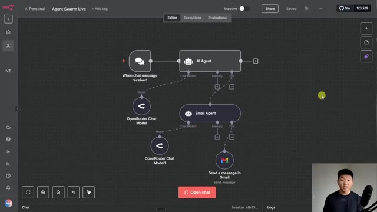
*⏱️ 00:11:49 — Vue d'ensemble du workflow graphique montrant l'agent principal et le sous-agent email relié à Gmail.*

---

### ⏱️ `[00:11:55 - 00:12:20]` | Segment #30

**🔊 Audio (Transcription Intégrale Mot pour Mot en Français) :**
> Donc je vais ouvrir le chat et je vais dire : envoie un e-mail à Nate arobase example.com pour lui demander s'il passe une bonne journée. Donc une fois qu'on lance ça, on va voir l'agent principal décider « j'ai besoin d'utiliser l'agent e-mail ». L'agent e-mail décide « j'ai besoin d'utiliser l'outil », bien qu'on puisse voir qu'on a eu une erreur avec cet outil. Donc je vais regarder ce qui s'est passé. On peut voir que c'est rouge, je vais cliquer ici, et en gros ce que ça dit, c'est que l'adresse e-mail est invalide.

**👁️ Analyse Visuelle d'Écran (gemini-3.5-flash-lite) :**
**Interface & Outils** : Interface web de type n8n ou plateforme d'automatisation d'agents IA (Agent Swarm Live)

**Contenu textuel & Code** : Workflow graphique : blocs "When chat message received", "AI Agent", "Email Agent", "OpenRouter Chat Model", et nœud Gmail "Send a message in Gmail".

**Action / Démonstration** : Présentation du workflow de l'agent d'essaim et préparation pour lancer le test dans le chat.

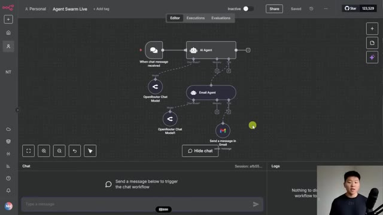
*⏱️ 00:12:02 — Interface de workflow montrant un agent IA principal connecté à un agent email et à un outil Gmail, avec un panneau de chat en bas.*

---

### ⏱️ `[00:12:20 - 00:12:41]` | Segment #31

**🔊 Audio (Transcription Intégrale Mot pour Mot en Français) :**
> Donc, le modèle d'IA a décidé de remplir le champ « À » avec juste Nate plutôt que nate@example.com. Donc, maintenant que nous savons qu'il a fait une erreur, ajoutons un petit prompt système là-dedans. J'ai donc deux options. Je pourrais en gros aller dans l'agent e-mail, je pourrais ajouter une option, ajouter un message système, et je pourrais dire : hé, au fait, chaque fois que tu envoies un e-mail à quelqu'un, il faut en gros que ce soit une adresse e-mail valide.

**👁️ Analyse Visuelle d'Écran (gemini-3.5-flash-lite) :**
**Interface & Outils** : n8n (éditeur de workflows d'automatisation IA)

**Contenu textuel & Code** : Nœuds de workflow "AI Agent", "Email Agent", "Send a message in Gmail", et panneau de chat en bas.
[DESC_IMAGE_2] L'utilisateur montre le diagramme global du workflow avec les agents connectés pour identifier où ajouter un prompt système.

**Action / Démonstration** : Explications face caméra et démonstration conceptuelle.

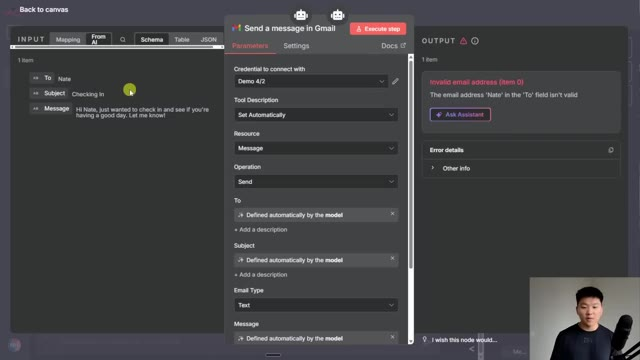
*⏱️ 00:12:25 — L'interface de configuration d'un nœud Gmail montrant l'erreur "Invalid email address" avec "Nate" dans le champ To au lieu d'une adresse complète.*

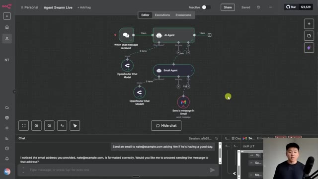
*⏱️ 00:12:31 — La vue globale du workflow d'automatisation d'agents sur n8n avec un panneau de chat en bas affichant les interactions.*

---

### ⏱️ `[00:12:41 - 00:13:01]` | Segment #32

**🔊 Audio (Transcription Intégrale Mot pour Mot en Français) :**
> Mais une façon encore plus simple de faire ça, c'est fondamentalement de revenir dans l'outil, d'aller juste ici et d'ajouter une description au champ "to" où je peux simplement dire à l'agent : "ceci doit être une adresse e-mail valide". Donc honnêtement, je crois que cette simple correction suffira et testons-la à nouveau. Donc il y a une petite flèche au-dessus de ce message, je vais juste cliquer dessus, ce qui l'envoie essentiellement à nouveau.

**👁️ Analyse Visuelle d'Écran (gemini-3.5-flash-lite) :**
**Interface & Outils** : Interface n8n (éditeur de workflow visuel).

**Contenu textuel & Code** : Paramètres de nœud Gmail, flux de travail avec agents IA connectés, et messages de chat interactifs.

**Action / Démonstration** : Configuration des paramètres d'un champ de destinataire et sauvegarde/exécution du workflow.

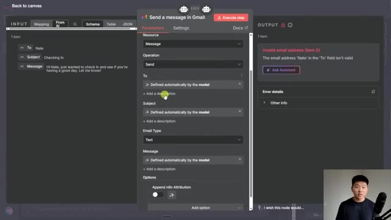
*⏱️ 00:12:46 — Gros plan sur le panneau de configuration d'un nœud d'automatisation Gmail, montrant les paramètres du champ 'To' avec une option pour ajouter une description.*

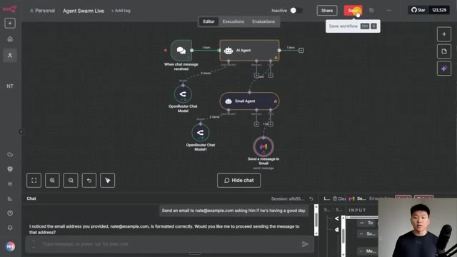
*⏱️ 00:12:56 — Vue d'ensemble d'un workflow n8n avec un panneau de chat en bas affichant un échange avec l'agent IA.*

---

### ⏱️ `[00:13:01 - 00:13:27]` | Segment #33

**🔊 Audio (Transcription Intégrale Mot pour Mot en Français) :**
> Et maintenant, nous allons voir si l'agent e-mail arrive à le faire correctement. D'accord, donc je viens tout juste de comprendre ce qui ne va pas en réalité. Ce n'est pas l'agent e-mail qui se trompe, c'est l'agent principal qui se trompe. Parce que ce qui se passe, c'est que l'agent principal reçoit ce message qui dit d'envoyer un e-mail à nate arobase example.com. Et si on clique sur les logs, on peut voir ce qu'il fait. Et on peut voir ici qu'en gros, il fait appel à l'outil de l'agent e-mail et lui transmet comme entrée : salut Nate, je voulais juste prendre des nouvelles.

**👁️ Analyse Visuelle d'Écran (gemini-3.5-flash-lite) :**
**Interface & Outils** : Interface n8n d'automatisation de workflows avec des nœuds d'IA et un panneau de chat interactif en bas.

**Contenu textuel & Code** : Diagramme de nœuds interconnectés (AI Agent, Email Agent, OpenRouter Chat Model, Gmail), paramètres de prompt et logs JSON d'exécution.
[DESC_IMAGE_2]

**Action / Démonstration** : Le présentateur analyse les logs d'exécution pour comprendre l'erreur de transmission entre l'agent principal et l'agent e-mail.

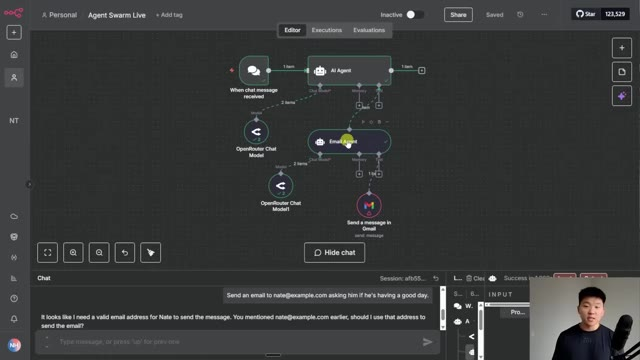
*⏱️ 00:13:08 — Vue d'ensemble du workflow d'agents IA montrant un agent principal relié à un agent e-mail et à des modèles OpenRouter.*

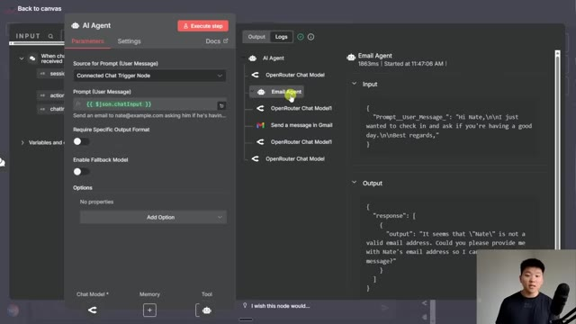
*⏱️ 00:13:21 — Panneau latéral affichant les paramètres de l'agent principal et les logs d'exécution détaillant les entrées et sorties JSON.*

---

### ⏱️ `[00:13:27 - 00:13:48]` | Segment #34

**🔊 Audio (Transcription Intégrale Mot pour Mot en Français) :**
> Donc ce qui s'est passé ici, c'est que l'agent principal a décidé « je veux rédiger l'e-mail » au lieu de dire « d'accord, monsieur l'agent des e-mails, faites tout ce travail ». Tout ce que nous avons à faire, c'est probablement d'ajouter un prompt système à l'agent principal pour lui dire : « Tu n'as pas besoin d'agir. Tu n'as pas besoin d'envoyer d'e-mails. Tu as juste besoin de déléguer la tâche au bon outil. » Je vais donc ajouter un message système et dire fondamentalement exactement cela.

**👁️ Analyse Visuelle d'Écran (gemini-3.5-flash-lite) :**
**Interface & Outils** : n8n ou outil similaire de gestion de workflows et d'agents IA, panneau de configuration des nœuds.

**Contenu textuel & Code** : Paramètres de l'agent (Source for Prompt, Prompt User Message, options de format de sortie) et logs d'exécution montrant les entrées et sorties de l'Email Agent.

**Action / Démonstration** : Consultation et analyse des paramètres et des logs d'un agent IA pour identifier pourquoi l'agent principal rédige les e-mails au lieu de déléguer la tâche.

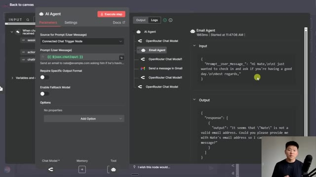
*⏱️ 00:13:33 — Interface d'un workflow d'automatisation montrant les paramètres d'un agent IA et les logs d'exécution de l'agent e-mail.*

---

### ⏱️ `[00:13:48 - 00:14:08]` | Segment #35

**🔊 Audio (Transcription Intégrale Mot pour Mot en Français) :**
> Donc ici vous pouvez voir que je lui ai donné trois courtes phrases sur quel devrait être son rôle. Et encore une fois, nous allons enregistrer ceci et réessayer. Très bien, donc je viens d'envoyer exactement le même message. Nous n'avons rien changé d'autre. Et maintenant vous pouvez voir que c'est passé. Et je sais que cela peut être un peu écrasant ou un peu déroutant pour le moment si c'est l'un de vos premiers agents que vous avez construits. Mais encore une fois, laissez-moi simplement passer en revue ce qui vient de se passer.

**👁️ Analyse Visuelle d'Écran (gemini-3.5-flash-lite) :**
**Interface & Outils** : Interface web de construction d'agents (type Agent Swarm Live / n8n / Flowise) avec un éditeur graphique et un chat de test.

**Contenu textuel & Code** : Schéma d'automatisation connectant un déclencheur de chat à un agent IA et un agent d'e-mail relié à Gmail, avec une conversation de test demandant d'envoyer un e-mail à nate@example.com.

**Action / Démonstration** : Test du workflow d'agents IA via le panneau de chat intégré pour vérifier la compréhension du rôle et l'envoi d'e-mail.

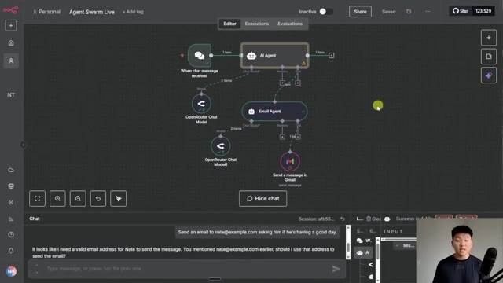
*⏱️ 00:13:53 — Interface de conception de workflow d'agents IA avec un panneau de chat en bas affichant une conversation et la vidéo du présentateur dans le coin inférieur droit.*

---

### ⏱️ `[00:14:08 - 00:14:26]` | Segment #36

**🔊 Audio (Transcription Intégrale Mot pour Mot en Français) :**
> Donc nous allons cliquer sur l'agent principal et nous allons aller dans les journaux de l'agent. Quand vous lisez les journaux, c'est fondamentalement comme ça que ça fonctionne. La première chose qu'il a faite, c'est qu'il appelle son cerveau afin de lire le message système pour comprendre quoi faire ensuite. Une fois qu'il a lu ça, il a appelé l'agent de messagerie. Et cette fois, ce qu'il a fait, c'est qu'il a transmis ce message à l'agent de messagerie.

**👁️ Analyse Visuelle d'Écran (gemini-3.5-flash-lite) :**
**Interface & Outils** : Interface web d'automatisation (n8n ou similaire) avec panneau de configuration de l'agent et journaux.

**Contenu textuel & Code** : Message système affiché : 'You are an orchestrator agent. You will never be required to send emails... Your job is to delegate the user's task to the right agent.'

**Action / Démonstration** : Consultation des journaux (Logs) de l'agent principal pour analyser le déroulement des appels au modèle de langage (cerveau de l'agent).

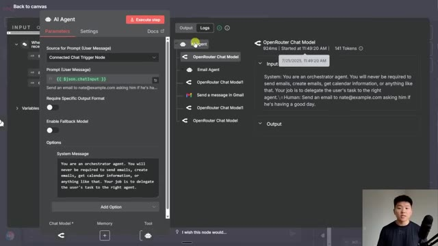
*⏱️ 00:14:12 — Interface d'un tableau de bord d'agent IA montrant les journaux d'exécution avec les détails du modèle OpenRouter Chat et les messages système.*

---

### ⏱️ `[00:14:26 - 00:14:51]` | Segment #37

**🔊 Audio (Transcription Intégrale Mot pour Mot en Français) :**
> Envoyer un e-mail à nade arobase example.com pour lui demander s'il passe une bonne journée. Donc maintenant, nous pouvons voir que l'agent principal ne crée pas les choses lui-même. Il délégue simplement la tâche, ce qui est exactement ce qui devrait se produire dans un essaim d'agents. À partir de là, l'agent e-mail utilise ensuite son cerveau, décide, d'accord, je dois créer un e-mail. Et ensuite, il transmet ces paramètres à son outil d'envoi Gmail, qui sont : voici à qui il est destiné, voici l'objet, et enfin voici le corps du message proprement dit.

**👁️ Analyse Visuelle d'Écran (gemini-3.5-flash-lite) :**
**Interface & Outils** : n8n (Interface de workflow d'automatisation)

**Contenu textuel & Code** : Prompt utilisateur : "Send an email to nate@example.com asking him if he's having a good day." et message système définissant le rôle d'agent orchestrateur.

**Action / Démonstration** : Affichage des détails d'exécution et des logs de l'agent principal déléguant la tâche à un sous-agent.

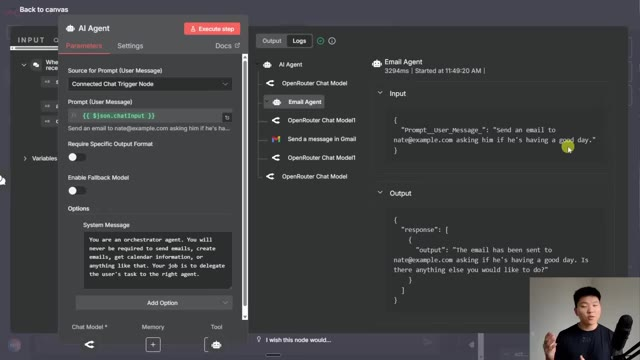
*⏱️ 00:14:32 — Interface d'un outil d'automatisation montrant les paramètres d'un agent IA et les journaux d'exécution de l'agent d'e-mail.*

---

### ⏱️ `[00:14:51 - 00:15:25]` | Segment #38

**🔊 Audio (Transcription Intégrale Mot pour Mot en Français) :**
> Et ensuite, fondamentalement, cela est communiqué au respononsable principal, et ensuite l'agent principal nous répond. Donc, il y a vraiment trois choses clés que vous devez maîtriser afin de construire des essaims d'agents. La première va être de comprendre comment lire les journaux des agents. C'est super, super important pour le débogage et pour s'assurer que vos agents font ce que vous leur avez dit de faire. Donc vous venez juste de me voir fondamentalement rencontrer une erreur, essayer de la corriger. Cela n'a pas fonctionné. Donc ce que j'ai fait, c'est que j'ai regardé les journaux pour comprendre où exactement dans cette chaîne de commandement quelque chose se brise. Donc plus vous gagnez d'expérience dans la lecture des journaux d'agents et la compréhension de ce qui se passe, de la façon dont les données sont transmises entre les différents agents, mieux c'est

**👁️ Analyse Visuelle d'Écran (gemini-3.5-flash-lite) :**
**Interface & Outils** : Interface web de workflow d'automatisation d'agents IA.

**Contenu textuel & Code** : Nœuds de workflow : "When chat message received", "AI Agent", "OpenRouter Chat Model", "Email Agent", et "Send a message in Gmail".

**Action / Démonstration** : Présentation visuelle de la structure d'un essaim d'agents communicants et des connexions entre les différents nœuds.

*⏱️ 00:14:59 — Capture d'écran montrant l'interface d'un outil de création de flux d'agents IA (probablement n8n ou similaire), avec un diagramme reliant un déclencheur de chat, un agent IA principal, un modèle OpenRouter et un agent e-mail connectés à Gmail.*

---

### ⏱️ `[00:15:25 - 00:15:59]` | Segment #39

**🔊 Audio (Transcription Intégrale Mot pour Mot en Français) :**
> vous allez comprendre comment vous pouvez construire des choses qui fonctionnent. Maintenant, la deuxième chose va être le prompting. Parce que ce qui se passe, c'est que ça va bien fonctionner lorsque vous avez un agent et un outil, mais à mesure que vous les faites évoluer, vous allez avoir plusieurs éléments supplémentaires à inclure dans votre prompt. Par exemple, avec celui-ci, nous avons un agent principal et nous lui disons, ok, tu es fondamentalement un agent orchestrateur, délégateur, et tu as cinq agents avec qui travailler. Il comprend cela maintenant et il fait son travail assez bien, mais je n'ai pas pu simplement balancer le prompt et le faire fonctionner comme par magie. Ce que vous allez vraiment devoir faire, c'est comprendre l'aspect du prompting réactif. Je

**👁️ Analyse Visuelle d'Écran (gemini-3.5-flash-lite) :**
**Interface & Outils** : Interface web de type builder de flux (n8n ou similaire) nommé Agent Swarm Live.

**Contenu textuel & Code** : Nœuds de workflow : When chat message received, AI Agent, OpenRouter Chat Model, Email Agent, et Send a message in Gmail.

**Action / Démonstration** : Visualisation du schéma d'architecture des agents IA interconnectés avec des modèles de langage et des outils.

*⏱️ 00:15:33 — Interface de workflow montrant un diagramme avec un déclencheur de chat, deux nœuds d'agents IA et un outil d'intégration Gmail.*

---

### ⏱️ `[00:15:59 - 00:16:20]` | Segment #40

**🔊 Audio (Transcription Intégrale Mot pour Mot en Français) :**
> J'ai en fait fait une vidéo complète sur le prompt réactif et je vais inclure ce PDF entier ainsi que toutes les autres ressources que vous obtiendrez pour créer le système. Mais cela aborde des points vraiment clés sur le fait de déboguer une erreur à la fois, d'évoluer lentement, d'ajouter des outils un par un, afin de s'plurer que tout fonctionne. Plutôt que de balancer 20 outils et un énorme prompt système en même temps et de cliquer sur exécuter, vous ne saurez pas exactement où les choses clochent.

**👁️ Analyse Visuelle d'Écran (gemini-3.5-flash-lite) :**
**Interface & Outils** : Document Google Docs / Visionneuse de PDF avec le présentateur en incrustation vidéo en bas à droite.

**Contenu textuel & Code** : Texte de prompt système pour un assistant virtuel et méthodologie de prompting réactif (règles de débogage et d'évolution graduelle).

**Action / Démonstration** : Le présentateur fait défiler le document de ressources PDF pour expliquer les bonnes pratiques de construction et de test des agents IA.

*⏱️ 00:16:04 — Affichage d'un document PDF de référence intitulé "Mastering Reactive Prompting for AI Agents" présentant un prompt système complet avec des sections Overview, Tools, Rules et Examples.*

*⏱️ 00:16:09 — Défilement vers le bas du même document PDF montrant les étapes clés : "Step 4: Debug One Error at a Time" et "Step 5: Scale Up Slowly", ainsi que la section "4. Core Components of an Effective Prompt".*

---

### ⏱️ `[00:16:21 - 00:16:56]` | Segment #41

**🔊 Audio (Transcription Intégrale Mot pour Mot en Français) :**
> Et puis le dernier élément à comprendre, c'est l'appel d'outils. En gros, tous ces différents outils, ce que nous faisons, c'est que nous laissons le modèle d'IA décider de la manière de remplir les paramètres. Donc pour vous donner un peu plus de contexte ici, ce qui se passe avec un outil d'envoi d'e-mails par exemple, c'est que le modèle d'IA décide à qui il est destiné, quel est l'objet et quel est le corps du message. Donc comme vous pouvez le voir dans cet outil Gmail, nous laissons le modèle d'IA décider à qui il est destiné, quel est l'objet et quel est le corps du message. Donc si nous voulions ajouter autre chose comme un agent de calendrier, nous ajouterions fondamentalement un autre outil. Nous ajouterions un agent IA comme outil, et nous appellerions celui-ci un agent de calendrier. Donc nous lui avons donné une description, nous lui avons donné un nom, et puis ce que je

**👁️ Analyse Visuelle d'Écran (gemini-3.5-flash-lite) :**
**Interface & Outils** : Application web de type éditeur de flux (interface de type n8n ou similaire), avec une incrustation vidéo du présentateur en bas à droite.

**Contenu textuel & Code** : Nœuds de traitement connectés entre eux (déclencheur Telegram, transcription audio, agents IA spécialisés comme Email Agent, Calendar Agent, Contact Agent, YouTube Agent, Web Agent et appels de modèles ou d'outils).

**Action / Démonstration** : Présentation et explication visuelle de l'architecture d'un agent swarm et de ses connexions d'outils.

*⏱️ 00:16:30 — Capture d'écran montrant un diagramme de workflow complexe pour un agent d'intelligence artificielle sur une plateforme web.*

---

### ⏱️ `[00:16:56 - 00:17:30]` | Segment #42

**🔊 Audio (Transcription Intégrale Mot pour Mot en Français) :**
> ce que nous allons faire encore une fois, c'est laisser l'agent principal décider du message que cet agent de calendrier reçoit. Nous laissons donc le modèle d'IA en décider. Ensuite, nous devrions fondamentalement donner à nouveau accès à un cerveau à l'agent de calendrier. Je peux donc faire glisser ce petit élément vers un autre cerveau. Ainsi, l'agent de messagerie et l'agent de calendrier utilisent le même modèle de chat. Et ensuite, ce que nous pouvons faire, c'est ajouter un outil de calendrier. Donc, si je vais sur le bouton d'outil juste ici et que je tape Google Calendar, nous allons récupérer celui-ci et nous allons fondamentalement effectuer une opération de création d'événement. Je choisirais le calendrier auquel je veux qu'il accède. Et ensuite, nous avons une heure de début et une heure de fin. Et ce que je suis capable de faire, c'est fondamentalement juste

**👁️ Analyse Visuelle d'Écran (gemini-3.5-flash-lite) :**
**Interface & Outils** : Interface web de conception de workflows et d'agents IA (type n8n ou équivalent).

**Contenu textuel & Code** : Blocs fonctionnels interconnectés : "When chat message received", "AI Agent", "OpenRouter Chat Model", "Calendar Agent", "Email Agent", "Send a message in Gmail".

**Action / Démonstration** : Le présentateur manipule visuellement et survole le bloc "Calendar Agent" pour configurer ses connexions et ses modèles de langage.

*⏱️ 00:17:05 — Un diagramme de workflow interactif d'une application d'agents IA, montrant l'agent principal (AI Agent) connecté à différents sous-agents dont un 'Calendar Agent' et un 'Email Agent'.*

---

### ⏱️ `[00:17:30 - 00:18:04]` | Segment #43

**🔊 Audio (Transcription Intégrale Mot pour Mot en Français) :**
> dis : « OK, modèle d'IA, tu vas décider quand cet événement va commencer et se terminer. » OK, donc je viens de lui demander de créer un événement dans le calendrier pour aujourd'hui à 13 heures pour le déjeuner. Vous pouvez voir que l'agent a appelé l'agent du calendrier. Vous pouvez voir que l'agent du calendrier a appelé l'outil de création d'événement. Tout a l'air d'avoir fonctionné. Donc, si je vais dans mon calendrier, nous ne voyons pas l'événement. C'est donc là qu'il faut comprendre : OK, les choses ont l'air d'avoir fonctionné, mais je ne vois pas le résultat réel que je cherchais. Ce que je dois faire maintenant, c'est examiner l'outil. Je dois examiner les différents journaux des agents et voir ce qui s'est réellement passé, et ensuite nous saurons où les choses ont mal tourné. C'est donc exactement ce que je vais faire.

**👁️ Analyse Visuelle d'Écran (gemini-3.5-flash-lite) :**
**Interface & Outils** : n8n (ou outil similaire de workflow d'agents) et Google Calendar

**Contenu textuel & Code** : Nœuds de workflow connectés : "When chat message received", "AI Agent", "Email Agent", "Calendar Agent" et outils associés (OpenRouter Chat Model, Gmail, Google Calendar).

**Action / Démonstration** : Démonstration de l'exécution d'un workflow où l'agent IA déclenche l'agent de calendrier pour planifier un événement de déjeuner.

*⏱️ 00:17:39 — Vue d'ensemble du workflow d'agents IA montrant les connexions entre l'agent principal, l'agent email et l'agent de calendrier.*

*⏱️ 00:17:47 — Interface de Google Calendar montrant le calendrier du 25 juillet 2025.*

---

### ⏱️ `[00:18:04 - 00:18:36]` | Segment #44

**🔊 Audio (Transcription Intégrale Mot pour Mot en Français) :**
> avec vous et je vais commencer par regarder l'outil pour voir ce qui s'est réellement passé dans notre Google Agenda. Donc si je clique sur l'outil, ce que vous pouvez voir qui s'est passé, c'est que l'agent a créé un événement pour 13 heures, mais il l'a programmé pour le 27 avril 2024, ce qui était, vous savez, il y a plus d'un an. Donc maintenant, je me dirais, ok, pourquoi a-t-il fait ça ? Et pour comprendre pourquoi il a fait ça, j'irais sur l'agent principal, je cliquerais sur les journaux et je commencerais simplement à regarder dans l'ordre. Donc tout d'abord, il fait appel à son cerveau. Et ensuite, à partir de là, il décide, ok, je dois utiliser l'agent d'agenda. Quand il appelle

**👁️ Analyse Visuelle d'Écran (gemini-3.5-flash-lite) :**
**Interface & Outils** : Interface web d'automatisation d'agent IA (type outil de workflow)

**Contenu textuel & Code** : Entrées (Input) avec date de début/fin au 2024-04-27, paramètres de l'outil Google Calendar, et sortie (Output) confirmant la création de l'événement.

**Action / Démonstration** : Visualisation des résultats de l'exécution d'un outil par l'agent IA pour la création d'un événement dans Google Agenda.

*⏱️ 00:18:12 — Interface d'automatisation montrant les paramètres d'un outil de création d'événement Google Calendar, avec les données d'entrée et de sortie.*

---

### ⏱️ `[00:18:36 - 00:19:05]` | Segment #45

**🔊 Audio (Transcription Intégrale Mot pour Mot en Français) :**
> l'agent de calendrier, il dit créer un événement de calendrier pour le déjeuner aujourd'hui à 13 heures. Donc maintenant je me dis, ok, l'agent ne sait pas réellement quel jour nous sommes aujourd'hui. Et c'est exactement pourquoi, lorsqu'il va remplir les paramètres pour l'outil de calendrier, il le crée pour il y a un an. La plupart du temps, quand je construis des choses et que j'essaie de comprendre ce qui ne va pas et comment le réparer, cela va sembler vraiment évident, mais je vous promets que c'est une très, très bonne façon de réfléchir. C'est juste de penser : si je faisais face à ce problème dans la vraie vie en tant qu'humain faisant cela manuellement, que ferais-je ?

**👁️ Analyse Visuelle d'Écran (gemini-3.5-flash-lite) :**
**Interface & Outils** : n8n (outil d'automatisation de workflows)

**Contenu textuel & Code** : Prompt utilisateur affiché dans le panneau d'administration : "Please create a calendar event for today at 1:00 PM for lun..."

**Action / Démonstration** : Configuration des paramètres et observation des entrées/sorties de l'agent de calendrier dans le panneau de logs.

*⏱️ 00:18:43 — Interface d'un tableau de bord de workflow (type n8n) affichant un nœud d'agent IA avec ses paramètres de configuration et les logs d'exécution du Calendar Agent.*

---

### ⏱️ `[00:19:06 - 00:19:29]` | Segment #46

**🔊 Audio (Transcription Intégrale Mot pour Mot en Français) :**
> Et donc dans ce cas-là, ce que je ferais, c'est que je regarderais mon téléphone et je registrerais, ok, on m'a dit de créer un événement pour aujourd'hui. Quel jour sommes-nous aujourd'hui ? Je regarderais mon téléphone. Je réaliserais qu'aujourd'hui est, vous savez, le 25 juillet. Et ensuite, je créerais essentiellement l'événement pour le 25 juillet. Donc la façon dont nous allons régler ça ici, c'est que je vais donner aux deux agents accès à la date et à l'heure actuelles d'aujourd'hui. Et pour ce faire, je viendrais dans l'invite système de cet agent IA principal.

**👁️ Analyse Visuelle d'Écran (gemini-3.5-flash-lite) :**
**Interface & Outils** : n8n (Interface de conception de workflows d'agents IA)

**Contenu textuel & Code** : Workflow "Agent Swarm Live" reliant un déclencheur de chat à un agent orchestrateur qui route vers des agents spécialisés (Gmail et Google Calendar).

**Action / Démonstration** : Exploration des paramètres et des logs d'exécution des différents agents IA au sein du workflow.

*⏱️ 00:19:11 — Gros plan sur les paramètres d'un nœud AI Agent dans n8n, avec un panneau affichant les logs d'exécution Google Calendar.*

*⏱️ 00:19:23 — Vue d'ensemble du workflow n8n montrant un système multi-agents interconnectés (Email Agent et Calendar Agent).*

---

### ⏱️ `[00:19:29 - 00:19:48]` | Segment #47

**🔊 Audio (Transcription Intégrale Mot pour Mot en Français) :**
> Je vais m'assurer que c'est une expression pour pouvoir insérer une variable dynamique. Et je vais simplement dire, la date d'aujourd'hui est deux accolades. Et ensuite, nous avons une petite variable juste ici, signe dollar now. Et tout ce que ça fait, c'est que ça donne à l'agent la date et l'heure actuelles, peu importe l'heure à laquelle vous l'utilisez. Et donc je vais simplement copier cette petite phrase que j'ai créée.

**👁️ Analyse Visuelle d'Écran (gemini-3.5-flash-lite) :**
**Interface & Outils** : Interface web de type outil d'automatisation (n8n ou similaire).

**Contenu textuel & Code** : Éditeur d'expression avec du texte de prompt système configurant un agent orchestrateur, affichant les données de l'événement de chat à gauche et le résultat à droite.

**Action / Démonstration** : Saisie d'une expression pour insérer une variable dynamique de date et heure.

*⏱️ 00:19:34 — Interface d'édition d'une expression dans un workflow, montrant le panneau de configuration des variables dynamiques.*

---

### ⏱️ `[00:19:48 - 00:20:23]` | Segment #48

**🔊 Audio (Transcription Intégrale Mot pour Mot en Français) :**
> Je vais aller dans l'agent de calendrier et je vais lui donner exactement la même information, m'assurer que c'est une expression, et simplement dire que la date d'aujourd'hui est vide. Donc maintenant que j'ai enregistré ça, si j'ouvre le chat et que j'exécute exactement le même message, je suis presque sûr qu'il devrait être capable de faire cela correctement. Il décide quel agent utiliser, l'agent décide quel outil utiliser, et maintenant si nous allons dans notre Google Agenda, nous pouvons voir que nous avons un événement ici aujourd'hui à 13 heures, bien que nous n'ayons pas de titre. Donc c'est la même chose, je réfléchirais fondamentalement à, OK, pourquoi n'y a-t-il pas de titre ? Laissez-moi aller examiner cet outil Google Agenda réel, je peux voir que l'agent est automatiquement

**👁️ Analyse Visuelle d'Écran (gemini-3.5-flash-lite) :**
**Interface & Outils** : n8n (workflow d'automatisation IA) et Google Calendar (interface web).

**Contenu textuel & Code** : Nœuds de workflow n8n (« When chat message received », « AI Agent », « Calendar Agent », « Send a message in Gmail ») et planning Google Calendar avec des blocs d'événements.

**Action / Démonstration** : Présentation du workflow d'agent d'automatisation et vérification des événements dans l'agenda Google.

*⏱️ 00:19:57 — Interface n8n affichant un workflow d'agents IA connectés (« AI Agent », « Email Agent », « Calendar Agent »).*

*⏱️ 00:20:14 — Interface de Google Calendar montrant les événements prévus pour le 25 juillet 2025.*

---

### ⏱️ `[00:20:23 - 00:20:56]` | Segment #49

**🔊 Audio (Transcription Intégrale Mot pour Mot en Français) :**
> en renseignant deux paramètres, l'heure de début et l'heure de fin, mais il n'y a pas de paramètre ici pour le titre. Donc ce que je ferais, c'est que je voudrais ajouter un champ supplémentaire. Je descendrais essentiellement ici jusqu'à résumé. Je pense que le résumé est la façon dont il apparaît dans Google Agenda comme titre. Et ensuite, je laisserais simplement l'agent IA décider quel est le résumé. Maintenant que j'ai enregistré cela et que nous savons que l'agent va envoyer l'heure de début, l'heure de fin et le titre, je peux envoyer cette requête qui lui demande de créer un événement pour 18 heures pour le dîner. L'agent appelle le bon outil et maintenant nous pouvons aller vérifier notre calendrier et nous pouvons voir que nous avons un événement à 18 heures appelé dîner.

**👁️ Analyse Visuelle d'Écran (gemini-3.5-flash-lite) :**
**Interface & Outils** : n8n (interface de workflow d'automatisation IA)

**Contenu textuel & Code** : Paramètres du nœud Google Calendar (Start, End, Add Field) et historique de chat interactif avec un agent IA.

**Action / Démonstration** : Configuration des paramètres de l'événement et test d'interaction avec le chatbot du workflow.

*⏱️ 00:20:31 — Interface n8n montrant un panneau de configuration pour ajouter des champs de paramètres à un événement Google Calendar.*

*⏱️ 00:20:48 — Vue d'ensemble d'un workflow d'agents IA sur n8n avec un panneau de chat interactif en bas.*

---

### ⏱️ `[00:20:57 - 00:21:26]` | Segment #50

**🔊 Audio (Transcription Intégrale Mot pour Mot en Français) :**
> Très bien, donc maintenant nous avons fondamentalement construit cet essaim de mini-agents où nous avons un agent orchestrateur principal et nous avons un agent de messagerie et un agent de calendrier. Ce qui viendrait ensuite à partir d'ici, c'est que vous commenceriez à mettre à l'échelle ces agents en leur donnant accès à différents outils de messagerie et différents outils de calendrier. Mais j'ai rendu les choses vraiment faciles pour vous les gars, parce que ce que vous pouvez faire, c'est que vous pouvez exploiter tous les outils et les invites système de cet essaim d'agents que j'ai déjà construit. Vous pourriez fondamentalement venir dans l'agent de messagerie et vous pourriez copier cette invite système exacte et ensuite la mettre dans votre agent de messagerie.

**👁️ Analyse Visuelle d'Écran (gemini-3.5-flash-lite) :**
**Interface & Outils** : Interface web de l'outil d'automatisation de flux de travail.

**Contenu textuel & Code** : Diagramme de nœuds montrant un agent principal "AI Agent" relié à un "Email Agent" (connecté à Gmail et OpenRouter) et un "Calendar Agent" (connecté à Google Calendar et OpenRouter).

**Action / Démonstration** : Le présentateur explique la structure de l'essaim d'agents et le rôle de chaque composant (orchestrateur, email, calendrier).

*⏱️ 00:21:04 — Capture d'écran montrant l'éditeur de flux de travail avec un essaim d'agents IA comprenant un agent orchestrateur central, un agent de messagerie (Email Agent) et un agent de calendrier (Calendar Agent).*

---

### ⏱️ `[00:21:26 - 00:22:02]` | Segment #51

**🔊 Audio (Transcription Intégrale Mot pour Mot en Français) :**
> Vous pourriez aussi ensuite copier tous ces outils, aller dans votre flux de travail et les coller, puis simplement glisser-déposer et connecter ces outils à votre propre agent. Maintenant, une chose à noter si vous empruntez cette voie, c'est qu'au sein de ces outils, comme je les ai construits il y a un certain temps, ce que j'ai, ce sont ces petites fonctions « from AI ». Et je voulais juste vous montrer, les gars, que ces fonctions « from AI » sont exactement la même chose que ce que nous avons configuré ensemble où nous cliquons sur le bouton pour laisser le modèle définir. Ils font exactement la même chose. NNN vient juste de faire une mise à jour où ils ont rendu les choses encore plus faciles que de taper une fonction « from AI ». Donc, que vous vouliez les configurer vous-même et utiliser ce bouton ou que vous vouliez simplement

**👁️ Analyse Visuelle d'Écran (gemini-3.5-flash-lite) :**
**Interface & Outils** : Interface graphique de n8n pour la création de flux de travail d'agents IA.

**Contenu textuel & Code** : Nœuds de workflow, connexions entre agents, modèles OpenRouter, outils Gmail et paramètres de configuration des messages.

**Action / Démonstration** : Navigation et explication de la structure du workflow et des paramètres des outils d'IA.

*⏱️ 00:21:35 — Vue d'ensemble du workflow d'agents IA montrant un agent principal connectant des sous-agents (Email et Calendar) ainsi que divers outils Gmail.*

*⏱️ 00:21:53 — Panneau de configuration détaillé d'un nœud spécifique (« Send a message in Gmail ») avec ses paramètres, ses options d'entrée et de sortie.*

---

### ⏱️ `[00:22:02 - 00:22:33]` | Segment #52

**🔊 Audio (Transcription Intégrale Mot pour Mot en Français) :**
> copiez dans ces outils que j'ai déjà avec les fonctions d'IA, ne vous inquiétez pas. Ils font exactement la même chose. Très rapidement les gars, pendant que j'édite cette vidéo, j'ai pensé à quelque chose que je voulais absolument mentionner. Ces essaims d'agents sont super cools. NNN fait un travail formidable pour rendre vraiment, vraiment facile et plus accessible aux gens la construction de ces agents qui appellent d'autres agents. Mais en fin de compte, je pense que la majorité des automatisations que vous pouvez construire pour vous-même ou pour votre entreprise ou peu importe, n'ont pas besoin d'être des agents et n'ont pas besoin d'être des essaims d'agents. Il y a une grande différence entre construire un agent IA et construire un flux de travail IA.

**👁️ Analyse Visuelle d'Écran (gemini-3.5-flash-lite) :**
**Interface & Outils** : Application de tableau blanc / diagramme en ligne (style Excalidraw)

**Contenu textuel & Code** : Schémas contrastant "AI Agent" (Input, AI Agent central et plusieurs outils en étoile) et "AI Workflow" (séquence linéaire Input -> Tool -> LLM Call -> Tools -> Output).

**Action / Démonstration** : Le présentateur explique les différences conceptuelles entre un agent autonome et un workflow d'automatisation rigide.

*⏱️ 00:22:10 — Un diagramme explicatif comparant un agent IA et un workflow IA, avec le présentateur visible en incrustation vidéo dans le coin inférieur droit.*

---

### ⏱️ `[00:22:33 - 00:23:06]` | Segment #53

**🔊 Audio (Transcription Intégrale Mot pour Mot en Français) :**
> Et je pense que la majorité des problèmes d'entreprise peuvent être résolus avec un très bon flux de travail en IA. La différence ici, c'est qu'avec un flux de travail, nous utilisons toujours l'IA, nous utilisons toujours des outils, mais nous contrôlons fondamentalement le flux exact. Donc nous savons que le processus va de un, deux, trois, quatre, cinq, six, et il n'y a littéralement aucun moyen pour que le processus aille de un, quatre, deux, six. Il doit suivre nos instructions exactes à chaque fois. Donc si vous essayez d'automatiser un processus déterministe et prévisible qui suit un guide étape par étape à chaque fois, vous voulez opter pour un

**👁️ Analyse Visuelle d'Écran (gemini-3.5-flash-lite) :**
**Interface & Outils** : Excalidraw (outil de dessin et diagrammes).

**Contenu textuel & Code** : Diagramme montrant à gauche un agent IA centralisé connectant à plusieurs outils, et à droite une séquence linéaire (workflow) alternant outils et appels LLM.

**Action / Démonstration** : Présentation visuelle pour expliquer le contrôle séquentiel des flux de travail automatisés.

*⏱️ 00:22:41 — Un schéma comparatif illustrant la différence structurelle entre un "AI Agent" et un "AI Workflow".*

---

### ⏱️ `[00:23:06 - 00:23:37]` | Segment #54

**🔊 Audio (Transcription Intégrale Mot pour Mot en Français) :**
> workflow. Les agents sont vraiment super parce qu'ils utilisent l'IA comme un aspect de raisonnement et de prise de décision, et c'est là que nous avons des processus qui sont imprévisibles, non déterministes, et nous avons besoin de cette assistance de la part d'une IA. Je vous encourage donc à réfléchir : est-ce que je construis quelque chose qui doit être un agent, ou est-ce que je construis un agent parce que je pense que c'est plus cool ? Je me suis moi-même fait prendre au piège du soufflé des agents IA et j'ai construit des agents alors qu'ils auraient très bien pu être des workflows. Je voulais donc juste mentionner ça rapidement. Si vous voulez regarder une vidéo complète, j'ai fait une vidéo complète sur ce sujet exact, que je vais mettre en lien juste ici, mais revenons immédiatement à la vidéo principale.

**👁️ Analyse Visuelle d'Écran (gemini-3.5-flash-lite) :**
**Interface & Outils** : Tableau blanc numérique / outil de schématisation (type Excalidraw) avec incrustation vidéo du présentateur en bas à droite.

**Contenu textuel & Code** : Diagrammes textuels et schématiques : "AI Agent" (Input -> AI Agent -> Output, relié à Tool #1, Tool #2, Tool #3, Tool #4) et "AI Workflow" (Input -> Tool #1 -> LLM Call -> Tool #2 -> Tool #3 -> Output).

**Action / Démonstration** : Présentation visuelle et comparaison conceptuelle entre un agent IA autonome et un workflow d'IA déterministe.

*⏱️ 00:23:13 — Schéma comparatif dessiné à la main illustrant la différence structurelle entre un "AI Agent" (avec un agent central connectant plusieurs outils) et un "AI Workflow" (séquence linéaire d'outils et d'appels LLM).*

---

### ⏱️ `[00:23:37 - 00:23:56]` | Segment #55

**🔊 Audio (Transcription Intégrale Mot pour Mot en Français) :**
> Donc maintenant, je dois vous dire comment vous pouvez réellement accéder à ceci et à la feuille de journal des agents ici même que vous voyez, afin de dupliquer fondamentalement ce système exact. Ce que vous allez faire, c'est aller dans ma communauté School gratuite. Le lien pour cela est dans la description. Et une fois que vous y êtes, vous pouvez obtenir toutes mes ressources de chaque vidéo YouTube que j'ai faite, de manière entièrement gratuite.

**👁️ Analyse Visuelle d'Écran (gemini-3.5-flash-lite) :**
**Interface & Outils** : n8n (workflow automation), Google Sheets (logs de données), School (plateforme communautaire).

**Contenu textuel & Code** : Diagrammes de nœuds logiques dans n8n ; logs structurés en format JSON dans Google Sheets ; annonces de communauté dans School.

**Action / Démonstration** : Présentation visuelle de l'architecture d'un agent IA, démonstration de la journalisation des tâches et indication de l'emplacement des ressources pour la duplication du système.

*⏱️ 00:23:42 — Interface du logiciel n8n montrant un workflow complexe de type "Agent Swarm" avec de multiples nœuds d'agents spécialisés (Email, Calendrier, Contact, YouTube, Web).*

*⏱️ 00:23:46 — Feuille de calcul Google Sheets intitulée "Agent Logs" répertoriant l'historique détaillé des exécutions, incluant les entrées utilisateur, les sorties de l'IA et les logs JSON des actions des agents.*

*⏱️ 00:23:51 — Interface de la plateforme de communauté en ligne "AI Automation Society" hébergée sur School, montrant les fils de discussion épinglés et le tableau de bord du créateur.*

---

### ⏱️ `[00:23:56 - 00:24:28]` | Segment #56

**🔊 Audio (Transcription Intégrale Mot pour Mot en Français) :**
> Vous cliquerez sur les ressources YouTube, ou vous chercherez le titre de la vidéo en utilisant la barre de recherche. Et une fois que vous aurez trouvé cette publication pour cette vidéo, vous cliquerez dessus tout simplement. Et ce que vous aurez juste ici, c'est un fichier JSON. Ce fichier JSON peut être téléchargé, puis il peut être importé dans votre propre instance Anitent. Et lorsque vous l'importerez, vous verrez simplement ceci, juste ici. Une fois que vous l'aurez importé, vous serez livré à vous-même pour configurer vos propres identifiants et vous connecter à vos propres suites Google et tout le reste. Mais il y habrá un guide de configuration sous forme de note adhésive juste ici, et il vous guidera à travers tout ce que vous avez besoin de configurer. Et puis j'ai également dit

**👁️ Analyse Visuelle d'Écran (gemini-3.5-flash-lite) :**
**Interface & Outils** : n8n (éditeur de workflow no-code)

**Contenu textuel & Code** : Diagramme de workflow n8n nommé "Agent Swarm Live" intégrant "AI Agent", "Email Agent", "Calendar Agent", ainsi que des intégrations OpenRouter et Gmail/Google Calendar.

**Action / Démonstration** : Navigation et présentation du workflow n8n d'agents IA interconnectés.

*⏱️ 00:24:12 — Capture montrant l'éditeur de workflow n8n avec un agent IA principal et des sous-agents connectés à divers outils (Gmail, Calendar).*

---

### ⏱️ `[00:24:28 - 00:24:53]` | Segment #57

**🔊 Audio (Transcription Intégrale Mot pour Mot en Français) :**
> que je vous donnerais ce modèle de Google Sheet pour que vous puissiez l'intégrer et commencer à suivre vos actions d'agent également. Il y aura donc un lien vers celui-ci dans la publication que je fais dans ma communauté FreeSchool avec le modèle. Et j'inclurai aussi cette pièce jointe sous forme de PDF si vous souhaitez aller de l'avant et en savoir plus sur le prompt réactif. Donc avec toutes ces ressources et, vous savez, en regardant une tonne d'autres vidéos sur ma chaîne, vous serez en route pour configurer votre premier essaim d'agents, même si vous n'avez pas vraiment de bagage technique.

**👁️ Analyse Visuelle d'Écran (gemini-3.5-flash-lite) :**
**Interface & Outils** : Google Sheets, n8n (éditeur de workflow).

**Contenu textuel & Code** : Dans Sheets : logs JSON détaillés avec "tool", "toolInput", "Prompt_User_Message" et "observation". Dans n8n : nœuds d'intégration, modèles de LLM (GPT 4o-mini), outils de recherche (Tavily, Perplexity) et applications (Gmail, Google Calendar).

**Action / Démonstration** : Présentation du système de journalisation des actions d'agent (logging) dans Google Sheets et démonstration de l'architecture complexe du workflow "Agent Swarm" dans n8n.

*⏱️ 00:24:35 — Une feuille de calcul Google Sheets intitulée "Agent Logs" montrant l'historique structuré des actions réalisées par un agent IA, incluant les colonnes Timestamp, Workflow, Input, Output et Actions détaillées sous format JSON.*

*⏱️ 00:24:47 — L'interface de conception de workflow dans n8n, affichant un diagramme complexe d'automatisation "Agent Swarm" avec un nœud central "AI Agent" connecté à divers sous-agents spécialisés (Email, Calendar, Contact, YouTube, Web).*

---

### ⏱️ `[00:24:54 - 00:25:27]` | Segment #58

**🔊 Audio (Transcription Intégrale Mot pour Mot en Français) :**
> Et pendant le processus de configuration de votre essaim, si vous avez besoin d'un support technique gratuit et que vous cherchez à approfondir vos connaissances, alors allez voir ma communauté payante. Le lien pour celle-ci se trouve également dans la description. Nous avons ici une super communauté de membres qui créent avec N&N chaque jour, et comme je l'ai dit, c'est du support technique gratuit. Donc dès que vous bloquez, vous pouvez y publier un message. Vous aurez des membres pour vous aider, je vous aiderai, ainsi que les personnes qui font officiellement partie de mon équipe de spécialistes du support. Nous avons également une section de cours avec deux formations complètes. Agent Zero, ce sont les bases des automatisations par IA pour débutants, et ensuite, 10 heures en 10 secondes, où vous apprenez à identifier, concevoir et créer des automatisations qui font gagner du temps. J'aimerais donc beaucoup vous voir dans

**👁️ Analyse Visuelle d'Écran (gemini-3.5-flash-lite) :**
**Interface & Outils** : Plateforme de gestion de communauté Skool.

**Contenu textuel & Code** : Titres des modules : "Start Here", "Agent Zero (Foundations)", "10 Hours to 10 Seconds", "n8n Templates", "Step-by-Step Builds", "$3M Savings Vault".

**Action / Démonstration** : Navigation et présentation des ressources pédagogiques et des modules de formation disponibles pour les membres de la communauté.

*⏱️ 00:25:02 — Interface principale de la plateforme communautaire "AI Automation Society Plus" montrant le flux des publications épinglées et le panneau latéral de présentation.*

*⏱️ 00:25:19 — Interface de la section "Classroom" de la communauté, affichant divers modules de formation sous forme de cartes cliquables (Agent Zero, n8n Templates, etc.).*

---

### ⏱️ `[00:25:27 - 00:25:38]` | Segment #59

**🔊 Audio (Transcription Intégrale Mot pour Mot en Français) :**
> ces communautés, mais ce sera tout pour aujourd'hui. Si vous avez aimé la vidéo ou si vous avez appris quelque chose de nouveau, s'il vous plaît, mettez un j'aime. Ça m'aide vraiment énormément. Et comme toujours, j'apprécie que vous soyez allés jusqu'à la fin de la vidéo. Je vous dis à la prochaine. Merci les gars.

**👁️ Analyse Visuelle d'Écran (gemini-3.5-flash-lite) :**
**Interface & Outils** : n8n (outil d'automatisation de workflow).

**Contenu textuel & Code** : Le workflow présente un "AI Agent" central connecté à divers sous-agents spécialisés : Email Agent, Calendar Agent, Contact Agent, YouTube Agent et Web Agent, chacun intégrant des modèles (GPT 4o-mini) et des outils tiers (Gmail, Google Calendar, Tavily, Perplexity).

**Action / Démonstration** : Visualisation globale d'un schéma d'automatisation d'agents IA complexes.

*⏱️ 00:25:30 — Une capture d'écran de l'interface de l'outil n8n affichant un workflow complexe d'automatisation nommé "Agent Swarm" avec de multiples nœuds interconnectés.*

---

