# 🎬 I Built 204 AI Automations, Here’s What Actually Matters

> **Chaîne** : [Nate Herk | AI Automation](https://www.youtube.com/@nateherk/featured)  
> **Lien YouTube** : [https://www.youtube.com/watch?v=wq001sxDTWw](https://www.youtube.com/watch?v=wq001sxDTWw)  
> **Date de publication** : 20250729  
> **Durée** : 00:22:36  
> **Identifiant vidéo** : `wq001sxDTWw`  
> **Transcription & Analyse** : `whisper-v3-large-turbo+gemini-3.5-flash-lite`  

---

## 📌 Synthèse Exécutive & Outils

### 💡 Résumé

Dans cette vidéo axée sur l'ingénierie du contexte appliquée aux agents conversationnels, Nate Herk démontre, à travers plus de 200 automatisations sans code sous N8N, que la qualité et la cohérence d'un système d'IA dépendent fondamentalement de sa capacité à recevoir et manipuler dynamiquement le bon contexte. S'appuyant sur l'analogie d'une « anti-sèche » indispensable lors d'un examen, l'analyste décortique l'architecture essentielle des agents intelligents, allant au-delà de la simple ingénierie de prompt statique. Il explore comment structurer l'entrée utilisateur, les prompts système, la mémoire et la récupération de connaissances pour transformer un simple outil de questions-réponses en un véritable assistant doté d'une persistance cognitive.

La démonstration technique se concentre ensuite sur la gestion multi-niveaux de la mémoire et l'utilisation stratégique des outils de récupération (RAG). L'auteur détaille l'impact direct du paramétrage de la fenêtre de contexte à court terme, la gestion des identifiants de session (par e-mail, téléphone ou ID d'employé) pour cloisonner les interactions, ainsi que l'utilisation de mémoires à long terme sophistiquées comme les graphes d'utilisateurs (Zep), les documents partagés ou les CRM. Chaque choix technique est mis en balance avec ses implications sur la consommation de jetons, la latence et la pertinence opérationnelle des réponses.

### 🛠️ Outils, Modèles & Logiciels Présentés

* **N8N** : Plateforme d'automatisation sans code centrale utilisée pour concevoir, orchestrer et tester les agents IA et leurs flux de travail.
* **Supabase** : Base de données relationnelle et vectorielle employée pour le stockage des données et l'implémentation de mécanismes RAG.
* **Zep** : Solution avancée de gestion de mémoire pour agents IA, spécialisée dans la création de graphes d'utilisateurs et le suivi des relations sémantiques.
* **Gmail** : Outil de messagerie utilisé pour illustrer l'intégration d'actions et l'extraction d'identifiants de session basés sur les adresses e-mail.
* **HubSpot** : CRM interconnecté servant de source de données persistantes pour enrichir le contexte contextuel des clients et prospects.
* **Google Docs** : Solution bureautique utilisée comme dépôt externe simple pour stocker et interroger de la mémoire à long terme via des outils.

### 🔑 Points Clés & Enseignements Stratégiques

* **Primauté de l'ingénierie du contexte** : Le succès des automatisations complexes repose davantage sur la capacité à alimenter dynamiquement l'agent avec les données pertinentes que sur la recherche d'un prompt unique parfait.
* **Architecture chronologique d'un agent** : Un système robuste s'articule autour de six composants clés : l'entrée utilisateur, le prompt système, la mémoire, les outils de récupération, les actions d'exécution et le parseur de sortie structurée.
* **L'analogie de l'anti-sèche** : Si l'ingénierie des prompts s'arente à des révisions préalables, l'ingénierie du contexte équivaut à disposer d'une documentation dynamique consultable en temps réel face à un problème inédit.
* **Segmentation de la mémoire** : Il est crucial de dissocier la mémoire de travail (traitement instantané par exécution), la mémoire à court terme (fenêtre conversationnelle) et la mémoire à long terme (persistance inter-sessions).
* **Arbitrage de la fenêtre de contexte** : Augmenter la longueur de la fenêtre de contexte améliore la continuité et la mémoire de l'agent, mais entraîne mécaniquement une augmentation de la consommation de jetons et des coûts d'exécution.
* **Isolation par identifiant de session** : L'utilisation d'identifiants uniques (adresse e-mail, numéro de téléphone, ID d'employé) permet de cloisonner rigoureusement les historiques de conversation pour chaque utilisateur interagissant avec le bot.
* **Supériorité des graphes d'utilisateurs** : Pour la mémoire à long terme, l'utilisation de graphes relationnels (type Zep) surpasse les simples bases vectorielles de faits isolés en cartographiant explicitement les préférences, habitudes et liens contextuels de l'utilisateur.
* **Modularité des sources de connaissances** : Qu'il s'agisse de bases vectorielles, d'appels API web, de CRM ou de documents partagés, l'agent doit être configuré pour choisir de manière autonome quel outil interroger selon la requête reçue.
* **Traduction de l'expertise métier** : L'intégration d'un contexte de haute qualité exige d'extraire l'expertise tacite des clients pour contraindre l'IA à adopter les comportements et standards spécifiques d'une entreprise réelle.

---

## ⏱️ Chronologie & Transcription Complète Audio & Visuelle (Mot pour Mot)

### ⏱️ `[00:00:00 - 00:00:21]` | Segment #01

**🔊 Audio (Transcription Intégrale Mot pour Mot en Français) :**
> Après avoir créé plus de 200 automatisations d'IA sans code, je me suis rendu compte que l'ingénierie du contexte est la chose la plus importante pour déterminer la qualité et la cohérence des systèmes d'IA. Donc aujourd'hui, je vais passer en revue les six leçons les plus importantes en matière d'ingénierie du contexte que j'ai apprises, en décomposant le tout et en l'appliquant aux agents IA de N8N. Donc je ne veux pas perdre de temps ici. Il y a des horodatages ci-dessous si vous voulez sauter d'une partie à l'autre, mais allons droit au but.

**👁️ Analyse Visuelle d'Écran (gemini-3.5-flash-lite) :**
**Interface & Outils** : Interface de type n8n ou plateforme d'automatisation de workflows IA sur toile sombre.

**Contenu textuel & Code** : Nœuds de workflow connectés pour des assistants IA, agents de recherche, outils de mémoire et intégrations d'API (OpenRouter, Tavily, Perplexity).

**Action / Démonstration** : Visualisation et présentation de schémas d'automatisation d'IA complexes.

*⏱️ 00:00:05 — Capture d'écran montrant un diagramme de workflow d'automatisation avec un assistant principal connecté à divers outils et sous-agents (OpenRouter, Simple Memory, Email Agent, Calendar Agent, Contact Agent, Content Creator Agent, Tavily, Perplexity, Calculator).*

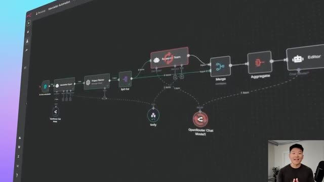
*⏱️ 00:00:16 — Capture d'écran montrant un autre diagramme de workflow d'automatisation de newsletter avec des nœuds de planification, de recherche (Research Team), de fusion (Merge) et d'édition.*

---

### ⏱️ `[00:00:22 - 00:00:57]` | Segment #02

**🔊 Audio (Transcription Intégrale Mot pour Mot en Français) :**
> Très bien, juste pour commencer ici avec le module un, introduction à l'ingénierie du contexte, si c'est un terme que vous n'avez jamais entendu auparavant. L'ingénierie du contexte est donc l'art de nourrir votre agent IA avec les bonnes informations dont il a besoin pour accomplir des tâches efficacement. Contrairement à l'ingénierie du prompt, qui se concentre sur la création de la instruction unique parfaite, l'ingénierie du contexte consiste à construire des systèmes qui peuvent fournir dynamiquement des informations pertinentes à l'agent. Donc, en un mot, l'agent devrait être capable de recevoir une sorte de message qui le déclenche. Il devrait comprendre : j'ai tous ces différents outils, j'ai toutes ces différentes sources de données ou d'informations que je peux consulter. Lesquelles est-ce que j'utilise réellement pour obtenir des informations afin de m'aider à répondre ou à faire la bonne tâche ? Maintenant, le

**👁️ Analyse Visuelle d'Écran (gemini-3.5-flash-lite) :**
**Interface & Outils** : Logiciel de présentation ou tableau blanc numérique (ex: Miro, Canva ou Google Slides)

**Contenu textuel & Code** : Texte affiché : 'Module 1: Intro to Context Engineering. Context engineering is the art of feeding your AI agent the right information it needs to complete tasks effectively. Unlike prompt engineering which focuses on crafting the perfect single instruction, context engineering is about building systems that can dynamically provide relevant information to the agent.'

**Action / Démonstration** : Présentation du premier module et explication de la définition de l'ingénierie du contexte par le formateur.

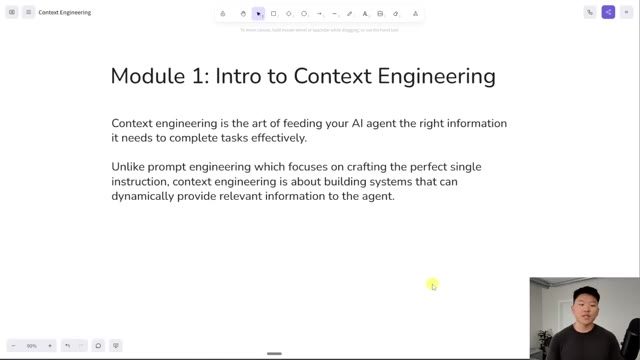
*⏱️ 00:00:30 — Une diapositive de présentation affichant le titre 'Module 1: Intro to Context Engineering' avec des définitions textuelles sur l'ingénierie du contexte, et le présentateur visible en médaillon dans le coin inférieur droit.*

---

### ⏱️ `[00:00:57 - 00:01:18]` | Segment #03

**🔊 Audio (Transcription Intégrale Mot pour Mot en Français) :**
> Le problème, c'est que la plupart des agents IA d'aujourd'hui qui n'utilisent pas beaucoup d'ingénierie du contexte, c'est comme avoir une conversation avec quelqu'un qui oublie tout juste après que vous l'avez dit. La solution est donc que, après que l'agent a lu son invite système, il doit comprendre : « J'ai ces différents outils que je peux utiliser pour obtenir plus de contexte. » Et cela va me transformer d'un simple outil de questions-réponses en un véritable assistant capable de se souvenir des choses et d'agir intelligemment.

**👁️ Analyse Visuelle d'Écran (gemini-3.5-flash-lite) :**
**Interface & Outils** : Outil de présentation visuelle ou canvas en ligne (ex: Miro, Excalidraw ou équivalent)

**Contenu textuel & Code** : Texte : "The Problem: Most AI agents today are like having a conversation with someone who forgets everything you've said moments after you say it." et "The Solution: Context engineering transforms your agents...". Schéma de la fondation des données et diagramme des conséquences d'un manque de contexte.

**Action / Démonstration** : Le présentateur explique les concepts théoriques de l'ingénierie du contexte à l'aide de visuels textuels et schématiques.

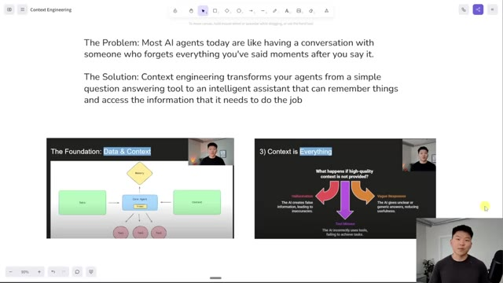
*⏱️ 00:01:02 — Une capture d'écran montrant un tableau blanc ou un outil de présentation avec du texte en anglais sur le problème et la solution des agents IA, ainsi que deux schémas illustratifs.*

---

### ⏱️ `[00:01:19 - 00:01:55]` | Segment #04

**🔊 Audio (Transcription Intégrale Mot pour Mot en Français) :**
> Et je voulais juste dire que ce n'est pas un nouveau concept. Ça existe depuis longtemps. Je pense que le terme « ingénierie du contexte » est un peu plus récent, mais cela a toujours existé. Ce sont des vidéos que j'ai faites il y a plusieurs et plusieurs mois pour parler de la base des systèmes d'IA et des automatisations, qui est la donnée et le contexte. Et ici, c'était une vidéo complètement séparée où je disais que le contexte est absolument tout. Les systèmes ne vont fonctionner qu'en fonction des données et du contexte que vous y nourrissez, données entrantes, données sortantes, déchets entrantes, déchets sortantes. Surtout si vous travaillez sur des systèmes pour un client ou quelque chose comme ça, vous allez vraiment devoir exploiter leur expertise métier pour entraîner les systèmes à se comporter de la manière dont un employé de leur entreprise le ferait.

**👁️ Analyse Visuelle d'Écran (gemini-3.5-flash-lite) :**
**Interface & Outils** : Application de tableau blanc / prise de notes (Canvas)

**Contenu textuel & Code** : Texte décrivant les problèmes des agents IA (« The Problem: Most AI agents today are like having a conversation with someone who forgets everything... ») et deux visuels schématiques montrant « The Foundation: Data & Context » et « 3) Context is Everything ».

**Action / Démonstration** : Le présentateur commente l'évolution de l'ingénierie du contexte en s'appuyant sur des visuels et des schémas explicatifs préalablement créés.

*⏱️ 00:01:28 — Capture d'écran montrant un tableau blanc ou une application de notes (type canvas) avec du texte en anglais expliquant le problème et la solution des agents IA, ainsi que des captures d'anciennes vidéos du présentateur illustrant la fondation des données et du contexte.*

---

### ⏱️ `[00:01:55 - 00:02:17]` | Segment #05

**🔊 Audio (Transcription Intégrale Mot pour Mot en Français) :**
> De plus, vous avez peut-être remarqué que, derrière moi en quelque sorte, mon arrière-plan est très dépouillé. C'est probablement la dernière vidéo que vous verrez de moi dans cet appartement, car je déménage dans mon nouveau chez-moi, ce qui est plutôt excitant, mais c'est un triste jour. Bref, si cela ne fait toujours pas vraiment tilt et que vous souhaitez approfondir un peu plus certains aspects techniques de l'ingénierie contextuelle et savoir d'où vient ce terme, alors allez absolument jeter un œil à la vidéo que Cole Meaden a faite sur ce sujet.

**👁️ Analyse Visuelle d'Écran (gemini-3.5-flash-lite) :**
**Interface & Outils** : Logiciel de tableau blanc numérique de type "Canvas" ou outil de mind-mapping en ligne (interface avec outils de dessin en haut).

**Contenu textuel & Code** : Texte pédagogique : "6 Context Engineering Lessons From 200+ AI Automations", "The Problem: Most AI agents today...", "The Solution: Context engineering transforms...", ainsi que des schémas conceptuels sur l'architecture des agents.

**Action / Démonstration** : Présentation théorique et visuelle des concepts d'ingénierie de contexte appliquée aux agents IA.

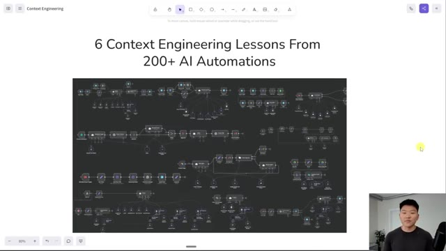
*⏱️ 00:02:01 — Une capture d'écran d'un tableau blanc virtuel affichant un diagramme de workflow complexe composé de dizaines de nœuds interconnectés, illustrant une automatisation IA de grande envergure.*

*⏱️ 00:02:11 — Une présentation sur un tableau blanc virtuel expliquant le concept de "Context Engineering" avec deux schémas : une architecture d'agent IA (Memory, Data, Context) et un diagramme de causes à effets sur les conséquences d'un manque de contexte (hallucinations, réponses vagues).*

---

### ⏱️ `[00:02:17 - 00:02:50]` | Segment #06

**🔊 Audio (Transcription Intégrale Mot pour Mot en Français) :**
> Je mettrai le lien dans la description ci-dessous. Mais dans notre vidéo, nous allons nous concentrer davantage sur l'intégration de ceci dans N8N et sur les solutions sans code. Il y a donc vraiment ces six composantes principales de l'ingénierie du contexte. Laissez-moi donc décomposer cela rapidement. Pour suivre le flux chronologique d'un agent IA, le premier aspect est l'entrée utilisateur. C'est fondamentalement la requête dynamique que nous demandons à l'agent d'exécuter à chaque fois que nous le déclenchons. Il reçoit donc l'entrée, et le deuxième élément de contexte est le prompt système, qui existe depuis longtemps avec l'ingénierie du prompt. C'est ici qu'il lira ses instructions pour comprendre : « OK, de quels outils est-ce que je dispose ? Qu'est-ce que je dois faire ? »

**👁️ Analyse Visuelle d'Écran (gemini-3.5-flash-lite) :**
**Interface & Outils** : Tableau blanc numérique / outil de mindmapping et interface n8n intégrée

**Contenu textuel & Code** : Schéma d'un workflow d'agent IA avec annotations : User Input, Instructions, Memory, Retrieved Knowledge, Tools, et Structured Output.

**Action / Démonstration** : Le présentateur présente et détaille les six composantes principales de l'ingénierie du contexte sur un diagramme.

*⏱️ 00:02:25 — Schéma explicatif sur fond blanc montrant un diagramme de workflow N8N avec des annotations en vert pour les six composantes de l'ingénierie du contexte.*

---

### ⏱️ `[00:02:50 - 00:03:09]` | Segment #07

**🔊 Audio (Transcription Intégrale Mot pour Mot en Français) :**
> que me demande l'utilisateur. La pièce suivante est la mémoire, où il peut aller vérifier quelles sont mes conversations passées que j'ai eues avec cette personne ? Y a-t-il quelque chose dont nous avons déjà parlé qui peut m'aider à faire mon travail mieux ? Ensuite, nous avons la connaissance récupérée, qui peut aller de pair avec les outils, mais je les ai juste séparés pour l'instant. Mais, vous savez, Supabase juste ici, c'est un outil. Et puis c'est aussi le cas d'envoyer un message dans Gmail.

**👁️ Analyse Visuelle d'Écran (gemini-3.5-flash-lite) :**
**Interface & Outils** : Outil de diagramme ou de tableau blanc (type Miro ou canvas n8n) avec le titre 'Context Engineering'.

**Contenu textuel & Code** : Schéma d'architecture d'agent IA comprenant un bloc 'AI Agent' connecté à 'OpenRouter Chat Model', 'Simple Memory', 'Supabase Vector Store', 'Send a message in Gmail' et 'Structured Output Parser'.

**Action / Démonstration** : Présentation visuelle et explication des différents composants de l'ingénierie du contexte d'un agent IA.

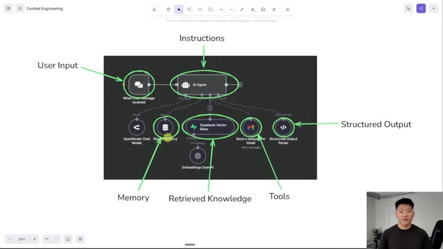
*⏱️ 00:02:55 — Schéma de workflow montrant l'architecture d'un agent IA avec différentes sections annotées en vert : User Input, Instructions, Memory, Retrieved Knowledge, Tools et Structured Output.*

---

### ⏱️ `[00:03:10 - 00:03:43]` | Segment #08

**🔊 Audio (Transcription Intégrale Mot pour Mot en Français) :**
> Mais l'idée est qu'il peut utiliser ses outils afin d'accéder à différentes connaissances qu'il possède. Il peut donc s'agir d'une base de données vectorielle. Il peut s'agir d'un appel API pour effectuer une recherche sur le web. Il peut s'agir de chercher quelque chose dans un CRM. Tout cela relève de l'obtention de plus de contexte pour agir plus efficacement. Et puis le dernier élément serait si nous avons un parseur de sortie structurée où nous allons dire à l'agent, voici comment nous avons besoin que tu sortes l'information. J'espère donc que ce diagramme vous semble assez familier si vous avez déjà construit quelques agents dans n8n. Et c'est en quelque sorte la répartition des différentes manières dont nous pouvons donner plus de contexte à l'agent. Cela ne signifie pas que chaque agent ou chaque système

**👁️ Analyse Visuelle d'Écran (gemini-3.5-flash-lite) :**
**Interface & Outils** : Outil de mind mapping / tableau blanc en ligne (type Miro ou Excalidraw) avec un schéma de workflow d'automatisation.

**Contenu textuel & Code** : Diagramme avec des nœuds connectés représentant un Agent IA, des modèles de chat, une base vectorielle Supabase, et des outils d'intégration.

**Action / Démonstration** : Le présentateur explique l'architecture d'un agent IA et ses connexions aux différentes sources de connaissances et outils.

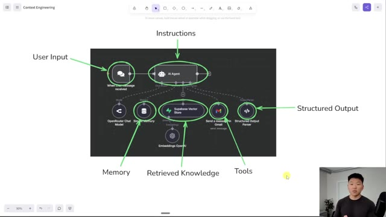
*⏱️ 00:03:18 — Schéma explicatif d'un workflow d'agent IA montrant les composants clés : User Input, Instructions, Memory, Retrieved Knowledge (Supabase Vector Store), Tools (Gmail) et Structured Output.*

---

### ⏱️ `[00:03:43 - 00:04:20]` | Segment #09

**🔊 Audio (Transcription Intégrale Mot pour Mot en Français) :**
> nous construisons doit avoir ces six éléments, mais ce sont les différentes choses que vous pouvez en quelque sorte ajuster et manipuler. Et c'est une analogie vraiment sympa que j'ai entendue, qui ressemble un peu à la différence entre l'ingénierie des prompts et l'ingénierie du contexte. L'ingénierie des prompts, c'est comme réviser pour un examen, vous savez, la semaine d'avant. Mais l'ingénierie du contexte, c'est se présenter à l'examen avec une anti-sèche que vous pouvez consulter à chaque fois que vous êtes face à un problème que vous ne connaissez pas. Pour obtenir les meilleurs résultats à cet examen, vous voudrez avoir à la fois de bonnes révisions et une bonne anti-sèche. Mais en fin de compte, si vous ne deviez en garder qu'une, je préférerais sans doute avoir une anti-sèche. Très bien, alors passons au module deux, il s'agit des systèmes de mémoire dans les agents IA. Il y a donc en gros trois catégories de

**👁️ Analyse Visuelle d'Écran (gemini-3.5-flash-lite) :**
**Interface & Outils** : Application de tableau blanc / prise de notes (type Canvas)

**Contenu textuel & Code** : Texte affiché : "Prompt engineering is like studying for an exam, but context engineering is like having a cheat sheet during the exam."

**Action / Démonstration** : Présentation de l'analogie visuelle illustrant la différence entre l'ingénierie des prompts et celle du contexte.

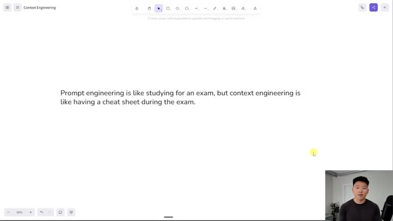
*⏱️ 00:03:52 — Une page blanche affichant une analogie textuelle sur l'ingénierie des prompts et du contexte, avec le présentateur visible en médaillon dans le coin inférieur droit.*

---

### ⏱️ `[00:04:20 - 00:04:44]` | Segment #10

**🔊 Audio (Transcription Intégrale Mot pour Mot en Français) :**
> mémoire que nous avons dans les agents IA. La première est la mémoire de travail, qui correspond fondamentalement au traitement des éléments par l'agent. Elle utilise son prompt système et son modèle de chat entre les actions pour déterminer ce qu'elle vient de faire, ce qu'elle doit encore faire, et cela sur une base d'exécution. Nous avons la mémoire à court terme, qui ressemble en quelque sorte à l'historique de conversation, une brève fenêtre contextuelle de ce qui a été dit à quiconque interagit actuellement avec le système.

**👁️ Analyse Visuelle d'Écran (gemini-3.5-flash-lite) :**
**Interface & Outils** : Application de tableau blanc / prise de notes en ligne (type Canvas / Miro).

**Contenu textuel & Code** : Texte explicatif sur les systèmes de mémoire dans les agents IA : Working Memory, Short-term Memory, Long-term Memory et leurs avantages.

**Action / Démonstration** : Présentation du module de cours sur les systèmes de mémoire avec le présentateur visible en incrustation vidéo dans le coin inférieur droit.

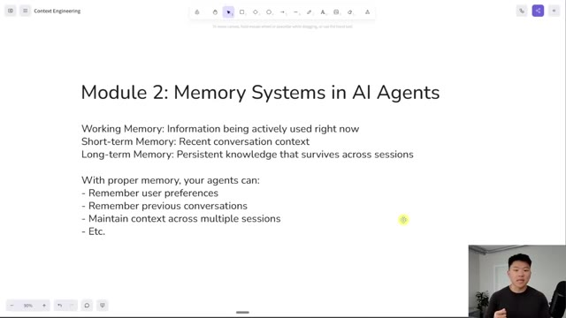
*⏱️ 00:04:26 — Une diapositive de présentation intitulée "Module 2: Memory Systems in AI Agents" listant les différents types de mémoire (Working, Short-term, Long-term) ainsi que leurs fonctionnalités.*

---

### ⏱️ `[00:04:44 - 00:05:07]` | Segment #11

**🔊 Audio (Transcription Intégrale Mot pour Mot en Français) :**
> Et ensuite nous avons la mémoire à long terme, qui est un peu plus de cette connaissance persistante qui peut survivre à travers les sessions. Ainsi, lorsque nous avons tous les éléments d'une mémoire appropriée, notre agent est capable de se souvenir des préférences de l'utilisateur, de se souvenir des conversations précédentes, et de maintenir également le contexte à travers de multiples sessions. Ainsi, en ce qui concerne la mémoire à court terme et que nous parlons d'une fenêtre de contexte, nous avons la capacité de choisir quelle est la longueur de cette fenêtre de contexte.

**👁️ Analyse Visuelle d'Écran (gemini-3.5-flash-lite) :**
**Interface & Outils** : Logiciel de présentation / tableau blanc numérique (Context Engineering)

**Contenu textuel & Code** : Texte explicatif sur les différents types de mémoire et schéma de fenêtres de contexte de conversation.

**Action / Démonstration** : Le présentateur explique les concepts théoriques des systèmes de mémoire pour les agents IA.

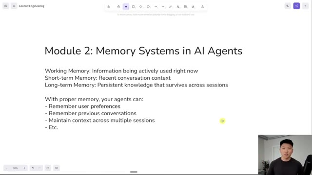
*⏱️ 00:04:50 — Diapositive présentant le Module 2 sur les systèmes de mémoire dans les agents IA, listant la mémoire de travail, à court terme et à long terme.*

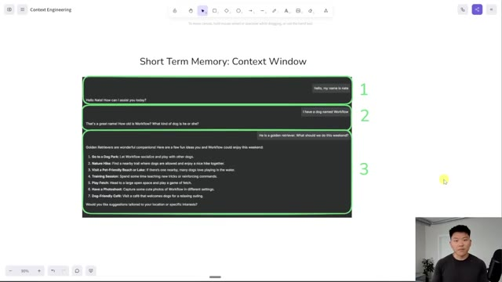
*⏱️ 00:05:01 — Diapositive illustrant la mémoire à court terme (Context Window) avec des exemples de blocs de conversation numérotés de 1 à 3.*

---

### ⏱️ `[00:05:07 - 00:05:31]` | Segment #12

**🔊 Audio (Transcription Intégrale Mot pour Mot en Français) :**
> Donc dans ce cas, ce que nous avons est une conversation entre Nate et un agent IA. Parce que nous lui avons donné une mémoire à court terme, il est capable d'avoir du sens comme une vraie conversation. J'ai dit, hé, je m'appelle Nate. Il a dit, hé, comment puis-je vous aider ? J'ai dit, j'ai un chien nommé Workflow. Il a dit, c' quel super nom. Quel âge a Workflow ? Quel genre de chien ? J'ai dit, c'est un golden retriever. Qu'est-ce qu'on devrait faire ce week-end ? Et il répond parce qu'il se souvient que nous avons un golden retriever. Il répond à tout ce genre de choses parce qu'il sait que notre retriever s'appelle Workflow.

**👁️ Analyse Visuelle d'Écran (gemini-3.5-flash-lite) :**
**Interface & Outils** : Interface de chat web avec blocs surlignés en vert.

**Contenu textuel & Code** : Échange de messages : 1. "hello, my name is nate" / "Hello Nate! How can I assist you today?" ; 2. "I have a dog named Workflow" / "That's a great name! How old is Workflow? What kind of dog is he or she?" ; 3. "He is a golden retriever. What should we do this weekend?" suivi de suggestions d'activités.

**Action / Démonstration** : Démonstration visuelle de la conservation du contexte et de la mémoire à court terme d'un agent conversationnel au fil des échanges.

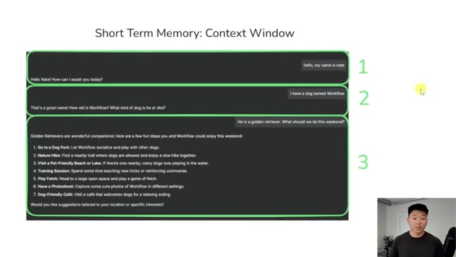
*⏱️ 00:05:13 — Une capture d'écran montrant une interface de chat avec un agent IA, illustrant la mémoire à court terme (fenêtre de contexte) à travers un échange en trois étapes numérotées, avec le présentateur visible en médaillon dans le coin inférieur droit.*

---

### ⏱️ `[00:05:32 - 00:05:55]` | Segment #13

**🔊 Audio (Transcription Intégrale Mot pour Mot en Français) :**
> Et ce serait trois interactions distinctes qui seraient stockées sous forme de paire. Ainsi, si notre fenêtre de contexte était de deux, elle se souviendrait seulement des deux interactions les plus récentes que nous avons réellement eues. Et nous avons la possibilité de modifier la longueur de cette fenêtre de contexte si nous venons effectivement au système de mémoire que nous avons configuré, qu'il s'agisse d'une mémoire simple dans NNN ou d'une mémoire Postgres ou d'une mémoire ZEP, peu importe ce que nous voulons configurer. Donc, juste ici, vous pouvez voir la longueur de la fenêtre de contexte, nous avons choisi trois.

**👁️ Analyse Visuelle d'Écran (gemini-3.5-flash-lite) :**
**Interface & Outils** : Interface graphique de configuration d'un nœud de mémoire IA (type n8n ou outil similaire).

**Contenu textuel & Code** : Texte et schémas expliquant la gestion de la fenêtre de contexte (Context Window) et des identifiants de session (Session ID).

**Action / Démonstration** : Explication visuelle de la structure des données et des paramètres de configuration de la mémoire conversationnelle.

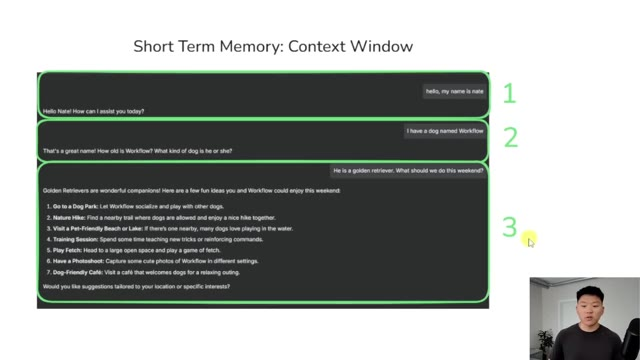
*⏱️ 00:05:38 — Schéma illustrant le fonctionnement de la mémoire à court terme d'un agent IA avec une fenêtre de contexte divisée en trois interactions numérotées.*

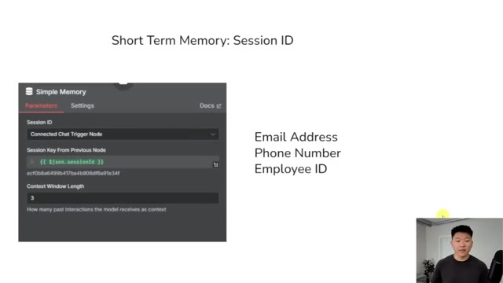
*⏱️ 00:05:44 — Interface de configuration montrant les paramètres de la mémoire simple (Session ID, clé de session, longueur de la fenêtre de contexte fixée à 3).*

---

### ⏱️ `[00:05:55 - 00:06:21]` | Segment #14

**🔊 Audio (Transcription Intégrale Mot pour Mot en Français) :**
> Mais gardez simplement à l'esprit, quelque chose que nous allons également aborder plus tard dans cette vidéo, c'est que plus la fenêtre de contexte est longue, plus il y aura de jetons traités. Ce sera donc plus coûteux, mais votre agent conservera davantage de contexte et plus d'historique de conversation. Et le prochain aspect de cette mémoire à court terme est un identifiant de session. Nous sommes donc capables de définir un identifiant de session, ce qui est plutôt cool parce que notre agent peut avoir des conversations uniques avec la personne A, la personne B, la personne C, et les garder toutes séparées dans sa mémoire.

**👁️ Analyse Visuelle d'Écran (gemini-3.5-flash-lite) :**
**Interface & Outils** : Interface graphique de configuration d'agent ou de workflow d'automatisation (style n8n ou plateforme similaire).

**Contenu textuel & Code** : Paramètres visibles : Session ID, Session Key From Previous Node ({{ $json.sessionId }}), Context Window Length réglé à 3, avec du texte explicatif 'How many past interactions the model receives as context'.

**Action / Démonstration** : Présentation des paramètres de la mémoire à court terme et de la longueur de la fenêtre de contexte d'un agent conversationnel.

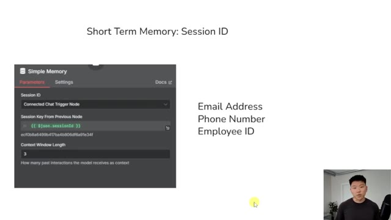
*⏱️ 00:06:02 — Capture d'écran montrant une interface de configuration de mémoire avec le titre 'Short Term Memory: Session ID', un panneau de paramètres affichant la variable de session et la longueur de la fenêtre de contexte réglée sur 3.*

---

### ⏱️ `[00:06:21 - 00:06:42]` | Segment #15

**🔊 Audio (Transcription Intégrale Mot pour Mot en Français) :**
> Donc, nous pourrions lier quelque chose comme un identifiant de session à une adresse e-mail. Donc, chaque fois qu'un agent reçoit un e-mail, il va regarder l'adresse e-mail et se dire, d'accord, laissez-moi aller voir les conversations que j'élaborées avec cette adresse e-mail, et ensuite je pourrai utiliser cet historique de conversation pour répondre à la question. C'est la même chose avec un numéro de téléphone, s'il s'agit d'un bot de SMS ou quelque chose de similaire, ou un identifiant d'employé s'il s'agit d'un agent Slack interne.

**👁️ Analyse Visuelle d'Écran (gemini-3.5-flash-lite) :**
**Interface & Outils** : Interface de type n8n ou outil d'automatisation (nœud Simple Memory) et présentation visuelle.

**Contenu textuel & Code** : Code ou expression d'accès au champ JSON : `{{ $json.sessionId }}`, et texte listant "Email Address", "Phone Number", "Employee ID".

**Action / Démonstration** : Explication de la gestion de la mémoire à court terme (Short Term Memory) basée sur l'identifiant de session lié à une adresse e-mail ou un autre identifiant.

*⏱️ 00:06:26 — Une diapositive explicative montrant un panneau de configuration "Simple Memory" avec le paramètre Session ID et Session Key configuré avec l'expression `{{ $json.sessionId }}`.*

---

### ⏱️ `[00:06:42 - 00:07:10]` | Segment #16

**🔊 Audio (Transcription Intégrale Mot pour Mot en Français) :**
> Quoi qu'il en soit, l'ID de session peut fondamentalement être rattaché à une seule personne. Et ensuite, quand nous en venon à penser à la mémoire à long terme, il s'agit d'une mémoire persistante qui survit à travers les sessions. Et dans NNN, elle peut être stockée de plusieurs manières différentes. Nous aurions un graphe utilisateur avec quelque chose comme Zep, sur lequel j'ai fait une vidéo. Et l'avantage d'un graphe utilisateur, c'est que vous pouvez voir qu'il y a un utilisateur au milieu, qui dans ce cas est John Doe, mais qu'il possède ensuite différentes relations et qu'il comprend les préférences concernant l'utilisateur, des choses comme ce qu'il aime, où il habite.

**👁️ Analyse Visuelle d'Écran (gemini-3.5-flash-lite) :**
**Interface & Outils** : Tableau blanc ou application de présentation visuelle (type Miro/Excalidraw).

**Contenu textuel & Code** : Texte 'Long Term Memory', 'Persistent information that survives across sessions', 'In n8n: Database storage, vector stores, user profiles', ainsi qu'un graphe de nœuds relationnels.
[DESC_IMAGE_2]

**Action / Démonstration** : Le présentateur zoome et détaille le graphe de données utilisateur pour expliquer le fonctionnement de la mémoire à long terme.

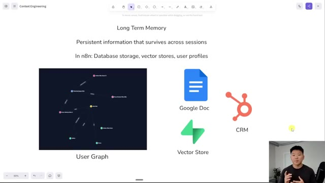
*⏱️ 00:06:49 — Diapositive montrant un schéma de 'Long Term Memory' avec des exemples de stockage dans n8n, un graphique utilisateur ('User Graph') et des icônes pour Google Doc, Vector Store et CRM.*

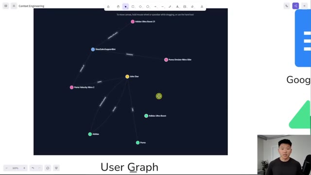
*⏱️ 00:07:03 — Gros plan sur le graphique utilisateur ('User Graph') illustrant les relations de données autour d'un utilisateur ('John Doe') et de différentes interactions de chaussures.*

---

### ⏱️ `[00:07:10 - 00:07:42]` | Segment #17

**🔊 Audio (Transcription Intégrale Mot pour Mot en Français) :**
> Que font-ils au quotidien ? Et ce sont les relations qui rendent ce graphique d'utilisateurs puissant plutôt qu'une simple série de faits aléatoires qui ne sont peut-être pas liés entre eux. Vous pouvez aussi tout simplement stocker des souvenirs dans un document Google Doc et ensuite dire à votre agent, voici un document Google Doc contenant la mémoire à long terme concernant l'utilisateur A. Si vous voulez chercher des informations, utilisez cet outil. Cela pourrait aussi être une base vectorielle, ce qui ressemblerait davantage à une recherche basée sur des fragments, ou cela pourrait aussi être quelque chose comme un CRM où, lorsqu'une demande arrive, vous allez chercher ce prospect ou ce client dans le CRM, trouver des informations à son sujet, et ensuite utiliser cela pour adapter votre réponse ou les actions que vous devez entreprendre.

**👁️ Analyse Visuelle d'Écran (gemini-3.5-flash-lite) :**
**Interface & Outils** : Interface de tableau blanc / mindmap ("Context Engineering")

**Contenu textuel & Code** : Texte "Long Term Memory", "Persistent information that survives across sessions", "In n8n: Database storage, vector stores, user profiles", ainsi que les icônes de Google Doc, Vector Store, CRM et un diagramme de réseau.

**Action / Démonstration** : Le présentateur explique les concepts de stockage de données et de mémoire persistante à l'aide d'un schéma visuel.

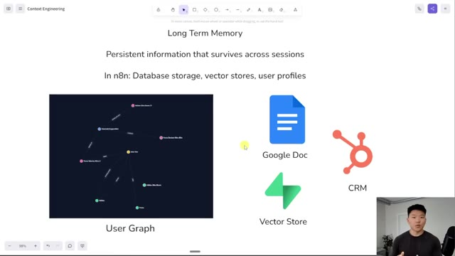
*⏱️ 00:07:18 — Schéma explicatif sur la mémoire à long terme présentant différents types de stockage : un graphe d'utilisateurs (User Graph), un Google Doc, un Vector Store et un CRM.*

---

### ⏱️ `[00:07:42 - 00:08:00]` | Segment #18

**🔊 Audio (Transcription Intégrale Mot pour Mot en Français) :**
> Très bien, passons au module trois, qui concerne l'utilisation de l'appel d'outils pour le RAG. C'est une bonne transition par rapport à la fin du module deux, car nous parlions de l'utilisation d'outils pour accéder à quelque chose comme une mémoire Google Doc, ou Supabase, ou HubSpot. Et l'appel d'outils peut aussi être appelé appel de fonctions, surtout si vous consultez une documentation sur un modèle d'IA.

**👁️ Analyse Visuelle d'Écran (gemini-3.5-flash-lite) :**
**Interface & Outils** : Application de présentation ou tableau blanc numérique (type Context Engineering / Miro)

**Contenu textuel & Code** : Texte explicatif : "Module 3: RAG Tool Calling. Tool calling, also known as function calling, enables your AI agent to interact with external systems... RAG (Retrieval-Augmented Generation) is a technique where an AI agent retrieves relevant external documents..."

**Action / Démonstration** : Le présentateur introduit le troisième module sur l'utilisation d'outils pour le RAG.

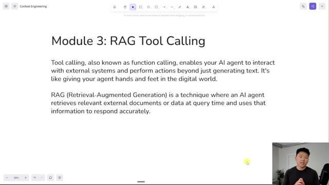
*⏱️ 00:07:47 — Une diapositive de présentation intitulée "Module 3: RAG Tool Calling" définissant le tool calling et le RAG (Retrieval-Augmented Generation), avec le présentateur incrusté en bas à droite.*

---

### ⏱️ `[00:08:01 - 00:08:38]` | Segment #19

**🔊 Audio (Transcription Intégrale Mot pour Mot en Français) :**
> Mais ce que cela nous permet de faire, c'est de permettre à notre agent d'interagir avec ces systèmes externes, d'envoyer une requête pour recevoir des données en retour, d'effectuer des actions qui vont au-delà de la simple génération de texte. C'est comme donner des mains et des pieds à votre agent dans le monde numérique. Donc, vous savez, ChatGPT tout seul, s'il n'avait aucun outil, tout ce que vous pourriez faire, c'est en quelque sorte lui parler et avoir une conversation. Mais si vous vouliez qu'il envoie un e-mail pour vous ou qu'il discute avec votre flux de travail N8N, ou quoi que ce soit d'autre, vous devriez lui donner accès à cet outil ou à cette fonction. Et puis le RAG, la génération augmentée par récupération, est une technique où les agents IA récupèrent des documents ou des données externes pertinents au moment de la requête et les utilisent pour répondre plus précisément. C'est donc l'analogie la plus simple que j'aime

**👁️ Analyse Visuelle d'Écran (gemini-3.5-flash-lite) :**
**Interface & Outils** : Logiciel de présentation ou canevas en ligne (type Context Engineering)

**Contenu textuel & Code** : Définition du Tool Calling (« enables your AI agent to interact with external systems... ») et du RAG (« Retrieval-Augmented Generation... »).

**Action / Démonstration** : Le présentateur explique les concepts théoriques du Module 3 sur le RAG et le Tool Calling.

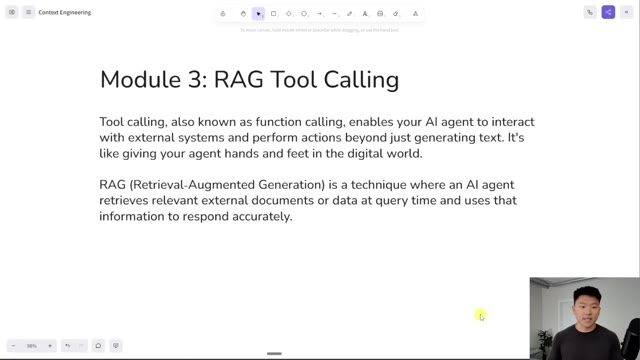
*⏱️ 00:08:10 — Une diapositive de présentation intitulée "Module 3: RAG Tool Calling" avec du texte explicatif sur le tool calling et le RAG, et une petite webcam du présentateur en bas à droite.*

---

### ⏱️ `[00:08:38 - 00:09:12]` | Segment #20

**🔊 Audio (Transcription Intégrale Mot pour Mot en Français) :**
> formulons les choses ainsi : disons que je te demande quelle est la capitale de la Californie. Si tu ne connaissais pas la capitale, tu irais probablement la chercher, ce qui correspondrait à ton aspect de RAG, chercher des informations, récupérer des informations, afin de pouvoir générer une réponse plus précise. C'est effectivement souvent associé au RAG par recherche vectorielle ou, tu sais, au RAG basé sur des segments, ce qui fait que beaucoup de gens pensent à un agent RAG et pensent immédiatement à une base de données vectorielle. Donc bien sûr, c'est le premier exemple pour lequel nous avons un RAG avec base de données vectorielle. Plus bas, ce premier flux consiste essentiellement à placer un document Google Doc depuis notre Drive dans un magasin vectoriel Supabase, puis plus haut, nous avons un agent IA et vous

**👁️ Analyse Visuelle d'Écran (gemini-3.5-flash-lite) :**
**Interface & Outils** : Application de tableau blanc / Outil de diagramme (type Miro ou Excalidraw) et workflow n8n.

**Contenu textuel & Code** : Schéma d'un agent IA connectant un chat, un modèle OpenAI, une base vectorielle Supabase et un chargeur de données.

**Action / Démonstration** : Présentation théorique du fonctionnement du RAG et de l'architecture d'un agent avec base de données vectorielle.

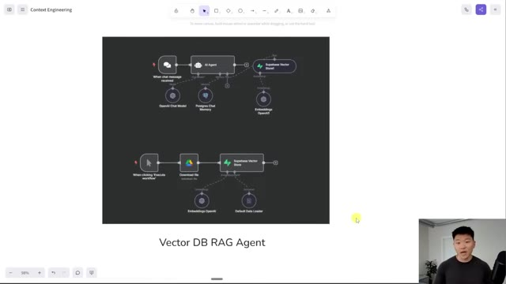
*⏱️ 00:09:04 — Diapositive illustrant un schéma de workflow 'Vector DB RAG Agent' avec n8n.*

---

### ⏱️ `[00:09:12 - 00:09:45]` | Segment #21

**🔊 Audio (Transcription Intégrale Mot pour Mot en Français) :**
> on peut voir que dans la section des outils, il est connecté à un outil appelé Supabase Vector Store. Donc maintenant, quand nous posons une question à notre agent IA, il ne va probablement pas connaître la réponse car c'est assez spécifique au document Google, mais il sait qu'il a un outil appelé Supabase Vector Store avec des informations qu'il peut utiliser pour répondre à la question de l'utilisateur avec plus de précision. Mais comme je l'ai dit, il ne s'agit pas seulement d'une base de données vectorielle. Voici un agent IA qui possède trois outils différents, Perplexity pour la recherche, Tavily pour la recherche, et OpenWeatherMap pour obtenir des informations sur la météo. Donc, évidemment, si nous demandons à cet agent IA quel temps il fait à Chicago, il ne le saura pas. Mais il sait que j'

**👁️ Analyse Visuelle d'Écran (gemini-3.5-flash-lite) :**
**Interface & Outils** : Interface de tableau blanc / outil de mindmapping et diagramme de workflow (Context Engineering).

**Contenu textuel & Code** : Schéma d'architecture d'agent IA comprenant des blocs "AI Agent", "Supabase Vector Store", "OpenAI Chat Model", et "Postgres Chat Memory".

**Action / Démonstration** : Présentation visuelle de l'architecture d'un agent IA utilisant une base de données vectorielle Supabase pour le RAG.

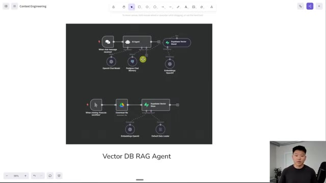
*⏱️ 00:09:21 — Un schéma montrant un workflow de type Vector DB RAG Agent avec un nœud Supabase Vector Store connecté à un agent IA.*

---

### ⏱️ `[00:09:45 - 00:10:20]` | Segment #22

**🔊 Audio (Transcription Intégrale Mot pour Mot en Français) :**
> nous avons un outil appelé Open Weather Map, que je peux utiliser, ce qui me permettra de trouver la météo. C'est la même chose pour la recherche. L'agent aura des informations sur tout ce sur quoi il a réellement été entraîné en utilisant son modèle d'IA, mais il ne connaîtra pas, vous savez, un article qui est sorti hier concernant un événement fou, il devrait faire des recherches sur le web en utilisant l'un de ses deux outils. Et puis il y a aussi l'utilisation d'outils pour obtenir des informations à partir de vos systèmes internes. Donc quelque chose comme HubSpot, pour obtenir des données de contact ou, vous savez, des données de projet, Airtable, c'est la même chose, ou Google Sheets. Et tout cela relève toujours du RAG parce que les données qui existent ici n'ont pas servi à entraîner le modèle d'IA.

**👁️ Analyse Visuelle d'Écran (gemini-3.5-flash-lite) :**
**Interface & Outils** : Interface de diagramme/workflow (type canvas) avec le présentateur visible en bas à droite.

**Contenu textuel & Code** : Diagrammes d'architecture d'agents IA intégrant divers outils et modèles (OpenRouter, Perplexity, Tavily, OpenWeatherMap, Hubspot, Airtable, Sheets).
[DESC_IMAGE_1] Présentation visuelle des différents modules et outils connectés à l'agent IA pour la recherche web.

**Action / Démonstration** : Explications face caméra et démonstration conceptuelle.

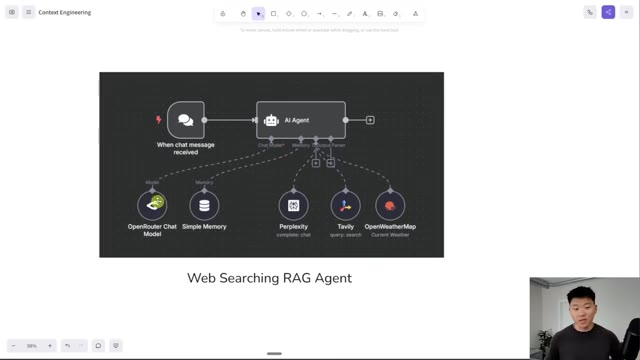
*⏱️ 00:09:54 — Schéma montrant un workflow d'agent IA nommé 'Web Searching RAG Agent' avec OpenRouter, Simple Memory, Perplexity, Tavily et OpenWeatherMap.*

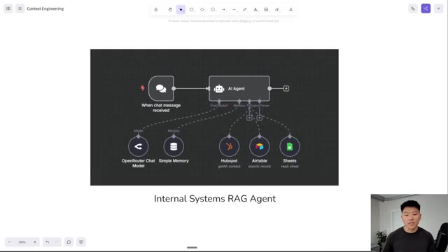
*⏱️ 00:10:11 — Schéma montrant un workflow d'agent IA nommé 'Internal Systems RAG Agent' connectant OpenRouter, Simple Memory, Hubspot, Airtable et Sheets.*

---

### ⏱️ `[00:10:20 - 00:10:55]` | Segment #23

**🔊 Audio (Transcription Intégrale Mot pour Mot en Français) :**
> et il doit aller chercher à l'extérieur pour l'obtenir. Et puis bien sûr, là où ça devient génial, c'est quand vous avez toutes sortes d'outils différents et que l'agent réalise : OK, voici ce que fait cet outil, voici ce que fait cet outil, voici à quoi cet outil a accès, lequel est-ce que je dois utiliser maintenant ? Et c'est là que vous avez besoin d'une bonne stratégie de "prompt engineering" afin de vous assurer que votre agent comprend cela. Donc, pour mettre cela en perspective très rapidement, avec un cas d'utilisation qui n'a pas de recherche vectorielle, disons que je parle à mon assistant ultime et que je dis : peux-tu envoyer un e-mail à Dexter Morgan avec un article de blog sur le récent rapport de résultats de NVIDIA ? Donc, ce qui se passerait ici, c'est que le premier élément de contexte est le déclencheur Telegram qui lance le flux de travail. Donc, nous récupérons

**👁️ Analyse Visuelle d'Écran (gemini-3.5-flash-lite) :**
**Interface & Outils** : Interface de tableau de bord ou éditeur de diagramme de type n8n/canvas.

**Contenu textuel & Code** : Diagrammes d'architecture d'agent IA avec déclencheurs, modèles de chat, mémoires et outils connectés. Le texte en bas de l'image 2 affiche : "Can you send an email to Dexter Morgan with a blog post about NVIDIA's recent earnings report?".

**Action / Démonstration** : Présentation visuelle de la structure d'un agent IA et de sa sélection d'outils et sous-agents pour accomplir des tâches complexes.

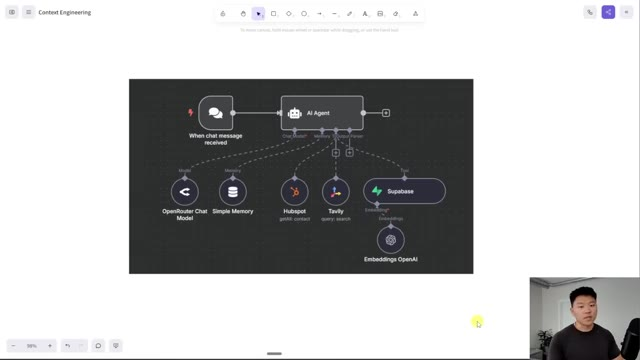
*⏱️ 00:10:29 — Un diagramme de workflow montrant un Agent IA relié à divers outils (OpenRouter, Simple Memory, Hubspot, Tavily, Supabase) sur fond sombre.*

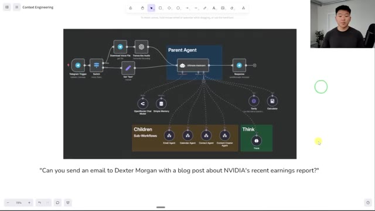
*⏱️ 00:10:38 — Un diagramme de workflow plus complexe montrant un Agent Parent avec des sous-agents (Email, Calendar, Contact, Content Creator) et une invite textuelle en bas.*

---

### ⏱️ `[00:10:55 - 00:11:28]` | Segment #24

**🔊 Audio (Transcription Intégrale Mot pour Mot en Français) :**
> message de Telegram et ensuite l'agent va essentiellement consulter son invite système qui se trouve à l'intérieur de l'assistant ultime, il va lire l'invite système, il va ensuite utiliser son modèle de chat afin de commencer à traiter qu'est-ce que je fais ensuite à partir de là, il décide, ok, la première chose que je dois faire est en fait de créer un article de blog sur le récent rapport de résultats de Nvidia, donc je vais contacter mon agent créateur de contenu qui utilise le RAG parce que j'ai besoin d'un article de blog, donc l'agent créateur de contenu crée cet article de blog et ensuite nous revenons à l'assistant ultime qui doit alors réfléchir à la suite, puis il réalise, ok, je vais envoyer ceci sous forme d'e-mail à Dexter Morgan, mais je n'ai pas Dexter

**👁️ Analyse Visuelle d'Écran (gemini-3.5-flash-lite) :**
**Interface & Outils** : Application de diagramme de workflow type n8n ou équivalent avec panneau d'outils d'édition graphique à gauche.

**Contenu textuel & Code** : Workflow d'agent IA nommé 'Parent Agent' connecté à Telegram, OpenRouter Chat Model, Simple Memory, Tavily, Calculator, et des sous-workflows enfants (Email Agent, Calendar Agent, Contact Agent, Content Creator Agent, Think). Texte affiché en bas : "Can you send an email to Dexter Morgan with a blog post about NVIDIA's recent earnings report?".

**Action / Démonstration** : Visualisation et explication du flux de traitement du message Telegram et du déclenchement de l'agent parent.

*⏱️ 00:11:03 — Schéma de workflow montrant un agent parent Telegram connecté à divers sous-agents et modèles (OpenRouter, Mémoire, Outils, etc.) avec une invite textuelle en bas.*

---

### ⏱️ `[00:11:28 - 00:12:01]` | Segment #25

**🔊 Audio (Transcription Intégrale Mot pour Mot en Français) :**
> L'e-mail de Morgan. Je vais donc contacter mon agent pour obtenir plus de RAG. L'agent de contact revient ensuite avec l'adresse e-mail. L'assistant ultime dit, d'accord, maintenant je suis paré. Je peux effectivement aller de l'avant et envoyer cet e-mail parce que j'ai les deux éléments dont j'avais besoin, à savoir l'article de blog et les coordonnées de Dexter Morgan. Passant au module quatre, je voulais faire une brève section sur la récupération basée sur des segments car c'est extrêmement important, mais c'est un sujet qui comporte de nombreuses complexités sur lesquelles il est important de réfléchir. La récupération basée sur des segments, qui utilise généralement une base de données vectorielle avec des intégrations et tout le reste, est donc une technique où de grands documents sont découpés en morceaux gérables.

**👁️ Analyse Visuelle d'Écran (gemini-3.5-flash-lite) :**
**Interface & Outils** : Tableau blanc interactif / Application de mindmapping et de diagrammes (Context Engineering)

**Contenu textuel & Code** : Schéma d'architecture d'agent avec des flux connectant Telegram Trigger, Parent Agent, et divers sous-agents de communication.

**Action / Démonstration** : Présentation du workflow global d'automatisation et des interactions entre les différents agents spécialisés.

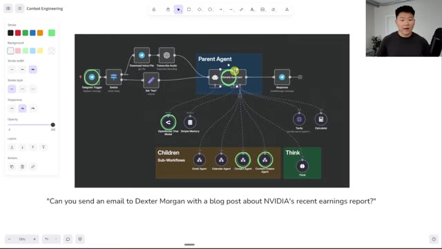
*⏱️ 00:11:37 — Schéma de workflow d'agents IA complexes montrant un nœud parent relié à plusieurs sous-agents (Email, Calendar, Contact Agent).*

---

### ⏱️ `[00:12:01 - 00:12:36]` | Segment #26

**🔊 Audio (Transcription Intégrale Mot pour Mot en Français) :**
> des morceaux qui peuvent être recherchés et récupérés plus efficacement. Maintenant, c'est important parce que les agents IA dotés de différents modèles d'IA ont des fenêtres de contexte différentes et parfois celles-ci sont limitées. Vous ne pourriez donc pas déposer un PDF de 65 pages chez votre agent et vous attendre à ce qu'il soit capable de tout voir, de tout lire et de tout traiter en même temps. Mais si nous les découpons en morceaux et que nous les plaçons dans une base de données vectorielle, l'agent sera capable de les parcourir très rapidement et facilement par recherche sémantique et de récupérer les morceaux dont il a besoin. Le problème ici, c'est qu'avec la récupération basée sur des morceaux, nous perdons les relations et le contexte de l'ensemble du document. Donc si je déposais

**👁️ Analyse Visuelle d'Écran (gemini-3.5-flash-lite) :**
**Interface & Outils** : Application de tableau blanc virtuel ou outil de prise de notes (type Excalidraw ou similaire).

**Contenu textuel & Code** : Texte explicatif : "Module 4: Chunk Based Retrieval", décrivant la technique de découpage des documents, les limites des fenêtres de contexte des agents IA, le stockage des "chunks" pour la recherche sémantique, et les défis liés à la perte de contexte global.

**Action / Démonstration** : Présentation théorique illustrant le concept de "Chunking" par le texte à l'écran, synchronisée avec les explications orales du présentateur.

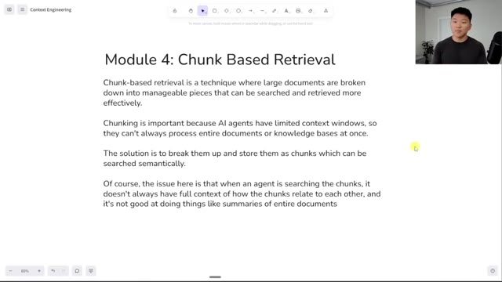
*⏱️ 00:12:10 — Une diapositive de présentation sur le "Chunk Based Retrieval" expliquant la nécessité de segmenter les documents pour les agents IA en raison des limites de fenêtre de contexte.*

---

### ⏱️ `[00:12:36 - 00:13:09]` | Segment #27

**🔊 Audio (Transcription Intégrale Mot pour Mot en Français) :**
> Dans un PDF de 65 pages, il a été découpé en fragments et mis dans une base de données, et j'ai dit : « Hé, M. l'agent IA, peux-tu résumer l'ensemble de ce PDF ? » Il ne ferait pas du très bon travail. Il y a cependant certaines choses que nous pouvons faire pour rendre notre récupération basée sur des fragments un peu plus précise et l'adapter à nos cas d'usage. Alors laissez-moi me plonger là-dedans très rapidement. Avant d'en arriver là, je voulais juste expliquer visuellement comment cela fonctionne. Donc, voici notre PDF de 65 pages. Nous le découpons en un tas de morceaux, nous le faisons passer par un modèle d'embeddings pour qu'il soit transformé en une représentation numérique de ce fragment, et ensuite les fragments sont placés dans l'espace multidimensionnel en fonction de leur sens.

**👁️ Analyse Visuelle d'Écran (gemini-3.5-flash-lite) :**
**Interface & Outils** : Application de tableau blanc virtuel ou de présentation (type Miro ou FigJam).

**Contenu textuel & Code** : Le texte explique que les grands documents sont divisés en morceaux pour pallier les limites de la fenêtre de contexte des agents IA, tout en soulignant la limite de cette technique pour résumer des documents complets.

**Action / Démonstration** : Le présentateur illustre théoriquement le problème de la perte de contexte global lors de l'utilisation de la récupération par segments (RAG).

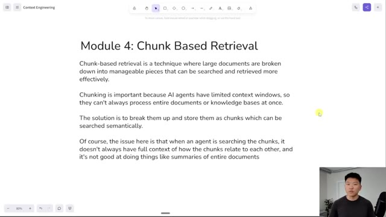
*⏱️ 00:12:44 — Une diapositive de présentation intitulée « Module 4: Chunk Based Retrieval » expliquant le concept de découpage (chunking) de documents pour les agents IA.*

---

### ⏱️ `[00:13:09 - 00:13:42]` | Segment #28

**🔊 Audio (Transcription Intégrale Mot pour Mot en Français) :**
> Donc, disons que ce morceau ici même parlait d'arbres. Il serait placé ici. Ce morceau parlait de chiens, il serait placé par ici, et puis ce morceau parlait de fruits, il est placé ici. Donc, à l'avenir, si nous insérons d'autres morceaux et que nous insérons un PDF entier sur les chiens, ils seront tous près de cet autre morceau qui concerne les chiens. Et nous pouvons utiliser des choses comme les métadonnées, qui sont simplement des données sur les données, pour rendre le contexte des morceaux plus riche. Donc, dans cet exemple, nous insérons des transcriptions d'une vidéo YouTube. Nous avons donc la vidéo YouTube A, la vidéo YouTube B et la vidéo YouTube C. Si nous insérons

**👁️ Analyse Visuelle d'Écran (gemini-3.5-flash-lite) :**
**Interface & Outils** : Excalidraw (tableau blanc virtuel)

**Contenu textuel & Code** : Diagramme de flux montrant le processus : "Text" -> "Chunks" -> "Embeddings Model" -> "Vectors" (représentés par des points sur un plan).

**Action / Démonstration** : Le présentateur utilise le tableau pour visualiser comment le contenu textuel est découpé en segments puis converti en représentations vectorielles dans un espace sémantique.

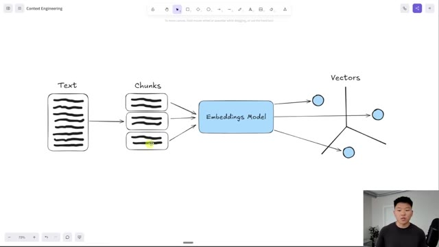
*⏱️ 00:13:17 — Un schéma explicatif illustrant le processus de transformation de texte en vecteurs via un modèle d'embedding, affiché sur un tableau blanc numérique.*

---

### ⏱️ `[00:13:42 - 00:14:17]` | Segment #29

**🔊 Audio (Transcription Intégrale Mot pour Mot en Français) :**
> tous les chunks dans la base de données vectorielle, nous ne saurions pas vraiment quel chunk provient de quelle vidéo originale. Mais si nous ajoutons des métadonnées comme, d'accord, ce chunk, le titre de la vidéo était ceci, l'URL de la vidéo était ceci, et l'horodatage de ce chunk spécifique dans l'ensemble de la vidéo est ceci. Et ensuite, lorsque notre agent récupère réellement les chunks, il sait exactement de quelle vidéo, de quelle URL, et d'exactement quel moment dans cette vidéo cela provient. C'est donc un moyen de vraiment enrichir nos données, notre récupération et notre génération de réponses avec nos agents IA en utilisant quelque chose comme des métadonnées. Il y a aussi d'autres choses que vous pouvez faire avec la recherche basée sur les chunks comme le ré-ordonnancement ou

**👁️ Analyse Visuelle d'Écran (gemini-3.5-flash-lite) :**
**Interface & Outils** : Tableau blanc virtuel (type Excalidraw) avec les outils de dessin sur le côté et en haut.

**Contenu textuel & Code** : Schéma montrant trois documents (A, B, C) reliés par des flèches en pointillés à un espace vectoriel, avec un vecteur mis en avant associé aux métadonnées : Title, URL, Timestamp.

**Action / Démonstration** : Le présentateur explique l'importance d'associer des métadonnées (titre, URL, horodatage) aux chunks de la base de données vectorielle pour retrouver l'origine exacte des informations.

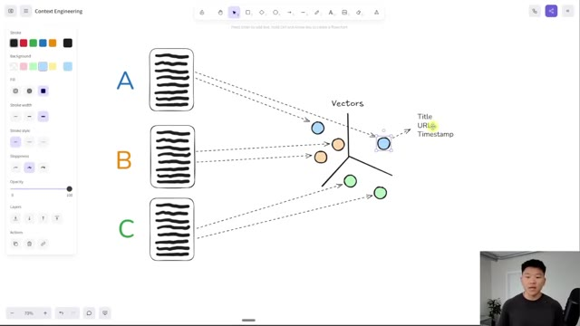
*⏱️ 00:13:50 — Schéma explicatif sur un tableau blanc virtuel montrant la transformation de documents (A, B, C) en vecteurs avec l'ajout de métadonnées (Title, URL, Timestamp).*

---

### ⏱️ `[00:14:17 - 00:14:52]` | Segment #30

**🔊 Audio (Transcription Intégrale Mot pour Mot en Français) :**
> ...le score, parce que lorsque vous récupérez les fragments les plus pertinents, il y aura généralement un score de pertinence. Vous pouvez donc avoir un flux de travail où vous récupérez un ensemble de fragments, puis vous ne conservez que ceux qui ont un score de pertinence supérieur à environ 0,75 ou quelque chose comme ça. Ou alors, vous pourriez utiliser un re-ranker. Je vais donc vous montrer une visualisation très rapide de ce que

**👁️ Analyse Visuelle d'Écran (gemini-3.5-flash-lite) :**
**Interface & Outils** : Tableau blanc interactif (outil de mind-mapping/dessin type Excalidraw) et incrustation vidéo du présentateur en bas à droite.

**Contenu textuel & Code** : Schéma avec les blocs : "What do I do if my ball goes out of bounds?", "Embeddings Model", un nuage de points vectoriels, des fragments de texte et un bloc "RAG Agent" menant à "Answer".

**Action / Démonstration** : Le présentateur explique visuellement le processus de recherche et de filtrage des fragments pertinents pour alimenter le modèle d'IA.

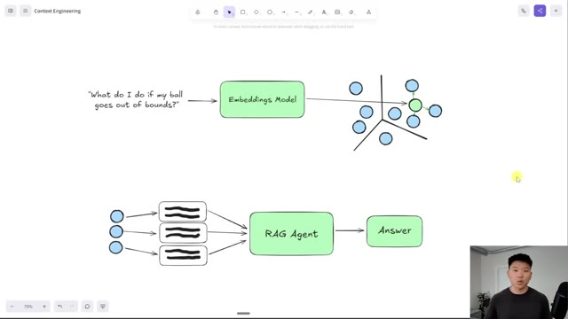
*⏱️ 00:14:26 — Schéma explicatif sur un tableau blanc virtuel montrant le fonctionnement du RAG (Retrieval-Augmented Generation) avec la transformation d'une question en embeddings et le filtrage des fragments textuels par un agent RAG.*

---

### ⏱️ `[00:14:52 - 00:15:29]` | Segment #31

**🔊 Audio (Transcription Intégrale Mot pour Mot en Français) :**
> au lieu de récupérer seulement trois blocs, nous pourrions en récupérer 10, puis nous pourrions tous les transmettre à un re-ranker. Il va évaluer automatiquement lesquels sont les plus pertinents, puis conserver les trois meilleurs et enfin les transmettre à l'agent. Et on peut dire que vous obtiendrez des résultats plus précis. Quoi qu'il en soit, voici le système réel que j'ai utilisé pour cet agent RAG de transcription YouTube. Et je voulais juste vous montrer, les gars, c'est un peu le pipeline que nous avons, où nous récupérons les transcriptions, nous récupérons les horodatages et tout ce dont nous avons besoin, et nous injectons cela dans une base de données vectorielle. Et ce que nous pouvons faire, juste ici à l'intérieur, dans ce chargeur de données par défaut, c'est là que nous pouvons charger les métadonnées que nous voulons, comme le titre de la vidéo, l'horodatage et l'URL de la vidéo. Très bien, passons au module cinq,

**👁️ Analyse Visuelle d'Écran (gemini-3.5-flash-lite) :**
**Interface & Outils** : Tableau blanc numérique / outil de mindmapping et interface de workflow d'automatisation (n8n).

**Contenu textuel & Code** : Schéma avec blocs de données, module 'Reranker', 'RAG Agent' et 'Answer' ; workflows d'automatisation avec flux de données et paramètres de nœuds.

**Action / Démonstration** : Présentation conceptuelle et technique du filtrage de données par un re-ranker pour optimiser le contexte transmis à l'agent RAG.

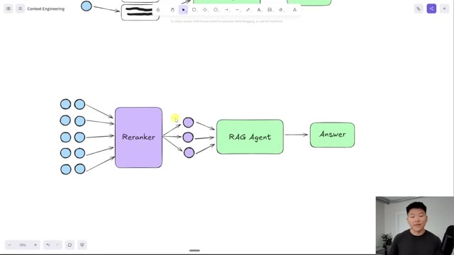
*⏱️ 00:15:01 — Schéma explicatif sur fond blanc illustrant le fonctionnement d'un re-ranker dans un système RAG, passant de 10 blocs de données à 3 blocs filtrés avant l'agent RAG.*

---

### ⏱️ `[00:15:29 - 00:16:03]` | Segment #32

**🔊 Audio (Transcription Intégrale Mot pour Mot en Français) :**
> nous avons des techniques de résumé. Le résumé est le processus qui consiste à condenser de grandes quantités d'informations en un résumé concis et pertinent qui peut être traité efficacement par le modèle d'IA. C'est un peu similaire à la théorie du découpage en blocs parce que, vous savez, nous ne voulons pas injecter trop d'informations dans un modèle d'IA. C'est vraiment important non seulement quand nous pensons à la fenêtre de contexte, mais aussi du point de vue des coûts, car plus le modèle d'IA reçoit de caractères, plus il doit traiter de jetons, ce qui signifie que cela va vous coûter plus cher. L'idée ici est donc que si nous pouvons prendre un gros morceau de texte qui contient de bonnes informations dont nous avons besoin, mais simplement le résumer en y extrayant les points clés, cela

**👁️ Analyse Visuelle d'Écran (gemini-3.5-flash-lite) :**
**Interface & Outils** : Application de présentation / Document numérique (type tableau blanc ou notes).

**Contenu textuel & Code** : Texte à l'écran : "Module 5: Summarization Techniques. Summarization is the process of condensing large amounts of information into a concise, relevant summary that can be efficiently processed by the AI agent. Summarization is important because agents have limited memory..."

**Action / Démonstration** : Le présentateur explique les concepts théoriques du résumé et de l'optimisation de la fenêtre de contexte.

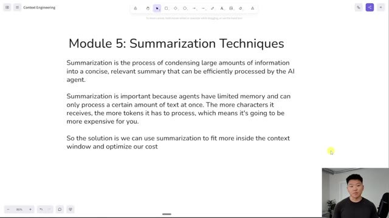
*⏱️ 00:15:37 — Une diapositive de présentation intitulée "Module 5: Summarization Techniques" définissant le résumé pour les agents IA et l'optimisation des coûts, avec une petite fenêtre vidéo du présentateur en bas à droite.*

---

### ⏱️ `[00:16:03 - 00:16:39]` | Segment #33

**🔊 Audio (Transcription Intégrale Mot pour Mot en Français) :**
> cela aide toujours l'agent à créer une meilleure réponse et cela va optimiser nos coûts. Donc un exemple sympa de cela est une vidéo que j'ai faite récemment avec Zep memory, qui est comme un graphe relationnel utilisateur pour la mémoire, et ce que vous pouvez voir, c'est que si nous utilisons Zep memory de manière native comme ça, cela extrayait tellement de contexte, et une grande partie n'était même pas si pertinente, et nous gaspillions tellement de tokens à chaque fois. Donc ce que j'ai fait, c'est que j'ai extrait la fenêtre de contexte et le graphe utilisateur séparément via une requête HTTP. Et j'ai pu contrôler le fait de garder les pertinents, de n'en garder que quelques-uns et de les injecter dans l'agent IA. Et cela a traité beaucoup moins de tokens et a réduit le coût de manière significative.

**👁️ Analyse Visuelle d'Écran (gemini-3.5-flash-lite) :**
**Interface & Outils** : Tableau blanc collaboratif (type Miro ou équivalent) avec des schémas de workflows.

**Contenu textuel & Code** : Schémas de workflows intitulés 'Zep Memory' et 'Zep Memory (HTTP)' comprenant des blocs Telegram Trigger, AI Agent, GPT 4o-mini, Zep et des nœuds de code.

**Action / Démonstration** : Présentation et explication visuelle des architectures de flux de travail intégrant la mémoire contextuelle Zep.

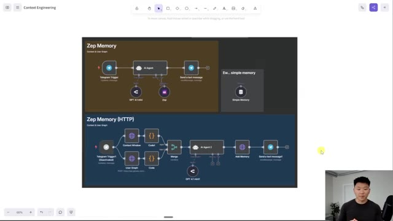
*⏱️ 00:16:12 — Un diagramme de workflow interactif sur tableau blanc numérique illustrant l'intégration de Zep Memory avec des déclencheurs Telegram et des agents IA.*

---

### ⏱️ `[00:16:39 - 00:16:59]` | Segment #34

**🔊 Audio (Transcription Intégrale Mot pour Mot en Français) :**
> Une autre façon sympa d'envisager la résume, c'est que, tu sais, ça n'a pas besoin d'être une base de données vectorielle, mais dans ce cas, disons que c'en est une. Ce que tu fais ici, c'est que tu donnes à l'agent accès à la base de données vectorielle et tout ce qu'il récupère est traité par le modèle d'IA, ce qui pourrait faire des tonnes de jetons et cela pourrait devenir coûteux. Mais ici, sur la droite, il y a une chose sympa que tu peux faire où tu vas faire du RAG dans un sous-flux de travail.

**👁️ Analyse Visuelle d'Écran (gemini-3.5-flash-lite) :**
**Interface & Outils** : Application de tableau blanc / canvas interactif (style Miro ou Excalidraw) pour l'ingénierie de contexte.

**Contenu textuel & Code** : Diagrammes de flux montrant des nœuds "AI Agent", "When chat message received", "OpenRouter Chat Model", "Simple Memory", "Supabase" et "Embeddings OpenAI".

**Action / Démonstration** : Le présentateur explique l'architecture d'un agent IA utilisant une base de données vectorielle et gérant des tokens.

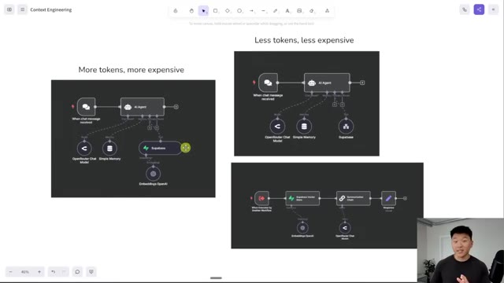
*⏱️ 00:16:44 — Vue globale d'un canvas (Context Engineering) présentant plusieurs schémas de workflows d'agents IA, avec le présentateur en bas à droite.*

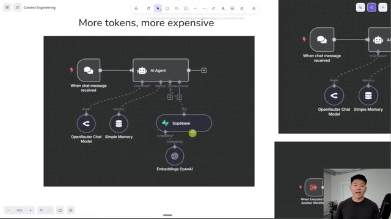
*⏱️ 00:16:49 — Zoom progressif sur le schéma de workflow "More tokens, more expensive" montrant un agent IA relié à OpenRouter, une mémoire simple et Supabase.*

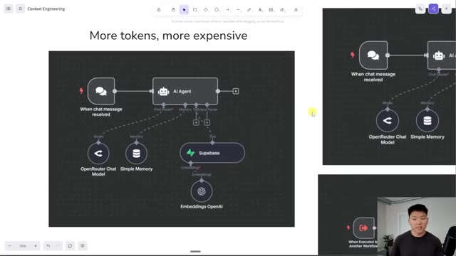
*⏱️ 00:16:54 — Gros plan centré sur le diagramme de workflow illustrant l'intégration d'un agent IA avec un modèle d'embedding OpenAI et Supabase.*

---

### ⏱️ `[00:17:00 - 00:17:20]` | Segment #35

**🔊 Audio (Transcription Intégrale Mot pour Mot en Français) :**
> Donc, même théorie, l'agent va utiliser son outil super-basé pour obtenir des informations, mais plutôt que d'interroger simplement l'outil et d'obtenir le résultat brut, il va interroger un sous-flux de travail que nous avons construit, qui interroge ensuite l'outil, l'injecte dans une chaîne de résumé, le rend plus concis, et renvoie ensuite ce résumé à l'agent principal. Et pour l'essentiel, cela conserve toutes les mêmes informations importantes et fait son travail à moindre coût.

**👁️ Analyse Visuelle d'Écran (gemini-3.5-flash-lite) :**
**Interface & Outils** : Interface de tableau blanc / outil de workflow visuel (type n8n ou canvas personnalisé).

**Contenu textuel & Code** : Schémas d'architecture de flux d'IA avec nœuds 'AI Agent', 'OpenRouter Chat Model', 'Supabase Vector Store' et 'Summarization Chain'.

**Action / Démonstration** : Le présentateur explique l'architecture d'un sous-flux de travail qui interroge Supabase et injecte les données dans une chaîne de résumé.

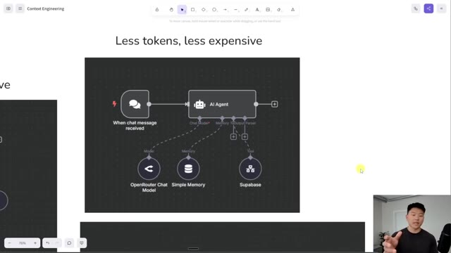
*⏱️ 00:17:05 — Vue d'un diagramme de workflow montrant un agent IA connecté à OpenRouter, Simple Memory et Supabase, avec le titre 'Less tokens, less expensive'.*

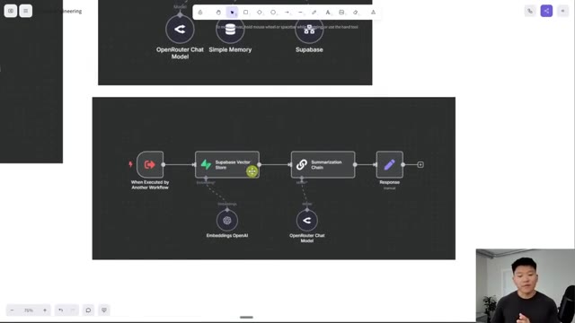
*⏱️ 00:17:10 — Gros plan sur un sous-flux de travail secondaire montrant un connecteur Supabase Vector Store relié à une chaîne de résumé (Summarization Chain) et une réponse.*

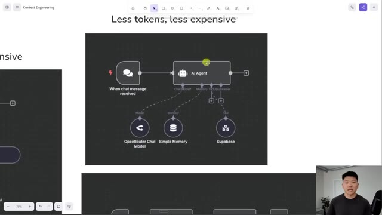
*⏱️ 00:17:15 — Retour au diagramme principal avec l'agent IA, le curseur pointant sur le nœud principal de l'agent.*

---

### ⏱️ `[00:17:21 - 00:17:43]` | Segment #36

**🔊 Audio (Transcription Intégrale Mot pour Mot en Français) :**
> Et enfin, ce qui est probablement le module le plus important, concerne l'état d'esprit. Ce sont donc les cinq points que je voulais aborder, dont je me suis surpris à parler beaucoup dans mes communautés et tout ça, lorsque je répondais à des questions sur l'ingénierie du contexte. Le premier est de commencer avec la fin en tête. Si vous avez une idée de haut niveau du système que vous voulez construire, vous savez généralement ce que l'agent fera et quel type de requêtes il recevra.

**👁️ Analyse Visuelle d'Écran (gemini-3.5-flash-lite) :**
**Interface & Outils** : Application de notes / tableau blanc numérique (type Canva ou Obsidian) et incrustation vidéo.

**Contenu textuel & Code** : Texte du 'Module 6: The Mindset' détaillant cinq principes sur l'ingénierie du contexte (Begin with the end in mind, Design your data pipeline, Ensure data accuracy, Optimize context windows, Embrace AI specialization).

**Action / Démonstration** : Présentation des cinq points clés du module sur l'état d'esprit (mindset) appliqué à l'ingénierie du contexte.

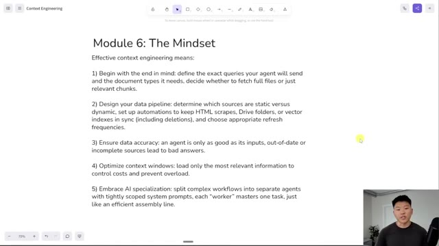
*⏱️ 00:17:26 — Capture d'écran montrant une page de notes intitulée 'Module 6: The Mindset' avec cinq points clés sur l'ingénierie du contexte, avec la vidéo du présentateur en bas à droite.*

---

### ⏱️ `[00:17:43 - 00:18:16]` | Segment #37

**🔊 Audio (Transcription Intégrale Mot pour Mot en Français) :**
> Et si vous pouvez définir les requêtes exactes que votre agent va envoyer et les types de documents dont il a besoin, cela vous aidera à décider s'il doit récupérer des fichiers complets ou si une recherche sémantique par morceaux pertinents est suffisante ou non. Et lorsque vous comprenez le type de bases de connaissances que l'agent aura réellement besoin d'utiliser, cela va vous aider à configurer votre pipeline au début, ce qui est la base de tout, de comment vais-je réellement intégrer ces données dans quelque chose à quoi mon agent peut parler ? Dois-je lui donner le document complet ? Dois-je le découper en morceaux ? Que dois-je faire ici ? Donc avant de construire cette base de données, cette source de vérité, pensez à la manière dont l'agent va l'utiliser. Souvent, ce ne sera pas juste une seule base de données. Peut-être

**👁️ Analyse Visuelle d'Écran (gemini-3.5-flash-lite) :**
**Interface & Outils** : Logiciel de présentation ou de prise de notes (type Notion, Miro ou PDF viewer).

**Contenu textuel & Code** : Texte listant 5 principes clés sur l'ingénierie du contexte : 1) Begin with the end in mind, 2) Design your data pipeline, 3) Ensure data accuracy, 4) Optimize context windows, 5) Embrace AI specialization.

**Action / Démonstration** : Le présentateur explique les concepts fondamentaux de la conception de pipelines de données et de l'optimisation des contextes pour les agents IA.

*⏱️ 00:17:51 — Une diapositive intitulée "Module 6: The Mindset" détaillant les principes de l'ingénierie du contexte, avec le présentateur visible en incrustation vidéo dans le coin inférieur droit.*

---

### ⏱️ `[00:18:16 - 00:18:52]` | Segment #38

**🔊 Audio (Transcription Intégrale Mot pour Mot en Français) :**
> ce sont de multiples banques de vecteurs ou peut-être de multiples fichiers et dossiers. Le deuxième point concernerait la conception de votre pipeline de données. Ces pipelines de données sont tellement importants. Vous devez penser à toutes les sources que vous allez avoir. Celles-ci vont-elles être statiques ou dynamiques ? Sont-elles mises à jour fréquemment ? Est-ce que je les supprime fréquemment ? Comment est-ce que je configure une automatisation pour garder tout cela pertinent ? Si votre agent examine un site web scrapé, à quelle fréquence le site web est-il mis à jour ? À quelle fréquence devons-nous relancer l'automatisation pour récupérer le site web ? Même chose pour vos dossiers de bases de données, vos bases de données vectorielles. Vous devez penser à votre fréquence de rafraîchissement et à ce qui se passe en cas de suppressions. Et cela mène très bien au point suivant, qui est de garantir l'exactitude des données.

**👁️ Analyse Visuelle d'Écran (gemini-3.5-flash-lite) :**
**Interface & Outils** : Logiciel de présentation ou tableau blanc numérique (ex: Canva, Notion ou outil similaire) avec encadré vidéo.

**Contenu textuel & Code** : Texte listant cinq points clés sur l'ingénierie du contexte, incluant la conception des pipelines de données, l'exactitude des données et l'optimisation des fenêtres de contexte.

**Action / Démonstration** : Le présentateur explique les différents points affichés à l'écran concernant l'état d'esprit à adopter pour l'ingénierie du contexte.

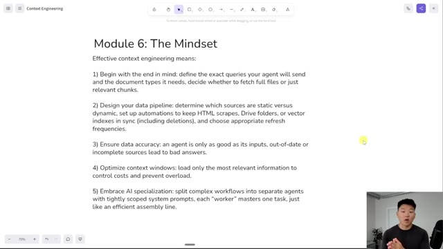
*⏱️ 00:18:25 — Une diapositive de présentation intitulée "Module 6: The Mindset" détaillant cinq principes fondamentaux pour l'ingénierie du contexte, avec le présentateur visible en incrustation vidéo dans le coin inférieur droit.*

---

### ⏱️ `[00:18:52 - 00:19:17]` | Segment #39

**🔊 Audio (Transcription Intégrale Mot pour Mot en Français) :**
> Toute la raison d'être de la mise en place de l'ingénierie du contexte et de nos systèmes RAG est que l'agent utilise ses outils, récupère des informations pertinentes, actualisées et précises, puis répond. Donc, si vos bases de connaissances sont obsolètes ou inexactes et que l'agent les récupère, il répondra lui aussi de manière inexacte. Mais en réalité, le pipeline de données est tellement, tellement important. C'est fondamentalement la base pour standardiser vos données, les préparer à l'entrée, puis les télécharger au bon endroit.

**👁️ Analyse Visuelle d'Écran (gemini-3.5-flash-lite) :**
**Interface & Outils** : Application de prise de notes ou tableau blanc virtuel affichant une liste à puces.

**Contenu textuel & Code** : Texte listant 5 points clés sur l'ingénierie du contexte : 1) Begin with the end in mind, 2) Design your data pipeline, 3) Ensure data accuracy, 4) Optimize context windows, 5) Embrace AI specialization.

**Action / Démonstration** : Le présentateur explique les principes fondamentaux de l'état d'esprit à adopter pour concevoir des agents IA efficaces et précis.

*⏱️ 00:18:58 — Diapositive de présentation intitulée "Module 6: The Mindset" détaillant les principes de l'ingénierie du contexte, avec le présentateur visible en médaillon dans le coin inférieur droit.*

---

### ⏱️ `[00:19:17 - 00:19:40]` | Segment #40

**🔊 Audio (Transcription Intégrale Mot pour Mot en Français) :**
> Et c'est là que vous avez beaucoup de contrôle, car ce que vous voulez faire, c'est avoir des entrées prévisibles, une standardisation prévisible, puis un chargement prévisible dans une base de données. Le point numéro quatre est d'optimiser les fenêtres de contexte. Ne chargez que les informations les plus pertinentes pour contrôler les coûts et éviter la surcharge. Si vous passez un examen d'histoire et que vous avez besoin de chercher des informations sur la Première Guerre mondiale, vous auriez votre antisèche avec des étiquettes claires.

**👁️ Analyse Visuelle d'Écran (gemini-3.5-flash-lite) :**
**Interface & Outils** : Application de prise de notes ou outil de présentation en ligne (type Canvas).

**Contenu textuel & Code** : Texte du "Module 6: The Mindset" détaillant 5 principes d'ingénierie de contexte (1) Begin with the end in mind, 2) Design your data pipeline, 3) Ensure data accuracy, 4) Optimize context windows, 5) Embrace AI specialization).

**Action / Démonstration** : Le présentateur explique les principes fondamentaux de l'ingénierie du contexte et commente le point 4 affiché à l'écran.

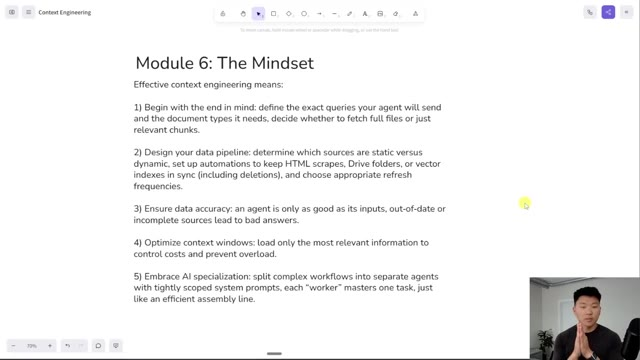
*⏱️ 00:19:23 — Une diapositive montrant le Module 6 : The Mindset avec une liste de 5 points clés sur l'ingénierie du contexte, avec la vidéo du présentateur en médaillon dans le coin inférieur droit.*

---

### ⏱️ `[00:19:40 - 00:20:05]` | Segment #41

**🔊 Audio (Transcription Intégrale Mot pour Mot en Français) :**
> Et vous iriez littéralement tout droit à la petite section sur la Première Guerre mondiale. Il n'y a aucune raison que vous commenciez par le début de toute votre antisèche, que vous lisiez tout de bout en bout, et qu'ensuite vous arriviez enfin à ce dont vous avez réellement besoin. Donc, si vous pouvez mettre en place des systèmes pour vous assurer que votre agent ne regarde et ne formule des requêtes que pour les informations les plus pertinentes en fonction de cette saisie utilisateur, alors vous obtenez des exécutions plus rapides, des résultats de plus haute qualité, des résultats plus cohérents, et aussi, plus important encore, des résultats moins coûteux.

**👁️ Analyse Visuelle d'Écran (gemini-3.5-flash-lite) :**
**Interface & Outils** : Application de prise de notes ou tableau blanc numérique (ex: Notion, Miro ou application similaire) avec la vidéo du présentateur en incrustation en bas à droite.

**Contenu textuel & Code** : Texte listant les principes de l'ingénierie de contexte (1) Begin with the end in mind, 2) Design your data pipeline, 3) Ensure data accuracy, 4) Optimize context windows, 5) Embrace AI specialization).

**Action / Démonstration** : Le présentateur explique les concepts théoriques affichés à l'écran concernant l'état d'esprit et l'ingénierie de contexte pour les agents IA.

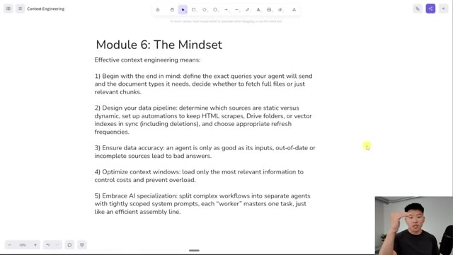
*⏱️ 00:19:46 — Une page de présentation intitulée 'Module 6: The Mindset' avec une liste de 5 points clés sur l'ingénierie de contexte.*

---

### ⏱️ `[00:20:05 - 00:20:24]` | Segment #42

**🔊 Audio (Transcription Intégrale Mot pour Mot en Français) :**
> Et puis le numéro cinq, qui selon moi est vraiment important, est d'adopter la spécialisation en IA. Chaque fois que j'ai un agent IA ou un modèle d'IA, dans un certain aspect d'une automatisation, j'essaie de me dire, comment puis-je faire en sorte que cette IA ne fasse qu'un seul travail vraiment bien ? C'est cool que vous puissiez avoir des agents IA qui font des tonnes de tâches différentes et gèrent le tout en un seul, comme une sorte de super agent.

**👁️ Analyse Visuelle d'Écran (gemini-3.5-flash-lite) :**
**Interface & Outils** : Interface de prise de notes ou tableau blanc virtuel (type Canvas) avec une vue incrustée du présentateur en bas à droite.

**Contenu textuel & Code** : Texte listant 5 principes d'ingénierie du contexte : 1) Begin with the end in mind, 2) Design your data pipeline, 3) Ensure data accuracy, 4) Optimize context windows, 5) Embrace AI specialization (split complex workflows into separate agents).

**Action / Démonstration** : Le présentateur explique les concepts du module tandis que la diapositive de cours défile à l'écran, mettant en valeur le point 5 sur la spécialisation des agents IA.

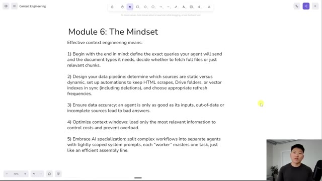
*⏱️ 00:20:10 — Capture d'écran montrant une page de notes intitulée "Module 6: The Mindset" détaillant les principes d'ingénierie du contexte, avec le point numéro 5 soulignant l'importance de la spécialisation en IA.*

---

### ⏱️ `[00:20:25 - 00:20:52]` | Segment #43

**🔊 Audio (Transcription Intégrale Mot pour Mot en Français) :**
> Mais c'est un peu toute la raison pour laquelle, avec l'Ultimate Assistant, plutôt que de lui donner tous les outils Gmail, tous les outils de calendrier, tous les outils de contacts, nous lui donnons moins d'outils. Et ensuite, tout ce qu'il a à faire, c'est de s'occuper essentiellement de déléguer la requête au bon endroit. Si vous avez un processus d'environ quatre étapes principales où votre agent pourrait faire des recherches, rédiger le rapport, créer un message, peu importe ce que c'est, il serait probablement plus cohérent pour vous d'avoir un agent qui s'occupe de chacune de ces étapes du processus. Pensez-y comme à une chaîne de montage.

**👁️ Analyse Visuelle d'Écran (gemini-3.5-flash-lite) :**
**Interface & Outils** : Application de notes ou outil de présentation (type Canvas / Notion) affichant du texte formaté.

**Contenu textuel & Code** : Texte du cours listant les cinq principes de l'ingénierie du contexte pour les agents IA (Begin with the end in mind, Design your data pipeline, Ensure data accuracy, Optimize context windows, Embrace AI specialization).

**Action / Démonstration** : Le présentateur commente le contenu affiché à l'écran concernant la structure et la mentalité à adopter pour concevoir des assistants IA spécialisés.

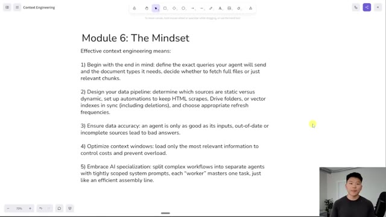
*⏱️ 00:20:31 — Une page de cours intitulée 'Module 6: The Mindset' listant cinq principes sur l'ingénierie du contexte, avec le présentateur visible en incrustation vidéo dans le coin inférieur droit.*

---

### ⏱️ `[00:20:52 - 00:21:27]` | Segment #44

**🔊 Audio (Transcription Intégrale Mot pour Mot en Français) :**
> Tout le monde fait une seule chose, puis prend cette entrée, la traite, et la transmet à l'étape suivante. Cela rend le tout beaucoup plus efficace. Cela rend tout le monde vraiment bon et très rapide dans son propre travail. Et cela aide aussi pour la formulation de vos instructions, car vous pouvez alors intervenir et donner des instructions très spécifiques à cet agent unique pour qu'il fasse son travail unique. Et la chose géniale là-dedans, c'est que vous pouvez faire en sorte que chaque étape de l'IA utilise un modèle d'IA différent si vous le souhaitez. Nous savons tous que les modèles différents sont bons pour des choses différentes et il peut parfois être difficile de voir quel modèle je devrais utiliser pour quel cas d'usage. Mais si tout est découpé, vous pouvez aller de l'avant et tester un modèle différent pour chaque étape du processus. C'était donc tout ce que j'avais pour vous aujourd'hui. Je n'ai pas

**👁️ Analyse Visuelle d'Écran (gemini-3.5-flash-lite) :**
**Interface & Outils** : Application de tableau blanc ou de présentation numérique (type Excalidraw ou Miro) avec incrustation vidéo du présentateur en bas à droite.

**Contenu textuel & Code** : Texte listant 5 principes clés : 1) Begin with the end in mind, 2) Design your data pipeline, 3) Ensure data accuracy, 4) Optimize context windows, 5) Embrace AI specialization.

**Action / Démonstration** : Le présentateur explique les concepts liés à la spécialisation des agents IA et aux pipelines de données.

*⏱️ 00:21:01 — Une diapositive de présentation intitulée "Module 6: The Mindset" détaillant les principes de l'ingénierie du contexte.*

---

### ⏱️ `[00:21:27 - 00:21:53]` | Segment #45

**🔊 Audio (Transcription Intégrale Mot pour Mot en Français) :**
> Je ne veux pas vous submerger avec trop d'informations, mais j'espère que cela a été utile. Si vous souhaitez accéder au lien de cet Excalidraw pour pouvoir y jeter un œil à votre rythme, vous pouvez y accéder dans ma communauté FreeSchool, le lien pour cela se trouvera dans la description. Tout ce que vous avez tout à faire, c'est de rejoindre la communauté, puis de rechercher le titre de la vidéo tout en haut, ou vous pouvez aller dans les ressources YouTube, trouver la publication associée à cette vidéo. Et disons que c'était cette vidéo-ci, vous verriez en gros un lien quelque part dans cette publication qui vous mènerait à l'Excalidraw.

**👁️ Analyse Visuelle d'Écran (gemini-3.5-flash-lite) :**
**Interface & Outils** : Excalidraw (tableau blanc en ligne) et plateforme communautaire Skool (AI Automation Society).

**Contenu textuel & Code** : Schémas de flux de travail d'IA, diagrammes d'architecture, et publications communautaires avec liens vers des ressources YouTube.

**Action / Démonstration** : Présentation visuelle du tableau blanc complet d'Excalidraw suivie de la navigation sur la page de la communauté en ligne mentionnée dans l'audio.

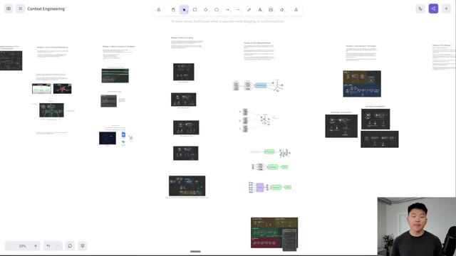
*⏱️ 00:21:34 — Vue d'ensemble d'un tableau blanc virtuel Excalidraw intitulé "Context Engineering" avec plusieurs schémas et modules d'architecture d'IA.*

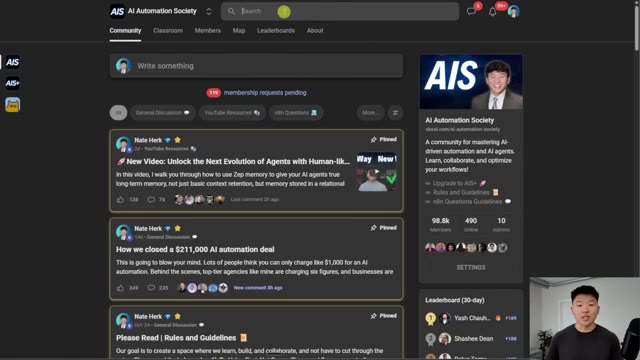
*⏱️ 00:21:40 — Interface de la communauté Skool "AI Automation Society" montrant le fil d'actualité, les publications épinglées et les discussions.*

---

### ⏱️ `[00:21:53 - 00:22:28]` | Segment #46

**🔊 Audio (Transcription Intégrale Mot pour Mot en Français) :**
> Et si vous avez trouvé cette vidéo intéressante et que vous cherchez à approfondir certains de ces aspects de l'ingénierie de contexte que j'ai abordés, alors consultez absolument ma communauté payante. Le lien pour cela se trouve également dans la description. Nous avons une super communauté de membres. Tout le monde construit chaque jour avec N8N, partage ses défis, partage ses réussites, partage ses projets. Et nous avons une section salle de classe avec deux cours complets. Agent Zero est la base de l'automatisation par IA. Donc si vous êtes débutant, c'est un excellent endroit pour obtenir des conseils structurés, et ensuite "10 hours to 10 seconds" où vous apprenez à identifier, concevoir et créer des automatisations qui font gagner du temps. C'est donc tout pour celle-ci. J'adorerais vous voir les gars dans ces communautés, mais j'espère que vous avez apprécié la vidéo. Si c'est le cas, ou si vous avez appris quelque chose de nouveau,

**👁️ Analyse Visuelle d'Écran (gemini-3.5-flash-lite) :**
**Interface & Outils** : Interface web de la plateforme communautaire Skool (AI Automation Society Plus)

**Contenu textuel & Code** : Publications de communauté, fils de discussion, sections de cours (Classroom) avec modules de formation sur l'IA et l'automatisation.

**Action / Démonstration** : Navigation et présentation de la communauté payante et de ses ressources de formation par le créateur.

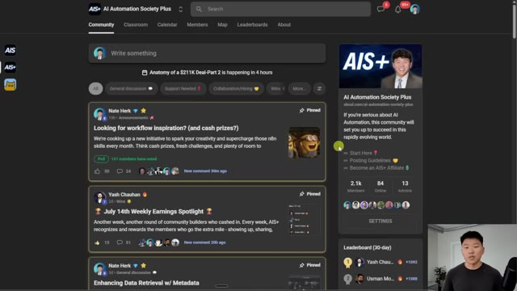
*⏱️ 00:22:02 — Capture d'écran montrant l'interface de la communauté "AI Automation Society Plus" (sur Skool), avec le fil de discussion (Community) et le présentateur en vidéo incrustée en bas à droite.*

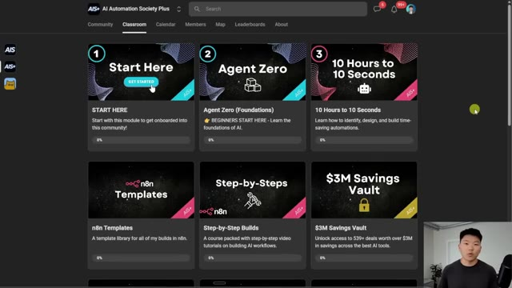
*⏱️ 00:22:11 — Capture d'écran montrant la section "Classroom" de la communauté "AI Automation Society Plus", listant divers modules de formation comme "Start Here", "Agent Zero" et "n8n Templates".*

---

### ⏱️ `[00:22:28 - 00:22:36]` | Segment #47

**🔊 Audio (Transcription Intégrale Mot pour Mot en Français) :**
> s'il vous plaît, mettez un pouce bleu. Ça m'aide vraiment énormément. Et comme toujours, j'apprécie vraiment que vous soyez arrivés jusqu'à la fin de la vidéo. Je vous vois dans la prochaine. Merci les gars.

**👁️ Analyse Visuelle d'Écran (gemini-3.5-flash-lite) :**
**Interface & Outils** : Interface de tableau blanc ou d'outil de mindmapping / workflow visuel (ex: Miro ou similaire)

**Contenu textuel & Code** : Texte du titre de la vidéo et diagramme de flux d'automatisation détaillé avec de nombreux nœuds et connexions.

**Action / Démonstration** : Le présentateur conclut la vidéo en s'adressant aux spectateurs.

*⏱️ 00:22:30 — Un écran affichant le titre '6 Context Engineering Lessons From 200+ AI Automations' au-dessus d'un grand diagramme de workflow complexe, avec le présentateur visible en bas à droite.*

---

