# 🎬 Turn Your AI Agent Into a Voice Assistant in Minutes (n8n & ElevenLabs)

> **Chaîne** : [Nate Herk | AI Automation](https://www.youtube.com/@nateherk/featured)  
> **Lien YouTube** : [https://www.youtube.com/watch?v=qJRFu88HUio](https://www.youtube.com/watch?v=qJRFu88HUio)  
> **Date de publication** : 20250731  
> **Durée** : 00:20:35  
> **Identifiant vidéo** : `qJRFu88HUio`  
> **Transcription & Analyse** : `whisper-v3-large-turbo+gemini-3.5-flash-lite`  

---

## 📌 Synthèse Exécutive & Outils

### 💡 Résumé

Cette vidéo présentée par Nate Herk sur la chaîne *Nate Herk | AI Automation* propose un guide pratique et direct pour transformer un agent IA textuel en un assistant vocal interactif intégré à des flux de travail automatisés via n8n. L'objectif principal est de démontrer qu'il est possible d'offrir une expérience utilisateur fluide et conversationnelle en combinant des applications de messagerie comme Telegram, des outils de transcription et de synthèse vocale de pointe, ainsi que des modèles de langage avancés.

Au cours d'une démonstration en direct, Nate Herk configure un scénario complet asynchrone (audio vers audio) au départ de Telegram. Lorsqu'un utilisateur envoie un message vocal, le flux n8n le télécharge automatiquement, le convertit en texte via le nœud communautaire vérifié d'ElevenLabs, puis le soumet à un agent IA alimenté par un grand modèle de langage configuré pour adopter une personnalité spécifique et pleine d'humour. La réponse textuelle générée est ensuite transformée en un fichier audio expressif grâce à la synthèse vocale d'ElevenLabs avant d'être renvoyée directement sous forme de fichier MP3 sur Telegram.

Cette approche met en lumière la simplicité d'intégration des technologies de pointe en matière d'intelligence artificielle conversationnelle au sein d'une architecture low-code. La vidéo montre également comment configurer finement les voix — que ce soit en sélectionnant des prénoms prédéfinis ou en récupérant des identifiants uniques (Voice IDs) depuis la plateforme ElevenLabs —, garantissant ainsi une personnalisation poussée et des interactions hautement engageantes pour l'utilisateur final.

### 🛠️ Outils, Modèles & Logiciels Présentés

* **n8n** : Plateforme d'automatisation de flux de travail (workflow automation) low-code permettant d'orchestrer la communication entre les différents services et nœuds d'IA.
* **ElevenLabs** : Solution de pointe pour la transcription audio (Speech-to-Text) et la synthèse vocale ultra-réaliste (Text-to-Speech), intégrée via un nœud communautaire vérifié dans n8n.
* **Telegram** : Application de messagerie instantanée utilisée comme interface utilisateur principale pour l'envoi et la réception de messages vocaux et audio.
* **Open Router** : Passerelle d'API unifiée permettant de connecter et d'interroger divers modèles de chat et grands modèles de langage (LLM) pour alimenter le raisonnement de l'agent IA.
* **Agent IA (n8n AI Agent)** : Composant intégré de n8n permettant de structurer le comportement, la mémoire et le traitement des messages des utilisateurs par un modèle de langage.

### 🔑 Points Clés & Enseignements Stratégiques

* **Architecture audio-à-audio asynchrone** : Il est possible de concevoir une boucle conversationnelle vocale efficace sans passer nécessairement par du temps réel pur, en enchaînant téléchargement, transcription, traitement textuel et re-synthèse vocale.
* **Exploitation des nœuds communautaires vérifiés** : L'utilisation de nœuds spécialisés, comme celui d'ElevenLabs dans n8n, simplifie drastiquement l'implémentation de fonctionnalités avancées de traitement audio sans nécessiter de code personnalisé complexe.
* **Gestion sécurisée des clés API** : Lors de la création de clés d'accès sur des plateformes tierces comme ElevenLabs, il est recommandé d'ajuster les permissions ou de supprimer les restrictions superflues pour garantir une intégration fluide tout en conservant une bonne traçabilité.
* **Mappage dynamique des données binaires** : Les flux n8n nécessitent une attention particulière au routage des données, notamment pour l'acheminement des champs binaires (`data`) entre le téléchargement initial du fichier vocal et le nœud de transcription.
* **Redirection du message utilisateur dans l'agent IA** : Par défaut, un agent IA n8n écoute un nœud de chat dédié ; il est donc indispensable de le reconfigurer pour qu'il analyse la sortie textuelle issue de la transcription vocale.
* **Personnalisation comportementale des agents** : Assigner un rôle précis et une tonalité marquée (par exemple, un assistant extrêmement drôle) à l'agent IA renforce l'engagement et l'immersion lors des interactions vocales.
* **Sélection et personnalisation granulaire des voix** : ElevenLabs permet de choisir des profils vocaux variés directement depuis une liste ou d'utiliser des identifiants de voix spécifiques (`Voice ID`) pour adapter précisément la personnalité auditive de l'assistant.
* **Récupération rigoureuse des métadonnées de chat** : Pour renvoyer un fichier audio au bon destinataire sur Telegram, le flux doit impérativement réutiliser l'identifiant de chat (`chat ID`) capturé au niveau du nœud déclencheur initial.
* **Activation et tests en conditions réelles** : Le passage d'un flux de travail du mode test au mode actif est une étape critique indispensable pour valider l'automatisation complète de bout en bout avec de vrais messages d'utilisateurs.
* **Scalabilité et accessibilité financière** : Des forfaits d'entrée de gamme abordables (tels que l'offre à 5 dollars par mois d'ElevenLabs) suffisent amplement pour gérer un volume élevé de requêtes sans saturer les limites de crédits.

---

## ⏱️ Chronologie & Transcription Complète Audio & Visuelle (Mot pour Mot)

### ⏱️ `[00:00:00 - 00:00:18]` | Segment #01

**🔊 Audio (Transcription Intégrale Mot pour Mot en Français) :**
> Aujourd'hui, je vais parler de la manière la plus simple de connecter la voix à nos flux de travail ou agents n8n pour offrir une meilleure expérience à l'utilisateur. Il y a deux façons de faire cela. La première consiste à utiliser ElevenLabs pour transformer du texte en parole et à l'envoyer sous forme de fichier audio. Et la deuxième est d'utiliser un agent vocal ElevenLabs pour avoir réellement une conversation en temps réel.

**👁️ Analyse Visuelle d'Écran (gemini-3.5-flash-lite) :**
**Interface & Outils** : n8n (éditeur de workflow), ElevenLabs Conversational AI

**Contenu textuel & Code** : Nœuds n8n (Webhook, Message a model, AI Agent, Respond to Webhook, Telegram Trigger, Transcribe audio or video, OpenRouter Chat Model)

**Action / Démonstration** : Présentation et explication des flux de travail n8n connectés à la voix via ElevenLabs ou la transcription audio.

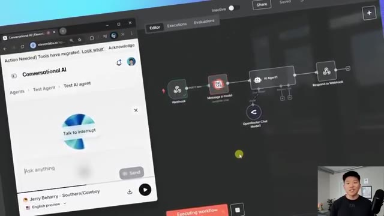
*⏱️ 00:00:05 — Interface n8n affichant un workflow avec webhook et agent IA, aux côtés de l'interface de test Conversational AI d'ElevenLabs.*

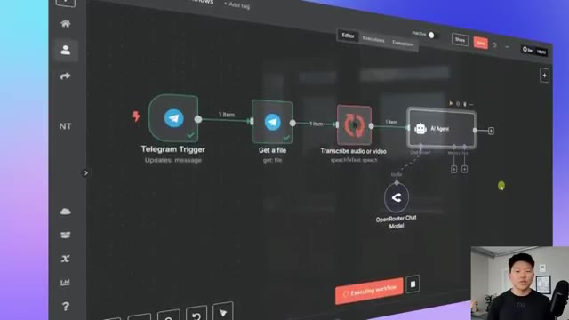
*⏱️ 00:00:09 — Vue rapprochée d'un workflow n8n complexe comprenant un déclencheur Telegram, un nœud de transcription audio/vidéo et un agent IA relié à OpenRouter.*

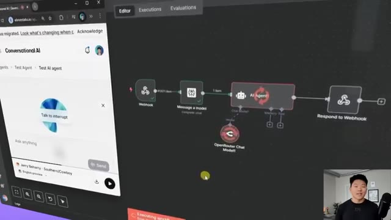
*⏱️ 00:00:14 — Workflow n8n en cours d'exécution avec un nœud d'agent IA actif et une fenêtre de chat vocale ElevenLabs ouverte sur la gauche.*

---

### ⏱️ `[00:00:19 - 00:00:38]` | Segment #02

**🔊 Audio (Transcription Intégrale Mot pour Mot en Français) :**
> Ça va être super facile et je vais vous montrer tout ça en direct devant vous, alors commençons. Bon, le premier scénario que nous allons examiner est un scénario où nous pouvons envoyer un fichier vocal à un agent IA, puis il va traiter l'information et ensuite nous renvoyer un autre fichier vocal. Ce ne sera donc pas une conversation, mais il s'agira bien d'audio et d'audio. La façon dont je vais faire cela aujourd'hui, ça va être via Telegram.

**👁️ Analyse Visuelle d'Écran (gemini-3.5-flash-lite) :**
**Interface & Outils** : Interface web de création de workflows vocaux.

**Contenu textuel & Code** : Espace de travail vide avec une grille de points et une invite centrale pour ajouter une première étape.

**Action / Démonstration** : Préparation de la création d'un scénario de traitement vocal dans l'éditeur de workflow.

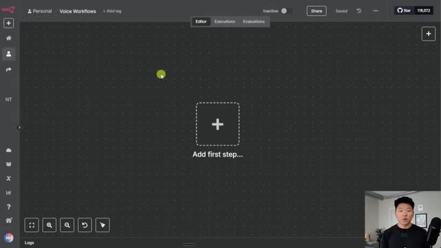
*⏱️ 00:00:28 — Interface de workflow avec une grille noire et un bouton central pour ajouter la première étape ("Add first step...").*

---

### ⏱️ `[00:00:38 - 00:00:56]` | Segment #03

**🔊 Audio (Transcription Intégrale Mot pour Mot en Français) :**
> Donc la première chose que je vais faire est d'ajouter un nœud Telegram, qui va être notre déclencheur, qui va s'activer à la réception d'un message. Et donc ce que je vais faire très rapidement, c'est exécuter cette étape. Donc il va écouter dans notre canal Telegram. Je vais ouvrir Telegram et je vais envoyer un message vocal. Test, test. Tu m'entends ? Donc on envoie ça. Ça devrait le capturer juste là.

**👁️ Analyse Visuelle d'Écran (gemini-3.5-flash-lite) :**
**Interface & Outils** : Outil d'automatisation de workflows (type n8n ou équivalent).

**Contenu textuel & Code** : Liste des déclencheurs Telegram disponibles (On message, On callback query, etc.) et paramètres du nœud Telegram Trigger.

**Action / Démonstration** : Sélection et configuration d'un déclencheur Telegram pour écouter les messages entrants.

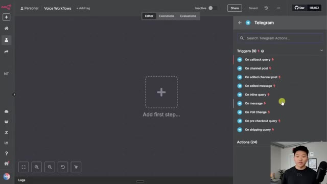
*⏱️ 00:00:42 — Interface d'un outil d'automatisation montrant le panneau latéral de sélection des déclencheurs Telegram (« Triggers ») avec diverses options comme « On message ».*

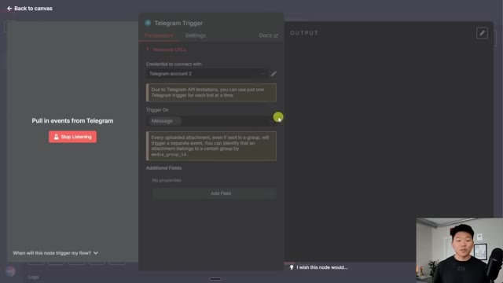
*⏱️ 00:00:47 — Configuration du nœud « Telegram Trigger » dans l'interface d'automatisation, avec le bouton rouge « Stop Listening » actif en attente d'événements.*

---

### ⏱️ `[00:00:56 - 00:01:14]` | Segment #04

**🔊 Audio (Transcription Intégrale Mot pour Mot en Français) :**
> Ce que l'on voit sur cette sortie du déclencheur Telegram, c'est que nous avons obtenu ce fichier vocal juste ici. Et nous savons que c'est un fichier vocal parce qu'ici même, il est écrit audio slash OGG. Donc maintenant, ce que nous devons faire, c'est télécharger ce fichier vocal et le transcrire afin de pouvoir l'envoyer à un agent IA. Donc ce que je vais faire, c'est ajouter une autre étape juste ici. Ça va être un nœud Telegram.

**👁️ Analyse Visuelle d'Écran (gemini-3.5-flash-lite) :**
**Interface & Outils** : Interface web n8n (éditeur de workflow low-code).

**Contenu textuel & Code** : Données JSON de sortie d'un message Telegram incluant les champs 'mime_type: audio/ogg', 'file_id' et 'file_size'.

**Action / Démonstration** : Examen des données JSON du déclencheur Telegram pour identifier et extraire le fichier vocal reçu au format audio OGG.

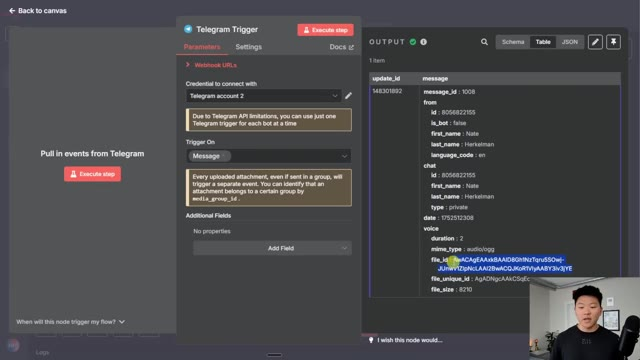
*⏱️ 00:01:00 — Vue rapprochée des paramètres du nœud 'Telegram Trigger' avec la sortie JSON affichant les détails d'un message audio OGG.*

---

### ⏱️ `[00:01:14 - 00:01:33]` | Segment #05

**🔊 Audio (Transcription Intégrale Mot pour Mot en Français) :**
> Et nous allons télécharger un fichier. D'accord, donc c'est en fait récupérer un fichier. C'est juste ici. Nous allons cliquer dessus. Et ce que nous allons faire, c'est en gros, il recherche un ID de fichier à télécharger. Donc tout ce que j'ai à faire, c'est de faire défiler vers le bas sur ce côté gauche, de glisser cet ID de fichier juste ici. Et si je clique sur exécuter l'étape, il devrait en gros récupérer le fichier vocal que nous venons d'y déposer.

**👁️ Analyse Visuelle d'Écran (gemini-3.5-flash-lite) :**
**Interface & Outils** : n8n (Interface de workflow d'automatisation)

**Contenu textuel & Code** : Configuration du nœud "Get a file" (Credential: Telegram account 2, Resource: File, Operation: Get, File ID, Download activé) et données d'entrée Telegram Trigger.

**Action / Démonstration** : Configuration des paramètres du nœud pour récupérer un fichier à partir d'un identifiant fourni par le déclencheur Telegram.

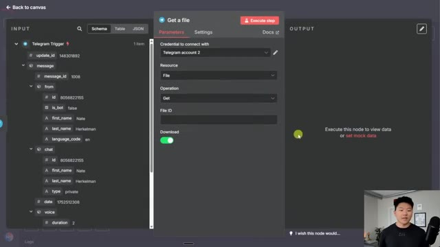
*⏱️ 00:01:19 — Interface de configuration du nœud n8n "Get a file" avec les paramètres Telegram et la structure des données d'entrée en JSON.*

---

### ⏱️ `[00:01:33 - 00:02:08]` | Segment #06

**🔊 Audio (Transcription Intégrale Mot pour Mot en Français) :**
> Et voici ce fichier audio. Laissez-moi juste vous le faire écouter rapidement. Test, test, vous m'entendez ? Ok, donc maintenant nous avons ce fichier. Ensuite, la prochaine étape était que nous devons le transcrire. Maintenant, par le passé, ce que je vous ai montré, c'était que pour un assistant personnel comme celui-ci, nous utilisions le nœud de transcription d'enregistrement d'OpenAI pour le transcrire. Et ce que vous voyez également ici, c'est la méthode où l'assistant personnel peut recevoir soit une entrée texte, soit une entrée vocale. Mais dans le tutoriel d'aujourd'hui, nous allons seulement nous occuper de la voix. Mais l'autre façon dont vous pourriez faire cela, c'est avec ElevenLabs pour transcrire cet enregistrement. Donc je vais cliquer sur le plus, je vais taper ElevenLabs, et c'est en fait un nœud communautaire vérifié d'ElevenLabs dans N8N. Donc si vous ne

**👁️ Analyse Visuelle d'Écran (gemini-3.5-flash-lite) :**
**Interface & Outils** : Application web de type éditeur de flux (n8n ou similaire).

**Contenu textuel & Code** : Workflow composé d'un déclencheur Telegram relié à une action de récupération de fichier.

**Action / Démonstration** : Présentation du diagramme de workflow pour illustrer la récupération du fichier audio depuis Telegram.

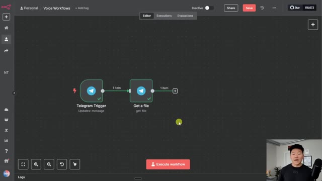
*⏱️ 00:01:42 — Interface de création de workflow affichant deux nœuds connectés : 'Telegram Trigger' et 'Get a file'.*

---

### ⏱️ `[00:02:08 - 00:02:29]` | Segment #07

**🔊 Audio (Transcription Intégrale Mot pour Mot en Français) :**
> Regardez cette option, vous devrez simplement vous assurer que votre version de N8N est mise à jour vers la version avec les nœuds communautaires vérifiés. Et ensuite, quand vous obtenez ceci, vous devez l'installer. Et maintenant, vous pouvez voir que nous avons différentes actions. Et il y en a une ici qui dit transcrire de l'audio ou de la vidéo. Je vais donc cliquer sur celle-ci. Elle va nous demander une clé API ElevenLabs. Je vais donc aller de l'avant et en configurer une nouvelle ici même devant vous les gars.

**👁️ Analyse Visuelle d'Écran (gemini-3.5-flash-lite) :**
**Interface & Outils** : n8n (éditeur de workflow d'automatisation)

**Contenu textuel & Code** : Workflow N8N avec nœud Telegram Trigger et panneau de configuration des actions ElevenLabs (Get a voice, Transcribe audio, etc.).

**Action / Démonstration** : Navigation et configuration des paramètres du nœud ElevenLabs dans un workflow n8n.

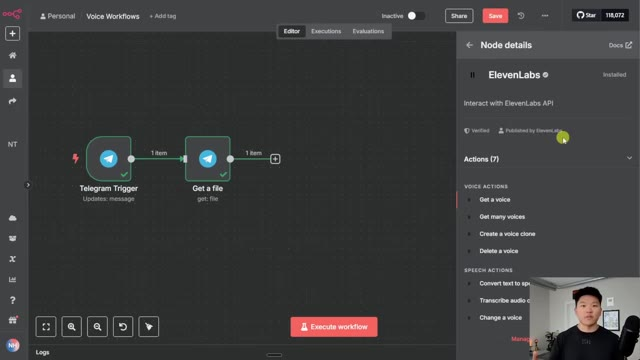
*⏱️ 00:02:13 — Interface N8N montrant le panneau latéral avec les détails du nœud ElevenLabs et ses actions disponibles.*

*⏱️ 00:02:24 — Interface N8N affichant les paramètres de configuration pour transcrire de l'audio ou de la vidéo (Speech to Text) via ElevenLabs.*

---

### ⏱️ `[00:02:29 - 00:02:48]` | Segment #08

**🔊 Audio (Transcription Intégrale Mot pour Mot en Français) :**
> Donc, quand je clique sur ce bouton et que je vais créer un nouvel identifiant, il nous demande une clé API ElevenLabs. Donc vous allez aller sur ElevenLabs. Le lien pour cela sera en bas dans la description. Et une fois que vous avez créé un compte, vous pouvez simplement prendre le forfait à 5 dollars par mois ou vous pouvez simplement commencer gratuitement. Mais je suis sur le forfait à 5 balles par mois et ce n'est vraiment pas si mal que ça. J'atteins presque jamais la limite de crédits.

**👁️ Analyse Visuelle d'Écran (gemini-3.5-flash-lite) :**
**Interface & Outils** : Interface de workflow (Make/n8n) et tableau de bord web ElevenLabs.

**Contenu textuel & Code** : Champ de saisie "ElevenLabs API Key" et interface de la plateforme de synthèse vocale ElevenLabs.

**Action / Démonstration** : Configuration d'un compte ElevenLabs en renseignant la clé API demandée par l'application.

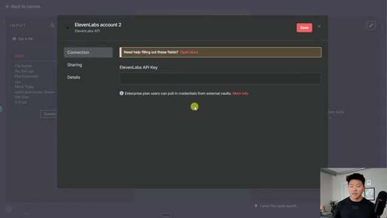
*⏱️ 00:02:34 — Fenêtre modale demandant la saisie d'une clé API ElevenLabs pour configurer un identifiant.*

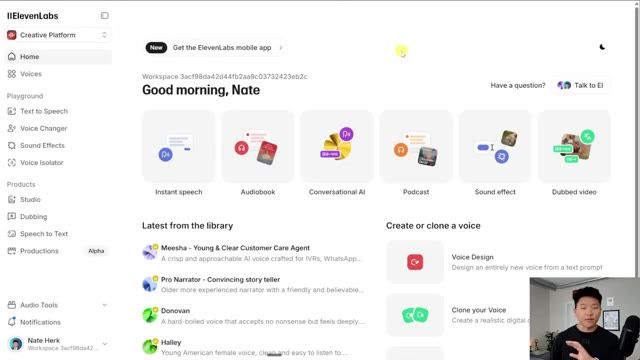
*⏱️ 00:02:39 — Interface principale du tableau de bord d'ElevenLabs affichant le compte utilisateur ("Good morning, Nate").*

---

### ⏱️ `[00:02:48 - 00:03:07]` | Segment #09

**🔊 Audio (Transcription Intégrale Mot pour Mot en Français) :**
> Bref, dans votre profil ici en bas, vous allez aller dans clés API juste là. Et ensuite tout ce que vous avez à faire c'est cliquer sur créer une clé API. Et ce qu'elle fait maintenant c'est qu'elle demande différentes permissions pour cette clé. Donc ce que je vais faire c'est m'assurer que la synthèse vocale a accès, que la conversion de la parole a accès. Et juste pour être sûr et lui donner accès à tout, je pourrais simplement désactiver ceci afin qu'elle n'ait aucune restriction.

**👁️ Analyse Visuelle d'Écran (gemini-3.5-flash-lite) :**
**Interface & Outils** : Interface web ElevenLabs (navigateur).

**Contenu textuel & Code** : Liste des clés API existantes (Deadly Caspian Tiger, Test, Looming Rattlesnake, HeyGen) avec options de gestion et bouton "Create API Key".

**Action / Démonstration** : Navigation vers l'onglet des clés API pour préparer la création d'une nouvelle clé d'accès.

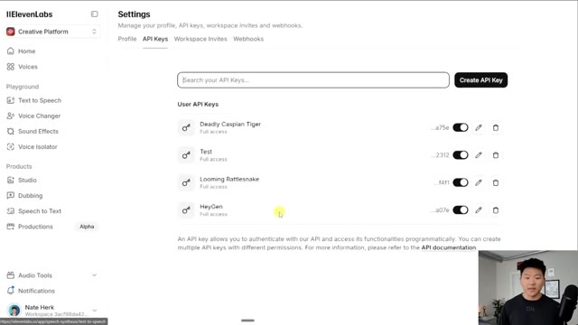
*⏱️ 00:02:53 — Interface web d'ElevenLabs affichant la section des paramètres des clés API (API Keys).*

---

### ⏱️ `[00:03:08 - 00:03:44]` | Segment #10

**🔊 Audio (Transcription Intégrale Mot pour Mot en Français) :**
> Donc je vais créer cette nouvelle clé. Et ensuite, je vais copier cette valeur juste ici. Et une fois que je l'aurai fermée, je ne pourrai plus la récupérer. Donc, sauvegardez-la quelque part. Et maintenant que j'ai copié cette clé, je peux retourner dans mon flux de travail et simplement la coller ici. Nous cliquons sur enregistrer et tout devrait être prêt, la connexion a été testée avec succès, et nous pouvons désormais accéder à ElevenLabs via n8n. Donc, ce que cela nous indique, c'est que cela va transformer la parole en texte et que cela recherche un binaire dans le champ appelé data, que nous pouvons voir juste ici. Donc ces deux éléments sont liés. Je devrais pouvoir simplement cliquer sur exécuter l'étape et ce que cela va faire, c'est transformer cela en texte. Donc juste ici, vous pouvez voir exactement ce que j'ai dit, à savoir testing, testing,

**👁️ Analyse Visuelle d'Écran (gemini-3.5-flash-lite) :**
**Interface & Outils** : Interface web ElevenLabs, Interface de workflow n8n

**Contenu textuel & Code** : Paramètres de clé API ElevenLabs, configuration de nœud n8n pour la conversion de la parole en texte ("Speech to Text")

**Action / Démonstration** : Copie et configuration d'une clé API ElevenLabs dans un flux de travail d'automatisation n8n

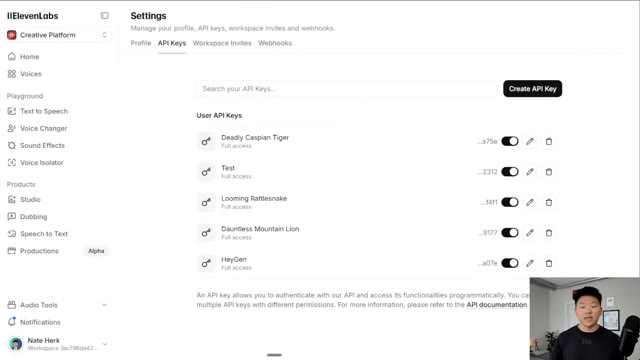
*⏱️ 00:03:17 — Interface des paramètres ElevenLabs affichant la liste des clés API utilisateur et le bouton de création.*

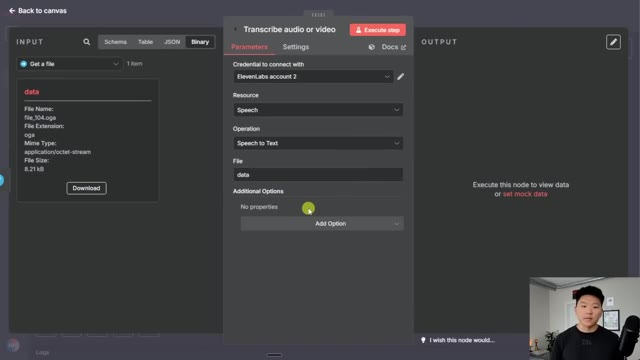
*⏱️ 00:03:26 — Interface d'un flux de travail n8n montrant un nœud de configuration pour la transcription audio avec ElevenLabs.*

---

### ⏱️ `[00:03:44 - 00:04:06]` | Segment #11

**🔊 Audio (Transcription Intégrale Mot pour Mot en Français) :**
> Tu m'entends ? Donc nous avons notre parole transformée en texte grâce à 11labs. Et maintenant, nous devons connecter notre agent IA. Je vais donc cliquer sur le plus, je vais taper AI agent. Nous allons prendre celui-ci juste ici. La première chose que nous devons faire est de configurer le message de l'utilisateur parce que, par défaut, l'agent IA est configuré pour chercher à l'intérieur du nœud de déclenchement de chat connecté, qui n'existe pas sur notre flux de travail.

**👁️ Analyse Visuelle d'Écran (gemini-3.5-flash-lite) :**
**Interface & Outils** : Interface web n8n (éditeur de workflows)

**Contenu textuel & Code** : Nœuds de workflow n8n (Telegram, Get a file, Transcribe, AI Agent) et structure de données JSON en entrée.

**Action / Démonstration** : Connexion et configuration du nœud 'AI Agent' pour traiter le texte transcrit.

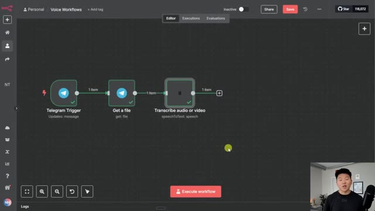
*⏱️ 00:03:50 — Vue d'ensemble du workflow sur n8n montrant la chaîne de nœuds : Telegram Trigger, Get a file, et Transcribe audio or video.*

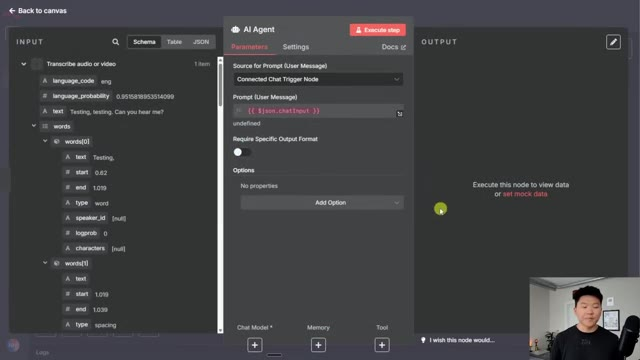
*⏱️ 00:03:55 — Panneau de configuration du nœud 'AI Agent' ouvert dans n8n, affichant les paramètres de prompt utilisateur et les données d'entrée JSON.*

---

### ⏱️ `[00:04:06 - 00:04:24]` | Segment #12

**🔊 Audio (Transcription Intégrale Mot pour Mot en Français) :**
> Nous voulons qu'à la place, il examine la sortie de ce nœud pour la transcription. Donc tout ce que j'ai à faire, c'est de cliquer sur l'agent, de changer le message utilisateur pour définir ci-dessous. Et ensuite, très simplement, je n'ai qu'à glisser le champ de texte juste ici dans cette boîte. Il examine donc maintenant cette variable, qui représente tout ce qui a été transcrit.

**👁️ Analyse Visuelle d'Écran (gemini-3.5-flash-lite) :**
**Interface & Outils** : n8n (éditeur de workflows d'automatisation)

**Contenu textuel & Code** : Nœuds de workflow connectés (Telegram Trigger, Get a file, Transcribe audio or video, AI Agent) et structure de données JSON d'entrée contenant le texte transcrit.

**Action / Démonstration** : Clic sur le nœud AI Agent pour ouvrir son panneau de configuration et modifier le message utilisateur.

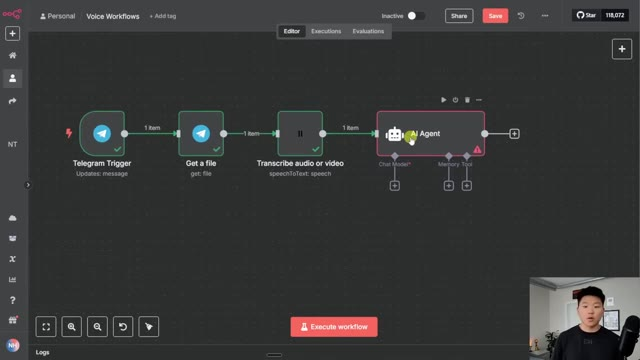
*⏱️ 00:04:10 — Vue d'ensemble du workflow n8n montrant l'enchaînement des nœuds : Telegram Trigger, Get a file, Transcribe audio or video et AI Agent, avec le présentateur visible en médaillon.*

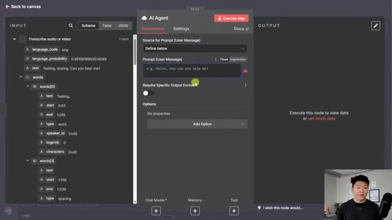
*⏱️ 00:04:15 — Interface de configuration du nœud 'AI Agent' dans n8n, affichant les panneaux d'entrée avec les données de transcription, les paramètres du prompt utilisateur et la zone de sortie.*

---

### ⏱️ `[00:04:24 - 00:04:45]` | Segment #13

**🔊 Audio (Transcription Intégrale Mot pour Mot en Français) :**
> Nous pourrions ensuite procéder à la configuration initiale de notre agent IA. Je vais donc simplement dire que tu es un assistant utile qui est extrêmement drôle. D'accord, c'est configuré ici. Et maintenant, nous devons connecter un modèle de chat. Je vais donc procéder à la connexion d'un modèle de chat Open Router. Vous obtiendriez cette clé API exactement de la même manière que vous venez d'en obtenir une d'Eleven Labs, sauf que vous iriez sur openrouter.ai plutôt que sur elevenlabs.

**👁️ Analyse Visuelle d'Écran (gemini-3.5-flash-lite) :**
**Interface & Outils** : Interface web d'automatisation de type n8n ou similaire pour la création de workflows d'agents IA.

**Contenu textuel & Code** : "You are a helpful assistant who is extremely funny", "OpenRouter Chat Model", "openai/gpt-4o-mini".

**Action / Démonstration** : Configuration des paramètres de l'agent IA et sélection/connexion d'un modèle de langage pour le chat.

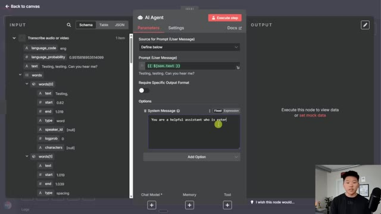
*⏱️ 00:04:29 — Configuration du message système de l'agent IA dans une interface de workflow.*

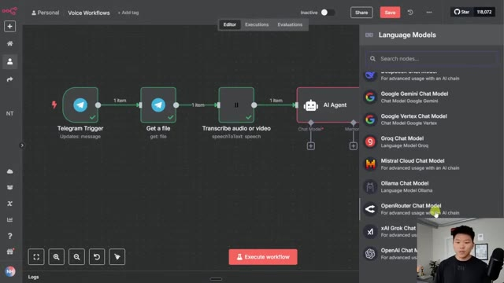
*⏱️ 00:04:34 — Sélection d'un modèle de chat (Language Models) dans le panneau latéral d'un outil d'automatisation.*

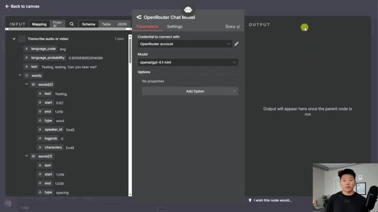
*⏱️ 00:04:40 — Configuration et connexion du modèle OpenRouter Chat Model avec le modèle openai/gpt-4o-mini.*

---

### ⏱️ `[00:04:45 - 00:05:10]` | Segment #14

**🔊 Audio (Transcription Intégrale Mot pour Mot en Français) :**
> Donc une fois que vous êtes connecté à votre cerveau, nous pouvons aller de l'avant et exécuter cet agent. Il examine essentiellement le message, test, test, est-ce que vous m'entendez ? Et ensuite il va répondre avec quelque chose du genre, fort et clair, je vous entends comme une chauve-souris dans une grotte avec un sonar ultra sensible, ou comme un moustique avec un doctorat en espionnage. Qu'est-ce qui suit ? Assistant très drôle, du bon travail. Et maintenant tout ce qui reste, c'est que nous devons transformer ce texte en parole et ensuite nous l'envoyer dans notre télégramme ici.

**👁️ Analyse Visuelle d'Écran (gemini-3.5-flash-lite) :**
**Interface & Outils** : Interface graphique de n8n (outil d'automatisation de workflows).

**Contenu textuel & Code** : Entrées JSON de transcription audio ("Testing, testing. Can you hear me?") et réponse de l'agent IA configuré avec un System Message humoristique.

**Action / Démonstration** : Exécution d'un workflow d'agent vocal et visualisation des résultats de transcription et de la réponse textuelle générée.

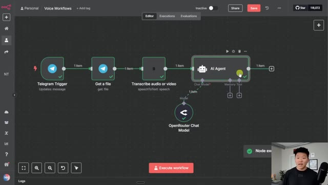
*⏱️ 00:04:51 — Vue d'ensemble du workflow n8n montrant la chaîne complète depuis le déclencheur Telegram jusqu'à l'agent IA, avec le bouton d'exécution du workflow en bas.*

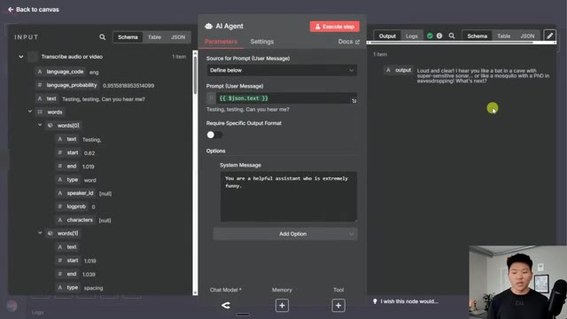
*⏱️ 00:04:57 — Panneau de configuration détaillé de l'agent IA affichant les données d'entrée (transcription audio avec "Testing, testing. Can you hear me?") et la sortie générée par le modèle ("Loud and clear! I hear you like a bat...").*

---

### ⏱️ `[00:05:10 - 00:05:28]` | Segment #15

**🔊 Audio (Transcription Intégrale Mot pour Mot en Français) :**
> Donc ce que je vais faire, c'est ajouter un autre nœud. Et encore une fois, nous allons aller sur 11labs. Nous allons faire "convertir du texte en parole". Et maintenant, ce que nous devons faire, c'est lui donner le texte à transformer en parole. Et nous devons aussi lui donner la voix à utiliser. Donc ce que nous pouvons faire, c'est simplement choisir une voix dans une liste où l'on peut voir que nous avons l'une de mes voix, Nate Herc.

**👁️ Analyse Visuelle d'Écran (gemini-3.5-flash-lite) :**
**Interface & Outils** : Interface web de création de workflows d'automatisation IA (type n8n ou plateforme similaire).

**Contenu textuel & Code** : Nœuds de workflow : 'Get a file', 'Transcribe audio or video', 'AI Agent', 'OpenRouter Chat Model', et configuration de l'action 'Convert text to speech' avec les champs Voice et Text.

**Action / Démonstration** : Navigation dans les actions ElevenLabs puis configuration des paramètres de conversion de texte en parole.

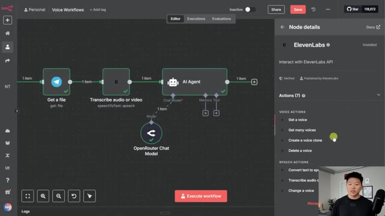
*⏱️ 00:05:14 — Interface d'un éditeur de workflow montrant un diagramme avec Telegram, transcription audio et un nœud Agent IA relié aux options ElevenLabs dans le panneau latéral.*

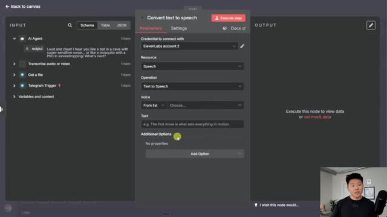
*⏱️ 00:05:19 — Fenêtre de configuration du nœud 'Convert text to speech' d'ElevenLabs affichant les paramètres de compte, de voix et de texte.*

---

### ⏱️ `[00:05:28 - 00:05:46]` | Segment #16

**🔊 Audio (Transcription Intégrale Mot pour Mot en Français) :**
> Nous avons Jarvis, nous avons Archer. Nous avons toutes ces voix différentes parmi lesquelles choisir. Et si vous voulez vraiment pouvoir aller sur ElevenLabs et les tester, ou si vous n'en voyez pas une sur cette liste que vous voulez, laissez-moi juste vous montrer ce que vous pouvez faire. Donc, vous retournez sur ElevenLabs. Sur le côté gauche, vous allez dans Voix. Et ici, vous pouvez voir que nous avons toutes ces différentes options parmi lesquelles choisir.

**👁️ Analyse Visuelle d'Écran (gemini-3.5-flash-lite) :**
**Interface & Outils** : Outil d'automatisation de workflows et interface web d'ElevenLabs.

**Contenu textuel & Code** : Noms de voix IA (Nate Herk, Jarvis, Archer) et gestion des clés API ElevenLabs.

**Action / Démonstration** : Sélection d'une voix vocale dans un nœud d'automatisation et navigation dans les paramètres ElevenLabs.

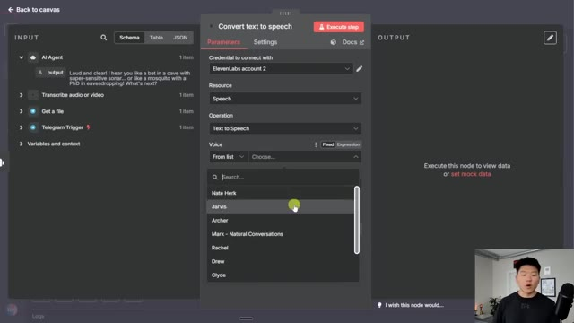
*⏱️ 00:05:33 — Interface d'un outil d'automatisation (n8n ou similaire) montrant le nœud 'Convert text to speech' avec un menu déroulant affichant différentes voix IA (Nate Herk, Jarvis, Archer, Mark, etc.).*

*⏱️ 00:05:42 — Interface des paramètres d'ElevenLabs affichant la section 'API Keys' avec une liste de clés utilisateurs configurées.*

---

### ⏱️ `[00:05:46 - 00:06:12]` | Segment #17

**🔊 Audio (Transcription Intégrale Mot pour Mot en Français) :**
> Et ce que vous pouvez faire, c'est en quelque sorte écouter un aperçu de chacun d'eux. Donc disons que je veux entendre un aperçu du jeune Jamal. Qu'est-ce qui se passe, frérot ? C'est le seul jeune accent noir. Vous pouvez donc l'utiliser comme vous voulez, frangin. Ou peut-être qu'on veut tester Jerry. Dans le Dixieland, vivait un jeune chevreuil, haut comme trois pommes. Donc si vous ne voyez pas ceux-ci dans l'option de liste, tout ce que vous avez à faire est de choisir une voix qui vous plaît, d'ouvrir juste ici et de cliquer sur copier l'ID de la voix.

**👁️ Analyse Visuelle d'Écran (gemini-3.5-flash-lite) :**
**Interface & Outils** : Interface web de la plateforme ElevenLabs (Creative Platform, section Voices)

**Contenu textuel & Code** : Listes de voix de synthèse vocale (Trending voices, John Wayne Rugged Men Collection) avec descriptions, tags de langue, et barre de lecture audio en bas.

**Action / Démonstration** : Navigation dans la bibliothèque de voix de l'application ElevenLabs et sélection d'un aperçu vocal pour écouter le rendu audio.

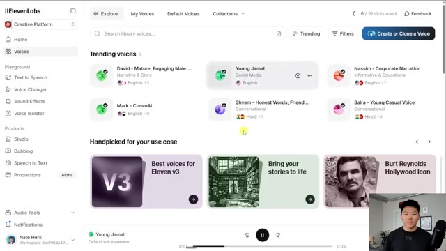
*⏱️ 00:05:53 — Interface d'ElevenLabs affichant la bibliothèque de voix "Voices" avec les options "Trending voices" et les profils vocaux disponibles (dont "Young Jamal" et "David"), ainsi qu'une barre de lecture audio en bas de l'écran.*

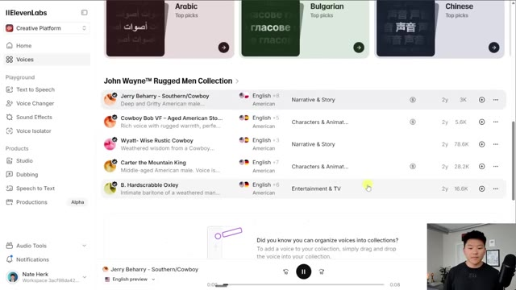
*⏱️ 00:05:59 — Interface d'ElevenLabs montrant la collection de voix "John Wayne Rugged Men Collection" avec plusieurs profils de voix de cow-boys et de narrateurs ("Jerry Beharry", "Cowboy Bob VF", etc.) et le lecteur audio actif.*

---

### ⏱️ `[00:06:12 - 00:06:32]` | Segment #18

**🔊 Audio (Transcription Intégrale Mot pour Mot en Français) :**
> Une fois que j'ai copié cela, je retournons dans le flux de travail et au lieu de choisir dans une liste, je choisirais simplement par identifiant, je collerais l'identifiant juste là, et ensuite nous devrions être configurés avec cette voix. Et puis tout ce que nous avons à faire est de glisser la sortie de l'agent IA dans le champ de texte. Et ensuite, quand nous exécutons cette étape, cela devrait transformer cela en un fichier audio. Donc si je télécharge ce fichier, laissez-moi l'écouter rapidement.

**👁️ Analyse Visuelle d'Écran (gemini-3.5-flash-lite) :**
**Interface & Outils** : n8n (éditeur de workflow d'automatisation)

**Contenu textuel & Code** : Paramètres du nœud de conversion texte-voix : identifiant de compte ElevenLabs, ressource Speech, opération Text to Speech, champ "Voice" réglé sur "By ID" avec un identifiant de voix collé, et champ "Text" vide.

**Action / Démonstration** : Configuration d'un nœud d'automatisation en collant l'identifiant d'une voix spécifique.

*⏱️ 00:06:17 — Configuration du nœud "Convert text to speech" avec sélection de la voix par identifiant (ID) dans l'interface n8n.*

---

### ⏱️ `[00:06:32 - 00:06:52]` | Segment #19

**🔊 Audio (Transcription Intégrale Mot pour Mot en Français) :**
> Fort et clair. Je t'entends comme une chauve-souris dans une grotte avec un sonar ultra sensible ou comme un moustique avec un doctorat en espionnage. Qu'est-ce qui suit ? Voilà. Nous avons donc notre fichier vocal et maintenant tout ce que nous avons à faire est simplement de l'envoyer à notre chat Telegram. Je vais donc cliquer sur le plus après la voix et je vais taper Telegram.

**👁️ Analyse Visuelle d'Écran (gemini-3.5-flash-lite) :**
**Interface & Outils** : Interface web d'automatisation (type n8n) avec un lecteur média superposé.

**Contenu textuel & Code** : Fichier audio text-to-speech visualisé dans un lecteur avec les contrôles de lecture, le nom du fichier « audio.textToSpeech (1) » et un aperçu du texte transcrit dans le panneau de gauche.

**Action / Démonstration** : Lecture du fichier audio généré pour vérifier la qualité de la synthèse vocale avant de l'envoyer au chat.

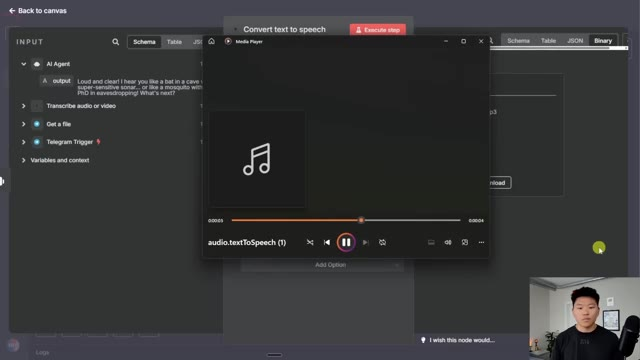
*⏱️ 00:06:37 — Interface d'un workflow d'automatisation affichant un lecteur multimédia intégré pour écouter le fichier audio généré (« audio.textToSpeech (1) »).*

---

### ⏱️ `[00:06:52 - 00:07:12]` | Segment #20

**🔊 Audio (Transcription Intégrale Mot pour Mot en Français) :**
> Ce que nous allons faire, ce n'est pas envoyer un message. Nous allons envoyer un fichier parce que ça va fonctionner avec un fichier. Donc, envoyer un fichier audio. Et donc maintenant, il y a trois choses à faire vraiment. La première, c'est : où est-ce qu'on envoie ça ? Donc il faut un identifiant de chat. Donc je vais cliquer sur le schéma et je vais aller tout the way back, tout the way back, tout le chemin jusqu'à notre déclencheur Telegram parce que cela contient des métadonnées comme l'identifiant de chat.

**👁️ Analyse Visuelle d'Écran (gemini-3.5-flash-lite) :**
**Interface & Outils** : n8n (éditeur de workflow d'automatisation)

**Contenu textuel & Code** : Nœuds de workflow : Telegram Trigger, Get a file, Transcribe audio or video, AI Agent, OpenRouter Chat Model, Convert text to speech. Liste d'actions Telegram incluant 'Send an audio file'. Paramètres du nœud avec 'Credential to connect with', 'Resource', 'Operation: Send Audio', 'Chat ID', 'Binary File'.

**Action / Démonstration** : Sélection et configuration d'une action Telegram pour envoyer un fichier audio dans le workflow d'automatisation.

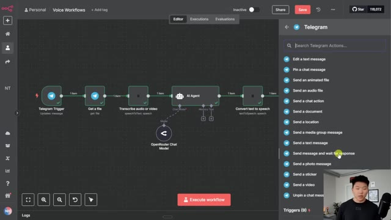
*⏱️ 00:06:57 — Vue d'ensemble d'un workflow n8n avec un panneau latéral listant les actions Telegram.*

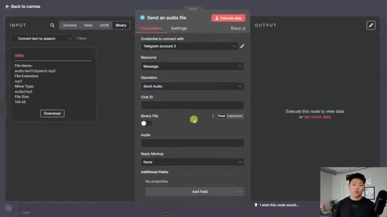
*⏱️ 00:07:02 — Configuration détaillée d'un nœud Telegram pour l'envoi d'un fichier audio, avec les champs de paramètres.*

---

### ⏱️ `[00:07:12 - 00:07:31]` | Segment #21

**🔊 Audio (Transcription Intégrale Mot pour Mot en Français) :**
> Donc je prendrais cet ID de chat juste ici et je le glisserais dans cet emplacement. Et maintenant, ce qui vient ensuite, c'est que nous devons lui dire quoi envoyer comme audio. Donc vous pouvez voir que nous travaillons avec notre champ de données binaires juste ici. Je dois donc dire à Telegram que nous allons envoyer du binaire. Il va automatiquement chercher un champ appelé data, qui est juste ici. Et maintenant, nous devrions être prêts à y aller.

**👁️ Analyse Visuelle d'Écran (gemini-3.5-flash-lite) :**
**Interface & Outils** : n8n (éditeur de workflow d'automatisation)

**Contenu textuel & Code** : Expression n8n pour le Chat ID : `{{ $('Telegram Trigger').item.json.message.chat.id }}`

**Action / Démonstration** : Configuration des paramètres du nœud 'Send an audio file' pour Telegram dans le workflow n8n.

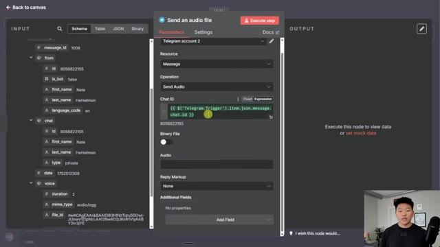
*⏱️ 00:07:17 — Interface de configuration du nœud Telegram dans n8n, montrant le champ 'Chat ID' rempli avec une expression dynamique et le panneau d'entrée de données à gauche.*

---

### ⏱️ `[00:07:31 - 00:07:53]` | Segment #22

**🔊 Audio (Transcription Intégrale Mot pour Mot en Français) :**
> Et donc maintenant je pense que tout est prêt. Je vais cliquer sur exécuter l'étape. Ça va dire que le message de succès a été envoyé. Et maintenant si j'ouvre mon télégramme, nous avons un fichier MP3 que je peux lancer. Fort et clair. Je t'entends comme une chauve-souris dans une grotte. Cool. C'est donc fondamentalement comme ça que cette chose fonctionne. Maintenant gardez à l'esprit, étant donné que ce flux de travail n'est pas actif, si nous voulions que cela fonctionne vraiment, nous devrions l'activer en tant que flux de travail actif.

**👁️ Analyse Visuelle d'Écran (gemini-3.5-flash-lite) :**
**Interface & Outils** : n8n / application Telegram

**Contenu textuel & Code** : Workflow d'automatisation composé de nœuds (Telegram Trigger, Get a file, Transcribe, Convert text to speech, Send an audio file) et interface de discussion Telegram avec un fichier audio "audio.textToSpeech.mp3".

**Action / Démonstration** : Exécution d'un workflow d'automatisation et réception d'un fichier audio généré sur Telegram.

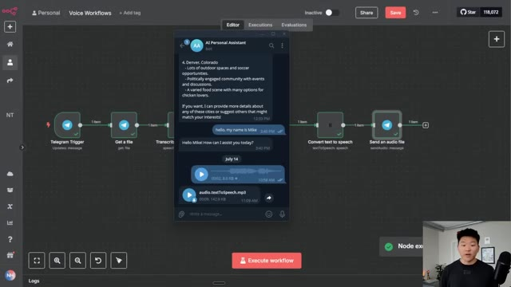
*⏱️ 00:07:37 — Capture d'écran montrant l'interface d'un outil d'automatisation de type n8n avec un workflow de traitement vocal, et une application Telegram ouverte par-dessus affichant un message audio.*

---

### ⏱️ `[00:07:54 - 00:08:31]` | Segment #23

**🔊 Audio (Transcription Intégrale Mot pour Mot en Français) :**
> Et maintenant qu'il est actif, laissez-moi tester un truc complet rapidement. Bonjour, comment se passe votre journée jusqu'à présent ? On envoie ça. Le flux de travail en ce moment devrait avoir capturé cela, en le téléugeant. L'agent IA devrait fonctionner en ce moment pour créer une réponse. 11 Labs va transformer cette réponse en parole. Et puis d'une seconde à l'autre, nous devrions récupérer un fichier audio. Oh, le voilà. Laissez-moi appuyer sur lecture. Salut, ma journée se passe super bien. J'ai déjà répondu à un million de questions et je n'ai même pas transpiré. Et vous ? Vous causez du chaos numérique ou vous vous détendez simplement comme un méchant de chatbot ? Et voilà. C'est donc notre agent cowboy un peu rigolo. D'accord. Donc

**👁️ Analyse Visuelle d'Écran (gemini-3.5-flash-lite) :**
**Interface & Outils** : Application de flux de travail basée sur le web (semblable à n8n ou Flowise) avec une fenêtre de discussion Telegram en superposition.

**Contenu textuel & Code** : Nœuds de workflow comprenant Telegram Trigger, Get a file, Convert text to speech, et Send an audio file, avec la discussion de l'assistant vocal IA.

**Action / Démonstration** : Test du flux de travail actif en envoyant et recevant des messages vocaux via l'interface Telegram.

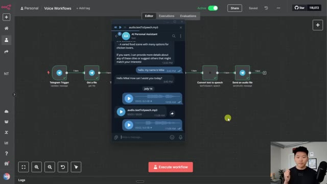
*⏱️ 00:08:03 — Interface de flux de travail montrant un diagramme de nodes avec Telegram et conversion texte-voix, sur lequel est superposée une fenêtre de chat Telegram.*

---

### ⏱️ `[00:08:31 - 00:09:03]` | Segment #24

**🔊 Audio (Transcription Intégrale Mot pour Mot en Français) :**
> c'était la première méthode. Maintenant, ce que nous allons faire, c'est descendre ici et nous allons en faire une deuxième où nous avons réellement un agent vocal conversationnel complet avec Eleven Labs. Donc, nous allons retourner sur Eleven Labs très rapidement. Et ce que nous allons faire, c'est sur ce côté gauche, nous allons aller dans les agents. Donc en haut à gauche, vous allez cliquer sur ces flèches et vous allez choisir IA conversationnelle. Et maintenant, nous pouvons configurer un agent vocal. Donc je vais cliquer sur agents et nous allons en créer un nouveau, que je vais simplement commencer à partir d'un agent vierge. Donc je vais juste l'appeler agent de test. Nous allons procéder à la création, et ensuite

**👁️ Analyse Visuelle d'Écran (gemini-3.5-flash-lite) :**
**Interface & Outils** : Interface web ElevenLabs et éditeur de workflow

**Contenu textuel & Code** : Menus de navigation ElevenLabs (Voices, Agents, Knowledge Base, Tools), statistiques d'appels et graphiques.

**Action / Démonstration** : Navigation dans l'interface d'ElevenLabs pour configurer ou consulter un agent conversationnel vocal.

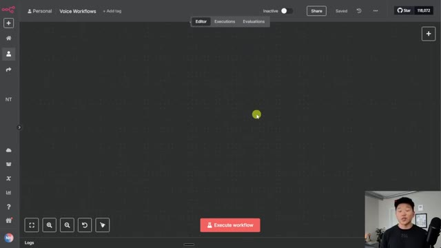
*⏱️ 00:08:39 — Interface d'un éditeur de workflow montrant un espace vide avec un bouton 'Execute workflow' en bas.*

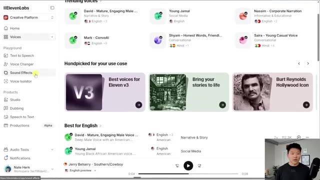
*⏱️ 00:08:47 — Tableau de bord de la plateforme ElevenLabs affichant diverses voix et options audio dans le menu de gauche.*

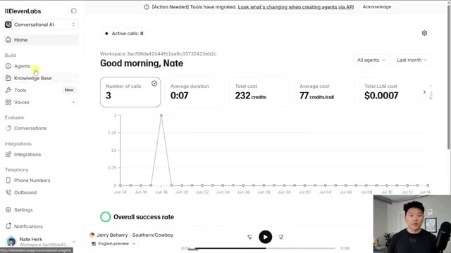
*⏱️ 00:08:55 — Tableau de bord Conversational AI d'ElevenLabs affichant les statistiques d'appels et un graphique d'activité.*

---

### ⏱️ `[00:09:03 - 00:09:35]` | Segment #25

**🔊 Audio (Transcription Intégrale Mot pour Mot en Français) :**
> nous allons devoir configurer certaines choses comme une invite système. Et la chose la plus importante que nous allons configurer est l'appel d'outils. Donc ici même, c'est là que vous pouvez choisir la langue. Vous pouvez également aller ici et choisir la voix. Nous allons simplement laisser la valeur par défaut pour l'instant. Et ensuite, nous pouvons configurer quelque chose comme un premier message. C'est la première chose que l'agent dira lorsque nous l'appellerons. S'il est vide, l'agent attendra que l'utilisateur, nous, commence la conversation. Je vais donc le garder pour l'instant avec bonjour, comment puis-je vous aider aujourd'hui ? Et maintenant, avant de configurer l'invite système, configurons rapidement l'appel d'outil réel pour parler à N8N. Je vais donc simplement faire défiler vers le bas et nous allons

**👁️ Analyse Visuelle d'Écran (gemini-3.5-flash-lite) :**
**Interface & Outils** : Interface web de configuration d'agent ElevenLabs Conversational AI

**Contenu textuel & Code** : Paramètres de l'agent : sélection de la voix (Voice), support multi-voix, option Use Flash, et menu latéral de navigation (Agents, Knowledge Base, Tools, Voices).

**Action / Démonstration** : Le présentateur montre l'onglet des paramètres vocaux pour choisir la voix de l'agent ElevenLabs.

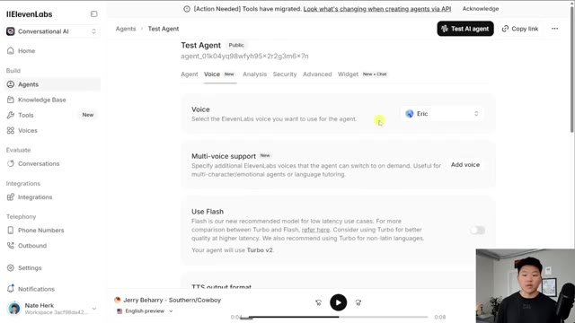
*⏱️ 00:09:11 — Interface web d'ElevenLabs montrant les paramètres vocaux de configuration d'un agent conversationnel IA (Test Agent) avec le choix de la voix (Eric).*

---

### ⏱️ `[00:09:35 - 00:10:04]` | Segment #26

**🔊 Audio (Transcription Intégrale Mot pour Mot en Français) :**
> pour chercher des outils. Voici où vous pourriez personnaliser le fait de laisser votre agent terminer l'appel, ce à quoi nous allons lui donner accès. Nous pouvons faire en sorte qu'il soit transféré vers un autre agent, transféré vers un numéro, tout ce genre de choses. Ce que nous cherchons à faire, c'est d'ajouter un outil personnalisé, ce qui nous permettra d'envoyer des données à N8N et ensuite N8N pourra renvoyer des données à notre agent. Je vais donc cliquer sur ajouter un outil. Vous pouvez voir que nous avons tous ces outils N8N que nous avons utilisés par le passé, mais évidemment nous allons en créer un nouveau. Je vais donc cliquer sur ajouter un outil webhook. Je vais appeler l'outil NNN. La description est appeler cet outil pour effectuer une recherche sur le web.

**👁️ Analyse Visuelle d'Écran (gemini-3.5-flash-lite) :**
**Interface & Outils** : Interface web ElevenLabs (Conversational AI)

**Contenu textuel & Code** : Menu "Tools" avec les options : End call, Detect language, Skip turn, Transfer to agent, Transfer to number, Play keypad touch tone, Custom tools, et Custom MCP Servers.

**Action / Démonstration** : Présentation des différents outils et permissions configurables pour l'agent conversationnel.

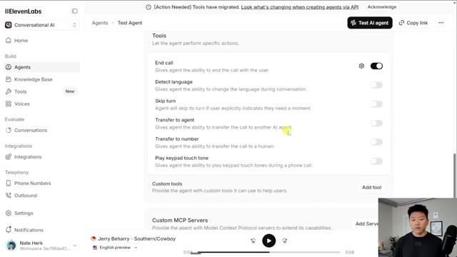
*⏱️ 00:09:42 — Interface de configuration des outils d'un agent conversationnel sur la plateforme ElevenLabs, affichant les options de fin d'appel et de transfert.*

---

### ⏱️ `[00:10:05 - 00:10:24]` | Segment #27

**🔊 Audio (Transcription Intégrale Mot pour Mot en Français) :**
> Dans ce cas d'utilisation, nous allons simplement faire en sorte que l'agent envoie des données à NNN. L'agent IA NNN va les chercher en ligne, puis renvoyer une réponse. Et ensuite, ce que nous devons faire, c'est configurer la méthode. Donc, ce sera « post » parce que nous lui envoyons des données. Et maintenant, nous devons aller récupérer notre URL de webhook NNN pour y envoyer des données. Nous allons donc retourner dans NNNN. Nous allons ajouter un webhook.

**👁️ Analyse Visuelle d'Écran (gemini-3.5-flash-lite) :**
**Interface & Outils** : Interface web ElevenLabs (Conversational AI / Agents)

**Contenu textuel & Code** : Formulaire de configuration d'un outil webhook : Name: n8n, Description: Call this tool to search the web, Method: GET, URL, Response timeout.

**Action / Démonstration** : Le présentateur configure les paramètres d'un outil webhook pour connecter l'agent IA à n8n.

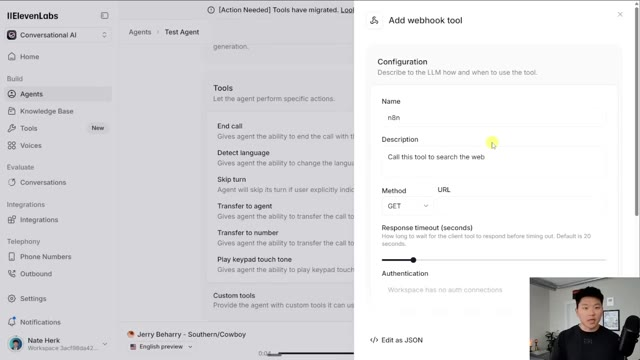
*⏱️ 00:10:09 — Interface d'ElevenLabs affichant la configuration d'un outil webhook (« Add webhook tool ») avec les champs Nom, Description, Méthode (GET sélectionné par défaut) et URL.*

---

### ⏱️ `[00:10:24 - 00:10:55]` | Segment #28

**🔊 Audio (Transcription Intégrale Mot pour Mot en Français) :**
> Et maintenant, nous allons simplement récupérer cette URL ici. Nous devons également nous assurer que notre méthode est changée en "post", puisque c'est ainsi que nous l'avons configurée dans ElevenLabs, et nous voulons nous assurer que cet élément peut recevoir des données. Donc, maintenant que j'ai copié cette URL, je vais la coller directement ici, puis je vais simplement définir le délai d'expiration de la réponse aussi haut que possible, car nous ne savons pas combien de temps cela peut prendre pour faire une recherche sur Internet. Maintenant, pour ces en-têtes, ces paramètres de chemin et ces paramètres de requête, nous ne allons pas trop nous en préoccuper. Nous allons ajouter un seul paramètre de corps, qui sera la requête de recherche elle-même.

**👁️ Analyse Visuelle d'Écran (gemini-3.5-flash-lite) :**
**Interface & Outils** : n8n, ElevenLabs (Conversational AI)

**Contenu textuel & Code** : URL de webhook n8n (https://nateherk.app.n8n.cloud/webhook-test/...) et configuration de la méthode HTTP POST.

**Action / Démonstration** : Copie de l'URL du webhook depuis n8n pour la configurer dans l'outil d'ElevenLabs avec la méthode POST.

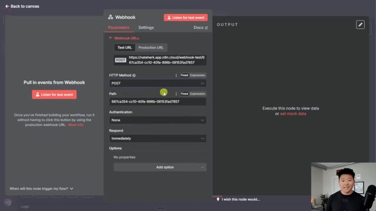
*⏱️ 00:10:32 — Interface n8n montrant la configuration d'un nœud Webhook avec la méthode HTTP réglée sur POST et l'URL du webhook affichée.*

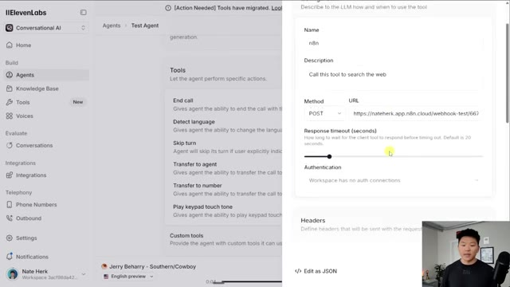
*⏱️ 00:10:40 — Interface d'ElevenLabs (Agents Conversational AI) montrant les paramètres d'un outil avec les champs Nom, Description, Méthode (POST) et URL.*

---

### ⏱️ `[00:10:55 - 00:11:15]` | Segment #29

**🔊 Audio (Transcription Intégrale Mot pour Mot en Français) :**
> Donc pour la description, j'ai dit : vous allez extraire la requête de recherche que l'utilisateur cherche à trouver pour obtenir plus d'informations. La chaîne de caractères que nous allons envoyer sera une requête de recherche. Nous ferons cela en *camel case*. Ce sera obligatoire. Et ensuite, nous pouvons configurer cela soit pour que le LLM l'extraie fondamentalement de notre conversation. Vous pourriez utiliser une variable dynamique ou une variable constante.

**👁️ Analyse Visuelle d'Écran (gemini-3.5-flash-lite) :**
**Interface & Outils** : Interface web ElevenLabs (Conversational AI - Agents)

**Contenu textuel & Code** : Description : "Extract the search query the user is looking to find more information on", Data type : String, Identifier, Value Type : LLM Prompt.

**Action / Démonstration** : Configuration d'un outil personnalisé pour un agent IA avec saisie des paramètres de données.

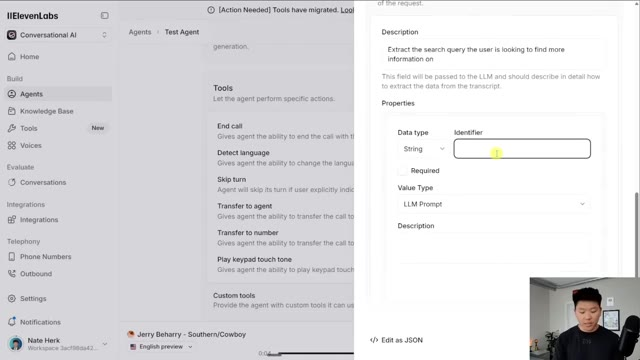
*⏱️ 00:11:00 — Interface d'ElevenLabs montrant la configuration d'un outil pour agent conversationnel IA, avec les champs de description des propriétés.*

---

### ⏱️ `[00:11:15 - 00:11:40]` | Segment #30

**🔊 Audio (Transcription Intégrale Mot pour Mot en Français) :**
> Nous allons laisser cela ici comme un prompt de LLM. Et ensuite, la description de ce paramètre de corps est ce que l'utilisateur veut rechercher en ligne. Donc je vais aller de l'avant et ajouter ceci comme un outil. Ainsi, vous pouvez voir que l'agent a accès à notre outil NNN. Donc maintenant, c'est pourquoi je voulais le configurer avant de lui donner notre system prompt, parce que nous devons dire à l'agent comment se comporter. Donc ce que je vais faire, c'est utiliser cette fonction de description avec l'IA où je peux fondamentalement dire à cette boîte de 11 Labs ce que nous voulons que l'agent fasse, et ensuite elle nous générera un system prompt.

**👁️ Analyse Visuelle d'Écran (gemini-3.5-flash-lite) :**
**Interface & Outils** : Interface web de ElevenLabs (Conversational AI / Agents).

**Contenu textuel & Code** : Propriétés de l'outil avec l'identifiant 'searchQuery', type de valeur 'LLM Prompt', et sélection du modèle LLM Gemini 2.0 Flash.

**Action / Démonstration** : Configuration d'un outil personnalisé pour l'agent vocal avec un paramètre piloté par le LLM.

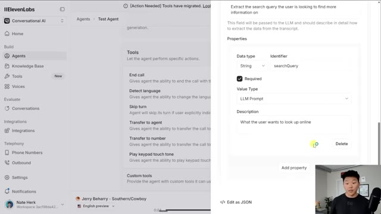
*⏱️ 00:11:21 — Interface d'ElevenLabs montrant le panneau latéral de configuration d'un outil avec la propriété 'searchQuery' réglée sur 'LLM Prompt' et la description 'What the user wants to look up online'.*

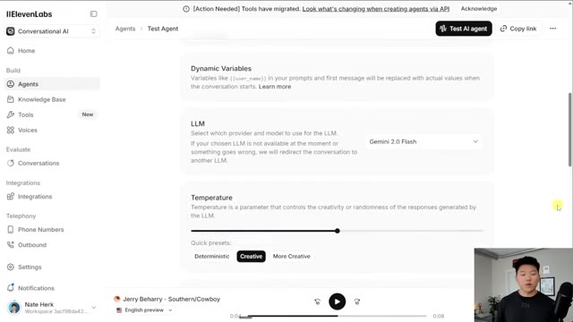
*⏱️ 00:11:27 — Interface d'ElevenLabs affichant les paramètres de l'agent IA, notamment le modèle LLM sélectionné (Gemini 2.0 Flash) et le réglage de la température.*

---

### ⏱️ `[00:11:40 - 00:11:59]` | Segment #31

**🔊 Audio (Transcription Intégrale Mot pour Mot en Français) :**
> Très bien, alors j'ai dit que je voulais créer un agent de recherche utile qui aidera l'utilisateur à faire des recherches et à trouver plus d'informations en utilisant le web. Nous allons cliquer sur générer avec l'IA et cela devrait nous générer une consigne système. Nous avons donc une personnalité, il s'appelle Rémy. Nous avons un environnement, un ton, un objectif. Et puis la seule chose qu'on a oublié de faire, c'est de lui dire quel outil utiliser.

**👁️ Analyse Visuelle d'Écran (gemini-3.5-flash-lite) :**
**Interface & Outils** : ElevenLabs (Conversational AI / Agents)

**Contenu textuel & Code** : Texte du prompt système saisi : "helpful research agent that will help the user do research and find more information using the web".

**Action / Démonstration** : Saisie de la description de l'agent de recherche pour la génération du prompt système par l'IA.

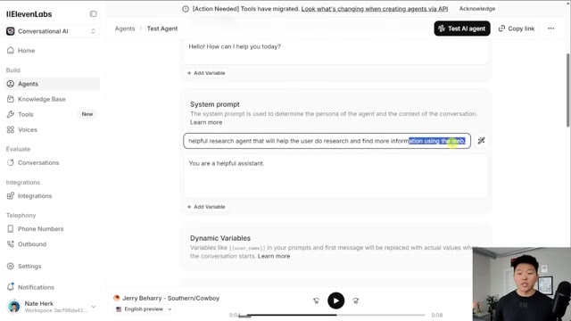
*⏱️ 00:11:45 — Interface web d'ElevenLabs montrant la configuration d'un agent IA avec un champ de saisie de prompt système.*

---

### ⏱️ `[00:11:59 - 00:12:19]` | Segment #32

**🔊 Audio (Transcription Intégrale Mot pour Mot en Français) :**
> Donc je vais juste changer ça manuellement. Ce que je vais faire, c'est que je vais dire que l'outil s'appelle NNN et nous allons utiliser cet outil pour faire des recherches sur le web et mener des recherches. Et puis j'ai aussi dit que cet outil ferait des recherches et renverrait une réponse. Donc vous devez attendre cette réponse. Ce que nous allons faire, c'est évidemment devoir tester cet agent pour voir s'il fonctionne.

**👁️ Analyse Visuelle d'Écran (gemini-3.5-flash-lite) :**
**Interface & Outils** : Interface web d'ElevenLabs (Conversational AI / Agents)

**Contenu textuel & Code** : Texte de configuration de l'agent incluant les sections Guardrails et Tools avec la mention de l'outil 'n8n'.

**Action / Démonstration** : Modification manuelle des instructions de l'agent pour intégrer et nommer l'outil de recherche web 'n8n'.

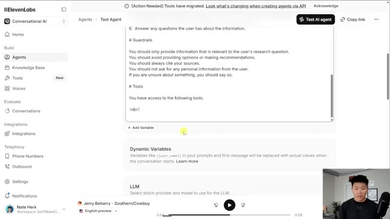
*⏱️ 00:12:04 — Interface web d'ElevenLabs montrant la configuration des instructions et des outils d'un agent conversationnel IA, avec le nom d'outil 'n8n' saisi dans le champ des outils.*

---

### ⏱️ `[00:12:19 - 00:12:38]` | Segment #33

**🔊 Audio (Transcription Intégrale Mot pour Mot en Français) :**
> Donc je vais m'assurer de sauvegarder ceci au bas de ce flux de travail. Et ensuite, ce que je vais faire, c'est cliquer sur Tester l'agent IA. Donc, lorsque vous cliquez sur Tester l'agent IA, cela va ouvrir une petite boîte de test comme celle-ci. Et avant de l'appeler réellement, nous voulons nous assurer que notre webhook dans N8N est à notre écoute. Donc maintenant, il écoute. Nous allons retourner dans ce champ de test et parler à l'agent.

**👁️ Analyse Visuelle d'Écran (gemini-3.5-flash-lite) :**
**Interface & Outils** : ElevenLabs Conversational AI, interface de workflow visuel

**Contenu textuel & Code** : Paramètres de l'agent IA, options de langue, premier message, et nœud de webhook.

**Action / Démonstration** : Clic sur 'Test AI agent' pour ouvrir la boîte de test et préparation de l'appel de l'agent.

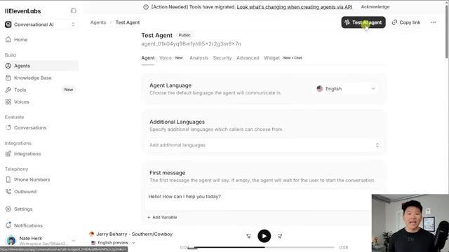
*⏱️ 00:12:24 — Interface ElevenLabs affichant la configuration d'un agent IA avec le bouton 'Test AI agent' mis en évidence.*

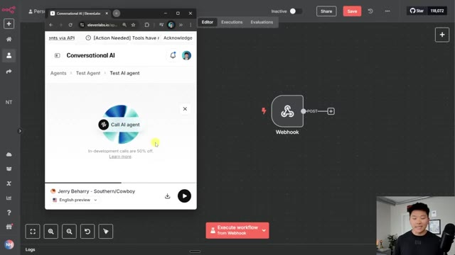
*⏱️ 00:12:29 — Affichage d'une fenêtre pop-up de test d'agent IA par-dessus un diagramme de workflow interactif avec un webhook.*

*⏱️ 00:12:33 — Vue du workflow en attente d'un événement déclencheur (Waiting for trigger event from Webhook) en bas de l'interface.*

---

### ⏱️ `[00:12:38 - 00:13:01]` | Segment #34

**🔊 Audio (Transcription Intégrale Mot pour Mot en Français) :**
> Bonjour, comment puis-je vous aider aujourd'hui ? Bonjour, je cherche à faire des recherches sur NVIDIA. D'accord, je peux vous aider avec ça. Y a-t-il quelque chose de spécifique que vous aimeriez savoir sur NVIDIA ? Par exemple, êtes-vous intéressé par leur cours de bourse, leurs produits ou autre chose ? Ouais, regardons simplement leurs prévisions pour le quatrième trimestre 2025.

**👁️ Analyse Visuelle d'Écran (gemini-3.5-flash-lite) :**
**Interface & Outils** : Navigateur web (ElevenLabs Conversational AI) et plateforme d'automatisation de type workflow/no-code.

**Contenu textuel & Code** : Interface de test d'agent vocal avec les mentions "Conversational AI", "Test Agent", un indicateur visuel "Listening", une zone de texte "Ask anything" et un bouton "Send".

**Action / Démonstration** : Test en direct de l'agent conversationnel vocal intégré à la plateforme d'automatisation.

*⏱️ 00:12:44 — Interface d'un agent conversationnel ElevenLabs affichée dans une fenêtre superposée à un éditeur de workflow avec un nœud Webhook.*

---

### ⏱️ `[00:13:01 - 00:13:19]` | Segment #35

**🔊 Audio (Transcription Intégrale Mot pour Mot en Français) :**
> D'accord, je vais chercher les prévisions de NVIDIA pour le Q4 2025. Juste pour confirmer, vous cherchez leurs prévisions financières pour le quatrième trimestre de l'année 2025, c'est bien ça ? C'est exact. D'accord, j'ai lancé une recherche pour le Q4 2025 de NVIDIA. D'accord, donc je vais mettre fin à cet appel.

**👁️ Analyse Visuelle d'Écran (gemini-3.5-flash-lite) :**
**Interface & Outils** : Interface web d'ElevenLabs (Conversational AI) et éditeur de workflow de type canvas.

**Contenu textuel & Code** : Interface de test affichant "Talk to interrupt", "Ask anything", un bouton "Send" et une configuration vocale ("Jerry Beharry - Southern/Cowboy"), ainsi qu'un nœud Webhook en attente d'appel à droite.

**Action / Démonstration** : Test en direct de l'agent conversationnel vocal en cours de configuration ou d'exécution.

*⏱️ 00:13:05 — Une fenêtre de test d'agent conversationnel ElevenLabs ouverte au premier plan avec une interface de discussion vocale, par-dessus un éditeur de workflow avec un nœud Webhook.*

---

### ⏱️ `[00:13:19 - 00:13:38]` | Segment #36

**🔊 Audio (Transcription Intégrale Mot pour Mot en Français) :**
> Ce que je n'ai pas aimé, c'est le temps qu'il a fallu pour envoyer les données au webhook. Vous pouvez voir qu'on l'a capturé, mais on aimerait peut-être que ce soit un peu plus direct, donc on va modifier ça dans les prompts système plus tard. Mais ce qu'on peut voir, c'est qu'on a réussi à faire envoyer les données par l'agent ElevenLabs vers n8n. Donc je vais juste épingler ça pour qu'on puisse le sauvegarder pour l'instant et qu'on n'ait pas à continuer à parler à Remy.

**👁️ Analyse Visuelle d'Écran (gemini-3.5-flash-lite) :**
**Interface & Outils** : n8n (éditeur de workflow), interface web de test d'agent.

**Contenu textuel & Code** : URL de webhook POST, en-têtes HTTP (host, user-agent Python/3.12, content-type).

**Action / Démonstration** : Visualisation des données capturées par le webhook après l'exécution d'un flux d'agent vocal.

*⏱️ 00:13:24 — Interface n8n avec une fenêtre de test d'agent vocal ouverte en superposition.*

*⏱️ 00:13:29 — Vue principale de l'éditeur de workflow n8n montrant un nœud Webhook.*

*⏱️ 00:13:33 — Panneau de configuration du nœud Webhook dans n8n avec les détails de l'URL et les résultats de sortie.*

---

### ⏱️ `[00:13:38 - 00:14:02]` | Segment #37

**🔊 Audio (Transcription Intégrale Mot pour Mot en Français) :**
> Mais en bas, vous pouvez voir qu'il a rempli notre requête de recherche avec « prévisions NVIDIA T4 2025 », ce qui est exactement ce que nous voulions. Donc maintenant, il nous suffit de configurer un agent IA qui recevra ce message et utilisera ensuite un outil pour faire des recherches dessus. Mais en fait, je ne veux même pas utiliser d'agent parce que ce serait du double traitement. Parce que ce qui se passe dans ElevenLabs, c'est que nous utilisons un agent IA pour converser et réfléchir à l'appel d'outils.

**👁️ Analyse Visuelle d'Écran (gemini-3.5-flash-lite) :**
**Interface & Outils** : Interface web de l'outil d'automatisation n8n (nœud Webhook).

**Contenu textuel & Code** : URL du webhook POST, méthode HTTP, et panneau de sortie (Output) montrant dans le corps (body) la requête « searchQuery: NVIDIA Q4 2025 forecast ».

**Action / Démonstration** : Visualisation des données de test reçues par le webhook pour valider le déclenchement du flux de travail.

*⏱️ 00:13:44 — Configuration d'un nœud Webhook dans l'interface n8n, affichant les détails de la requête reçue avec le paramètre de recherche NVIDIA Q4 2025.*

---

### ⏱️ `[00:14:02 - 00:14:22]` | Segment #38

**🔊 Audio (Transcription Intégrale Mot pour Mot en Français) :**
> Il finit par décider d'appeler cet outil. Et ensuite, ce qui se passe, c'est que si nous devions créer un autre agent ici avec un autre aspect de raisonnement, cela ne ferait que dupliquer ça sans aucune raison. Donc, ce qui serait peut-être plus intelligent, c'est que dans 11labs, nous configurions ce webhook de workflow comme un outil appelé research. Et ensuite, nous pouvons envoyer des données à cet outil juste pour qu'elles fassent l'objet de recherches.

**👁️ Analyse Visuelle d'Écran (gemini-3.5-flash-lite) :**
**Interface & Outils** : Éditeur de workflow web (similaire à n8n) nommé "Voice Workflows".

**Contenu textuel & Code** : Un bloc "Webhook" violet avec une icône d'éclair, relié à un connecteur vert affichant "1 item - POST".

**Action / Démonstration** : Le présentateur explique la structure du workflow d'automatisation vocale et la configuration des appels d'outils.

*⏱️ 00:14:07 — Interface d'un éditeur de workflow montrant un nœud Webhook connecté à un point d'entrée sur une grille sombre.*

---

### ⏱️ `[00:14:22 - 00:14:44]` | Segment #39

**🔊 Audio (Transcription Intégrale Mot pour Mot en Français) :**
> Et c'est ce qu'on va faire ici. Donc plutôt que de passer ces données à un agent, je vais simplement les passer dans un nœud Perplexity qui va faire des recherches. Je vais donc cliquer sur ce bouton, je vais taper Perplexity, on va récupérer ceci juste ici, puis on va envoyer un message à un modèle. J'ai déjà configuré Perplexity, mais si ce n'est pas votre cas, de la même manière que vous avez configuré OpenRouter et ElevenLabs, il vous suffit d'aller récupérer une clé API sur perplexity.ai.

**👁️ Analyse Visuelle d'Écran (gemini-3.5-flash-lite) :**
**Interface & Outils** : Interface de workflow (type n8n / outil low-code).

**Contenu textuel & Code** : Paramètres du nœud avec les champs 'Credential to connect with' (Perplexity account), 'Operation' (Message a Model), 'Model' (R1-1776) et les données JSON d'entrée du webhook.

**Action / Démonstration** : Configuration d'un nœud pour intégrer l'API Perplexity et envoyer un message au modèle.

*⏱️ 00:14:27 — Interface d'un éditeur de workflow montrant un nœud unique 'Webhook' sur le canevas.*

*⏱️ 00:14:38 — Panneau de configuration du nœud 'Message a model' configuré avec les identifiants Perplexity.*

---

### ⏱️ `[00:14:44 - 00:15:02]` | Segment #40

**🔊 Audio (Transcription Intégrale Mot pour Mot en Français) :**
> Et ensuite, je vais simplement choisir sonar pour le texte réel sur lequel faire des recherches, nous allons glisser la requête de recherche que notre agent ElevenLabs a envoyée. Et je vais aussi simplifier la sortie parce que nous ne voulons pas renvoyer à l'agent une tonne d'informations. Donc nous allons exécuter l'étape et nous verrons quel genre de résultats nous obtenons de ce nœud.

**👁️ Analyse Visuelle d'Écran (gemini-3.5-flash-lite) :**
**Interface & Outils** : Interface web n8n (éditeur de workflow / configuration de nœud)

**Contenu textuel & Code** : Paramètres du nœud « Message a model » (modèle Sonar, Perplexity account, champ Text vide avec option d'expression, option « Simplify Output » en bas).

**Action / Démonstration** : Le présentateur configure le nœud de modèle pour l'intégrer au workflow de l'agent.

*⏱️ 00:14:48 — Configuration d'un nœud de workflow dans n8n pour se connecter au modèle Perplexity (Sonar) et y insérer une requête de recherche (searchQuery).*

---

### ⏱️ `[00:15:02 - 00:15:20]` | Segment #41

**🔊 Audio (Transcription Intégrale Mot pour Mot en Français) :**
> D'accord, alors voici le message que nous avons reçu en retour et nous avons un petit résumé rapide qui semble être là en bas. Bien qu'en fait, voyons à quel point il est vraiment court. Il a été tiré de cinq sources différentes et le message est honnêtement assez long. Donc ce que nous voudrons probablement faire, c'est injecter ce message dans une étape d'IA qui va simplement résumer pour l'essentiel les points clés.

**👁️ Analyse Visuelle d'Écran (gemini-3.5-flash-lite) :**
**Interface & Outils** : n8n (éditeur de workflow d'automatisation)

**Contenu textuel & Code** : Paramètres du nœud avec l'identifiant Perplexity, le modèle "Sonar", et un message textuel basé sur une variable JSON (`{{ $json.body.searchQuery }}`) ainsi que les données d'entrée/sortie.

**Action / Démonstration** : Le présentateur examine les résultats renvoyés par l'appel au modèle d'IA dans l'interface de n8n.

*⏱️ 00:15:06 — Interface d'un nœud dans n8n montrant les paramètres d'un module "Message a model" connecté à un compte Perplexity (modèle Sonar) avec l'input et l'output affichés de part et d'autre.*

---

### ⏱️ `[00:15:20 - 00:15:41]` | Segment #42

**🔊 Audio (Transcription Intégrale Mot pour Mot en Français) :**
> Donc c'est ce que je vais faire très rapidement. Nous allons faire ça avec un agent IA. Et ça ne prendra pas aussi longtemps parce qu'il n'y a pas de prise de décision en cours. Nous utilisons simplement l'agent pour traiter et résumer l'information. Donc encore une fois, nous n'utilisons pas le nœud de déclenchement de chat connecté. Nous allons glisser la sortie de Perplexity, qui est juste ici. Et ensuite pour le message système, je vais ajouter quelque chose très rapidement.

**👁️ Analyse Visuelle d'Écran (gemini-3.5-flash-lite) :**
**Interface & Outils** : n8n (Interface de workflow d'automatisation)

**Contenu textuel & Code** : Panneau de configuration 'AI Agent1' avec le prompt configuré sur '{{ $json.chatInput }}', un panneau 'INPUT' affichant un objet JSON avec des liens de citations et un champ 'message' contenant un résumé financier de NVIDIA.

**Action / Démonstration** : Configuration des paramètres du nœud 'AI Agent' et visualisation des données d'entrée JSON.

*⏱️ 00:15:25 — Vue rapprochée d'un panneau de configuration pour un nœud 'AI Agent' dans n8n, montrant les paramètres du prompt, le panneau d'entrée avec des données structurées contenant des citations web et un message sur les résultats financiers de NVIDIA, et le panneau de sortie vide.*

---

### ⏱️ `[00:15:41 - 00:16:07]` | Segment #43

**🔊 Audio (Transcription Intégrale Mot pour Mot en Français) :**
> Bon, alors pour les besoins de la démo, je dis que tu es un agent de recherche expert, tu vas recevoir des informations et tu dois faire un résumé concis. Ça ne devrait faire qu'environ trois phrases. Très rapidement, je vais connecter un autre modèle de chat OpenRouter pour traiter cette information, et on va tester ça pour voir à quel point le résumé qu'il fait est concis. Donc on obtient en gros, NVIDIA a annoncé un chiffre d'affaires solide pour le T4, 39 milliards, bla-bla-bla, ça a vraiment l'air mieux comme résumé qu'on peut renvoyer à notre agent vocal dans ElevenLabs.

**👁️ Analyse Visuelle d'Écran (gemini-3.5-flash-lite) :**
**Interface & Outils** : Interface de workflow d'automatisation (type n8n) avec un panneau de configuration pour un agent IA.

**Contenu textuel & Code** : Prompt système : "You are an expert research agent. You will be fed information, and you need to make a concise summary."

**Action / Démonstration** : Configuration et visualisation des entrées/sorties d'un agent de chat IA au sein du workflow.

*⏱️ 00:15:47 — Gros plan sur une expression JavaScript et son résultat dans l'interface montrant le rôle d'agent de recherche expert.*

*⏱️ 00:16:01 — Vue globale de l'interface d'un nœud d'agent IA montrant les paramètres, le prompt utilisateur et la sortie générée sur NVIDIA.*

---

### ⏱️ `[00:16:07 - 00:16:30]` | Segment #44

**🔊 Audio (Transcription Intégrale Mot pour Mot en Français) :**
> Donc la dernière partie de ceci est que nous devons utiliser un nœud de réponse au webhook pour le renvoyer. Je vais donc taper « respond », nous allons prendre « respond to webhook », et il va simplement renvoyer le premier élément entrant, qui est déjà la sortie de cet agent IA. Si vous vouliez spécifier plus en détail, vous pourriez évidemment choisir ici même. Mais pour que cela fonctionne, nous devons nous assurer que c'est configuré correctement de l'autre côté.

**👁️ Analyse Visuelle d'Écran (gemini-3.5-flash-lite) :**
**Interface & Outils** : n8n (éditeur de workflows d'automatisation)

**Contenu textuel & Code** : Nœuds de workflow connectés (Webhook -> Message a model -> AI Agent1 -> OpenRouter) et panneau de configuration du nœud « Respond to Webhook » avec les données d'entrée JSON/Output.

**Action / Démonstration** : Ajout et configuration d'un nœud « Respond to Webhook » pour renvoyer le premier élément entrant (la sortie de l'agent IA).

*⏱️ 00:16:13 — Vue d'ensemble du workflow n8n avec les nœuds Webhook, Message a model, AI Agent1, OpenRouter Chat Model1, et le panneau latéral de recherche affichant « Respond to webhook ».*

*⏱️ 00:16:19 — Interface de configuration du nœud « Respond to Webhook » dans n8n, montrant les paramètres avec l'option « Respond With : First Incoming Item » et les données d'entrée issues de l'agent IA.*

---

### ⏱️ `[00:16:30 - 00:16:51]` | Segment #45

**🔊 Audio (Transcription Intégrale Mot pour Mot en Français) :**
> Donc ici même dans le webhook, vous pouvez voir qu'il va répondre immédiatement. Mais ce que nous voulons faire, c'est répondre en utilisant le nœud de réponse au webhook. Donc maintenant, je vais détacher ces données. Nous allons sauvegarder ce flux de travail et je vais fondamentalement le tester à nouveau. Donc maintenant, il est à notre écoute. Et ce que je peux faire, c'est ouvrir rapidement notre 11 Labs, tester l'agent IA, et nous réessaierons.

**👁️ Analyse Visuelle d'Écran (gemini-3.5-flash-lite) :**
**Interface & Outils** : n8n (outil d'automatisation de workflows visuels)

**Contenu textuel & Code** : Nœuds de workflow connectés : Webhook, Message a model, AI Agent1, OpenRouter Chat Model1, et Respond to Webhook.
[DESC_IMAGE_1] Configuration des paramètres du webhook et visualisation des données de sortie dans n8n.
[DESC_IMAGE_2] Vue d'ensemble du flux de travail d'automatisation vocal sur le canevas n8n.

**Action / Démonstration** : Configuration du nœud Webhook pour utiliser l'option de réponse dédiée ('Respond to Webhook' Node) et visualisation du flux de travail complet.

*⏱️ 00:16:35 — L'interface de configuration du nœud Webhook dans l'outil n8n, montrant les paramètres HTTP et les données de sortie.*

*⏱️ 00:16:41 — Le canevas complet du workflow n8n montrant l'enchaînement des nœuds : Webhook, Message a model, AI Agent et Respond to Webhook.*

---

### ⏱️ `[00:16:51 - 00:17:13]` | Segment #46

**🔊 Audio (Transcription Intégrale Mot pour Mot en Français) :**
> Bonjour, comment puis-je vous aider aujourd'hui ? Bonjour, je cherche à faire des recherches. D'accord, je peux vous aider avec ça. Quel sujet recherchez-vous ? Plus vous êtes précis, mieux je peux vous aider. Pouvez-vous s'il vous plaît trouver la différence entre les chiens et les chats ? D'accord, je peux certainement vous aider avec ça. Je vais utiliser mon outil de recherche pour trouver les principales différences entre les chiens et les chats.

**👁️ Analyse Visuelle d'Écran (gemini-3.5-flash-lite) :**
**Interface & Outils** : Navigateur web affichant une interface d'agent conversationnel et un outil d'automatisation de type workflow/n8n.

**Contenu textuel & Code** : Nœuds de workflow connectés (Webhook, Message a model, AI Agent relié à OpenRouter Chat Model, Respond to Webhook) et interface de chat test "Conversational AI".

**Action / Démonstration** : Test d'un agent conversationnel en cours d'exécution dans un workflow d'automatisation.

*⏱️ 00:16:57 — Capture d'écran montrant à gauche une interface de test d'agent conversationnel (similaire à ElevenLabs) avec un champ de discussion et une fenêtre pop-up vocale, et à droite un éditeur de workflow de type n8n ou similaire avec un nœud Webhook, AI Agent et OpenRouter.*

---

### ⏱️ `[00:17:13 - 00:17:38]` | Segment #47

**🔊 Audio (Transcription Intégrale Mot pour Mot en Français) :**
> Donnez-moi un moment pour rassembler l'information. D'accord, j'ai trouvé quelques informations pour vous. Les chiens et les chats diffèrent considérablement à plusieurs égards. Les chiens sont généralement plus sociaux et actifs pendant la journée, nécessitant de l'exercice régulier, du toilettage et de l'espace extérieur. Les chats, en revanche, ont tendance à être plus indépendants, sont souvent plus actifs la nuit, et ont besoin de moins de toilettage et d'espace, faisant souvent leur exercice à l'intérieur.

**👁️ Analyse Visuelle d'Écran (gemini-3.5-flash-lite) :**
**Interface & Outils** : n8n (éditeur de workflow) et interface web de test d'agent conversationnel ElevenLabs.

**Contenu textuel & Code** : Diagramme de nœuds d'automatisation (Webhook -> Message a model -> AI Agent -> Respond to Webhook) et interface de chat vocal avec la voix de Jerry Beharry.

**Action / Démonstration** : Test en cours d'un agent conversationnel intégré au workflow d'automatisation.

*⏱️ 00:17:19 — Capture d'écran montrant une interface de workflow d'automatisation (type n8n) à l'arrière-plan avec un diagramme reliant un Webhook, un modèle de message, un agent IA (OpenRouter Chat Model) et une réponse, ainsi qu'une fenêtre contextuelle de test d'intelligence artificielle conversationnelle (ElevenLabs) affichant une interface de discussion vocale.*

---

### ⏱️ `[00:17:38 - 00:17:59]` | Segment #48

**🔊 Audio (Transcription Intégrale Mot pour Mot en Français) :**
> De plus, les chiens communiquent ouvertement par leur langage corporel et leurs vocalisations comme les aboiements, tandis que les chats utilisent des indices plus subtils et des sons différents comme les miaulements. Y avait-il quelque chose de spécifique concernant les différences entre les chats et les pauvres... entre les chats et les chiens que vous vouliez savoir ? Non, c'est tout, merci. Parfait, je suis ravi d'avoir pu vous aider, passez une excellente journée.

**👁️ Analyse Visuelle d'Écran (gemini-3.5-flash-lite) :**
**Interface & Outils** : n8n (éditeur de workflow), interface web ElevenLabs (Conversational AI), navigateur web.

**Contenu textuel & Code** : Workflow n8n avec blocs Webhook, Message a model, AI Agent1, OpenRouter Chat Model1 et Respond to Webhook. Fenêtre de test d'agent vocal avec le texte "Talk to interrupt" et le texte incrusté "Wow this guy loves to yap".

**Action / Démonstration** : Configuration et test en cours d'un agent conversationnel IA alimenté par ElevenLabs et orchestré via n8n.

*⏱️ 00:17:43 — Un écran partagé montrant une interface de test d'agent conversationnel ElevenLabs à gauche, et un diagramme de workflow n8n à droite avec des blocs Webhook, AI Agent et OpenRouter.*

---

### ⏱️ `[00:17:59 - 00:18:18]` | Segment #49

**🔊 Audio (Transcription Intégrale Mot pour Mot en Français) :**
> Cool, d'accord, donc c'était genre pas super concis, mais ce n'est pas grave, mais l'agent, vous avez pu voir que lorsqu'il a réalisé que nous en avions fini avec notre intention, qui était de rechercher des chiens et des chats, il a mis fin à l'appel de lui-même. Donc, pour plonger dans ce qui s'est passé ici, l'agent vocal a envoyé des données au webhook. Le webhook va attendre la réponse.

**👁️ Analyse Visuelle d'Écran (gemini-3.5-flash-lite) :**
**Interface & Outils** : Interface n8n et interface de test Conversational AI d'ElevenLabs.

**Contenu textuel & Code** : Nœuds de workflow : Webhook, Message a a model, AI Agent1 relié à OpenRouter Chat Model1, et Respond to Webhook.

**Action / Démonstration** : Visualisation et explication du flux d'automatisation et du comportement de l'agent conversationnel.

*⏱️ 00:18:04 — L'écran affiche un workflow de type n8n avec une fenêtre de test d'agent vocal ElevenLabs superposée à gauche, et le présentateur en médaillon en bas à droite.*

*⏱️ 00:18:13 — L'éditeur de workflow n8n en plein écran montrant les nœuds Webhook, Message a a model, AI Agent1 et Respond to Webhook.*

---

### ⏱️ `[00:18:18 - 00:18:41]` | Segment #50

**🔊 Audio (Transcription Intégrale Mot pour Mot en Français) :**
> Effectue des recherches, l'agent résume, envoie un résumé en retour à l'agent, et vous pouvez voir qu'dès qu'il a terminé, c'est à ce moment-là que Remy s'est remis à parler. Et évidemment ce que vous auriez à faire, c'est de prompter cela un petit peu différemment si vous voulez un type de sortie différent. Et bien sûr, vous auriez besoin de venir dans votre agent vocal et de retourner dans le prompt système réel de celui-ci si vous n'aimiez pas le déroulement de la conversation.

**👁️ Analyse Visuelle d'Écran (gemini-3.5-flash-lite) :**
**Interface & Outils** : n8n et interface web ElevenLabs Conversational AI

**Contenu textuel & Code** : Nœuds de workflow n8n (Webhook, Message a model, AI Agent1, OpenRouter Chat Model1, Respond to Webhook) et interface de test ElevenLabs avec les options 'Call AI agent' et 'Show last conversation'.

**Action / Démonstration** : Navigation et présentation du workflow d'automatisation vocale combinant n8n et un agent conversationnel ElevenLabs.

*⏱️ 00:18:24 — Vue d'ensemble d'un workflow n8n nommé 'Voice Workflows' montrant l'enchaînement des nœuds : Webhook, Message a model, AI Agent1, et Respond to Webhook.*

*⏱️ 00:18:35 — Affichage d'une fenêtre superposée 'Conversational AI' d'ElevenLabs par-dessus le workflow n8n, permettant de tester un agent conversationnel vocal.*

---

### ⏱️ `[00:18:41 - 00:19:01]` | Segment #51

**🔊 Audio (Transcription Intégrale Mot pour Mot en Français) :**
> Pour les besoins de la démo, je vais juste le laisser ici parce que c'était très bien. Mais vous pouvez voir que c'est très similaire à la façon dont vous feriez un prompt pour un agent dans NNN. Dernière chose à garder à l'esprit, lorsque vous passerez cela à un flux de travail actif, ce que vous devrez faire, c'est vous assurer de changer également le webhook dans 11labs. Parce que ce que nous avons donné à 11labs était un webhook de test.

**👁️ Analyse Visuelle d'Écran (gemini-3.5-flash-lite) :**
**Interface & Outils** : ElevenLabs (Conversational AI) et n8n (Voice Workflows).

**Contenu textuel & Code** : Un prompt système détaillé pour agent IA avec sections de consignes, règles de garde-fous et outils, ainsi qu'un diagramme de flux d'automatisation.

**Action / Démonstration** : Le présentateur explique la configuration d'un agent IA et montre la transition vers un flux de travail actif.

*⏱️ 00:18:46 — Interface d'ElevenLabs affichant la configuration des agents conversationnels avec un prompt système comprenant des consignes et des règles de sécurité (Guardrails).*

*⏱️ 00:18:51 — Interface d'un éditeur de workflow de type n8n montrant un flux automatisé reliant un Webhook, un modèle de message, un agent IA et une réponse.*

---

### ⏱️ `[00:19:01 - 00:19:23]` | Segment #52

**🔊 Audio (Transcription Intégrale Mot pour Mot en Français) :**
> Donc si je clique dans le webhook juste ici, même s'il indique test, ce que vous voulez faire c'est copier l'URL de production, et ensuite vous retournez simplement dans votre agent, vous faites défiler vers le bas jusqu'à l'outil que nous avions configuré, et vous pouvez aller de l'avant et simplement modifier ceci et y coller votre nouvelle URL de webhook de production. Et en réalité, la seule différence est qu'après webhook juste ici, vous supprimez simplement tiret test et ensuite c'est exactement le même webhook.

**👁️ Analyse Visuelle d'Écran (gemini-3.5-flash-lite) :**
**Interface & Outils** : n8n et ElevenLabs Conversational AI (interfaces web)

**Contenu textuel & Code** : URL de webhook n8n (https://nateherk.app.n8n.cloud/webhook/...) et paramètres de configuration d'outil (méthode POST, URL).

**Action / Démonstration** : Copie de l'URL de production du webhook n8n pour la configurer dans l'outil de l'agent ElevenLabs.

*⏱️ 00:19:06 — Vue de l'interface n8n montrant les paramètres du nœud Webhook avec l'URL de production et les données de sortie JSON à droite.*

*⏱️ 00:19:12 — Vue de l'interface ElevenLabs montrant la configuration d'un outil agent avec le champ URL où l'on peut coller l'URL du webhook n8n.*

---

### ⏱️ `[00:19:23 - 00:19:43]` | Segment #53

**🔊 Audio (Transcription Intégrale Mot pour Mot en Français) :**
> Vous pouvez l'enregistrer et ensuite tester votre agent IA. Et rappelez-vous simplement que lorsqu'un élément est actif, vous ne le verrez pas en temps réel, mais il s'exécutera tout de même en arrière-plan. Et d'ailleurs, une fois que vous avez un flux de travail actif et un webhook actif, vous allez vouloir regarder cette vidéo ici où je parle de la façon dont vous pouvez protéger ceux-ci afin que quelqu'un n'abuse pas de vos jetons ou n'accède pas à vos données s'il ne le devrait pas.

**👁️ Analyse Visuelle d'Écran (gemini-3.5-flash-lite) :**
**Interface & Outils** : n8n (éditeur de workflows d'automatisation)

**Contenu textuel & Code** : Nœuds de workflow : Webhook, Message a model, AI Agent1, OpenRouter Chat Model1 et Respond to Webhook.

**Action / Démonstration** : Configuration et activation du workflow d'automatisation avec un agent IA et un webhook actif.

*⏱️ 00:19:28 — Interface d'un éditeur de flux de travail montrant un webhook connecté à un agent IA et un nœud de réponse.*

---

### ⏱️ `[00:19:43 - 00:20:02]` | Segment #54

**🔊 Audio (Transcription Intégrale Mot pour Mot en Français) :**
> C'est tout pour cette vidéo. Si vous voulez télécharger ce flux de travail juste pour commencer et l'essayer, vous pouvez le faire dans ma communauté FreeSchool. Le lien se trouve dans la description. Une fois que vous aurez rejoint, vous n'aurez qu'à venir ici et chercher le titre de la vidéo, ou si vous cliquez sur les ressources YouTube, vous pourrez trouver la publication associée à la vidéo et ensuite télécharger ce flux de travail directement ici.

**👁️ Analyse Visuelle d'Écran (gemini-3.5-flash-lite) :**
**Interface & Outils** : n8n (éditeur de workflow) et plateforme web Skool (communauté).

**Contenu textuel & Code** : Nœuds de workflow connectés pour l'automatisation d'agents vocaux IA et fils de discussion de la communauté.

**Action / Démonstration** : Présentation du flux de travail finalisé et explication de la méthode pour le télécharger dans la communauté.

*⏱️ 00:19:48 — Vue d'un éditeur de workflow avec deux scénarios d'automatisation vocale contenant des nœuds Telegram, IA Agent et OpenRouter.*

*⏱️ 00:19:53 — Interface de la communauté Skool « AI Automation Society » montrant les publications et le profil du présentateur.*

---

### ⏱️ `[00:20:02 - 00:20:23]` | Segment #55

**🔊 Audio (Transcription Intégrale Mot pour Mot en Français) :**
> Et si vous recherchez une expérience plus pratique et que vous voulez pousser votre apprentissage un peu plus loin, alors allez absolument jeter un œil à ma communauté payante. Le lien pour cela se trouve également dans la description. Nous avons une super communauté de membres qui partagent toujours ce qu'ils font avec NNN chaque jour. Et nous avons aussi une section de cours avec deux formations complètes. Agent zéro, c'est les bases de l'automatisation par IA, et ensuite 10 heures en 10 secondes, où vous apprenez à identifier, concevoir et créer des automatisations qui font gagner du temps.

**👁️ Analyse Visuelle d'Écran (gemini-3.5-flash-lite) :**
**Interface & Outils** : Plateforme de communauté en ligne (Skool).

**Contenu textuel & Code** : Noms des modules de formation : "Start Here", "Agent Zero (Foundations)", "10 Hours to 10 Seconds", "n8n Templates", "Step-by-Step Builds", et "3M Savings Vault".

**Action / Démonstration** : Navigation à travers les sections "Community" et "Classroom" pour présenter les ressources disponibles aux membres.

*⏱️ 00:20:07 — Interface de la plateforme communautaire "AI Automation Society Plus" montrant le fil d'actualité avec des publications épinglées par les membres.*

*⏱️ 00:20:17 — Interface de la section "Classroom" de la plateforme, présentant une bibliothèque de cours et de ressources de formation sous forme de cartes interactives.*

---

### ⏱️ `[00:20:23 - 00:20:35]` | Segment #56

**🔊 Audio (Transcription Intégrale Mot pour Mot en Français) :**
> Donc j'espère vous voir les gars dans la communauté, mais ça va être tout pour celui-ci. Si vous avez apprécié ou si vous avez appris quelque chose de nouveau, veuillez s'il vous plaît lui donner un j'aime, ça m'aide vraiment énormément. Et comme toujours, je vous remercie d'être arrivés jusqu'à la fin de la vidéo. Je vous verrai sur la prochaine. Merci les gars.

**👁️ Analyse Visuelle d'Écran (gemini-3.5-flash-lite) :**
**Interface & Outils** : n8n (outil d'automatisation de workflow).

**Contenu textuel & Code** : Workflow supérieur : Telegram Trigger -> Get a file -> Transcribe audio -> AI Agent (OpenRouter Chat Model) -> Convert text to speech -> Send an audio file. Workflow inférieur : Webhook -> Message a model (OpenRouter Chat Model) -> AI Agent -> Respond to Webhook.

**Action / Démonstration** : Affichage global des pipelines d'automatisation configurés et prêts à l'exécution.

*⏱️ 00:20:26 — Interface du logiciel n8n affichant deux workflows automatisés distincts basés sur des agents IA.*

---

