# 🎬 Watch Me Build a Multi-Agent Newsletter System in n8n (step-by-step)

> **Chaîne** : [Nate Herk | AI Automation](https://www.youtube.com/@nateherk/featured)  
> **Lien YouTube** : [https://www.youtube.com/watch?v=pxzo2lXhWJE](https://www.youtube.com/watch?v=pxzo2lXhWJE)  
> **Date de publication** : 20250821  
> **Durée** : 00:28:55  
> **Identifiant vidéo** : `pxzo2lXhWJE`  
> **Transcription & Analyse** : `whisper-v3-large-turbo+gemini-3.5-flash-lite`  

---

## 📌 Synthèse Exécutive & Outils

### 💡 Résumé
Dans cette vidéo intitulée **Watch Me Build a Multi-Agent Newsletter System in n8n (step-by-step)**, Nate Herk décortique les capacités pratiques d'automatisation et de développement propulsées par les modèles de pointe.

### 🛠️ Outils, Modèles & Logiciels Présentés
- **Opus 5.5 & Claude Code** : Modèles d'ingénierie et agents de codage autonome.

### 🔑 Points Clés & Enseignements Stratégiques
- Optimiser le niveau d'effort et le raisonnement des modèles IA pour des résultats industriels.
- Automatiser les cycles de création logicielle de bout en bout.

---

## ⏱️ Chronologie & Transcription Complète Audio & Visuelle (Mot pour Mot)

### ⏱️ `[00:00:00 - 00:00:33]` | Segment #01

**🔊 Audio (Transcription Intégrale Mot pour Mot en Français) :**
> Today we're going to be building this AI system that automates newsletter creation. The idea is that when this system goes off, it'll do some initial research to find good topics for the newsletter. Then we'll do deeper research on those topics, write some sections, and then the editor agent will take all those sections and style it together in HTML and send it off to you for human approval. Like I said, I'm going to build this live right in front of you guys so I can explain what I'm doing and why I'm doing it. So hopefully you guys find this one helpful. Let's get right into it. So this is what the finished product will look like. You can see it's not too complicated. It's just a linear flow of nodes. There are three AI steps, which are these

**👁️ Analyse Visuelle d'Écran (gemini-3.5-flash-lite) :**
**Interface & Outils** : Plateforme d'automatisation de workflow (Type n8n ou similaire), Interface Gmail.

**Contenu textuel & Code** : Schémas de flux de travail avec nœuds (Planning Agent, Section Writer), contenu de newsletter (titres sur l'IA, sections "AI for Small Businesses", "AI Stylist"), structure de données JSON avec liste de sujets.

**Action / Démonstration** : Démonstration du flux d'automatisation de la création de newsletter, de la planification initiale jusqu'à la génération finale du brouillon d'e-mail.

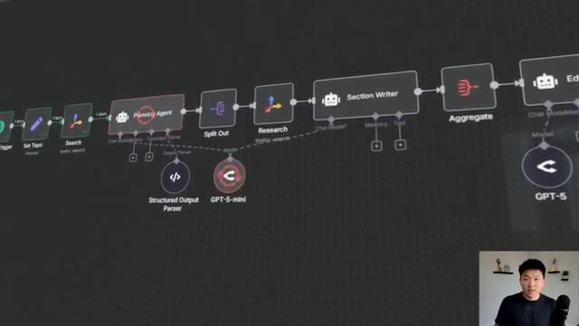
*⏱️ 00:00:08 — Interface de workflow visuel montrant la séquence logique de l'agent IA, incluant des nœuds pour la recherche, la planification, l'écriture de sections et l'agrégation.*

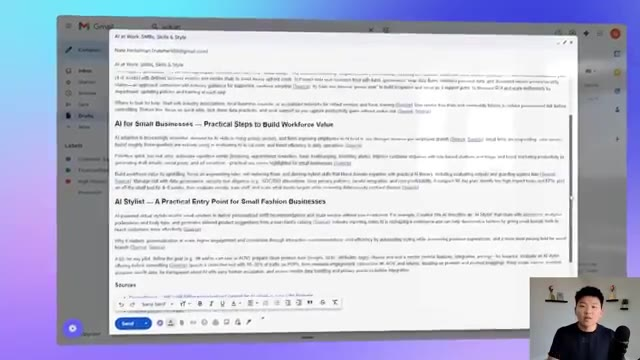
*⏱️ 00:00:17 — Aperçu d'un brouillon d'e-mail dans Gmail contenant le contenu généré par l'IA sur le thème de l'IA pour les petites entreprises.*

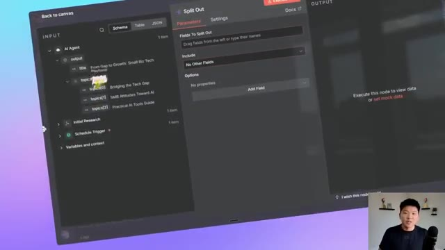
*⏱️ 00:00:25 — Fenêtre de configuration du nœud "Split Out" dans l'outil de workflow, montrant la structure des données d'entrée et les paramètres de division des champs.*

---

### ⏱️ `[00:00:33 - 00:01:08]` | Segment #02

**🔊 Audio (Transcription Intégrale Mot pour Mot en Français) :**
> three different agents, and we'll break down what they're all doing. But high level, what the flow is, is that we're going to do research, send that initial research into the planning agent to create topics. We'll then do deeper research on all of those topics, write those sections based on those topics. And then when we aggregate everything together, the editor agent will basically approve the final copy and push it over to us on Gmail. Anyways, this is kind of what the final product looks like. And it's a really holistic newsletter. And you could basically get this sent to you as a draft once a week or every single day or whatever it is, send it out to your team, send it out to your email list, whatever you want to do. But this is going to cut down all the time of actually

**👁️ Analyse Visuelle d'Écran (gemini-3.5-flash-lite) :**
**Interface & Outils** : - Image #1 : LangFlow (ou outil similaire de workflow d'agents IA)
- Image #2 : Gmail (Interface de rédaction de courriel)

**Contenu textuel & Code** : - Image #1 : Nœuds "Planning Agent", "Section Writer", "Editor Agent", intégrés à "OpenRouter Chat Model".
- Image #2 : Contenu textuel généré concernant l'adoption de l'IA par les PME (Small Business Tech Playbook), divisé en sections avec des liens de sources.

**Action / Démonstration** : - Image #1 : Visualisation de l'architecture du workflow d'automatisation de la newsletter.
- Image #2 : Présentation du résultat final (le brouillon du courriel) produit par le système d'agents.

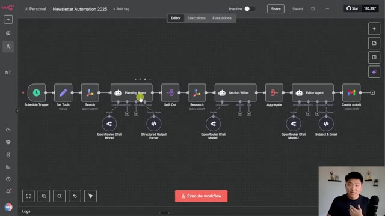
*⏱️ 00:00:42 — Interface de conception de workflow montrant une chaîne automatisée avec des nœuds de recherche, des agents de planification, d'écriture et d'édition.*

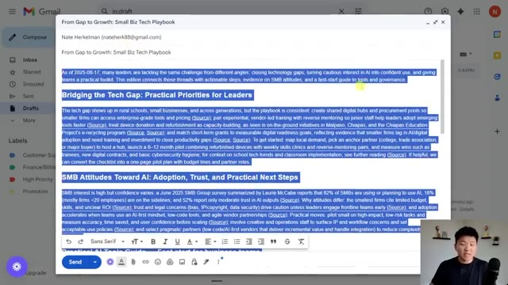
*⏱️ 00:00:59 — Fenêtre de brouillon Gmail ouverte affichant un article structuré et généré automatiquement intitulé "From Gap to Growth: Small Biz Tech Playbook".*

---

### ⏱️ `[00:01:08 - 00:01:40]` | Segment #03

**🔊 Audio (Transcription Intégrale Mot pour Mot en Français) :**
> doing like the research. And now that you have this draft here, you could basically just make your small tweaks and shoot it off. And just to get you guys inside my mindset, when I'm looking at building a system and I kind of know what I want as the end result, but I don't know how to get there exactly. What I do is I go to some sort of whiteboard program tool like Excalajaw or Miro or whatever you want to call them. And you can see here, I basically was brainstorming. Okay, so mine, I'm going to have this be a weekly trigger. When this goes off, the first thing I want to happen is research over the past week to basically make sure that this newsletter goes off once a

**👁️ Analyse Visuelle d'Écran (gemini-3.5-flash-lite) :**
**Interface & Outils** : LangFlow (Image 1), outil de diagramme/tableau blanc type excalidraw/canvas (Image 2).

**Contenu textuel & Code** : Nœuds de workflow : "Planning Agent", "Section Writer", "Editor Agent", "OpenRouter Chat Model", "Google Gmail (Create a draft)".

**Action / Démonstration** : Présentation de l'architecture technique de l'automatisation (Image 1) et visualisation de la logique métier simplifiée (Image 2).

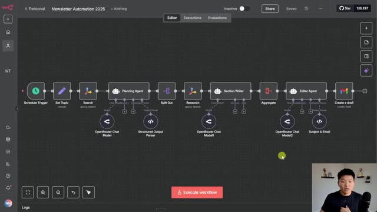
*⏱️ 00:01:16 — Interface d'édition de workflow automatisé affichant une série de nœuds connectés (agents IA, recherche, rédaction, éditeur) pour une automatisation de newsletter.*

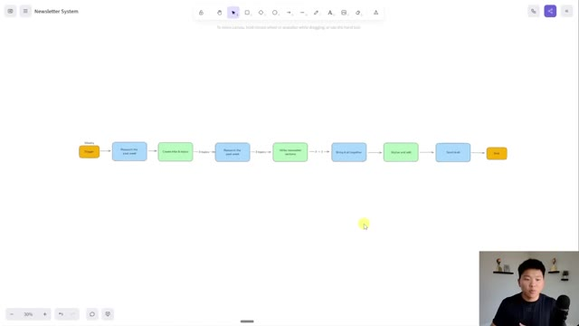
*⏱️ 00:01:24 — Diagramme de flux logique simplifié sur un canevas blanc, illustrant les étapes conceptuelles du système de newsletter (recherche, rédaction, assemblage, envoi).*

---

### ⏱️ `[00:01:40 - 00:02:09]` | Segment #04

**🔊 Audio (Transcription Intégrale Mot pour Mot en Français) :**
> week and it's capturing all of the most recent news. Based on the research from the past week, I'm going to feed this into an AI step. So in my mind, this green is indicating AI. So this AI would read the initial research and create the title of the newsletter and topics for this edition. Then we would have three different topics. So we would do research on each of those three topics. We would pass the three topics with the research along to the next AI, which will write each of the individual sections. So now we'll have three different newsletter sections written.

**👁️ Analyse Visuelle d'Écran (gemini-3.5-flash-lite) :**
**Interface & Outils** : Présentation ou face-caméra explicatif sans interface logicielle partagée.

**Contenu textuel & Code** : Explications orales et mise en contexte méthodologique.

**Action / Démonstration** : Explications face caméra et démonstration conceptuelle.

---

### ⏱️ `[00:02:09 - 00:02:43]` | Segment #05

**🔊 Audio (Transcription Intégrale Mot pour Mot en Français) :**
> And then what we want to do is bring it all together. So we'll use an aggregate node to put it all together. And then finally, we'll feed it to a last AI, which we call the editor AI. And this AI's job is to make sure it's HTML formatted and make sure it has an introduction and a conclusion and that everything flows. And then it's basically done and we send off the draft. And that's the end of the process. And because we're going to be building this together, I wanted to show you the tech stack is really lean. We're obviously going to use NNN as the main workflow builder. We're going to be using Tavoli twice for different research steps. We're going to be using Gmail just to send the actual newsletter. And then Open Router is what we're using for all our AI models. We're

**👁️ Analyse Visuelle d'Écran (gemini-3.5-flash-lite) :**
**Interface & Outils** : Diagramme de flux dans une interface de type tableau blanc virtuel (type Excalidraw ou similaire).

**Contenu textuel & Code** : Logigramme avec les étapes : "3 -> 1", "Bring it all together", "Stylize and edit", "Send draft" et "End".

**Action / Démonstration** : Visualisation du workflow de l'automatisation pour expliquer le rôle de l'IA dans l'agrégation et l'édition du contenu.

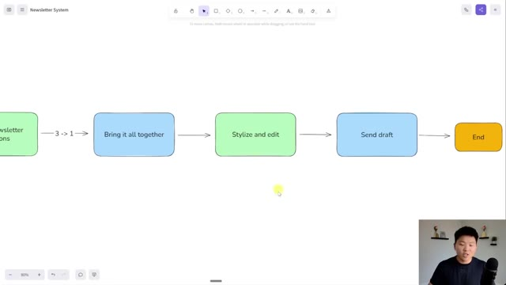
*⏱️ 00:02:18 — Un schéma de workflow sous forme de logigramme illustrant le processus de création d'une newsletter, reliant les étapes "Bring it all together", "Stylize and edit" et "Send draft".*

---

### ⏱️ `[00:02:43 - 00:03:17]` | Segment #06

**🔊 Audio (Transcription Intégrale Mot pour Mot en Français) :**
> probably going to stick with some GBT5 models today just because it's new and it's fun to try it out. But you could also experiment on Open Router with some Google models or Anthropic models or Deep Seek, whatever you want to use. Open Router has a ton of them in there. So now that we understand what the system is that we're going to be building, let's head over to a fresh workflow in N8N and get started. And because we have our wireframe already diagrammed out, this is really easy. I already know exactly where I need to go. This first thing that we're going to do is grab a schedule trigger. And because I want mine to go off once a week, I'm going to change the interval to weeks. I'm going to have it go off one week in between. We'll do Sundays at

**👁️ Analyse Visuelle d'Écran (gemini-3.5-flash-lite) :**
**Interface & Outils** : Présentation ou face-caméra explicatif sans interface logicielle partagée.

**Contenu textuel & Code** : Explications orales et mise en contexte méthodologique.

**Action / Démonstration** : Explications face caméra et démonstration conceptuelle.

---

### ⏱️ `[00:03:17 - 00:03:52]` | Segment #07

**🔊 Audio (Transcription Intégrale Mot pour Mot en Français) :**
> midnight. That's fine by me. And this is basically how often the system would go off once we push it into production. So once we make it an active workflow, now this trigger would actually go off once a week on Sunday at midnight. I'm just going to turn this off because we don't want to do that yet. And now let's get started on the build. So I know that the first step that we want to happen after the trigger goes off is to do some research. So I'm going to click on this plus and I'm going to type in Tavali, which is the tool that we're going to use for research. If you don't see Tavali, what you're going to have to do is go to your admin panel, or if you're self-hosting, update your endident in a different way. And you'll have to make sure you're on one point,

**👁️ Analyse Visuelle d'Écran (gemini-3.5-flash-lite) :**
**Interface & Outils** : Présentation ou face-caméra explicatif sans interface logicielle partagée.

**Contenu textuel & Code** : Explications orales et mise en contexte méthodologique.

**Action / Démonstration** : Explications face caméra et démonstration conceptuelle.

---

### ⏱️ `[00:03:52 - 00:04:13]` | Segment #08

**🔊 Audio (Transcription Intégrale Mot pour Mot en Français) :**
> I think it's 101 or higher, and also that you have verified community nodes turned on. And then you'll spin back up your endident and you should see Tavali, you'll install it, and then you're going to grab the search action. Now, if you don't have a Tavali API key, you can start one up for free. You can get a thousand searches a month, which will last you a long time. And once you come into here and create a new credential, you'll just go to tavley.com.

**👁️ Analyse Visuelle d'Écran (gemini-3.5-flash-lite) :**
**Interface & Outils** : Présentation ou face-caméra explicatif sans interface logicielle partagée.

**Contenu textuel & Code** : Explications orales et mise en contexte méthodologique.

**Action / Démonstration** : Explications face caméra et démonstration conceptuelle.

---

### ⏱️ `[00:04:13 - 00:04:35]` | Segment #09

**🔊 Audio (Transcription Intégrale Mot pour Mot en Français) :**
> And then when you create an account, there'll be a button that says create an API key. You'll grab that API key and just put that right in there. Super simple. But now we have to make our actual search. So the query right here is where we enter your broad category or niche or topic of your newsletter. So let's say mine is AI adoption for small businesses.

**👁️ Analyse Visuelle d'Écran (gemini-3.5-flash-lite) :**
**Interface & Outils** : Présentation ou face-caméra explicatif sans interface logicielle partagée.

**Contenu textuel & Code** : Explications orales et mise en contexte méthodologique.

**Action / Démonstration** : Explications face caméra et démonstration conceptuelle.

---

### ⏱️ `[00:04:35 - 00:04:58]` | Segment #10

**🔊 Audio (Transcription Intégrale Mot pour Mot en Français) :**
> That's what I'm gonna put right in here. And this is going to stay the same every single time this workflow goes off. Now I wanna add some options. The first thing that I'm gonna add is a topic. And these are all options that we can use to change the way that Tablet searches the web for us. So I'm gonna go to topic and instead of doing general, I'm gonna choose news because then it's like more looking for recent things and like headlines, stuff like that.

**👁️ Analyse Visuelle d'Écran (gemini-3.5-flash-lite) :**
**Interface & Outils** : Présentation ou face-caméra explicatif sans interface logicielle partagée.

**Contenu textuel & Code** : Explications orales et mise en contexte méthodologique.

**Action / Démonstration** : Explications face caméra et démonstration conceptuelle.

---

### ⏱️ `[00:04:58 - 00:05:18]` | Segment #11

**🔊 Audio (Transcription Intégrale Mot pour Mot en Français) :**
> From there, I'm going to also do time range. So I only want to search within the past week. That way we know it's all like things that are trending, things that are currently happening. And then you can see there's other things that we can do. I'm also gonna turn on max results. You don't have to do this, but I'm just gonna go with three for now, especially just because I'm doing a live build demo.

**👁️ Analyse Visuelle d'Écran (gemini-3.5-flash-lite) :**
**Interface & Outils** : Présentation ou face-caméra explicatif sans interface logicielle partagée.

**Contenu textuel & Code** : Explications orales et mise en contexte méthodologique.

**Action / Démonstration** : Explications face caméra et démonstration conceptuelle.

---

### ⏱️ `[00:05:18 - 00:05:38]` | Segment #12

**🔊 Audio (Transcription Intégrale Mot pour Mot en Français) :**
> So these are the options that I currently want. I'm going to hit execute step. And now you can see we're gonna get back three different URLs with kind of like some summarized content about small business AI adoption. So we have the small business technology gap. We have SMBs, ho-hum on AI versus automation, all this kind of stuff.

**👁️ Analyse Visuelle d'Écran (gemini-3.5-flash-lite) :**
**Interface & Outils** : Présentation ou face-caméra explicatif sans interface logicielle partagée.

**Contenu textuel & Code** : Explications orales et mise en contexte méthodologique.

**Action / Démonstration** : Explications face caméra et démonstration conceptuelle.

---

### ⏱️ `[00:05:38 - 00:05:58]` | Segment #13

**🔊 Audio (Transcription Intégrale Mot pour Mot en Français) :**
> And you can see the publish date. These are all coming from within the past week. So we know our options are working. Now real quick, just some workflow hygiene. I'm going to rename this node. I hit space bar, by the way, when I clicked on it. And I'm just going to say initial research. This is just a good habit to get into so you can know what each node is doing. Another good habit to get into is pinning data.

**👁️ Analyse Visuelle d'Écran (gemini-3.5-flash-lite) :**
**Interface & Outils** : Présentation ou face-caméra explicatif sans interface logicielle partagée.

**Contenu textuel & Code** : Explications orales et mise en contexte méthodologique.

**Action / Démonstration** : Explications face caméra et démonstration conceptuelle.

---

### ⏱️ `[00:05:58 - 00:06:27]` | Segment #14

**🔊 Audio (Transcription Intégrale Mot pour Mot en Français) :**
> So I can click on this and hit P. and now we don't have to re-trigger that API call if we accidentally like refresh or whatever it is just to keep all that live data in there. Cool. So we've done our initial research. Next is, well, let's just go look at the diagram of the wireframe here. The next thing to do is use AI to create titles and topics out of that initial research. So I'm going to go back into the workflow. I'm going to grab an AI agent and now we need to do some configuration of this step here.

**👁️ Analyse Visuelle d'Écran (gemini-3.5-flash-lite) :**
**Interface & Outils** : Présentation ou face-caméra explicatif sans interface logicielle partagée.

**Contenu textuel & Code** : Explications orales et mise en contexte méthodologique.

**Action / Démonstration** : Explications face caméra et démonstration conceptuelle.

---

### ⏱️ `[00:06:27 - 00:06:59]` | Segment #15

**🔊 Audio (Transcription Intégrale Mot pour Mot en Français) :**
> The first thing I'm going to do real quick is add our chat model. So I'm going to go to open router like we talked about. Same thing here. If you don't have an open router account, you'll go to openrouter.ai. You'll make an account. And when you create an API key, you basically just put that right in here. So very simple again. We're going to actually go to GPT5 mini for this step. And now what we need to do is a few other things. We need to configure what the agent looks at, what the agent's instructions are and then potentially an output format.

**👁️ Analyse Visuelle d'Écran (gemini-3.5-flash-lite) :**
**Interface & Outils** : Présentation ou face-caméra explicatif sans interface logicielle partagée.

**Contenu textuel & Code** : Explications orales et mise en contexte méthodologique.

**Action / Démonstration** : Explications face caméra et démonstration conceptuelle.

---

### ⏱️ `[00:06:59 - 00:07:18]` | Segment #16

**🔊 Audio (Transcription Intégrale Mot pour Mot en Français) :**
> So I'll show you guys what I mean by that. The first thing that we need to do is we need to give it basically like this is your message, this is what you're looking at. So instead of doing that here in the connected chat trigger node, we have to define that. And what we wanted to look at is pretty simple. We wanted to look at the research results from our Tavoli node.

**👁️ Analyse Visuelle d'Écran (gemini-3.5-flash-lite) :**
**Interface & Outils** : Présentation ou face-caméra explicatif sans interface logicielle partagée.

**Contenu textuel & Code** : Explications orales et mise en contexte méthodologique.

**Action / Démonstration** : Explications face caméra et démonstration conceptuelle.

---

### ⏱️ `[00:07:18 - 00:07:39]` | Segment #17

**🔊 Audio (Transcription Intégrale Mot pour Mot en Français) :**
> So basically what I would do is I would say, you know, like here is article. Oops, I cannot type today. Here's article one. And then I would just basically like drag in here's the URL. Here's the title. Here is the content of article one. So you could do that. It's a bit more manual. And, you know, obviously this looks weird because the variables are all smushed together.

**👁️ Analyse Visuelle d'Écran (gemini-3.5-flash-lite) :**
**Interface & Outils** : Présentation ou face-caméra explicatif sans interface logicielle partagée.

**Contenu textuel & Code** : Explications orales et mise en contexte méthodologique.

**Action / Démonstration** : Explications face caméra et démonstration conceptuelle.

---

### ⏱️ `[00:07:40 - 00:08:00]` | Segment #18

**🔊 Audio (Transcription Intégrale Mot pour Mot en Français) :**
> You'd probably want to format it like this. And now that's article one. But what I'm going to do instead is I'm going to go to this resource pack, which you guys can get in my free school community. I'm going to grab this function right here. And I'm just going to paste that in here. And all that does is it's basically grabbing this array of results and it's just formatting it for us pretty much like natively.

**👁️ Analyse Visuelle d'Écran (gemini-3.5-flash-lite) :**
**Interface & Outils** : Présentation ou face-caméra explicatif sans interface logicielle partagée.

**Contenu textuel & Code** : Explications orales et mise en contexte méthodologique.

**Action / Démonstration** : Explications face caméra et démonstration conceptuelle.

---

### ⏱️ `[00:08:00 - 00:08:18]` | Segment #19

**🔊 Audio (Transcription Intégrale Mot pour Mot en Français) :**
> And that way our agent can read it and understand what it's looking at. And this is just going to be a lot easier and more dynamic than if we basically hard fixed in different variables and dragged them in. So in order to actually grab this resource pack and if you want to just download the actual automation rather than build it yourself, you can do that as well. You're going to go to my FreeSchool community. The link for that is down in the description.

**👁️ Analyse Visuelle d'Écran (gemini-3.5-flash-lite) :**
**Interface & Outils** : Présentation ou face-caméra explicatif sans interface logicielle partagée.

**Contenu textuel & Code** : Explications orales et mise en contexte méthodologique.

**Action / Démonstration** : Explications face caméra et démonstration conceptuelle.

---

### ⏱️ `[00:08:18 - 00:08:37]` | Segment #20

**🔊 Audio (Transcription Intégrale Mot pour Mot en Français) :**
> When you get in here, you're going to search for the title of the video or go to YouTube resources and find the post associated with this YouTube video. And when you click on it, there will be a JSON file to download. There will be a PDF. You can download all the resources that you need right from this post. So that's how you'll get everything. And now that you have it, follow along with the rest of the video.

**👁️ Analyse Visuelle d'Écran (gemini-3.5-flash-lite) :**
**Interface & Outils** : Présentation ou face-caméra explicatif sans interface logicielle partagée.

**Contenu textuel & Code** : Explications orales et mise en contexte méthodologique.

**Action / Démonstration** : Explications face caméra et démonstration conceptuelle.

---

### ⏱️ `[00:08:38 - 00:09:04]` | Segment #21

**🔊 Audio (Transcription Intégrale Mot pour Mot en Français) :**
> So that's all that's going on here. But once again, you could manually drag the stuff in. So now that we have the agent is looking at our three articles, we need to tell it what to do with these three articles. And that's where we come down here and we add a system message. So real quick, I'm just going to make this an expression so we can open up full screen. And I'm also gonna go back to the resource pack and I'm gonna copy in this system message that I'll give you guys again in my FreeSchool community and paste that in.

**👁️ Analyse Visuelle d'Écran (gemini-3.5-flash-lite) :**
**Interface & Outils** : Présentation ou face-caméra explicatif sans interface logicielle partagée.

**Contenu textuel & Code** : Explications orales et mise en contexte méthodologique.

**Action / Démonstration** : Explications face caméra et démonstration conceptuelle.

---

### ⏱️ `[00:09:04 - 00:09:23]` | Segment #22

**🔊 Audio (Transcription Intégrale Mot pour Mot en Français) :**
> So all I'm saying here is that you are an expert newsletter planner. You will receive three articles from the past week. Your job is to come up with a creative and fun title as well as the main topics for the newsletter. So this AI is specialized in just this function. It would be way too overwhelming if we gave our agent all this research, all these articles and said, hey, just write a newsletter.

**👁️ Analyse Visuelle d'Écran (gemini-3.5-flash-lite) :**
**Interface & Outils** : Présentation ou face-caméra explicatif sans interface logicielle partagée.

**Contenu textuel & Code** : Explications orales et mise en contexte méthodologique.

**Action / Démonstration** : Explications face caméra et démonstration conceptuelle.

---

### ⏱️ `[00:09:23 - 00:09:45]` | Segment #23

**🔊 Audio (Transcription Intégrale Mot pour Mot en Français) :**
> So I like to break it up in steps and have each AI do something very specialized. The instructions down here say that the newsletter should flow nicely, feel informative and holistic, and that the topic should be three to five words. So what I'm gonna do now is just hit execute step. And what we're gonna see is that the agent's going to use its brain right now in order to output the title and the three topics for us.

**👁️ Analyse Visuelle d'Écran (gemini-3.5-flash-lite) :**
**Interface & Outils** : Présentation ou face-caméra explicatif sans interface logicielle partagée.

**Contenu textuel & Code** : Explications orales et mise en contexte méthodologique.

**Action / Démonstration** : Explications face caméra et démonstration conceptuelle.

---

### ⏱️ `[00:09:45 - 00:10:05]` | Segment #24

**🔊 Audio (Transcription Intégrale Mot pour Mot en Français) :**
> There is one thing that we're gonna have to do, but I just wanted to run this first to show you guys the difference here. And that is that we're going to require a specific output because what you see here is it did its job, it output a title, and then it output different topics as you can see, but it's all in one field. Meaning if we moved on to the next step, let me just add like a set node just to show you guys, it would all be in one variable.

**👁️ Analyse Visuelle d'Écran (gemini-3.5-flash-lite) :**
**Interface & Outils** : Présentation ou face-caméra explicatif sans interface logicielle partagée.

**Contenu textuel & Code** : Explications orales et mise en contexte méthodologique.

**Action / Démonstration** : Explications face caméra et démonstration conceptuelle.

---

### ⏱️ `[00:10:05 - 00:10:25]` | Segment #25

**🔊 Audio (Transcription Intégrale Mot pour Mot en Français) :**
> And if we dragged it in, we couldn't really separate it. Like it's all together. So what we want to do is just get it all separate. So I'm gonna go back into the resource pack. I'm gonna copy the structured output parser JSON. And then I'm going to turn on this option that says require specific output format. And now we are in even more control of the way the agent outputs information.

**👁️ Analyse Visuelle d'Écran (gemini-3.5-flash-lite) :**
**Interface & Outils** : Présentation ou face-caméra explicatif sans interface logicielle partagée.

**Contenu textuel & Code** : Explications orales et mise en contexte méthodologique.

**Action / Démonstration** : Explications face caméra et démonstration conceptuelle.

---

### ⏱️ `[00:10:25 - 00:10:44]` | Segment #26

**🔊 Audio (Transcription Intégrale Mot pour Mot en Français) :**
> So I'm gonna choose the structured output parser. This part's important. I'm gonna change this type to define using JSON schema and then just paste in that value that we got from that resource pack. And I can hit play on the agent right here. And this is going to do the exact same thing, except for now it's going to put it in that format that we were looking for. And you guys will see the difference once this spins out.

**👁️ Analyse Visuelle d'Écran (gemini-3.5-flash-lite) :**
**Interface & Outils** : Présentation ou face-caméra explicatif sans interface logicielle partagée.

**Contenu textuel & Code** : Explications orales et mise en contexte méthodologique.

**Action / Démonstration** : Explications face caméra et démonstration conceptuelle.

---

### ⏱️ `[00:10:44 - 00:11:09]` | Segment #27

**🔊 Audio (Transcription Intégrale Mot pour Mot en Français) :**
> So you can see now we have, these things are in different fields. so we could actually drag them differently. So that's great. I'm also going to pin this data so we don't have to rerun our agent if something goes wrong. And we're gonna move on to the next step. So what we're gonna do now is we're gonna use a node called split out. What this is gonna do is it's gonna take this list of topics, as you can see, we have topic one, two, and three, and we're going to just split them out.

**👁️ Analyse Visuelle d'Écran (gemini-3.5-flash-lite) :**
**Interface & Outils** : Présentation ou face-caméra explicatif sans interface logicielle partagée.

**Contenu textuel & Code** : Explications orales et mise en contexte méthodologique.

**Action / Démonstration** : Explications face caméra et démonstration conceptuelle.

---

### ⏱️ `[00:11:09 - 00:11:31]` | Segment #28

**🔊 Audio (Transcription Intégrale Mot pour Mot en Français) :**
> So now it went from one list, one item, to three items out here. And this is nice because what we're gonna do is we're gonna use Tavoli again to do research on each of these three things individually. So I'm just gonna pin this data. I am going to grab another Tavoli node. We're gonna do another search and I'm just gonna drag in the topic into the query.

**👁️ Analyse Visuelle d'Écran (gemini-3.5-flash-lite) :**
**Interface & Outils** : Présentation ou face-caméra explicatif sans interface logicielle partagée.

**Contenu textuel & Code** : Explications orales et mise en contexte méthodologique.

**Action / Démonstration** : Explications face caméra et démonstration conceptuelle.

---

### ⏱️ `[00:11:31 - 00:11:50]` | Segment #29

**🔊 Audio (Transcription Intégrale Mot pour Mot en Français) :**
> So this is gonna run Tavoli three separate times. The first time it's gonna run it for bridging the tech gap. The second time it's gonna run it for SMB attitudes towards AI and the third time it's gonna run it for practical AI tools guide. Before we run this, we need to do some more options. So the first thing I'm gonna do is for topic, we're gonna leave it as general. So you actually don't even have to add that.

**👁️ Analyse Visuelle d'Écran (gemini-3.5-flash-lite) :**
**Interface & Outils** : Présentation ou face-caméra explicatif sans interface logicielle partagée.

**Contenu textuel & Code** : Explications orales et mise en contexte méthodologique.

**Action / Démonstration** : Explications face caméra et démonstration conceptuelle.

---

### ⏱️ `[00:11:50 - 00:12:10]` | Segment #30

**🔊 Audio (Transcription Intégrale Mot pour Mot en Français) :**
> It's general by default. You could play with the time range if you want. For now, let's just say we're gonna go just the past month. But the main important thing that I wanna do is include raw content. I'm gonna turn this on. Because you guys may have not noticed, but in this first step, we had include raw content turned off.

**👁️ Analyse Visuelle d'Écran (gemini-3.5-flash-lite) :**
**Interface & Outils** : n8n (workflow automation platform)

**Contenu textuel & Code** : Configuration du nœud Search : Credential (Tavily), Resource (Search), Operation (Query), Query expression {{ $json['output.topics'] }}, et le menu déroulant "Time Range" avec les options Day, Week, Month, Year.

**Action / Démonstration** : Le curseur sélectionne l'option "Month" dans le menu déroulant de l'intervalle de temps (Time Range) pour restreindre la recherche aux données du dernier mois.

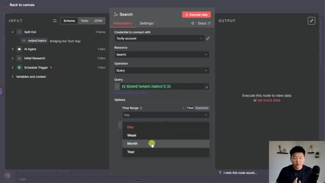
*⏱️ 00:11:55 — Interface de configuration d'un nœud "Search" (Tavily) dans n8n, montrant la sélection de l'intervalle de temps pour la recherche.*

---

### ⏱️ `[00:12:10 - 00:12:30]` | Segment #31

**🔊 Audio (Transcription Intégrale Mot pour Mot en Français) :**
> And what that meant is that we were getting basically just like a summary from each article, but we weren't getting the actual raw content. And that's what we want to write the newsletter. So here I'm going to make sure that's on. I'm gonna change this name to research topics. Okay.

**👁️ Analyse Visuelle d'Écran (gemini-3.5-flash-lite) :**
**Interface & Outils** : Présentation ou face-caméra explicatif sans interface logicielle partagée.

**Contenu textuel & Code** : Explications orales et mise en contexte méthodologique.

**Action / Démonstration** : Explications face caméra et démonstration conceptuelle.

---

### ⏱️ `[00:12:30 - 00:12:50]` | Segment #32

**🔊 Audio (Transcription Intégrale Mot pour Mot en Français) :**
> My fingers are a little cold, so my typing has been awful. But anyways, we're gonna execute the step and you can see that there's three items going in. There's gonna be three items coming out. So there's gonna be different research on all those topics like I already mentioned. Real quick guys, a word from the sponsor of today's video, Hostinger. All NN workflows need a place to reliably run 24 seven and scale up as you need to.

**👁️ Analyse Visuelle d'Écran (gemini-3.5-flash-lite) :**
**Interface & Outils** : Présentation ou face-caméra explicatif sans interface logicielle partagée.

**Contenu textuel & Code** : Explications orales et mise en contexte méthodologique.

**Action / Démonstration** : Explications face caméra et démonstration conceptuelle.

---

### ⏱️ `[00:12:50 - 00:13:09]` | Segment #33

**🔊 Audio (Transcription Intégrale Mot pour Mot en Français) :**
> And that's where Hostinger comes in. What we're looking at right here is Hostinger self-hosted NN with unlimited workflows, unlimited executions, community nodes, and a one-click installation. So I'm gonna show you guys how that works real quick. You'll click on choose your plan and you can see they have different options based on the amount of storage and processing power that you need. Right now we're gonna go with KVM2, which is the most popular plan.

**👁️ Analyse Visuelle d'Écran (gemini-3.5-flash-lite) :**
**Interface & Outils** : Présentation ou face-caméra explicatif sans interface logicielle partagée.

**Contenu textuel & Code** : Explications orales et mise en contexte méthodologique.

**Action / Démonstration** : Explications face caméra et démonstration conceptuelle.

---

### ⏱️ `[00:13:09 - 00:13:28]` | Segment #34

**🔊 Audio (Transcription Intégrale Mot pour Mot en Français) :**
> On this panel, you can see how long do you want the period to run. You can get daily backups, you choose your server. And here's where you would choose NN as your application. And of course, if you're getting a yearly plan, don't forget to use code NateHerc right here and you can get 10% off your NNN. Now that I've paid, I just have to set up a password and we'll be all set. So now that everything is spun up, you can see the overview right here.

**👁️ Analyse Visuelle d'Écran (gemini-3.5-flash-lite) :**
**Interface & Outils** : Présentation ou face-caméra explicatif sans interface logicielle partagée.

**Contenu textuel & Code** : Explications orales et mise en contexte méthodologique.

**Action / Démonstration** : Explications face caméra et démonstration conceptuelle.

---

### ⏱️ `[00:13:28 - 00:13:51]` | Segment #35

**🔊 Audio (Transcription Intégrale Mot pour Mot en Français) :**
> I just have to click on manage app to the right of NNN and it's just gonna pull up our NNN right here. Just spun up my account and now you can see we have our self-hosted NNN right here and that took minutes. So if you're like me, not super technical, especially when it comes to DevOps stuff, but you obviously know you need somewhere safe and reliable to host your end-to-end workflows and have daily backup stuff like that, then use the link in the description to check out Hostinger and don't forget to use code NateHerc.

**👁️ Analyse Visuelle d'Écran (gemini-3.5-flash-lite) :**
**Interface & Outils** : Présentation ou face-caméra explicatif sans interface logicielle partagée.

**Contenu textuel & Code** : Explications orales et mise en contexte méthodologique.

**Action / Démonstration** : Explications face caméra et démonstration conceptuelle.

---

### ⏱️ `[00:13:51 - 00:14:09]` | Segment #36

**🔊 Audio (Transcription Intégrale Mot pour Mot en Français) :**
> So while this finishes up, we're gonna pin it when it's done so we don't have to re-trigger the research. So I'm just gonna come in here real quick and pin that data. And now you can see that we are getting, let's see schema might be the easiest, but we're getting research on different topics. So the first one was bridging the tech gap and then the next two topics as well.

**👁️ Analyse Visuelle d'Écran (gemini-3.5-flash-lite) :**
**Interface & Outils** : Présentation ou face-caméra explicatif sans interface logicielle partagée.

**Contenu textuel & Code** : Explications orales et mise en contexte méthodologique.

**Action / Démonstration** : Explications face caméra et démonstration conceptuelle.

---

### ⏱️ `[00:14:09 - 00:14:28]` | Segment #37

**🔊 Audio (Transcription Intégrale Mot pour Mot en Français) :**
> So we have gotten our title and topics. We have done the research. Now we need to use AI again to write the actual newsletter sections. So I'm going to grab another AI agent right here. We are once again, real quick, going to connect open router. And actually a fun trick, you can just hook them up to the same model if you want them to use the same model.

**👁️ Analyse Visuelle d'Écran (gemini-3.5-flash-lite) :**
**Interface & Outils** : Présentation ou face-caméra explicatif sans interface logicielle partagée.

**Contenu textuel & Code** : Explications orales et mise en contexte méthodologique.

**Action / Démonstration** : Explications face caméra et démonstration conceptuelle.

---

### ⏱️ `[00:14:29 - 00:14:50]` | Segment #38

**🔊 Audio (Transcription Intégrale Mot pour Mot en Français) :**
> Obviously, if you want the agents to use different models, you would have to create a new one, but they're going to use the same one, so that's fine. I'm going to change this agent to, let's see what I named him in here, the section writer agent. So I'm just going to copy this actually. And I'm going to change this agent's name here. And now, same thing, we have to configure the user message, what the agent sees, and the system message, its instructions.

**👁️ Analyse Visuelle d'Écran (gemini-3.5-flash-lite) :**
**Interface & Outils** : Présentation ou face-caméra explicatif sans interface logicielle partagée.

**Contenu textuel & Code** : Explications orales et mise en contexte méthodologique.

**Action / Démonstration** : Explications face caméra et démonstration conceptuelle.

---

### ⏱️ `[00:14:51 - 00:15:12]` | Segment #39

**🔊 Audio (Transcription Intégrale Mot pour Mot en Français) :**
> So I'm going to open this guy up. We're going to first of all change the user message to define below because we want to define what it looks at. And what do we want it to look at? We basically want it to look at all of the search results for the given topic as well as the query that it was given. So what I'm going to do here is basically just say, actually not query, I'm going to say topic.

**👁️ Analyse Visuelle d'Écran (gemini-3.5-flash-lite) :**
**Interface & Outils** : Présentation ou face-caméra explicatif sans interface logicielle partagée.

**Contenu textuel & Code** : Explications orales et mise en contexte méthodologique.

**Action / Démonstration** : Explications face caméra et démonstration conceptuelle.

---

### ⏱️ `[00:15:12 - 00:15:34]` | Segment #40

**🔊 Audio (Transcription Intégrale Mot pour Mot en Français) :**
> So basically I'm telling the, this agent, you're going to write a section of a newsletter. Here's the main topic or heading. And then I'm going to give you these results down here. These are like the article results. So that is what we would give it, but we get this weird object object thing. So we'd have to like do a join expression to be able to see it.

**👁️ Analyse Visuelle d'Écran (gemini-3.5-flash-lite) :**
**Interface & Outils** : Plateforme d'automatisation de workflow n8n.

**Contenu textuel & Code** : Configuration d'une expression JavaScript : "Topic: {{ $json.query }}". À gauche, la structure des données d'entrée provenant du nœud "Research Topics" (incluant `url`, `title`, `content` et `results`). À droite, l'aperçu du résultat affichant "Topic: Bridging the Tech Gap".

**Action / Démonstration** : Le présentateur configure l'injection de variables dynamiques dans un prompt ou un champ de texte au sein d'un agent de rédaction de newsletter pour structurer les données provenant d'une recherche.

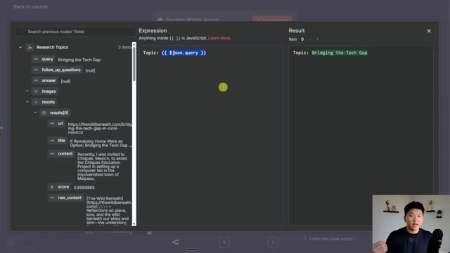
*⏱️ 00:15:18 — Une vue de l'interface de configuration d'un nœud dans n8n, montrant une fenêtre d'expression JavaScript à gauche et le résultat de l'exécution à droite.*

---

### ⏱️ `[00:15:34 - 00:15:56]` | Segment #41

**🔊 Audio (Transcription Intégrale Mot pour Mot en Français) :**
> Or obviously you could drag in like, you know, here's the URL, here's the title, here is the raw content from that article. but we don't wanna do it that way because it's not as variable. So I'm gonna go back to the resource pack and I am just going to grab this JSON function, which is gonna do the same thing as it did earlier, where basically it's just gonna split out all of the research in a way that the agent can read really nicely.

**👁️ Analyse Visuelle d'Écran (gemini-3.5-flash-lite) :**
**Interface & Outils** : Présentation ou face-caméra explicatif sans interface logicielle partagée.

**Contenu textuel & Code** : Explications orales et mise en contexte méthodologique.

**Action / Démonstration** : Explications face caméra et démonstration conceptuelle.

---

### ⏱️ `[00:15:56 - 00:16:17]` | Segment #42

**🔊 Audio (Transcription Intégrale Mot pour Mot en Français) :**
> So that's the only reason we're using a function there. Cool, so it gets the topic in research. Once again, this agent's gonna do it three times. So the first time it's gonna do bridging the tech gap, second time it's gonna do SMB attitudes towards AI, And the third time it's gonna do practical AI tools guide. Now we need to add another system message so it can actually see, okay, I'm getting this stuff.

**👁️ Analyse Visuelle d'Écran (gemini-3.5-flash-lite) :**
**Interface & Outils** : Présentation ou face-caméra explicatif sans interface logicielle partagée.

**Contenu textuel & Code** : Explications orales et mise en contexte méthodologique.

**Action / Démonstration** : Explications face caméra et démonstration conceptuelle.

---

### ⏱️ `[00:16:17 - 00:16:40]` | Segment #43

**🔊 Audio (Transcription Intégrale Mot pour Mot en Français) :**
> What do I do with it? So of course, for the sake of time, I've already pre-written this. I'm gonna grab this system message, which is actually pretty short. And once again, you guys will get this in my free school community. I'll show you guys later how you actually do that. And what you do is you're gonna come in here and you're gonna hit paste. So now we have this system message with an overview, which is that you are a professional newsletter section writer.

**👁️ Analyse Visuelle d'Écran (gemini-3.5-flash-lite) :**
**Interface & Outils** : Présentation ou face-caméra explicatif sans interface logicielle partagée.

**Contenu textuel & Code** : Explications orales et mise en contexte méthodologique.

**Action / Démonstration** : Explications face caméra et démonstration conceptuelle.

---

### ⏱️ `[00:16:41 - 00:17:00]` | Segment #44

**🔊 Audio (Transcription Intégrale Mot pour Mot en Français) :**
> Your only task is to write one standalone section of a newsletter. Your instructions are to always include a clear section heading. Do not write an overall title, introduction, or conclusion. You're just writing one little section. Write in a professional, expert, and engaging tone. If you reference facts, data, or quotes, you must cite the source. All this kind of stuff.

**👁️ Analyse Visuelle d'Écran (gemini-3.5-flash-lite) :**
**Interface & Outils** : Présentation ou face-caméra explicatif sans interface logicielle partagée.

**Contenu textuel & Code** : Explications orales et mise en contexte méthodologique.

**Action / Démonstration** : Explications face caméra et démonstration conceptuelle.

---

### ⏱️ `[00:17:00 - 00:17:19]` | Segment #45

**🔊 Audio (Transcription Intégrale Mot pour Mot en Français) :**
> And these prompts, keep in mind, are where you can really come in here and make this newsletter a lot more tailored towards your business, your ICP, you know, anything like that. This is where you can put your own spin on it. This one and the editor one for sure. But anyways, it's a good place to start. And now what I'm gonna do is just hit execute step.

**👁️ Analyse Visuelle d'Écran (gemini-3.5-flash-lite) :**
**Interface & Outils** : Présentation ou face-caméra explicatif sans interface logicielle partagée.

**Contenu textuel & Code** : Explications orales et mise en contexte méthodologique.

**Action / Démonstration** : Explications face caméra et démonstration conceptuelle.

---

### ⏱️ `[00:17:19 - 00:17:44]` | Segment #46

**🔊 Audio (Transcription Intégrale Mot pour Mot en Français) :**
> And we don't need a structured output parser here. You could split them up in between like the header and the body, but we're gonna combine it all together later either way. So I'm just gonna go ahead and run this section writer agent right now. All right, so the section writer just finished up. We'll take a quick look. If we go to the table view, we can see that the first section comes out with this heading and then we have different little pieces in here and it is using its sources, so that's good.

**👁️ Analyse Visuelle d'Écran (gemini-3.5-flash-lite) :**
**Interface & Outils** : Présentation ou face-caméra explicatif sans interface logicielle partagée.

**Contenu textuel & Code** : Explications orales et mise en contexte méthodologique.

**Action / Démonstration** : Explications face caméra et démonstration conceptuelle.

---

### ⏱️ `[00:17:44 - 00:18:02]` | Segment #47

**🔊 Audio (Transcription Intégrale Mot pour Mot en Français) :**
> Here is the second section, which is SMB attitudes towards AI adoption. And then the third one comes out as well. So now that we have all that figured out, let me just move this back to the middle. What we need to do now is first of all, I'm just gonna pin this so we don't lose it. And now we need to bring it all back together and then have an editor agent make it stylized with HTML.

**👁️ Analyse Visuelle d'Écran (gemini-3.5-flash-lite) :**
**Interface & Outils** : Présentation ou face-caméra explicatif sans interface logicielle partagée.

**Contenu textuel & Code** : Explications orales et mise en contexte méthodologique.

**Action / Démonstration** : Explications face caméra et démonstration conceptuelle.

---

### ⏱️ `[00:18:02 - 00:18:25]` | Segment #48

**🔊 Audio (Transcription Intégrale Mot pour Mot en Français) :**
> So it looks nice. So in order to get everything back together, we're gonna do another data transformation node, which is called an aggregate. And this is gonna bring our three items over here back into one. As you can see right here, we basically said three to one, bring it all together, and then we're gonna stylize and edit. So all I have to do is say that we're going to just combine this field called output into one.

**👁️ Analyse Visuelle d'Écran (gemini-3.5-flash-lite) :**
**Interface & Outils** : Présentation ou face-caméra explicatif sans interface logicielle partagée.

**Contenu textuel & Code** : Explications orales et mise en contexte méthodologique.

**Action / Démonstration** : Explications face caméra et démonstration conceptuelle.

---

### ⏱️ `[00:18:25 - 00:18:44]` | Segment #49

**🔊 Audio (Transcription Intégrale Mot pour Mot en Français) :**
> So now we should be getting one item over here that has all three of those sections combined, as you can see. Perfect. Now I'm going to add another AI agent, which is our final AI agent. We're gonna real quick go grab a chat model. And the reason I'm grabbing one myself is because for this writing, because it's like HTML and we want it to really sound nice.

**👁️ Analyse Visuelle d'Écran (gemini-3.5-flash-lite) :**
**Interface & Outils** : Présentation ou face-caméra explicatif sans interface logicielle partagée.

**Contenu textuel & Code** : Explications orales et mise en contexte méthodologique.

**Action / Démonstration** : Explications face caméra et démonstration conceptuelle.

---

### ⏱️ `[00:18:44 - 00:19:04]` | Segment #50

**🔊 Audio (Transcription Intégrale Mot pour Mot en Français) :**
> I'm gonna use GPT-5 rather than these other ones where I was using GPT-5 mini. So we're gonna use GPT-5 here. I'm also gonna call this guy real quick, the editor agent. And again, we have a couple of things to set up. System message, user message. And we are going to again do a structured output parser.

**👁️ Analyse Visuelle d'Écran (gemini-3.5-flash-lite) :**
**Interface & Outils** : n8n (plateforme d'automatisation de workflow).

**Contenu textuel & Code** : Nœuds de workflow nommés "Section Writer Agent", "Aggregate" (avec 3 items entrants et 1 sortant), "AI Agent1" et "OpenRouter Chat Model1".

**Action / Démonstration** : Le présentateur est en train de configurer les nœuds du workflow, en connectant spécifiquement un modèle de chat via OpenRouter à son agent IA.

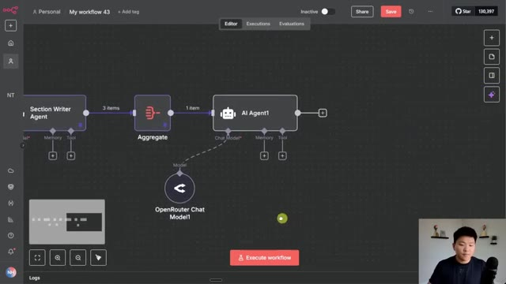
*⏱️ 00:18:49 — Interface d'édition de flux de travail (workflow) affichant un nœud "AI Agent1" connecté à un modèle "OpenRouter Chat Model1", précédé d'un nœud d'agrégation de données.*

---

### ⏱️ `[00:19:04 - 00:19:23]` | Segment #51

**🔊 Audio (Transcription Intégrale Mot pour Mot en Français) :**
> So first of all, let's do the user message. We're not gonna do this. You only do this if you use a chat trigger. So we're not using a chat trigger. So we're gonna define below. What we wanted to look at are the three different sections. So what you could do is you could basically go like, you know, here's section one, hit enter.

**👁️ Analyse Visuelle d'Écran (gemini-3.5-flash-lite) :**
**Interface & Outils** : Présentation ou face-caméra explicatif sans interface logicielle partagée.

**Contenu textuel & Code** : Explications orales et mise en contexte méthodologique.

**Action / Démonstration** : Explications face caméra et démonstration conceptuelle.

---

### ⏱️ `[00:19:23 - 00:19:44]` | Segment #52

**🔊 Audio (Transcription Intégrale Mot pour Mot en Français) :**
> Here's section two, hit enter a few times. And then here's section three. There's nothing wrong with that. And you certainly can. But just to get you guys more comfortable with like the way you can use functions to make things a bit more dynamic, you could drag in this array right here. And this is similar to what we were doing earlier. You can after the dot output type in dot join.

**👁️ Analyse Visuelle d'Écran (gemini-3.5-flash-lite) :**
**Interface & Outils** : Présentation ou face-caméra explicatif sans interface logicielle partagée.

**Contenu textuel & Code** : Explications orales et mise en contexte méthodologique.

**Action / Démonstration** : Explications face caméra et démonstration conceptuelle.

---

### ⏱️ `[00:19:44 - 00:20:08]` | Segment #53

**🔊 Audio (Transcription Intégrale Mot pour Mot en Français) :**
> And this basically joins together the items of the array. And then you can also in here, specify what to do between each join. So let me find the good point right here. So the second output starts with SMB attitudes towards AI. So let me just find that real quick. We'll find it. We'll find it. We'll find it. Okay. I found it right here. SMB attitudes towards AI.

**👁️ Analyse Visuelle d'Écran (gemini-3.5-flash-lite) :**
**Interface & Outils** : Présentation ou face-caméra explicatif sans interface logicielle partagée.

**Contenu textuel & Code** : Explications orales et mise en contexte méthodologique.

**Action / Démonstration** : Explications face caméra et démonstration conceptuelle.

---

### ⏱️ `[00:20:08 - 00:20:42]` | Segment #54

**🔊 Audio (Transcription Intégrale Mot pour Mot en Français) :**
> And you can see that it basically starts right away, like combined with the end of output one. So we don't want to do that. So if I come here and I type in a quote and do a new line symbol, it's going to space it out. And if I do one more, and if I do one more, it spaces it out even more. So now it's very clear where this second section basically starts. So that's what we're going to to do here. That is what I did down here in the, what's it called? The resource pack. I have the sections with the three new lines after a join. So once again, you could also just grab this user

**👁️ Analyse Visuelle d'Écran (gemini-3.5-flash-lite) :**
**Interface & Outils** : Présentation ou face-caméra explicatif sans interface logicielle partagée.

**Contenu textuel & Code** : Explications orales et mise en contexte méthodologique.

**Action / Démonstration** : Explications face caméra et démonstration conceptuelle.

---

### ⏱️ `[00:20:42 - 00:21:09]` | Segment #55

**🔊 Audio (Transcription Intégrale Mot pour Mot en Français) :**
> message and then paste that in there and you will get the title and the sections. The reason why the title is being weird is because we grabbed the title back from the initial agent called the planning agent. And it's because I didn't name it planning agent. So if I literally just went back all the way over here. Oops. And I just named this guy planning agent that should have fixed it basically. So now it's green. You can see I fixed it. Now it knows what to reference.

**👁️ Analyse Visuelle d'Écran (gemini-3.5-flash-lite) :**
**Interface & Outils** : Présentation ou face-caméra explicatif sans interface logicielle partagée.

**Contenu textuel & Code** : Explications orales et mise en contexte méthodologique.

**Action / Démonstration** : Explications face caméra et démonstration conceptuelle.

---

### ⏱️ `[00:21:09 - 00:21:44]` | Segment #56

**🔊 Audio (Transcription Intégrale Mot pour Mot en Français) :**
> So this editor agent is receiving the title as well as all of the sections of the newsletter. And now all it has to do is it has to understand I need to create the intro and the conclusion and like a sources section at the bottom. So that's where we're going to tell it to do that in the system message. So let me real quick, just make this full screen, go to our resource pack, and I'm going to grab the system message. You can see this is the longest one out of all of the other ones that we've had today. And I'm just going to paste this in right here. I'm not going to read the whole thing. You guys obviously have access to the template. You can also pause the video as I scroll down if you want to be able to read the whole thing. But what we're doing here is we're

**👁️ Analyse Visuelle d'Écran (gemini-3.5-flash-lite) :**
**Interface & Outils** : Présentation ou face-caméra explicatif sans interface logicielle partagée.

**Contenu textuel & Code** : Explications orales et mise en contexte méthodologique.

**Action / Démonstration** : Explications face caméra et démonstration conceptuelle.

---

### ⏱️ `[00:21:44 - 00:22:17]` | Segment #57

**🔊 Audio (Transcription Intégrale Mot pour Mot en Français) :**
> defining its role. We're telling you what to do. And then we're giving it the structure of HTML so that it has like headings and bold and clickable links and stuff like that. So that's how we're doing it here. And what I'm going to do now is before we actually run it, explain why we need a structured output parser. So I'm going to connect the structured output parser. And then I'm going to explain why, because what we're doing is we're having this editor agent output the title of the email as a subject or in a subject field. And then it's going to output the actual content

**👁️ Analyse Visuelle d'Écran (gemini-3.5-flash-lite) :**
**Interface & Outils** : Présentation ou face-caméra explicatif sans interface logicielle partagée.

**Contenu textuel & Code** : Explications orales et mise en contexte méthodologique.

**Action / Démonstration** : Explications face caméra et démonstration conceptuelle.

---

### ⏱️ `[00:22:17 - 00:22:46]` | Segment #58

**🔊 Audio (Transcription Intégrale Mot pour Mot en Français) :**
> of the newsletter in a field called content. And the reason why we need to do this is because we're going to send the newsletter in Gmail and we want to have two fields that we can drag off. The first one being the subject, the second one being the email body. So that's why we're doing a structured output parser here. This is probably going to take anywhere from 30 seconds to a minute and 30 seconds. So I will let the spin. We will configure the Gmail node and shoot that off and then we'll take a look at it together. So, all right. So that run actually took like four minutes.

**👁️ Analyse Visuelle d'Écran (gemini-3.5-flash-lite) :**
**Interface & Outils** : Présentation ou face-caméra explicatif sans interface logicielle partagée.

**Contenu textuel & Code** : Explications orales et mise en contexte méthodologique.

**Action / Démonstration** : Explications face caméra et démonstration conceptuelle.

---

### ⏱️ `[00:22:47 - 00:23:20]` | Segment #59

**🔊 Audio (Transcription Intégrale Mot pour Mot en Français) :**
> Earlier when I was doing this, they weren't always taking that long. I don't know, maybe just the time of day. But either way, before we actually read it and see how it came out, I'm just going to pin this data real quick so we don't have to wait another four freaking minutes. And then I'm going to add a Gmail node. So I'm going to grab this node. And what we're going to do is create a draft. So if you don't have, if you haven't connected your Gmail account, you're basically just going to sign in, create your account. And now, like I said, we have our subject and our message. And because we actually already, you know, separated them out with our structured output parser, super easy, we just drag in the subject,

**👁️ Analyse Visuelle d'Écran (gemini-3.5-flash-lite) :**
**Interface & Outils** : Présentation ou face-caméra explicatif sans interface logicielle partagée.

**Contenu textuel & Code** : Explications orales et mise en contexte méthodologique.

**Action / Démonstration** : Explications face caméra et démonstration conceptuelle.

---

### ⏱️ `[00:23:20 - 00:23:40]` | Segment #60

**🔊 Audio (Transcription Intégrale Mot pour Mot en Français) :**
> we drag in the content. And now the only thing we have to do is change the email type to HTML because we formatted it as HTML, or our editor agent did. And if we sent it as text, then it would not actually be formatted. It would just have this like weird dash P dash P slash H2, just have that everywhere.

**👁️ Analyse Visuelle d'Écran (gemini-3.5-flash-lite) :**
**Interface & Outils** : Présentation ou face-caméra explicatif sans interface logicielle partagée.

**Contenu textuel & Code** : Explications orales et mise en contexte méthodologique.

**Action / Démonstration** : Explications face caméra et démonstration conceptuelle.

---

### ⏱️ `[00:23:40 - 00:23:59]` | Segment #61

**🔊 Audio (Transcription Intégrale Mot pour Mot en Français) :**
> So we have it as email. And then also you have options down here. So you can send it to someone, you can attach things, You can send it to someone. I'm real quick, just going to send it to nateherk88 at Gmail, which is just like my test email for all this end and end stuff. And now that we have that set up, I can hit execute step. And this is just going to notify us that it was in fact sent.

**👁️ Analyse Visuelle d'Écran (gemini-3.5-flash-lite) :**
**Interface & Outils** : Présentation ou face-caméra explicatif sans interface logicielle partagée.

**Contenu textuel & Code** : Explications orales et mise en contexte méthodologique.

**Action / Démonstration** : Explications face caméra et démonstration conceptuelle.

---

### ⏱️ `[00:23:59 - 00:24:23]` | Segment #62

**🔊 Audio (Transcription Intégrale Mot pour Mot en Français) :**
> So I'm going to head over to the Gmail and we're going to take a look at this newsletter draft. All right. So in my drafts, here it is. You can see that we have our title from gap to growth, small biz tech playbook. We have a quick little brief, which is, you know, as of August 17th, 2025, many leaders are tackling the same challenge from different angles, closing tech gaps, turning cautious interest in AI into confident use and giving teams a practical toolkit.

**👁️ Analyse Visuelle d'Écran (gemini-3.5-flash-lite) :**
**Interface & Outils** : Présentation ou face-caméra explicatif sans interface logicielle partagée.

**Contenu textuel & Code** : Explications orales et mise en contexte méthodologique.

**Action / Démonstration** : Explications face caméra et démonstration conceptuelle.

---

### ⏱️ `[00:24:23 - 00:24:50]` | Segment #63

**🔊 Audio (Transcription Intégrale Mot pour Mot en Français) :**
> This edition connects those threads with actionable steps, evidence on SMB attitudes and a fast start guide to tools and governance. So what you see here is that we have our three main source sections. We have bridging the gap. We have SMB attitudes and we have practical tools guide. We also have a list down here at the bottom of sources. So we know that all of this newsletter was written by real sources that have, you know, we can click into these right here and it will take us right to them.

**👁️ Analyse Visuelle d'Écran (gemini-3.5-flash-lite) :**
**Interface & Outils** : Présentation ou face-caméra explicatif sans interface logicielle partagée.

**Contenu textuel & Code** : Explications orales et mise en contexte méthodologique.

**Action / Démonstration** : Explications face caméra et démonstration conceptuelle.

---

### ⏱️ `[00:24:50 - 00:25:26]` | Segment #64

**🔊 Audio (Transcription Intégrale Mot pour Mot en Français) :**
> And we can basically see why it wrote that. We have a quick little sign off. And then the thing to notice here is that we also have sources after each sentence. So you can see where each sentence came from. If you don't like the way that it literally just says source, you could easily go back into the editor prompt and say, you know, hey, like maybe this source should be called Forbes because it came from Forbes. And this one should be called, that one's also Forbes. This one should be called Euro News because it came from there. All stuff that you can play with in the system prompt to make it tailored towards the way you want your newsletter to be written. So I'm not going to read through this whole thing. I think you guys can see how this

**👁️ Analyse Visuelle d'Écran (gemini-3.5-flash-lite) :**
**Interface & Outils** : Présentation ou face-caméra explicatif sans interface logicielle partagée.

**Contenu textuel & Code** : Explications orales et mise en contexte méthodologique.

**Action / Démonstration** : Explications face caméra et démonstration conceptuelle.

---

### ⏱️ `[00:25:26 - 00:25:46]` | Segment #65

**🔊 Audio (Transcription Intégrale Mot pour Mot en Français) :**
> works. It seems like it's flowing very nice. You could obviously play with the different chat models. In the past when I've done newsletter creation, I've liked to use Claude because I I really liked the way that it writes, but GBT5 so far, I've been very impressed with as well. You can see down here, we've got a lot of different sources for different tools, different AI tools. Apologies if you hear the fire truck that's zooming down the street down there.

**👁️ Analyse Visuelle d'Écran (gemini-3.5-flash-lite) :**
**Interface & Outils** : Présentation ou face-caméra explicatif sans interface logicielle partagée.

**Contenu textuel & Code** : Explications orales et mise en contexte méthodologique.

**Action / Démonstration** : Explications face caméra et démonstration conceptuelle.

---

### ⏱️ `[00:25:47 - 00:26:23]` | Segment #66

**🔊 Audio (Transcription Intégrale Mot pour Mot en Français) :**
> But anyways, this is kind of what the final product looks like. And it's a really holistic newsletter. And you could basically get this sent to you as a draft once a week or every single day or whatever it is. Send it out to your team, send it out to your email list, whatever you want to do. But this is going to cut down all the time of actually doing like the research. And now that you have this draft here, you could basically just make your small tweaks and shoot it off So in order to actually grab this resource pack And if you want to just download the actual automation rather than build it yourself, you can do that as well You're going to go to my free school community. The link for that is down in the description When you get in here You're going to search for the title of the video or go to youtube resources and find the post associated with this youtube video

**👁️ Analyse Visuelle d'Écran (gemini-3.5-flash-lite) :**
**Interface & Outils** : Présentation ou face-caméra explicatif sans interface logicielle partagée.

**Contenu textuel & Code** : Explications orales et mise en contexte méthodologique.

**Action / Démonstration** : Explications face caméra et démonstration conceptuelle.

---

### ⏱️ `[00:26:23 - 00:27:00]` | Segment #67

**🔊 Audio (Transcription Intégrale Mot pour Mot en Français) :**
> And when you click on it, there will be a json file to download. There will be a pdf You can download all the resources that you need right from this post So that's how you'll get everything and now that you have it follow along with the rest of the video So that is pretty much the whole system. You guys saw me build this entire thing Hopefully I explained kind of like why I was doing things I would basically now want to just select all these hit P to unpin them if that works I thought that did work. I don't know why it's not letting me do that Well, I'll just do it the manual way so I'm unpinning everything I would save it I would push this into production by making this active So now this trigger would actually go off every single week and you pretty much have just built your first workflow

**👁️ Analyse Visuelle d'Écran (gemini-3.5-flash-lite) :**
**Interface & Outils** : Présentation ou face-caméra explicatif sans interface logicielle partagée.

**Contenu textuel & Code** : Explications orales et mise en contexte méthodologique.

**Action / Démonstration** : Explications face caméra et démonstration conceptuelle.

---

### ⏱️ `[00:27:00 - 00:27:21]` | Segment #68

**🔊 Audio (Transcription Intégrale Mot pour Mot en Français) :**
> Now from here, there's a lot of things you'd want to do next. The first one that I would recommend is have a log of all the newsletters that have gone out. That way you can track them when they've gone out, you can give feedback in like a Google sheet and that way you can see your feedback over time in order to make these changes in the different prompts of the agents if you don't like how something's happening.

**👁️ Analyse Visuelle d'Écran (gemini-3.5-flash-lite) :**
**Interface & Outils** : Présentation ou face-caméra explicatif sans interface logicielle partagée.

**Contenu textuel & Code** : Explications orales et mise en contexte méthodologique.

**Action / Démonstration** : Explications face caméra et démonstration conceptuelle.

---

### ⏱️ `[00:27:21 - 00:27:56]` | Segment #69

**🔊 Audio (Transcription Intégrale Mot pour Mot en Français) :**
> There's of course tons of other stuff that you can do from here. To make this smarter, not only do you want to log it so you can revisit the prompting and stuff, but you want to log so that you can have error handling in place. And you also want to be able to, you know, customize your HTML styling and human in the loop revision, stuff like that. You could also actually change the workflow logic so that you're not just doing research on Tavly. Maybe you want to use perplexity and Tavly and then bring those back together. Or maybe you want to use SERP API and bring all that together. So now it's really up to you since you have this nice template to start from, understand what happens in each step, how you're able to customize

**👁️ Analyse Visuelle d'Écran (gemini-3.5-flash-lite) :**
**Interface & Outils** : Présentation ou face-caméra explicatif sans interface logicielle partagée.

**Contenu textuel & Code** : Explications orales et mise en contexte méthodologique.

**Action / Démonstration** : Explications face caméra et démonstration conceptuelle.

---

### ⏱️ `[00:27:56 - 00:28:30]` | Segment #70

**🔊 Audio (Transcription Intégrale Mot pour Mot en Français) :**
> each step. And if you want to improve certain areas, you know, make it your own. So I've showed you guys the free community where you can download this exact template if you just want to plug it in right away and start playing with it. Or if you want to grab this resource pack, of course, with all the prompts that we use today. But if you're looking to take your skills further, or you're looking for, you know, some more hands-on support, then definitely check out my plus community. The link for that is also down in the description. We've got a great community of members who are building with NNN every single day. They're sharing their learnings, their wins, their challenges, all this kind of stuff. We also have a classroom section with two full courses, Agent Zero, which is the foundations for beginners, and then 10 hours

**👁️ Analyse Visuelle d'Écran (gemini-3.5-flash-lite) :**
**Interface & Outils** : Présentation ou face-caméra explicatif sans interface logicielle partagée.

**Contenu textuel & Code** : Explications orales et mise en contexte méthodologique.

**Action / Démonstration** : Explications face caméra et démonstration conceptuelle.

---

### ⏱️ `[00:28:30 - 00:28:49]` | Segment #71

**🔊 Audio (Transcription Intégrale Mot pour Mot en Français) :**
> to 10 seconds where you learn how to identify, design, and build time-saving automations. So if you like the whole way that I go about, you know, trying to understand the tech stack and wire framing and everything before you get into it, that's something that I talk about in this course as well. So I'd love to see you guys in these communities, but that's going to do it for today. If you enjoyed the video or you learned something new, please give it a like. It definitely helps me out a ton.

**👁️ Analyse Visuelle d'Écran (gemini-3.5-flash-lite) :**
**Interface & Outils** : Présentation ou face-caméra explicatif sans interface logicielle partagée.

**Contenu textuel & Code** : Explications orales et mise en contexte méthodologique.

**Action / Démonstration** : Explications face caméra et démonstration conceptuelle.

---

### ⏱️ `[00:28:49 - 00:28:54]` | Segment #72

**🔊 Audio (Transcription Intégrale Mot pour Mot en Français) :**
> And as always, I appreciate you guys making it to the end of the video. I'll see you all in the next one. Thanks so much guys.

**👁️ Analyse Visuelle d'Écran (gemini-3.5-flash-lite) :**
**Interface & Outils** : Présentation ou face-caméra explicatif sans interface logicielle partagée.

**Contenu textuel & Code** : Explications orales et mise en contexte méthodologique.

**Action / Démonstration** : Explications face caméra et démonstration conceptuelle.

---

