# 🎬 How to Sell AI Workflows (Without Starting an Agency)

> **Chaîne** : [Nate Herk | AI Automation](https://www.youtube.com/@nateherk/featured)  
> **Lien YouTube** : [https://www.youtube.com/watch?v=QIsJe-nZ5XE](https://www.youtube.com/watch?v=QIsJe-nZ5XE)  
> **Date de publication** : 20250824  
> **Durée** : 00:14:06  
> **Identifiant vidéo** : `QIsJe-nZ5XE`  
> **Transcription & Analyse** : `whisper-v3-large-turbo+gemini-3.5-flash-lite`  

---

## 📌 Synthèse Exécutive & Outils

### 💡 Résumé
Dans cette vidéo intitulée **Comment vendre des workflows IA (sans lancer d'agence)**, Nate Herk décortique les capacités pratiques d'automatisation et de développement propulsées par les modèles de pointe.

### 🛠️ Outils, Modèles & Logiciels Présentés
- **Opus 5.5 & Claude Code** : Modèles d'ingénierie et agents de codage autonome.

### 🔑 Points Clés & Enseignements Stratégiques
- Optimiser le niveau d'effort et le raisonnement des modèles IA pour des résultats industriels.
- Automatiser les cycles de création logicielle de bout en bout.

---

## ⏱️ Chronologie & Transcription Complète Audio & Visuelle (Mot pour Mot)

### ⏱️ `[00:00:00 - 00:00:20]` | Segment #01

**🔊 Audio (Transcription Intégrale Mot pour Mot en Français) :**
> So today I'm going to teach you guys how to sell AI workflows without starting an agency. Because the truth is, if you've never actually sold AI workflows before, building an agency is probably the worst move you can make. You'll be drowning in client headaches and you'll probably want to give up before you make any real money. But there's a way smarter way to profit from AI workflows. One that's simpler, faster, doesn't involve hiring anyone, or quitting your job.

**👁️ Analyse Visuelle d'Écran (gemini-3.5-flash-lite) :**
**Interface & Outils** : Aucune interface de workflow, code ou outil d'IA montrée.

**Contenu textuel & Code** : Aucun code, commande ou donnée pertinente.

**Action / Démonstration** : Aucune démonstration technique ou exécution d'agent IA.

---

### ⏱️ `[00:00:20 - 00:00:53]` | Segment #02

**🔊 Audio (Transcription Intégrale Mot pour Mot en Français) :**
> In fact, it's exactly how I went from zero AI experience to making thousands per workflow without quitting my job. So in this video, I'm going to break down why you shouldn't start an agency, what to do instead, and how to sell your first AI workflows step by step. Why starting an agency is a trap. Everyone online seems to be pushing this narrative that if you want to make money with AI workflows, you have to start an agency. But that's definitely not the case. And here's why I had that realization. When I first started, I did not really understand the nitty gritty of what goes into a project. I didn't know how to price properly. I definitely didn't realize how many little complexities will pop up in actually delivering that final product. My mindset was

**👁️ Analyse Visuelle d'Écran (gemini-3.5-flash-lite) :**
**Interface & Outils** : n8n (logiciel d'automatisation de workflows).

**Contenu textuel & Code** : Schéma de workflow n8n avec nœuds de logique, connecteurs et icônes d'agents, incluant une icône centrale "AI WORKFLOW".

**Action / Démonstration** : Visualisation du processus technique (nœuds et flux) permettant de construire un système d'agents IA sans code.

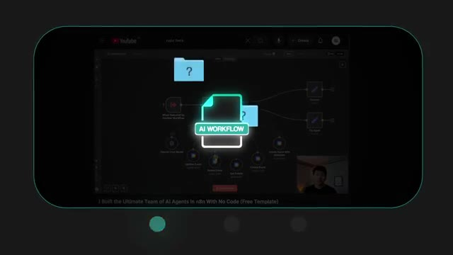
*⏱️ 00:00:45 — Capture d'écran de l'interface de travail n8n montrant un diagramme de workflow complexe avec des nœuds connectés pour des agents IA.*

---

### ⏱️ `[00:00:53 - 00:01:13]` | Segment #03

**🔊 Audio (Transcription Intégrale Mot pour Mot en Français) :**
> basically this. Get in, get money, get out. So I'd quote something like $1,500 for a build, Thinking, wow, I'm about to make $1,500. But then I'd get into it and I'd realize this is going to take me a lot longer than I thought. I'd already agreed on the price. We'd signed off. And now I am stuck. I just shot myself in the foot. I was wearing all the hats, scoping, sales, building, delivery. And I was taking a huge loss.

**👁️ Analyse Visuelle d'Écran (gemini-3.5-flash-lite) :**
**Interface & Outils** : n8n (Workflow automation platform), interface de messagerie (simulant une plateforme comme Instagram ou une web app).

**Contenu textuel & Code** : "n8n Developer Agent", diagramme de flux (GPT-4o, Memory, Tools), messages : "cost for this project will be $1500", "That works for me".

**Action / Démonstration** : Illustration du processus de vente et de validation contractuelle d'un projet de développement automatisé par IA.

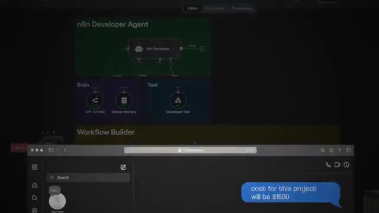
*⏱️ 00:01:03 — Interface de "n8n Developer Agent" en arrière-plan, avec au premier plan une fenêtre de messagerie confirmant le coût du projet à 1500$.*

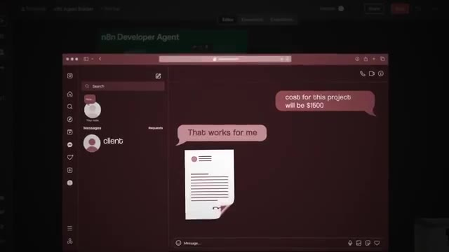
*⏱️ 00:01:08 — Interface de messagerie où un client valide la proposition ("That works for me") accompagnée d'une icône de document/contrat.*

---

### ⏱️ `[00:01:13 - 00:01:34]` | Segment #04

**🔊 Audio (Transcription Intégrale Mot pour Mot en Français) :**
> But if I had been running an agency, that problem would have actually been 10 times worse. Because in an agency, you'd have to hand that product to a developer. And the developer might say, this isn't enough money for this build. And now you just slashed your margins. Or they'd ask you for like a full project requirement doc. And you don't even know how to write that yet. Same thing if you had a salesperson or appointment setter doing your calls. If you don't know how to scope accurately, they probably won't either.

**👁️ Analyse Visuelle d'Écran (gemini-3.5-flash-lite) :**
**Interface & Outils** : Application de messagerie mobile (type iMessage).

**Contenu textuel & Code** : Nom de contact "developer".

**Action / Démonstration** : Aucune.

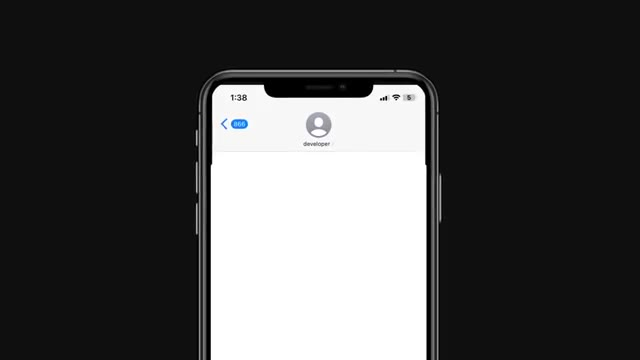
*⏱️ 00:01:18 — Capture d'écran simulée d'une interface de messagerie sur smartphone affichant "developer" comme destinataire.*

---

### ⏱️ `[00:01:34 - 00:01:55]` | Segment #05

**🔊 Audio (Transcription Intégrale Mot pour Mot en Français) :**
> Now you've got a bad price, a bad proposal, and a mess to deliver on. And in an agency, that's going to hurt more than just your bottom line. It's going to hurt your brand and your reputation. I've seen people go all in on the agency model, close a bunch of sales, and then realize that their developers aren't as good as they thought, or they can't afford enough of them. They're stretched way too thin, drowning in projects, and now they're not delivering on any of them on time or at all.

**👁️ Analyse Visuelle d'Écran (gemini-3.5-flash-lite) :**
**Interface & Outils** : Éditeur de code (IDE) sur ordinateur portable.

**Contenu textuel & Code** : Lignes de code source et texte technique affichés à l'écran de l'ordinateur.

**Action / Démonstration** : Développement logiciel intensif, illustrant le concept de surexploitation des ressources ("stretched too thin").

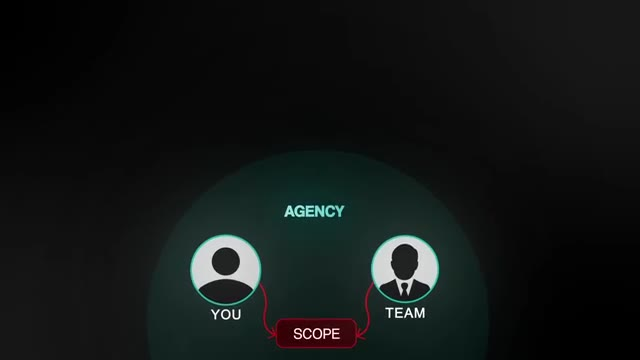
*⏱️ 00:01:39 — Un schéma conceptuel sur fond sombre représentant un modèle d'agence avec deux icônes d'utilisateurs ("YOU" et "TEAM") reliées par un bloc central intitulé "SCOPE".*

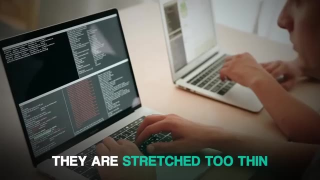
*⏱️ 00:01:50 — Une vue en plongée d'une personne travaillant sur un ordinateur portable affichant un éditeur de code avec des sections de texte surlignées, illustrant la charge de travail technique.*

---

### ⏱️ `[00:01:55 - 00:02:13]` | Segment #06

**🔊 Audio (Transcription Intégrale Mot pour Mot en Français) :**
> That's not a business. That's a stress machine. And here's the thing, one of the worst parts of running an agency isn't just the technical side or the delivery problems. It's juggling multiple clients at once, all with different personalities, expectations, and timelines. If you don't align on these expectations with your clients from the very beginning, it's going to be a nightmare. And I've seen that myself.

**👁️ Analyse Visuelle d'Écran (gemini-3.5-flash-lite) :**
**Interface & Outils** : Aucune interface logicielle ou outil de développement n'est présent dans ce segment.

**Contenu textuel & Code** : Aucun code, commande ou prompt affiché.

**Action / Démonstration** : Aucune manipulation logicielle ou exécution d'agent ; le segment est purement illustratif via des animations graphiques.

---

### ⏱️ `[00:02:14 - 00:02:36]` | Segment #07

**🔊 Audio (Transcription Intégrale Mot pour Mot en Français) :**
> Even if someone is willing to hand you $5,000, that doesn't automatically mean you want them as a client. AI isn't magic, some people think it is. And if the client is in debt and hoping that your AI workflows can save their business, you're setting yourself up in a really bad situation. That kind of pressure will make the project miserable for both of you guys. You don't want clients who are insanely risk averse and looking for AI to plug every hole in a sinking ship.

**👁️ Analyse Visuelle d'Écran (gemini-3.5-flash-lite) :**
**Interface & Outils** : Aucune interface logicielle, éditeur de code ou tableau de bord n'est affiché.

**Contenu textuel & Code** : Aucun contenu textuel, code source ou donnée technique n'est présent.

**Action / Démonstration** : Aucune action de démonstration ou manipulation technique n'est montrée.

---

### ⏱️ `[00:02:36 - 00:02:56]` | Segment #08

**🔊 Audio (Transcription Intégrale Mot pour Mot en Français) :**
> You want people who are forward thinking, who see AI as an investment to get ahead of the curve, not as a last ditch lifeline. One of my go-to discovery questions was always, what do you think about AI and where do you think it's going? This answer told me a lot. If they were hesitant or skeptical, I knew they'd probably resist the process. If they were excited and bullish, that's the kind of person who I want to work with and who's going to be a great partner.

**👁️ Analyse Visuelle d'Écran (gemini-3.5-flash-lite) :**
**Interface & Outils** : Interface logicielle de type outil de CRM ou plateforme de simulation de vente.

**Contenu textuel & Code** : Texte affiché dans la bulle : "What do you think about AI".

**Action / Démonstration** : Illustration visuelle du processus de qualification commerciale via une question découverte sur l'IA.

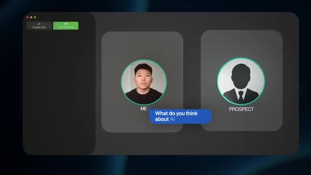
*⏱️ 00:02:46 — Interface graphique représentant une simulation d'appel ou de discussion, avec deux avatars ("ME" et "PROSPECT") et une bulle de texte posant une question sur l'IA.*

---

### ⏱️ `[00:02:56 - 00:03:17]` | Segment #09

**🔊 Audio (Transcription Intégrale Mot pour Mot en Français) :**
> The real issue with diving into an agency first is that you're trying to run before you've learned to walk. You haven't yet learned the full journey from the first outreach message to scoping the project in detail, building it, deploying it, and deciding how to support it long term. And until you've done that whole process yourself, no way you'll know how to lead a team through it. Beyond just team size, the difference is an agency owner is usually taking inbound requests, helping deliver them.

**👁️ Analyse Visuelle d'Écran (gemini-3.5-flash-lite) :**
**Interface & Outils** : Diagramme de workflow métier (interface type SaaS ou outil de gestion de projet).

**Contenu textuel & Code** : Texte affiché : "SCOPE", "DEPLOY", et icônes symbolisant la communication, l'automatisation et la relation client.

**Action / Démonstration** : Affichage visuel des étapes du cycle de vie d'un projet en agence.

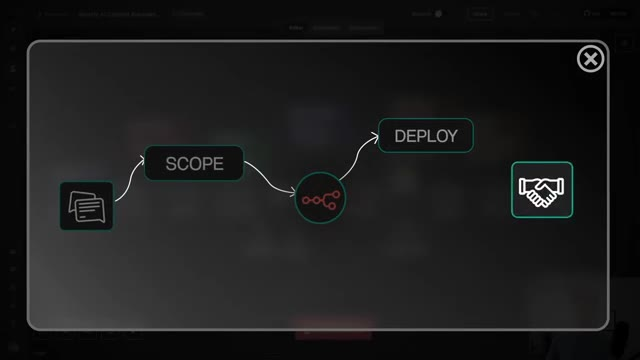
*⏱️ 00:03:06 — Diagramme de flux schématique sur fond sombre représentant les étapes clés d'un projet : "SCOPE", une icône de workflow, "DEPLOY" et une icône de poignée de main.*

---

### ⏱️ `[00:03:17 - 00:03:51]` | Segment #10

**🔊 Audio (Transcription Intégrale Mot pour Mot en Français) :**
> A consultant is actually being approached as the expert. The business owner is going to say, help me figure out what I need. I'm here to listen to you. consultants get paid for their brain and their expertise, not for how many employees they manage. And for me, it's not just about making money. Sustainable growth means you enjoy what you're doing. You keep learning and you build something that has long-term potential. Think of it like learning golf. When you first start, you're going to get blisters on your hands. That's just part of building the skill. And you can't wear three golf gloves forever, every single time you want to play. You're going to look ridiculous. So you'll get those early blisters, figuring things out solo, and that will make you stronger and it will make you a better leader later. When I made my

**👁️ Analyse Visuelle d'Écran (gemini-3.5-flash-lite) :**
**Interface & Outils** : Flowise (plateforme de construction de flux pour LLM).

**Contenu textuel & Code** : Diagramme de flux logique incluant un "AI Agent", "Supabase Vector Store", "Embeddings OpenAI" et "Default Data Loader".

**Action / Démonstration** : Visualisation du pipeline de données d'un agent IA spécialisé (RAG) dans une interface de programmation visuelle.

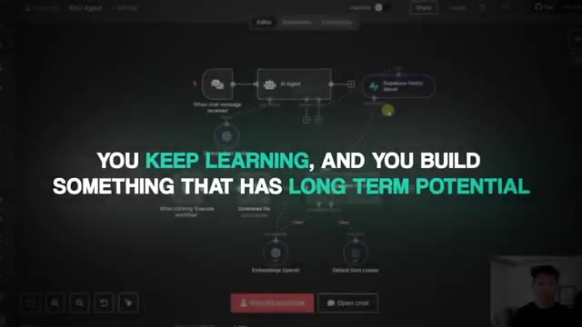
*⏱️ 00:03:34 — Interface de workflow automatisé dans l'outil Flowise, montrant des nœuds connectés pour un agent IA (RAG Agent).*

---

### ⏱️ `[00:03:51 - 00:04:27]` | Segment #11

**🔊 Audio (Transcription Intégrale Mot pour Mot en Français) :**
> first $1,200 from an NNN workflow. It came from an inbound lead. Someone who had seen something I built and reached out. We had a casual conversation about what they needed and I was able to deliver on it myself and they were happy. That project gave me the confidence to know I can do this and from there I learned how to scope better, price better, and eventually teach other people my system. If I had to start over I'd 100% begin as a freelancer then move into consulting and only then once I'm really good at the process think about building a team around me because when you start solo you learn the foundations, you protect your margins, and you actually enjoy the process instead of burning out. The alternative? Becoming an AI consultant. So if starting an agency isn't the

**👁️ Analyse Visuelle d'Écran (gemini-3.5-flash-lite) :**
**Interface & Outils** : n8n (outil d'automatisation de workflow)

**Contenu textuel & Code** : Nœuds de workflow : "Get Avatar ID", "Get Voice ID", "Create Video", "Create Video w/ Polling", "Script Writer", "GPT AI Unit".

**Action / Démonstration** : Visualisation et configuration de nœuds dans une plateforme d'automatisation (n8n) pour construire un workflow de création de contenu vidéo par IA.

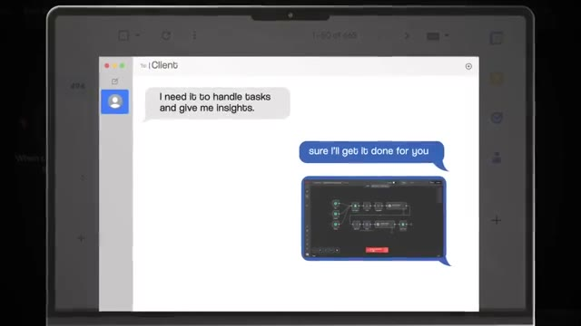
*⏱️ 00:04:00 — Capture d'écran montrant une interface de messagerie où un client demande une automatisation pour la gestion des tâches et des insights, suivie d'une réponse confirmant la réalisation du projet avec un aperçu du workflow.*

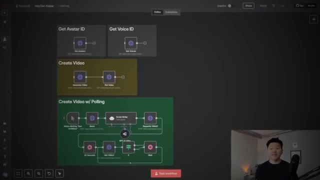
*⏱️ 00:04:18 — Vue détaillée de l'interface n8n affichant plusieurs nœuds de workflow, notamment pour la génération de vidéos avec avatars et l'utilisation de modèles GPT.*

---

### ⏱️ `[00:04:27 - 00:04:48]` | Segment #12

**🔊 Audio (Transcription Intégrale Mot pour Mot en Français) :**
> right first move, what's the alternative? For me, the answer was simple. Become an AI consultant. Now when I say consultant, I don't mean you're sitting in an office all day writing 50-page reports and sending invoices. I mean you're getting paid for your brain, for your ability to see how a business works, spot inefficiencies, and design AI workflows and systems to actually solve those specific problems. You're the strategist and the builder, and you don't need a team to get started.

**👁️ Analyse Visuelle d'Écran (gemini-3.5-flash-lite) :**
**Interface & Outils** : Make (plateforme d'automatisation de workflows).

**Contenu textuel & Code** : Schéma visuel d'un workflow composé de déclencheurs (triggers), d'outils de traitement et de modules connectés entre eux par des lignes de flux.

**Action / Démonstration** : Visualisation et édition d'un processus d'automatisation IA, illustrant la construction d'un système opérationnel pour un client.

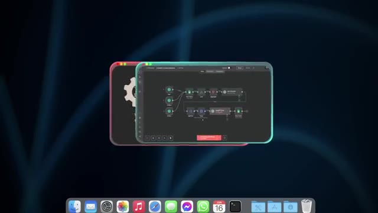
*⏱️ 00:04:43 — Capture d'écran montrant l'interface du logiciel Make (ex-Integromat) affichant un workflow d'automatisation avec des nœuds connectés.*

---

### ⏱️ `[00:04:48 - 00:05:10]` | Segment #13

**🔊 Audio (Transcription Intégrale Mot pour Mot en Français) :**
> This was a game changer for me because I didn't have to manage developers, juggle payroll, or figure out how to keep 10 clients happy at once. I could just focus on the one problem in front of me, just one at a time, solve it well, and move on. The thing I love about consulting is you can jump into real, high-impact problems quickly, like helping an e-com brand automate 80% of their customer support, or building a lead qualification chatbot for a coach so they only talk to their most serious prospects.

**👁️ Analyse Visuelle d'Écran (gemini-3.5-flash-lite) :**
**Interface & Outils** : AUCUNE

**Contenu textuel & Code** : AUCUN

**Action / Démonstration** : AUCUNE

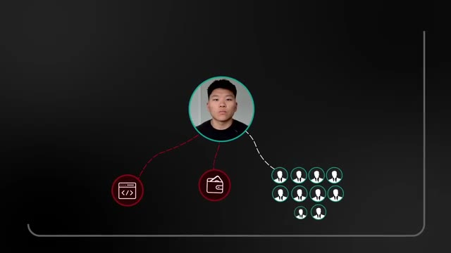
*⏱️ 00:04:53 — Un graphique schématique montrant une icône centrale reliée à trois éléments : deux icônes rouges (code et portefeuille) représentant les contraintes et un groupe d'icônes de personnes (clients) reliées en pointillés.*

---

### ⏱️ `[00:05:10 - 00:05:31]` | Segment #14

**🔊 Audio (Transcription Intégrale Mot pour Mot en Français) :**
> Those things I just mentioned aren't nice-to-have projects. They actually save time, cut costs, and help those businesses make more money, Which means those business owners will be happy to pay a lot of money for those. And here's where it gets exciting. Big consulting firms are making millions just on strategy before they even actually build or implement anything. Enterprise AI assessments can range from $7,000 to $50,000.

**👁️ Analyse Visuelle d'Écran (gemini-3.5-flash-lite) :**
**Interface & Outils** : Logiciel de présentation graphique / Document texte (probablement un article de réflexion ou un rapport).

**Contenu textuel & Code** : Texte sur les limites du conseil traditionnel : "This isn't just an execution problem. It's a model problem." et critiques sur les "elegant decks that never ship".

**Action / Démonstration** : Présentation de concepts théoriques sur la valeur ajoutée réelle par rapport au conseil stratégique traditionnel.

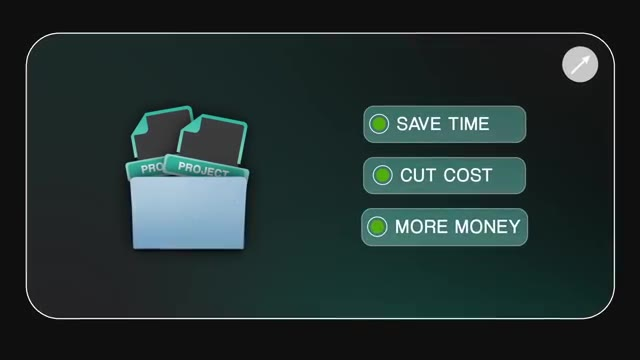
*⏱️ 00:05:15 — Un graphique montrant une icône de dossier contenant des projets, associé à trois points de valeur : "SAVE TIME", "CUT COST" et "MORE MONEY".*

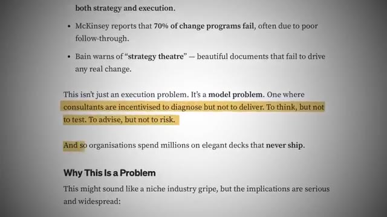
*⏱️ 00:05:26 — Un extrait de document textuel analysant les failles des cabinets de conseil, avec des passages surlignés en jaune soulignant que les consultants sont incités à diagnostiquer mais pas à livrer.*

---

### ⏱️ `[00:05:31 - 00:05:50]` | Segment #15

**🔊 Audio (Transcription Intégrale Mot pour Mot en Français) :**
> Strategic AI roadmaps for mid-market companies can cost $90,000 to a quarter million dollars. Accenture actually booked $600 million in AI consulting in just one quarter and $2.6 billion in six months. The only reason small and medium-sized businesses aren't paying firms like McKenzie or BCG for AI help is because they simply can't afford it.

**👁️ Analyse Visuelle d'Écran (gemini-3.5-flash-lite) :**
**Interface & Outils** : Graphique statique de type "overlay" (superposition) généré au montage.

**Contenu textuel & Code** : Texte affichant les fourchettes de prix pour les services de conseil en IA.

**Action / Démonstration** : Aucune manipulation de logiciel, de code ou d'agent IA n'est démontrée ; il s'agit d'une illustration pédagogique.

---

### ⏱️ `[00:05:50 - 00:06:10]` | Segment #16

**🔊 Audio (Transcription Intégrale Mot pour Mot en Français) :**
> But they still want and need that level of guidance, and that's where you can step in at a fraction of the price. Your first step, become an AI freelancer. Of course, before you can become a consultant, you want to have some proof that you can deliver, and that's where freelancing comes in. I know the term freelancing doesn't sound as shiny as consulting or agency owner, but this stage is critical. As a freelancer, you're getting paid to learn.

**👁️ Analyse Visuelle d'Écran (gemini-3.5-flash-lite) :**
**Interface & Outils** : Aucune interface logicielle ou outil technique n'est affiché.

**Contenu textuel & Code** : Texte affiché à l'écran : "#3 YOUR FIRST STEP - BECOME AN AI FREELANCER".

**Action / Démonstration** : Aucune action technique ou démonstration logicielle effectuée.

---

### ⏱️ `[00:06:10 - 00:06:30]` | Segment #17

**🔊 Audio (Transcription Intégrale Mot pour Mot en Français) :**
> You're testing different workflows, solving real problems, and building up your portfolio, all without the pressure of running a big operation. The goal here isn't to make millions overnight. It's to rack up three to five solid paid results that you can show as proof of what you can do. For me, freelancing gave me four things that I couldn't skip. Proof of results, so that when I said I can save you X hours a week, I actually had examples.

**👁️ Analyse Visuelle d'Écran (gemini-3.5-flash-lite) :**
**Interface & Outils** : n8n (outil d'automatisation de workflows).

**Contenu textuel & Code** : Workflow n8n avec les nœuds : Webhook, Ultimate Assistant, Respond to Webhook, GPT 4o, Simple Memory, Tools, Email Agent, Calendar Agent, Contact Agent, Content Creator Agent.

**Action / Démonstration** : Visualisation d'une structure d'automatisation d'agent IA conçue pour un assistant personnel/professionnel.

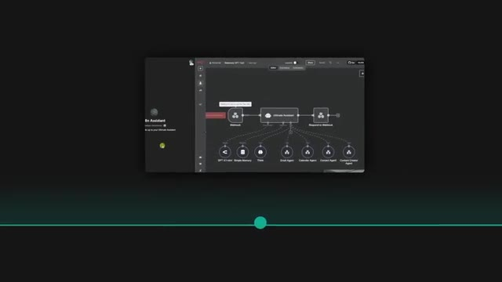
*⏱️ 00:06:20 — Interface de l'outil d'automatisation n8n montrant un workflow complexe avec un nœud "Webhook", un module "Ultimate Assistant" et plusieurs sous-agents connectés.*

---

### ⏱️ `[00:06:31 - 00:07:04]` | Segment #18

**🔊 Audio (Transcription Intégrale Mot pour Mot en Français) :**
> Testimonials, actual words from clients to build my credibility. Confidence in my process, I knew how to handle a project from start to finish. And clarity on my niche. I learned who I liked working with and who actually paid well. Without those things, moving into consulting would have been guesswork. One win led to another and another. Each time I learned more about how to communicate with clients, how to price correctly, and how to spot red flags before taking on a project. You just have to be in that mindset of getting paid to practice. You're not just trying to make as much money as possible on every deal. You're trying to get better, faster, and more efficient with each project. What you're doing here is optimizing for experience

**👁️ Analyse Visuelle d'Écran (gemini-3.5-flash-lite) :**
**Interface & Outils** : Graphisme d'interface de type présentation (motion design).

**Contenu textuel & Code** : Texte listant les 4 points clés : "1. PROOF OF RESULTS", "2. TESTIMONIALS", "3. CONFIDENCE IN MY PROCESS", "4. CLARITY ON MY NICHE".

**Action / Démonstration** : Affichage progressif des étapes nécessaires pour réussir sa transition vers le consulting.

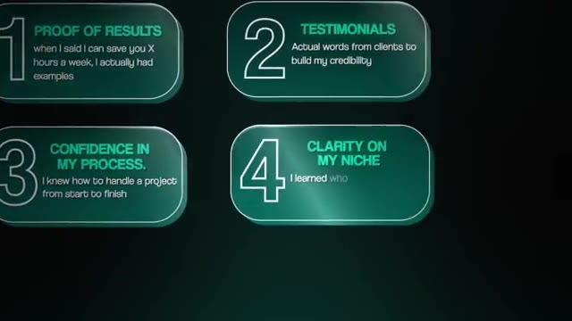
*⏱️ 00:06:39 — Une infographie structurée présentant 4 piliers stratégiques pour le conseil : Preuve de résultats, Témoignages, Confiance dans le processus et Clarté sur la niche.*

---

### ⏱️ `[00:07:04 - 00:07:40]` | Segment #19

**🔊 Audio (Transcription Intégrale Mot pour Mot en Français) :**
> rather than cost. So if that means you end up doing your first project or two for free in exchange for a testimonial and a case study, that's 100% worth it. Think of it like building your own playbook. So when you eventually start consulting, you're not figuring things out for the first time with a high ticket client breathing down your neck. So the big question remaining is how do you actually sell your first AI workflows as a freelancer? How to sell AI workflows. So now you know why we start with freelancing and why those first three to five projects matter so much. Let's talk about how to actually land them because the process is way simpler than most people think. Here's exactly how I go from zero to a paid AI workflow deal. Step one, choose a pain point to solve. The first

**👁️ Analyse Visuelle d'Écran (gemini-3.5-flash-lite) :**
**Interface & Outils** : AUCUNE

**Contenu textuel & Code** : AUCUN

**Action / Démonstration** : AUCUNE

---

### ⏱️ `[00:07:40 - 00:08:14]` | Segment #20

**🔊 Audio (Transcription Intégrale Mot pour Mot en Français) :**
> mistake a lot of people make is just saying, I can automate anything. Just tell me what you need. That's way too broad. You need to pick a specific type of person that you want to help coaches, e-com store owners, agencies, whatever, and pick one clear problem to solve for them. Now, I'll be honest. I ultimately went broad because I had a lot of inbound leads from the channel, but if you're starting from scratch, I highly recommend niching down. Not only will it make your outreach and your content more consistent, but it will help you convert at a higher rate, deliver better results, and you'll end up being able to charge more. Think of it like this. A steakhouse can charge a premium for a little six ounce filet, while an all-you-can-eat buffet might give you a

**👁️ Analyse Visuelle d'Écran (gemini-3.5-flash-lite) :**
**Interface & Outils** : Aucune (il s'agit d'illustrations pédagogiques ou d'interfaces de réseaux sociaux sans outils techniques de développement).

**Contenu textuel & Code** : Texte informatif et titres de vidéos YouTube.

**Action / Démonstration** : Aucune action technique, de codage ou de manipulation d'agent n'est montrée.

---

### ⏱️ `[00:08:14 - 00:08:46]` | Segment #21

**🔊 Audio (Transcription Intégrale Mot pour Mot en Français) :**
> 24 ounce ribeye for cheap. When you specialize, you're the steakhouse. People pay more for a specific thing that you're really good at. Step two is to build a simple demo or case study. People need to see it to believe it. That's why I would always create a quick demo, sometimes just like a quick two-minute loom video, just showing a before and after. For example, the before could be a coach manually messaging every lead to qualify them. The after could be your chatbot in action, which does that automatically and only books qualified leads onto the coach's calendar. You're showing the destination, not the car that gets them there. AI is the car, the result is the actual destination

**👁️ Analyse Visuelle d'Écran (gemini-3.5-flash-lite) :**
**Interface & Outils** : n8n (ou outil d'automatisation de workflow similaire), interface de messagerie simulée.

**Contenu textuel & Code** : Workflow divisé en 5 chapitres ("Chapter 1" à "Chapter 5") avec des nœuds de connexion ; interface de chatbot avec bulles de conversation.

**Action / Démonstration** : Visualisation d'un processus d'automatisation de flux de travail (pipeline) et démonstration du résultat client via chatbot.

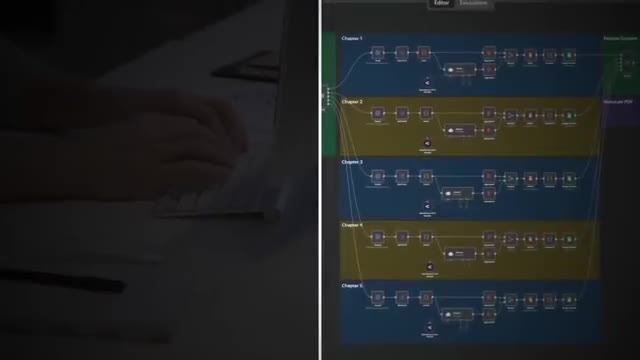
*⏱️ 00:08:30 — Capture d'écran divisée montrant à gauche une personne tapant sur un clavier et à droite une interface de workflow automatisé (type n8n).*

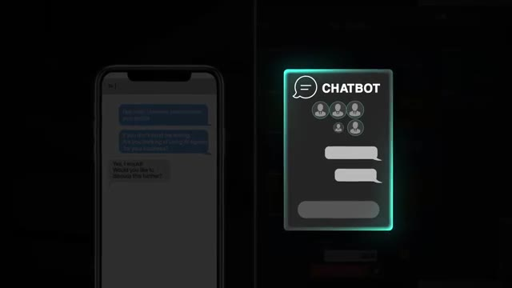
*⏱️ 00:08:38 — Capture d'écran montrant à gauche une interface de messagerie mobile (SMS) et à droite une représentation graphique simplifiée d'une interface de chatbot.*

---

### ⏱️ `[00:08:46 - 00:09:19]` | Segment #22

**🔊 Audio (Transcription Intégrale Mot pour Mot en Français) :**
> that the business owner cares about. Step three is to outreach with a strong offer. You need to make the offer something that the business owner would feel stupid if they said no to. And what a lot of freelancers miss out on is that you have to speak their language. Business owners speak in money and time. If you can relate everything back to those two things and make it a no-brainer, you'll close deals at a much higher rate. A no-brainer, to me, sounds like this. Hey, you're doing this process manually, which takes you five hours a week. If you value your time at $100 an hour, that's $500 a week. Over a month, $2,000. Over a year, $24,000. Now, if I can go ahead and build you a system that

**👁️ Analyse Visuelle d'Écran (gemini-3.5-flash-lite) :**
**Interface & Outils** : Graphique conceptuel (infographie type slide de présentation).

**Contenu textuel & Code** : Texte affiché : "BUSINESS OWNER", "YOU", "MONEY" (avec icône portefeuille), "TIME" (avec icône chronomètre).

**Action / Démonstration** : Illustration visuelle du flux d'échange de valeur (temps contre argent) entre un prestataire et un propriétaire d'entreprise.

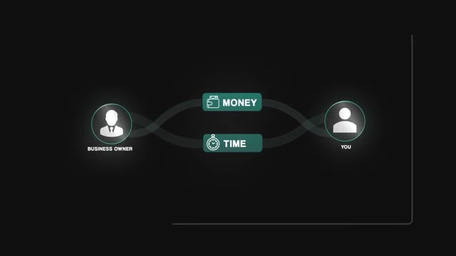
*⏱️ 00:09:03 — Diagramme conceptuel illustrant la relation entre un "Business Owner" et "You" avec les concepts centraux de "MONEY" et "TIME" connectés.*

---

### ⏱️ `[00:09:19 - 00:09:52]` | Segment #23

**🔊 Audio (Transcription Intégrale Mot pour Mot en Français) :**
> eliminates all of that manual work, I'm not just giving you back 20 hours a month, which is huge. I'm also giving you back $2,000 a month in value. So paying me only $2,000 for that solution is a no-brainer because over the course of the year, you're getting back 240 hours and saving $22,000. Step four, deliver, document, and capture metrics. After you've got a client on board, your next job is to track metrics before and after the automation goes live. Ask questions like, how long does this task take manually? What's the error percentage? How many leads or tickets are processed per week. Then, after your system's up and running, measure those same numbers

**👁️ Analyse Visuelle d'Écran (gemini-3.5-flash-lite) :**
**Interface & Outils** : Interface graphique animée (type présentation ou dashboard personnalisé).

**Contenu textuel & Code** : "STEP #1: IDENTIFY A PAIN POINT TO SOLVE", "STEP #2: BUILD A SIMPLE DEMO OR CASE STUDY", "STEP #3: OUTREACH WITH A STRONG OFFER", "STEP #4: DELIVER DOCUMENT AND CAPTURE METRICS".

**Action / Démonstration** : Présentation visuelle de la stratégie de vente et du processus opérationnel pour les services d'automatisation.

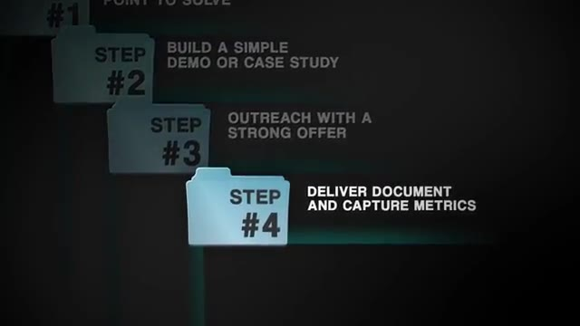
*⏱️ 00:09:35 — Un graphique animé affiche une liste séquentielle de quatre étapes (Steps) représentées par des icônes de dossiers empilés, mettant l'accent sur l'étape 4.*

---

### ⏱️ `[00:09:52 - 00:10:13]` | Segment #24

**🔊 Audio (Transcription Intégrale Mot pour Mot en Français) :**
> again. This will do two things for you. The first one is that it will give you a rock-solid case study to win future clients because you're objectively proving that your system added value. And second, it shows the client in black and white numbers that their investment paid off. And when they see that proof, they're obviously way more likely to give you a strong testimonial because now you've helped them feel the value, not just hear about it. Remember, you're not selling AI.

**👁️ Analyse Visuelle d'Écran (gemini-3.5-flash-lite) :**
**Interface & Outils** : Site web de présentation (Webflow/Portfolio), Flowise (workflow builder).

**Contenu textuel & Code** : Nœuds de workflow, connexions logiques entre modèles de langage (OpenAI) et bases de données vectorielles (Supabase), retours clients textuels.

**Action / Démonstration** : Navigation à travers une page de présentation de projets, affichage d'un schéma technique de workflow IA, lecture de témoignages professionnels.

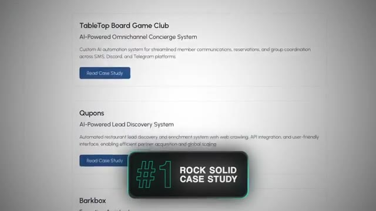
*⏱️ 00:09:57 — Une liste de projets clients avec leurs intitulés ("TableTop Board Game Club", "Qupons") et un bouton "Read Case Study" pour chacun.*

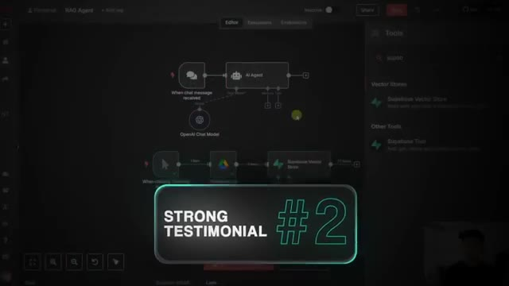
*⏱️ 00:10:02 — Une vue de l'interface de travail de Flowise montrant un workflow d'agent IA avec des nœuds connectés (Chat message, AI Agent, OpenAI, Supabase Vector Store).*

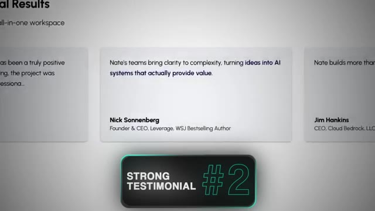
*⏱️ 00:10:08 — Une section de témoignages clients avec une citation mise en avant de Nick Sonnenberg sur la capacité des équipes à transformer des idées en systèmes IA générateurs de valeur.*

---

### ⏱️ `[00:10:13 - 00:10:44]` | Segment #25

**🔊 Audio (Transcription Intégrale Mot pour Mot en Français) :**
> AI is the tool. What you're really selling is the time saved, the money saved, the extra revenue generated, the ability to avoid hiring another employee. When you figure out someone's pain point and you press on it, then show how your workflow gets rid of it, closing the deal becomes way easier. Transitioning to an AI consultant. Now that you've done a couple projects and you have your testimonials and your case studies, you have the credibility to raise your prices. You can package your offers differently and start selling like a true consultant. As a freelancer, your pitch is usually, tell me what you need, I'll build it. As a consultant, your pitch becomes more of a, Let me figure out what you actually need.

**👁️ Analyse Visuelle d'Écran (gemini-3.5-flash-lite) :**
**Interface & Outils** : Page web de présentation d'offres commerciales (Pricing page).

**Contenu textuel & Code** : Liste des services inclus pour les offres "Business Partner" (Dedicated AI Engineer, VIP support, etc.) et "Enterprise Partner" (Dedicated Project Manager, strategic roadmap, etc.).

**Action / Démonstration** : Aucune, il s'agit d'une illustration statique des services et tarifs proposés par un consultant en automatisation IA.

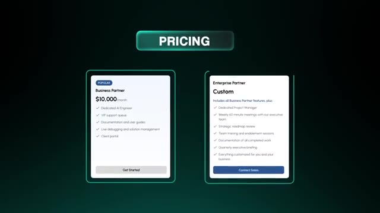
*⏱️ 00:10:36 — Tableau comparatif des offres tarifaires : "Business Partner" à 10 000 $/mois et une option "Enterprise Partner" personnalisée.*

---

### ⏱️ `[00:10:44 - 00:11:06]` | Segment #26

**🔊 Audio (Transcription Intégrale Mot pour Mot en Français) :**
> Then I'll design the solution for you. And this shift fundamentally changes how clients look at you. You're no longer just an extra set of hands or, you know, a subcontractor that they can push some work to. You're the expert, the strategist. You're the one they trust to guide them through the chaos and all of this noise of AI and automation. And once you've proven you can deliver those results, you can stop charging for tasks and start charging for outcomes.

**👁️ Analyse Visuelle d'Écran (gemini-3.5-flash-lite) :**
**Interface & Outils** : Interface de navigation web pour l'image #3 ; interface utilisateur stylisée avec overlays graphiques pour l'image #2.

**Contenu textuel & Code** : Titre d'article : "The Future of AI Automation: How It's Changing Business Operations".

**Action / Démonstration** : Illustration visuelle du concept d'expert stratégique en automatisation et de veille technologique.

*⏱️ 00:10:55 — Une vue cinématique d'un utilisateur travaillant sur un ordinateur portable, avec des superpositions graphiques numériques (HUD) évoquant l'analyse de données et l'automatisation.*

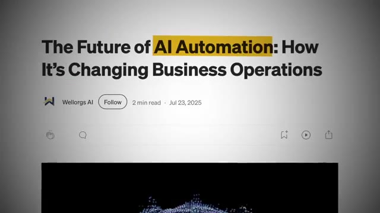
*⏱️ 00:11:01 — Une capture d'écran d'un article en ligne titré "The Future of AI Automation: How It's Changing Business Operations" publié par Wellorgs AI.*

---

### ⏱️ `[00:11:06 - 00:11:28]` | Segment #27

**🔊 Audio (Transcription Intégrale Mot pour Mot en Français) :**
> As a freelancer, you might be charging one to $5,000 per project. As a consultant, you can package that same expertise into $10,000 plus solutions. Because now you're not just building workflows, you're designing systems and integrating into a company's specific operation. And those systems are worth a lot more than a single automation. This is where I stopped thinking in terms of projects and started thinking in terms of systems.

**👁️ Analyse Visuelle d'Écran (gemini-3.5-flash-lite) :**
**Interface & Outils** : n8n (workflow automation builder).

**Contenu textuel & Code** : Nœuds de workflow ("Google Sheets", "HTTP Request", "IF", "Edit Fields", "Code"), prompts d'agent IA ("Write me a poem about nature"), et journaux d'exécution système.

**Action / Démonstration** : Exécution visuelle d'un workflow automatisé avec traitement de données (30 items) et interaction entre différents modèles de langage.

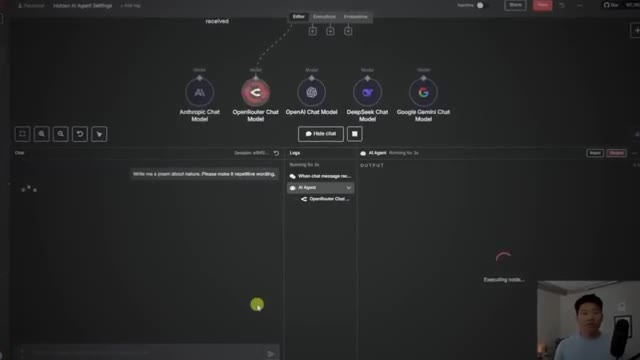
*⏱️ 00:11:17 — Interface de conception d'un workflow d'agent IA, montrant une sélection de modèles (Anthropic, OpenRouter, OpenAI, DeepSeek, Gemini) et un panneau de logs en cours d'exécution.*

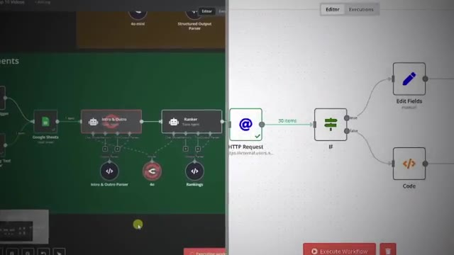
*⏱️ 00:11:22 — Vue scindée d'un diagramme de workflow complexe dans n8n, connectant Google Sheets à des agents ("Ranker", "Intro & Outro") et traitant des requêtes HTTP avec des conditions logiques.*

---

### ⏱️ `[00:11:28 - 00:12:02]` | Segment #28

**🔊 Audio (Transcription Intégrale Mot pour Mot en Français) :**
> Instead of saying, I'll build you a chatbot for $2,500, I'd say, I'll design and implement a full lead qualification system that runs 24-7, save your sales team 20 hours a week, and increases conversion rates. and we'll build that together over the next month. Pretty similar work, but it's framed as a high value business changing solution. As consultant, part of what you're selling is thinking beyond the build. I've had projects where the strategy document I delivered outlining exactly where AI should and shouldn't be used in the business was actually worth more to the client than the workflows themselves. Because now you're not just the automation person, you're the person who makes sure their AI strategy makes sense, actually works and drives ROI. This is also where you start to

**👁️ Analyse Visuelle d'Écran (gemini-3.5-flash-lite) :**
**Interface & Outils** : Outil d'automatisation de workflow (type n8n ou Make) et icône de fichier document.

**Contenu textuel & Code** : Schémas conceptuels de flux de travail : icônes d'utilisateurs connectés à un moteur central "24-7", et interface de nœuds logiques dans un workflow.

**Action / Démonstration** : Illustration visuelle du passage d'un processus manuel chronophage à une solution automatisée par l'IA.

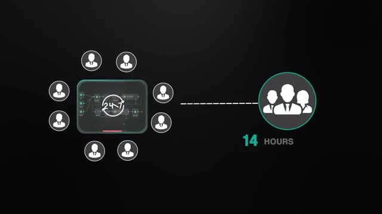
*⏱️ 00:11:36 — Un schéma illustrant l'automatisation 24/7 d'un système de qualification de leads remplaçant le travail manuel de l'équipe commerciale.*

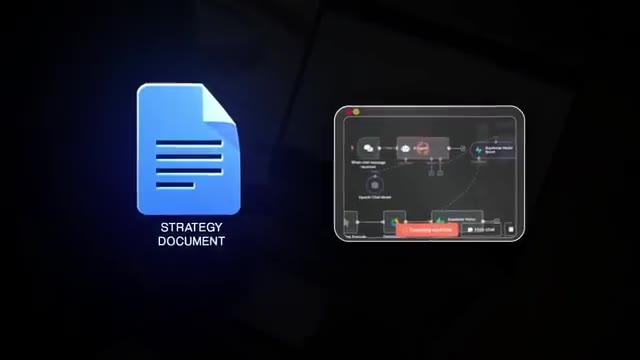
*⏱️ 00:11:54 — Une représentation visuelle associant un "document de stratégie" à une interface de workflow de type automate (n8n ou Make).*

---

### ⏱️ `[00:12:02 - 00:12:38]` | Segment #29

**🔊 Audio (Transcription Intégrale Mot pour Mot en Français) :**
> land longer term engagements, which should definitely be the goal. Monthly retainers, ongoing advisory roles, even revenue share deals. These aren't one and done builds. These are partnerships where clients keep you around because you're continuously spotting new opportunities for them to save time, money, and make more money. And this is exactly where you want to be before you even think about hiring a team or building a full agency. Remember those insane figures I mentioned earlier? Accenture booking $600 million in AI consulting in a quarter and then $2.6 billion in generative AI related sales. If billion dollar companies are pouring that much into AI consulting, there's an enormous opportunity for skilled individuals to carve out their piece of the

**👁️ Analyse Visuelle d'Écran (gemini-3.5-flash-lite) :**
**Interface & Outils** : Navigateur web ou lecteur de documents.

**Contenu textuel & Code** : Texte informatif soulignant qu'Accenture a généré 600 millions de dollars de revenus en IA générative sur le dernier trimestre, avec une projection annuelle de 2,4 milliards de dollars.

**Action / Démonstration** : Aucune action technique ou logicielle montrée, simple support visuel informatif.

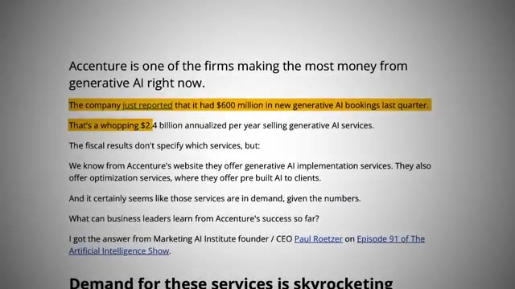
*⏱️ 00:12:29 — Capture d'écran d'un article ou d'un rapport textuel détaillant les revenus d'Accenture liés à l'IA générative.*

---

### ⏱️ `[00:12:38 - 00:13:13]` | Segment #30

**🔊 Audio (Transcription Intégrale Mot pour Mot en Français) :**
> market, especially for small and mid-sized businesses who can't pay enterprise rates but still need expert guidance. And then when you nail that aspect, the next logical step, if you even want to do it, is building a team around you. But now you'll be doing it with the skills, confidence, and processes to make sure it actually works. So here's the big picture. Don't jump into an agency too fast. It's a lot harder to get right when you don't have the experience yet. Start as a freelancer. Use that stage to learn the craft, deliver results, and build credibility. Then take those wins and evolve into an AI consultant where you're not just building workflows, you're solving real business problems and getting paid for your expertise. That's the path I took and it's the one

**👁️ Analyse Visuelle d'Écran (gemini-3.5-flash-lite) :**
**Interface & Outils** : Outil d'automatisation de workflow (nœud de gestion de mémoire de contexte).

**Contenu textuel & Code** : Paramètres visibles : "Session ID" (réglé sur "Take from previous node automatically"), "Content Window Length" (réglé sur "5").

**Action / Démonstration** : Configuration des paramètres de rétention de mémoire pour un agent IA afin de limiter ou définir le nombre d'interactions précédentes conservées dans le contexte.

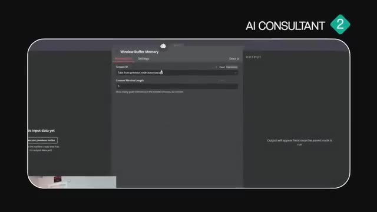
*⏱️ 00:13:04 — Interface de configuration d'un nœud "Window Buffer Memory" au sein d'un outil d'automatisation (type n8n ou plateforme similaire), avec le titre "AI CONSULTANT 2".*

---

### ⏱️ `[00:13:13 - 00:13:31]` | Segment #31

**🔊 Audio (Transcription Intégrale Mot pour Mot en Français) :**
> I recommend if you want this to be sustainable, enjoyable, and actually profitable long term. You don't have to quit your job tomorrow. You don't have to hire a team right away. You just have to take the next step that's right in front of you and focus on that. Get your first few wins and continue to build off of that momentum from there. Now I don't want this video to go too long, but I tried to pack as much value as I could into it.

**👁️ Analyse Visuelle d'Écran (gemini-3.5-flash-lite) :**
**Interface & Outils** : Plateformes de réseaux sociaux (type LinkedIn).

**Contenu textuel & Code** : Texte des témoignages : "60K Deal Closed" par Mark Chiles et "Closed another $3,500 client" par Nazmul Hasan, détaillant des implémentations d'agents IA vocaux.

**Action / Démonstration** : Affichage de preuves sociales (social proof) pour illustrer la réussite des étapes recommandées par le présentateur.

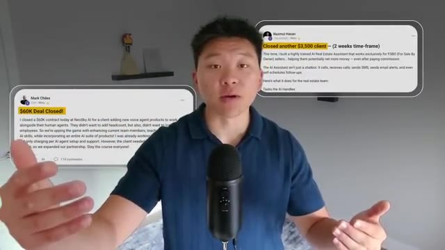
*⏱️ 00:13:26 — Capture d'écran montrant deux témoignages clients (posts LinkedIn/réseaux sociaux) encadrés, illustrant des succès financiers dans l'automatisation IA.*

---

### ⏱️ `[00:13:31 - 00:13:55]` | Segment #32

**🔊 Audio (Transcription Intégrale Mot pour Mot en Français) :**
> And if you want to get this full document so you can go ahead and take a look at it, it could be a great resource for you. I'll drop that in my FreeSchool community, which will be linked in the description. And of course, if this kind of stuff interests you and you're looking to connect with other people who are just as interested in it, then definitely check out my Plus community. The link for that will also be in the description. I do a live Q&A every week in there. There's educational resources. But really, what I think is the most valuable is the actual network of people who are also paying to be a member so you know they're taking it seriously.

**👁️ Analyse Visuelle d'Écran (gemini-3.5-flash-lite) :**
**Interface & Outils** : Plateforme communautaire Skool (AI Automation Society).

**Contenu textuel & Code** : Textes de posts communautaires, titre de cours "Agent Zero", et détails d'abonnement (prix : $89/mois).

**Action / Démonstration** : Navigation et présentation de la communauté en ligne et des ressources pédagogiques proposées par le créateur.

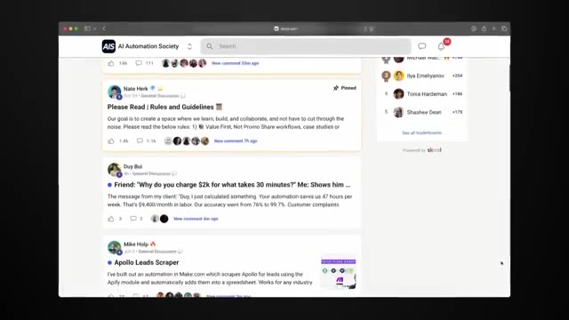
*⏱️ 00:13:37 — Interface de la plateforme communautaire "AI Automation Society" montrant un fil de discussion avec des posts d'utilisateurs sur l'automatisation et le scraping.*

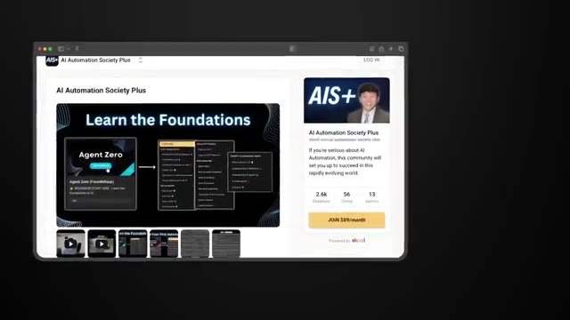
*⏱️ 00:13:43 — Page de destination de "AI Automation Society Plus" mettant en avant le programme "Learn the Foundations" et une option d'abonnement payant.*

---

### ⏱️ `[00:13:55 - 00:14:06]` | Segment #33

**🔊 Audio (Transcription Intégrale Mot pour Mot en Français) :**
> So I'd love to see you guys in those communities, but that's going to do it for today. If you enjoyed the video or you learned something new, please give it a like. Definitely helps me out a ton. And as always, I appreciate you guys making it to the end of the video. I'll see you all in the next one. Thanks, everyone.

**👁️ Analyse Visuelle d'Écran (gemini-3.5-flash-lite) :**
**Interface & Outils** : Lecteur YouTube (interface web).

**Contenu textuel & Code** : Titre de la vidéo : "How to Sell AI Workflows (Without Starting an Agency)".

**Action / Démonstration** : Interaction avec le bouton "Like" de YouTube via un curseur de souris.

---

