# 🎬 How I Sold These 4 AI Agents for $23,000 (as a beginner)

> **Chaîne** : [Nate Herk | AI Automation](https://www.youtube.com/@nateherk/featured)  
> **Lien YouTube** : [https://www.youtube.com/watch?v=HNKlFTd1maM](https://www.youtube.com/watch?v=HNKlFTd1maM)  
> **Date de publication** : 20250831  
> **Durée** : 00:14:18  
> **Identifiant vidéo** : `HNKlFTd1maM`  
> **Transcription & Analyse** : `whisper-v3-large-turbo+gemini-3.5-flash-lite`  

---

## 📌 Synthèse Exécutive & Outils

### 💡 Résumé
Dans cette vidéo intitulée **How I Sold These 4 AI Agents for $23,000 (as a beginner)**, Nate Herk décortique les capacités pratiques d'automatisation et de développement propulsées par les modèles de pointe.

### 🛠️ Outils, Modèles & Logiciels Présentés
- **Opus 5.5 & Claude Code** : Modèles d'ingénierie et agents de codage autonome.

### 🔑 Points Clés & Enseignements Stratégiques
- Optimiser le niveau d'effort et le raisonnement des modèles IA pour des résultats industriels.
- Automatiser les cycles de création logicielle de bout en bout.

---

## ⏱️ Chronologie & Transcription Complète Audio & Visuelle (Mot pour Mot)

### ⏱️ `[00:00:00 - 00:00:24]` | Segment #01

**🔊 Audio (Transcription Intégrale Mot pour Mot en Français) :**
> So we built these four AI agents and got paid $23,000 total by four separate businesses, and they weren't anything too complex or advanced. In fact, I actually started selling agents just like this a few months after starting out. So I'm confident that you could build and sell something just like them. In this video, I'm going to walk you guys through what each agent actually did, how much we charge per agent, the exact process we followed to sell our agents, and how you can sell your first agent step by step.

**👁️ Analyse Visuelle d'Écran (gemini-3.5-flash-lite) :**
**Interface & Outils** : Présentation ou face-caméra explicatif sans interface logicielle partagée.

**Contenu textuel & Code** : Explications orales et mise en contexte méthodologique.

**Action / Démonstration** : Explications face caméra et démonstration conceptuelle.

---

### ⏱️ `[00:00:24 - 00:00:42]` | Segment #02

**🔊 Audio (Transcription Intégrale Mot pour Mot en Français) :**
> And stay to the end, because that's when I go through the most expensive agent out of the four. All right, let's start with the first agent I sold, which was a personalized outreach agent. Basically, it let my client drop in a list of contacts, however many he wanted, and the system would automatically research each person and their company, then generate a personalized outreach message and follow-up message for them.

**👁️ Analyse Visuelle d'Écran (gemini-3.5-flash-lite) :**
**Interface & Outils** : Présentation ou face-caméra explicatif sans interface logicielle partagée.

**Contenu textuel & Code** : Explications orales et mise en contexte méthodologique.

**Action / Démonstration** : Explications face caméra et démonstration conceptuelle.

---

### ⏱️ `[00:00:42 - 00:01:08]` | Segment #03

**🔊 Audio (Transcription Intégrale Mot pour Mot en Français) :**
> This agent didn't actually send the messages or run the campaigns. It simply filled up the database with ready-to-go, customized, research-backed messages that he could then plug into an email or DM sequence. Super simple, but insanely valuable. I ended up charging $1,650 for this build, and honestly, that number was pretty random. At the time, I had already sold another agent for $1,200, so that was kind of my baseline, and I thought to myself, okay, this one's a bit more, let's try $1,650.

**👁️ Analyse Visuelle d'Écran (gemini-3.5-flash-lite) :**
**Interface & Outils** : Présentation ou face-caméra explicatif sans interface logicielle partagée.

**Contenu textuel & Code** : Explications orales et mise en contexte méthodologique.

**Action / Démonstration** : Explications face caméra et démonstration conceptuelle.

---

### ⏱️ `[00:01:08 - 00:01:41]` | Segment #04

**🔊 Audio (Transcription Intégrale Mot pour Mot en Français) :**
> I was clearly a beginner, and I wasn't even thinking about ROI back then. But if you actually do calculate the ROI, it still was a total no-brainer for him. I think he got a great deal, because he was spending 2-3 hours per week crafting personalized messages, and doing all that research himself. So let's say his time was worth $50 an hour. That's around $400 a month. With this system, he instantly got that time back, which means in about four months, he's made his money back. And every month after that, it's pure ROI. Over the course of a year, that's nearly $5,000 saved. And that doesn't even count the opportunity cost of having those extra hours back every week to actually grow the business instead of writing repetitive

**👁️ Analyse Visuelle d'Écran (gemini-3.5-flash-lite) :**
**Interface & Outils** : Présentation ou face-caméra explicatif sans interface logicielle partagée.

**Contenu textuel & Code** : Explications orales et mise en contexte méthodologique.

**Action / Démonstration** : Explications face caméra et démonstration conceptuelle.

---

### ⏱️ `[00:01:41 - 00:02:16]` | Segment #05

**🔊 Audio (Transcription Intégrale Mot pour Mot en Français) :**
> outreach. Now, how did I actually sell this? Well, the client found me on YouTube because I built something similar on my channel just for fun. And he emailed me saying that he wanted something similar. We hopped on a couple of calls. I scoped out the build. I told him I could do it. He said yes, it was that simple. The crazy part is at this stage I wasn't positioning myself as a freelancer or saying that I did paid work I just happened to have my email address in the description of the videos and I was posting builds online because I was excited about learning But because I was putting myself out there People started reaching out and that's how I was able to close this deal and my other first ones So that was the first agent soon after that things started moving a lot faster. I'd quit my job

**👁️ Analyse Visuelle d'Écran (gemini-3.5-flash-lite) :**
**Interface & Outils** : Présentation ou face-caméra explicatif sans interface logicielle partagée.

**Contenu textuel & Code** : Explications orales et mise en contexte méthodologique.

**Action / Démonstration** : Explications face caméra et démonstration conceptuelle.

---

### ⏱️ `[00:02:16 - 00:02:39]` | Segment #06

**🔊 Audio (Transcription Intégrale Mot pour Mot en Français) :**
> I started getting more inbound traction and I realized I couldn't keep doing everything solo That's when I decided to team up with my co-founders and we started building what's now our AI business, True Horizon AI. And this was a big turning point because up until then, I was just throwing out random numbers for pricing like that $1,650 outreach agent. But once I had a team, we started taking this more seriously and we realized we needed to get a system for pricing rather than just throwing out a number.

**👁️ Analyse Visuelle d'Écran (gemini-3.5-flash-lite) :**
**Interface & Outils** : Présentation ou face-caméra explicatif sans interface logicielle partagée.

**Contenu textuel & Code** : Explications orales et mise en contexte méthodologique.

**Action / Démonstration** : Explications face caméra et démonstration conceptuelle.

---

### ⏱️ `[00:02:39 - 00:03:00]` | Segment #07

**🔊 Audio (Transcription Intégrale Mot pour Mot en Français) :**
> That way, instead of guessing, we could actually sit down with a client, break down how much time or money a process was costing them and show them exactly how an automation would save that time or money. And then we could price the system in a way that made sense for both sides. That made selling way easier because clients could see in black and white that it wasn't an expense. It was an investment with a measurable return. And that's how we ended up landing the second agent that I'm going to show you guys.

**👁️ Analyse Visuelle d'Écran (gemini-3.5-flash-lite) :**
**Interface & Outils** : AUCUNE

**Contenu textuel & Code** : Texte "MONEY", "TIME" et "we'll make a deal at $4000".

**Action / Démonstration** : AUCUNE

---

### ⏱️ `[00:03:00 - 00:03:28]` | Segment #08

**🔊 Audio (Transcription Intégrale Mot pour Mot en Français) :**
> So once I started working with my business partners, Millen and Tyler, we launched True Horizon AI. We started getting our internal systems in place and we landed one of our first products together. This one was a type of sales agent. The idea here was simple, but really impactful. The agent could handle customer inquiries, generate quotes, and automatically enter everything into the CRM. It would talk to both the customer and the orders team, generate an accurate quote, and then log all the important details like name, email, phone number, location, and even a summary of the conversation back into the CRM.

**👁️ Analyse Visuelle d'Écran (gemini-3.5-flash-lite) :**
**Interface & Outils** : Graphiques animés de présentation (Motion Design).

**Contenu textuel & Code** : Textes explicatifs : "Customer Inquiries", "AI Agent", "The Workflow Process", "Customers", "Orders Team".

**Action / Démonstration** : Visualisation schématique du rôle d'un agent de vente IA dans une chaîne de traitement automatisée.

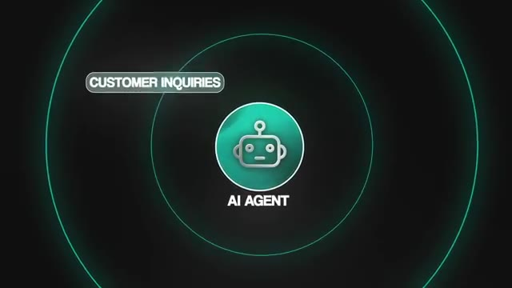
*⏱️ 00:03:14 — Animation graphique illustrant un "AI Agent" central traitant des requêtes entrantes ("Customer Inquiries").*

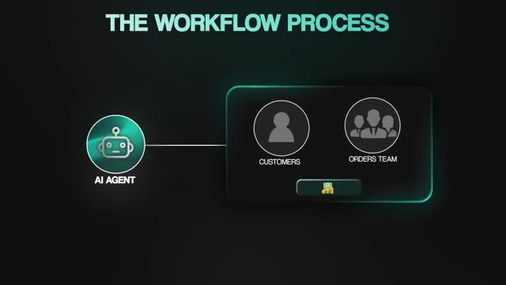
*⏱️ 00:03:21 — Schéma conceptuel du "Workflow Process" montrant l'agent IA interagissant avec les clients et l'équipe de commande pour générer du profit.*

---

### ⏱️ `[00:03:28 - 00:03:48]` | Segment #09

**🔊 Audio (Transcription Intégrale Mot pour Mot en Français) :**
> The value proposition here was clear. The system would cut down manual data entry, reduce errors, and free up the business owner's time so he could focus on growth rather than repetitive administrative work. And because it streamlined operations, it also gave him a foundation to scale without hiring more staff. And that was a huge deal for him because hiring wasn't something he could yet afford to do, but he still needed to grow his business.

**👁️ Analyse Visuelle d'Écran (gemini-3.5-flash-lite) :**
**Interface & Outils** : Aucune interface logicielle ou outil technique n'est affiché.

**Contenu textuel & Code** : Aucun code, commande ou prompt n'est visible.

**Action / Démonstration** : Le présentateur s'exprime face caméra pour expliquer les bénéfices théoriques de l'automatisation.

---

### ⏱️ `[00:03:48 - 00:04:21]` | Segment #10

**🔊 Audio (Transcription Intégrale Mot pour Mot en Français) :**
> So for this project, we charged $4,000 and the client was happy to pay that because we weren't just automating a small task. We were removing hours of repetitive work, setting up a system he could scale with and helping him avoid the costs of extra headcount. Now let's talk about the sales process. It started with me hopping on an initial discovery call to scope things out. From there, I brought in my co-founders, Millen, our CEO, and Tyler, our CTO, to make sure there weren't any crazy technical requirements that we were overlooking and that we had the bandwidth to actually deliver on this project. After that, Millen and I ran a second discovery call with the client and then Millen closed the deal on the third call. Looking back, we definitely

**👁️ Analyse Visuelle d'Écran (gemini-3.5-flash-lite) :**
**Interface & Outils** : Présentation ou face-caméra explicatif sans interface logicielle partagée.

**Contenu textuel & Code** : Explications orales et mise en contexte méthodologique.

**Action / Démonstration** : Explications face caméra et démonstration conceptuelle.

---

### ⏱️ `[00:04:21 - 00:04:56]` | Segment #11

**🔊 Audio (Transcription Intégrale Mot pour Mot en Français) :**
> didn't have our processes nailed down yet. For example, we forgot to collect baseline data, which meant we couldn't build a strong case study to show the ROI afterward. At the same time, we were getting flooded with inbound requests, but didn't have solid SOPs or systems to handle them. So for delivery of this build, Millen, our CEO, ended up doing a lot of the heavy lifting himself and then transitioned into more of an account management role once we brought on a developer to help finish things out. But I want to be clear, you don't need a co-founder or a full team to land a $4,000 project. What this really shows is that the jump from freelancer to consultant to trying to run an agency is tough. There are growing pains and even though you might

**👁️ Analyse Visuelle d'Écran (gemini-3.5-flash-lite) :**
**Interface & Outils** : Logiciel de création graphique/diagrammes (style présentation animée).

**Contenu textuel & Code** : Schéma avec deux blocs connectés par une flèche : un carré rouge pour "MILAN (CEO)" (incluant une photo) et un cercle turquoise pour "AI AGENT" (avec une icône de robot).

**Action / Démonstration** : Illustration visuelle du flux de travail ou de la délégation de tâches entre un dirigeant et un agent d'intelligence artificielle.

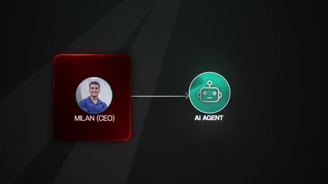
*⏱️ 00:04:39 — Diagramme simplifié illustrant une interaction professionnelle entre "Milan (CEO)" et un "AI Agent".*

---

### ⏱️ `[00:04:56 - 00:05:21]` | Segment #12

**🔊 Audio (Transcription Intégrale Mot pour Mot en Français) :**
> be able to charge more, you'll still be figuring out internal systems along the way. This third agent that we built was essentially a personal assistant for a business owner and his team. It It could provide quick access to internal data sources, streamlined task management, and improved team productivity, all directly inside Slack, which was where the company lived most of the day. The value prop here was all about productivity, centralizing data retrieval, automating routine admin tasks, and enabling faster communication without switching between tools.

**👁️ Analyse Visuelle d'Écran (gemini-3.5-flash-lite) :**
**Interface & Outils** : Éditeur de code (type VS Code ou Cursor en arrière-plan de l'image 3).

**Contenu textuel & Code** : Texte affiché : "CENTRALIZING DATA RETRIEVAL", sur fond de syntaxe de code source.

**Action / Démonstration** : Présentation conceptuelle des capacités techniques d'un agent d'assistance personnelle, illustrée par la centralisation de l'accès aux données.

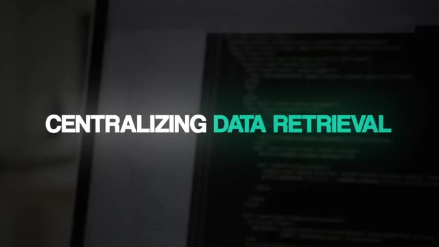
*⏱️ 00:05:15 — Capture d'écran montrant du code informatique en arrière-plan avec le titre textuel "CENTRALIZING DATA RETRIEVAL".*

---

### ⏱️ `[00:05:21 - 00:05:56]` | Segment #13

**🔊 Audio (Transcription Intégrale Mot pour Mot en Français) :**
> Now when it came to pricing, this one was trickier. With sales or outreach agents, it's easy to calculate how much time you're saving. But with something like a personal assistant, the value is a little more variable because those small admin tasks don't happen on a set cadence. So it's harder to directly tie them to ROI. So we ended up charging $6,000 for this project. And even though we tried to back that number with some ROI calculations, the truth is we priced more on complexity of the build rather than the actual long-term value. Value-based pricing is obviously the way to go and something that we didn't learn right away. And when you really break it down in terms of value, I actually think that we should have charged more for the sales agent than we did for this personal assistant agent.

**👁️ Analyse Visuelle d'Écran (gemini-3.5-flash-lite) :**
**Interface & Outils** : Présentation ou face-caméra explicatif sans interface logicielle partagée.

**Contenu textuel & Code** : Explications orales et mise en contexte méthodologique.

**Action / Démonstration** : Explications face caméra et démonstration conceptuelle.

---

### ⏱️ `[00:05:56 - 00:06:16]` | Segment #14

**🔊 Audio (Transcription Intégrale Mot pour Mot en Français) :**
> If you think about the way that the usage and leverage of a system actually compounds with a process like a sales agent compared to a personal assistant administrative agent, it becomes very clear. Because if the sales agent converts those leads, the business grows. And as the business grows, more leads come through. So the usage of the system grows. And this creates like this flywheel where the ROI of the system actually exponentially scales.

**👁️ Analyse Visuelle d'Écran (gemini-3.5-flash-lite) :**
**Interface & Outils** : Interface graphique de présentation (type diaporama).

**Contenu textuel & Code** : Texte : "USAGE", "LEVERAGE", "SALES AGENT", "PERSONAL ASSISTANT".

**Action / Démonstration** : Transition visuelle isolant le concept de "SALES AGENT" pour illustrer son impact sur la croissance de l'entreprise.

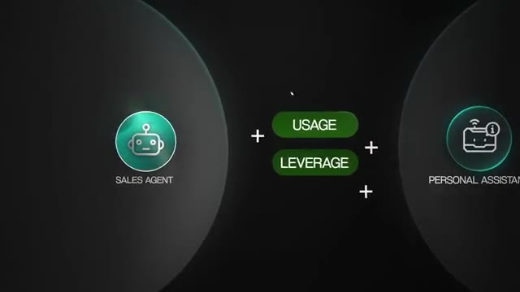
*⏱️ 00:06:01 — Schéma comparatif illustrant "USAGE" et "LEVERAGE" entre un "SALES AGENT" (à gauche) et un "PERSONAL ASSISTANT" (à droite).*

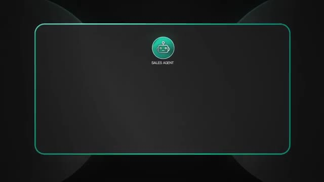
*⏱️ 00:06:06 — Gros plan sur une zone isolée centrée sur l'icône et le label "SALES AGENT" dans une boîte encadrée.*

---

### ⏱️ `[00:06:16 - 00:06:51]` | Segment #15

**🔊 Audio (Transcription Intégrale Mot pour Mot en Français) :**
> And that's something that's not as clear with a personal assistant because as the business grows, does the personal assistant usage grow? Maybe it does, maybe it doesn't, but it doesn't scale in the same way. And that's an important lesson. because pricing in this space is hard, and it takes time, data, and experience to get it right. Looking back, I know we were pricing too low because our close rate was insanely high. If you're closing over 50% of your proposals, it means your clients are realizing that they're getting a steal. And this is the market telling you that you need to charge more. It means that you're rarely getting pushback on your pricing, which is a strong signal that you're doing it too low. So anyways, the sales process for this project looked a lot like the previous one.

**👁️ Analyse Visuelle d'Écran (gemini-3.5-flash-lite) :**
**Interface & Outils** : Aucune interface logicielle ou démonstration technique n'est affichée.

**Contenu textuel & Code** : Aucun code, aucune donnée ou prompt n'est visible à l'écran.

**Action / Démonstration** : Le présentateur parle directement à la caméra, sans manipulation d'outil ou d'interface.

---

### ⏱️ `[00:06:51 - 00:07:23]` | Segment #16

**🔊 Audio (Transcription Intégrale Mot pour Mot en Français) :**
> Melan and I ran the discovery calls, we brought in Tyler, our CTO, to double check the technical scope and then we close the deal. But this is where our growing pains really showed because in order to deliver this build, our CTO ended up being the one in the weeds developing the workflow. And that's not how a CTO should spend their time. He should be managing a team of engineers and innovating, which is what Tyler's passionate about and does best, not being stuck in the weeds of a build connecting nodes to an agent. So this process was another reminder that scaling a team doesn't automatically make things easier. It actually gives you more things to manage, more moving pieces, and more chances for inefficiency.

**👁️ Analyse Visuelle d'Écran (gemini-3.5-flash-lite) :**
**Interface & Outils** : Outil de design de workflow type n8n.

**Contenu textuel & Code** : Nœuds de workflow : Webhook, Message a model (complete: chat), AI Agent1 (avec connexions Memory et Tool), et OpenRouter Chat Model1.

**Action / Démonstration** : Représentation visuelle de l'automatisation d'un processus IA, illustrant la connexion entre le déclencheur (webhook) et l'exécution par un agent IA.

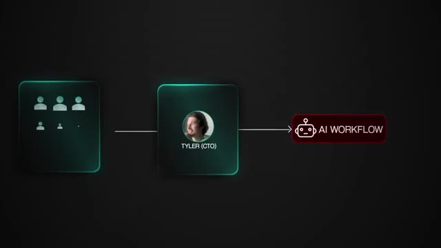
*⏱️ 00:07:07 — Schéma conceptuel montrant une équipe de projet connectée à "Tyler (CTO)", lui-même relié à un bloc "AI WORKFLOW".*

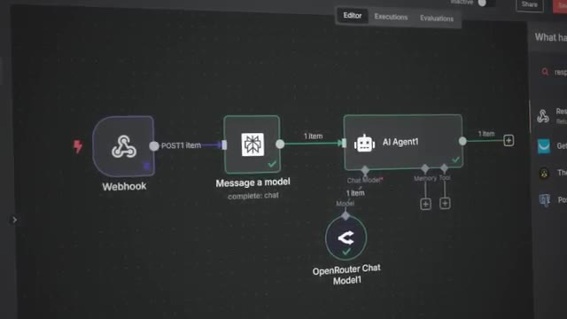
*⏱️ 00:07:15 — Interface de conception de workflow automatisé montrant un flux de travail (n8n ou similaire) avec des nœuds : Webhook, Message a model, AI Agent1 et OpenRouter Chat.*

---

### ⏱️ `[00:07:24 - 00:07:48]` | Segment #17

**🔊 Audio (Transcription Intégrale Mot pour Mot en Français) :**
> By the time we got to our next agent, we were in a much better place. We had stronger SOPs, better systems, and because of that, we were finally able to charge double what we just charged for this one. Finally, the fourth agent we sold was a full AI concierge. This one was designed to support a client's business by helping their members with everything they needed. Onboarding, finding and starting events, managing guest passes, offering support, and even keeping a running conversation history across all the members.

**👁️ Analyse Visuelle d'Écran (gemini-3.5-flash-lite) :**
**Interface & Outils** : Interface graphique d'illustration (UI Motion Design), Calendrier type application de gestion (Google Calendar/Notion).

**Contenu textuel & Code** : Noms des agents (Personalized Outreach, Sales Agent, Personal Assistant, AI Concierge), calendrier avec planification d'événements familiaux.

**Action / Démonstration** : Présentation visuelle de la montée en gamme des agents et démonstration fonctionnelle de la gestion d'un planning par l'AI Concierge.

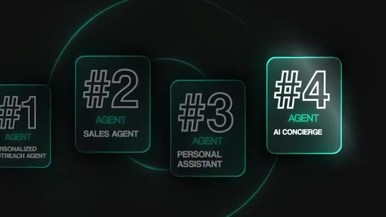
*⏱️ 00:07:36 — Infographie animée montrant une progression numérotée de 4 types d'agents IA, mettant en évidence le "#4 Agent : AI Concierge".*

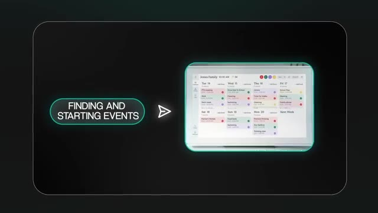
*⏱️ 00:07:42 — Illustration du fonctionnement de l'agent IA, montrant une interface de calendrier familial ("Jones Family") avec le texte "FINDING AND STARTING EVENTS".*

---

### ⏱️ `[00:07:48 - 00:08:18]` | Segment #18

**🔊 Audio (Transcription Intégrale Mot pour Mot en Français) :**
> In other words, it acted like a virtual secretary. A single point of contact that could handle the day-to-day tasks of guiding users and keeping the business running smoothly. And because the company was launching a new offer, our AI concierge was critical in helping them get it off the ground quickly without hiring more staff. This was also right around the time that MCP servers started to become a big deal online, and we were able to transition the scope and architect to incorporate this new technology, which was another value lever for us to pull here by showing the client that we stay bleeding edge and are always looking for the newest technology.

**👁️ Analyse Visuelle d'Écran (gemini-3.5-flash-lite) :**
**Interface & Outils** : Présentation ou face-caméra explicatif sans interface logicielle partagée.

**Contenu textuel & Code** : Explications orales et mise en contexte méthodologique.

**Action / Démonstration** : Explications face caméra et démonstration conceptuelle.

---

### ⏱️ `[00:08:18 - 00:08:36]` | Segment #19

**🔊 Audio (Transcription Intégrale Mot pour Mot en Français) :**
> This was by far one of the more complex systems that we had built up to this point, and that's why we charged $12,000. The client could clearly see the value because the agent was basically filling the role of an intern or assistant, but at a fraction of the long-term cost of hiring. The good news was, by this point, our internal systems were finally catching up to the size of the projects we were landing.

**👁️ Analyse Visuelle d'Écran (gemini-3.5-flash-lite) :**
**Interface & Outils** : n8n (éditeur de workflows visuels).

**Contenu textuel & Code** : Schéma d'automatisation composé de multiples nœuds, connexions logiques et étiquettes textuelles (ex: "AI Agent", "AP Message").

**Action / Démonstration** : Présentation visuelle de l'architecture complexe du système vendu pour démontrer la valeur technique derrière le coût de 12 000 $.

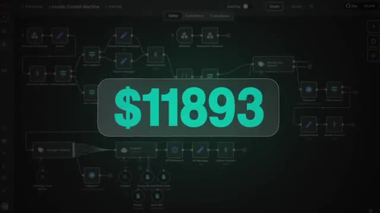
*⏱️ 00:08:22 — Une capture d'écran montrant l'interface de travail d'un outil d'automatisation de type workflow (probablement n8n), affichant un diagramme complexe de nœuds connectés entre eux avec un montant de "$11893" superposé au centre.*

---

### ⏱️ `[00:08:36 - 00:08:56]` | Segment #20

**🔊 Audio (Transcription Intégrale Mot pour Mot en Français) :**
> We had a dedicated account manager keeping the client communication smooth. Our CEO was in the right spot, focusing on sales strategy, operations, and growth. and our CTO was finally managing a team of engineers instead of being stuck building by himself. And for me, I finally had more freedom to spend time creating YouTube videos and focusing on the front end of the business instead of being buried in client projects.

**👁️ Analyse Visuelle d'Écran (gemini-3.5-flash-lite) :**
**Interface & Outils** : n8n (outil d'automatisation de workflow low-code/no-code).

**Contenu textuel & Code** : Le schéma montre un workflow nommé "AI Personal Assistant 2.0" avec des connexions entre un déclencheur Telegram, un agent principal, et des agents spécialisés (Email, Research, Projects, etc.).

**Action / Démonstration** : Visualisation et édition d'un workflow d'orchestration d'agents IA au sein de l'interface n8n.

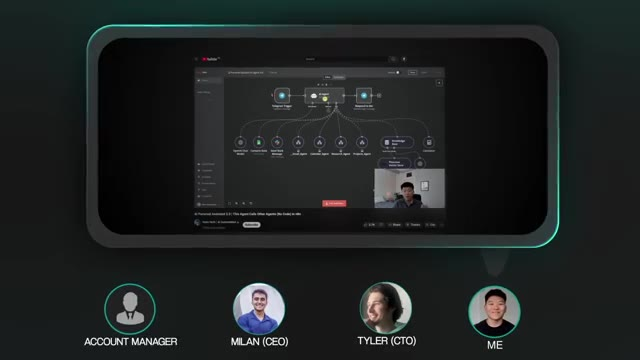
*⏱️ 00:08:51 — Interface de l'outil n8n affichant un workflow complexe d'agents IA, avec un nœud central "AI Agent" connecté à plusieurs sous-agents et bases de connaissances.*

---

### ⏱️ `[00:08:56 - 00:09:32]` | Segment #21

**🔊 Audio (Transcription Intégrale Mot pour Mot en Français) :**
> So this project wasn't just a win because of the $12,000 price tag. It was proof that we had gone from scrappy freelancers to consultants, then to building a business with real systems that could handle bigger and more valuable clients, and now looking to scale our operations. All right, so we've walked through the four agents that we sold. Now the question is, how do you actually do this yourself? This is the exact roadmap I followed as a freelancer, then when I built my own agency, and now with my co-founders at True Horizon, as we started to move up market. And it's the same roadmap you can follow to start landing your first real AI automation clients. Step one, diagnose the problem, prescribe a solution. The very first step

**👁️ Analyse Visuelle d'Écran (gemini-3.5-flash-lite) :**
**Interface & Outils** : Logiciel de création graphique / Outil de présentation (type Canva ou Slides).

**Contenu textuel & Code** : Textes : "FREELANCER", "CONSULTANTS", "BUSINESS", "ROADMAP", "STEP 1" à "STEP 7".

**Action / Démonstration** : Présentation visuelle conceptuelle de la croissance d'une entreprise de services IA.

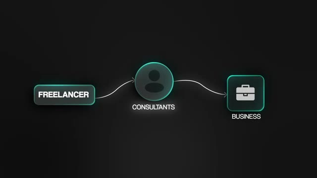
*⏱️ 00:09:05 — Un schéma de progression linéaire illustrant le passage de "FREELANCER" à "CONSULTANTS" puis à "BUSINESS" avec des icônes stylisées.*

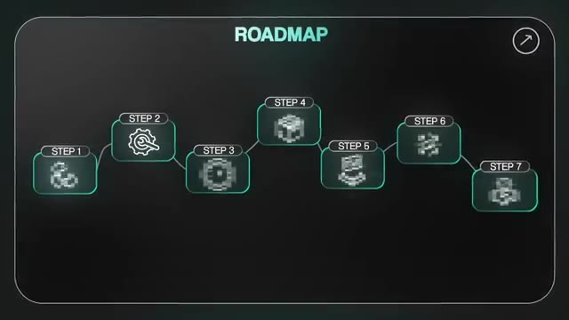
*⏱️ 00:09:23 — Une infographie représentant une "ROADMAP" en 7 étapes sous forme de diagramme de flux avec des icônes symbolisant chaque phase.*

---

### ⏱️ `[00:09:32 - 00:10:05]` | Segment #22

**🔊 Audio (Transcription Intégrale Mot pour Mot en Français) :**
> is learning to think like a problem solver. The value isn't in the fact that you know how to wire up nodes in your AI workflow. The value is your brain and your ability to understand how a business runs, where it's leaking time or money, and where an automation can fix that. For example, don't pitch I can build you an AI chatbot. Instead say your team spends 15 hours a week answering repetitive client questions, I can build a system that cuts that down to almost zero, freeing them up to close more deals. That shift takes you from just being a builder to being a business partner. Number two, pick simple tools. Once you've identified the problem, the tools are just the way you solve it.

**👁️ Analyse Visuelle d'Écran (gemini-3.5-flash-lite) :**
**Interface & Outils** : Application de messagerie mobile (mockup).

**Contenu textuel & Code** : Texte de la conversation : "I can build you an AI chat bot" vs "your team spends 15 hours a week answering repetitive client questions...".

**Action / Démonstration** : Démonstration comparative entre un pitch technique pauvre et un pitch orienté "résolution de problème business" pour illustrer la stratégie de vente.

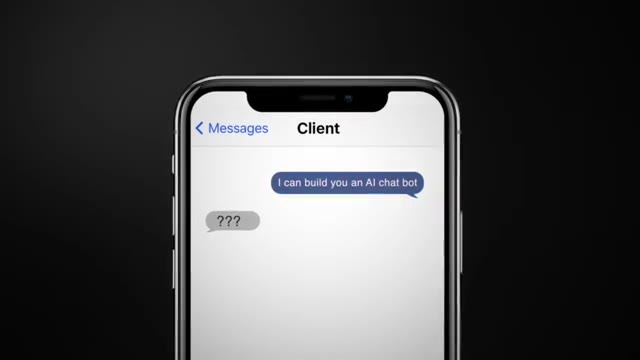
*⏱️ 00:09:48 — Interface de messagerie mobile montrant une proposition de vente générique ("I can build you an AI chat bot") recevant une réponse sceptique ("???").*

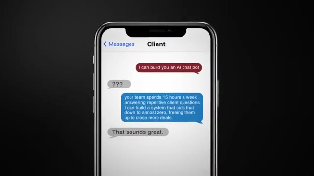
*⏱️ 00:09:57 — Interface de messagerie mobile montrant une proposition de valeur axée sur le retour sur investissement et l'efficacité opérationnelle, recevant une réponse positive du client.*

---

### ⏱️ `[00:10:05 - 00:10:40]` | Segment #23

**🔊 Audio (Transcription Intégrale Mot pour Mot en Français) :**
> For 90% of use cases, simple building blocks like N8N, vector databases, and an AI model or two we'll get the job done. But don't overcomplicate this step. Many freelancers underprice because they think in terms of technical effort. Clients don't care if it takes you two hours or 20. They care about the outcome. Selling workflows and templates may have worked when the space first started up, but if your value is defined by the templates you give out, it's all becoming commoditized. You should leverage templates to help you build quicker and smarter, but the value is how you are able to customize them to fit the client's needs. Step three is to multiply the hours saved by the hourly rate by four weeks, and that's how you get to monthly savings, and then

**👁️ Analyse Visuelle d'Écran (gemini-3.5-flash-lite) :**
**Interface & Outils** : Graphique personnalisé (UI stylisée).

**Contenu textuel & Code** : Texte affiché : "VALUE", "TEMPLATES", "QUICKER" (avec coche), "SMARTER" (avec coche).

**Action / Démonstration** : Présentation conceptuelle pour illustrer la proposition de valeur client.

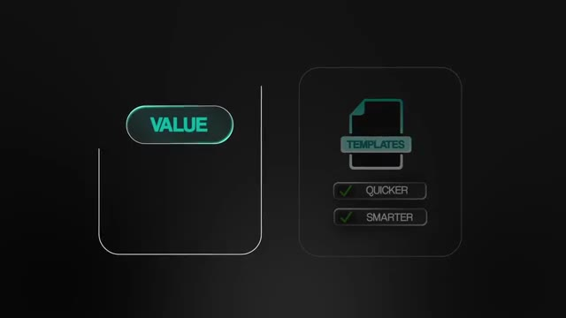
*⏱️ 00:10:31 — Graphique minimaliste sur fond noir illustrant le concept de valeur ajoutée via des templates, mettant en avant les bénéfices "Quicker" et "Smarter".*

---

### ⏱️ `[00:10:40 - 00:11:12]` | Segment #24

**🔊 Audio (Transcription Intégrale Mot pour Mot en Français) :**
> just times that by 12 to get to annual savings. So number four is to package and anchor your offers. Don't just blurt out a number. Try creating tiered packages like a starter plan, a growth plan, and a scale plan so clients can self-select and always lead with the highest anchor. So for example, our scale package is $25,000 and it includes these functionalities, but most clients actually go with the growth package at 12k that has these functionalities. Suddenly that 12k feels like the smart middle option. Packaging makes you look professional, anchoring makes your pricing logical and together they stop clients from comparing you to hourly freelancers. Number five,

**👁️ Analyse Visuelle d'Écran (gemini-3.5-flash-lite) :**
**Interface & Outils** : Interface graphique de présentation (overlay vidéo).

**Contenu textuel & Code** : "STARTER PLAN", "$4000", ">Dedicated AI Engineer", ">VIP support queue".

**Action / Démonstration** : Affichage visuel d'un exemple d'offre tarifaire (tier) pour illustrer la stratégie de packaging.

*⏱️ 00:10:48 — Une carte de présentation stylisée au néon affichant une offre tarifaire nommée "Starter Plan".*

---

### ⏱️ `[00:11:12 - 00:11:46]` | Segment #25

**🔊 Audio (Transcription Intégrale Mot pour Mot en Français) :**
> avoid the traps. There are a couple of silent killers that you need to watch out for. One of them is underpricing. It attracts the wrong clients and makes it nearly impossible to raise your rates later. Number two is underscoping. Saying yes to just one more feature without rescoping will destroy your margins and always define exactly what's included and create a change request process for anything outside the scope. Number three is chasing small retainers too early. One $10,000 project is often more profitable and better for your mental health and business reputation than five $2,000 a month retainers. Stability comes from having a lead pipeline, not from having

**👁️ Analyse Visuelle d'Écran (gemini-3.5-flash-lite) :**
**Interface & Outils** : AUCUNE

**Contenu textuel & Code** : AUCUN (seul le montant "$10000" est affiché à l'écran).

**Action / Démonstration** : AUCUNE (aucune démonstration technique ou logicielle effectuée).

---

### ⏱️ `[00:11:46 - 00:12:20]` | Segment #26

**🔊 Audio (Transcription Intégrale Mot pour Mot en Français) :**
> retainers. And just another quick reminder to raise your rates regularly. If your close rate is way above 40 to 50%, it's a clear signal that you're underpricing. For B2B consulting services, a 20 to 30% close rate is considered strong. So if you're not receiving any friction or pushback, you're going down a bad path where your CLV or customer lifetime value is going to be way too low. Number six, we have prototype and QA. Now that you've priced and packaged the deal, it's time to build. But don't overthink it. Prototype fast, get a working version live, then test. At True Horizon, we follow a simple QA cycle, which is one week of internal QA. We run it through a sample and a real

**👁️ Analyse Visuelle d'Écran (gemini-3.5-flash-lite) :**
**Interface & Outils** : Diaporama de présentation (PowerPoint/Keynote).

**Contenu textuel & Code** : Texte explicatif sur les ratios de clôture de vente (20% en moyenne, 30% ou plus pour l'excellence) et mention « CLV = CUSTOMER ».

**Action / Démonstration** : Affichage d'informations éducatives liées au business et au marketing.

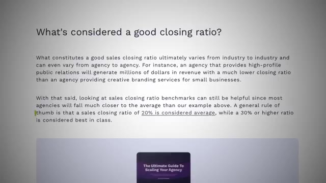
*⏱️ 00:11:55 — Une capture d'écran présentant une diapositive informative titrée « What's considered a good closing ratio? », détaillant les standards de l'industrie pour les agences.*

---

### ⏱️ `[00:12:20 - 00:12:42]` | Segment #27

**🔊 Audio (Transcription Intégrale Mot pour Mot en Français) :**
> data set. We stress test it with edge cases and we fix issues before the client sees anything. And then we give the client a week to QA where he or she will test it in the real world, give us feedback, and then we're able to iterate and make those adjustments. The QA process does two things. One, it protects you from edge case failures. And two, it shows your client that you're professional, reliable, and looking out for their business. Number seven, building long-term partnerships.

**👁️ Analyse Visuelle d'Écran (gemini-3.5-flash-lite) :**
**Interface & Outils** : Slack (application de messagerie professionnelle).

**Contenu textuel & Code** : Liste de canaux et messages de discussion au sein de l'interface Slack.

**Action / Démonstration** : Utilisation de l'outil de communication pour la phase de QA avec le client.

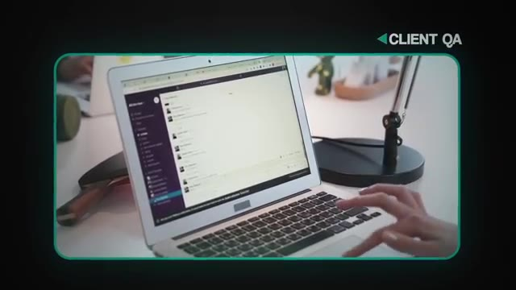
*⏱️ 00:12:31 — Gros plan sur un ordinateur portable montrant l'interface de Slack utilisée pour la communication client.*

---

### ⏱️ `[00:12:42 - 00:13:14]` | Segment #28

**🔊 Audio (Transcription Intégrale Mot pour Mot en Français) :**
> Finally, just remember this. You're not selling one-off automations. You're building relationships. Your early projects position you in the client's mind as either the cheap freelancer or the strategic AI partner. Long-term value comes from collecting data and case studies from every project, turning one project into multiple by showing measurable ROI, offering ongoing optimization or expansion once trust is established, and building relationships with more than just one person in the customer's organization. When you can clearly demonstrate this system saves you 10 times what you paid me, clients stop thinking about cost and start thinking about how else they

**👁️ Analyse Visuelle d'Écran (gemini-3.5-flash-lite) :**
**Interface & Outils** : Aucune interface logicielle ou technique (il s'agit d'une présentation visuelle de type slide/infographie).

**Contenu textuel & Code** : Textes informatifs sur la stratégie commerciale : "MEASURABLE ROI", "turning one product into multiple", "BUILDING RELATIONSHIPS", "with more than just one person in the customer's organization".

**Action / Démonstration** : Aucune action logicielle, il s'agit d'une illustration conceptuelle de stratégie d'affaires pour les freelances en IA.

---

### ⏱️ `[00:13:14 - 00:13:32]` | Segment #29

**🔊 Audio (Transcription Intégrale Mot pour Mot en Français) :**
> can work with you. So if you want to follow the same path, here's the roadmap. Spot the problem, pick simple tools, price based on ROI, package and anchor, avoid the traps, prototype, and build long-term partnerships. That's the exact framework that I've used to find success selling agents, and it's the same one that we will still use today at True Horizon.

**👁️ Analyse Visuelle d'Écran (gemini-3.5-flash-lite) :**
**Interface & Outils** : n8n (éditeur de workflow low-code).

**Contenu textuel & Code** : Schéma logique composé d'un nœud Webhook, d'un nœud central "Ultimate Assistant", et de nœuds périphériques connectés : GPT-4o-mini, Mémoire, Think, Email Agent, Calendar Agent, Contact Agent, Content Creator Agent.

**Action / Démonstration** : Le workflow est en mode "Waiting for trigger event" (en attente d'un déclenchement), illustrant la configuration d'un agent capable d'interagir avec plusieurs outils de productivité.

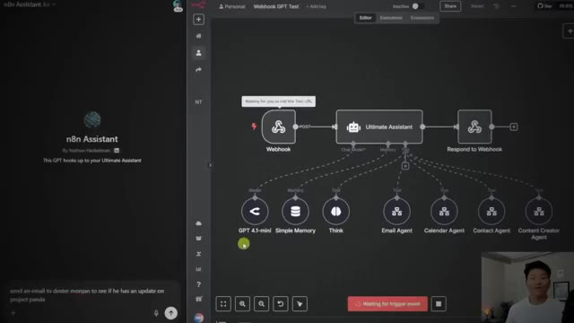
*⏱️ 00:13:28 — Interface de l'éditeur de workflow n8n montrant un agent IA ("Ultimate Assistant") connecté à divers outils et modèles (GPT-4o-mini, mémoire, emails, calendrier, contacts).*

---

### ⏱️ `[00:13:33 - 00:14:04]` | Segment #30

**🔊 Audio (Transcription Intégrale Mot pour Mot en Français) :**
> So that's gonna do it for today. I'm gonna have this full resource pack in my FreeSchool community if you guys wanna access that. It just basically goes over everything that I just talked about here so you can reference that later. And if you're looking to go even deeper with this kind of stuff and you also wanna connect with other people who are building businesses with NNN, then definitely check out my plus group. The link for that is also down in the description. And by the time you're watching this, we just dropped a full course called Automation to Monetization where I talk about how you can actually start to monetize your AI skills now that you are not just advanced in end-to-end, but you're also becoming advanced in AI implementation and becoming a problem solver for these businesses.

**👁️ Analyse Visuelle d'Écran (gemini-3.5-flash-lite) :**
**Interface & Outils** : Skool (plateforme de communauté en ligne)

**Contenu textuel & Code** : Textes visibles : "Learn the Foundations", "Agent Zero", "AI Automation Society Plus", "Automation to Monetization", "How you can actually start to monetize".

**Action / Démonstration** : Navigation au sein de la section "Classroom" de la communauté Skool pour présenter les ressources pédagogiques et les formations disponibles.

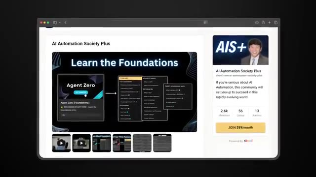
*⏱️ 00:13:48 — Interface de la plateforme Skool affichant la communauté "AI Automation Society Plus", avec des modules de formation comme "Agent Zero".*

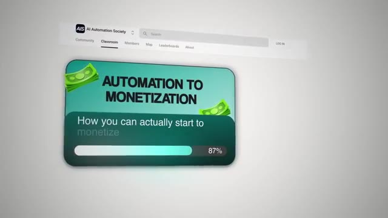
*⏱️ 00:13:56 — Interface de la plateforme Skool affichant un module de cours intitulé "Automation to Monetization" avec une barre de progression à 87%.*

---

### ⏱️ `[00:14:05 - 00:14:17]` | Segment #31

**🔊 Audio (Transcription Intégrale Mot pour Mot en Français) :**
> And trust me, these businesses desperately need someone to help them out with their AI implementation roadmaps. If you guys enjoyed or you learned something new, please give it a like, definitely helps me out a ton. And as always, I appreciate you guys making it to the end of the video. I'll see you on the next one. Thanks everyone.

**👁️ Analyse Visuelle d'Écran (gemini-3.5-flash-lite) :**
**Interface & Outils** : Présentation ou face-caméra explicatif sans interface logicielle partagée.

**Contenu textuel & Code** : Explications orales et mise en contexte méthodologique.

**Action / Démonstration** : Explications face caméra et démonstration conceptuelle.

---

