# 🎬 Beginner's Guide to Workflow Evaluation in n8n (Stop Guessing!)

> **Chaîne** : [Nate Herk | AI Automation](https://www.youtube.com/@nateherk/featured)  
> **Lien YouTube** : [https://www.youtube.com/watch?v=-zFd1nPn6U0](https://www.youtube.com/watch?v=-zFd1nPn6U0)  
> **Date de publication** : 20250903  
> **Durée** : 00:17:25  
> **Identifiant vidéo** : `-zFd1nPn6U0`  
> **Transcription & Analyse** : `whisper-v3-large-turbo+gemini-3.5-flash-lite`  

---

## 📌 Synthèse Exécutive & Outils

### 💡 Résumé
Dans cette vidéo intitulée **Beginner's Guide to Workflow Evaluation in n8n (Stop Guessing!)**, Nate Herk décortique les capacités pratiques d'automatisation et de développement propulsées par les modèles de pointe.

### 🛠️ Outils, Modèles & Logiciels Présentés
- **Opus 5.5 & Claude Code** : Modèles d'ingénierie et agents de codage autonome.

### 🔑 Points Clés & Enseignements Stratégiques
- Optimiser le niveau d'effort et le raisonnement des modèles IA pour des résultats industriels.
- Automatiser les cycles de création logicielle de bout en bout.

---

## ⏱️ Chronologie & Transcription Complète Audio & Visuelle (Mot pour Mot)

### ⏱️ `[00:00:00 - 00:00:21]` | Segment #01

**🔊 Audio (Transcription Intégrale Mot pour Mot en Français) :**
> Today we're going to talk about something pretty boring but super super important and that is workflow evaluation. So I'm going to start off by talking about what it is and how it works then we're going to get into N8N and I'm going to show you guys me actually running some evaluations. So let's get started. All right like I said today we're talking about AI workflow evaluation and specifically within N8N. I thought it would first make sense to talk about what is evaluation.

**👁️ Analyse Visuelle d'Écran (gemini-3.5-flash-lite) :**
**Interface & Outils** : n8n (plateforme d'automatisation de workflows).

**Contenu textuel & Code** : Nœuds de workflow : "Gmail Trigger", "Tagging Agent", "OpenRouter Chat Model", "Structured Output Parser", et tableau de bord "All runs" avec données de performance.

**Action / Démonstration** : Visualisation du design d'un workflow d'agent IA suivi de l'affichage des logs et métriques d'évaluation de ses performances.

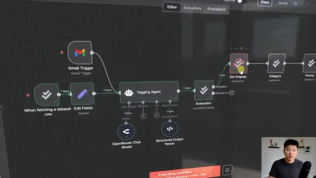
*⏱️ 00:00:05 — Interface n8n montrant un workflow d'automatisation avec des nœuds de déclenchement Gmail, un "Tagging Agent" et des outils d'évaluation.*

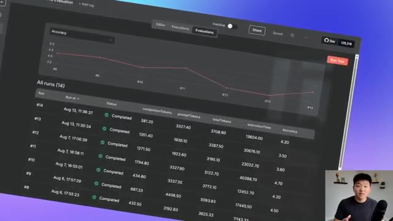
*⏱️ 00:00:10 — Tableau de bord d'évaluation dans n8n affichant un graphique de précision et un historique des exécutions avec des métriques de tokens et de temps.*

---

### ⏱️ `[00:00:21 - 00:00:43]` | Segment #02

**🔊 Audio (Transcription Intégrale Mot pour Mot en Français) :**
> In my mind the simplest way to put it is validating your hypothesis with objective proof. Think back to when you were building an AI agent or a workflow and you weren't happy with the results. What you do is you think about, okay, if I do X, it's going to make the output better. And so that's your hypothesis. You go ahead and you make that change, you run it again, and you basically subjectively judge, is it better or worse?

**👁️ Analyse Visuelle d'Écran (gemini-3.5-flash-lite) :**
**Interface & Outils** : Présentation ou face-caméra explicatif sans interface logicielle partagée.

**Contenu textuel & Code** : Explications orales et mise en contexte méthodologique.

**Action / Démonstration** : Explications face caméra et démonstration conceptuelle.

---

### ⏱️ `[00:00:43 - 00:01:02]` | Segment #03

**🔊 Audio (Transcription Intégrale Mot pour Mot en Français) :**
> But by running evaluations, we can actually see data and we can see proof if your change validates your hypothesis or not. So now that we all are on the same page about what evaluation means, let's start to look at how this would actually work in NADN. So for this example, what we're looking at is a tagging agent. It will receive an email.

**👁️ Analyse Visuelle d'Écran (gemini-3.5-flash-lite) :**
**Interface & Outils** : Présentation ou face-caméra explicatif sans interface logicielle partagée.

**Contenu textuel & Code** : Explications orales et mise en contexte méthodologique.

**Action / Démonstration** : Explications face caméra et démonstration conceptuelle.

---

### ⏱️ `[00:01:02 - 00:01:22]` | Segment #04

**🔊 Audio (Transcription Intégrale Mot pour Mot en Français) :**
> It will look at the subject and the body, and it will use its AI brain to basically tag the category and priority of an email and then do whatever it has to do later. And so what we're looking at here is a test data set where we say, okay, here are six really good examples of an email that came in and where they should be categorized and marked as far as priority goes.

**👁️ Analyse Visuelle d'Écran (gemini-3.5-flash-lite) :**
**Interface & Outils** : Interface de type éditeur de workflow visuel (similaire à n8n ou Make) et tableau de données.

**Contenu textuel & Code** : Le schéma montre un workflow partant d'un "Gmail Trigger" vers un "Tagging Agent" (connecté à "OpenRouter Chat Model" et "Structured Output Parser"), suivi d'une action "Ticket Tagging" dans Google Sheets et un envoi d'email. Le tableau en dessous liste des exemples de sujets d'emails, leurs contenus, ainsi que la catégorie et la priorité attendues (High/Medium).

**Action / Démonstration** : Présentation visuelle de la logique de traitement des emails par un agent IA, illustrant comment les données d'entrée (emails) sont structurées pour entraîner ou tester le modèle de classification.

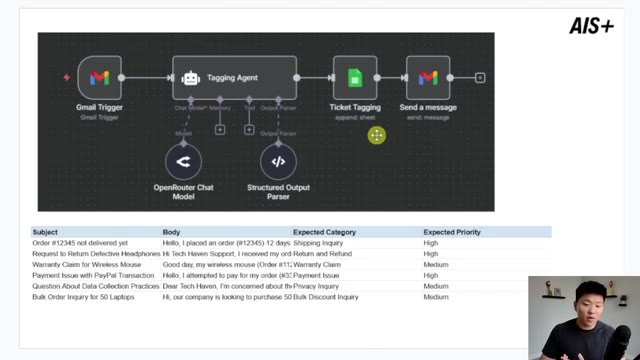
*⏱️ 00:01:07 — Une capture d'écran montrant un workflow d'automatisation d'agent IA et un tableau de données de test.*

---

### ⏱️ `[00:01:22 - 00:01:40]` | Segment #05

**🔊 Audio (Transcription Intégrale Mot pour Mot en Français) :**
> So what we would do in our evaluation is we would feed through these six inputs and we would basically validate, are they answering the expected category and expected priority correctly? And when we run these through an evaluation, we can actually see each of those six test cases and we can look at how many tokens were consumed, how long it took in time.

**👁️ Analyse Visuelle d'Écran (gemini-3.5-flash-lite) :**
**Interface & Outils** : Outil d'automatisation de workflow (type n8n ou plateforme d'agents IA) et interface de test/évaluation personnalisée.

**Contenu textuel & Code** : Workflow logique (Gmail > Tagging Agent > Sheets), données de test (ex: "Order #12345 not delivered yet"), et métriques d'évaluation LLM (completion/prompt tokens, execution time).

**Action / Démonstration** : Démonstration de la validation automatisée des entrées d'un agent IA pour vérifier la conformité des catégories et priorités par rapport aux attentes.

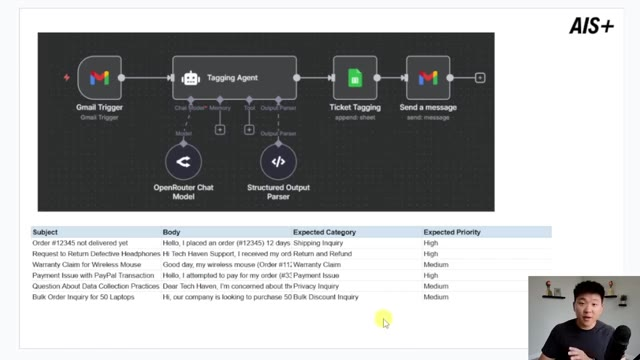
*⏱️ 00:01:26 — Un workflow automatisé montrant un déclencheur Gmail relié à un "Tagging Agent", avec un tableau présentant six cas de test basés sur des objets de courriels, catégories et priorités attendues.*

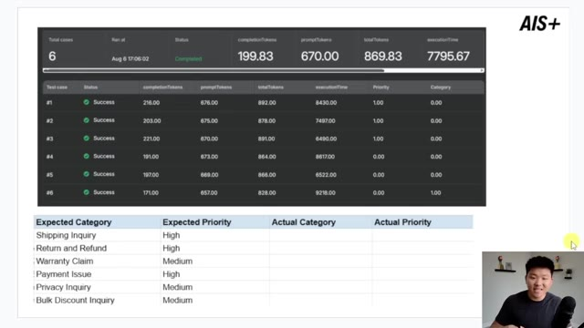
*⏱️ 00:01:36 — Un tableau de bord d'évaluation affichant les résultats de 6 cas de test (tous marqués en succès), avec des statistiques de tokens et temps d'exécution, au-dessus d'un tableau comparatif des catégories et priorités.*

---

### ⏱️ `[00:01:40 - 00:02:00]` | Segment #06

**🔊 Audio (Transcription Intégrale Mot pour Mot en Français) :**
> And then we can see if the priority or category was right or wrong. And then because we're able to identify patterns like maybe when it's shipping inquiry, it's actually being labeled as support or something like that. We can go ahead and use that data of what is actually happening to go ahead and fix the prompt. And then we fix the prompt, run it through again, and we see if we get a higher accuracy score.

**👁️ Analyse Visuelle d'Écran (gemini-3.5-flash-lite) :**
**Interface & Outils** : Tableau de bord d'analyse de données AIS+

**Contenu textuel & Code** : Métriques de performance (tokens, temps d'exécution) pour 6 cas de test et colonnes pour comparer "Expected Category/Priority" (Shipping Inquiry, Return and Refund, etc.) avec "Actual Category/Priority".

**Action / Démonstration** : Analyse et comparaison des résultats de catégorisation et de priorité des tickets pour identifier les erreurs d'étiquetage par l'IA.

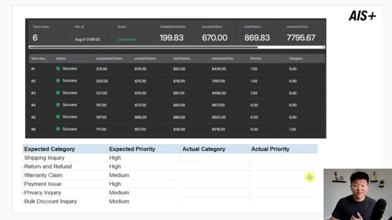
*⏱️ 00:01:45 — Un tableau de bord AIS+ présentant les statistiques d'exécution de 6 cas de test, couplé à une grille de comparaison des catégories et priorités (attendues vs réelles).*

---

### ⏱️ `[00:02:00 - 00:02:19]` | Segment #07

**🔊 Audio (Transcription Intégrale Mot pour Mot en Français) :**
> So in a couple minutes, we're going to hop into N&N and actually look at this exact example. But real quick, I wanted to get some of the more boring stuff out of the way real quick, which is just kind of laying a good foundation about the mindset of AI workflow evaluation. So evaluation has been around for a long time. But why is AI workflow evaluation fundamentally different than code evaluation or other projects?

**👁️ Analyse Visuelle d'Écran (gemini-3.5-flash-lite) :**
**Interface & Outils** : Présentation PowerPoint ou Keynote (diapositive pédagogique).

**Contenu textuel & Code** : Texte : "Black Box Problem", "Probabilistic Nature", "Evolving Models", "Beyond Traditional Testing" (incluant précision, cohérence, robustesse, biais et coût). Logo "AIS+" en haut à droite.

**Action / Démonstration** : Le présentateur illustre les concepts théoriques avant la démonstration technique sur n8n.

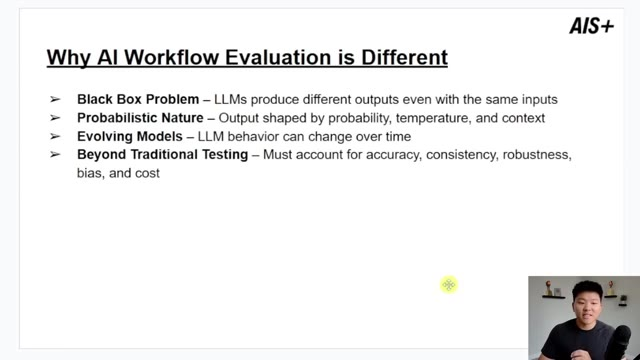
*⏱️ 00:02:05 — Une diapositive de présentation titrée "Why AI Workflow Evaluation is Different" listant les défis fondamentaux de l'évaluation des flux de travail IA.*

---

### ⏱️ `[00:02:20 - 00:02:42]` | Segment #08

**🔊 Audio (Transcription Intégrale Mot pour Mot en Français) :**
> Because AI, LLMs, are kind of known as a black box. because we don't know exactly what is going on and how it gets to its end result. Meaning if you put in 100 of the exact same inputs, you'd likely get 100 different variations of outputs. Whereas in a traditional workflow with no AI or a code script, you could put in 100 of the same inputs and you should get 100 of the same outputs.

**👁️ Analyse Visuelle d'Écran (gemini-3.5-flash-lite) :**
**Interface & Outils** : Présentation de diapositives (Slide deck).

**Contenu textuel & Code** : Texte listant les problématiques : Black Box Problem, Probabilistic Nature, Evolving Models, Beyond Traditional Testing.

**Action / Démonstration** : Présentation théorique illustrant les différences entre les workflows IA et traditionnels.

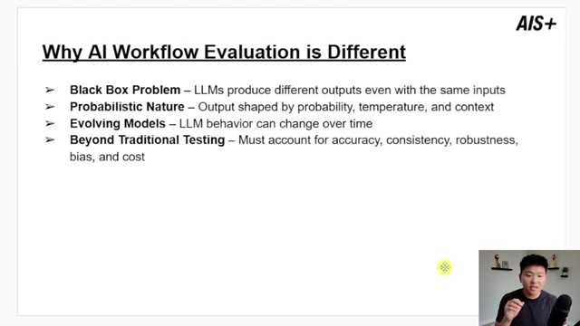
*⏱️ 00:02:25 — Une diapositive de présentation titrée "Why AI Workflow Evaluation is Different" listant quatre points clés sur les défis des LLM (Black Box, Nature probabiliste, modèles évolutifs, limites des tests traditionnels).*

---

### ⏱️ `[00:02:42 - 00:03:05]` | Segment #09

**🔊 Audio (Transcription Intégrale Mot pour Mot en Français) :**
> We also have the probabilistic nature. Output is shaped by probability, temperature, and context. And there's so many different levers that we can pull to train the way the AI actually behaves. We also have evolving models. as new ones come out, if they're cheaper and faster and people say they're the best, you're going to switch it out. But does that new model actually increase the performance of your workflow or not? And there's other things that we want to optimize for beyond just accuracy and consistency.

**👁️ Analyse Visuelle d'Écran (gemini-3.5-flash-lite) :**
**Interface & Outils** : Logiciel de présentation (type PowerPoint ou Google Slides).

**Contenu textuel & Code** : Texte listant les points suivants : "Black Box Problem", "Probabilistic Nature" (avec mention de la probabilité, la température et le contexte), "Evolving Models" et "Beyond Traditional Testing".

**Action / Démonstration** : Présentation théorique illustrant les concepts abordés oralement par le narrateur.

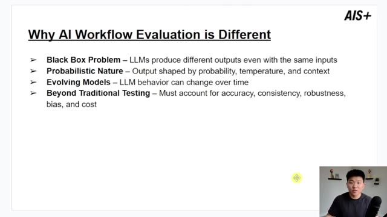
*⏱️ 00:02:48 — Une diapositive de présentation titrée "Why AI Workflow Evaluation is Different", listant quatre défis majeurs liés à l'évaluation des flux de travail IA.*

---

### ⏱️ `[00:03:05 - 00:03:39]` | Segment #10

**🔊 Audio (Transcription Intégrale Mot pour Mot en Français) :**
> We also have stuff like bias and cost and time. So because there's so much to take a look at, there's a lot of noise. The key metrics to really be thinking about when you are running evaluations and you want to track would be performance, reliability, efficiency, and quality. And by the I'll have these slides in my free school community. The link for that will be down in the description You can download that and you can also get the two workflows We're gonna look at so you can get all the resources shown in this video in the free school Just in case you thought I was going a little too fast and now moving on to something that is Probably the most important part of evaluations Well second most the most important thing we'll talk about at the end

**👁️ Analyse Visuelle d'Écran (gemini-3.5-flash-lite) :**
**Interface & Outils** : Diapositive de présentation (format slide).

**Contenu textuel & Code** : Texte structuré listant les métriques : Performance (Accuracy, correctness), Reliability (Consistency, error rate, uptime), Efficiency (Token usage, latency, cost), Quality (Hallucination rate, relevance, completeness).

**Action / Démonstration** : Présentation pédagogique des indicateurs de performance clés (KPI) pour le suivi des agents IA.

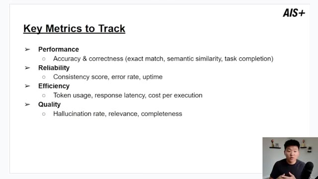
*⏱️ 00:03:14 — Une diapositive de présentation intitulée "Key Metrics to Track" listant quatre catégories principales pour l'évaluation des systèmes IA : Performance, Reliability, Efficiency et Quality, avec des indicateurs spécifiques pour chacune.*

---

### ⏱️ `[00:03:39 - 00:04:14]` | Segment #11

**🔊 Audio (Transcription Intégrale Mot pour Mot en Français) :**
> But the second most important thing is being able to isolate variables to actually understand what's going on I don't know how long you guys have been watching my channel, but something I've talked about before is reactively prompting your AI agents. Meaning if you aren't happy with the output of your agent you want to change one thing in the prompt at a time. Rather than if you get in there and you add like two paragraphs and all of a sudden your agents performing horribly you don't know where in the two paragraphs you broke the agent. Or on the other side of things if it makes it better you don't know what specifically made it better. And this is honestly even more important when you're doing evaluations because let's say you're getting you know 70%

**👁️ Analyse Visuelle d'Écran (gemini-3.5-flash-lite) :**
**Interface & Outils** : Logiciel de présentation (type PowerPoint ou Google Slides).

**Contenu textuel & Code** : Liste à puces : "Treat every change as a scientific experiment", "Only change one thing at a time", "Keep test conditions consistent", "Document what changed, why, and results", "Establish a baseline before testing improvements". Liste "Common Variables to Test" : "Prompt wording & structure", "LLM/model version", "Workflow design", "Data preprocessing methods".

**Action / Démonstration** : Présentation théorique des principes méthodologiques d'optimisation des agents IA.

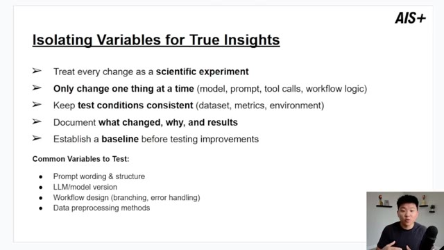
*⏱️ 00:03:48 — Une diapositive de présentation titrée "Isolating Variables for True Insights" listant les bonnes pratiques pour tester les agents IA.*

---

### ⏱️ `[00:04:14 - 00:04:45]` | Segment #12

**🔊 Audio (Transcription Intégrale Mot pour Mot en Français) :**
> accuracy and then you change the prompt and the tools and the chat model and all of a sudden you're getting 85% accuracy. You don't know which one of those had the most effect on the actual increase in performance. So what you need to do is treat it as a scientific experiment to validate your hypothesis. Change one thing at a time, whatever that is. Keep all of the test conditions consistent. So keep all of the variables, not variable, keep them consistent and only change one thing at a time and document what changed, why you changed it and what the actual result was.

**👁️ Analyse Visuelle d'Écran (gemini-3.5-flash-lite) :**
**Interface & Outils** : Diapositive de présentation (format slide deck).

**Contenu textuel & Code** : Liste de bonnes pratiques pour l'expérimentation : "Only change one thing at a time", "Keep test conditions consistent", "Document what changed", "Establish a baseline". Liste des variables courantes à tester : prompt, LLM/modèle, design de workflow, méthodes de prétraitement des données.

**Action / Démonstration** : Le présentateur explique l'importance d'isoler les variables lors des tests de performance pour identifier précisément ce qui améliore la précision du modèle.

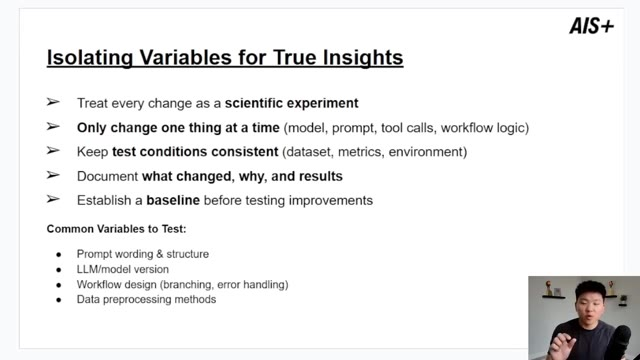
*⏱️ 00:04:22 — Une diapositive de présentation titrée "Isolating Variables for True Insights" détaillant la méthodologie scientifique pour optimiser les performances des agents IA.*

---

### ⏱️ `[00:04:45 - 00:05:08]` | Segment #13

**🔊 Audio (Transcription Intégrale Mot pour Mot en Français) :**
> This allows you to actually test different things and optimize for the best model possible. Common variables that you should change and test different things would be the prompt wording, would be the actual LLM itself. And then within the LLM, you have different things like temperature, top P, all this kind of stuff, the workflow design and data pre-processing methods. So in other words, kind of the context that is being fed to the agent or to the AI before it does its action.

**👁️ Analyse Visuelle d'Écran (gemini-3.5-flash-lite) :**
**Interface & Outils** : Présentation ou face-caméra explicatif sans interface logicielle partagée.

**Contenu textuel & Code** : Explications orales et mise en contexte méthodologique.

**Action / Démonstration** : Explications face caméra et démonstration conceptuelle.

---

### ⏱️ `[00:05:08 - 00:05:32]` | Segment #14

**🔊 Audio (Transcription Intégrale Mot pour Mot en Français) :**
> And now this is the most important part of an evaluation is the data set. The purpose of your evaluation data set is that it has to be the ground truth. This is basically what we're training our AI workflow to perform like. So it has to be good and what does good data look like? It's accurate, obviously it's consistent, it's comprehensive and representative of lots of different scenarios that may go through the system.

**👁️ Analyse Visuelle d'Écran (gemini-3.5-flash-lite) :**
**Interface & Outils** : Logiciel de présentation (type PowerPoint ou Google Slides).

**Contenu textuel & Code** : Liste à puces : Purpose (Ground truth), Qualities of Good Data (Accurate, consistent, comprehensive, representative, edge cases, statistical significance), Sourcing Examples (Historical tickets, marketing content, SME-curated outputs).

**Action / Démonstration** : Présentation théorique illustrant les concepts clés de la préparation de données pour l'évaluation de systèmes d'IA.

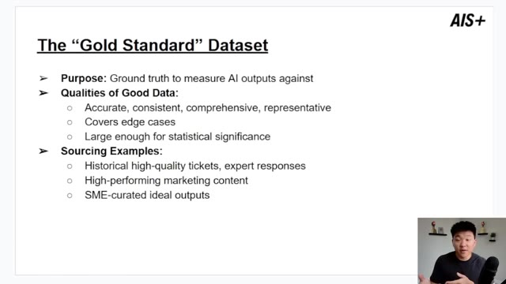
*⏱️ 00:05:14 — Une diapositive de présentation titrée "The 'Gold Standard' Dataset" détaillant le but, les qualités requises et des exemples de sources pour un jeu de données d'évaluation IA.*

---

### ⏱️ `[00:05:32 - 00:06:05]` | Segment #15

**🔊 Audio (Transcription Intégrale Mot pour Mot en Français) :**
> It covers edge cases and it has to be large enough for statistical significance to have confidence in it. And some examples of where you could get this type of data would be historical high quality tickets, expert responses, high performing marketing content. And ultimately you're probably going to have to work with the subject matter expert of whoever was manually doing the process beforehand or overseeing the manual process. They are the ones that should be able to provide you with all of that good data. So for example, if you're building a system to make LinkedIn posts, you would want to go grab all of the best performing LinkedIn posts and use those

**👁️ Analyse Visuelle d'Écran (gemini-3.5-flash-lite) :**
**Interface & Outils** : Logiciel de présentation (type PowerPoint ou Google Slides).

**Contenu textuel & Code** : Liste à puces détaillant les critères d'un bon jeu de données (précision, couverture des cas limites, significativité statistique) et des exemples de sources (tickets historiques, contenu marketing, sorties validées par des experts).

**Action / Démonstration** : Présentation théorique illustrant les concepts abordés par l'intervenant pour guider la préparation des données d'entraînement ou d'évaluation.

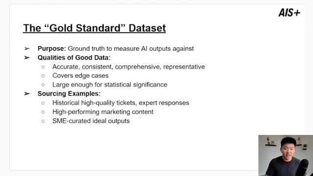
*⏱️ 00:05:40 — Une diapositive de présentation titrée "The 'Gold Standard' Dataset" détaillant les objectifs, les qualités requises et les exemples de sources pour constituer un jeu de données de haute qualité pour l'IA.*

---

### ⏱️ `[00:06:05 - 00:06:40]` | Segment #16

**🔊 Audio (Transcription Intégrale Mot pour Mot en Français) :**
> as data that you want the AI workflow to consistently output stuff like those posts. And last slide here, then we're hopping into NNN. Why data is the core of success? Well, it's pretty obvious. Good data would be, you know, good evaluation, good AI behavior. Bad data is you're literally just training the LLM to be worse. It would be like every time, you know, a kid cusses, you just start laughing and you give them a cookie and you say, good job. That's just like, not the way you should do it. And anyways, when you think about size, ultimately more data the better, unless it's bad data. But if you start small and you're trying to get some early testing,

**👁️ Analyse Visuelle d'Écran (gemini-3.5-flash-lite) :**
**Interface & Outils** : Logiciel de présentation (type PowerPoint ou Google Slides).

**Contenu textuel & Code** : Texte structuré listant : "Good data vs Bad data", suivi des recommandations pour "Minimum for a Holistic Dataset" (Small-scale POC : 50-100, Production-ready : 250-750, Mission-critical : 1,000+).

**Action / Démonstration** : Présentation théorique illustrant l'importance de la qualité et de la quantité des données dans les workflows d'automatisation IA.

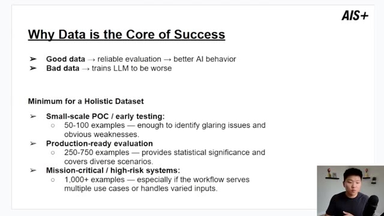
*⏱️ 00:06:13 — Une diapositive de présentation titrée "Why Data is the Core of Success", détaillant les exigences de taille de jeux de données selon le stade de développement du projet IA.*

---

### ⏱️ `[00:06:40 - 00:06:59]` | Segment #17

**🔊 Audio (Transcription Intégrale Mot pour Mot en Français) :**
> 50 to 100 examples is good. I'm not going to do 50 examples today. I'm going to do like 6 or 10, but just I wanted to throw this out there to show you that you need more than just 10. When you really are starting to think about pushing this into production readiness, you want to have upwards of 250 to 750 examples where you can actually get statistical significance and cover a wide range of scenarios.

**👁️ Analyse Visuelle d'Écran (gemini-3.5-flash-lite) :**
**Interface & Outils** : Présentation ou face-caméra explicatif sans interface logicielle partagée.

**Contenu textuel & Code** : Explications orales et mise en contexte méthodologique.

**Action / Démonstration** : Explications face caméra et démonstration conceptuelle.

---

### ⏱️ `[00:07:00 - 00:07:20]` | Segment #18

**🔊 Audio (Transcription Intégrale Mot pour Mot en Français) :**
> Now take this with a grain of salt because the amount of examples you need definitely depends on the actual system and the variety of inputs it could receive, but just kind of rough ballpark figures. And then mission critical, high risk systems, you wanna go above a thousand, get as much data as you can truly. Something else to think about is if you were to think about right now, I need to source a thousand examples, that would kind of suck.

**👁️ Analyse Visuelle d'Écran (gemini-3.5-flash-lite) :**
**Interface & Outils** : Diapositive de présentation (type PowerPoint/Keynote).

**Contenu textuel & Code** : Texte structuré sur l'importance de la qualité des données (Good/Bad data) et les recommandations chiffrées : 50-100 exemples pour un POC, 250-750 pour la production, et 1000+ pour les systèmes critiques.

**Action / Démonstration** : Présentation théorique illustrant les seuils recommandés pour la constitution de jeux de données d'évaluation.

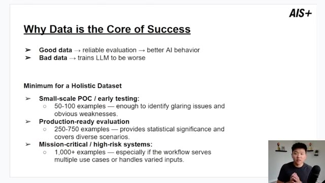
*⏱️ 00:07:05 — Une diapositive de présentation titrée « Why Data is the Core of Success » listant les recommandations de volume de données nécessaires pour évaluer des systèmes d'IA selon leur criticité.*

---

### ⏱️ `[00:07:21 - 00:07:43]` | Segment #19

**🔊 Audio (Transcription Intégrale Mot pour Mot en Français) :**
> But if you're thinking about getting good data and collecting data over months so that when you're ready to test the system, you have it, that's going to obviously make the workload less. But also when you do that, you're collecting data, like I said, over months. So you're not just grabbing, you know, all the data from the past week or something where that wouldn't be as holistic as when the system is actually gonna be in production and facing this type of real stuff.

**👁️ Analyse Visuelle d'Écran (gemini-3.5-flash-lite) :**
**Interface & Outils** : Diapositive de présentation (type PowerPoint/Keynote) avec branding "AIS+".

**Contenu textuel & Code** : Texte structuré en listes à puces expliquant la corrélation entre la qualité des données et le comportement de l'IA, ainsi que des recommandations chiffrées : 50-100 exemples pour un POC, 250-750 pour la production, et plus de 1000 pour les systèmes critiques.

**Action / Démonstration** : Présentation théorique illustrant l'importance stratégique de la collecte de données pour l'automatisation IA.

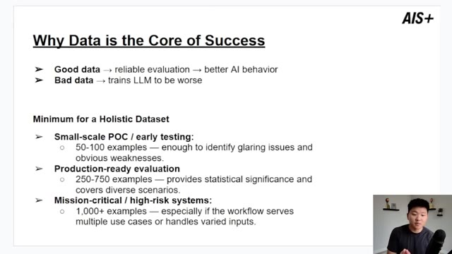
*⏱️ 00:07:26 — Une diapositive de présentation titrée "Why Data is the Core of Success" détaillant les exigences minimales en nombre d'exemples de données pour différents stades de développement de systèmes IA (POC, production, systèmes critiques).*

---

### ⏱️ `[00:07:43 - 00:08:01]` | Segment #20

**🔊 Audio (Transcription Intégrale Mot pour Mot en Français) :**
> All right, so now we're actually in NNN and we're gonna look at how we do an evaluation flow. So I know this workflow may look intimidating like right off the bat because there's so many different nodes. These are all of the new evaluation nodes in NNN and I'm gonna explain exactly how they work. So if you were to come in here and type evaluation, you can see there's four new nodes. We have the trigger, which is over here.

**👁️ Analyse Visuelle d'Écran (gemini-3.5-flash-lite) :**
**Interface & Outils** : Présentation ou face-caméra explicatif sans interface logicielle partagée.

**Contenu textuel & Code** : Explications orales et mise en contexte méthodologique.

**Action / Démonstration** : Explications face caméra et démonstration conceptuelle.

---

### ⏱️ `[00:08:02 - 00:08:36]` | Segment #21

**🔊 Audio (Transcription Intégrale Mot pour Mot en Français) :**
> We have check if evaluating, we have set metrics, and we have set outputs. So what happens is when we do this trigger, it's going to pull in our data set, which in this case, we're going to use this data set of six examples with our expected category and our expected priority. So it's going to pull in those examples. It's going to feed them through the AI model, which is supposed to tag them, you know, the different categories and the priority. It's going to check if we're evaluating or not because you could still have a typical flow. So if a Gmail came in, it would go down the normal branch and you could set the logic. But if you're evaluating, it'll go up here,

**👁️ Analyse Visuelle d'Écran (gemini-3.5-flash-lite) :**
**Interface & Outils** : n8n (outil d'automatisation de workflow low-code)

**Contenu textuel & Code** : Diagramme de flux comprenant : "Gmail Trigger", "When fetching a dataset row", "Tagging Agent", "OpenRouter Chat Model", "Evaluation", "Set Outputs", "Category" et "Priority".

**Action / Démonstration** : Présentation de l'architecture du workflow montrant comment les données sont extraites d'un jeu de données pour tester l'agent et évaluer les performances via les nœuds de métriques et de résultats.

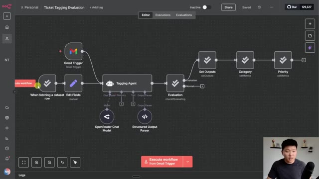
*⏱️ 00:08:10 — Interface n8n affichant un workflow automatisé pour l'évaluation du "Tagging" (étiquetage) de tickets, avec des nœuds pour le déclencheur Gmail, l'agent de tagging, l'évaluation et la définition des métriques.*

---

### ⏱️ `[00:08:37 - 00:08:55]` | Segment #22

**🔊 Audio (Transcription Intégrale Mot pour Mot en Français) :**
> set outputs, which just means it's going to write the AI's answers back into the Google sheet. And then it will set the category and the priority, which we will be able to check in the evaluations tab. So just to show you guys how that looks, I'm going to do one run through here, and then we're going to actually do the evaluation. So just to pull in the data set, It's gonna pull in the first row.

**👁️ Analyse Visuelle d'Écran (gemini-3.5-flash-lite) :**
**Interface & Outils** : Présentation ou face-caméra explicatif sans interface logicielle partagée.

**Contenu textuel & Code** : Explications orales et mise en contexte méthodologique.

**Action / Démonstration** : Explications face caméra et démonstration conceptuelle.

---

### ⏱️ `[00:08:56 - 00:09:15]` | Segment #23

**🔊 Audio (Transcription Intégrale Mot pour Mot en Français) :**
> The AI is gonna tag it. It's going to go up the evaluation branch and then it's gonna write the outputs back to the Google Sheet. I'm just gonna stop this real quick. And then it would have set the category and priority. So if I go into our data set, you can see that that first run, it got the category wrong because it was billing issue rather than billing and the priority was right.

**👁️ Analyse Visuelle d'Écran (gemini-3.5-flash-lite) :**
**Interface & Outils** : Présentation ou face-caméra explicatif sans interface logicielle partagée.

**Contenu textuel & Code** : Explications orales et mise en contexte méthodologique.

**Action / Démonstration** : Explications face caméra et démonstration conceptuelle.

---

### ⏱️ `[00:09:15 - 00:09:53]` | Segment #24

**🔊 Audio (Transcription Intégrale Mot pour Mot en Français) :**
> And so obviously this is just a mistake of like wording. And the reason it did that is because this AI agent has no system prompt. So just wanted to show you guys like a very very rough baseline of how this works. I'm going to clear this out and What we're gonna do is check what chat model we're using We're using 4.1 mini and then I'm gonna go to evaluations and just hit run test And so this is basically going to send those six different items in our data set through this model It's going to collect an average of how many tokens were used prompt, total, and then also how long it took. And then it's going to give us an average of the

**👁️ Analyse Visuelle d'Écran (gemini-3.5-flash-lite) :**
**Interface & Outils** : Présentation ou face-caméra explicatif sans interface logicielle partagée.

**Contenu textuel & Code** : Explications orales et mise en contexte méthodologique.

**Action / Démonstration** : Explications face caméra et démonstration conceptuelle.

---

### ⏱️ `[00:09:53 - 00:10:16]` | Segment #25

**🔊 Audio (Transcription Intégrale Mot pour Mot en Français) :**
> priority and category score correctness. So looks like that already finished up. If I clicked into it, you can see it processed all six and you can see which ones, you know, were right and which ones weren't. And so let me just go back to the actual execution. You can see that we got 67% of priority correct, but 0% of category correct. We could also look at different figures over here, of course, like our time and how much it costed us.

**👁️ Analyse Visuelle d'Écran (gemini-3.5-flash-lite) :**
**Interface & Outils** : Présentation ou face-caméra explicatif sans interface logicielle partagée.

**Contenu textuel & Code** : Explications orales et mise en contexte méthodologique.

**Action / Démonstration** : Explications face caméra et démonstration conceptuelle.

---

### ⏱️ `[00:10:16 - 00:10:47]` | Segment #26

**🔊 Audio (Transcription Intégrale Mot pour Mot en Français) :**
> But this is mainly what I'm focused on right now. And so you would see this and you'd go into your sheet and you'd see, okay, all of these categories are wrong. What we could do is work in a quick fix in the prompts because it seems like it's just messing up because it doesn't know the actual words. So what I'm gonna do is just copy these words right there. I'm gonna go back into our workflow, into the editor, and I'm just gonna add a really quick system prompt into the agent where I am just going to say, here are the categories to choose from.

**👁️ Analyse Visuelle d'Écran (gemini-3.5-flash-lite) :**
**Interface & Outils** : Présentation ou face-caméra explicatif sans interface logicielle partagée.

**Contenu textuel & Code** : Explications orales et mise en contexte méthodologique.

**Action / Démonstration** : Explications face caméra et démonstration conceptuelle.

---

### ⏱️ `[00:10:47 - 00:11:05]` | Segment #27

**🔊 Audio (Transcription Intégrale Mot pour Mot en Français) :**
> And I'm just gonna paste those in like that. I think this alone will make it much more accurate. So we're just gonna go to evaluations. I'm gonna hit run test once again. It's gonna pull in that same dataset and it will overwrite whatever already exists in here. And you can see it already got that first category right. You just got the second category right. Got the third one right.

**👁️ Analyse Visuelle d'Écran (gemini-3.5-flash-lite) :**
**Interface & Outils** : Présentation ou face-caméra explicatif sans interface logicielle partagée.

**Contenu textuel & Code** : Explications orales et mise en contexte méthodologique.

**Action / Démonstration** : Explications face caméra et démonstration conceptuelle.

---

### ⏱️ `[00:11:05 - 00:11:26]` | Segment #28

**🔊 Audio (Transcription Intégrale Mot pour Mot en Français) :**
> It got the fourth one right. And I'm assuming it's gonna be 100% accuracy on category, but then we're still messing up on the priority score. So just finished up, we can see the evaluation now. We got 100% correctness in the category. We got 67% correctness in the priority. And now we would just be able to keep making one tweak at a time and know exactly why what we're doing is working.

**👁️ Analyse Visuelle d'Écran (gemini-3.5-flash-lite) :**
**Interface & Outils** : Présentation ou face-caméra explicatif sans interface logicielle partagée.

**Contenu textuel & Code** : Explications orales et mise en contexte méthodologique.

**Action / Démonstration** : Explications face caméra et démonstration conceptuelle.

---

### ⏱️ `[00:11:26 - 00:11:49]` | Segment #29

**🔊 Audio (Transcription Intégrale Mot pour Mot en Français) :**
> And so yes, you have this data here, but what you don't see is you don't see what you changed unless you clicked into it and looked on all the executions. So what I would recommend is when you start running these evaluations, you would maybe in your dataset have another tab where you could say, run number one, what did I change? And then what were the results? And then you can just basically keep stacking all those runs and evaluations to see which ones gave you the best scores.

**👁️ Analyse Visuelle d'Écran (gemini-3.5-flash-lite) :**
**Interface & Outils** : Présentation ou face-caméra explicatif sans interface logicielle partagée.

**Contenu textuel & Code** : Explications orales et mise en contexte méthodologique.

**Action / Démonstration** : Explications face caméra et démonstration conceptuelle.

---

### ⏱️ `[00:11:50 - 00:12:25]` | Segment #30

**🔊 Audio (Transcription Intégrale Mot pour Mot en Français) :**
> So I hope you guys can see how this would be really helpful in creating a workflow and then basically deciding, okay, well, which model do I wanna use? You just test like five of them, see which ones have the best accuracy and we're also the cheapest and boom. I don't want this video to go too long, so I won't really dive into what's actually going on here, but basically in these metrics, I'm just setting it as what the expected answer is, what the actual answer was, and then that's how it outputs either one or zero if it was correct or incorrect. But what you can see here is that there's lots of other metrics. We just did categorization, which means explicitly do these two things match. But what we want to do is sometimes

**👁️ Analyse Visuelle d'Écran (gemini-3.5-flash-lite) :**
**Interface & Outils** : Présentation ou face-caméra explicatif sans interface logicielle partagée.

**Contenu textuel & Code** : Explications orales et mise en contexte méthodologique.

**Action / Démonstration** : Explications face caméra et démonstration conceptuelle.

---

### ⏱️ `[00:12:25 - 00:12:58]` | Segment #31

**🔊 Audio (Transcription Intégrale Mot pour Mot en Français) :**
> we need to use like correctness or similarity or helpfulness. And that's where you actually need to use AI to judge the correctness or similarity. So this next example that we're going to look at, This one actually uses AI to evaluate so similar type of scenario. We have a Agent that's going to read an email. It will look up in its vector database FAQs and policies to answer that email and then it would respond back to them So what we're gonna do is we're gonna look at this second data set that has subject and body It has expected answers and then we're gonna get the actual answer

**👁️ Analyse Visuelle d'Écran (gemini-3.5-flash-lite) :**
**Interface & Outils** : Présentation ou face-caméra explicatif sans interface logicielle partagée.

**Contenu textuel & Code** : Explications orales et mise en contexte méthodologique.

**Action / Démonstration** : Explications face caméra et démonstration conceptuelle.

---

### ⏱️ `[00:12:59 - 00:13:35]` | Segment #32

**🔊 Audio (Transcription Intégrale Mot pour Mot en Français) :**
> Evaluated on how close it is to these expected answers. And so before I actually kick this off I wanted to show you guys one thing real quick because what you can do is Use the actual set metrics node to do AI based correctness and it will give you this full prompt about like Basically you have your expected answer and you have your actual answer and it will output a score one through five over how correct it is But right now I'm sure by the time everyone's watching this it'll be fixed This node is basically broken and it was giving me these errors Let me just show you guys. It was giving me these errors where it would say the set metrics node is not configured properly

**👁️ Analyse Visuelle d'Écran (gemini-3.5-flash-lite) :**
**Interface & Outils** : Présentation ou face-caméra explicatif sans interface logicielle partagée.

**Contenu textuel & Code** : Explications orales et mise en contexte méthodologique.

**Action / Démonstration** : Explications face caméra et démonstration conceptuelle.

---

### ⏱️ `[00:13:35 - 00:14:09]` | Segment #33

**🔊 Audio (Transcription Intégrale Mot pour Mot en Français) :**
> Even though I knew it was so all I did is I took this system prompt And I basically fed it into this agent where I'm giving it now the expected answer the actual answer and the exact same system prompt So it's really the same exact thing going on and then I'm just passing it into a different metric setter And I know this all may seem a little confusing. Just watch how this plays out You can download all of these workflows I'm showing you today and my set example data sets from the the free school community. If you want to play with it yourself, that'll probably be a better way to actually understand what each node is doing. But I just wanted to show you guys this little workaround because this node wasn't actually working. And you know, we talked about

**👁️ Analyse Visuelle d'Écran (gemini-3.5-flash-lite) :**
**Interface & Outils** : Présentation ou face-caméra explicatif sans interface logicielle partagée.

**Contenu textuel & Code** : Explications orales et mise en contexte méthodologique.

**Action / Démonstration** : Explications face caméra et démonstration conceptuelle.

---

### ⏱️ `[00:14:09 - 00:14:46]` | Segment #34

**🔊 Audio (Transcription Intégrale Mot pour Mot en Français) :**
> keeping things consistent. I know some people may say like, Hey, but you're using an AI model to evaluate blah, blah, blah. All you have to make sure is that you keep this AI model the same every single time. That's where you'd run into trouble is if you were changing like the prompt, but you were also changing the model that you use to evaluate. So as long as you keep this consistent, I'm not going to be concerned at all that we're using AI to evaluate. If you watch my GPT-5 video, you may have seen a preview of me actually doing this. I was testing GPT-5 and GPT-5 mini and stuff like that. So this first run, we're going to do GPT-5 mini. I'm just going to go to evaluations, hit run test, and we'll let this finish up real quick. And then I'll show you guys what we're

**👁️ Analyse Visuelle d'Écran (gemini-3.5-flash-lite) :**
**Interface & Outils** : n8n (outil d'automatisation de workflows).

**Contenu textuel & Code** : Configuration du nœud avec un compte OpenRouter, sélection du modèle "openai/gpt-4o" (affiché comme gpt-4.1), et message d'avertissement indiquant que le nœud doit être connecté à une chaîne IA.

**Action / Démonstration** : Le présentateur illustre la configuration technique du modèle d'IA au sein d'un workflow, soulignant l'importance de maintenir une configuration constante pour la cohérence des résultats.

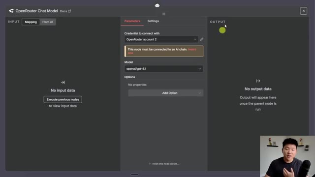
*⏱️ 00:14:18 — Interface de configuration d'un nœud "OpenRouter Chat Model" dans l'outil d'automatisation n8n.*

---

### ⏱️ `[00:14:46 - 00:15:21]` | Segment #35

**🔊 Audio (Transcription Intégrale Mot pour Mot en Français) :**
> looking at. Okay. So this run just finished up. Looks like we had an accuracy of 3.5 out of five. We could click into the run and we could see individually each of the runs. Like we can see number three was not accurate at all but the first one was super accurate and what's nice is we can see like over time if our workflow has gotten better or worse but keep in mind this doesn't really show us what was changed in each one so it's still very important to track on your own in like a Google Sheet or something but let's say for some reason we were not happy about how long this took so we have an hypothesis that if I use Google Flash it will finish a lot quicker so in order to validate that I would just go into the editor I'd

**👁️ Analyse Visuelle d'Écran (gemini-3.5-flash-lite) :**
**Interface & Outils** : Interface web d'un outil d'évaluation de pipelines IA (semblable à LangSmith ou plateforme similaire).

**Contenu textuel & Code** : Tableau de données montrant les colonnes : Test case, Status (Success), completionTokens, promptTokens, totalTokens, executionTime, et Accuracy. On peut voir par exemple que le cas #3 affiche une précision de 1.0, tandis que le cas #1 affiche 5.0.

**Action / Démonstration** : L'utilisateur visualise les performances détaillées de chaque exécution de test pour analyser la précision du modèle.

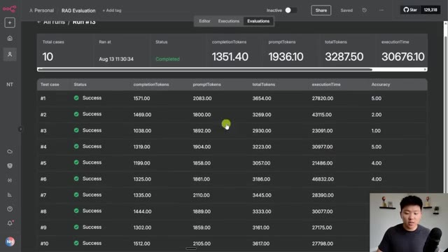
*⏱️ 00:14:55 — Une vue détaillée des résultats d'une évaluation RAG (Retrieval-Augmented Generation) affichant un tableau comparatif de 10 cas de test avec leurs métriques respectives (tokens, temps d'exécution et score d'exactitude).*

---

### ⏱️ `[00:15:21 - 00:15:56]` | Segment #36

**🔊 Audio (Transcription Intégrale Mot pour Mot en Français) :**
> come in here and I would just want to go to some sort of flash model so we'll do 2.5 flash. We'll save that, go back into evaluations. And now we're going to run another test. So the hypothesis that flash is going to be cheaper and hopefully more accurate, but we don't actually know. So now we are going to, oh, and faster. That's the whole reason I said it in the first place. So now I'm going to let this finish up and we'll compare the execution time and the accuracy. Okay. So that just finished up and I'm actually really impressed. It got 4.3 on the accuracy, so much higher than GPT-5 mini. And I know for a fact it was cheaper and it was about

**👁️ Analyse Visuelle d'Écran (gemini-3.5-flash-lite) :**
**Interface & Outils** : Plateforme d'évaluation d'IA (interface web type LangSmith ou équivalent).

**Contenu textuel & Code** : Tableau récapitulatif "All runs (14)" avec les colonnes : Run, Run at, Status, completionTokens, promptTokens, totalTokens, executionTime, et Accuracy. Le test #14 est en cours d'exécution.

**Action / Démonstration** : L'utilisateur a lancé une nouvelle série d'évaluations (#14) après avoir modifié la configuration du modèle pour comparer les performances (précision, temps d'exécution et consommation de jetons).

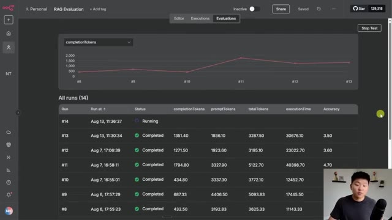
*⏱️ 00:15:30 — Interface de monitoring d'évaluations de RAG (Retrieval-Augmented Generation) affichant un tableau de bord avec les résultats des différents tests et un graphique de performance.*

---

### ⏱️ `[00:15:56 - 00:16:21]` | Segment #37

**🔊 Audio (Transcription Intégrale Mot pour Mot en Français) :**
> half the time. So I don't think speed alone in this use case justifies making the switch, but because the accuracy was 0.8 higher, which is pretty significant, then that makes this one a no-brainer. But we were able to objectively see that rather than just having a hunch. Anyways, I hope that this video has been helpful and showed you how you can use this evaluation feature for not just like categorization metrics, but also for accuracy metrics and stuff like that.

**👁️ Analyse Visuelle d'Écran (gemini-3.5-flash-lite) :**
**Interface & Outils** : Plateforme d'évaluation d'agents IA (interface web type LangSmith ou plateforme similaire).

**Contenu textuel & Code** : Tableau comparatif des exécutions (#8 à #14) incluant les colonnes : date, statut, completionTokens, promptTokens, totalTokens, executionTime et Accuracy (score de précision).

**Action / Démonstration** : Analyse comparative des performances entre différentes exécutions pour justifier le choix d'un modèle basé sur une augmentation significative de la précision (+0.8).

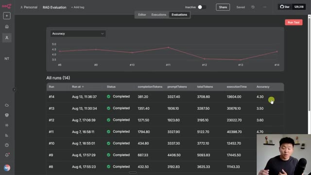
*⏱️ 00:16:02 — Interface de monitoring "RAG Evaluation" affichant un graphique de précision et un tableau récapitulatif des exécutions avec des métriques détaillées.*

---

### ⏱️ `[00:16:21 - 00:16:44]` | Segment #38

**🔊 Audio (Transcription Intégrale Mot pour Mot en Français) :**
> You'll be able to download this workflow, this workflow, as well as the two different sets of test data right here that we saw in the video. You'll be able to make a copy of all of this stuff and download all of it for free, as well as the actual slides that we were looking at earlier too. All you gotta do is go to my FreeSchool community. Link for that will be down in the description. And once you get in here, just go to YouTube resources and you'll be able to find this YouTube video, or you can search for the title of it.

**👁️ Analyse Visuelle d'Écran (gemini-3.5-flash-lite) :**
**Interface & Outils** : Google Sheets, plateforme communautaire Skool.

**Contenu textuel & Code** : Tableau de données de test avec des exemples de tickets de support client et leurs catégorisations/priorités associées (ex: "Invoice charged twice", "App crash on login").

**Action / Démonstration** : Présentation des ressources téléchargeables et des jeux de données de test utilisés dans le workflow automatisé.

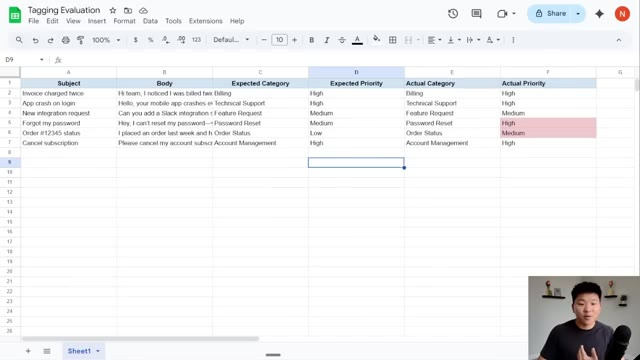
*⏱️ 00:16:27 — Une feuille de calcul Google Sheets intitulée "Tagging Evaluation" présentant des données de test structurées en colonnes (Subject, Body, Expected Category, Expected Priority, Actual Category, Actual Priority).*

---

### ⏱️ `[00:16:44 - 00:17:05]` | Segment #39

**🔊 Audio (Transcription Intégrale Mot pour Mot en Français) :**
> It'll be in here, I promise. And then all of the resources will be pretty much in that post associated with this video. And if you want to dive deeper with NNN, then I definitely recommend to check out my plus community. The link for that will also be down in the description. We've got a great community of members who are always sharing what they're doing and what they're building with NNN, sharing their challenges, sharing helpful resources. We've also got a classroom section with two full courses right now.

**👁️ Analyse Visuelle d'Écran (gemini-3.5-flash-lite) :**
**Interface & Outils** : Présentation ou face-caméra explicatif sans interface logicielle partagée.

**Contenu textuel & Code** : Explications orales et mise en contexte méthodologique.

**Action / Démonstration** : Explications face caméra et démonstration conceptuelle.

---

### ⏱️ `[00:17:05 - 00:17:25]` | Segment #40

**🔊 Audio (Transcription Intégrale Mot pour Mot en Français) :**
> One is Agent Zero, the foundations of AI. And then 10 hours and 10 seconds where you learn how to identify, design, and build time-saving automations. So I'd love to see you guys in these communities, but that's gonna do it for today If you enjoyed the video or you learned something new, please give it a like it definitely helps me out a ton And as always, I appreciate you guys making it to the end of the video. I'll see you on the next one. Thanks guys

**👁️ Analyse Visuelle d'Écran (gemini-3.5-flash-lite) :**
**Interface & Outils** : n8n (éditeur de workflow low-code).

**Contenu textuel & Code** : Diagramme de flux logique connectant des outils : Gmail Trigger, Support Agent, Supabase Vector Store, Embeddings OpenAI, OpenRouter Chat Model, et un mécanisme d'évaluation (Evaluation).

**Action / Démonstration** : Visualisation du canvas de travail n8n avec un bouton "Execute workflow" prêt à être déclenché en bas de l'écran.

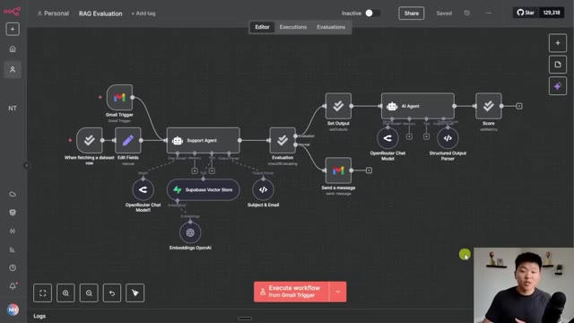
*⏱️ 00:17:15 — Éditeur de workflow n8n ouvert sur un projet intitulé "RAG Evaluation", affichant un diagramme complexe d'automatisation incluant des nœuds Gmail, Supabase, OpenAI et des agents IA.*

---

