# 🎬 I Built a Photoshop AI Agent in n8n with no code (NanoBanana)

> **Chaîne** : [Nate Herk | AI Automation](https://www.youtube.com/@nateherk/featured)  
> **Lien YouTube** : [https://www.youtube.com/watch?v=7UNsK9LoORo](https://www.youtube.com/watch?v=7UNsK9LoORo)  
> **Date de publication** : 20250905  
> **Durée** : 00:17:25  
> **Identifiant vidéo** : `7UNsK9LoORo`  
> **Transcription & Analyse** : `whisper-v3-large-turbo+gemini-3.5-flash-lite`  

---

## 📌 Synthèse Exécutive & Outils

### 💡 Résumé
Dans cette vidéo intitulée **I Built a Photoshop AI Agent in n8n with no code (NanoBanana)**, Nate Herk décortique les capacités pratiques d'automatisation et de développement propulsées par les modèles de pointe.

### 🛠️ Outils, Modèles & Logiciels Présentés
- **Opus 5.5 & Claude Code** : Modèles d'ingénierie et agents de codage autonome.

### 🔑 Points Clés & Enseignements Stratégiques
- Optimiser le niveau d'effort et le raisonnement des modèles IA pour des résultats industriels.
- Automatiser les cycles de création logicielle de bout en bout.

---

## ⏱️ Chronologie & Transcription Complète Audio & Visuelle (Mot pour Mot)

### ⏱️ `[00:00:00 - 00:00:34]` | Segment #01

**🔊 Audio (Transcription Intégrale Mot pour Mot en Français) :**
> Today I'm super excited to share with you guys this Photoshop AI agent that I built in NNN with no code. It uses Google's new nano banana image generation model which is absolutely insane. It's really changing the game for ad creatives and UGC content. So I don't want to waste any time we're going to dive into it and I'm going to show you guys exactly how the system works and as always I'm going to give all the resources that you need to set this up completely free so stick around so I can show you guys how to do that. Alright so here is the master Photoshop agent and you can see it's not too complex. Up front what we have is the ability to take text or image as an input. And then the agent has five different tools to choose from. It's got two image gen tools

**👁️ Analyse Visuelle d'Écran (gemini-3.5-flash-lite) :**
**Interface & Outils** : Outil d'automatisation visuelle (type plateforme low-code/n8n) avec une interface graphique de conception de workflows.

**Contenu textuel & Code** : Nœuds de workflow nommés "Telegram Trigger", "Photoshop Agent", "GPT 5 mini", "Sonnet 3.5", "AI Image Gen" et "File Handling".

**Action / Démonstration** : Visualisation et démonstration du flux logique de l'agent Photoshop, mettant en évidence les connexions entre les outils d'IA et la gestion de fichiers.

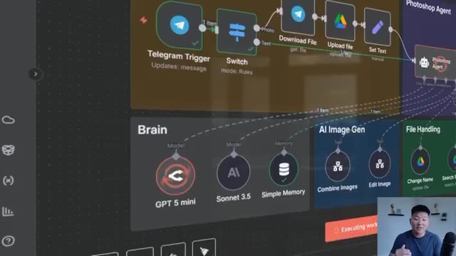
*⏱️ 00:00:09 — Gros plan sur le workflow d'automatisation montrant la section "Brain" avec les modèles actifs (GPT 5 mini, Sonnet 3.5) et les outils associés.*

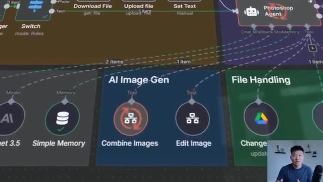
*⏱️ 00:00:17 — Mise au point sur la section "AI Image Gen" du workflow, détaillant les outils "Combine Images" et "Edit Image" connectés à l'agent Photoshop.*

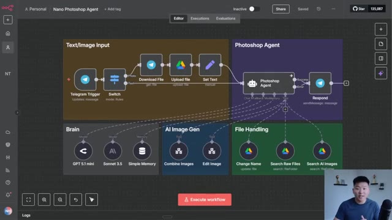
*⏱️ 00:00:26 — Vue d'ensemble de l'interface complète du workflow "Nano Photoshop Agent", incluant les triggers Telegram, le traitement des fichiers et les différents modules d'IA.*

---

### ⏱️ `[00:00:34 - 00:01:06]` | Segment #02

**🔊 Audio (Transcription Intégrale Mot pour Mot en Français) :**
> where it can combine images or edit existing images. And then it has three file handling tools in Google Drive where it can change the name of a file, search through raw files, or search through AI generated images that it's created for us. And it can manage all of this right in your pocket, right through Telegram. So let's hop into a demo. Okay, so you can see that our workflow is listening to us. I'm going to send a picture on Telegram. Okay, so I just shot that off. And now you can see it's uploading that to Google Drive. The agent's going to see that and then it's going to ask us what we want to name that file in our Google Drive. So there you go. It just responded with

**👁️ Analyse Visuelle d'Écran (gemini-3.5-flash-lite) :**
**Interface & Outils** : Présentation ou face-caméra explicatif sans interface logicielle partagée.

**Contenu textuel & Code** : Explications orales et mise en contexte méthodologique.

**Action / Démonstration** : Explications face caméra et démonstration conceptuelle.

---

### ⏱️ `[00:01:06 - 00:01:41]` | Segment #03

**🔊 Audio (Transcription Intégrale Mot pour Mot en Français) :**
> what would you like me to name that photo? And I'm shooting back a message that says call it Nate. And what it's going to do now is use this change name tool to change the name in our Google Drive to Nate. As you can see, if I switch over real quick to media, it just got called Nate. And originally it would have been called today's date. So now it's asking us what we want to do next. And I'm going to shoot off this picture of a bag of granola. And once again, it's going to ask us, what do we want to name this file? And just to show you guys real quick in the media folder that it's dropping, like I said, it defaults to naming everything today's date. So now I'm going to show you guys that it actually does change it. All right. So shooting off this message that says to

**👁️ Analyse Visuelle d'Écran (gemini-3.5-flash-lite) :**
**Interface & Outils** : Présentation ou face-caméra explicatif sans interface logicielle partagée.

**Contenu textuel & Code** : Explications orales et mise en contexte méthodologique.

**Action / Démonstration** : Explications face caméra et démonstration conceptuelle.

---

### ⏱️ `[00:01:41 - 00:02:06]` | Segment #04

**🔊 Audio (Transcription Intégrale Mot pour Mot en Français) :**
> call that picture granola. And once again, we'll see it go here and change that picture to granola, and then we'll have it combine the images together. All right, that just finished up. We'll check the media folder and we can see that picture got called granola. Okay. So I've got telegram open on my desktop now just to make this easier and it's asking us what to do next. I'm shooting off this message that says please combine the Nate and granola pictures to make a photorealistic image where the man is holding their granola while hiking on a mountain.

**👁️ Analyse Visuelle d'Écran (gemini-3.5-flash-lite) :**
**Interface & Outils** : Présentation ou face-caméra explicatif sans interface logicielle partagée.

**Contenu textuel & Code** : Explications orales et mise en contexte méthodologique.

**Action / Démonstration** : Explications face caméra et démonstration conceptuelle.

---

### ⏱️ `[00:02:07 - 00:02:41]` | Segment #05

**🔊 Audio (Transcription Intégrale Mot pour Mot en Français) :**
> So if you remember over here we have a raw file of granola. We have a smiling selfie of me and it's going to put these together right here. You can see it's using its combined image tool and it's going to use nano banana to make it look like I'm holding the granola on a mountain. So I'll check with you guys when that's finished up. Oh, and one other thing while this is running, normally the agent would go search through the files to make sure it has the right IDs to combine the images, but because it's using its memory, it already knows that. So that's why it didn't hit the other file handling tools. But you can see we got a response over here. It's combined the images. Now let me click into this Google Drive link and we'll take a look. So there we go. We've got the kind granola

**👁️ Analyse Visuelle d'Écran (gemini-3.5-flash-lite) :**
**Interface & Outils** : Plateforme d'automatisation de workflow (n8n ou similaire), intégration Telegram.

**Contenu textuel & Code** : Workflow composé de nœuds : "Text/Image Input", "Photoshop Agent", "Brain" (GPT 4o mini, Sonnet 3.5), "AI Image Gen" (Combine Images, Edit Image) et "File Handling". Chat Telegram affichant la demande : "Please combine the Nate and Granola pictures...".

**Action / Démonstration** : Le workflow est en cours d'exécution ("Executing workflow") pour traiter la fusion de deux images via l'agent Photoshop, suite à une instruction textuelle envoyée par l'utilisateur.

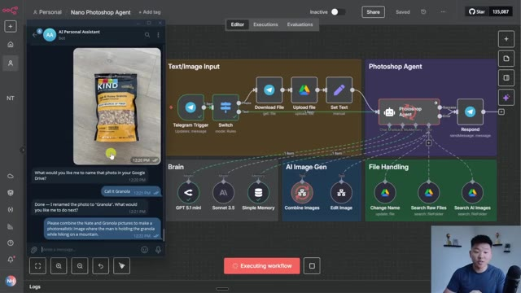
*⏱️ 00:02:15 — Une interface de workflow visuel (type n8n ou plateforme d'automatisation) montrant un agent "Nano Photoshop" en cours d'exécution, avec une fenêtre de chat Telegram latérale illustrant l'interaction utilisateur pour combiner des images.*

---

### ⏱️ `[00:02:41 - 00:03:16]` | Segment #06

**🔊 Audio (Transcription Intégrale Mot pour Mot en Français) :**
> with all the spelling correct. We've got me and my face holding the granola while hiking on a And just to show you guys what that would look like if the files weren't just immediately uploaded and we wanted to pull different ones So let's see we have a hermosi picture right here. That's insanely low quality. We've got a JBL speaker picture right here So what I'm gonna do now is say Please combine the hermosi image with the JBL speaker image to make it look like the man is listening to the speaker on a boat And now you can see it's searching through the raw files It has those correct IDs and now that it has those file IDs It can pass that to the combined images tool in order to actually send those both to nano banana

**👁️ Analyse Visuelle d'Écran (gemini-3.5-flash-lite) :**
**Interface & Outils** : n8n (ou plateforme similaire d'automatisation low-code).

**Contenu textuel & Code** : Diagramme de flux comprenant : "Text/Image Input" (Telegram Trigger, Switch), "Photoshop Agent", "Brain" (GPT 5.1 mini, Sonnet 3.5, Simple Memory), "AI Image Gen" et "File Handling". Le bouton de statut indique "Waiting for trigger event".

**Action / Démonstration** : Visualisation du pipeline d'automatisation de l'agent qui traite des messages Telegram, manipule des fichiers et utilise des modèles IA pour l'édition d'images.

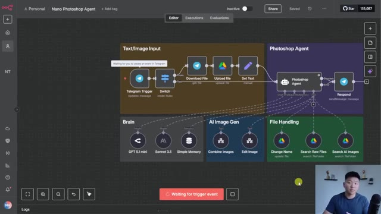
*⏱️ 00:02:50 — Une interface de plateforme d'automatisation de workflow (type n8n) affichant un schéma complexe de nœuds connectés pour un "Nano Photoshop Agent".*

---

### ⏱️ `[00:03:16 - 00:03:36]` | Segment #07

**🔊 Audio (Transcription Intégrale Mot pour Mot en Français) :**
> and get back an image. There you go. You can see it's calling the combined images tool. So I'll check in with you guys when we get that back. All right. So it just told us it was done. I'm going to go to the AI image generation folder and you can see we do have a new one. Let's click in to see how it turned out. Not too bad at all. We have the JBL speaker. We've got Hermosi in his acquisition.com beater and it looks pretty good.

**👁️ Analyse Visuelle d'Écran (gemini-3.5-flash-lite) :**
**Interface & Outils** : Présentation ou face-caméra explicatif sans interface logicielle partagée.

**Contenu textuel & Code** : Explications orales et mise en contexte méthodologique.

**Action / Démonstration** : Explications face caméra et démonstration conceptuelle.

---

### ⏱️ `[00:03:37 - 00:04:08]` | Segment #08

**🔊 Audio (Transcription Intégrale Mot pour Mot en Français) :**
> And remember, these images are only going to get better and better when you come in here and you customize the prompts and you customize all this other stuff because what's actually going on is this agent is creating its own prompt when it sends over variables to this workflow. So if we had a dedicated agent just focused on like creating optimized AI image generation prompts, the results would probably be a lot better. All right, and just to show off the functionality of the edit image tool, I'm going to shoot off this message that says to create a photorealistic advertisement of the granola image, make it look like it's being held in front of the Eiffel Tower.

**👁️ Analyse Visuelle d'Écran (gemini-3.5-flash-lite) :**
**Interface & Outils** : Présentation ou face-caméra explicatif sans interface logicielle partagée.

**Contenu textuel & Code** : Explications orales et mise en contexte méthodologique.

**Action / Démonstration** : Explications face caméra et démonstration conceptuelle.

---

### ⏱️ `[00:04:08 - 00:04:44]` | Segment #09

**🔊 Audio (Transcription Intégrale Mot pour Mot en Français) :**
> So this one is going to have to find the file ID of the granola image, whether that's in the memory or if it has to search the raw files. Looks like it just searched the raw files as you can see. And now it's going to call the edit image tool in order to change the appearance of that image. Okay, so it looks like that just finished up. I'm going to go to the AI image generation folder. You can see we have granola ad Eiffel. If I click on it, you can see that it is our bag of granola, which looks exactly like that and is being held in front of the Eiffel Tower. So if that's not a good ad creative, then I don't know what is. And so all of the words are pretty much spot on except for right up here at the top as you can see. This is supposed to say ingredients

**👁️ Analyse Visuelle d'Écran (gemini-3.5-flash-lite) :**
**Interface & Outils** : Présentation ou face-caméra explicatif sans interface logicielle partagée.

**Contenu textuel & Code** : Explications orales et mise en contexte méthodologique.

**Action / Démonstration** : Explications face caméra et démonstration conceptuelle.

---

### ⏱️ `[00:04:44 - 00:05:19]` | Segment #10

**🔊 Audio (Transcription Intégrale Mot pour Mot en Français) :**
> you can see and pronounce but two things. The first thing is that in the raw files this is a pretty low quality image so like I can't even read what that says right there. And the second thing is this image generation model is only going to get better and better and of course the prompting that is in this current workflow is very minimal. But anyways now that you guys have seen how this works let's start to dive into what's going on with all of these nodes. So the first thing I'm to start off with is the text to image input. What happens here is we're using a switch basically to detect if a photo exists or if text exists. And if photo exists, we go up this way where we download it,

**👁️ Analyse Visuelle d'Écran (gemini-3.5-flash-lite) :**
**Interface & Outils** : Présentation ou face-caméra explicatif sans interface logicielle partagée.

**Contenu textuel & Code** : Explications orales et mise en contexte méthodologique.

**Action / Démonstration** : Explications face caméra et démonstration conceptuelle.

---

### ⏱️ `[00:05:19 - 00:05:55]` | Segment #11

**🔊 Audio (Transcription Intégrale Mot pour Mot en Français) :**
> upload it to Google Drive, and then we shoot that off to the agent. But if text exists, then we just shoot the text straight away. But what we have to do is make sure that the variables are the same so that it's always coming through in a field called json.message.txt. So we basically just standardize the input so the agent looks at it no matter what comes through. Naturally, the next thing that we'll go over is the system prompt, which is very, very minimal. I said, you are a personal assistant agent. Your job is to use the tools you have access to, to help the user with their request. I listed out all the tools and I gave a very minimal description of each of them because in the tools themselves, there's a brief description, but I still like to put them here.

**👁️ Analyse Visuelle d'Écran (gemini-3.5-flash-lite) :**
**Interface & Outils** : Présentation ou face-caméra explicatif sans interface logicielle partagée.

**Contenu textuel & Code** : Explications orales et mise en contexte méthodologique.

**Action / Démonstration** : Explications face caméra et démonstration conceptuelle.

---

### ⏱️ `[00:05:56 - 00:06:31]` | Segment #12

**🔊 Audio (Transcription Intégrale Mot pour Mot en Français) :**
> And then for the instructions, I only ended up giving it one instruction, which was if the user submits a photo, ask what they want to name it by saying, what would you like me to name that photo in your Google Drive. Then once they respond, change the name using your change name tool. The system prompt is very minimal. We have only five tools to choose from and we're using GPT 5.1 and it's doing really well. And from here, what I would do is as I'm testing more and as you guys download the template and start to play around with different things, just add instructions to your system prompt when you realize it's failing to do certain things. And then real quick, just to hit on what's going on over here before we dive into the tools is we're using GPT 5.1. We're using

**👁️ Analyse Visuelle d'Écran (gemini-3.5-flash-lite) :**
**Interface & Outils** : Présentation ou face-caméra explicatif sans interface logicielle partagée.

**Contenu textuel & Code** : Explications orales et mise en contexte méthodologique.

**Action / Démonstration** : Explications face caméra et démonstration conceptuelle.

---

### ⏱️ `[00:06:31 - 00:07:05]` | Segment #13

**🔊 Audio (Transcription Intégrale Mot pour Mot en Français) :**
> Sonnet 3.5 as the fallback model. And then we're just using simple memory with the session ID being the telegram chat ID. All right. So first I'm going to go over the file handling tools because they're super simple and we'll just get that out the way. The first one is change name. So if I click into this tool, you can see what we're doing is we're updating a file and we're updating it by the ID. And the ID is automatically found by the agent. So if the agent doesn't have the ID of a file to change the name, it will have to go use its other tools to find that ID. And then it will pass the ID to this tool. And the other thing that gets passed to this tool is the new name. So when

**👁️ Analyse Visuelle d'Écran (gemini-3.5-flash-lite) :**
**Interface & Outils** : Présentation ou face-caméra explicatif sans interface logicielle partagée.

**Contenu textuel & Code** : Explications orales et mise en contexte méthodologique.

**Action / Démonstration** : Explications face caméra et démonstration conceptuelle.

---

### ⏱️ `[00:07:05 - 00:07:38]` | Segment #14

**🔊 Audio (Transcription Intégrale Mot pour Mot en Français) :**
> we say, hey, call that photo Nate, it knows to fill this in right here with the word Nate. And then these tools are doing the exact same thing. The only difference is the folder that they're searching in. So if I say to search for raw files, what we're doing is we're searching within a folder called media, and we're searching for files. But if the agent realizes that we want to search through an image that it already created for us, it would use this one, which is search AI images. And it's doing the exact same thing except for we change the folder that it's looking through. So like I said, those three are super simple, but those are necessary in order to change things, look at

**👁️ Analyse Visuelle d'Écran (gemini-3.5-flash-lite) :**
**Interface & Outils** : Présentation ou face-caméra explicatif sans interface logicielle partagée.

**Contenu textuel & Code** : Explications orales et mise en contexte méthodologique.

**Action / Démonstration** : Explications face caméra et démonstration conceptuelle.

---

### ⏱️ `[00:07:38 - 00:08:12]` | Segment #15

**🔊 Audio (Transcription Intégrale Mot pour Mot en Français) :**
> things and search through the database. Okay, so now let's get into the fun stuff, which are these two custom workflows that I built. And what that means is if I open up this workflow, you can see that it is a custom NNN workflow that I built myself. We're able to make our main agent call on it because you can see that if we add a tool right here, we have an option to call an NNN workflow as a tool. So that's how we can create these really modular systems because now if I ever want to create another agent that can combine images I can just plug it into this workflow right here. So anyways there's a lot of stuff going on here so let's just take it node by node. The first thing that's

**👁️ Analyse Visuelle d'Écran (gemini-3.5-flash-lite) :**
**Interface & Outils** : Présentation ou face-caméra explicatif sans interface logicielle partagée.

**Contenu textuel & Code** : Explications orales et mise en contexte méthodologique.

**Action / Démonstration** : Explications face caméra et démonstration conceptuelle.

---

### ⏱️ `[00:08:12 - 00:08:40]` | Segment #16

**🔊 Audio (Transcription Intégrale Mot pour Mot en Français) :**
> going on is we have the input where I'm defining to the main Photoshop agent what to send over. So you can see we're sending over an image prompt, image 1 which is an image ID, image 2 which is the image ID of the second image, and and then the image title for the new image that's created. And that may seem a little confusing, but when we go back to the main Photoshop agent, it looks at this and it says, okay, when I need to call this tool, which is combining images, I need to send over a prompt, image one, image two, and image title.

**👁️ Analyse Visuelle d'Écran (gemini-3.5-flash-lite) :**
**Interface & Outils** : Présentation ou face-caméra explicatif sans interface logicielle partagée.

**Contenu textuel & Code** : Explications orales et mise en contexte méthodologique.

**Action / Démonstration** : Explications face caméra et démonstration conceptuelle.

---

### ⏱️ `[00:08:41 - 00:09:13]` | Segment #17

**🔊 Audio (Transcription Intégrale Mot pour Mot en Français) :**
> So this is how it knows to use its brain to give the second workflow all of this information. And to make this easier, I pulled in the live data from that run we did in the demo, just so you guys can see that what comes in is, here's the image with Hormozy in the speaker, Here's the idea of the first one the idea of the second one and the new name of the AI generated image So from there what we do is we edit fields just to create an array of the two image IDs We have to create an array so that we can split these out into two separate items Because we need to download two files and we need to get a public URL of both of those files

**👁️ Analyse Visuelle d'Écran (gemini-3.5-flash-lite) :**
**Interface & Outils** : Présentation ou face-caméra explicatif sans interface logicielle partagée.

**Contenu textuel & Code** : Explications orales et mise en contexte méthodologique.

**Action / Démonstration** : Explications face caméra et démonstration conceptuelle.

---

### ⏱️ `[00:09:14 - 00:09:37]` | Segment #18

**🔊 Audio (Transcription Intégrale Mot pour Mot en Français) :**
> So in the Google Drive node, we're downloading by ID so you can see we're getting both of these pictures here There's the Hormozy one and there is the speaker one and then the way that the Nano banana API works it has to take a public URL of an image in order to actually change it. So what we do is we use a free service called ImageBB and I'm basically just uploading these images as binary and then it gives us back a public URL that represents the image.

**👁️ Analyse Visuelle d'Écran (gemini-3.5-flash-lite) :**
**Interface & Outils** : Présentation ou face-caméra explicatif sans interface logicielle partagée.

**Contenu textuel & Code** : Explications orales et mise en contexte méthodologique.

**Action / Démonstration** : Explications face caméra et démonstration conceptuelle.

---

### ⏱️ `[00:09:37 - 00:09:55]` | Segment #19

**🔊 Audio (Transcription Intégrale Mot pour Mot en Français) :**
> So here you can see this is what we get back and if I open that up, it is the picture of Hermosi. So that's just a cool little workaround if you need to get a binary image into a public URL. There's other ways to do it, but this is just a free easy way that I do it. So once we have both those URLs back, we aggregate them so that we can make one API request rather than two.

**👁️ Analyse Visuelle d'Écran (gemini-3.5-flash-lite) :**
**Interface & Outils** : Présentation ou face-caméra explicatif sans interface logicielle partagée.

**Contenu textuel & Code** : Explications orales et mise en contexte méthodologique.

**Action / Démonstration** : Explications face caméra et démonstration conceptuelle.

---

### ⏱️ `[00:09:55 - 00:10:14]` | Segment #20

**🔊 Audio (Transcription Intégrale Mot pour Mot en Français) :**
> So we're making one request to NanoBanana through a service called Fal.ai. So I'm not going to dive super, super deep into what's going on here. If you want to watch an API video I made, I'll tag that right up here. But what's going on is we're using our file credentials. So I got my API key from Fal.ai. And then this JSON body request is really simple.

**👁️ Analyse Visuelle d'Écran (gemini-3.5-flash-lite) :**
**Interface & Outils** : Présentation ou face-caméra explicatif sans interface logicielle partagée.

**Contenu textuel & Code** : Explications orales et mise en contexte méthodologique.

**Action / Démonstration** : Explications face caméra et démonstration conceptuelle.

---

### ⏱️ `[00:10:14 - 00:10:47]` | Segment #21

**🔊 Audio (Transcription Intégrale Mot pour Mot en Français) :**
> We're passing over a prompt and we're passing over two image URLs. And the only reason why this prompt looks a little confusing is because I put these two replace functions in there that basically make sure if the prompt has new lines or Double quotation marks that it gets rid of that because that would break the JSON body request So now it has everything it needs It has both the images and it has the prompt and then it basically says, okay I received your request. We're working on that right now and because it's working on it We wait for about 10 seconds and then we make a request back to foul to see if it's done

**👁️ Analyse Visuelle d'Écran (gemini-3.5-flash-lite) :**
**Interface & Outils** : Présentation ou face-caméra explicatif sans interface logicielle partagée.

**Contenu textuel & Code** : Explications orales et mise en contexte méthodologique.

**Action / Démonstration** : Explications face caméra et démonstration conceptuelle.

---

### ⏱️ `[00:10:47 - 00:11:19]` | Segment #22

**🔊 Audio (Transcription Intégrale Mot pour Mot en Français) :**
> And if it's not done it will come here and it will wait for 30 seconds And honestly this should probably change to like four because images are really quick and then it will just continuously check until it's done So that's just another cool guardrail you can have in your workflows And then once it gets that result back it basically gives us a URL And so what I do is I make a simple get requests to that URL to actually get the image itself And now we have the images binary We can upload it to Google Drive and then we can set our response to the main agent which is basically saying, hey, the image was created and this is what we named it.

**👁️ Analyse Visuelle d'Écran (gemini-3.5-flash-lite) :**
**Interface & Outils** : Présentation ou face-caméra explicatif sans interface logicielle partagée.

**Contenu textuel & Code** : Explications orales et mise en contexte méthodologique.

**Action / Démonstration** : Explications face caméra et démonstration conceptuelle.

---

### ⏱️ `[00:11:19 - 00:11:41]` | Segment #23

**🔊 Audio (Transcription Intégrale Mot pour Mot en Français) :**
> And here's the link to that image in your Google Drive. And then the main agent gets that in response to us, the user. So hopefully that wasn't too confusing. And at a high level, you can understand what's going on. Remember, this will be a free workflow you guys can download in my Freeschool community as well. So the best way to really understand it is to download all the assets, run it, and then go node by node and understand what's going on.

**👁️ Analyse Visuelle d'Écran (gemini-3.5-flash-lite) :**
**Interface & Outils** : n8n (outil d'automatisation de workflows).

**Contenu textuel & Code** : Expressions de données JSON (ex: `$json.name`, `$json.webViewLink`), blocs de nœuds logiques (Input, Download File, Create AI Image, Polling, Output).

**Action / Démonstration** : Configuration des paramètres de sortie d'un nœud et visualisation complète de la structure d'un workflow automatisé pour la génération et le stockage d'images.

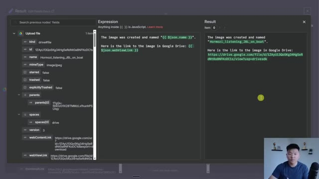
*⏱️ 00:11:24 — Fenêtre de configuration de nœud n8n affichant les métadonnées d'un fichier Google Drive et un champ d'expression générant un message de confirmation avec un lien.*

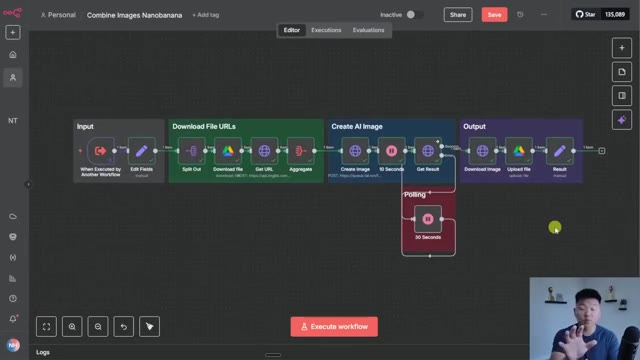
*⏱️ 00:11:30 — Vue d'ensemble du workflow d'automatisation dans n8n, illustrant le pipeline de traitement, de la réception des fichiers à la création d'image IA et à l'export final.*

---

### ⏱️ `[00:11:41 - 00:12:05]` | Segment #24

**🔊 Audio (Transcription Intégrale Mot pour Mot en Français) :**
> And real quick, the way you would actually get all this is you join my Freeschool community. The link for that's down in the description. When you get there, this is what it will look like. And all you need to do is go to YouTube resources and find the post associated with this video. If you're having trouble finding it, you can also use the search bar to search for the title of the video. But then once you get in there, you'll see the video and then you'll also see all of these JSON files that you can download and then import directly into your NNN.

**👁️ Analyse Visuelle d'Écran (gemini-3.5-flash-lite) :**
**Interface & Outils** : Plateforme de communauté en ligne Skool (AI Automation Society).

**Contenu textuel & Code** : Titres de posts : "Get ready... I'm about to release a new course", "New Video: Beginner's Guide to Workflow Evaluation in n8n", "Ticket Tagging Evaluation.json", "RAG Evaluation.json".

**Action / Démonstration** : Navigation au sein de la communauté pour localiser et ouvrir la ressource associée à la vidéo YouTube.

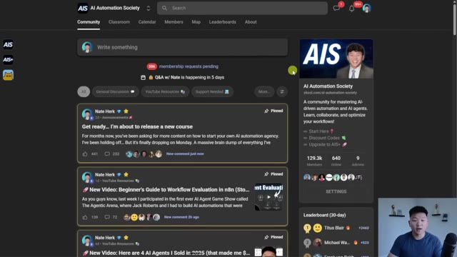
*⏱️ 00:11:47 — Interface principale de la plateforme communautaire "AI Automation Society" (Skool), montrant le flux des publications avec les derniers posts de Nate Herk.*

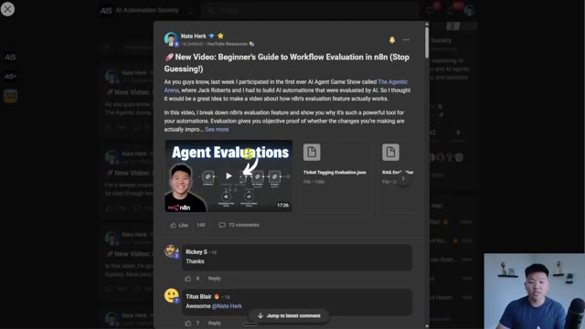
*⏱️ 00:11:59 — Fenêtre modale ouverte sur une publication spécifique de Nate Herk concernant le guide sur l'évaluation des workflows dans n8n, incluant des fichiers joints en .json.*

---

### ⏱️ `[00:12:05 - 00:12:26]` | Segment #25

**🔊 Audio (Transcription Intégrale Mot pour Mot en Français) :**
> And then when you get all the stuff set up, there will be a big sticky note right here called a setup guide and it will tell you exactly what you need to do to get up and running. Okay, cool. So that was the combined images node where we used Nano Banana. Now, what's cool is the edit image node is very, very similar. So if I open this up and I actually just click on view sub execution, we can see exactly what happened when it was called.

**👁️ Analyse Visuelle d'Écran (gemini-3.5-flash-lite) :**
**Interface & Outils** : n8n (outil d'automatisation de workflows low-code).

**Contenu textuel & Code** : - Image #1 : Workflow "Nano Photoshop Agent" avec des déclencheurs Telegram, des nœuds d'IA (GPT 5.1 mini, Sonnet 3.5), et des outils de manipulation d'images ("Combine Images", "Edit Image").
- Image #2 : Configuration du nœud "Edit Image" avec un prompt détaillé pour la création d'une image publicitaire ("Granola_Ad_Eiffel"), et un résultat de sortie contenant un lien Google Drive.

**Action / Démonstration** : - Image #1 : Présentation visuelle de l'architecture du workflow d'agent IA.
- Image #2 : Manipulation des paramètres d'entrée pour le nœud d'édition d'image via l'interface de n8n.

*⏱️ 00:12:10 — Vue d'ensemble d'un workflow d'automatisation dans n8n, montrant des nœuds organisés par catégories (Input, Agent, Brain, Image Gen, File Handling).*

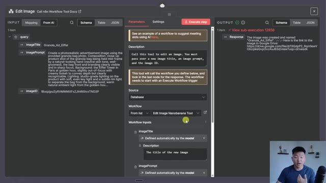
*⏱️ 00:12:21 — Interface de configuration détaillée du nœud "Edit Image" dans n8n, affichant les paramètres, les champs d'entrée (input) et le résultat (output) d'une exécution.*

---

### ⏱️ `[00:12:27 - 00:12:59]` | Segment #26

**🔊 Audio (Transcription Intégrale Mot pour Mot en Français) :**
> And it's very similar to the previous one. Literally, the only difference is that instead of passing in two image IDs, we're only passing in one. So what happens once again is the input is image title, image prompt, and image ID. So here's the run from the granola Eiffel Tower ad as you can see We're gonna go to Google Drive once again pass in that image ID so we can download the file Then what comes next is we are once again sending that binary data to image BB to get a public URL So right here you can see this is the public URL we get for our granola picture

**👁️ Analyse Visuelle d'Écran (gemini-3.5-flash-lite) :**
**Interface & Outils** : Présentation ou face-caméra explicatif sans interface logicielle partagée.

**Contenu textuel & Code** : Explications orales et mise en contexte méthodologique.

**Action / Démonstration** : Explications face caméra et démonstration conceptuelle.

---

### ⏱️ `[00:12:59 - 00:13:18]` | Segment #27

**🔊 Audio (Transcription Intégrale Mot pour Mot en Français) :**
> And then now that we have that we can make another request to file AI to use nano banana Where we send over the prompt and then just one image URL instead of two So it's very, very similar. We're using the same guardrails in here to get rid of new lines and new spaces and quotation marks, all that kind of stuff.

**👁️ Analyse Visuelle d'Écran (gemini-3.5-flash-lite) :**
**Interface & Outils** : Présentation ou face-caméra explicatif sans interface logicielle partagée.

**Contenu textuel & Code** : Explications orales et mise en contexte méthodologique.

**Action / Démonstration** : Explications face caméra et démonstration conceptuelle.

---

### ⏱️ `[00:13:18 - 00:13:38]` | Segment #28

**🔊 Audio (Transcription Intégrale Mot pour Mot en Français) :**
> And then it basically just edits that image. We're doing the exact same thing here with a polling check. And then when we get the result, we download it as binary rather than keeping it as a URL, put it in our Google Drive, and then we send a response back to the main agent. Real quick, just wanted to touch on some of the pricing for this system. The first thing that I wanted to cover was fal.ai.

**👁️ Analyse Visuelle d'Écran (gemini-3.5-flash-lite) :**
**Interface & Outils** : n8n (workflow automation) et plateforme web "fal.ai".

**Contenu textuel & Code** : Diagramme de flux de données (nœuds Input, Download, Create AI Image, Polling, Output) et interface utilisateur de gestion de modèles d'IA.

**Action / Démonstration** : Construction et démonstration d'un workflow d'automatisation pour le traitement d'images, suivi d'une vue d'ensemble des capacités de la plateforme fal.ai.

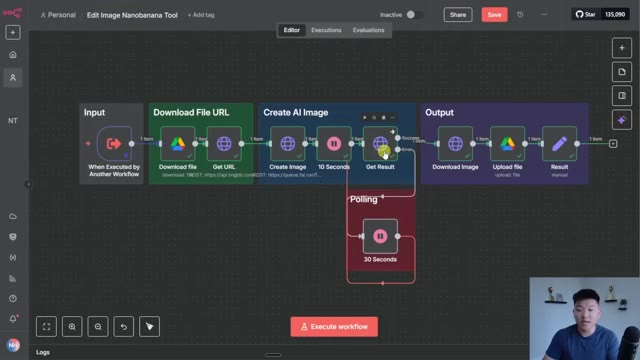
*⏱️ 00:13:23 — Interface n8n montrant un workflow automatisé pour le traitement d'images IA avec des nœuds de téléchargement, de génération et une boucle de "polling" (interrogation) de 30 secondes.*

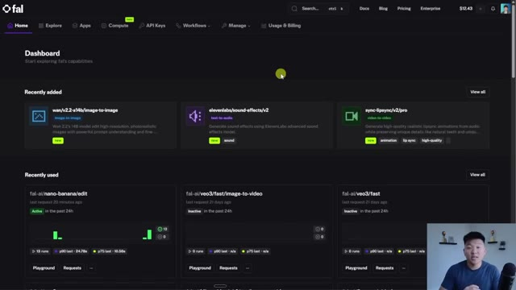
*⏱️ 00:13:33 — Tableau de bord de la plateforme "fal" affichant des modèles d'IA récemment ajoutés et utilisés, tels que des outils d'édition d'image, de génération de sons et de synchronisation labiale.*

---

### ⏱️ `[00:13:38 - 00:14:13]` | Segment #29

**🔊 Audio (Transcription Intégrale Mot pour Mot en Français) :**
> What FAL is is like a place where you can have a ton of different image and video generation models And you can just use one credential and you know get all of them through there So it's really cool. You can see right here my recently used our nano banana edit We've got VO3 fast VO3 You can go to explore and you can see all of these other models that they have available But anyways the reason why I wanted to show you guys this is because first of all It's only about four cents per image, which is not too bad at all But what you can do is you can play around with like image URLs and prompts here So you can really refine the way you want to have your prompting before you get into N8N and start messing around there

**👁️ Analyse Visuelle d'Écran (gemini-3.5-flash-lite) :**
**Interface & Outils** : Présentation ou face-caméra explicatif sans interface logicielle partagée.

**Contenu textuel & Code** : Explications orales et mise en contexte méthodologique.

**Action / Démonstration** : Explications face caméra et démonstration conceptuelle.

---

### ⏱️ `[00:14:13 - 00:14:47]` | Segment #30

**🔊 Audio (Transcription Intégrale Mot pour Mot en Français) :**
> And then the way that we can call it through N8N is by going to their API documentation I would change this to HTTP curl And now you can look through like how to get your API key how to set that up how to submit a request how to upload files All this kind of stuff And I also did see about a week ago that you could get free image generation through open router for Gemini Nano Banana Because if you go to the Gemini web app, it's free to try out there And so for a while it was free here on open router, but it looks like they might have just taken that off so Unfortunate but once again, you can get 25 images for only a dollar. So it's not too bad. Okay

**👁️ Analyse Visuelle d'Écran (gemini-3.5-flash-lite) :**
**Interface & Outils** : Présentation ou face-caméra explicatif sans interface logicielle partagée.

**Contenu textuel & Code** : Explications orales et mise en contexte méthodologique.

**Action / Démonstration** : Explications face caméra et démonstration conceptuelle.

---

### ⏱️ `[00:14:47 - 00:15:08]` | Segment #31

**🔊 Audio (Transcription Intégrale Mot pour Mot en Français) :**
> So that's basically all that's going on in this workflow Now let's talk about a few ways that when you get this template that you could customize this and make it a little more Production ready. So something that I alluded to earlier was in these two tools where you're doing image generation Would be to have a dedicated AI that would create the system prompts or the AI image generation prompts.

**👁️ Analyse Visuelle d'Écran (gemini-3.5-flash-lite) :**
**Interface & Outils** : Flowise (interface de design de workflow basée sur des nœuds).

**Contenu textuel & Code** : Diagramme de workflow complexe comprenant des blocs fonctionnels : "Text/Image Input", "Photoshop Agent", "Brain" (contenant GPT 5.1 mini, Sonnet 3.5), "AI Image Gen" (Combine Images, Edit Image) et "File Handling" (Google Drive).

**Action / Démonstration** : Le pointeur de la souris survole le bloc "Search Raw Files" dans la section "File Handling", illustrant la manipulation et l'organisation du workflow.

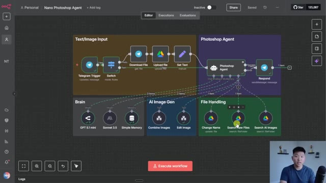
*⏱️ 00:14:53 — Une capture d'écran montrant l'interface de travail de Flowise, un outil de création de workflows IA, illustrant un projet nommé "Nano Photoshop Agent".*

---

### ⏱️ `[00:15:08 - 00:15:28]` | Segment #32

**🔊 Audio (Transcription Intégrale Mot pour Mot en Français) :**
> So what you could do is like literally right here, just add an AI agent node. And this one is prompted in a way where it's specializing in creating AI image generated prompts. And then you pass that prompt all the way down to the create image node, rather than relying on this main agent who has tons of other jobs to do, relying on him to make the image prompt.

**👁️ Analyse Visuelle d'Écran (gemini-3.5-flash-lite) :**
**Interface & Outils** : Présentation ou face-caméra explicatif sans interface logicielle partagée.

**Contenu textuel & Code** : Explications orales et mise en contexte méthodologique.

**Action / Démonstration** : Explications face caméra et démonstration conceptuelle.

---

### ⏱️ `[00:15:28 - 00:16:01]` | Segment #33

**🔊 Audio (Transcription Intégrale Mot pour Mot en Français) :**
> It would be better to have a second agent in this workflow that would specialize in that. There's of course other things you can do like having a logger. So in a previous agent I've made that was kind of similar. This one was an ultimate media team. What I did here was I had it returning all of its steps into a Google Sheet, whether it erred or it was successful. So you could see exactly what input was processed, what tools were called, how many tokens that was taking you. So you could use this video, which I will tag right up here if you haven't seen it. You can download those resources and do the exact same thing in this agent where you can have a Google Sheet that's logging everything. And then of course, another

**👁️ Analyse Visuelle d'Écran (gemini-3.5-flash-lite) :**
**Interface & Outils** : Plateforme d'automatisation de workflow (interface web type n8n ou similaire).

**Contenu textuel & Code** : Diagramme de flux divisé en sections : "Text/Image Input", "Photoshop Agent", "Brain" (avec GPT 5.1 mini, Sonnet 3.5), "AI Image Gen", et "File Handling" (avec des nœuds de recherche de fichiers Google Drive). Les flux sont représentés par des lignes pointillées et continues reliant les différents agents et outils.

**Action / Démonstration** : Navigation et présentation de l'architecture d'un agent IA capable de traiter des fichiers, d'utiliser des modèles LLM et d'interagir avec des services externes.

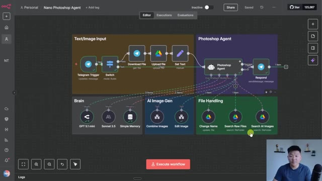
*⏱️ 00:15:36 — Une vue d'ensemble d'un éditeur de workflow visuel (type plateforme d'automatisation d'agents IA) nommé "Nano Photoshop Agent", présentant une architecture modulaire avec divers blocs interconnectés.*

---

### ⏱️ `[00:16:01 - 00:16:24]` | Segment #34

**🔊 Audio (Transcription Intégrale Mot pour Mot en Français) :**
> Another really cool next step would be being able to take these AI generated images and pass that to another workflow that can create videos out of them. And you could use like VO3Fast to create those images for you. That's another thing that I did in this media agent where I have like an image to video tool, a create video tool. So definitely check out that video as well if you want to literally use some of these workflows and then just hook them up to your Photoshop agent.

**👁️ Analyse Visuelle d'Écran (gemini-3.5-flash-lite) :**
**Interface & Outils** : Présentation ou face-caméra explicatif sans interface logicielle partagée.

**Contenu textuel & Code** : Explications orales et mise en contexte méthodologique.

**Action / Démonstration** : Explications face caméra et démonstration conceptuelle.

---

### ⏱️ `[00:16:24 - 00:16:43]` | Segment #35

**🔊 Audio (Transcription Intégrale Mot pour Mot en Français) :**
> Because that's the beauty of these custom workflows as a tool, you can have them hooked up to as many different agents as you want. Once again, all the resources for this video and every single other YouTube video you've seen on my channel, you can get for completely free in my FreeSchool community. You just have to come here, look through the YouTube resources. And as you can see, every single video has all of the resources right here.

**👁️ Analyse Visuelle d'Écran (gemini-3.5-flash-lite) :**
**Interface & Outils** : Présentation ou face-caméra explicatif sans interface logicielle partagée.

**Contenu textuel & Code** : Explications orales et mise en contexte méthodologique.

**Action / Démonstration** : Explications face caméra et démonstration conceptuelle.

---

### ⏱️ `[00:16:43 - 00:17:16]` | Segment #36

**🔊 Audio (Transcription Intégrale Mot pour Mot en Français) :**
> And if you're looking to take your skills a little further with NNN and you're also looking to understand how you can monetize your AI automation knowledge, then definitely check out my Plus community. The link for that will also be down in the description. We've got thousands of members in here who are building and selling NNN services every single day and they're always sharing their learnings and their challenges. It's a really cool space to be. We've also got two full courses at the moment with a third one coming about monetizing your AI skills. But if you're a complete beginner, you can start with the foundations and then you get in here and you master N8N and then you learn how to start selling or consulting with this knowledge. So I'd love to see you guys in these communities, but that's going to do it

**👁️ Analyse Visuelle d'Écran (gemini-3.5-flash-lite) :**
**Interface & Outils** : Plateforme communautaire Skool (AI Automation Society Plus).

**Contenu textuel & Code** : Titres de cours et modules : "Start Here", "Agent Zero (Foundations)", "10 Hours to 10 Seconds", "n8n Templates", et "Step-by-Step Builds".

**Action / Démonstration** : Navigation et présentation des ressources éducatives et de la structure de la communauté privée.

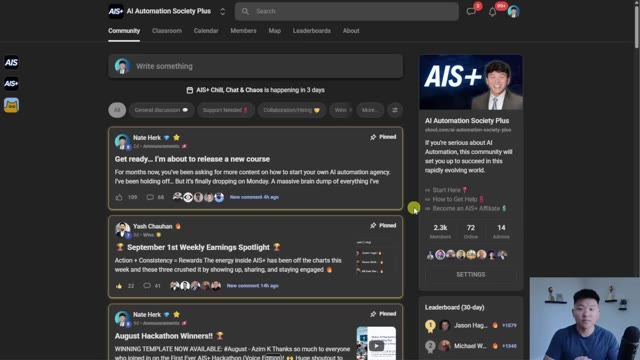
*⏱️ 00:16:52 — Vue d'ensemble de l'interface de la communauté "AI Automation Society Plus" sur Skool, montrant le fil d'actualité avec des publications épinglées et le tableau de bord latéral.*

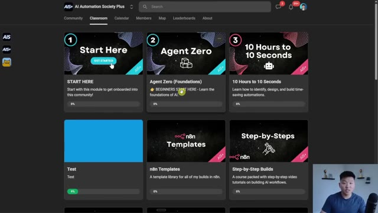
*⏱️ 00:17:08 — Interface de la section "Classroom" de la plateforme, affichant une grille de modules de formation sur l'IA et l'automatisation, incluant "Agent Zero" et "n8n Templates".*

---

### ⏱️ `[00:17:16 - 00:17:24]` | Segment #37

**🔊 Audio (Transcription Intégrale Mot pour Mot en Français) :**
> for the video. If you enjoyed it or you learned something new, please give it a like. It definitely helps me out a ton. And as always, I appreciate you guys making it to the end of the video. I'll see you on the next one. Thanks everyone.

**👁️ Analyse Visuelle d'Écran (gemini-3.5-flash-lite) :**
**Interface & Outils** : Présentation ou face-caméra explicatif sans interface logicielle partagée.

**Contenu textuel & Code** : Explications orales et mise en contexte méthodologique.

**Action / Démonstration** : Explications face caméra et démonstration conceptuelle.

---

