# 🎬 How I Sold a $6000 AI Workflow to a Business (Live Sales Call)

> **Chaîne** : [Nate Herk | AI Automation](https://www.youtube.com/@nateherk/featured)  
> **Lien YouTube** : [https://www.youtube.com/watch?v=NSwl_E0WWKk](https://www.youtube.com/watch?v=NSwl_E0WWKk)  
> **Date de publication** : 20250907  
> **Durée** : 00:41:19  
> **Identifiant vidéo** : `NSwl_E0WWKk`  
> **Transcription & Analyse** : `whisper-v3-large-turbo+gemini-3.5-flash-lite`  

---

## 📌 Synthèse Exécutive & Outils

### 💡 Résumé
Dans cette vidéo intitulée **How I Sold a $6000 AI Workflow to a Business (Live Sales Call)**, Nate Herk décortique les capacités pratiques d'automatisation et de développement propulsées par les modèles de pointe.

### 🛠️ Outils, Modèles & Logiciels Présentés
- **Opus 5.5 & Claude Code** : Modèles d'ingénierie et agents de codage autonome.

### 🔑 Points Clés & Enseignements Stratégiques
- Optimiser le niveau d'effort et le raisonnement des modèles IA pour des résultats industriels.
- Automatiser les cycles de création logicielle de bout en bout.

---

## ⏱️ Chronologie & Transcription Complète Audio & Visuelle (Mot pour Mot)

### ⏱️ `[00:00:00 - 00:00:31]` | Segment #01

**🔊 Audio (Transcription Intégrale Mot pour Mot en Français) :**
> In this video, you're about to watch me sell a $6,000 AI agent. This close took place over three separate calls back in December of 2024, so it was when I was pretty new to the space, but I still managed to close the call. So today I'm going to break down these calls and show you guys what I did well, what I could have improved on, and how you can go ahead and close a deal just like this one. So let's get into it. All right, so before we actually start watching these calls, and I try not to cringe at myself as best as I can, I wanted to real quick tell you guys my mindset when I'm hopping into these discovery calls and I haven't met this person before.

**👁️ Analyse Visuelle d'Écran (gemini-3.5-flash-lite) :**
**Interface & Outils** : Navigateur web (YouTube).

**Contenu textuel & Code** : Titres de vidéos (ex: "How to Create an AI Email Agent with n8n").

**Action / Démonstration** : Aucune action technique ou de démonstration logicielle présente dans ce segment d'introduction.

---

### ⏱️ `[00:00:31 - 00:01:05]` | Segment #02

**🔊 Audio (Transcription Intégrale Mot pour Mot en Français) :**
> So it's a discovery call, which means it's for you to discover as much information as you can about this client, their business, and what they want to do with AI automation. And in order to make sure that I'm not rambling on and letting the client talk the majority of the call, I use a framework that I call the LRP, which stands for listen, repeat, poke. It basically makes sure that I listen to what he or she is saying. I repeat it back to them to make sure that we're all completely aligned going through the call. And then I poke with a question and I prompt them for more information so i just want to throw that out there throughout the call i'll stop and i'll mention some times when i did lrp and i'll show you guys why that's beneficial but

**👁️ Analyse Visuelle d'Écran (gemini-3.5-flash-lite) :**
**Interface & Outils** : Aucune (Il s'agit d'animations graphiques de présentation, non de démonstrations logicielles ou techniques).

**Contenu textuel & Code** : Texte affiché : "CLIENT", "BUSINESS", "PURPOSE", "FRAMEWORK", "LISTEN", "REPEAT", "POKE", "L", "R", "P".

**Action / Démonstration** : Animation de transition entre les différentes étapes du framework de vente/communication du présentateur.

---

### ⏱️ `[00:01:05 - 00:01:35]` | Segment #03

**🔊 Audio (Transcription Intégrale Mot pour Mot en Français) :**
> let's get started almost invited my note taker uh you if you want to go for it otherwise i'll send you a copy of this one uh no so it's funny actually um when i said our own i meant literally we uh this is different this is a separate conversation but my company we actually are launching our own uh oh okay yeah so just wanted to show you guys real quick that was like the first 20 seconds of the call. And it's important because I spent the first two minutes just kind of building rapport and realizing real quick that this client is very bullish on AI.

**👁️ Analyse Visuelle d'Écran (gemini-3.5-flash-lite) :**
**Interface & Outils** : Aucune interface logicielle de travail ou de démonstration technique n'est visible (seulement une interface de conférence vidéo et un plan fixe du présentateur).

**Contenu textuel & Code** : Aucun code, aucune commande terminal, aucun prompt ni flux de travail IA n'est affiché.

**Action / Démonstration** : Aucune manipulation d'outil d'automatisation ou de développement n'est effectuée.

---

### ⏱️ `[00:01:35 - 00:02:09]` | Segment #04

**🔊 Audio (Transcription Intégrale Mot pour Mot en Français) :**
> You can see he's innovative. You can see that they're doing things, they have AI initiatives already in the company, which was a really great green flag for me of someone that we would want to work with because they have long-term goals with this and they have realistic expectations. A lot of times you have people on the two ends of the spectrum, which would be way too bullish and they think it's magic and they have unrealistic expectations and you know right away that throughout this discovery call, you may have to try to manage those expectations or people on this left side where they're very skeptical. They need to still be convinced about AI automation. And then you know how to approach the rest of the call and sort of the questions that you ask. So just

**👁️ Analyse Visuelle d'Écran (gemini-3.5-flash-lite) :**
**Interface & Outils** : Aucune interface logicielle, éditeur de code ou terminal de commande n'est présent dans ce segment.

**Contenu textuel & Code** : Aucun contenu technique, code ou donnée n'est affiché.

**Action / Démonstration** : Aucune action d'agent, manipulation logicielle ou démonstration technique n'est réalisée.

---

### ⏱️ `[00:02:09 - 00:02:42]` | Segment #05

**🔊 Audio (Transcription Intégrale Mot pour Mot en Français) :**
> want to throw that out there real quick. The next thing that I try to do here is basically just open the floor up to him and say, why did you book in a call today? How can I help you? Yeah. Well, yeah. If you want to just tell me about sort of what you were looking, I was reading your your Calendly booking link a little bit. But yeah, if you just want to sort of let me know, you know, what, what prompted you to book a call and what you're, what you're looking to do here. So that's the way I wanted to open it up. Just lay the agenda and get him talking right away about what it is he's looking to do. You could see I wasn't very, like I wasn't speaking very confidently there. So that was a tough watch, but now what I'm going to do is just listen until there's an opportunity for me to repeat and then poke with another question. Yeah, I understand.

**👁️ Analyse Visuelle d'Écran (gemini-3.5-flash-lite) :**
**Interface & Outils** : Fathom (outil de prise de notes assisté par IA pour les visioconférences).

**Contenu textuel & Code** : Texte informatif « Recording and taking notes » affiché au centre de l'interface de réunion.

**Action / Démonstration** : Aucune manipulation de code ou démonstration technique ; il s'agit d'une séquence de conversation classique enregistrée via un outil de transcription automatique.

---

### ⏱️ `[00:02:42 - 00:03:01]` | Segment #06

**🔊 Audio (Transcription Intégrale Mot pour Mot en Français) :**
> I understand. So, you know, we're looking at, uh, you know, email integration, Slack. Um, What about your calendar sync? Would that also be like a Google calendar or these Outlook? Google. Okay. So what just happened there was I listened for a while and he started to break down his tech stack and what he was looking for this type of assistant.

**👁️ Analyse Visuelle d'Écran (gemini-3.5-flash-lite) :**
**Interface & Outils** : Logiciel de visioconférence (Fathom).

**Contenu textuel & Code** : Texte affiché : "Recording and taking notes".

**Action / Démonstration** : Conversation en cours sur des sujets d'intégration technique (email, Slack, calendrier).

---

### ⏱️ `[00:03:01 - 00:03:21]` | Segment #07

**🔊 Audio (Transcription Intégrale Mot pour Mot en Français) :**
> And I repeated back to make sure that we were fully aligned on the different tools. And then I threw out another question, which wasn't a great question, but just kind of like trying to get a better understanding of the tools and asked about Google and Outlook, stuff like that. But what I missed here was a big opportunity to highlight the value add that this system would bring, because he basically just went through talking about the different tools he used and what he does in those tools.

**👁️ Analyse Visuelle d'Écran (gemini-3.5-flash-lite) :**
**Interface & Outils** : Aucune interface logicielle ou outil de développement n'est présenté.

**Contenu textuel & Code** : Aucun code source, terminal ou donnée technique affiché.

**Action / Démonstration** : Le présentateur explique simplement son approche méthodologique en parlant à la caméra.

---

### ⏱️ `[00:03:21 - 00:03:49]` | Segment #08

**🔊 Audio (Transcription Intégrale Mot pour Mot en Français) :**
> And that would have been a great opportunity for me to bring light to that and say, how often are you doing this kind of stuff? And how much time do you think per week are you spending in each of these tools where this assistant would solve that? And just by me asking that would get him going more on about how much value this system will actually add. So something that you should try to do. It's a great point you bring up because that's kind of the way that we like to work as a, you know, a very custom agency is we, we really like to understand the operations of the business, the goals of the business, and then not just help you solve the one pain point.

**👁️ Analyse Visuelle d'Écran (gemini-3.5-flash-lite) :**
**Interface & Outils** : Google Meet, Fathom (assistant de prise de notes).

**Contenu textuel & Code** : "Recording and taking notes", texte identifiant "Nate's Fathom Notetaker".

**Action / Démonstration** : Enregistrement d'une session de réunion en direct avec un outil d'IA pour la transcription et la synthèse.

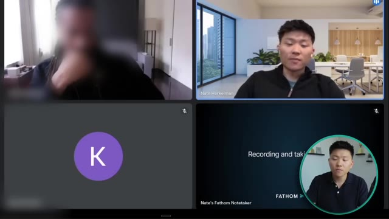
*⏱️ 00:03:42 — Capture d'écran d'une réunion visioconférence (Google Meet) utilisant l'outil Fathom pour la prise de notes automatique, avec le présentateur intégré dans un cercle en bas à droite.*

---

### ⏱️ `[00:03:49 - 00:04:26]` | Segment #09

**🔊 Audio (Transcription Intégrale Mot pour Mot en Français) :**
> In this example, you come to me and say, hey, like, we're interested in this personal assistant. But we, you know, we've seen a lot of use cases. We've worked with a lot of businesses. So we like to be able to say, you know, this is the way that we think you should start to integrate because, you know, this is really just the beginning of AI as far as like getting integrated into businesses and really helping transform a business. so you know the earlier you start the better in six months 12 months like where is the space going to be something that i think about every day um and just being able to start early and building up a foundation so that when these more powerful tools come out we've already got you know a leg up on everyone else so um yeah we we like to sort of that's the way that that i do approach working

**👁️ Analyse Visuelle d'Écran (gemini-3.5-flash-lite) :**
**Interface & Outils** : Google Meet, Fathom (outil de prise de notes automatisé).

**Contenu textuel & Code** : Texte affiché : "Recording and taking".

**Action / Démonstration** : Réunion en cours avec un agent de transcription actif.

---

### ⏱️ `[00:04:26 - 00:05:01]` | Segment #10

**🔊 Audio (Transcription Intégrale Mot pour Mot en Français) :**
> with the client make seeing if it makes sense for both of us to sort of engage in like a partnership i guess you could call it as we're we're sort of like a dedicated team for you and your projects so I guess that leads into my question of you know what are sort of some of your goals with AI integration and AI automation within your business is it kind of like you want this personal assistant and then that's kind of all you're looking for or do you want to see like how we can continue to slowly chip away, chip away, save more time and help you grow at the end of the day. So what I did right there was within the first 10 minutes of the call I wanted to make sure that he understood the way that we work which is not just a one-off project we want to work on a longer term partnership where we're actually

**👁️ Analyse Visuelle d'Écran (gemini-3.5-flash-lite) :**
**Interface & Outils** : Logiciel de visioconférence et outil de prise de notes automatisée (Fathom).

**Contenu textuel & Code** : Aucun contenu technique (code, workflow ou prompt) n'est affiché.

**Action / Démonstration** : Discussion orale sur les objectifs d'intégration de l'IA lors d'un appel client.

---

### ⏱️ `[00:05:01 - 00:05:33]` | Segment #11

**🔊 Audio (Transcription Intégrale Mot pour Mot en Français) :**
> deeply integrated into the business, like I said, understanding their goals, their operations, so that we can help implement solutions where they make sense. If it wasn't clear, this client found me through my YouTube video about a personal assistant, and that's kind of the first functionality he was looking for. And what I ended up asking as my poking question was, are you just looking for this? Are you looking to see how we can help you chip away and chip away and save time over the course of many months? And while that was a good question to ask, it shows two things about the bullishness and also shows some of our value, but I should have tied that a bit more to actual business outcomes by saying, after we nail this first phase with the

**👁️ Analyse Visuelle d'Écran (gemini-3.5-flash-lite) :**
**Interface & Outils** : YouTube (Interface Web)

**Contenu textuel & Code** : Liste de vidéos intitulées : "How I Wish Someone Explained AI Agents To Me", "How to Create an AI Email Agent with n8n", "RAG AI AGENT", "NO CODE AI AGENT", "Personalized Outreach AI Agent", "Inbox Management AI Agent", "How to Build a Google Scraping AI Agent".

**Action / Démonstration** : Navigation sur la page YouTube de la chaîne pour illustrer les contenus passés sur les agents IA.

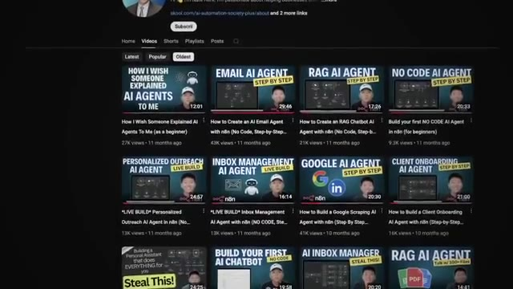
*⏱️ 00:05:09 — Capture d'écran de la section "Vidéos" de la chaîne YouTube de Nate Herk, affichant une grille de miniatures de vidéos traitant d'agents IA et d'automatisation.*

---

### ⏱️ `[00:05:33 - 00:05:56]` | Segment #12

**🔊 Audio (Transcription Intégrale Mot pour Mot en Français) :**
> personal assistant, where's the next area where you'd like to be able to buy back five to 10 hours a week? At the William level, maybe I didn't mention I'm the founder and CEO. So, okay. So if you didn't hear that, he basically just said that he's the founder and CEO of this company, which was great because I didn't even have to ask about that, but it's something I needed to figure out if he was actually in a position to make decisions within the organization and dedicate a budget towards something like this.

**👁️ Analyse Visuelle d'Écran (gemini-3.5-flash-lite) :**
**Interface & Outils** : Navigateur web (page Portfolio d'entreprise) affiché au sein d'une interface de réunion virtuelle.

**Contenu textuel & Code** : Noms d'entreprises : Aria Nova, Open Horizons, Sigma+, Pamoja Prep.

**Action / Démonstration** : Présentation visuelle du portfolio d'une entreprise lors d'une discussion sur le rôle de fondateur/CEO.

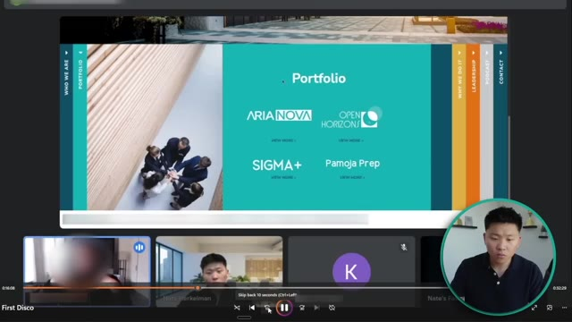
*⏱️ 00:05:39 — Capture d'écran montrant une interface de visioconférence (type Google Meet) affichant une page web "Portfolio" avec les logos d'entreprises comme Aria Nova, Open Horizons, Sigma+ et Pamoja Prep, avec le présentateur en médaillon.*

---

### ⏱️ `[00:05:56 - 00:06:25]` | Segment #13

**🔊 Audio (Transcription Intégrale Mot pour Mot en Français) :**
> So now I've validated that. He's qualified. They're bullish about AI. I'm going to keep going on. But the idea that the operations bot would be able to, again, take the next steps from our meeting notes and either populate them inside of our notion space immediately or would be able to recognize when that stuff has been populated and can then, you know, our operations team can say, hey, tell me all the tasks for Bob.

**👁️ Analyse Visuelle d'Écran (gemini-3.5-flash-lite) :**
**Interface & Outils** : Navigateur web (présentation de site web) intégré dans une interface de visioconférence.

**Contenu textuel & Code** : La page web affiche une section "Portfolio" avec les logos de quatre entités : Aria Nova, Open Horizons, Sigma+ et Pamoja Prep. En bas, on voit les vignettes vidéo des participants, dont Nate Herkelman.

**Action / Démonstration** : Le présentateur partage son écran durant une réunion virtuelle pour illustrer ses propos sur la qualification de prospects.

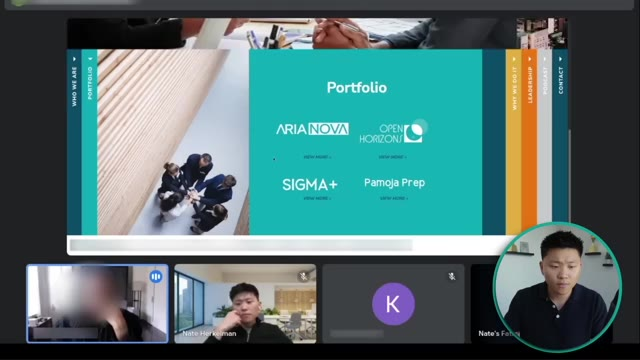
*⏱️ 00:06:03 — Capture d'écran montrant une interface de visioconférence (type Google Meet) avec une présentation en plein écran d'une page web portfolio entreprise.*

---

### ⏱️ `[00:06:26 - 00:06:49]` | Segment #14

**🔊 Audio (Transcription Intégrale Mot pour Mot en Français) :**
> Give me all of Bob's tasks that are due this week, right? Whatever that is. So on one hand, there's workflow efficiency within operations. There's, again, the recall of all of that, just what you would expect. But those are the main domains at the moment. I don't see us having it directly linked into QuickBooks and send out invoices automatically or things like that.

**👁️ Analyse Visuelle d'Écran (gemini-3.5-flash-lite) :**
**Interface & Outils** : Navigateur web (présentant un site vitrine) au sein d'une interface de visioconférence.

**Contenu textuel & Code** : Le site web affiche une section "Portfolio" avec les noms d'entreprises : Aria Nova, Open Horizons, Sigma+, Pamoja Prep.

**Action / Démonstration** : Présentation visuelle ou partage d'écran lors d'une réunion en ligne ; aucune démonstration technique de workflow ou d'automatisation n'est visible.

---

### ⏱️ `[00:06:49 - 00:07:09]` | Segment #15

**🔊 Audio (Transcription Intégrale Mot pour Mot en Français) :**
> We've got other systems to do that stuff. Does that give a good picture? Yeah. Yeah, that's awesome. I mean, you know, typically the first thing we do is we like to break down, because obviously there's multiple pieces. And it seems like the first thing here would, you know, the most important aspect is always, how can we get all the information that you have into the database so that the agent has context of everything that's going on?

**👁️ Analyse Visuelle d'Écran (gemini-3.5-flash-lite) :**
**Interface & Outils** : Navigateur web (page de portfolio) et plateforme de visioconférence (Google Meet ou similaire).

**Contenu textuel & Code** : Interface utilisateur affichant une grille de portfolio d'entreprise avec des sections "Who we are", "Portfolio", "Why we do it", "Leadership", "Podcast", "Contact".

**Action / Démonstration** : Présentation visuelle et partage d'écran lors d'une session de conseil ou de démonstration client.

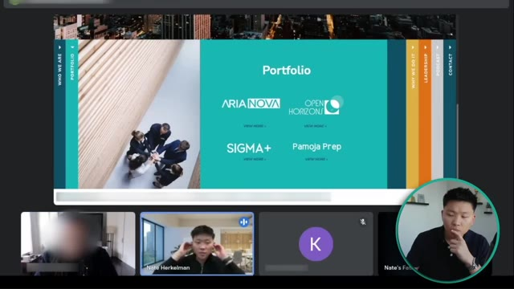
*⏱️ 00:06:54 — Une capture d'écran montrant une page web de "Portfolio" avec les logos d'entreprises (Aria Nova, Open Horizons, Sigma+, Pamoja Prep) intégrée dans une interface de réunion vidéo type Google Meet.*

---

### ⏱️ `[00:07:09 - 00:07:29]` | Segment #16

**🔊 Audio (Transcription Intégrale Mot pour Mot en Français) :**
> You know, data and context are the two most important things, especially with something like a personal assistant. Yep. So, yeah, it would really be diving into the different integrations you have, all the data. And then first aspect is, can we get that into some sort of database for you? So that it's in, you know, in an optimal way so that the agent's able to recall all that information whenever it's prompted to do.

**👁️ Analyse Visuelle d'Écran (gemini-3.5-flash-lite) :**
**Interface & Outils** : Interface de visioconférence (Google Meet) et application de prise de notes assistée par IA (Fathom).

**Contenu textuel & Code** : Texte minimal visible : "Recording and taking..." associé au logo de Fathom.

**Action / Démonstration** : Aucune démonstration technique ou graphique n'est présente ; il s'agit d'un appel vidéo standard en cours d'enregistrement.

---

### ⏱️ `[00:07:30 - 00:07:51]` | Segment #17

**🔊 Audio (Transcription Intégrale Mot pour Mot en Français) :**
> And then, you know, figuring out some sort of automated system so that whenever you change information, whenever you have new stuff you upload in there, that that process all takes place, you know, in the back end for you as well. So, yeah, another question I had was how big is the organization and like what does that operational piece look like when it comes to, you know, the next phase is where we're trying to help automate some of those interactions as well.

**👁️ Analyse Visuelle d'Écran (gemini-3.5-flash-lite) :**
**Interface & Outils** : Google Meet, Fathom (assistant de prise de notes).

**Contenu textuel & Code** : Texte affiché : "Recording and taking notes", logo Fathom.

**Action / Démonstration** : Réunion en cours avec enregistrement actif via un outil d'IA tiers.

---

### ⏱️ `[00:07:51 - 00:08:14]` | Segment #18

**🔊 Audio (Transcription Intégrale Mot pour Mot en Français) :**
> I don't love what I just did there. What happened was he talked for a while about some of the operations or some of the different departments and what he would be looking for out of his assistant. So just dove more into the scope of this first phase. And he talked about a lot of things. He talked about a ton of different tasks that he would use the assistant for. And rather than me poking more at that pain point, I basically said, OK, I hear you.

**👁️ Analyse Visuelle d'Écran (gemini-3.5-flash-lite) :**
**Interface & Outils** : n8n (workflow automation), Slack.

**Contenu textuel & Code** : Prompt système n8n : "You are an expert AI automation developer specializing in building workflows for n8n. Your job is to transform human's natural language request into a fully structured workflow JSON."

**Action / Démonstration** : Rédaction/Configuration d'un prompt d'instruction pour un agent dans n8n ; navigation dans l'interface de messagerie Slack.

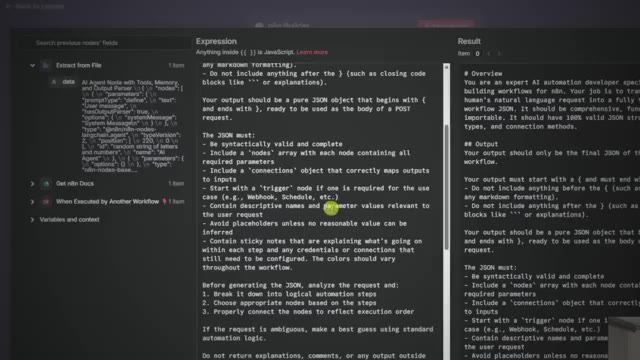
*⏱️ 00:07:57 — Interface n8n affichant un éditeur de texte contenant un prompt système complexe pour le développement de workflows d'agents IA.*

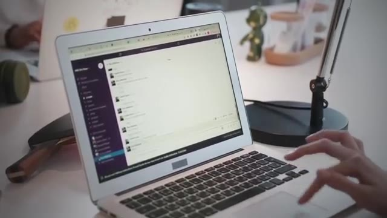
*⏱️ 00:08:03 — Gros plan sur un écran d'ordinateur portable montrant l'interface Slack utilisée pour la communication d'équipe.*

---

### ⏱️ `[00:08:14 - 00:08:47]` | Segment #19

**🔊 Audio (Transcription Intégrale Mot pour Mot en Français) :**
> And then I tried to prove expertise. That's what I was doing there as I tried to throw out that stuff about the vector database and building an automated pipeline To convince him that I knew what I was talking about and that I was the right fit for him That was not a bad thing to do But what I should have done before that was say okay You just told me all of these processes that you want this personal assistant to be able to do for you How valuable is that how many hours is that gonna save you and what that's doing is it's making the ROI clear It's also quantifying his pain and bringing more light to it And then it anchors the price and allows me to go even higher Another good question would have been, since you're saving two to three hours a week with this new assistant,

**👁️ Analyse Visuelle d'Écran (gemini-3.5-flash-lite) :**
**Interface & Outils** : Logiciel de montage graphique (type After Effects ou Canva pour animation de présentation).

**Contenu textuel & Code** : Schéma d'architecture d'un agent IA : icône centrale d'agent reliée à des symboles d'e-mail, de recherche, de ciblage et de gestion de tâches.

**Action / Démonstration** : Présentation visuelle d'un diagramme de workflow automatisé pour illustrer les capacités de l'agent IA.

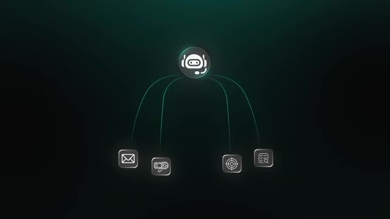
*⏱️ 00:08:30 — Un schéma graphique animé représentant un agent IA central connecté à quatre icônes distinctes illustrant des fonctionnalités de flux de travail.*

---

### ⏱️ `[00:08:47 - 00:09:08]` | Segment #20

**🔊 Audio (Transcription Intégrale Mot pour Mot en Français) :**
> what can you dedicate those two or three hours to? And by putting the client in that position where they're thinking about that and they're imagining a world where they have five extra hours a week indefinitely, it just opens up some cool ways to keep the conversation going. So you're pretty eager to get this get this out there. Yeah, and it's just it just comes down to the integrations I had in my video was like it was Gmail and calendar and that's pretty much it.

**👁️ Analyse Visuelle d'Écran (gemini-3.5-flash-lite) :**
**Interface & Outils** : Google Meet, Fathom (outil de prise de notes IA).

**Contenu textuel & Code** : Texte affiché dans l'outil Fathom : "Recording and taking notes", "Nate's Fathom Notetaker".

**Action / Démonstration** : Utilisation d'un agent IA (Fathom) pour l'enregistrement et la transcription automatique durant un appel client.

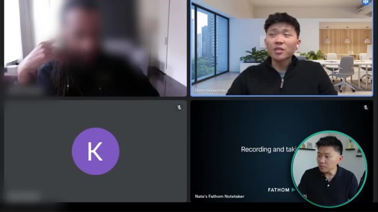
*⏱️ 00:09:03 — Capture d'une réunion vidéo (type Google Meet) montrant le présentateur dans un cadre, un interlocuteur flouté, une icône utilisateur, et une fenêtre de l'outil "Fathom" notant la réunion.*

---

### ⏱️ `[00:09:08 - 00:09:40]` | Segment #21

**🔊 Audio (Transcription Intégrale Mot pour Mot en Français) :**
> I mean, I had to send a Slack message, but there's so many more actions in Slack besides just sending a message. you want to be able to search through there I'm sure you want to be able to recall certain information and the same thing with gmail you want to be able to not just send an email or get emails you want to be able to reply to drafts or reply to threads create drafts label emails delete emails move them around mark the spam whatever it is so we want to be able to make sure you have every single action and every action in a you know every action we add is another layer of in the prompting we need to make sure that the agent understands what to do when to do when to do it and how to do it So, yeah.

**👁️ Analyse Visuelle d'Écran (gemini-3.5-flash-lite) :**
**Interface & Outils** : Logiciel de visioconférence et outil de prise de notes assistée par IA (Fathom).

**Contenu textuel & Code** : Texte affiché à l'écran : "Recording and taking", "Nate's Fathom Notetaker".

**Action / Démonstration** : Aucune action technique ou démonstration de workflow n'est présentée ; il s'agit d'une discussion en direct entre participants.

---

### ⏱️ `[00:09:41 - 00:10:06]` | Segment #22

**🔊 Audio (Transcription Intégrale Mot pour Mot en Français) :**
> And the truth is, really quick, I don't actually need all of those. I've got a labeling system. I kind of use it. I'm going to probably use it better. And I know that there's a way to have the AI automatically apply labels based off of what it thinks, but that could also be a little bit of danger. I think I'm a bit fan of artificial intelligence, and we're in day one of whatever this thing is going to be.

**👁️ Analyse Visuelle d'Écran (gemini-3.5-flash-lite) :**
**Interface & Outils** : Logiciel de visioconférence (type Google Meet/Zoom) avec l'intégration de l'application Fathom Notetaker.

**Contenu textuel & Code** : Texte affiché dans la fenêtre Fathom : "Recording and taking..." ; mention "Nate's Fathom Notetaker" en bas à gauche de la fenêtre de partage.

**Action / Démonstration** : Session de visioconférence en cours avec enregistrement automatique par un agent IA (Fathom) pour la prise de notes.

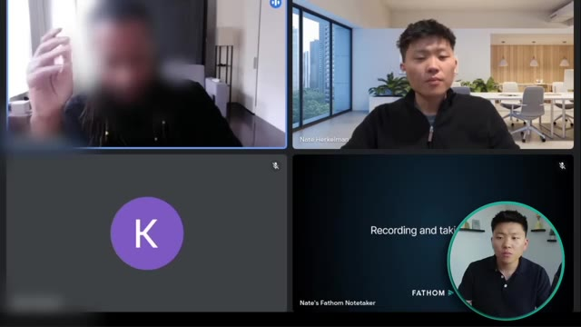
*⏱️ 00:09:47 — Capture d'écran d'une réunion en visioconférence montrant deux participants principaux et une fenêtre intégrée de l'outil Fathom.*

---

### ⏱️ `[00:10:06 - 00:10:40]` | Segment #23

**🔊 Audio (Transcription Intégrale Mot pour Mot en Français) :**
> um but i also am not quite i think that anything that it does needs to be vetted um 100 like it's only the lowest stakes emails where i would say just respond to so and so right like the it's always going to be drop it in drugs right yes you're 100 correct i agree and um you know i'm working through a project right now where you know we're doing automated research which is great um and then from there taking that research and creating like linkedin posts and blogs and i I told the client, I was like, how about we drop all these into a spreadsheet for you?

**👁️ Analyse Visuelle d'Écran (gemini-3.5-flash-lite) :**
**Interface & Outils** : Google Meet, Fathom (logiciel de prise de notes).

**Contenu textuel & Code** : Interface de réunion vidéo standard, texte "Recording and taking notes" et logo Fathom dans la vignette du bot de transcription.

**Action / Démonstration** : Aucune démonstration technique ou outil d'automatisation n'est visible ; il s'agit d'un appel vidéo statique.

---

### ⏱️ `[00:10:40 - 00:10:59]` | Segment #24

**🔊 Audio (Transcription Intégrale Mot pour Mot en Français) :**
> So you're able to go in there and, you know, basically just every week we'll have like those three automated posts. But we don't want to just post them on your LinkedIn. You know, you just never know. You know, it's consistent. It's been cool. And also an aspect that we're trying to add in is AI generated images, infographics for the LinkedIn posts. And especially with those, you want to make sure those are checked as well.

**👁️ Analyse Visuelle d'Écran (gemini-3.5-flash-lite) :**
**Interface & Outils** : Google Meet, Fathom Notetaker.

**Contenu textuel & Code** : Texte affiché : "Recording and taking notes" et le logo Fathom.

**Action / Démonstration** : Aucune action technique ou manipulation d'outil d'automatisation n'est visible.

---

### ⏱️ `[00:11:00 - 00:11:20]` | Segment #25

**🔊 Audio (Transcription Intégrale Mot pour Mot en Français) :**
> Obviously, we'll get to a space. I don't know if you played around the store at all, but that's been really cool. But, you know, it just gets smarter exponentially every day, which is cool. Man, that's kind of cool to see because I remember thinking to myself, I can't wait till image generation gets good enough for being able to confidently make some graphics to post on LinkedIn and stuff. It wasn't there yet, but that's beside the point.

**👁️ Analyse Visuelle d'Écran (gemini-3.5-flash-lite) :**
**Interface & Outils** : Outil de génération d'images par IA (type galerie de résultats).

**Contenu textuel & Code** : Galerie d'images générées : style artistique (Van Gogh/ville nocturne), scène réaliste de rue, portrait haute couture.

**Action / Démonstration** : Démonstration des capacités de génération visuelle d'un modèle d'IA.

*⏱️ 00:11:15 — Présentation visuelle de trois exemples distincts d'images générées par IA : un paysage urbain de nuit, une scène de rue animée, et un portrait de mode stylisé.*

---

### ⏱️ `[00:11:20 - 00:11:39]` | Segment #26

**🔊 Audio (Transcription Intégrale Mot pour Mot en Français) :**
> What happened there was this also just validated to me that this person is very, very realistic about AI. And I really liked that because that helps me not have to worry about managing expectations. have to set expectations and hold up to certain expectations, but we don't have to play that game of making sure that we're bringing them back down to earth. I guess I have two questions.

**👁️ Analyse Visuelle d'Écran (gemini-3.5-flash-lite) :**
**Interface & Outils** : Aucune interface logicielle ou outil technique n'est présent.

**Contenu textuel & Code** : Aucun contenu technique, code ou diagramme n'est affiché.

**Action / Démonstration** : Aucune action technique n'est montrée ; il s'agit d'une séquence de type "talking head" (plan fixe sur le présentateur).

---

### ⏱️ `[00:11:39 - 00:11:58]` | Segment #27

**🔊 Audio (Transcription Intégrale Mot pour Mot en Français) :**
> One is your buckets of hours, I guess. What are those tiers? Is it, I don't know, 20 for like $20,000? I mean, I'm throwing numbers at it, but what does that break down to? Yeah, so the first one is going to be 4.5K for the 20 hours and then 8K for 40 hours.

**👁️ Analyse Visuelle d'Écran (gemini-3.5-flash-lite) :**
**Interface & Outils** : Plateforme de visioconférence et outil de prise de notes automatisé Fathom.

**Contenu textuel & Code** : L'écran affiche les vignettes des participants et une fenêtre Fathom indiquant "Recording and taking notes".

**Action / Démonstration** : Réunion en cours avec enregistrement automatique par l'IA Fathom ; aucune démonstration technique ou graphique n'est présente à cet instant.

---

### ⏱️ `[00:11:58 - 00:12:28]` | Segment #28

**🔊 Audio (Transcription Intégrale Mot pour Mot en Français) :**
> like that's something where you can build out a version of your personal assistant ai providing we're able to get you you know everything you need in a timely manner you know login information jv basic i don't know api links whatever that is yeah i like i said it's impossible to estimate but i i really i do think so um considering like i said the toughest part here is going to be understanding where data is coming from and how to make that automated.

**👁️ Analyse Visuelle d'Écran (gemini-3.5-flash-lite) :**
**Interface & Outils** : Outil de visioconférence et application de prise de notes automatisée (Fathom).

**Contenu textuel & Code** : Texte affiché : « Recording and taking notes » et « Nate's Fathom Notetaker ».

**Action / Démonstration** : Aucune démonstration technique ou logicielle ; il s'agit d'un plan statique montrant les intervenants lors d'une réunion.

---

### ⏱️ `[00:12:29 - 00:12:56]` | Segment #29

**🔊 Audio (Transcription Intégrale Mot pour Mot en Français) :**
> That usually is the biggest chunk is setting up that foundation because that's the most important part. And then from there, once we are able to connect all the systems, which in this case, the integration don't seem like it'll be too challenging. It just seems more like the end 20 piece, 20% again, will be the prompting and testing where that's the only, that's the only area where I could really see any spill over would be the, the basically refining to make sure that this thing's 100% ready to go for you.

**👁️ Analyse Visuelle d'Écran (gemini-3.5-flash-lite) :**
**Interface & Outils** : Plateforme de visioconférence et application de prise de notes automatisée (Fathom).

**Contenu textuel & Code** : Texte affiché : "Recording and taking notes" et logo "FATHOM".

**Action / Démonstration** : Utilisation d'un assistant IA pour l'enregistrement et la transcription automatique de la réunion.

---

### ⏱️ `[00:12:56 - 00:13:16]` | Segment #30

**🔊 Audio (Transcription Intégrale Mot pour Mot en Français) :**
> Okay. So I don't love what just happened there. And let me explain why. Ultimately, when you get to the end of that first call, the question is going to start to come up in the client's mind of, you know, I wonder how much this is going to cost me or how expensive it is to work with this person. And so the client asked me basically like how we work. And we talked about different models and we ended up considering maybe just kind of working together for 20 hours.

**👁️ Analyse Visuelle d'Écran (gemini-3.5-flash-lite) :**
**Interface & Outils** : Aucune interface logicielle ou outil technique n'est affiché dans ces segments.

**Contenu textuel & Code** : Aucun code, commande, prompt ou donnée n'est visible.

**Action / Démonstration** : Aucune action d'automatisation ou de démonstration technique n'est effectuée.

---

### ⏱️ `[00:13:16 - 00:13:37]` | Segment #31

**🔊 Audio (Transcription Intégrale Mot pour Mot en Français) :**
> And so naturally the question is, well, do you think you can get this done for me in 20 hours? First of all, I think that maybe you should only use an hourly model if you're first starting out and you need to get experience, and that is a safer investment for the client. But like I've talked about many times before, you don't want to be tying yourself to an hourly rate because that's just, you're putting yourself in a box. But pricing aside, what I should have done here, I should have just not answered the question.

**👁️ Analyse Visuelle d'Écran (gemini-3.5-flash-lite) :**
**Interface & Outils** : AUCUNE

**Contenu textuel & Code** : AUCUN

**Action / Démonstration** : AUCUNE

---

### ⏱️ `[00:13:37 - 00:13:56]` | Segment #32

**🔊 Audio (Transcription Intégrale Mot pour Mot en Français) :**
> I don't think there's anything wrong with saying, you know, the point of this call and the next discovery call is to scope out the build to a point where I feel comfortable with everything that we need to be able to do for it. Because at this point, I have no idea how much data he even has that he's expecting this agent to have access to. And I've even said in this call, probably two or three times, the data is the most important part.

**👁️ Analyse Visuelle d'Écran (gemini-3.5-flash-lite) :**
**Interface & Outils** : Aucune interface logicielle ou outil technique n'est affiché.

**Contenu textuel & Code** : Aucun code, aucune commande ni aucune donnée technique ne sont visibles.

**Action / Démonstration** : Le présentateur s'exprime verbalement et utilise des gestes des mains pour appuyer son discours sur la méthodologie de gestion de projet.

---

### ⏱️ `[00:13:56 - 00:14:15]` | Segment #33

**🔊 Audio (Transcription Intégrale Mot pour Mot en Français) :**
> That's what takes the longest is getting all of that right so that the agent has all the context it needs to actually perform. And without understanding what the data looks like, how much it is, the format, where it lives, I should not have been saying anything about how quickly I could get a POC spun up or if I could deliver in a month. Like I said, anything that pops into mind before our next call too, we can bring there.

**👁️ Analyse Visuelle d'Écran (gemini-3.5-flash-lite) :**
**Interface & Outils** : Aucune interface logicielle ou outil de développement n'est visible dans ce segment.

**Contenu textuel & Code** : Aucun code, commande ou donnée affiché.

**Action / Démonstration** : Le présentateur s'exprime verbalement devant la caméra sans manipuler d'interface.

---

### ⏱️ `[00:14:15 - 00:14:39]` | Segment #34

**🔊 Audio (Transcription Intégrale Mot pour Mot en Français) :**
> and yeah, just dive into it. And that way we'll be able to bring you like a very outlined build strategy, a very outlined wireframe of what we think the build will look like. That will also contain our estimated timelines on that for each step of the build. And the main thing I want to talk about for the next one will be, you know, besides those integrations, will be what your data looks like, where it's kept and how we want to get it in there.

**👁️ Analyse Visuelle d'Écran (gemini-3.5-flash-lite) :**
**Interface & Outils** : Google Meet, Fathom (logiciel de prise de notes).

**Contenu textuel & Code** : Texte affiché : "Recording and taking notes" et "Nate's Fathom Notetaker".

**Action / Démonstration** : Aucune action technique ou démonstration logicielle pertinente n'est effectuée ; il s'agit d'une interface de réunion en cours.

---

### ⏱️ `[00:14:39 - 00:15:11]` | Segment #35

**🔊 Audio (Transcription Intégrale Mot pour Mot en Français) :**
> So, yeah. Yeah. Well, so let's quickly, what about um yeah what's your Friday the plan okay so at this point I basically concluded by saying what I should have said earlier which is we still need a lot of scoping around the data so you can see I ended off the call that way and now what we're doing is we spend that last minute coordinating our schedules and booking in a time so that's a great thing you want to try to do is at the end of the first discovery call just book in a call while you're both still on the call and then at the end of the second call try to book in the third call while you're both still on the call but that's kind of how I wrapped this one up and now I have some information to head into the

**👁️ Analyse Visuelle d'Écran (gemini-3.5-flash-lite) :**
**Interface & Outils** : Superposition graphique (Overlay) de workflow de rendez-vous.

**Contenu textuel & Code** : Liste de deux appels de 30 minutes.

**Action / Démonstration** : Illustration visuelle du processus de planification des réunions évoqué dans la discussion.

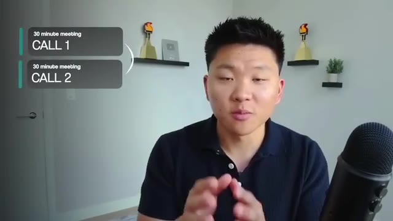
*⏱️ 00:15:03 — Le présentateur est face caméra, avec une incrustation graphique à gauche listant deux étapes : "30 minute meeting CALL 1" et "30 minute meeting CALL 2".*

---

### ⏱️ `[00:15:11 - 00:15:48]` | Segment #36

**🔊 Audio (Transcription Intégrale Mot pour Mot en Français) :**
> next one with but I don't have enough yet to give a price or like I said realistic timelines. How are you? I'm doing well. Doing well actually just uh just got into uh I just drove like three hours in the snow. I was I was I was thinking I might have to uh email you guys and say hey I might be a few minutes late because I didn't expect the roads to be so so bad especially I got up and left at like six but I made it just in time so doing well. How about you guys? Classic Nate trying to be charming trying to build rapport but now let's actually get into the meat and potatoes of the strategy call the process of still scoping out a build it's about the questions you ask and about the

**👁️ Analyse Visuelle d'Écran (gemini-3.5-flash-lite) :**
**Interface & Outils** : Aucune interface logicielle, éditeur de code ou outil d'automatisation n'est visible dans ces images.

**Contenu textuel & Code** : Aucun code, commande, prompt ou donnée technique n'est affiché.

**Action / Démonstration** : Aucune action technique ou démonstration de workflow n'est effectuée ; il s'agit d'une séquence de discussion conversationnelle.

---

### ⏱️ `[00:15:48 - 00:16:22]` | Segment #37

**🔊 Audio (Transcription Intégrale Mot pour Mot en Français) :**
> the way we talk about um just like the goals so i'm glad that you have that that sort of mindset here um awesome and so yeah as long as it goes too i don't know so i don't i'm not a database guy i don't know i don't know how that works period like i i learned about a vector database from your videos that's how you uh and don't be wrong your video was great but like i still don't know what the fuck a factor of a base is in short it's they're confusing yeah and honestly like this is something that i tell people um i feel like i've got a good grasp on it but there's still so

**👁️ Analyse Visuelle d'Écran (gemini-3.5-flash-lite) :**
**Interface & Outils** : Logiciel de visioconférence (inconnu) et interface de lecteur vidéo.

**Contenu textuel & Code** : Aucun contenu technique ou code visible, uniquement des flux vidéo de participants.

**Action / Démonstration** : Discussion en direct entre les participants.

---

### ⏱️ `[00:16:22 - 00:16:58]` | Segment #38

**🔊 Audio (Transcription Intégrale Mot pour Mot en Français) :**
> much um under the hood that i don't get yet so much math that goes into it and basically what i tell people is i understand maybe about 80 percent and that 80 percent allows me to get your agents to work but i don't need to understand the formulas and the math and all of the deep the deep down embeddings um but i i think i understand them well enough to be able to back metadata filter through things understand how to do it optimally and like you were talking about have a big social database but maybe not having every agent have access to the entire thing but pieces of it and be able to filter and retrieve through certain sections which is super cool so that's um i've been

**👁️ Analyse Visuelle d'Écran (gemini-3.5-flash-lite) :**
**Interface & Outils** : Plateforme de visioconférence (type Google Meet) avec intégration de l'outil Fathom.

**Contenu textuel & Code** : Interface de réunion avec vignettes vidéo, initiales des participants et le texte "Recording and taking notes" sur la vignette du bot Fathom.

**Action / Démonstration** : Réunion en cours avec un agent IA (Fathom) actif pour la transcription et l'enregistrement de la session.

---

### ⏱️ `[00:16:58 - 00:17:31]` | Segment #39

**🔊 Audio (Transcription Intégrale Mot pour Mot en Français) :**
> pretty loyal to pine cone with that right now but um i've been exploring some of the other vector databases like Supabase and Quadrant. Because yeah, you know, it's those things where right now I've been loyal to OpenAI, NADN, Pinecone, but that could change. You know, Vappy has been also our voice agent go-to. Okay, so that was a bit of a good and bad mix. I was able to relate to the client and we kind of had a laugh about the technicalities of vector databases, but I don't love the rest of the piece of what I said because that could instill some doubt in the client. So

**👁️ Analyse Visuelle d'Écran (gemini-3.5-flash-lite) :**
**Interface & Outils** : Aucune (plateforme de visioconférence et flux vidéo personnel).

**Contenu textuel & Code** : Aucun contenu technique (code, diagramme ou données) visible.

**Action / Démonstration** : Aucune action technique n'est démontrée ; il s'agit d'une séquence de discussion conversationnelle.

---

### ⏱️ `[00:17:31 - 00:18:05]` | Segment #40

**🔊 Audio (Transcription Intégrale Mot pour Mot en Français) :**
> what I should have done was taken a technical concept like the things that happen under the hood of a vector database and just transformed that and communicated that into business value. So instead of saying, I understand 80%, which is enough to get your agents to work, I should have said, yeah, completely hear you there. Vector databases are pretty technical, but here's why it should matter to you. And here's like what we need to do with it. It's going to let your agents be able to accurately search through tons and tons of stuff quicker. It's going to be cheaper than if we basically made your agent read through all of your documents every single time. And so that would have probably clicked with the client a lot better on a personal basis probably is that's

**👁️ Analyse Visuelle d'Écran (gemini-3.5-flash-lite) :**
**Interface & Outils** : Aucune interface logicielle montrée.

**Contenu textuel & Code** : Texte "BUSINESS VALUE" et icône de croissance graphique.

**Action / Démonstration** : Aucune manipulation logicielle ou démonstration technique.

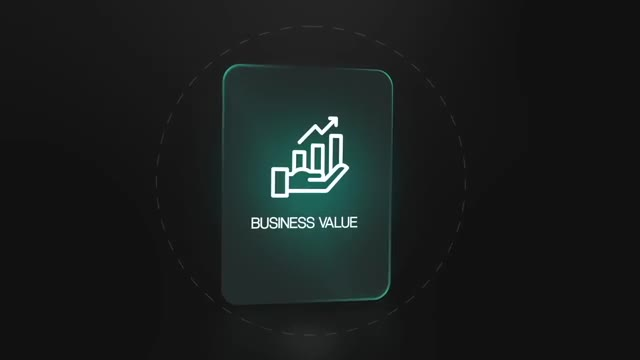
*⏱️ 00:17:40 — Un graphique montrant une main tenant des barres de croissance avec le texte "BUSINESS VALUE".*

---

### ⏱️ `[00:18:05 - 00:18:37]` | Segment #41

**🔊 Audio (Transcription Intégrale Mot pour Mot en Français) :**
> where i think reality is going but certainly in sci-fi dystopia right each each mega corporation has its own ai um and i bet you where we're going in this reality is that the ai are just going to start talking to each other we're already seeing that in social media anyway completely agree And one way that I talk to my partners about this kind of stuff is like, we're basically trying to create like interns where you can tell them like what to do sort of thing.

**👁️ Analyse Visuelle d'Écran (gemini-3.5-flash-lite) :**
**Interface & Outils** : Logiciel de visioconférence intégrant Fathom (outil d'IA pour réunions).

**Contenu textuel & Code** : Texte affiché à l'écran : "Recording and taking notes" et "Nate's Fathom Notetaker".

**Action / Démonstration** : L'agent IA Fathom est en cours d'exécution pour capturer et transcrire la réunion en temps réel.

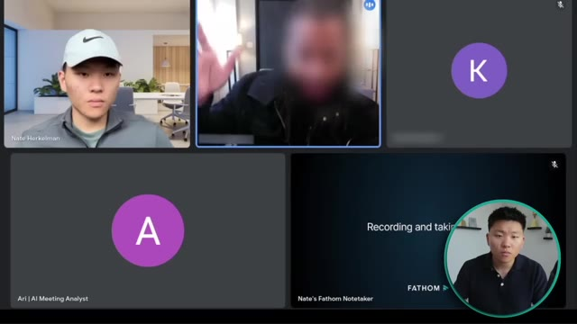
*⏱️ 00:18:13 — Capture d'écran d'une réunion en visioconférence montrant l'interface de l'agent "Fathom" utilisé pour la prise de notes automatisée.*

---

### ⏱️ `[00:18:37 - 00:18:58]` | Segment #42

**🔊 Audio (Transcription Intégrale Mot pour Mot en Français) :**
> They'll compile stuff. It's not always going to be perfect, but they get you started. You're able to give feedback and they'll kind of go back and do it again and talk to these other people about it. And yeah, like you said, agents that can talk to each other and talk to each other hands off is the goal. And, you know, that's the kind of stuff that happens in workflows already is like just agents pass data between each other.

**👁️ Analyse Visuelle d'Écran (gemini-3.5-flash-lite) :**
**Interface & Outils** : Interface de visioconférence et logiciel de prise de notes assisté par IA (Fathom).

**Contenu textuel & Code** : Noms des participants (Nate Herkelman, Ari), initiales, et texte mentionnant "Recording and taking notes" pour l'outil Fathom.

**Action / Démonstration** : Aucune action technique ou manipulation d'agent IA montrée, il s'agit d'une simple vue de réunion.

---

### ⏱️ `[00:18:58 - 00:19:17]` | Segment #43

**🔊 Audio (Transcription Intégrale Mot pour Mot en Français) :**
> And something that I've been doing a lot recently with my agents is I have them talk to each other. And like if it's not good enough, they'll send it back. So some like this agent will send over like a newsletter article to this other guy. And then this agent will read it and send like some information to a different one that will like check it. And then this agent, if it's not good enough, it'll send it back to start.

**👁️ Analyse Visuelle d'Écran (gemini-3.5-flash-lite) :**
**Interface & Outils** : Plateforme de visioconférence intégrant l'outil "Fathom".

**Contenu textuel & Code** : L'interface affiche les noms des participants et le statut "Recording and taking notes" pour le compte Fathom. Aucun workflow d'agent ou code source n'est visible.

**Action / Démonstration** : Réunion en cours avec enregistrement actif par un agent IA de transcription (Fathom).

---

### ⏱️ `[00:19:17 - 00:19:36]` | Segment #44

**🔊 Audio (Transcription Intégrale Mot pour Mot en Français) :**
> And they'll just continue down that process until the final checking agent said it's good enough to go. And then that's when I get to see that output, which is really cool. Let's bookmark that. That's fantastic. Um, so one space, one space where I'm a bottleneck is in our writing space.

**👁️ Analyse Visuelle d'Écran (gemini-3.5-flash-lite) :**
**Interface & Outils** : Plateforme de visioconférence et interface de l'outil de transcription/prise de notes Fathom.

**Contenu textuel & Code** : Aucune donnée technique, code ou workflow n'est visible ; l'écran affiche uniquement des vignettes de vidéo de participants et une interface de réunion.

**Action / Démonstration** : Aucune action technique ou démonstration de flux de travail automatisé n'est illustrée dans cette capture.

---

### ⏱️ `[00:19:36 - 00:19:57]` | Segment #45

**🔊 Audio (Transcription Intégrale Mot pour Mot en Français) :**
> Okay. That was pretty cool because what I did was I listened to him and I basically like threw in some insight from some other products that I've worked on with having agents kind of use like an LLM as a judge. And he loved it. You could see, he said, let's bookmark that. Um, and he was very excited about that. But then I miss out on an opportunity here because he literally explicitly said to me one area where we have a bottleneck and then he starts talking about it.

**👁️ Analyse Visuelle d'Écran (gemini-3.5-flash-lite) :**
**Interface & Outils** : n8n (outil d'automatisation de workflow).

**Contenu textuel & Code** : Workflow automatisé incluant : Webhook, nœud "Ultimate Assistant", et des sous-nœuds connectés (GPT 4.1-mini, Simple Memory, Think, Email Agent, Calendar Agent, Contact Agent).

**Action / Démonstration** : Visualisation et configuration d'un agent IA structuré au sein de l'éditeur visuel n8n.

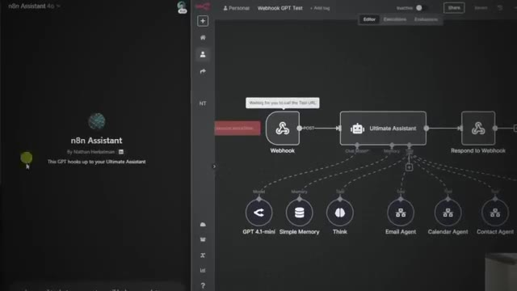
*⏱️ 00:19:41 — Interface n8n affichant un diagramme de workflow complexe pour un "Ultimate Assistant" avec des nœuds connectés à divers agents (Email, Calendrier, Contact).*

---

### ⏱️ `[00:19:57 - 00:20:18]` | Segment #46

**🔊 Audio (Transcription Intégrale Mot pour Mot en Français) :**
> But I never go back and address that bottleneck by saying, how many hours a week are you losing because of that bottleneck? Or what would the value be if we could actually use AI and use automation to get rid of that bottleneck? And then once again, we're just poking the pain points and we're shedding more light on them. So it becomes very clear for the client. Having agents check at every step before it passes through, it really opened my eyes.

**👁️ Analyse Visuelle d'Écran (gemini-3.5-flash-lite) :**
**Interface & Outils** : AUCUNE

**Contenu textuel & Code** : Texte incrusté dans des bulles de type messagerie : "How many hours a week are you losing because of that bottleneck" et "What would the value be if we can actually use AI and use automation to get rid of the bottleneck".

**Action / Démonstration** : Aucune manipulation logicielle ou technique montrée.

---

### ⏱️ `[00:20:18 - 00:20:37]` | Segment #47

**🔊 Audio (Transcription Intégrale Mot pour Mot en Français) :**
> And then I saw just the power of, I think that's where agents are able to get smarter too, because they have that memory and they can see what didn't work and what did pass. and just continue to get smarter and smarter as we sort of adjust the prompts and all that. So yeah, definitely cool stuff that we could work on in the future as this kind of stuff gets smarter.

**👁️ Analyse Visuelle d'Écran (gemini-3.5-flash-lite) :**
**Interface & Outils** : Plateforme de visioconférence.

**Contenu textuel & Code** : N/A (uniquement des vignettes vidéo de participants).

**Action / Démonstration** : Discussion en cours entre les participants sans démonstration visuelle à l'écran.

---

### ⏱️ `[00:20:37 - 00:21:00]` | Segment #48

**🔊 Audio (Transcription Intégrale Mot pour Mot en Français) :**
> It's just so exciting. But yeah, well, I wanted to, one thing I wanted to dive into today would be specifically the inputs that you're looking to have into the big overall database. What those inputs look like, specifically the integrations And then like how often do we need to be able to feed in, you know, dynamically?

**👁️ Analyse Visuelle d'Écran (gemini-3.5-flash-lite) :**
**Interface & Outils** : Logiciel de visioconférence.

**Contenu textuel & Code** : Noms des participants (Nate Herkelman, Ari | AI Meeting Analyst, Nate's Fathom Notetaker) et logos de services de prise de notes.

**Action / Démonstration** : Conversation en cours entre plusieurs personnes dans le cadre d'une réunion.

---

### ⏱️ `[00:21:00 - 00:21:20]` | Segment #49

**🔊 Audio (Transcription Intégrale Mot pour Mot en Français) :**
> Is it every day will we have new stuff to feed in every week, every month? What does that sort of look like? So what I did right there is I tried to bring the conversation from kind of a fun use case, which actually is the bottleneck that I maybe should have been poking out a little more. But I tried to bring it back to the initial conversation where I needed to really scope out how much data that he has and the frequency of updates and deletions and stuff like that.

**👁️ Analyse Visuelle d'Écran (gemini-3.5-flash-lite) :**
**Interface & Outils** : Aucune interface logicielle ou technique n'est affichée.

**Contenu textuel & Code** : Texte incrusté à l'écran (overlay) : "FUN USE CASES" et "SCOPING".

**Action / Démonstration** : Le présentateur illustre ses propos par des gestes manuels tout en introduisant des concepts textuels à l'écran pour structurer son discours.

---

### ⏱️ `[00:21:20 - 00:21:55]` | Segment #50

**🔊 Audio (Transcription Intégrale Mot pour Mot en Français) :**
> So now I let him talk for a while. I listen and then I follow up about that. For the most part, it's Dropbox, Notion, Slack, Gmail, and yeah, otherwise AWS. So, you know, at some point, I think it'd be great to have Ari's output, just like a wet scraping, you know, if we can have it listen to a YouTube video and pull a transcript and summarize, for example, or if it can, you know, scrape a website or and say like, oh, hey, this is what Deloitte does about themselves, right?

**👁️ Analyse Visuelle d'Écran (gemini-3.5-flash-lite) :**
**Interface & Outils** : Logiciel de visioconférence (non spécifique).

**Contenu textuel & Code** : Aucun contenu technique (code ou workflow).

**Action / Démonstration** : Discussion en visioconférence entre plusieurs participants.

---

### ⏱️ `[00:21:55 - 00:22:15]` | Segment #51

**🔊 Audio (Transcription Intégrale Mot pour Mot en Français) :**
> And we can figure out, because then obviously we can do something with that information. So some capability to interact with a website. This isn't a tool, but it is the last thing that's on my mind is like citations that link to where it found that stuff. That would be really, really helpful from. Yeah, yeah, 100%.

**👁️ Analyse Visuelle d'Écran (gemini-3.5-flash-lite) :**
**Interface & Outils** : Interface de visioconférence (Google Meet).

**Contenu textuel & Code** : Aucun contenu technique (code, diagramme ou interface d'agent).

**Action / Démonstration** : Réunion en ligne, le présentateur discute sans support visuel technique.

---

### ⏱️ `[00:22:15 - 00:22:48]` | Segment #52

**🔊 Audio (Transcription Intégrale Mot pour Mot en Français) :**
> That's definitely possible. One of the products I'm actually working on right now. Don't love that. He just spent 10 minutes talking about the data sources and transformation that they're looking to automate. He ends his kind of breakdown with literally saying that would be really helpful for me. And I say, oh, okay, gotcha. This is something else I'm working on. I don't know what I'm thinking there. That is one of the times where he says it's helpful for me. I say, how helpful? If we can automate this for you, we could save your ops team five hours a quarter. That's probably low, but more than that, what could we actually save you if all of that process is taken care of now? So learn from that lesson after a big

**👁️ Analyse Visuelle d'Écran (gemini-3.5-flash-lite) :**
**Interface & Outils** : Lecteur vidéo / Interface utilisateur de bureau (non spécifié).

**Contenu textuel & Code** : Texte superposé "5 HOURS A".

**Action / Démonstration** : Illustration visuelle d'une tâche répétitive ou d'un flux de travail humain.

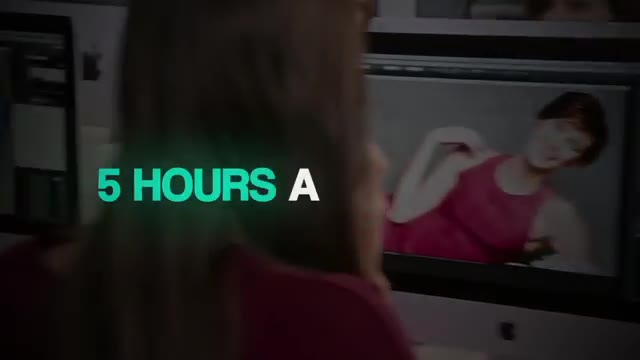
*⏱️ 00:22:40 — Capture d'une vidéo illustrant une personne devant un écran d'ordinateur, avec une surimpression textuelle "5 HOURS A".*

---

### ⏱️ `[00:22:48 - 00:23:17]` | Segment #53

**🔊 Audio (Transcription Intégrale Mot pour Mot en Français) :**
> breakdown like that, relay it back, poke with another question, but also try to make the value clear as you're going through the scoping. I consider that a win because I just got tons of information about where the data sources are and what we need to do. But once again, I should have just relayed it back to business value. Because the first phase will be a data ingestion. And that is what I imagine taking the longest is basically just optimizing all of your data in an automated pipeline to get it into your vector database. And that's, yeah, like I said, that's what's going to take the bulk of work.

**👁️ Analyse Visuelle d'Écran (gemini-3.5-flash-lite) :**
**Interface & Outils** : Plateforme de visioconférence intégrant l'outil Fathom (AI Meeting Assistant).

**Contenu textuel & Code** : Interface utilisateur affichant les vignettes des participants ("Nate Herkelman", "Ari | AI Meeting Analyst", "Nate's Fathom Notetaker") et un texte indiquant "Recording and taking...".

**Action / Démonstration** : Présentation du processus de scoping et de documentation automatique via un assistant IA durant un appel client.

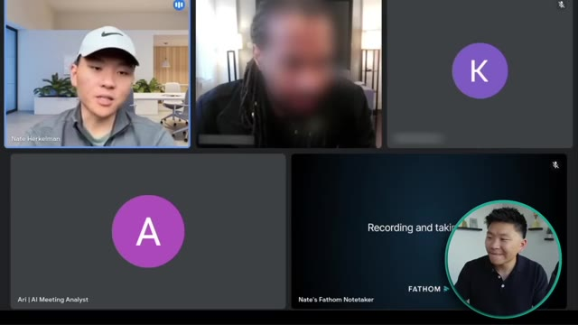
*⏱️ 00:23:10 — Capture d'une réunion en visio-conférence montrant l'interface d'un outil d'IA de prise de notes (Fathom) avec plusieurs participants et une fenêtre dédiée à l'analyse de réunion.*

---

### ⏱️ `[00:23:17 - 00:23:36]` | Segment #54

**🔊 Audio (Transcription Intégrale Mot pour Mot en Français) :**
> So if we were able to maybe just start with one of those sources, get you something up and running in Slack that you can see and test it out, and then it's like, okay, yeah, let's start to add our notion now. Now let's add Dropbox, that sort of thing. So, okay. Yeah. I think that that makes sense. And we'll align in early January and just sort of have a conversation about it. Sounds good.

**👁️ Analyse Visuelle d'Écran (gemini-3.5-flash-lite) :**
**Interface & Outils** : Plateforme de visioconférence et logiciel de prise de notes automatisée (Fathom).

**Contenu textuel & Code** : Noms des participants (Nate Herkelman, Ari | AI Meeting Analyst, Nate's Fathom Notetaker) et mention "Recording and taking notes" sur l'écran du bot.

**Action / Démonstration** : Réunion en cours, aucune démonstration technique ou outil d'automatisation n'est affiché à l'écran.

---

### ⏱️ `[00:23:36 - 00:24:03]` | Segment #55

**🔊 Audio (Transcription Intégrale Mot pour Mot en Français) :**
> So really quick, when you say ingesting our data, what would that process look like? And how would that work? and how is that different from just like connecting the bot to notion through one of N8N's triggers or something like that. And N8N, I'm always saying that because I have that baseline from the videos that I watched, but I don't say that from a space of knowledge.

**👁️ Analyse Visuelle d'Écran (gemini-3.5-flash-lite) :**
**Interface & Outils** : Interface de visioconférence.

**Contenu textuel & Code** : Texte affiché : "Recording and taking", "FATHOM", ainsi que les noms des participants (Nate Herkelman, Ari).

**Action / Démonstration** : Aucune démonstration technique ou graphique n'est présente ; il s'agit d'une vue standard d'une réunion en ligne.

---

### ⏱️ `[00:24:03 - 00:24:35]` | Segment #56

**🔊 Audio (Transcription Intégrale Mot pour Mot en Français) :**
> I'm genuinely curious. Yeah, basically, we want to get everything in that source into a vector database. And it's not just as simple as plugging in Notion to Pinecone. We have to optimize the data, create some sort of pipeline that we can just basically pull everything. We'll run through this logic to optimize it with metadata, with the right tags, the right embeddings, and then put it into Vector Database. We have to basically load it in correctly, embed it correctly, or not embed it correctly, split it up, chunk it correctly, get it in there. A lot of testing to make sure that it's actually coming back afterly

**👁️ Analyse Visuelle d'Écran (gemini-3.5-flash-lite) :**
**Interface & Outils** : Google Meet ou Zoom, Fathom (assistant de réunion).

**Contenu textuel & Code** : Aucune donnée technique, ligne de code ou workflow visible ; il s'agit uniquement de l'interface de l'application de visioconférence.

**Action / Démonstration** : Discussion en cours entre les participants, aucune démonstration de pipeline ou d'intégration technique n'est affichée.

---

### ⏱️ `[00:24:35 - 00:25:10]` | Segment #57

**🔊 Audio (Transcription Intégrale Mot pour Mot en Français) :**
> because sometimes with the Vector Database, it can start to hallucinate a little bit if you don't sort of split it up right and after we get everything in there we want to set up that automated pipeline so that if you do add new tasks new pages they'll also go through and it will you know it'll be a robust system um and so that's basically that process of getting into vector database because that's going to ultimately it's going to be able to run quicker it's going to be run run more efficiently it's going to um he'll pull you more accurate results back when you're asking like, hey, what was Bob's task on the 26th? And like, what were the action items and that sort

**👁️ Analyse Visuelle d'Écran (gemini-3.5-flash-lite) :**
**Interface & Outils** : Plateforme de visioconférence et outil de prise de notes automatisé Fathom.

**Contenu textuel & Code** : Texte générique "Recording and taking" visible dans l'un des cadres de la réunion.

**Action / Démonstration** : Aucune manipulation technique ou démonstration de code n'est présentée ; l'image montre simplement le contexte d'un appel vidéo en cours.

---

### ⏱️ `[00:25:10 - 00:25:40]` | Segment #58

**🔊 Audio (Transcription Intégrale Mot pour Mot en Français) :**
> of thing? Oh, it's all about the data. And that's the big chunk is how do we get that in there? And how do we get that in a robust system so that you can manipulate things in Notion and not have to see it happen in Pinecone, but it is happening for you. Okay, so that was interesting. I didn't really love the answer at first, but then it ended up being a little bit better. And the reason I say that is because he asked, what does ingesting mean? And what's the difference between doing that and just connecting the agent to something like Notion. He didn't care really technically what that means. I didn't have to talk about embedding, splitting, chunking, all that kind of stuff.

**👁️ Analyse Visuelle d'Écran (gemini-3.5-flash-lite) :**
**Interface & Outils** : AUCUNE

**Contenu textuel & Code** : AUCUN

**Action / Démonstration** : AUCUNE

---

### ⏱️ `[00:25:40 - 00:26:02]` | Segment #59

**🔊 Audio (Transcription Intégrale Mot pour Mot en Français) :**
> What I should have said is it's just a different strategy to provide context to your agent. Going through a vector database is going to let it be cheaper, faster, more accurate compared to if we just have the agent searching through Notion, which could be slower, more expensive, and all this kind of stuff. Because that's what he wants to hear is cost and efficiency. Well, really quick, Looking at the calendar, are you thinking first is a Wednesday?

**👁️ Analyse Visuelle d'Écran (gemini-3.5-flash-lite) :**
**Interface & Outils** : Présentation ou face-caméra explicatif sans interface logicielle partagée.

**Contenu textuel & Code** : Explications orales et mise en contexte méthodologique.

**Action / Démonstration** : Explications face caméra et démonstration conceptuelle.

---

### ⏱️ `[00:26:02 - 00:26:24]` | Segment #60

**🔊 Audio (Transcription Intégrale Mot pour Mot en Français) :**
> Are you thinking like that Friday, like, you know, Thursday, Friday, second or third? Kind of breaking for Christmas and all that kind of stuff. And we decided we're going to meet up after the new year. So we find a date that works. And now I'm going to head into that final call with this client. I will go ahead and share screen over this build strategy. Unless you guys have anything you wanted to talk about real quick before we sort of dive in here and go over some of the details.

**👁️ Analyse Visuelle d'Écran (gemini-3.5-flash-lite) :**
**Interface & Outils** : Présentation ou face-caméra explicatif sans interface logicielle partagée.

**Contenu textuel & Code** : Explications orales et mise en contexte méthodologique.

**Action / Démonstration** : Explications face caméra et démonstration conceptuelle.

---

### ⏱️ `[00:26:25 - 00:26:44]` | Segment #61

**🔊 Audio (Transcription Intégrale Mot pour Mot en Français) :**
> Nope, just excited. Okay, well, we'll get forward, whatever. Okay. We have a more detailed doc that we would go over sort of once we're actually really launching this project. But obviously for now, it's just going to be focused on that sort of personal system that we had talked about.

**👁️ Analyse Visuelle d'Écran (gemini-3.5-flash-lite) :**
**Interface & Outils** : Présentation ou face-caméra explicatif sans interface logicielle partagée.

**Contenu textuel & Code** : Explications orales et mise en contexte méthodologique.

**Action / Démonstration** : Explications face caméra et démonstration conceptuelle.

---

### ⏱️ `[00:26:44 - 00:27:17]` | Segment #62

**🔊 Audio (Transcription Intégrale Mot pour Mot en Français) :**
> We talked about some of your data sources like Notion, Dropbox, Slack, Gmail, managing information, being a personal system for you. And with the long-term goal of potentially pushing this solution out to more employees within Kinexus. but the initial focus here is quick and easy access to your data being able to interact via slack and obviously having a good knowledge infrastructure of different tasks that is going to update automatically and just that sort of capability so that's like the general overview

**👁️ Analyse Visuelle d'Écran (gemini-3.5-flash-lite) :**
**Interface & Outils** : Présentation ou face-caméra explicatif sans interface logicielle partagée.

**Contenu textuel & Code** : Explications orales et mise en contexte méthodologique.

**Action / Démonstration** : Explications face caméra et démonstration conceptuelle.

---

### ⏱️ `[00:27:17 - 00:27:35]` | Segment #63

**🔊 Audio (Transcription Intégrale Mot pour Mot en Français) :**
> of course and this is what we looked at doing for the actual build strategy like we talked about the first phase would be the data ingestion getting everything into a vector database we We talked about your different data sources. So far, we've been able to work with all these sources. There's nothing too complicated. There's nothing that, you know, doesn't have any endpoints we could connect to.

**👁️ Analyse Visuelle d'Écran (gemini-3.5-flash-lite) :**
**Interface & Outils** : Présentation ou face-caméra explicatif sans interface logicielle partagée.

**Contenu textuel & Code** : Explications orales et mise en contexte méthodologique.

**Action / Démonstration** : Explications face caméra et démonstration conceptuelle.

---

### ⏱️ `[00:27:35 - 00:27:54]` | Segment #64

**🔊 Audio (Transcription Intégrale Mot pour Mot en Français) :**
> So we don't see any major complications there. We would obviously have to get into the details, like what the data really looks like. I don't assume it's going to be too complicated, but that's obviously how we're going to start off. And then we will do a lot of testing before we really push into integrating with the tools like Slack and your email.

**👁️ Analyse Visuelle d'Écran (gemini-3.5-flash-lite) :**
**Interface & Outils** : Présentation ou face-caméra explicatif sans interface logicielle partagée.

**Contenu textuel & Code** : Explications orales et mise en contexte méthodologique.

**Action / Démonstration** : Explications face caméra et démonstration conceptuelle.

---

### ⏱️ `[00:27:54 - 00:28:28]` | Segment #65

**🔊 Audio (Transcription Intégrale Mot pour Mot en Français) :**
> Obviously, a lot of testing is important to see how the metadata is going to work. what type of embedding and what type of chunking and splitting we should do to make sure that everything coming back is accurate. And then that way, we're also going to explore sort of doing some namespaces up front. That way, when you do have wanting to push the solution to other employees, we'll already have like a separated sort of system for information specific to each person or, you know, if you guys want to have access to all the data, but not all the agents should, that sort of thing. Okay, so now we're at the point of the call where I have a proposal,

**👁️ Analyse Visuelle d'Écran (gemini-3.5-flash-lite) :**
**Interface & Outils** : Présentation ou face-caméra explicatif sans interface logicielle partagée.

**Contenu textuel & Code** : Explications orales et mise en contexte méthodologique.

**Action / Démonstration** : Explications face caméra et démonstration conceptuelle.

---

### ⏱️ `[00:28:28 - 00:28:52]` | Segment #66

**🔊 Audio (Transcription Intégrale Mot pour Mot en Français) :**
> and I'm talking about this is what we've talked about. Are we aligned? Honestly, I would recommend that you bring something like this earlier than the final call. It ended up being that we were able to close on this call. And if you notice what I did here was I have all the tech stack listed out, I have all of the functionality, and I'm reading it off to make sure that he agrees with everything that I'm saying so that we can ultimately use this as the functionality requirements and the definition of done for the system.

**👁️ Analyse Visuelle d'Écran (gemini-3.5-flash-lite) :**
**Interface & Outils** : Présentation ou face-caméra explicatif sans interface logicielle partagée.

**Contenu textuel & Code** : Explications orales et mise en contexte méthodologique.

**Action / Démonstration** : Explications face caméra et démonstration conceptuelle.

---

### ⏱️ `[00:28:52 - 00:29:12]` | Segment #67

**🔊 Audio (Transcription Intégrale Mot pour Mot en Français) :**
> And the whole point of scoping is that you can get to a place like this where you confidently understand exactly how you're going to build it and what the connections are going to look like. And if you haven't sculpted out enough to be able to say that, then you're not ready to close the sale because you're not ready to talk about timelines and integrations or put a price tag on it. For the most part, what this agent will be doing is waiting for commands.

**👁️ Analyse Visuelle d'Écran (gemini-3.5-flash-lite) :**
**Interface & Outils** : Présentation ou face-caméra explicatif sans interface logicielle partagée.

**Contenu textuel & Code** : Explications orales et mise en contexte méthodologique.

**Action / Démonstration** : Explications face caméra et démonstration conceptuelle.

---

### ⏱️ `[00:29:12 - 00:29:35]` | Segment #68

**🔊 Audio (Transcription Intégrale Mot pour Mot en Français) :**
> It's not going to really be taking action on itself, right? So, you know, there's other integrations that we've done with basically like an inbox manager that takes emails and can sort of send them around, label them, respond to certain ones. But we're looking for more of like a, you will be specifically prompting this when you want it to do something. So I think one tool integration to add to this is search, you know, like being able to search Google or something like that.

**👁️ Analyse Visuelle d'Écran (gemini-3.5-flash-lite) :**
**Interface & Outils** : Présentation ou face-caméra explicatif sans interface logicielle partagée.

**Contenu textuel & Code** : Explications orales et mise en contexte méthodologique.

**Action / Démonstration** : Explications face caméra et démonstration conceptuelle.

---

### ⏱️ `[00:29:35 - 00:30:14]` | Segment #69

**🔊 Audio (Transcription Intégrale Mot pour Mot en Français) :**
> That is going to be a thing that would be very useful for us to have upfront. And partly, for instance, whether we're collecting blog post information, something like that, we'll want to be able to just you know have it have it search and support our efforts uh which also leads to the automated element that like one thing that could be really useful is does a search and collects information into a giant summary and sends it off and shoots it off internally to some database or something like that so i do think there are certain unprompted automation that we want to add um but in terms of like proper economist agents not yet okay and so when

**👁️ Analyse Visuelle d'Écran (gemini-3.5-flash-lite) :**
**Interface & Outils** : Présentation ou face-caméra explicatif sans interface logicielle partagée.

**Contenu textuel & Code** : Explications orales et mise en contexte méthodologique.

**Action / Démonstration** : Explications face caméra et démonstration conceptuelle.

---

### ⏱️ `[00:30:14 - 00:30:46]` | Segment #70

**🔊 Audio (Transcription Intégrale Mot pour Mot en Français) :**
> you say like searching do you mean you would be able to prompt on like certain keywords that it would go look for recent articles about exactly like hey i go search google for or hey pull this from wikipedia or not even right rather that it has the ability to do whatever you know collect some information and give me a document or you know whatever right um and it does you know it knows that wikipedia is a pretty reliable source it knows that like your times or whatever also like reliable sources but then it's not afraid to search for other things but the day that you know

**👁️ Analyse Visuelle d'Écran (gemini-3.5-flash-lite) :**
**Interface & Outils** : Lecteur PDF intégré dans une interface de visioconférence (type Google Meet ou Zoom).

**Contenu textuel & Code** : Le document liste : 1. Data Ingestion & Vector Database (Notion, Dropbox, Gmail, Slack, Pinecone) ; 2. Tool Integrations ; 3. Phased Development Approach (Phases 1 à 3) ; 4. Documentation & Scalability.

**Action / Démonstration** : Le présentateur illustre sa stratégie de développement d'automatisation en utilisant un document structuré pour expliquer l'intégration des données et les phases de déploiement de l'agent.

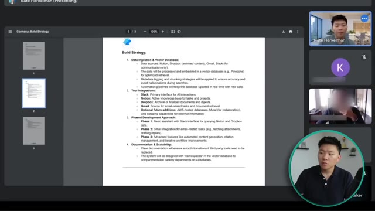
*⏱️ 00:30:22 — Une vue de partage d'écran lors d'une visioconférence montrant un document PDF intitulé "Connexus Build Strategy" détaillant les étapes techniques de l'automatisation.*

---

### ⏱️ `[00:30:46 - 00:31:20]` | Segment #71

**🔊 Audio (Transcription Intégrale Mot pour Mot en Français) :**
> maybe it's got a preference list for sources um okay and it knows to or at the very least it has the ability to go retrieve information from those sources online as part of the request okay cool and that um we'll also obviously be able to come back with like okay here's a quick summary of like what i found here are the links that i use that sort of thing okay exactly so you can see what kind of happened there was even though we had talked about this stuff on the first two calls, we saw that we weren't aligned on something already, which was the ability to have some

**👁️ Analyse Visuelle d'Écran (gemini-3.5-flash-lite) :**
**Interface & Outils** : Lecteur de document PDF (intégré à une interface de réunion type Google Meet/Zoom).

**Contenu textuel & Code** : Le document liste : "Data Ingestion & Vector Database" (Notion, Dropbox, Gmail, Slack, Pinecone), "Tool Integrations" (Slack, Notion, Dropbox, Gmail), "Phased Development Approach" (Phases 1-3) et "Documentation & Scalability".

**Action / Démonstration** : Présentation stratégique de l'architecture d'un système d'automatisation IA, expliquant comment les données sont ingérées et traitées.

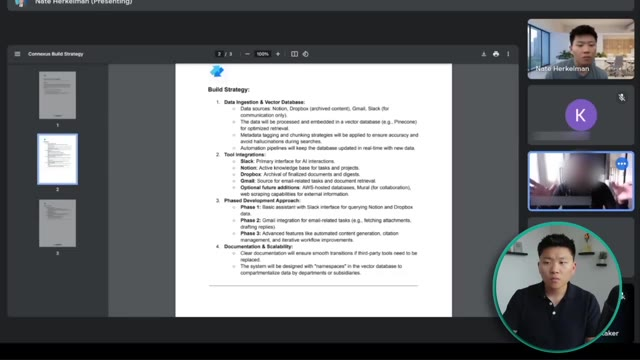
*⏱️ 00:30:55 — Une vue de partage d'écran montrant un document PDF intitulé "Connexus Build Strategy" détaillant les sources de données, les intégrations d'outils et une approche de développement en trois phases.*

---

### ⏱️ `[00:31:20 - 00:31:55]` | Segment #72

**🔊 Audio (Transcription Intégrale Mot pour Mot en Français) :**
> autonomous web search, which is fine to add in. But the reason why you want to list all of this stuff down as clearly as you can and avoid as much ambiguity as possible is to avoid scope creep because you don't want to be two weeks into the build, three weeks in the build, and then the client wants to add more things. So that's the kind of the whole point of getting all this stuff written down as clearly as possible. That's why in-depth scoping is required to understand every little nuance of this build that could potentially pop up and then you can bring it like a proposal like this to align on during the call. We're on that right now as far as next steps. I know we've had a lot of calls which has been good. We've gotten to know each other a little bit. We've gotten to

**👁️ Analyse Visuelle d'Écran (gemini-3.5-flash-lite) :**
**Interface & Outils** : Lecteur PDF / Visionneuse de documents.

**Contenu textuel & Code** : Le document contient quatre sections clés : "Data Ingestion & Vector Database" (Notion, Dropbox, Gmail, Pinecone), "Tool Integrations" (Slack, Notion, Dropbox, Gmail, AWS), "Phased Development Approach" (3 phases de développement) et "Documentation & Scalability".

**Action / Démonstration** : Affichage à l'écran de la stratégie de construction pour illustrer la nécessité de clarifier les périmètres du projet afin d'éviter le "scope creep".

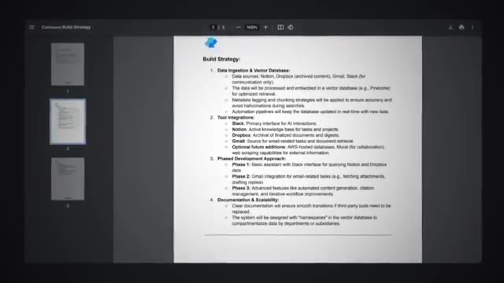
*⏱️ 00:31:46 — Capture d'écran d'un document PDF intitulé "Build Strategy" détaillant l'architecture d'un projet d'automatisation IA.*

---

### ⏱️ `[00:31:55 - 00:32:31]` | Segment #73

**🔊 Audio (Transcription Intégrale Mot pour Mot en Français) :**
> understand sort of the way we work and so my recommendation here would next call we would want to it would be like a project kickoff call. We'd really get started from there. We would have one of my devs would hop on the call too just to make sure that we're both aligned so we could pretty much kick off right away after that call. So yeah, any questions that you guys have about moving forward with this? One thing that I'd want to throw out is I would love to hear, I know we talked a little bit about, you know, end of January, we'd love to see something, but with the more calls, things have been delayed a little bit. I would like to know what you guys

**👁️ Analyse Visuelle d'Écran (gemini-3.5-flash-lite) :**
**Interface & Outils** : Visionneuse de documents PDF au sein d'une interface de visioconférence (type Google Meet).

**Contenu textuel & Code** : Plan de stratégie technique : "Data Ingestion & Vector Database" (Notion, Dropbox, Gmail, Slack, Pinecone), "Tool Integrations" (Slack, Notion, Dropbox, Gmail, AWS), et "Phased Development Approach" (Phase 1 à 3).

**Action / Démonstration** : Présentation du document de stratégie et de la feuille de route technique aux clients avant le lancement du projet.

*⏱️ 00:32:04 — Capture d'écran montrant le document "Connexus Build Strategy" partagé lors d'une visioconférence, détaillant les sources de données, les intégrations d'outils et les phases de développement.*

---

### ⏱️ `[00:32:31 - 00:33:05]` | Segment #74

**🔊 Audio (Transcription Intégrale Mot pour Mot en Français) :**
> are looking at here as far as the urgency. Ideally, what is it? What is a good timeline for this project look like for you um and then any final thoughts or questions that you've got honestly as soon as possible um is the as the timeline um there is no urgency from a business perspective we're not promising to anybody this is totally internal uh but it's it's all direct related right the sooner we get this the faster we can begin to do other things one to test you know two to figure out like our own processes will be augmented by this so i'm looking forward to having increased

**👁️ Analyse Visuelle d'Écran (gemini-3.5-flash-lite) :**
**Interface & Outils** : Google Meet (affichage de présentation de document PDF).

**Contenu textuel & Code** : Le document détaille une stratégie de développement technique avec quatre sections : "Data Ingestion & Vector Database", "Tool Integrations" (Slack, Notion, Dropbox, Gmail), "Phased Development Approach" (phases 1, 2 et 3) et "Documentation & Scalability".

**Action / Démonstration** : Présentation du plan de projet et de la stratégie d'implémentation technique lors d'un appel de clôture client.

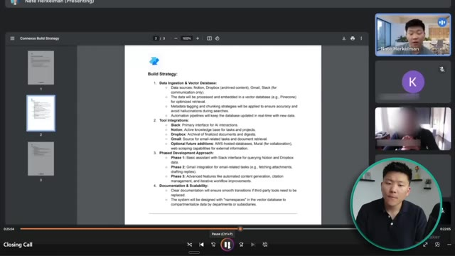
*⏱️ 00:32:40 — Une capture d'écran d'une réunion visioconférence (Google Meet) montrant un document PDF intitulé "Connexus Build Strategy" en cours de partage d'écran.*

---

### ⏱️ `[00:33:05 - 00:33:34]` | Segment #75

**🔊 Audio (Transcription Intégrale Mot pour Mot en Français) :**
> automation in our own systems um but in terms of you know we've got no client recommendations or anything like that like this is purely an internal effort uh right so as soon as possible is ideal and um i recognize that that's a balance and so yeah so i guess i would say you know you let me know what do you think is possible um if if end of january still for some reason becomes possible because it's actually pretty straightforward great you know like to not have this go into March, right?

**👁️ Analyse Visuelle d'Écran (gemini-3.5-flash-lite) :**
**Interface & Outils** : Lecteur de PDF intégré dans une interface de visioconférence (type Google Meet).

**Contenu textuel & Code** : Plan stratégique divisé en 4 sections : 1. Ingestion de données & Base de données vectorielle (Notion, Dropbox, Gmail, Slack, Pinecone), 2. Intégrations d'outils, 3. Approche de développement phasée (Phase 1 à 3), 4. Documentation & Évolutivité.

**Action / Démonstration** : Présentation visuelle et partage d'écran d'un document de planification stratégique interne.

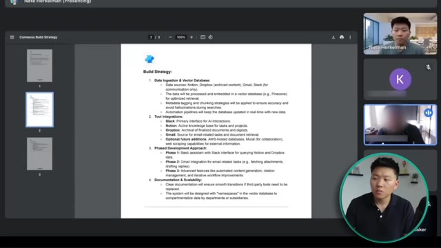
*⏱️ 00:33:12 — Document PDF affichant la « Build Strategy » (Stratégie de construction) pour Connexus, détaillant l'ingestion de données, les intégrations d'outils et les phases de développement.*

---

### ⏱️ `[00:33:34 - 00:33:54]` | Segment #76

**🔊 Audio (Transcription Intégrale Mot pour Mot en Français) :**
> So we could say like, you know, by end of February. But if we get into February and you're like, hey, actually we need to add right capabilities to Dropbox because Notion's a dead end and we need to be able to update the RAG database in the Google spreadsheet in Dropbox for example, right? Like I get that too.

**👁️ Analyse Visuelle d'Écran (gemini-3.5-flash-lite) :**
**Interface & Outils** : Présentation ou face-caméra explicatif sans interface logicielle partagée.

**Contenu textuel & Code** : Explications orales et mise en contexte méthodologique.

**Action / Démonstration** : Explications face caméra et démonstration conceptuelle.

---

### ⏱️ `[00:33:54 - 00:34:20]` | Segment #77

**🔊 Audio (Transcription Intégrale Mot pour Mot en Français) :**
> So yeah. Okay. Awesome. I think that that aligns really with what we were thinking. I don't see this pushing into March just as a ballpark at the moment. Definitely don't see this pushing into March, especially since if we sort of agree on that, then we'll pretty much make it a priority to make sure that it doesn't push into March unless the unforeseen things pop up and it's just really complicated for some reason, which I don't think it will be.

**👁️ Analyse Visuelle d'Écran (gemini-3.5-flash-lite) :**
**Interface & Outils** : Présentation ou face-caméra explicatif sans interface logicielle partagée.

**Contenu textuel & Code** : Explications orales et mise en contexte méthodologique.

**Action / Démonstration** : Explications face caméra et démonstration conceptuelle.

---

### ⏱️ `[00:34:21 - 00:34:55]` | Segment #78

**🔊 Audio (Transcription Intégrale Mot pour Mot en Français) :**
> But yeah, okay. So that sounds good to me. That would give us sort of four or five check-ins throughout the process just to make sure that we're moving forward as as planned based on estimations i don't really see this taking anywhere upwards of um i would say 40 hours max would be my estimate right now um and so what i was thinking is ballpark i think that maybe doing three thousand dollar up front and then maybe a three thousand

**👁️ Analyse Visuelle d'Écran (gemini-3.5-flash-lite) :**
**Interface & Outils** : Présentation ou face-caméra explicatif sans interface logicielle partagée.

**Contenu textuel & Code** : Explications orales et mise en contexte méthodologique.

**Action / Démonstration** : Explications face caméra et démonstration conceptuelle.

---

### ⏱️ `[00:34:55 - 00:35:30]` | Segment #79

**🔊 Audio (Transcription Intégrale Mot pour Mot en Français) :**
> dollar upon completion which would put it a six thousand dollar total project um that's sort of what we're thinking based on, you know, like I said, just scoping out all of the integrations and the data ingestion piece up front. I think that that makes sense as far as the timeline and sort of the resources that we would dedicate to this. That is so tough to watch. First of all, I'm not speaking confidently at all. And that kind of stuff is important when you're trying to sell this stuff because I don't have a sales background. So I don't have these sales tactics and I'm not a pushy salesman. So speaking like that, and then you've also got the aspect of just being transparent.

**👁️ Analyse Visuelle d'Écran (gemini-3.5-flash-lite) :**
**Interface & Outils** : Présentation ou face-caméra explicatif sans interface logicielle partagée.

**Contenu textuel & Code** : Explications orales et mise en contexte méthodologique.

**Action / Démonstration** : Explications face caméra et démonstration conceptuelle.

---

### ⏱️ `[00:35:30 - 00:35:53]` | Segment #80

**🔊 Audio (Transcription Intégrale Mot pour Mot en Français) :**
> So telling straight up if I think something will work or if I don't think something will work, just trying to build goodwill. And then the final thing is being able to back stuff with facts, because ultimately most decisions in life come down to a math problem where if you have data, you can make a strategic data driven decision. And what you just saw me do there is I threw out a price. I was probably sitting there with my feet shaking and just waiting to see what he would say back.

**👁️ Analyse Visuelle d'Écran (gemini-3.5-flash-lite) :**
**Interface & Outils** : Présentation ou face-caméra explicatif sans interface logicielle partagée.

**Contenu textuel & Code** : Explications orales et mise en contexte méthodologique.

**Action / Démonstration** : Explications face caméra et démonstration conceptuelle.

---

### ⏱️ `[00:35:53 - 00:36:14]` | Segment #81

**🔊 Audio (Transcription Intégrale Mot pour Mot en Français) :**
> But what I should have done is been able to justify it by saying we're charging you this much. This is why. We've done the math and we're saving you this much time over these different departments, which basically translates to this much dollar savings. And you're going to make your money back in two, three months, if not quicker. And then over the course of a year or two years, you're netting tens of thousands of dollars. And then you just stand on that because that's objectively true.

**👁️ Analyse Visuelle d'Écran (gemini-3.5-flash-lite) :**
**Interface & Outils** : Présentation ou face-caméra explicatif sans interface logicielle partagée.

**Contenu textuel & Code** : Explications orales et mise en contexte méthodologique.

**Action / Démonstration** : Explications face caméra et démonstration conceptuelle.

---

### ⏱️ `[00:36:14 - 00:36:37]` | Segment #82

**🔊 Audio (Transcription Intégrale Mot pour Mot en Français) :**
> But what I did is I said, I think that this makes sense based on timeline and resources. And that's just horrible. If you think about the way the client now perceives me in the future, if we want to work on more and more, which is the goal, it's hard to break out of that barrier of now being perceived as an hourly worker. Even though I tried to set that foundation up front in the first and second discovery calls about the way that we want to ingest in their business as a long-term partner.

**👁️ Analyse Visuelle d'Écran (gemini-3.5-flash-lite) :**
**Interface & Outils** : Présentation ou face-caméra explicatif sans interface logicielle partagée.

**Contenu textuel & Code** : Explications orales et mise en contexte méthodologique.

**Action / Démonstration** : Explications face caméra et démonstration conceptuelle.

---

### ⏱️ `[00:36:38 - 00:37:02]` | Segment #83

**🔊 Audio (Transcription Intégrale Mot pour Mot en Français) :**
> So really, really don't like the way that I kind of approached the pricing in this conversation. Cut me some slack. This was in December. But the reason why this worked here is a couple things. What I still did well throughout this process was I used LRP. I listened to everything he was saying. I repeated everything back. And then I asked more questions. and because I was able to scope out the build so well, we now have a full build strategy that completely aligns with what exactly he was thinking.

**👁️ Analyse Visuelle d'Écran (gemini-3.5-flash-lite) :**
**Interface & Outils** : Présentation ou face-caméra explicatif sans interface logicielle partagée.

**Contenu textuel & Code** : Explications orales et mise en contexte méthodologique.

**Action / Démonstration** : Explications face caméra et démonstration conceptuelle.

---

### ⏱️ `[00:37:02 - 00:37:24]` | Segment #84

**🔊 Audio (Transcription Intégrale Mot pour Mot en Français) :**
> And through the other calls where we had kind of bonded and we talked about kind of passion projects and other use cases of AI, we got to this place where trust had been established. So a lot of stuff happened in those three calls and I obviously couldn't show you guys everything, but what I wanted to do is now kind of just recap with six key lessons from what we just looked at. So the first one is something that I didn't do great in these three calls, which is to prove the value with ROI.

**👁️ Analyse Visuelle d'Écran (gemini-3.5-flash-lite) :**
**Interface & Outils** : Présentation ou face-caméra explicatif sans interface logicielle partagée.

**Contenu textuel & Code** : Explications orales et mise en contexte méthodologique.

**Action / Démonstration** : Explications face caméra et démonstration conceptuelle.

---

### ⏱️ `[00:37:24 - 00:37:53]` | Segment #85

**🔊 Audio (Transcription Intégrale Mot pour Mot en Français) :**
> Collect your data before and after. Without this baseline data, you cannot actually prove ROI. Keep it simple. Focus on three to five key metrics that align with business goals, like hours saved, lead conversion, or error reduction. Translate your technical improvements into financial outcomes, because clients can actually understand that. So like with that example earlier about the vector database, rather than me talking about the metadata or the Euclidean distance or whatever technical jargon I was throwing around, I should have just translated that to the agent being able to respond cheaper, quicker, and more accurately.

**👁️ Analyse Visuelle d'Écran (gemini-3.5-flash-lite) :**
**Interface & Outils** : Présentation ou face-caméra explicatif sans interface logicielle partagée.

**Contenu textuel & Code** : Explications orales et mise en contexte méthodologique.

**Action / Démonstration** : Explications face caméra et démonstration conceptuelle.

---

### ⏱️ `[00:37:53 - 00:38:21]` | Segment #86

**🔊 Audio (Transcription Intégrale Mot pour Mot en Français) :**
> And hopping right off of that ROI stuff, you want a price based on the outcomes, not the effort. Value is based on result. Value is not based on time. Never sell hours or number of nodes or the complexity of the build. Sell business transformation. More leads, less churn, reduced cost, whatever it is. And that's how you can actually pitch out a number and confidently justify it, rather than what you just saw me do, where I said, I think maybe 6,000 makes sense. I think that sounds good. That was just hard to watch.

**👁️ Analyse Visuelle d'Écran (gemini-3.5-flash-lite) :**
**Interface & Outils** : Présentation ou face-caméra explicatif sans interface logicielle partagée.

**Contenu textuel & Code** : Explications orales et mise en contexte méthodologique.

**Action / Démonstration** : Explications face caméra et démonstration conceptuelle.

---

### ⏱️ `[00:38:21 - 00:38:41]` | Segment #87

**🔊 Audio (Transcription Intégrale Mot pour Mot en Français) :**
> And once you start understanding how to actually price based on value, it makes it clearer for you and you're not going to undervalue or underprice your services, which is a big issue that we had for a long, long time was severely underpricing tons of our builds. Master consultative selling, not technical selling. Position yourself as a problem solver, not a tool pusher.

**👁️ Analyse Visuelle d'Écran (gemini-3.5-flash-lite) :**
**Interface & Outils** : Présentation ou face-caméra explicatif sans interface logicielle partagée.

**Contenu textuel & Code** : Explications orales et mise en contexte méthodologique.

**Action / Démonstration** : Explications face caméra et démonstration conceptuelle.

---

### ⏱️ `[00:38:41 - 00:39:02]` | Segment #88

**🔊 Audio (Transcription Intégrale Mot pour Mot en Français) :**
> Ask deep questions in discovery like what business problems are we solving here? What result must this deliver? It's important to be technical enough to understand how to scope out a build, but speak not technical when you need to so that the person can actually understand what you're saying and not get confused or overwhelmed. Use analogies and visual aids instead of overwhelming the client. You can see in the call when I use that intern analogy, he left it.

**👁️ Analyse Visuelle d'Écran (gemini-3.5-flash-lite) :**
**Interface & Outils** : Aucune interface logicielle, éditeur de code ou outil d'automatisation n'est visible.

**Contenu textuel & Code** : Texte incrusté à l'écran : "USE ANALOGIES AND VISUAL AIDS".

**Action / Démonstration** : Aucune démonstration technique ou manipulation d'outil n'est effectuée.

---

### ⏱️ `[00:39:03 - 00:39:24]` | Segment #89

**🔊 Audio (Transcription Intégrale Mot pour Mot en Français) :**
> Use a structured framework. And that doesn't mean to enter the call with a script on your right or a set list of questions that you're going to ask in order no matter what, because you have to be fluid and you have to be a human. But if you have a framework like LRP where you listen, as soon as you listen and it's your turn to speak, you recap and then you just poke another question. That's going to help the conversation flow in a way where they're speaking the most of the time, which they should be in a discovery call.

**👁️ Analyse Visuelle d'Écran (gemini-3.5-flash-lite) :**
**Interface & Outils** : Aucune interface logicielle ou de programmation.

**Contenu textuel & Code** : Texte affiché à l'écran : "LISTEN", "REPEAT", "POKE".

**Action / Démonstration** : Présentation orale du cadre de travail ("framework") LRP pour structurer les appels clients.

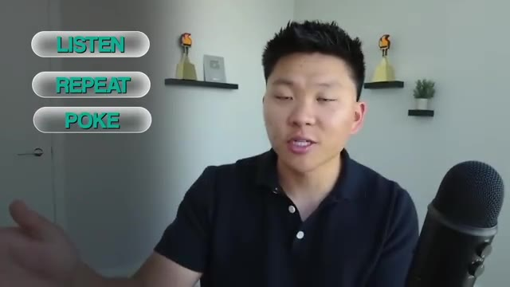
*⏱️ 00:39:19 — Le présentateur face caméra avec une incrustation graphique à gauche listant les étapes "LISTEN", "REPEAT", "POKE".*

---

### ⏱️ `[00:39:24 - 00:39:54]` | Segment #90

**🔊 Audio (Transcription Intégrale Mot pour Mot en Français) :**
> And we're getting a ton of information that later you can revisit the call, read the transcript and have it all there in front of you. Turn every win into a growth engine. After showing that ROI, that's when you can start to ask for video testimonials, case studies, referrals, stuff like that. And that's going to help you in your discovery and your sales. If you're facing any objections or like you could see in these calls, I was able to talk about other products I'm working on or other things I've done, which helped build trust for this client in me and prove that I could do what he was looking for.

**👁️ Analyse Visuelle d'Écran (gemini-3.5-flash-lite) :**
**Interface & Outils** : Interface de visioconférence (Google Meet/Zoom) avec outil d'enregistrement automatisé.

**Contenu textuel & Code** : Texte à l'écran : "Recording and taking notes".

**Action / Démonstration** : Démonstration de l'utilisation d'un outil d'IA pour enregistrer et prendre des notes automatiquement lors d'un appel commercial.

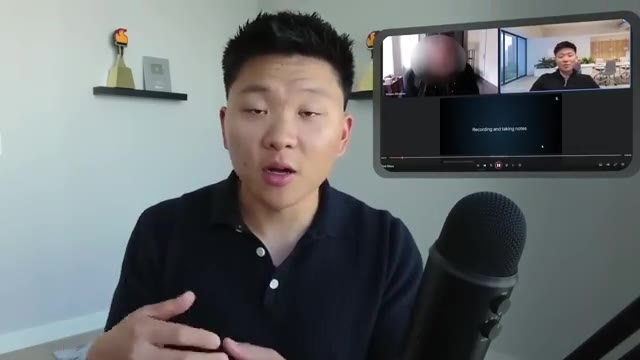
*⏱️ 00:39:46 — Capture d'écran incrustée montrant une interface de visioconférence (type Zoom/Google Meet) avec un indicateur "Recording and taking notes".*

---

### ⏱️ `[00:39:54 - 00:40:27]` | Segment #91

**🔊 Audio (Transcription Intégrale Mot pour Mot en Français) :**
> And then finally, just to maintain your sales rhythm, make sure you're researching and you're prepping before a call, not just hopping into it a minute late with no idea who the person is. Listen for 70% of the time, speak for 30% of the time, focus conversation on business value not technical details unless you're specifically asked because sometimes the clients do like to nerd out a little bit as well and then follow up with low pressure high value touch points insights quick wins or relevant examples so that's going to do it for this one what i'm going to do is drop this document as well as a resource that pretty much broke down everything that i just broke down in those three calls and i'll drop that in my free school community

**👁️ Analyse Visuelle d'Écran (gemini-3.5-flash-lite) :**
**Interface & Outils** : Aucune interface logicielle montrée.

**Contenu textuel & Code** : Texte graphique "70% LISTEN".

**Action / Démonstration** : Illustration visuelle du concept de ratio d'écoute active pour les ventes.

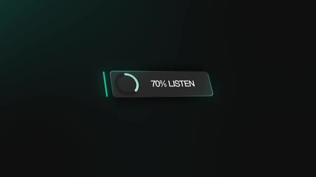
*⏱️ 00:40:02 — Un graphique numérique minimaliste sur fond sombre affichant "70% LISTEN" avec un indicateur circulaire.*

---

### ⏱️ `[00:40:27 - 00:41:01]` | Segment #92

**🔊 Audio (Transcription Intégrale Mot pour Mot en Français) :**
> all you got to do if you want to download that is hop in using the link in the description like i said it's completely free and once you get in here just search for the title of this video or go to YouTube resources and find the post associated with this YouTube video and in there there'll be a PDF just like this where you'll have all of the resources that we just talked about. And if you're looking to take your skills further and connect with people who are running businesses using NNN then definitely check out my plus community the link for that's also down in the description. Not only is this a great community of people who are passionate about NNN and monetizing their skills but by the time you're seeing this we would have just dropped this new course called automation to monetization where you

**👁️ Analyse Visuelle d'Écran (gemini-3.5-flash-lite) :**
**Interface & Outils** : Plateforme YouTube (navigation sur une page de chaîne).

**Contenu textuel & Code** : Texte de recherche saisi dans l'onglet Posts : "selling $6000 AI workflow" ; Titre visible sur le document PDF : "How I Closed a $6,000 AI...".

**Action / Démonstration** : Navigation sur la chaîne YouTube et recherche d'une ressource (PDF) spécifique via l'onglet "Posts".

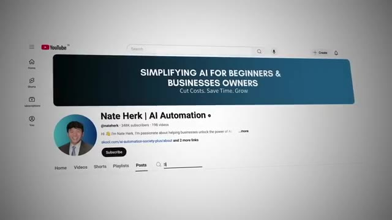
*⏱️ 00:40:35 — Vue d'ensemble de la page YouTube de la chaîne "Nate Herk | AI Automation", montrant la bannière et la section de navigation avec l'onglet "Posts" sélectionné.*

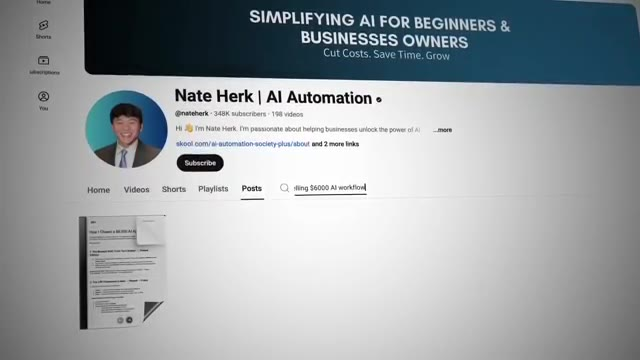
*⏱️ 00:40:44 — Gros plan sur l'interface YouTube montrant une recherche active dans la section "Posts" avec le titre du document recherché ("...lling $6000 AI workflow") et l'aperçu du PDF trouvé en dessous.*

---

### ⏱️ `[00:41:01 - 00:41:19]` | Segment #93

**🔊 Audio (Transcription Intégrale Mot pour Mot en Français) :**
> learn how to actually launch your AI freelancing or consulting business. So if If you like this type of content that you've been seeing from me on YouTube, this full course covers a lot more. Anyways, that's going to do it for this one. If you learned something new or you enjoyed the video, please give it a like. It definitely helps me out a ton. And as always, I appreciate you guys making it to the end of the video. I'll see you on the next one.

**👁️ Analyse Visuelle d'Écran (gemini-3.5-flash-lite) :**
**Interface & Outils** : Lecteur vidéo YouTube.

**Contenu textuel & Code** : Texte affiché : "*LIVE* Selling $6,000 AI Workflow to a Business".

**Action / Démonstration** : Aucune démonstration technique ou logicielle ; il s'agit d'une séquence de fin de vidéo.

---

### ⏱️ `[00:41:19 - 00:41:19]` | Segment #94

**🔊 Audio (Transcription Intégrale Mot pour Mot en Français) :**
> Thanks guys.

**👁️ Analyse Visuelle d'Écran (gemini-3.5-flash-lite) :**
**Interface & Outils** : Aucune interface logicielle n'est affichée.

**Contenu textuel & Code** : Aucun code, aucune commande ou donnée n'est affiché.

**Action / Démonstration** : Le présentateur salue son audience pour terminer la séquence.

---

