# 🎬 The TRUTH About Selling AI Automations to Businesses

> **Chaîne** : [Nate Herk | AI Automation](https://www.youtube.com/@nateherk/featured)  
> **Lien YouTube** : [https://www.youtube.com/watch?v=SAerRtQLD0I](https://www.youtube.com/watch?v=SAerRtQLD0I)  
> **Date de publication** : 20250914  
> **Durée** : 00:12:28  
> **Identifiant vidéo** : `SAerRtQLD0I`  
> **Transcription & Analyse** : `whisper-v3-large-turbo+gemini-3.5-flash-lite`  

---

## 📌 Synthèse Exécutive & Outils

### 💡 Résumé
Dans cette vidéo intitulée **The TRUTH About Selling AI Automations to Businesses**, Nate Herk décortique les capacités pratiques d'automatisation et de développement propulsées par les modèles de pointe.

### 🛠️ Outils, Modèles & Logiciels Présentés
- **Opus 5.5 & Claude Code** : Modèles d'ingénierie et agents de codage autonome.

### 🔑 Points Clés & Enseignements Stratégiques
- Optimiser le niveau d'effort et le raisonnement des modèles IA pour des résultats industriels.
- Automatiser les cycles de création logicielle de bout en bout.

---

## ⏱️ Chronologie & Transcription Complète Audio & Visuelle (Mot pour Mot)

### ⏱️ `[00:00:00 - 00:00:20]` | Segment #01

**🔊 Audio (Transcription Intégrale Mot pour Mot en Français) :**
> So nobody's buying your AI agents or your AI workflows. And it's not because you're a beginner with no proof or because of what you're selling, it's because of how. So in this video, we'll go through the mistakes you're making and how to fix them so that you can sell your own AI services just like I've done. So let's get started and take a look at the first reason why no one is buying from you. The first reason no one's buying your AI agents is because you're focusing too much on the what, not the how.

**👁️ Analyse Visuelle d'Écran (gemini-3.5-flash-lite) :**
**Interface & Outils** : Présentation ou face-caméra explicatif sans interface logicielle partagée.

**Contenu textuel & Code** : Explications orales et mise en contexte méthodologique.

**Action / Démonstration** : Explications face caméra et démonstration conceptuelle.

---

### ⏱️ `[00:00:20 - 00:00:54]` | Segment #02

**🔊 Audio (Transcription Intégrale Mot pour Mot en Français) :**
> Here's what I mean. When I sold my very first $1,200 LinkedIn agent, I did not sell the agent itself. I didn't get in on a call and say, hey, here's this workflow, here's how many nodes it has, here's what model it uses. none of that matters to the business owner. What I actually sold was the idea, the outcome. I sold the fact that they would never have to research or write LinkedIn posts ever again, but they'd still be getting that consistent inbound traffic and expanding their brand's top of funnel. That's what got the client excited, not the tech, the result. And this is where a lot of people mess up. You could have the most advanced personal assistant agent in the world, something that has outreach, scheduling, reporting, whatever. But if you pitch it in the wrong way, no one's going to buy it and

**👁️ Analyse Visuelle d'Écran (gemini-3.5-flash-lite) :**
**Interface & Outils** : Navigateur web affichant l'interface de publication LinkedIn.

**Contenu textuel & Code** : Fenêtre modale "Create a post" active au centre de l'écran avec des options d'ajout de contenu multimédia.

**Action / Démonstration** : Interaction utilisateur sur l'interface de publication de contenu LinkedIn pour illustrer l'automatisation.

*⏱️ 00:00:37 — Gros plan sur un ordinateur portable affichant l'interface de création de post sur le réseau social LinkedIn.*

---

### ⏱️ `[00:00:54 - 00:01:16]` | Segment #03

**🔊 Audio (Transcription Intégrale Mot pour Mot en Français) :**
> see that value. Because selling AI isn't about features, it's about framing. You have to ask the right questions. You have to find the pain points. You have to press hard on those pain points. And then you have to position your AI solution as the fix by demonstrating the value. So the secret to that is to always sell the destination, not the vehicle. Nobody buys a plane ticket because they love sitting on an airplane. They buy it because they want to get to their vacation spot.

**👁️ Analyse Visuelle d'Écran (gemini-3.5-flash-lite) :**
**Interface & Outils** : Graphiques illustratifs (non techniques/logiciels).

**Contenu textuel & Code** : Texte "PAIN POINT" et interface de suivi de vol (SFO 10h44 PM).

**Action / Démonstration** : Aucune manipulation de logiciel, de code ou d'agent IA montrée.

---

### ⏱️ `[00:01:16 - 00:01:46]` | Segment #04

**🔊 Audio (Transcription Intégrale Mot pour Mot en Français) :**
> Same thing here. The AI workflow is the plane, but the outcome is the vacation. And if you can actually communicate that clearly, your chances of closing a deal go way up. Reason number two, No one cares about the AI. The second reason no one's buying your AI agents is because you're focusing too much on the AI itself. Here's the truth. Business owners may not actually care about the AI. They don't care how many nodes are in your workflow or what chat model you're using or how technically complex your system is. What they care about comes down to literally three things. Time, money, focus. How many hours are you giving back to them or their team every week?

**👁️ Analyse Visuelle d'Écran (gemini-3.5-flash-lite) :**
**Interface & Outils** : Éditeur de code (type VS Code ou IDE système), logiciel de création graphique pour présentations.

**Contenu textuel & Code** : Code source C (malloc, sizeof, group_info, gidsetsize) ; Schéma conceptuel Workflow/Outcome.

**Action / Démonstration** : Aucune action logicielle en temps réel ; il s'agit d'une illustration de concepts théoriques ou d'extraits de code statiques à des fins pédagogiques.

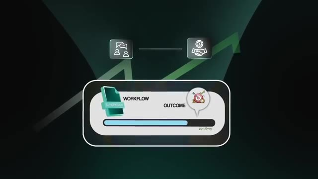
*⏱️ 00:01:23 — Un graphique conceptuel illustrant la transition d'un "Workflow" (processus) vers un "Outcome" (résultat attendu) via une barre de progression.*

*⏱️ 00:01:38 — Gros plan sur un éditeur de code affichant du langage C avec des fonctions de gestion mémoire.*

---

### ⏱️ `[00:01:46 - 00:02:10]` | Segment #05

**🔊 Audio (Transcription Intégrale Mot pour Mot en Français) :**
> How much money are you saving them or how much extra revenue are you unlocking? And what distractions or low value tasks are you removing so that they can spend their energy on things to actually grow the business. So keep it simple, that's it, those three things. If your agent doesn't clearly tie back to at least one of those three resources, it's not gonna sell. Now here's the kicker. Sometimes it's as simple as actually automating manual repetitive processes that a team is doing by hand without AI.

**👁️ Analyse Visuelle d'Écran (gemini-3.5-flash-lite) :**
**Interface & Outils** : Aucune interface logicielle, éditeur de code ou outil d'automatisation n'est visible. Il s'agit d'illustrations conceptuelles et de séquences de stock.

**Contenu textuel & Code** : Aucun code source, aucune commande terminal ni aucune donnée technique n'est affiché.

**Action / Démonstration** : Aucune action technique ou démonstration d'agent n'est réalisée.

---

### ⏱️ `[00:02:10 - 00:02:28]` | Segment #06

**🔊 Audio (Transcription Intégrale Mot pour Mot en Français) :**
> That alone is a huge save in time, money, and focus. And the funny part is a lot of business owners are just now becoming aware of standard automation in general because of the term AI. It's in the news, it's a buzzword, it's everywhere. And that's what basically opened their eyes to efficiency gains. And if you can deliver that AI or not, you'll make yourself incredibly valuable.

**👁️ Analyse Visuelle d'Écran (gemini-3.5-flash-lite) :**
**Interface & Outils** : Navigateur web (sites d'actualités et plateforme de lecture type Medium/Blog).

**Contenu textuel & Code** : Titres d'articles de presse et de réflexion sur les agents IA.

**Action / Démonstration** : Illustration visuelle du concept d'IA en tant que "buzzword" mentionné dans le discours pour souligner la prise de conscience des propriétaires d'entreprises.

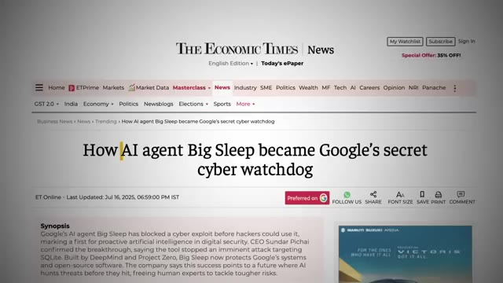
*⏱️ 00:02:19 — Capture d'écran d'un article de presse sur "The Economic Times" concernant l'agent IA "Big Sleep" de Google.*

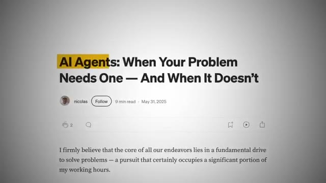
*⏱️ 00:02:23 — Capture d'écran d'un article en ligne intitulé "AI Agents: When Your Problem Needs One — And When It Doesn't".*

---

### ⏱️ `[00:02:28 - 00:02:48]` | Segment #07

**🔊 Audio (Transcription Intégrale Mot pour Mot en Français) :**
> So stop selling AI, start selling time, money and focus. And that's what actually closes deals. Reason number three is that value is about results, not time. The third reason no one's buying your AI agents is because you've got a massive misconception about what business owners value. I saw this in my comment section on a recent video, people saying things like, I feel sorry for that business owner because I made a video about a solution that only took me two hours to build.

**👁️ Analyse Visuelle d'Écran (gemini-3.5-flash-lite) :**
**Interface & Outils** : YouTube (plateforme de visionnage vidéo).

**Contenu textuel & Code** : Titre de la vidéo : "I built this AI Agent in 2 hours (and got paid $1200)" ; Texte à l'écran : "Value is about results, not time".

**Action / Démonstration** : Aucune manipulation logicielle ou démonstration technique en temps réel (uniquement des captures d'écran de présentation et des éléments graphiques illustratifs).

---

### ⏱️ `[00:02:48 - 00:03:23]` | Segment #08

**🔊 Audio (Transcription Intégrale Mot pour Mot en Français) :**
> But here's the reality, client was thrilled. He didn't care that it only took two hours to build. Why? the results were still the same. Business owners are not paying for the number of hours you put in. That's the mindset of an hourly employee. What they're paying for is the solution, the outcome. The fact that their pain point is solved and that their life or business just got easier. If you build something for someone and it saves them 20 hours a month, do you really think that they're going to complain that it only took you two hours to make? Of course not. What they're thinking is, man, I just got a system that saves me thousands of dollars worth of time for a one-time fee. That's a steal. So if you want to sell, you need to shift out of that employee mentality and into the problem solver mentality. Business owners love quick, effective

**👁️ Analyse Visuelle d'Écran (gemini-3.5-flash-lite) :**
**Interface & Outils** : Aucune interface logicielle ou outil technique n'est affiché.

**Contenu textuel & Code** : Aucun code, commande ou donnée technique n'est présent.

**Action / Démonstration** : Le présentateur parle de la valeur du travail vs le temps passé, sans manipulation d'outils de développement.

---

### ⏱️ `[00:03:23 - 00:03:57]` | Segment #09

**🔊 Audio (Transcription Intégrale Mot pour Mot en Français) :**
> solutions. They don't care about the time you spent. They care about the results you deliver. Once again, value is about results, not time. Reason number four, pick a niche. Don't be a generalist. The fourth reason no one is buying your AI agents is because you're trying to be everything to everyone. You've heard the saying, a jack of all trades is a master of none. And that's true. But here's the full saying, jack of all trades is a master of none, but oftentimes better than a master of one. You don't need to niche down so tightly that you're only building for barbershops, but you do need to pick a lane. For example, instead of barbershops, think broader, like hair and beauty. That way you can learn the common problems everyone in the industry faces and

**👁️ Analyse Visuelle d'Écran (gemini-3.5-flash-lite) :**
**Interface & Outils** : Aucune interface logicielle, éditeur de code ou outil d'automatisation n'est présent dans ces captures.

**Contenu textuel & Code** : Texte informatif relatif au marketing d'agents IA : "Value is about results", "Pick a niche", "A jack of all trades is a master of none", "Barber shops".

**Action / Démonstration** : Aucune action technique ou démonstration logicielle n'est effectuée.

---

### ⏱️ `[00:03:57 - 00:04:31]` | Segment #10

**🔊 Audio (Transcription Intégrale Mot pour Mot en Français) :**
> then design solutions that solve those repeated problems. So here's why this actually matters. If you know the space deeply, you can build a system once and then reuse 70 to 80% of it for multiple clients. You're not reinventing the wheel every time. Sure, you can't just mass sell generic templates, which unfortunately is a narrative that I see being pushed around way too often. Templates are commoditized and a bundle of templates isn't useful. But what you can do with a bundle of templates is start with a strong base and then tweak it with the subject matter expertise of each business owner so it fits perfectly into their systems. And this goes back to what I've always stressed. You want to be a problem solver who can speak the business owner's language.

**👁️ Analyse Visuelle d'Écran (gemini-3.5-flash-lite) :**
**Interface & Outils** : Outil d'automatisation de workflow (Make ou équivalent).

**Contenu textuel & Code** : "Download File URLs", "Split Out", "Download file", "Get URL", "Aggregate", "Create AI Image". Texte à l'écran : "REUSE 70 TO 80% OF IT". Texte schéma : "EXPERTISE", "STRONG BASE".

**Action / Démonstration** : Visualisation d'un processus automatisé étape par étape pour démontrer la réutilisabilité des systèmes.

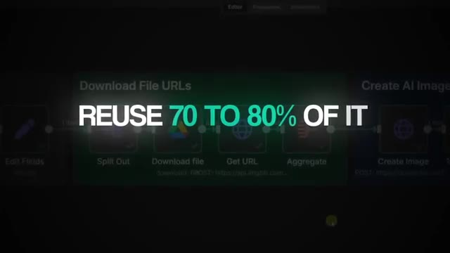
*⏱️ 00:04:06 — Interface d'un éditeur de workflow (type Make/n8n) montrant une séquence d'automatisation.*

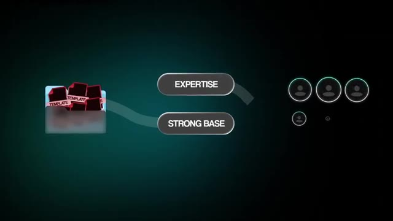
*⏱️ 00:04:23 — Schéma conceptuel illustrant une base de données de modèles connectée à l'expertise, distribuée à plusieurs clients.*

---

### ⏱️ `[00:04:32 - 00:05:02]` | Segment #11

**🔊 Audio (Transcription Intégrale Mot pour Mot en Français) :**
> If you're an expert in the industry, you can walk into a conversation and pitch them something that they didn't even realize they needed yet. And that instantly positions you as an expert in their eyes. The bonus is once you have proof from that niche, you can charge way more. You can confidently say I've worked with five other business owners just like you. I've delivered these exact results and I can do the same for you. That credibility makes your offer 10 times stronger and justifies higher pricing. Let's say you build a system that automatically follows up with leads for gyms. Once you've done it once, you can tweak that same build for a yoga studio, a boxing gym, or a CrossFit gym.

**👁️ Analyse Visuelle d'Écran (gemini-3.5-flash-lite) :**
**Interface & Outils** : n8n (éditeur de workflows d'automatisation)

**Contenu textuel & Code** : Workflow comprenant un "Telegram Trigger", des nœuds d'IA (GPT-4o/Claude), des intégrations Google Drive/Sheets et une interface de chat listant des étapes de traitement de données (Instagram/TikTok).

**Action / Démonstration** : Démonstration visuelle d'un agent d'automatisation traitant des données de réseaux sociaux et générant un document Google Docs via une interface de chat intégrée.

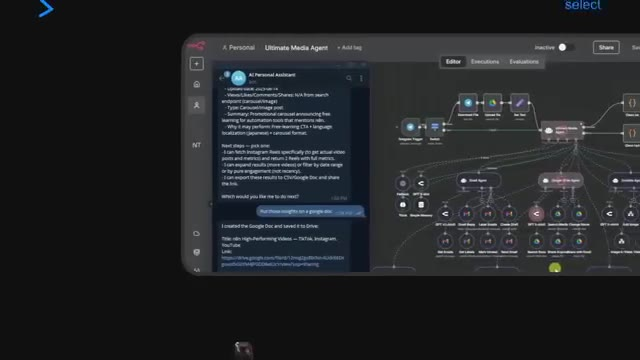
*⏱️ 00:04:54 — Interface de la plateforme n8n montrant un workflow complexe d'automatisation IA ("Ultimate Media Agent") avec une fenêtre de chat latérale simulant une interaction avec un assistant.*

---

### ⏱️ `[00:05:02 - 00:05:34]` | Segment #12

**🔊 Audio (Transcription Intégrale Mot pour Mot en Français) :**
> Same pain, same solutions, just a little customization. So don't try to be a generalist building random workflows for everyone, pick a niche, learn their pain points, and build repeatable solutions at scale. Reason number five is that you're trying to sell like everyone else. The fifth reason no one is buying your AI agents is because you're trying to sell like everyone else. Over the past few months, I've spoken to hundreds of business owners, and you know what nearly all of them complain about? The quality of service in the industry. They tell me about people who overcharge, overpromise, and underdeliver. Or the opposite, people who charge way too cheap and then don't deliver anything close to real value. Either way, the end result is the same.

**👁️ Analyse Visuelle d'Écran (gemini-3.5-flash-lite) :**
**Interface & Outils** : Aucune interface logicielle ou technique n'est visible.

**Contenu textuel & Code** : Texte affiché : "OVERCHARGE".

**Action / Démonstration** : Aucune démonstration technique ou manipulation n'est effectuée.

---

### ⏱️ `[00:05:34 - 00:05:52]` | Segment #13

**🔊 Audio (Transcription Intégrale Mot pour Mot en Français) :**
> disappointed business owners who don't trust the next person that pitches them. So that's the gap in the market. There's a huge opportunity for you if you can simply sell differently and deliver differently. Stop looking at each business as just a client that you can squeeze money out of. Start looking at them as a system you can add value to, an organization you can guide through a multi-year transition into being AI first.

**👁️ Analyse Visuelle d'Écran (gemini-3.5-flash-lite) :**
**Interface & Outils** : AUCUNE

**Contenu textuel & Code** : AUCUN

**Action / Démonstration** : AUCUNE

---

### ⏱️ `[00:05:52 - 00:06:12]` | Segment #14

**🔊 Audio (Transcription Intégrale Mot pour Mot en Français) :**
> Because here's the reality. It's not just one agent and done. For a company to truly become AI first, it's a long process. Years, not weeks. And the business owners know that. which means if you're the one who starts with them now, proves your value, executes consistently, and earns their trust, you'll be their go-to partner for every single step along that journey in their AI transformation. And here's something a lot of people don't realize.

**👁️ Analyse Visuelle d'Écran (gemini-3.5-flash-lite) :**
**Interface & Outils** : Aucune interface logicielle ou technique (code, terminal, workflow) n'est présentée.

**Contenu textuel & Code** : Texte informatif et titres liés à la stratégie commerciale (calendrier, piliers de confiance).

**Action / Démonstration** : Aucune action technique n'est démontrée ; il s'agit d'une séquence de présentation orale illustrée par du texte.

---

### ⏱️ `[00:06:12 - 00:06:32]` | Segment #15

**🔊 Audio (Transcription Intégrale Mot pour Mot en Français) :**
> Most businesses don't even know where to start with AI. Their first thought would be to turn to a big consulting firm like McKinsey, BCG, Accenture, one of those big guys. But those firms charge hundreds of thousands of dollars just for an audit or scoping. That's completely out of range for the majority of small to medium-sized businesses that want to get started with this. And the irony is these smaller businesses can actually move way faster.

**👁️ Analyse Visuelle d'Écran (gemini-3.5-flash-lite) :**
**Interface & Outils** : Aucune interface logicielle ou outil technique n'est présent dans ce segment.

**Contenu textuel & Code** : Aucun code, commande ou donnée technique n'est affiché.

**Action / Démonstration** : Aucune démonstration technique ou exécution d'agent n'est réalisée.

---

### ⏱️ `[00:06:32 - 00:06:57]` | Segment #16

**🔊 Audio (Transcription Intégrale Mot pour Mot en Français) :**
> They don't have as much red tape. You can get in front of real decision makers quickly and actually implement something in weeks rather than months. And that's a massive opportunity if you can position yourself correctly and sell your value. And part of selling differently means charging differently. Instead of just slapping a flat fee on every project, think about creative pricing models. Maybe something like a setup fee that covers your costs, plus a rev share model tied to money saved or hours saved compared to hiring another employee.

**👁️ Analyse Visuelle d'Écran (gemini-3.5-flash-lite) :**
**Interface & Outils** : Aucune (Il s'agit de graphismes d'illustration et d'incrustations textuelles).

**Contenu textuel & Code** : Texte promotionnel sur les modèles de tarification ("Setup", "Rev Share", "One-time Setup Fee").

**Action / Démonstration** : Aucune manipulation technique ou démonstration de logiciel n'est visible.

---

### ⏱️ `[00:06:57 - 00:07:17]` | Segment #17

**🔊 Audio (Transcription Intégrale Mot pour Mot en Français) :**
> Not saying that's the best way, just saying there's not really an industry standard way to price it. Everyone's trying to figure out pricing, but you want to make sure that you have a system so you can actually justify why you're charging what you're charging. That way, you're not just a service provider, you're aligned with their success. And that's the kind of partnership business owners are dying to find in this space. So if you want to stand out, don't sell like everyone else.

**👁️ Analyse Visuelle d'Écran (gemini-3.5-flash-lite) :**
**Interface & Outils** : AUCUNE

**Contenu textuel & Code** : AUCUN

**Action / Démonstration** : AUCUNE

---

### ⏱️ `[00:07:17 - 00:07:38]` | Segment #18

**🔊 Audio (Transcription Intégrale Mot pour Mot en Français) :**
> Execute differently, price differently, and think long term. Funnily enough, that's an example of how to get people to buy, and that's what we're going to cover now. So we just talked about why people are not buying your AI agents. Let's flip it. How do you actually get people to buy? The first thing you need to understand is this. You're not selling AI. You're not selling the agent or the workflow. By the time they come to you, they're already sold on the idea of using AI.

**👁️ Analyse Visuelle d'Écran (gemini-3.5-flash-lite) :**
**Interface & Outils** : n8n (workflow automation).

**Contenu textuel & Code** : Nœuds de workflow : "Telegram Trigger", "Download Voice File", "Personal Assistant" (central), "OpenAI Chat Model", "Window Buffer Memory", "Contact Database", et divers outils (email, calendar, research agents, vector store).

**Action / Démonstration** : Visualisation et explication de la logique de connexion entre les déclencheurs (triggers), les outils d'IA (LLMs) et les sources de données pour un agent de type assistant personnel.

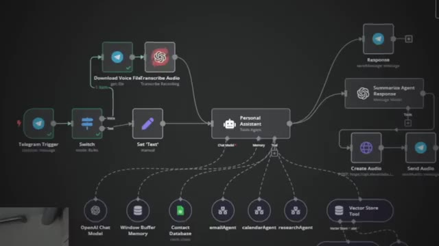
*⏱️ 00:07:33 — Vue détaillée d'un workflow automatisé sur une plateforme de type n8n montrant un assistant personnel connecté à diverses sources de données et outils.*

---

### ⏱️ `[00:07:39 - 00:08:03]` | Segment #19

**🔊 Audio (Transcription Intégrale Mot pour Mot en Français) :**
> So take me as an example. A lot of people come in already wanting N&M implementation. But here's the thing. They're not paying me for N&M workflows. If all they wanted was a workflow, they could grab one of the hundreds that are in my free school community, or they could go to N&M's website and grab one of the thousands that are there for free. So clearly that's not what they're looking for and that's not what they're buying. What they're really buying is you and your brain and your ability to understand their problems and translate that into a solution that fits their needs.

**👁️ Analyse Visuelle d'Écran (gemini-3.5-flash-lite) :**
**Interface & Outils** : n8n (éditeur de workflow et interface de plateforme éducative).

**Contenu textuel & Code** : Schémas de nœuds d'automatisation (Text/Image Input, Photoshop Agent, Brain, AI Image Gen, File Handling), titres de tutoriels (Learn JSON Basics, Learn Code Node, Personal Life Manager).

**Action / Démonstration** : Visualisation d'un workflow d'agent d'IA opérationnel et navigation dans une base de connaissances de ressources d'automatisation.

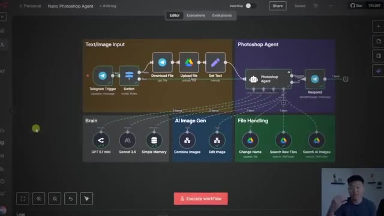
*⏱️ 00:07:45 — Interface de l'éditeur de workflow n8n montrant un agent complexe nommé "Nano Photoshop Agent" avec plusieurs nœuds interconnectés (Telegram, Google Drive, GPT-4, etc.).*

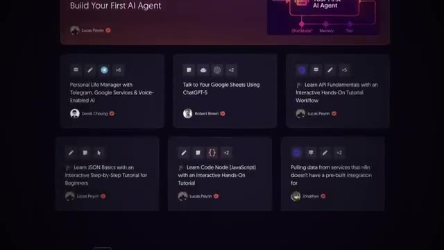
*⏱️ 00:07:51 — Capture d'une bibliothèque de cours ou de modèles "n8n" présentant diverses vignettes de tutoriels pratiques sur l'automatisation.*

---

### ⏱️ `[00:08:03 - 00:08:23]` | Segment #20

**🔊 Audio (Transcription Intégrale Mot pour Mot en Français) :**
> Think of yourself like a doctor. Patients don't show up to a hospital saying, I need ibuprofen. If all they needed was an over-the-counter medicine, they just go buy it themselves. They show up because they don't actually know what's wrong and they don't know what they need. They need a doctor to diagnose the problem and prescribe the right treatment. It's the same thing here. The free templates, all those random agents online, those are the over-the-counter ibuprofens.

**👁️ Analyse Visuelle d'Écran (gemini-3.5-flash-lite) :**
**Interface & Outils** : AUCUNE

**Contenu textuel & Code** : AUCUN

**Action / Démonstration** : AUCUNE

---

### ⏱️ `[00:08:23 - 00:08:57]` | Segment #21

**🔊 Audio (Transcription Intégrale Mot pour Mot en Français) :**
> ibuprofens. What business owners need is someone who can come in, diagnose what's really holding them back, and then prescribe the exact AI workflow or agent that's going to fix that problem for them. And once again, get them back time, money, and focus. And here's the key. People automatically buy the solution once the pain is crystal clear. You don't even have to hard sell it. You just have to make the cost of the pain bigger than the cost of the solution. So in your conversations with prospects, drill into what their pain is costing them in time, in money, and missed opportunities, then position your AI as the fix. When you do that, it becomes a no-brainer for them to say yes. And also think about this. If you're doing multiple calls with a prospect,

**👁️ Analyse Visuelle d'Écran (gemini-3.5-flash-lite) :**
**Interface & Outils** : Aucune interface logicielle ou outil technique n'est affiché.

**Contenu textuel & Code** : Texte graphique stylisé "AI AGENT" (Image 1) et "MONEY" (Image 3).

**Action / Démonstration** : Aucune action technique n'est démontrée, il s'agit d'éléments visuels d'illustration (B-roll).

*⏱️ 00:08:31 — Une animation graphique illustrant le concept d'un "AI AGENT", représenté par une icône stylisée de robot casqué à l'intérieur d'un cercle, avec des mains stylisées sur les côtés.*

---

### ⏱️ `[00:08:57 - 00:09:32]` | Segment #22

**🔊 Audio (Transcription Intégrale Mot pour Mot en Français) :**
> don't just show up on the second call trying to close them. Instead, build a custom roadmap. Do something different. Take that extra step that other vendors that they're probably talking to aren't doing. Here's what I could look in practice. On call one, you dig into their pain points. You map out what's hurting, where they're wasting time, money, and focus. Then before the next call, you put together a short audit, a wireframe, process map, whatever it is. It doesn't have to be too fancy. On the follow-up call, you say, here's what we mapped out together. Here's the solution I think could fix your problems. Am I understanding you correctly? This approach works because you're showing them that you actually listened. You're not just trying to sell them something generic. You've mapped their pain to your solution. This obviously builds trust and

**👁️ Analyse Visuelle d'Écran (gemini-3.5-flash-lite) :**
**Interface & Outils** : Interface graphique animée de style présentation (type Motion Design/Explainer).

**Contenu textuel & Code** : Texte affiché : "Short audit", "STRATEGY", "Wireframe", "Process map", "Here's the solution I think could fix your problems. If I'm understanding you...".

**Action / Démonstration** : Présentation visuelle des étapes d'un workflow de conseil client (audit, stratégie, wireframe, cartographie des processus) pour illustrer la création d'une "roadmap" personnalisée.

*⏱️ 00:09:14 — Capture montrant une icône de document ("Short audit") sous forme de post-it avec une animation graphique verte, illustrant une étape du processus de vente.*

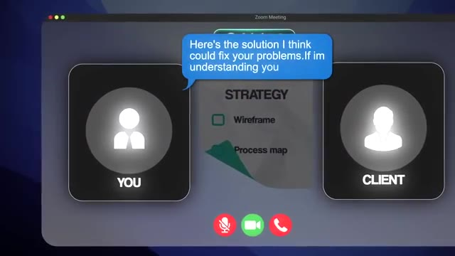
*⏱️ 00:09:23 — Interface de visioconférence (Zoom) stylisée montrant une interaction entre "You" (le vendeur) et "Client", avec une bulle de texte bleue affichant une proposition de solution et une liste de contrôle ("Strategy", "Wireframe", "Process map").*

---

### ⏱️ `[00:09:32 - 00:10:05]` | Segment #23

**🔊 Audio (Transcription Intégrale Mot pour Mot en Français) :**
> makes you stand out from almost everyone else who's probably trying to pitch them AI solutions right now. Okay, now let's talk about how to frame your pricing in a way that feels like a no-brainer. A good rule of thumb is 10 times ROI. Here's what I mean by that. If I told you right now to give me $10,000, but I said in the next year, I'd give you back $100,000, would you do it? For most people, that's an easy yes. Unless for some reason they desperately need that 10k right now. Your offer needs to feel the same way. If you're charging 5k for a system, you need to show them how it's going to generate at least 50k in value over time. That could be in direct money saved, revenue gained, or opportunity costs from all the hours that they're no longer wasting.

**👁️ Analyse Visuelle d'Écran (gemini-3.5-flash-lite) :**
**Interface & Outils** : Aucune interface logicielle ou technique n'est présente.

**Contenu textuel & Code** : Texte simple sur l'écran : "$5000" et des bulles de discussion concernant un prêt de 10 000 $ contre 100 000 $.

**Action / Démonstration** : Aucune action de démonstration technique ou d'exécution d'agent IA n'est réalisée.

---

### ⏱️ `[00:10:05 - 00:10:28]` | Segment #24

**🔊 Audio (Transcription Intégrale Mot pour Mot en Français) :**
> And here's the thing, that 10 times ROI exists in almost every automation you could possibly build. The problem is your clients won't go calculate it for themselves. They won't naturally just go connect all those dots between three wasted hours a week and tens of thousands of dollars and lost opportunity over the course of a year. So that is your job. You have to shed light on it. You have to clearly communicate the ROI and then press on that pain of what it's costing them right now.

**👁️ Analyse Visuelle d'Écran (gemini-3.5-flash-lite) :**
**Interface & Outils** : Graphique animé (Motion Design) intégré à la vidéo.

**Contenu textuel & Code** : Texte affiché : "3 WASTED HOURS", "LOST OPPORTUNITY", "Year".

**Action / Démonstration** : Visualisation schématique du concept d'opportunité manquée liée à la perte de temps.

*⏱️ 00:10:22 — Schéma conceptuel sur fond sombre illustrant la corrélation annuelle entre "3 WASTED HOURS" et "LOST OPPORTUNITY" reliés par un nœud central "Year".*

---

### ⏱️ `[00:10:28 - 00:10:48]` | Segment #25

**🔊 Audio (Transcription Intégrale Mot pour Mot en Français) :**
> Because once you frame it like that, your solution doesn't feel like an expense. It's a no brainer investment, like I said, with a measurable return. And the bonus is when you actually take the extra mile to make these ROI calculations, you're just creating a built-in case study, which you can literally show the client. Here's exactly where your business was three months ago. And here's where it is now after you started working with me and I helped you put in these automations.

**👁️ Analyse Visuelle d'Écran (gemini-3.5-flash-lite) :**
**Interface & Outils** : Aucune

**Contenu textuel & Code** : Aucun

**Action / Démonstration** : Aucune

---

### ⏱️ `[00:10:49 - 00:11:21]` | Segment #26

**🔊 Audio (Transcription Intégrale Mot pour Mot en Français) :**
> And now you can ask for testimonial because you're only going to get one if someone actually felt like they received value from you. And when you can prove it with numbers and it objectively lives there, then it becomes a no-brainer for them to give you a video testimonial. So now you have that for your website. You've got a case study for your marketing materials and proof that you can share in content and on sales calls. You've just created an endless flywheel. Every happy client turns into more business. And yes, the hardest one to get is always your first customer. But once you have that first one documented, everything will become 10 times easier. So to recap, the reason no one's buying your AI builds isn't because you're a beginner. It's because of how you're selling.

**👁️ Analyse Visuelle d'Écran (gemini-3.5-flash-lite) :**
**Interface & Outils** : Interface graphique de présentation (utilisée pour illustrer les piliers de preuves sociales).

**Contenu textuel & Code** : Texte affiché : "case study", "website", "proof".

**Action / Démonstration** : Transition visuelle illustrant les trois types de preuves nécessaires pour obtenir un témoignage vidéo.

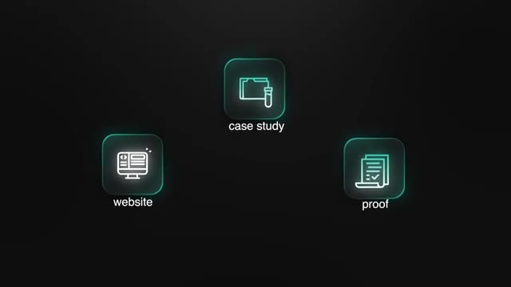
*⏱️ 00:11:05 — Graphique minimaliste sur fond noir présentant trois icônes lumineuses (style néon) : "case study" (dossier), "website" (ordinateur) et "proof" (documents).*

---

### ⏱️ `[00:11:21 - 00:11:54]` | Segment #27

**🔊 Audio (Transcription Intégrale Mot pour Mot en Français) :**
> You need to sell the outcome, not the tool. You need to focus on time, money, and focus. You need to stop charging by the hour. You need to pick a niche. You need to sell differently. And you need to prove ROI. If you can do those things, you'll stand out instantly. And listen, I didn't start with experience, I was a 22 year old kid who just quit his job and was hopping on calls with business owners. And I had no idea how to speak their language. And now that I've spoken to tons of different business owners across tons of different industries, different sizes of businesses, I've got a good grasp on how to speak their language. And this whole ROI thing becomes very clear. Now that you've heard all this and you have a roadmap, the only question is, are you going to

**👁️ Analyse Visuelle d'Écran (gemini-3.5-flash-lite) :**
**Interface & Outils** : Aucune interface logicielle, éditeur de code ou terminal de commande n'est présent dans ces captures.

**Contenu textuel & Code** : Aucun code source, commande, ou prompt n'est visible.

**Action / Démonstration** : Aucune action technique, compilation ou exécution d'agent n'est montrée.

---

### ⏱️ `[00:11:54 - 00:12:18]` | Segment #28

**🔊 Audio (Transcription Intégrale Mot pour Mot en Français) :**
> start selling the right way? So I know that that was a lot to take in. So what I've done for you guys is thrown all of this that we just talked about into a free resource that you guys can grab from my school community. The link for that is down in the description. Once again, completely free. And if you're looking to take this a little further and connect with other people who are monetizing their N8N and AI automation knowledge, then definitely check out my plus community. The link for that is down in the description. Definitely check it out. And if you liked this type of video, there's more of that type of stuff in the community. So that's going to do it for today.

**👁️ Analyse Visuelle d'Écran (gemini-3.5-flash-lite) :**
**Interface & Outils** : Plateforme communautaire Skool.

**Contenu textuel & Code** : Texte promotionnel "Learn the Foundations", "Agent Zero", et détails tarifaires ($89/month).

**Action / Démonstration** : Navigation sur la page de présentation de la communauté et affichage des ressources éducatives proposées aux membres.

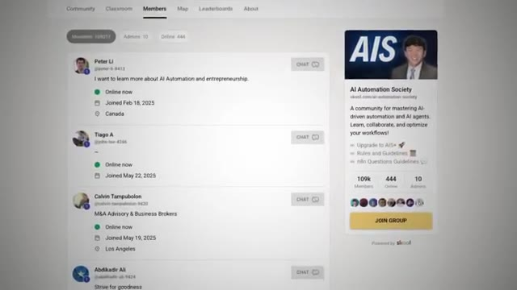
*⏱️ 00:12:06 — Capture d'écran de l'interface de la communauté Skool "AI Automation Society" affichant la liste des membres connectés et les statistiques de la plateforme.*

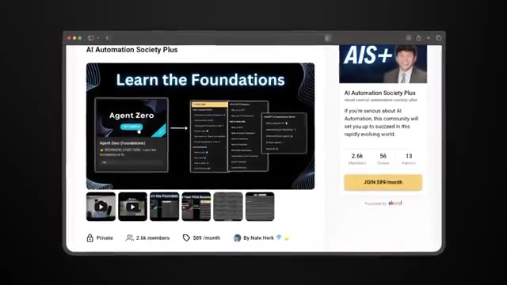
*⏱️ 00:12:12 — Capture d'écran montrant la page de vente de la communauté "AI Automation Society Plus" sur Skool, mettant en avant le programme "Agent Zero" et le tarif d'abonnement.*

---

### ⏱️ `[00:12:18 - 00:12:27]` | Segment #29

**🔊 Audio (Transcription Intégrale Mot pour Mot en Français) :**
> I hope you guys find this one insightful. If you did, or if you enjoyed, please give it a like. That helps me out a ton. And as always, I appreciate you guys making it to the end of the video. I'll see you on the next one. Thanks guys.

**👁️ Analyse Visuelle d'Écran (gemini-3.5-flash-lite) :**
**Interface & Outils** : AUCUNE

**Contenu textuel & Code** : AUCUNE

**Action / Démonstration** : Le présentateur s'adresse directement à son audience pour les remercier et les inciter à liker la vidéo.

---

