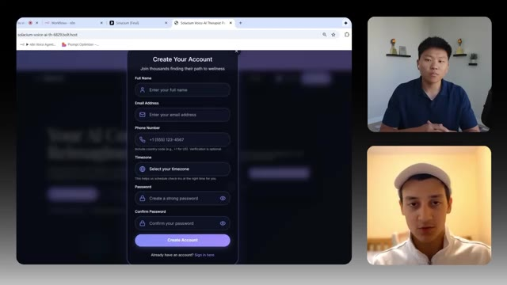
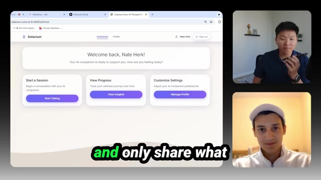
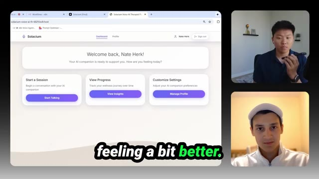
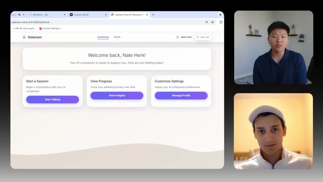
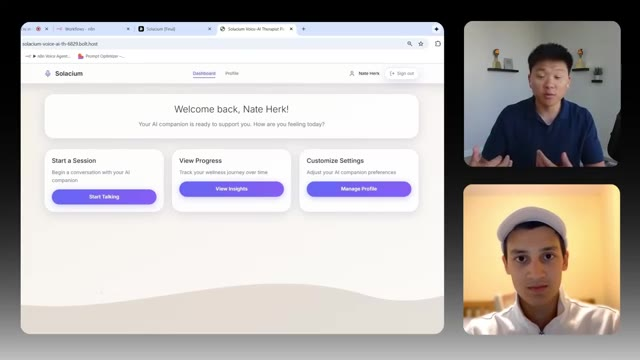
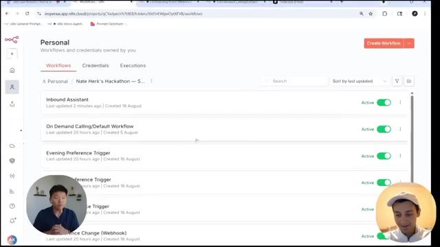
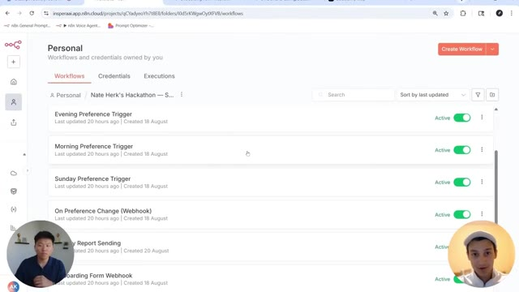
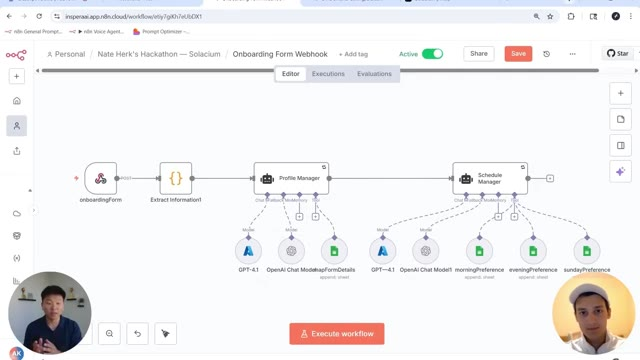
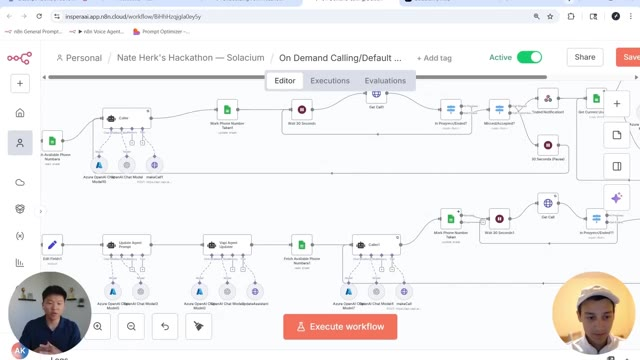

# 🎬 This Vapi + n8n Voice Agent Won $5,000 in Just 21 Days

> **Chaîne** : [Nate Herk | AI Automation](https://www.youtube.com/@nateherk/featured)  
> **Lien YouTube** : [https://www.youtube.com/watch?v=7siRW0My05o](https://www.youtube.com/watch?v=7siRW0My05o)  
> **Date de publication** : 20250917  
> **Durée** : 00:18:50  
> **Identifiant vidéo** : `7siRW0My05o`  
> **Transcription & Analyse** : `whisper-v3-large-turbo+gemini-3.5-flash-lite`  

---

## 📌 Synthèse Exécutive & Outils

### 💡 Résumé
Dans cette vidéo intitulée **Comment cet agent vocal Vapi + n8n a gagné 5 000 $ en seulement 21 jours**, Nate Herk décortique les capacités pratiques d'automatisation et de développement propulsées par les modèles de pointe.

### 🛠️ Outils, Modèles & Logiciels Présentés
- **Opus 5.5 & Claude Code** : Modèles d'ingénierie et agents de codage autonome.

### 🔑 Points Clés & Enseignements Stratégiques
- Optimiser le niveau d'effort et le raisonnement des modèles IA pour des résultats industriels.
- Automatiser les cycles de création logicielle de bout en bout.

---

## ⏱️ Chronologie & Transcription Complète Audio & Visuelle (Mot pour Mot)

### ⏱️ `[00:00:00 - 00:00:18]` | Segment #01

**🔊 Audio (Transcription Intégrale Mot pour Mot en Français) :**
> Today we have a really exciting one. We're going to be going over the winning submission from our first community hackathon that took home $5,000. And in this interview with the winner, we found out that he'd only been playing around with this kind of stuff for about six months now and he's still in high school. So I hope that's inspiring to you guys. There were hundreds of people that participated in this hackathon and this is the one that we crowned the winner.

**👁️ Analyse Visuelle d'Écran (gemini-3.5-flash-lite) :**
**Interface & Outils** : Aucun

**Contenu textuel & Code** : Aucun

**Action / Démonstration** : Présentation orale par le narrateur.

---

### ⏱️ `[00:00:19 - 00:00:39]` | Segment #02

**🔊 Audio (Transcription Intégrale Mot pour Mot en Français) :**
> So let's dive into the actual build. Alright guys, so today I'm here with Azim. He was the winner of the first hackathon within our paid community, AI Automation Society Plus. This was a hackathon that was three weeks long, and all that they were told was that they needed to build a voice agent, and the backend integration needed to be ended in. Like I said, he was the winner of the $5,000 and the first place prize for this hackathon.

**👁️ Analyse Visuelle d'Écran (gemini-3.5-flash-lite) :**
**Interface & Outils** : Aucune (appel vidéo en écran divisé).

**Contenu textuel & Code** : Aucun.

**Action / Démonstration** : Discussion introductive entre les deux personnes.

---

### ⏱️ `[00:00:40 - 00:01:01]` | Segment #03

**🔊 Audio (Transcription Intégrale Mot pour Mot en Français) :**
> So he's going to walk us through what he built, how he thought of it, and what he plans to do with this winning solution. So I'll hand it over to you real quick. If you want to give a quick intro, talk about the tech stack you used and what the voice agent does, and then we'll just dive into a demo. Hey guys, it's Ian here. So as Nate mentioned, I took part of the August AAS Plus hackathon and I delivered a mental health web app.

**👁️ Analyse Visuelle d'Écran (gemini-3.5-flash-lite) :**
**Interface & Outils** : Aucune interface logicielle ou outil de développement n'est visible.

**Contenu textuel & Code** : Aucun code, aucune ligne de commande ou élément graphique lié au projet n'est présent.

**Action / Démonstration** : Les deux personnes sont en train de discuter, aucune manipulation d'outil ou démonstration n'est en cours dans ce segment.

---

### ⏱️ `[00:01:01 - 00:01:21]` | Segment #04

**🔊 Audio (Transcription Intégrale Mot pour Mot en Français) :**
> It was powered by a custom coded Bolt.new web app, nine NAN workflows as the backend, and VAPI for hosting the voice agents. Cool. Yeah, Azeem, real quick before we hop in, I'd be curious, like, what is your background like as far as how technical were you and how long you've been playing with Bolt, NAN, stuff like that? Yeah, so with NAN and voice agents, I got started around six months ago.

**👁️ Analyse Visuelle d'Écran (gemini-3.5-flash-lite) :**
**Interface & Outils** : Aucune interface logicielle ou outil technique n'est visible.

**Contenu textuel & Code** : Aucun code, schéma ou interface utilisateur n'est présent à l'écran.

**Action / Démonstration** : Discussion conversationnelle entre les deux interlocuteurs.

---

### ⏱️ `[00:01:21 - 00:01:40]` | Segment #05

**🔊 Audio (Transcription Intégrale Mot pour Mot en Français) :**
> I had pretty much no prior technical experience. I just learned my way through courses and YouTube videos like yours. I still remember two months ago, I was just sitting and watching your videos. And Bold on You was something that was pretty much new to me before I used it to blackcode myself a website. Other than that, my experience with it was pretty limited.

**👁️ Analyse Visuelle d'Écran (gemini-3.5-flash-lite) :**
**Interface & Outils** : Aucune interface logicielle ou technique n'est présente, il s'agit uniquement d'une vue de webcam.

**Contenu textuel & Code** : Aucun code, commande ou graphique.

**Action / Démonstration** : Les deux personnes sont en train de discuter en visioconférence.

---

### ⏱️ `[00:01:40 - 00:02:00]` | Segment #06

**🔊 Audio (Transcription Intégrale Mot pour Mot en Français) :**
> That is super awesome. I hope that that's inspiring for everyone watching that wants to get started building solutions and maybe is looking to monetize their knowledge. Everyone thinks the answer is an AI agency, but apparently the answer is to do an AIS plus app. Definitely is. Okay, cool. So I think let's hop over to the web app. Let's take a look at how it works and then just kind of dive into it.

**👁️ Analyse Visuelle d'Écran (gemini-3.5-flash-lite) :**
**Interface & Outils** : Présentation ou face-caméra explicatif sans interface logicielle partagée.

**Contenu textuel & Code** : Explications orales et mise en contexte méthodologique.

**Action / Démonstration** : Explications face caméra et démonstration conceptuelle.

---

### ⏱️ `[00:02:00 - 00:02:18]` | Segment #07

**🔊 Audio (Transcription Intégrale Mot pour Mot en Français) :**
> Yeah, for sure. Yeah, so Overture is the web app. We can just go ahead and sign up right now. So it looks like when you do your little onboarding, you've got full name, email address, phone number, time zone, and then you create a password. And then where does this account information get stored on the backend? Yeah, if we're that backend, I not only use Bolt, I also use Google Firebase.

**👁️ Analyse Visuelle d'Écran (gemini-3.5-flash-lite) :**
**Interface & Outils** : Présentation ou face-caméra explicatif sans interface logicielle partagée.

**Contenu textuel & Code** : Explications orales et mise en contexte méthodologique.

**Action / Démonstration** : Explications face caméra et démonstration conceptuelle.

---

### ⏱️ `[00:02:18 - 00:02:36]` | Segment #08

**🔊 Audio (Transcription Intégrale Mot pour Mot en Français) :**
> So that's good for simple authentication with the email and password. That's also where people's user IDs and other such information gets stored. Cool. So that information gets stored. So the conversations they're having with these AI therapists is very tailored towards them. Yeah. Awesome. Awesome. Cool. So yeah, let's get me signed up. And yeah, we're here.

**👁️ Analyse Visuelle d'Écran (gemini-3.5-flash-lite) :**
**Interface & Outils** : Navigateur web (Bolt.new / application web Solacium).

**Contenu textuel & Code** : Formulaire de création de compte utilisateur avec champs de saisie (Full Name, Email Address, Phone Number, Timezone, Password, Confirm Password).

**Action / Démonstration** : Présentation visuelle de l'interface d'authentification et de collecte des données utilisateur pour le service de thérapie par IA.

*⏱️ 00:02:23 — Une page d'inscription utilisateur pour une application nommée "Solacium" s'affichant dans un navigateur web, incluant des champs pour le nom, l'email, le téléphone, le fuseau horaire et le mot de passe.*

---

### ⏱️ `[00:02:37 - 00:03:09]` | Segment #09

**🔊 Audio (Transcription Intégrale Mot pour Mot en Français) :**
> Sent that email verification. Let me go sign in and get that verified. Okay. So now we're getting to the next stage of the onboarding where it's going to ask us some questions. So this first one is What brings you here today? Tell us about your current situation and what you'd like support with So it looks like there's five total questions And the point of these is just to make the profile very tailored So that people when they come here for mental health support They can have conversations with what feels more like a human Exactly, so it's not some generic voice agent or some bot Awesome, I love that Yeah, let's get me onboarded and then we'll check back in with everyone Cool

**👁️ Analyse Visuelle d'Écran (gemini-3.5-flash-lite) :**
**Interface & Outils** : Présentation ou face-caméra explicatif sans interface logicielle partagée.

**Contenu textuel & Code** : Explications orales et mise en contexte méthodologique.

**Action / Démonstration** : Explications face caméra et démonstration conceptuelle.

---

### ⏱️ `[00:03:09 - 00:03:28]` | Segment #10

**🔊 Audio (Transcription Intégrale Mot pour Mot en Français) :**
> So it looks like we're going to complete the setup and then we will give this voice agent a call or it will give us a call, either or. Okay, cool. So on the main screen, users will be able to start a session. They can view progress or they can customize those settings of their AI companion. But yeah, let's just start talking to the AI companion.

**👁️ Analyse Visuelle d'Écran (gemini-3.5-flash-lite) :**
**Interface & Outils** : Présentation ou face-caméra explicatif sans interface logicielle partagée.

**Contenu textuel & Code** : Explications orales et mise en contexte méthodologique.

**Action / Démonstration** : Explications face caméra et démonstration conceptuelle.

---

### ⏱️ `[00:03:29 - 00:03:48]` | Segment #11

**🔊 Audio (Transcription Intégrale Mot pour Mot en Français) :**
> Okay, so now it's connected to the therapist. Is this going to trigger a call to me? Yeah, exactly. So over here, it said, expect to receive a call soon. And within just a minute, I should get a call. Okay, sweet. So it hit an NAN workflow and the NAN workflow is going to trigger off that call API or is it hitting VAPI or what's going on right now?

**👁️ Analyse Visuelle d'Écran (gemini-3.5-flash-lite) :**
**Interface & Outils** : Présentation ou face-caméra explicatif sans interface logicielle partagée.

**Contenu textuel & Code** : Explications orales et mise en contexte méthodologique.

**Action / Démonstration** : Explications face caméra et démonstration conceptuelle.

---

### ⏱️ `[00:03:49 - 00:04:07]` | Segment #12

**🔊 Audio (Transcription Intégrale Mot pour Mot en Français) :**
> Yeah. So it's going to hit the NAN workflow. Then it's going to use the details you just gave to create a personalized agent. So every time you want to get a call, it keeps personalizing your agent further and further. And then it triggers VAPI, which places an outbound call to you. Great. Sweet. Well, I'm getting that right now. So I'm going to go ahead and answer it. Put it on speakerphone.

**👁️ Analyse Visuelle d'Écran (gemini-3.5-flash-lite) :**
**Interface & Outils** : Présentation ou face-caméra explicatif sans interface logicielle partagée.

**Contenu textuel & Code** : Explications orales et mise en contexte méthodologique.

**Action / Démonstration** : Explications face caméra et démonstration conceptuelle.

---

### ⏱️ `[00:04:08 - 00:04:34]` | Segment #13

**🔊 Audio (Transcription Intégrale Mot pour Mot en Français) :**
> I'm sorry. Could you repeat that? Of course, Nate. I just wanted to say hi and let you know I'm here whenever you want to talk. How are things feeling for you today? Yeah, well, thanks for checking in. I'm feeling pretty stressed because there's a lot that's going on at work. Whatever you need, I'm here. Yeah, I appreciate that. You know, I've never talked to an AI companion before, so I don't know how comfortable I currently feel with sharing details about my personal life to you.

**👁️ Analyse Visuelle d'Écran (gemini-3.5-flash-lite) :**
**Interface & Outils** : Présentation ou face-caméra explicatif sans interface logicielle partagée.

**Contenu textuel & Code** : Explications orales et mise en contexte méthodologique.

**Action / Démonstration** : Explications face caméra et démonstration conceptuelle.

---

### ⏱️ `[00:04:34 - 00:05:08]` | Segment #14

**🔊 Audio (Transcription Intégrale Mot pour Mot en Français) :**
> But yeah, let's just take some deep breaths. absolutely nate i'm glad you know no rush you know inhale gently through your nose hold for a moment and exhale slowly through your mouth let's do it a couple more times inhale hold you know no need to rush just notice how your body feels with each other if you want we can keep going a bit longer or hear and chat about anything else

**👁️ Analyse Visuelle d'Écran (gemini-3.5-flash-lite) :**
**Interface & Outils** : Navigateur web (Bolt.new / application web personnalisée).

**Contenu textuel & Code** : Dashboard avec le message "Welcome back, Nate Herk!" et trois cartes d'action : "Start a Session", "View Progress" et "Customize Settings".

**Action / Démonstration** : Présentation de l'interface utilisateur de l'application "Solacium" lors d'une conversation en direct avec un agent IA.

*⏱️ 00:04:43 — Interface web d'une application nommée "Solacium" affichant un tableau de bord utilisateur avec des options pour démarrer une session, consulter les progrès ou gérer les paramètres.*

---

### ⏱️ `[00:05:08 - 00:05:41]` | Segment #15

**🔊 Audio (Transcription Intégrale Mot pour Mot en Français) :**
> yeah i'm feeling a lot better now thank you let's end the conversation for today but i will check in another time. I'm really glad to like, hey, there's no problem. If you want to talk to him, I'll be here to listen and say. I like that. Awesome. Yeah. I think the first thing I noticed is that it sounds really nice. And in this case, we didn't put a preference for a gender, but I got a male and I noticed that he was actually kind of pausing and it felt very

**👁️ Analyse Visuelle d'Écran (gemini-3.5-flash-lite) :**
**Interface & Outils** : Navigateur web (Bolt.new) affichant l'interface utilisateur de l'application Solacium.

**Contenu textuel & Code** : Dashboard utilisateur accueillant "Nate Herk" avec les boutons "Start Talking", "View Insights" et "Manage Profile".

**Action / Démonstration** : Présentation visuelle du tableau de bord de l'application thérapeutique par IA en fin de session.

*⏱️ 00:05:17 — Une capture d'écran montrant l'interface web de l'application "Solacium", un compagnon IA de bien-être, avec des options pour démarrer une session, voir ses progrès et personnaliser les paramètres.*

---

### ⏱️ `[00:05:41 - 00:06:14]` | Segment #16

**🔊 Audio (Transcription Intégrale Mot pour Mot en Français) :**
> natural and the voice was very good and it wasn't aggressive at all you know so i think that was pretty cool so after that conversation do you think that there's any insights that will be populated here or once the call has ended what else goes on in the back yeah so once the call ends a separate ai agent takes the transcript and the summary of the call and then it condenses and updates your user profile from there it's able to personalize future calls because now it has information about your last call, as well as your overall history with the agent.

**👁️ Analyse Visuelle d'Écran (gemini-3.5-flash-lite) :**
**Interface & Outils** : Application web "Solacium" (hébergée sur bolt.new), affichée dans un navigateur web.

**Contenu textuel & Code** : Interface utilisateur avec le message d'accueil "Welcome back, Nate Herk!", et trois options principales : "Start a Session", "View Progress" (pour les insights), et "Customize Settings".

**Action / Démonstration** : Présentation de l'interface utilisateur de l'application générée, illustrant l'endroit où les insights de la conversation seront consultables après la fin de l'appel.

*⏱️ 00:05:50 — Une capture d'écran montrant l'interface web de l'application "Solacium", un tableau de bord pour un compagnon IA, affichant des boutons pour démarrer une session, visualiser les progrès et gérer les paramètres.*

---

### ⏱️ `[00:06:14 - 00:06:35]` | Segment #17

**🔊 Audio (Transcription Intégrale Mot pour Mot en Français) :**
> Okay, super cool. So the more and more you use this thing, the smarter and smarter it's going to get about you and helping you out with your problems. So at this point, I think we've seen the way that this has all kind of come together from that front end user experience. I'd love to dive into some of those initial end-in workflows that are doing things and helping you out with the onboarding, with triggering the calls and everything like that.

**👁️ Analyse Visuelle d'Écran (gemini-3.5-flash-lite) :**
**Interface & Outils** : Navigateur web affichant l'application SaaS "Solacium".

**Contenu textuel & Code** : Texte d'accueil "Welcome back, Nate Herk!", boutons d'action avec les labels "Start Talking", "View Insights" et "Manage Profile".

**Action / Démonstration** : Démonstration de l'interface utilisateur finale (frontend) de l'application de thérapie par IA après sa configuration.

*⏱️ 00:06:20 — Interface web du tableau de bord "Solacium" présentant un message de bienvenue personnalisé et trois options de navigation principales : "Start a Session", "View Progress" et "Customize Settings".*

---

### ⏱️ `[00:06:36 - 00:07:01]` | Segment #18

**🔊 Audio (Transcription Intégrale Mot pour Mot en Français) :**
> Yeah, for sure. Let's go ahead and dive into that. Absolutely. Let's just kind of take them in chronological order and see what you did. Yeah. So here I am inside my NAN workspace. As you can see here, these were nine NAN workflows and also the nine biggest pains of my life, but I'm glad that I sorted them out. So first, why don't we just start with the onboarding form webhook and see how your data was logged. So over here, this onboarding form webhook workflow is actually quite simple.

**👁️ Analyse Visuelle d'Écran (gemini-3.5-flash-lite) :**
**Interface & Outils** : n8n (plateforme d'automatisation de workflows).

**Contenu textuel & Code** : Liste de workflows nommés : "Inbound Assistant", "On Demand Calling/Default Workflow", "Evening Preference Trigger", "Morning Preference Trigger", "Sunday Preference Trigger", "On Preference Change (Webhook)", "Daily Report Sending", "Onboarding Form Webhook".

**Action / Démonstration** : Navigation et consultation de la bibliothèque de workflows au sein du workspace n8n.

*⏱️ 00:06:42 — Vue d'ensemble de l'interface n8n affichant une liste de workflows actifs sous le projet "Nate Herk's Hackathon".*

*⏱️ 00:06:48 — Défilement vers le bas de la même liste de workflows n8n, révélant des déclencheurs basés sur les préférences et des webhooks.*

---

### ⏱️ `[00:07:01 - 00:07:22]` | Segment #19

**🔊 Audio (Transcription Intégrale Mot pour Mot en Français) :**
> The first node we have here is a regular webhook node. It's designed so that as soon as somebody completes their onboarding and fills out that form. The data all gets captured and sent over to here. After that is done, we have a code node extracting the exact fields we need. And then that's passed over to these two NAM agents. So the first AI agent we have over here is the profile manager.

**👁️ Analyse Visuelle d'Écran (gemini-3.5-flash-lite) :**
**Interface & Outils** : Plateforme d'automatisation n8n (éditeur de workflow).

**Contenu textuel & Code** : Diagramme de flux : Webhook -> Code (Extract Information) -> Agents AI (Profile Manager, Schedule Manager) -> Intégrations (GPT-4, OpenAI Chat, Google Sheets).

**Action / Démonstration** : Présentation visuelle de la structure du workflow d'automatisation pour le traitement des données d'onboarding.

*⏱️ 00:07:06 — Une vue du canevas n8n montrant un workflow automatisé commençant par un noeud 'onboardingForm' suivi d'un noeud d'extraction de code, reliés à deux agents principaux : 'Profile Manager' et 'Schedule Manager', chacun connectés à plusieurs outils externes (GPT-4, Google Sheets).*

---

### ⏱️ `[00:07:23 - 00:07:58]` | Segment #20

**🔊 Audio (Transcription Intégrale Mot pour Mot en Français) :**
> Essentially, it manages your main profile with one Google Sheet tool where it maps all of the form details to your newly created profile. After that, it gets passed down to this AI agent over which can make customizations to your profile based on each of the preferences you picked. So in this case, if Nate decided to pick the morning and evening preference, this wouldn't have went ahead and added him to these sheets. And overall, it's just a pretty simple setup. For anyone that's never done like a web app, like with Bolt or Lovable, sending data to an end-to-end workflow, like Azim said, it's a pretty simple webhook and all

**👁️ Analyse Visuelle d'Écran (gemini-3.5-flash-lite) :**
**Interface & Outils** : Présentation ou face-caméra explicatif sans interface logicielle partagée.

**Contenu textuel & Code** : Explications orales et mise en contexte méthodologique.

**Action / Démonstration** : Explications face caméra et démonstration conceptuelle.

---

### ⏱️ `[00:07:58 - 00:08:34]` | Segment #21

**🔊 Audio (Transcription Intégrale Mot pour Mot en Français) :**
> all you have to do is you just actually drop that webhook URL to Bolt and say, when the user clicks on this button, send data here. And so that's a really cool way to link a custom front end with a custom backend. And then obviously the possibilities are endless. So this is a really nice setup here, Azeem. The data gets sent to these different two AI agents that log information about the user so that later it can look up that information to make sure that the call is tailored towards them. So super cool. Let's take a look at the next edit workflow. So as you can see here, this is the monster workflow that just initiated that call to Nate. Yeah. Okay. So this

**👁️ Analyse Visuelle d'Écran (gemini-3.5-flash-lite) :**
**Interface & Outils** : Plateforme d'automatisation n8n (insperaai.app.n8n.cloud).

**Contenu textuel & Code** : Le workflow inclut un trigger "onboardingForm", une étape "Extract Information1", et deux nœuds d'agents : "Profile Manager" et "Schedule Manager". Ces nœuds sont reliés à divers modèles (GPT-4) et outils (Google Sheets) via des connexions filaires.

**Action / Démonstration** : Visualisation et configuration du flux logique de données entre un formulaire d'onboarding et des agents IA spécialisés dans la gestion de profils et d'agendas.

*⏱️ 00:08:07 — Une capture d'écran de l'interface n8n montrant un workflow d'automatisation nommé "Onboarding Form Webhook" avec deux agents IA principaux connectés.*

---

### ⏱️ `[00:08:34 - 00:08:56]` | Segment #22

**🔊 Audio (Transcription Intégrale Mot pour Mot en Français) :**
> is the one that kind of launches calls and then stores information. Exactly. And this one is for the on-demand calling. So that's when you click the button inside. This runs with exact calls that you make yourself. Okay, cool. Cool. So you know what I love about this and we'll take a look and we'll zoom in a little bit in a sec. But you guys can see here that this is a pretty linear flow where there's a lot of conditional checks.

**👁️ Analyse Visuelle d'Écran (gemini-3.5-flash-lite) :**
**Interface & Outils** : Présentation ou face-caméra explicatif sans interface logicielle partagée.

**Contenu textuel & Code** : Explications orales et mise en contexte méthodologique.

**Action / Démonstration** : Explications face caméra et démonstration conceptuelle.

---

### ⏱️ `[00:08:56 - 00:09:32]` | Segment #23

**🔊 Audio (Transcription Intégrale Mot pour Mot en Français) :**
> There's a few agents every once in a while, but it doesn't seem very autonomous. And I like the way you design this because it keeps you in control pretty much the whole way. And by the way, we're not gonna be able to dive into every single node and all the configurations in this video. But if you guys do want to access all of the templates that Azim's built here and check out what a $5,000 voice agent build looks like, then you can download this template in the community, which I will link down below as well. But yeah, Zim, let's go ahead and zoom in a little bit. And you don't have to go into every single node, but just kind of at a high level, let's take sections of the workflow and you can explain what they're doing. Yeah, so with the last workflow, we're going

**👁️ Analyse Visuelle d'Écran (gemini-3.5-flash-lite) :**
**Interface & Outils** : Présentation ou face-caméra explicatif sans interface logicielle partagée.

**Contenu textuel & Code** : Explications orales et mise en contexte méthodologique.

**Action / Démonstration** : Explications face caméra et démonstration conceptuelle.

---

### ⏱️ `[00:09:32 - 00:10:05]` | Segment #24

**🔊 Audio (Transcription Intégrale Mot pour Mot en Français) :**
> to start with another webhook. And this webhook is activated as soon as somebody fills out the form to receive a call. After the information is extracted, we have a small segment over here that's actually responsible for checking the safety of the user's query. So if the safety check finds that somebody is in an emergency or a crisis is going to go ahead and route this to an emergency response path, which in the real world would alert emergency services so they can take proper action to help that person. I think that was a really cool thing that you added in there. So then what

**👁️ Analyse Visuelle d'Écran (gemini-3.5-flash-lite) :**
**Interface & Outils** : Présentation ou face-caméra explicatif sans interface logicielle partagée.

**Contenu textuel & Code** : Explications orales et mise en contexte méthodologique.

**Action / Démonstration** : Explications face caméra et démonstration conceptuelle.

---

### ⏱️ `[00:10:05 - 00:10:31]` | Segment #25

**🔊 Audio (Transcription Intégrale Mot pour Mot en Français) :**
> happens if the AI decides that there's no emergency? It goes up this northern branch. What does this one do? Yeah, so these two northern branches, they're pretty much the same thing, except for the caution score, which is a bit different. But regardless, they're going to lead down this main path, which leads to this mental health AI over here. It gets the data of the person that placed the call using their user ID, and it searches with that user ID inside of the Google Sheet to retrieve all of their information.

**👁️ Analyse Visuelle d'Écran (gemini-3.5-flash-lite) :**
**Interface & Outils** : Présentation ou face-caméra explicatif sans interface logicielle partagée.

**Contenu textuel & Code** : Explications orales et mise en contexte méthodologique.

**Action / Démonstration** : Explications face caméra et démonstration conceptuelle.

---

### ⏱️ `[00:10:32 - 00:10:51]` | Segment #26

**🔊 Audio (Transcription Intégrale Mot pour Mot en Français) :**
> Awesome. So if you guys remember in that onboarding flow, the two agents were logging data into the Google Sheet, and now Azim's able to use that Google Sheet later when it needs to pull back information about the user that it's going to talk to. Very nice. So from here, it looks like we go off into different paths.

**👁️ Analyse Visuelle d'Écran (gemini-3.5-flash-lite) :**
**Interface & Outils** : Présentation ou face-caméra explicatif sans interface logicielle partagée.

**Contenu textuel & Code** : Explications orales et mise en contexte méthodologique.

**Action / Démonstration** : Explications face caméra et démonstration conceptuelle.

---

### ⏱️ `[00:10:51 - 00:11:14]` | Segment #27

**🔊 Audio (Transcription Intégrale Mot pour Mot en Français) :**
> At a high level, what is each of the paths doing? Yeah, so put simply, my struggles did not stop here. I eventually realized that I would have to route new users and also existing users. So if the person is a new user, we're going to write the agent prompt, and then we're going to use this separate AI agent to actually create the assistant inside of Appy. If the person is an existing user, we're first going to have to get their current assistant inside of API.

**👁️ Analyse Visuelle d'Écran (gemini-3.5-flash-lite) :**
**Interface & Outils** : Présentation ou face-caméra explicatif sans interface logicielle partagée.

**Contenu textuel & Code** : Explications orales et mise en contexte méthodologique.

**Action / Démonstration** : Explications face caméra et démonstration conceptuelle.

---

### ⏱️ `[00:11:14 - 00:11:34]` | Segment #28

**🔊 Audio (Transcription Intégrale Mot pour Mot en Français) :**
> Next, it would pass on these details to another prompt writer, but this time it's going to update that prompt. And then it's essentially going to update or recreate that assistant with a new prompt. Love it. So we're always making sure that the voice agent that is going to call the person is just super, super customized for them. Exactly. Okay, cool.

**👁️ Analyse Visuelle d'Écran (gemini-3.5-flash-lite) :**
**Interface & Outils** : Présentation ou face-caméra explicatif sans interface logicielle partagée.

**Contenu textuel & Code** : Explications orales et mise en contexte méthodologique.

**Action / Démonstration** : Explications face caméra et démonstration conceptuelle.

---

### ⏱️ `[00:11:34 - 00:12:07]` | Segment #29

**🔊 Audio (Transcription Intégrale Mot pour Mot en Français) :**
> So now this section of the workflow near the end, is this basically like after a call has been finished? we're kind of like writing back data or what's going on over here? Yeah. So before we actually get the data, we have to place the call. So this is why we have two AI agents over here that are actually making the call using the HTTP requests. And they also dynamically fetch the available phone numbers so that there's no mix up and that we always have a phone number to call with. Cool. Okay. And so over here is the exact path that actually fetches the call. So as you can see here, another request is going to get that call. Then it's going to perform

**👁️ Analyse Visuelle d'Écran (gemini-3.5-flash-lite) :**
**Interface & Outils** : n8n (outil d'automatisation de workflow low-code).

**Contenu textuel & Code** : Le diagramme montre des nœuds connectés incluant des appels API, des instances de modèles Azure OpenAI, des outils "Vapi Agent Updater" et des étapes de temporisation ("Wait 30 Seconds"). Le workflow gère le cycle de vie des appels : vérification des numéros disponibles, lancement des appels, vérification du statut (In Progress/Ended) et mise à jour des agents.

**Action / Démonstration** : Présentation visuelle de la logique d'automatisation des appels, expliquant comment le système orchestre deux agents IA simultanément pour gérer les flux d'appels sortants.

*⏱️ 00:11:42 — Une vue d'ensemble d'un workflow complexe dans l'interface n8n, illustrant deux lignes de traitement parallèles pour la gestion des appels automatisés.*

---

### ⏱️ `[00:12:07 - 00:12:31]` | Segment #30

**🔊 Audio (Transcription Intégrale Mot pour Mot en Français) :**
> some routing to make sure that the call has actually ended. After that, it's going to send an ended notification to the user back inside of the web app. Next, it's going to get the current user data again. And after getting that current user data, it's going to send it over to another AI agent, which will combine the current data and the call we received from the summary and transcript. And then finally, that is updated. We mark the phone number available again.

**👁️ Analyse Visuelle d'Écran (gemini-3.5-flash-lite) :**
**Interface & Outils** : Présentation ou face-caméra explicatif sans interface logicielle partagée.

**Contenu textuel & Code** : Explications orales et mise en contexte méthodologique.

**Action / Démonstration** : Explications face caméra et démonstration conceptuelle.

---

### ⏱️ `[00:12:31 - 00:13:06]` | Segment #31

**🔊 Audio (Transcription Intégrale Mot pour Mot en Français) :**
> And that's where the route essentially ends. Okay, I love that. So there was a few things going on here that was really smart. So you had a polling check to make sure that the call was actually finished. And it's going to check every 30 seconds to see if the call was finished. Another thing you were doing is you were marking off a number as unavailable if a user was having a conversation with an agent that was occupying that number. And then when the call's done, you go ahead and you change that phone number back to available. So some cool error handling guardrails here to make sure that the workflow is performing as you had designed it to.

**👁️ Analyse Visuelle d'Écran (gemini-3.5-flash-lite) :**
**Interface & Outils** : Présentation ou face-caméra explicatif sans interface logicielle partagée.

**Contenu textuel & Code** : Explications orales et mise en contexte méthodologique.

**Action / Démonstration** : Explications face caméra et démonstration conceptuelle.

---

### ⏱️ `[00:13:07 - 00:13:30]` | Segment #32

**🔊 Audio (Transcription Intégrale Mot pour Mot en Français) :**
> Yeah, so super cool stuff. And this was, like you said, kind of the main master agent that's behind all of the calling. Yeah, practically. But even with that, we have three more workflows that are pretty similar to this one. And they are set up for each of their preferences. So if a person wants to get called in the morning, in the evening, or on Sundays, there's going to be a schedule trigger with a workflow that looks very similar to this, and it's going to perform pretty much the same.

**👁️ Analyse Visuelle d'Écran (gemini-3.5-flash-lite) :**
**Interface & Outils** : Présentation ou face-caméra explicatif sans interface logicielle partagée.

**Contenu textuel & Code** : Explications orales et mise en contexte méthodologique.

**Action / Démonstration** : Explications face caméra et démonstration conceptuelle.

---

### ⏱️ `[00:13:31 - 00:14:05]` | Segment #33

**🔊 Audio (Transcription Intégrale Mot pour Mot en Français) :**
> Gotcha. Okay, because this is the on-demand calling. but if we set up like hey I want this agent to call me every morning at 8 a.m it's going to be a different trigger but it's essentially the same flow that happens. That's totally right. Awesome I love that. So I don't think we have to dive into those two flows because we've kind of seen how they work. How about you show us a different workflow that we haven't really looked at yet that is doing something on the back end as well. All right so this one looks like it is triggered by a webhook and this is called on preference changed and it looks like we have a profile manager so I'm assuming when someone on the front end web app

**👁️ Analyse Visuelle d'Écran (gemini-3.5-flash-lite) :**
**Interface & Outils** : Présentation ou face-caméra explicatif sans interface logicielle partagée.

**Contenu textuel & Code** : Explications orales et mise en contexte méthodologique.

**Action / Démonstration** : Explications face caméra et démonstration conceptuelle.

---

### ⏱️ `[00:14:05 - 00:14:35]` | Segment #34

**🔊 Audio (Transcription Intégrale Mot pour Mot en Français) :**
> goes to their profile to change, you know, what they're stressed about or why they want to talk, this profile manager will go basically grab their user ID and update the sheet and change their preferences. Exactly. So as usual, we have a webhook trigger over here. It's going to receive the information. The user ID is going to be extracted and then it passes it over to this master agent, which controls two agents that are going to adjust the overall profile as well as each of the preference profiles. So for every preference you have, you actually have sub profile.

**👁️ Analyse Visuelle d'Écran (gemini-3.5-flash-lite) :**
**Interface & Outils** : Présentation ou face-caméra explicatif sans interface logicielle partagée.

**Contenu textuel & Code** : Explications orales et mise en contexte méthodologique.

**Action / Démonstration** : Explications face caméra et démonstration conceptuelle.

---

### ⏱️ `[00:14:35 - 00:15:12]` | Segment #35

**🔊 Audio (Transcription Intégrale Mot pour Mot en Français) :**
> So it changes that too. Super cool. Okay. Yeah. I like how you were able to split up the two different types of profile changes or preference changes by two sub agents, because now each one is very clear on what it is actually changing. So yeah, super simple flow here, but super effective. And it gives the users on the front end, the ability to constantly be changing their profile and the way that they want to speak with this AI companion. So super awesome. And then it looks like we've got one more flow which you can go and pull up we didn't get to cover all nine today like i said you guys can check out azim's youtube channel which we'll link at the end of the video as well as join automation society plus if you want to dive into the workflows themselves but

**👁️ Analyse Visuelle d'Écran (gemini-3.5-flash-lite) :**
**Interface & Outils** : Présentation ou face-caméra explicatif sans interface logicielle partagée.

**Contenu textuel & Code** : Explications orales et mise en contexte méthodologique.

**Action / Démonstration** : Explications face caméra et démonstration conceptuelle.

---

### ⏱️ `[00:15:12 - 00:15:46]` | Segment #36

**🔊 Audio (Transcription Intégrale Mot pour Mot en Français) :**
> this is the last one we're going to cover today which is a weekly report so azim why don't you go ahead and let us know what this one's doing yeah nate so this is more of a workflow that's in progress but either way lays out the framework that we would use in a real world web app every hour from 8 a.m. to 6 p.m. on a Friday, it would get all of the users, and then it would cycle through each user and then extract information from every preference profile they actually have. And after that's done, we would send it off to an email sender. In the real world, this wouldn't obviously use a simple Gmail note. It would use a dedicated CRM of some sort,

**👁️ Analyse Visuelle d'Écran (gemini-3.5-flash-lite) :**
**Interface & Outils** : Présentation ou face-caméra explicatif sans interface logicielle partagée.

**Contenu textuel & Code** : Explications orales et mise en contexte méthodologique.

**Action / Démonstration** : Explications face caméra et démonstration conceptuelle.

---

### ⏱️ `[00:15:47 - 00:16:20]` | Segment #37

**🔊 Audio (Transcription Intégrale Mot pour Mot en Français) :**
> but just to demonstrate the concept, we would have an AI agent over here doing this, and then we would have it marking the appropriate status and all of that. Awesome. So one thing I wanted to point out here is that because Azeem understood that this flow was going to happen in the same order every time, meaning it's going to check all four of those preference sheets and then send an email, it wouldn't make much sense to make all of those a tool given to an agent because then you're giving it more possibility to actually mess up. So because Azeem keeps this flow, but also the majority of his flows I've noticed very linear,

**👁️ Analyse Visuelle d'Écran (gemini-3.5-flash-lite) :**
**Interface & Outils** : Présentation ou face-caméra explicatif sans interface logicielle partagée.

**Contenu textuel & Code** : Explications orales et mise en contexte méthodologique.

**Action / Démonstration** : Explications face caméra et démonstration conceptuelle.

---

### ⏱️ `[00:16:20 - 00:16:46]` | Segment #38

**🔊 Audio (Transcription Intégrale Mot pour Mot en Français) :**
> he is in control the entire way and there's a lot more guardrails in place. So this is a really well-designed workflow. And I think all of the other ones were also really well-designed. So hats off to you. And hopefully you guys can see why Azeem won this hackathon. So I know we didn't spend a ton of time on the front end web app side of things, just because a lot of you guys are coming here for editing content. So I wanted to dive into those workflows with Azeem, but you can see it's a really nice looking web app. He built it with Bolt.

**👁️ Analyse Visuelle d'Écran (gemini-3.5-flash-lite) :**
**Interface & Outils** : Présentation ou face-caméra explicatif sans interface logicielle partagée.

**Contenu textuel & Code** : Explications orales et mise en contexte méthodologique.

**Action / Démonstration** : Explications face caméra et démonstration conceptuelle.

---

### ⏱️ `[00:16:46 - 00:17:21]` | Segment #39

**🔊 Audio (Transcription Intégrale Mot pour Mot en Français) :**
> And I wanted to hand it over to you, Azeem, real quick. What are your plans with Selassium and this web app. Same was just an idea that was born out of an announcement I saw in AI Automation Society Plus just around three weeks ago. But now that you asked that question, I'm not really sure about the answer myself. Obviously, to deploy something like this, we would need things like HIPAA compliance, data protection, and many other features that we would actually need to make this available to the public. So just because of that, I think it would require some sort of larger scale funding to really get this idea going and help people at no charge. But that's pretty much what

**👁️ Analyse Visuelle d'Écran (gemini-3.5-flash-lite) :**
**Interface & Outils** : Présentation ou face-caméra explicatif sans interface logicielle partagée.

**Contenu textuel & Code** : Explications orales et mise en contexte méthodologique.

**Action / Démonstration** : Explications face caméra et démonstration conceptuelle.

---

### ⏱️ `[00:17:21 - 00:17:46]` | Segment #40

**🔊 Audio (Transcription Intégrale Mot pour Mot en Français) :**
> has been on my mind. I absolutely love that. And I know we were chatting a little earlier and you mentioned that you do have an agency where you want to build voice agents for clients. And even something like this, just to show them, hey, this is like a passion project that I've worked on. This is, you know, you can go ahead and give it a quick call if you want to see the type of voice agents I can build. Ultimately, even if this Selassian web app isn't making you money or you don't launch it as a product, it still will have a lot of net positives that come out of it.

**👁️ Analyse Visuelle d'Écran (gemini-3.5-flash-lite) :**
**Interface & Outils** : Présentation ou face-caméra explicatif sans interface logicielle partagée.

**Contenu textuel & Code** : Explications orales et mise en contexte méthodologique.

**Action / Démonstration** : Explications face caméra et démonstration conceptuelle.

---

### ⏱️ `[00:17:46 - 00:18:21]` | Segment #41

**🔊 Audio (Transcription Intégrale Mot pour Mot en Français) :**
> So really great work. And I'm glad that we were able to have you on today. thanks for showing us those flows where can people find you if they want to work with you look at some other stuff you've worked on and stuff like that yeah so besides appearing as a guest on Nate's channel which I'm really grateful for by the way I also do have my own YouTube where I show and share voice agent builds like these so people are always welcome to check that out and even schedule things like consultations I've recently been building my own school community whether you're a voice agent builder a business owner or somebody else I always drop a bunch of voice agent templates in there, offer one-on-one calls and chats, and just a bunch of resources

**👁️ Analyse Visuelle d'Écran (gemini-3.5-flash-lite) :**
**Interface & Outils** : Présentation ou face-caméra explicatif sans interface logicielle partagée.

**Contenu textuel & Code** : Explications orales et mise en contexte méthodologique.

**Action / Démonstration** : Explications face caméra et démonstration conceptuelle.

---

### ⏱️ `[00:18:21 - 00:18:50]` | Segment #42

**🔊 Audio (Transcription Intégrale Mot pour Mot en Français) :**
> that anyone looking into voice AI can find helpful. Cool. Awesome. Well, we'll have all of the links to Azeem's communities, YouTube channel, all that kind of stuff will be down in the description for you guys. Once again, if you guys do want to check out all of the templates that Azeem used to win our hackathon, then you can do so by joining the plus group. The link for that will be down in the description. If you enjoyed the video or you found it helpful, don't forget to leave a like. It definitely helps me out a ton. And as always, I appreciate you guys make it to the end of the video. See you on the next one. Thanks, guys.

**👁️ Analyse Visuelle d'Écran (gemini-3.5-flash-lite) :**
**Interface & Outils** : Aucune

**Contenu textuel & Code** : Aucun

**Action / Démonstration** : Le présentateur s'exprime et fait des gestes de la main pour conclure l'entretien.

---

