# 🎬 The NEW Easiest Way to Build RAG Agents in Minutes (no code)

> **Chaîne** : [Nate Herk | AI Automation](https://www.youtube.com/@nateherk/featured)  
> **Lien YouTube** : [https://www.youtube.com/watch?v=QojPKL96Dx4](https://www.youtube.com/watch?v=QojPKL96Dx4)  
> **Date de publication** : 20250919  
> **Durée** : 00:16:09  
> **Identifiant vidéo** : `QojPKL96Dx4`  
> **Transcription & Analyse** : `whisper-v3-large-turbo+gemini-3.5-flash-lite`  

---

## 📌 Synthèse Exécutive & Outils

### 💡 Résumé

Cette vidéo présentée par la chaîne Nate Herk | AI Automation met en lumière une méthode extrêmement rapide et sans code complexe pour configurer un agent RAG (Retrieval-Augmented Generation) ultra-précis en moins de cinq minutes. Grâce à l'utilisation combinée des assistants Pinecone et d'un workflow N8N, la démonstration prouve qu'il est possible d'interroger simultanément plusieurs rapports financiers complexes (Tesla, NVIDIA, Nike) et d'obtenir non seulement des réponses factuelles exactes, mais aussi des citations textuelles rigoureuses, incluant les noms de documents et les numéros de page précis. 

L'approche technique s'affranchit des pipelines de métadonnées traditionnellement lourds et fastidieux à mettre en place. En exploitant nativement l'API d'un assistant Pinecone via une simple requête HTTP importée en cURL dans un agent IA N8N, le système devient capable d'analyser dynamiquement les requêtes de l'utilisateur grâce à une expression (`$json.query`). Cette architecture low-code simplifie radicalement le prototypage tout en garantissant un niveau de traçabilité et de fiabilité indispensable pour des cas d'usage professionnels en ingénierie IA et en automatisation.

### 🛠️ Outils, Modèles & Logiciels Présentés

* **Pinecone Assistant** : Une solution de base de données vectorielle gérée qui intègre nativement une interface de type "GPT personnalisé" pour le téléchargement direct de fichiers et l'interrogation sémantique via API.
* **N8N** : Une plateforme d'automatisation des flux de travail (workflow automation) low-code utilisée ici pour orchestrer l'agent IA, gérer les requêtes HTTP et connecter les outils de raisonnement.
* **OpenRouter** : Une passerelle d'API unifiée permettant d'accéder facilement à différents modèles de langage de pointe.
* **GPT-4o mini** : Un modèle de langage léger, rapide et économique utilisé comme "cerveau" de l'agent IA dans N8N pour traiter les requêtes et structurer les réponses.

### 🔑 Points Clés & Enseignements Stratégiques

* **Simplification radicale du RAG** : Élimination de la nécessité de configurer manuellement des pipelines complexes de balisage de métadonnées pour obtenir des citations exactes.
* **Exploitation de Pinecone Assistant** : Utilisation d'une interface intuitive de type glisser-déposer pour ingérer instantanément des documents PDF volumineux (rapports financiers).
* **Traçabilité et explicabilité accrues** : Capacité native de l'agent à restituer le document source, la section, le numéro de page et la citation textuelle exacte, renforçant la confiance de l'utilisateur.
* **Intégration API via cURL** : Méthode rapide et infaillible pour connecter l'assistant Pinecone à un agent N8N en important directement la structure de la requête HTTP.
* **Dynamisation des requêtes d'outils** : Utilisation d'expressions dynamiques (`$json.query`) au sein de N8N pour permettre à l'agent IA d'adapter la requête envoyée à la base vectorielle en fonction de la question de l'utilisateur.
* **Gestion flexible des identifiants** : Possibilité d'utiliser soit une clé API Pinecone dédiée, soit les nœuds d'authentification prédéfinis natifs de N8N pour sécuriser les appels.
* **Rôle critique du prompt système** : Définition comportementale explicite indispensable pour forcer l'agent IA à formater et restituer les métadonnées de citation (pages, sources) fournies par l'outil de recherche.
* **Efficacité du prototypage** : Démonstration qu'un système RAG hautement fonctionnel et prêt pour la production peut être entièrement opérationnel en moins de cinq minutes.
* **Disponibilité des ressources** : Mise à disposition gratuite du modèle de workflow complet au sein de la communauté FreeSchool pour encourager l'expérimentation pratique.

---

## ⏱️ Chronologie & Transcription Complète Audio & Visuelle (Mot pour Mot)

### ⏱️ `[00:00:00 - 00:00:33]` | Segment #01

**🔊 Audio (Transcription Intégrale Mot pour Mot en Français) :**
> Donc cet agent RAG m'a pris moins de cinq minutes à configurer. C'est la méthode la plus simple que j'aie jamais essayée. Je vais ouvrir ce chat et coller ce message, qui contient trois requêtes différentes. La première est : quel a été le chiffre d'affaires total de Tesla au deuxième trimestre 2025 ? La deuxième est : quel a été le chiffre d'affaires total de NVIDIA au premier trimestre de l'exercice fiscal 25 ? Et la troisième est : quels ont été les chiffres d'affaires de Nike pour le quatrième trimestre de l'exercice fiscal 2025 ? Vous pouvez voir que l'agent a sollicité son outil Pinecone à trois reprises. Et si nous regardons ses réponses, non seulement il nous donne les bonnes réponses, mais il nous fournit le document exact, les numéros de page et la citation exacte qu'il a trouvée dans le PDF. Et c'est ainsi que nous pouvons avoir confiance dans le fait que les réponses sont

**👁️ Analyse Visuelle d'Écran (gemini-3.5-flash-lite) :**
**Interface & Outils** : Interface web de workflow d'automatisation et de chatbot (type n8n ou plateforme similaire).

**Contenu textuel & Code** : "What was Tesla's total revenue in Q2 2025? What was NVIDIA's total revenue for Q1 FY25? What were Nike's revenues for Q4 FY25?" ainsi que les réponses structurées avec sources.

**Action / Démonstration** : Exécution d'un workflow RAG qui interroge un modèle OpenRouter et Pinecone pour répondre à une requête multi-entreprises.

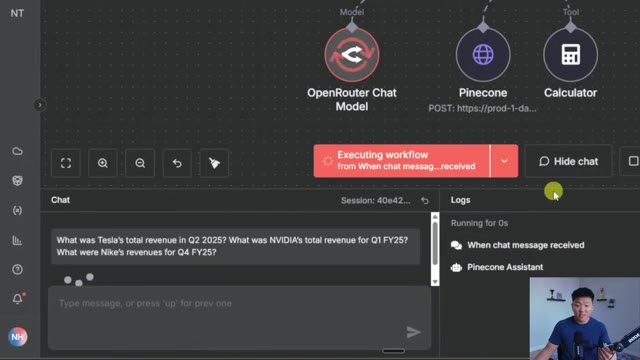
*⏱️ 00:00:08 — Interface d'un workflow d'agent IA montrant un panneau de chat en bas avec la requête sur Tesla, Nvidia et Nike saisie, et le présentateur en médaillon.*

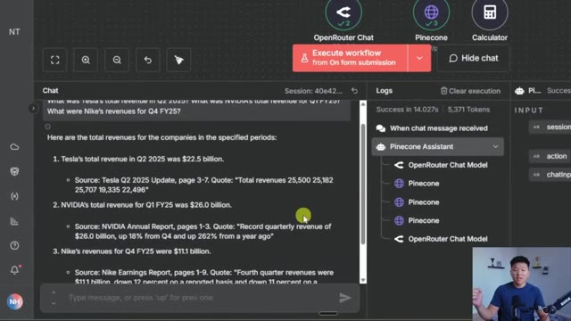
*⏱️ 00:00:25 — Le même workflow montrant la réponse générée dans le chat avec les chiffres d'affaires détaillés et les sources pour Tesla, NVIDIA et Nike.*

---

### ⏱️ `[00:00:33 - 00:01:06]` | Segment #02

**🔊 Audio (Transcription Intégrale Mot pour Mot en Français) :**
> exact. Donc pour commencer avec Tesla, si je prends la citation exacte qu'il a trouvée dans le PDF, et que je vais dans le document Tesla, et que nous faisons une recherche rapide, nous pouvons voir qu'il l'a tirée de la page quatre. Et auparavant dans NNN, notre assistant a dit qu'il l'avait trouvée de la page trois à sept sur ce document exact. Ensuite, si nous allons à la réponse de Nvidia, et que nous prenons la citation exacte, et ensuite je fais un Ctrl+F pour celle-ci dans ce document, vous pouvez voir qu'il la trouve juste ici. Et c'est la page un du PDF. Et nous retournons dans NNN et il dit qu'il l'a trouvée sur la page un du document du rapport annuel de Nvidia. Et puis enfin, si nous allons à la réponse de Nike et que nous prenons cette citation qu'il a trouvée, passons au Nike

**👁️ Analyse Visuelle d'Écran (gemini-3.5-flash-lite) :**
**Interface & Outils** : Visionneuse de PDF et interface de workflow d'assistant IA (Pinecone).

**Contenu textuel & Code** : Document financier de Tesla (chiffres d'affaires Q2 2024 - Q2 2025) et interface de chat avec des sources et des citations textuelles.

**Action / Démonstration** : Navigation dans le document PDF pour retrouver la citation exacte et affichage des résultats dans l'assistant IA.

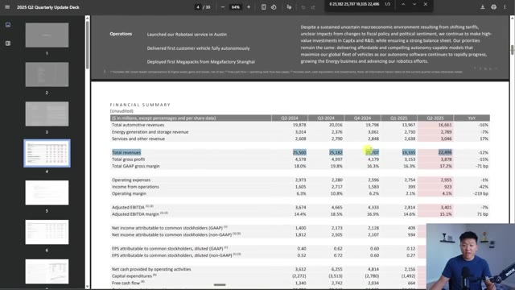
*⏱️ 00:00:41 — Visualisation du document PDF '2025 Q2 Quarterly Update Deck' de Tesla montrant le tableau financier de la page 4 avec des données de revenus.*

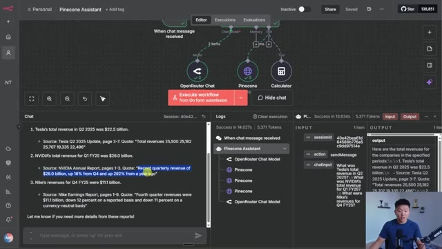
*⏱️ 00:00:50 — Interface de l'assistant Pinecone affichant un workflow de chat avec les résultats de recherche et les citations extraites des documents.*

---

### ⏱️ `[00:01:06 - 00:01:28]` | Segment #03

**🔊 Audio (Transcription Intégrale Mot pour Mot en Français) :**
> document et faire un autre Ctrl+F, nous pouvons voir que la citation exacte a été trouvée juste ici à la page un. Et dans NNN, l'assistant a dit qu'il l'avait trouvée à la page un. Donc ceux d'entre vous qui ont déjà créé des agents RAG, vous savez que ce n'est pas super facile de faire en sorte que votre agent cite exactement d'où il tire tout. C'est faisable, mais vous devez configurer un pipeline pour faire des choses comme le balisage de métadonnées. Et comme je l'ai dit, tout ce que j'ai fait ici, c'est déposer un fichier et ensuite chatter avec.

**👁️ Analyse Visuelle d'Écran (gemini-3.5-flash-lite) :**
**Interface & Outils** : Interface web de workflow / chatbot (type n8n ou plateforme d'agent IA personnalisée) avec un panneau de discussion intégré et une vue des logs d'exécution.

**Contenu textuel & Code** : Réponse textuelle détaillée d'un assistant IA listant les revenus de Tesla, NVIDIA et Nike accompagnés de citations textuelles exactes et numéros de pages extraits des rapports de référence.

**Action / Démonstration** : Exécution d'un workflow d'agent IA effectuant une recherche RAG et affichant les résultats structurés dans le chat et les logs de sortie.

*⏱️ 00:01:12 — Capture d'écran montrant l'interface d'un outil d'automatisation de flux de travail avec un panneau de chat à gauche affichant les résultats de requêtes RAG sur des rapports financiers (Tesla, NVIDIA, Nike), un éditeur de workflow au centre-haut et les logs d'exécution à droite.*

---

### ⏱️ `[00:01:28 - 00:01:53]` | Segment #04

**🔊 Audio (Transcription Intégrale Mot pour Mot en Français) :**
> C'est donc exactement ce que je vais vous montrer comment nous faisons cela aujourd'hui. D'accord, maintenant que vous avez vu cette rapide démo, je vais simplement, en gros, construire ce système exact devant vous, étape par étape. Donc, n'hésitez pas à ouvrir votre ordinateur et à suivre ce que je fais. Mais aussi, le modèle entier que vous verrez aujourd'hui sera disponible au téléchargement gratuitement. Tout ce que vous avez à faire, c'est de rejoindre ma communauté FreeSchool. De cette façon, vous pourrez simplement l'installer et l'essayer par vous-même. Donc, ce que nous faisons aujourd'hui, c'est que nous utilisons un assistant Pinecone comme recherche RAG.

**👁️ Analyse Visuelle d'Écran (gemini-3.5-flash-lite) :**
**Interface & Outils** : Interface web de type constructeur de workflow (Pinecone Assistant Template)

**Contenu textuel & Code** : Espace de travail vide avec une grille de points et l'élément central 'Add first step'

**Action / Démonstration** : Le présentateur s'apprête à ajouter la première étape du système automatisé

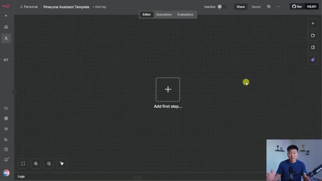
*⏱️ 00:01:35 — Interface vide de création de workflow avec un bouton central 'Add first step', en bas à droite la webcam du présentateur.*

---

### ⏱️ `[00:01:54 - 00:02:18]` | Segment #05

**🔊 Audio (Transcription Intégrale Mot pour Mot en Français) :**
> Donc, si vous n'avez jamais utilisé Pinecone auparavant, c'est une base de données vectorielle. Mais ici, vous pouvez voir que nous avons une section juste ici appelée "assistant". Donc si je clique dessus, vous pouvez voir que j'ai un assistant de test, qui est celui que nous venions d'utiliser. Mais ce que je vais faire aujourd'hui rapidement, c'est en créer un nouveau devant vous les gars. Je vais juste appeler celui-ci "demo" et je vais créer l'assistant. Maintenant, rapidement, ce auquel vous voulez faire attention, c'est ici en bas : il est écrit que les assistants actifs ont des frais de cinq cents par heure.

**👁️ Analyse Visuelle d'Écran (gemini-3.5-flash-lite) :**
**Interface & Outils** : Interface web Pinecone

**Contenu textuel & Code** : Documentation et options de configuration de la base de données vectorielle Pinecone, sections "Get started", "Assistant", et formulaire de création d'assistant.

**Action / Démonstration** : Navigation dans le tableau de bord Pinecone pour accéder et configurer un assistant IA.

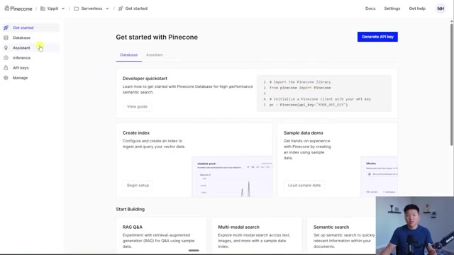
*⏱️ 00:02:00 — Interface web de la plateforme Pinecone montrant le tableau de bord "Get started" avec le curseur sur la section "Assistant" dans le menu de gauche.*

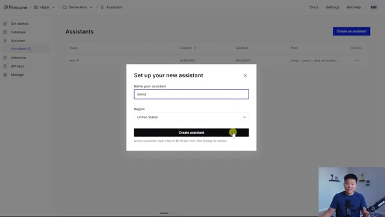
*⏱️ 00:02:12 — Interface web de Pinecone affichant une fenêtre modale "Set up your new assistant" avec un champ de saisie du nom ("demo").*

---

### ⏱️ `[00:02:18 - 00:02:39]` | Segment #06

**🔊 Audio (Transcription Intégrale Mot pour Mot en Français) :**
> Donc ce n'est pas trop mal. Et vous pouvez aussi cliquer juste ici pour plus de détails sur les tarifs. Maintenant que c'est fait, je vais procéder à la création de cet assistant. Et ce que vous pouvez voir, c'est que cela ressemble un peu à une interface de GPT personnalisé. Nous avons un chat juste ici et ensuite vous avez la possibilité d'y glisser des fichiers. Donc ce que je vais faire, c'est glisser ces trois fichiers que nous regardions tout à l'heure, les rapports de résultats de Tesla, Nike et NVIDIA.

**👁️ Analyse Visuelle d'Écran (gemini-3.5-flash-lite) :**
**Interface & Outils** : Interface web de Pinecone (Assistant playground).

**Contenu textuel & Code** : Nom de l'assistant "demo", sélection de la région "United States", et interface de chat avec zone de téléchargement de fichiers (PDF, DOCX, TXT, JSON, MD).

**Action / Démonstration** : Création d'un nouvel assistant et affichage de l'interface de test (playground).

*⏱️ 00:02:23 — Interface de Pinecone affichant une boîte de dialogue pour configurer un nouvel assistant avec les champs de nom et de région.*

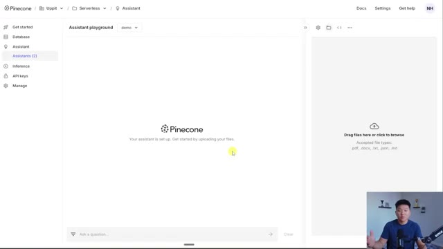
*⏱️ 00:02:28 — Interface de l'Assistant playground de Pinecone montrant un espace de chat à gauche et une zone de dépôt de fichiers à droite.*

---

### ⏱️ `[00:02:39 - 00:02:57]` | Segment #07

**🔊 Audio (Transcription Intégrale Mot pour Mot en Français) :**
> Et je vais simplement les importer tout de suite dans notre Pinecone Assistant. Et maintenant qu'ils sont téléchargés dans Pinecone Assistant, je peux coller exactement la même question que j'ai posée à notre agent NN dans cette démo. Vous pouvez donc voir qu'il renvoie les bonnes réponses, et nous pouvons survoler chacun de ces liens puisque nous sommes en mode terrain de jeu pour voir de quel PDF il les a tirés, puis les numéros de page d'où il a tiré cette information.

**👁️ Analyse Visuelle d'Écran (gemini-3.5-flash-lite) :**
**Interface & Outils** : Pinecone Assistant (interface web)

**Contenu textuel & Code** : Fichiers PDF importés (Nike.pdf, TSLA.pdf, Nvidia.pdf) et barre de saisie de question en bas avec une requête visible.

**Action / Démonstration** : Importation des fichiers PDF et test des requêtes dans l'assistant Pinecone.

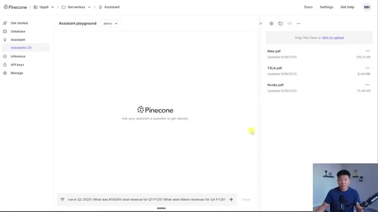
*⏱️ 00:02:43 — Interface web de Pinecone Assistant montrant le panneau de test 'Assistant playground' avec la liste des fichiers importés (Nike.pdf, TSLA.pdf, Nvidia.pdf) dans le panneau latéral droit.*

---

### ⏱️ `[00:02:58 - 00:03:20]` | Segment #08

**🔊 Audio (Transcription Intégrale Mot pour Mot en Français) :**
> Donc la puissance de ceci provient de l'API réelle que nous pouvons utiliser pour parler à cet assistant Pinecone. Et comme je l'ai dit, ne vous inquiétez pas si cela semble confus. Je vais vous montrer exactement ce que nous devons faire, et c'est en fait super facile. Donc vous pouvez voir qu'via l'API, il y a deux choses que nous pouvons faire. Nous pouvons télécharger des fichiers ou nous pouvons discuter avec notre assistant. Et dans la vidéo d'aujourd'hui, nous allons simplement nous concentrer sur la discussion avec notre assistant parce que nous avons déjà téléchargé nos fichiers dans cette interface juste ici.

**👁️ Analyse Visuelle d'Écran (gemini-3.5-flash-lite) :**
**Interface & Outils** : Interface web Pinecone (Assistant playground)

**Contenu textuel & Code** : Exemples de code cURL pour l'upload de fichiers et pour chatter avec l'assistant, ainsi qu'un historique de conversation (ex: questions sur les revenus de Tesla, Nvidia, Nike).

**Action / Démonstration** : Présentation de l'API Pinecone et de ses exemples de code d'intégration.

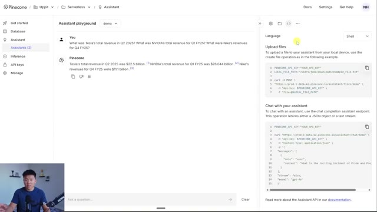
*⏱️ 00:03:03 — Interface web de Pinecone montrant le "Assistant playground" avec des exemples de requêtes et de code API pour interagir avec l'assistant.*

---

### ⏱️ `[00:03:20 - 00:03:39]` | Segment #09

**🔊 Audio (Transcription Intégrale Mot pour Mot en Français) :**
> Donc je vais retourner dans N8N et on va juste rapidement prendre un agent IA. Et maintenant, nous allons pouvoir le connecter à cet outil Pinecone Assistant. Donc quand nous donnons un outil à notre agent, vous pouvez voir qu'il n'y a pas d'outil natif ici pour un Pinecone Assistant, mais il y en a un pour Pinecone Vector Store. Donc ce que nous devons faire, c'est prendre une requête HTTP pour pouvoir parler à notre assistant.

**👁️ Analyse Visuelle d'Écran (gemini-3.5-flash-lite) :**
**Interface & Outils** : n8n (interface web de gestion de workflows d'automatisation)

**Contenu textuel & Code** : Workflow contenant les blocs 'When chat message received' relié à un bloc 'AI Agent' avec ses connecteurs Chat Model, Memory et Tool.

**Action / Démonstration** : Le présentateur explique comment intégrer et connecter l'agent IA dans l'éditeur de workflows n8n.

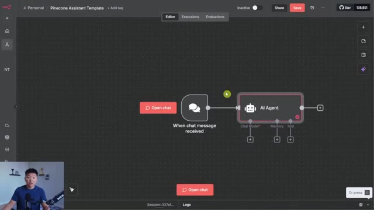
*⏱️ 00:03:25 — Vue d'ensemble de l'interface n8n montrant un workflow en cours de construction avec un nœud déclencheur de chat et un nœud 'AI Agent'.*

---

### ⏱️ `[00:03:40 - 00:04:00]` | Segment #10

**🔊 Audio (Transcription Intégrale Mot pour Mot en Français) :**
> Donc tout ce que vous allez faire, c'est de retourner dans Pinecone ici. Vous allez ouvrir cette petite chose de connexion pour accéder à l'API. Et puis ici en bas, où vous voyez "discuter avec votre assistant", je vais fondamentalement tout copier, à l'exception des deux lignes du haut pour la clé API Pinecone et cette ligne vide. Je vais donc copier ceci, y retourner et modifier, cliquer sur "importer cURL", puis coller cela là-dedans.

**👁️ Analyse Visuelle d'Écran (gemini-3.5-flash-lite) :**
**Interface & Outils** : Interface web de Pinecone (Assistant Playground).

**Contenu textuel & Code** : Commandes cURL pour l'API Pinecone, requêtes POST JSON pour l'assistant avec messages et modèles de langage (GPT-4o).

**Action / Démonstration** : Sélection et copie du code cURL pour interagir avec l'assistant Pinecone via l'API.

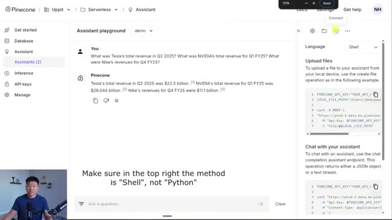
*⏱️ 00:03:45 — Interface Pinecone montrant le panneau latéral de connexion avec les instructions cURL pour discuter avec l'assistant, et une consigne textuelle indiquant de sélectionner 'Shell' et non 'Python'.*

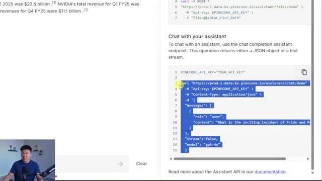
*⏱️ 00:03:50 — Gros plan sur le panneau latéral de Pinecone montrant la sélection et la copie du bloc de code cURL pour la section 'Chat with your assistant'.*

---

### ⏱️ `[00:04:00 - 00:04:36]` | Segment #11

**🔊 Audio (Transcription Intégrale Mot pour Mot en Français) :**
> Et quand je clique sur importer, cela remplit pratiquement toute la requête HTTP dont nous avons besoin, à l'exception de quelques éléments que nous devrons ajuster. Donc, la première chose est une clé API Pinecone. La façon d'obtenir cela est de retourner dans Pinecone, vous cliquerez ici sur les clés API, et ensuite vous allez simplement créer une nouvelle clé. Donc, voici à quoi cela ressemble, vous cliquez sur créer une clé API. Je vais juste appeler celle-ci "demo 4", nous allons créer cette clé et maintenant elle va nous donner la valeur secrète et je dois copier ceci et après l'avoir sauvegardée et avoir cliqué sur fermer, elle va disparaître. Vous pouvez toujours en créer une nouvelle, mais gardez simplement à l'esprit que cette clé aura disparu. Donc ensuite, vous revenez dans Pinecone et vous collez simplement cette clé directement là-dedans et vous serez tout bon.

**👁️ Analyse Visuelle d'Écran (gemini-3.5-flash-lite) :**
**Interface & Outils** : n8n / outil d'automatisation de workflow et tableau de bord Pinecone.

**Contenu textuel & Code** : Paramètres de requête HTTP avec en-tête 'Api-Key' et formulaire de génération de clé API Pinecone.

**Action / Démonstration** : Configuration des identifiants et génération d'une nouvelle clé API pour connecter le flux à Pinecone.

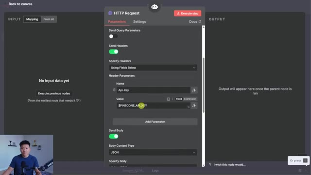
*⏱️ 00:04:09 — Configuration d'un nœud de requête HTTP dans une interface d'automatisation montrant le paramètre de clé API Pinecone.*

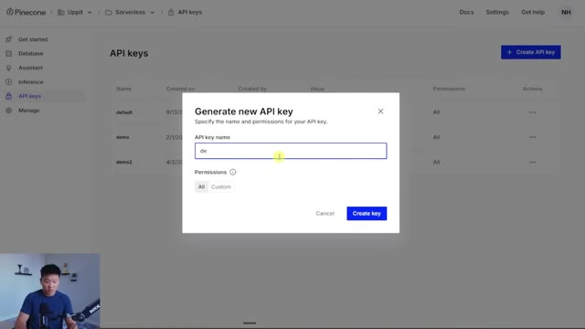
*⏱️ 00:04:18 — Interface de gestion de Pinecone affichant la fenêtre modale pour générer une nouvelle clé API.*

---

### ⏱️ `[00:04:36 - 00:05:11]` | Segment #12

**🔊 Audio (Transcription Intégrale Mot pour Mot en Français) :**
> Donc c'est super simple et une astuce de pro que je veux vous montrer les gars, c'est que si vous êtes déjà connecté à Pinecone via un nœud natif, vous pouvez venir dans l'authentification, vous pouvez aller dans prédéfini, et ensuite vous pouvez venir ici et taper simplement Pinecone et cela récupérera vos identifiants de votre intégration Pinecone native, donc vous pouvez soit faire ça, soit faire ceci. C'est exactement la même chose. Donc parce que je fais ça, je vais juste désactiver mes en-têtes, mais ne laissez pas cela vous confondre, tout ce que c'est, c'est essentiellement juste entrer notre mot de passe afin que nous puissions accéder à cet assistant Pinecone. Donc maintenant ce que je vais faire, c'est changer la description et je vais juste dire d'utiliser cet outil pour parler à votre base de connaissances. Donc nous allons coller cela comme description.

**👁️ Analyse Visuelle d'Écran (gemini-3.5-flash-lite) :**
**Interface & Outils** : Interface de workflow d'automatisation (type n8n) avec une fenêtre modale de configuration de nœud HTTP Request.

**Contenu textuel & Code** : Paramètres HTTP (Method: POST, URL: https://prod-1-data.ke.pinecone.io/assistant/chat/demo, Authentication: Predefined Credential Type, Header Parameters: Api-Key).

**Action / Démonstration** : Sélection du type d'authentification prédéfini pour se connecter à Pinecone via le nœud HTTP Request.

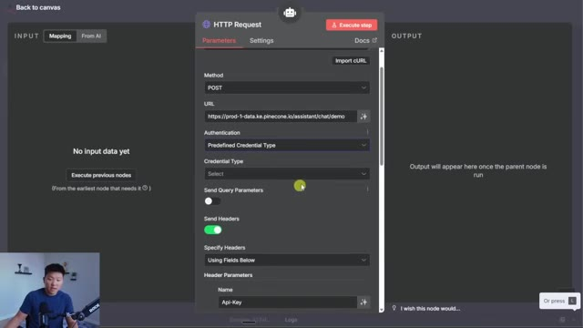
*⏱️ 00:04:45 — Configuration d'un nœud HTTP Request dans une interface d'automatisation avec un panneau de paramètres ouvert.*

---

### ⏱️ `[00:05:11 - 00:05:43]` | Segment #13

**🔊 Audio (Transcription Intégrale Mot pour Mot en Français) :**
> Je vais nommer cet outil Pinecone juste pour garder les choses simples. Et ensuite, la dernière chose que nous devons configurer est la requête réelle que nous faisons à notre assistant Pinecone. Donc pour l'instant, si nous déclenchions cet outil, peu importe ce pour quoi nous demandions de l'aide à notre assistant, il enverrait cette requête à l'assistant. Quel est l'incident déclencheur de Orgueil et Préjugés ? Et donc nous ne voulons pas que ce soit la requête à chaque fois. Donc ce que nous devons faire, c'est changer ceci en une expression, ce qui signifie que ces valeurs peuvent être dynamiques. Je vais me débarrasser de ce contenu ici, et je vais taper deux accolades tournées dans chaque sens. Nous allons faire un

**👁️ Analyse Visuelle d'Écran (gemini-3.5-flash-lite) :**
**Interface & Outils** : Interface web d'automatisation de workflow (style n8n ou plateforme similaire)

**Contenu textuel & Code** : Objet JSON avec un tableau "messages" incluant une question sur le livre "Pride and Prejudice", le paramètre "stream: false" et le modèle "gpt-4o".

**Action / Démonstration** : Configuration des paramètres et de la requête JSON pour l'outil Pinecone au sein du workflow.

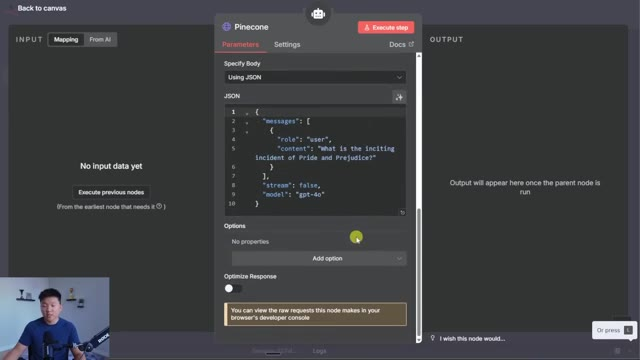
*⏱️ 00:05:19 — Interface d'un éditeur de workflow montrant les paramètres du nœud Pinecone configurés avec un payload JSON contenant un message pour le modèle gpt-4o.*

---

### ⏱️ `[00:05:43 - 00:06:18]` | Segment #14

**🔊 Audio (Transcription Intégrale Mot pour Mot en Français) :**
> signe dollar, et nous allons récupérer ceci depuis la fonction IA. Et ceci va simplement permettre à notre agent IA de déterminer quelle requête est-ce que j'envoie à l'Assistant Pinecone. Et donc tout ce que je vais faire, c'est taper "search query" à l'intérieur de cette petite guillemet juste là. Et maintenant, c'est fondamentalement configuré pour être dynamique. Et je vais vous montrer exactement ce que je veux dire par là, si cela n'a pas encore de sens. Super. Donc maintenant, tout ce qui reste à faire, c'est de tester l'agent. Bien sûr, nous devons d'abord lui donner un cerveau. Donc je vais juste aller récupérer ma clé API OpenRouter, et nous allons simplement nous en tenir à GPT-4o mini pour l'instant. Très bien. Donc maintenant, l'agent est fondamentalement configuré. Tout ce qui va

**👁️ Analyse Visuelle d'Écran (gemini-3.5-flash-lite) :**
**Interface & Outils** : n8n (éditeur de workflow low-code)

**Contenu textuel & Code** : Expression JSON contenant `{{ $fromAI() }}` configurée pour un modèle gpt-4o.

**Action / Démonstration** : Configuration d'un paramètre `$fromAI` pour l'agent IA au sein du workflow n8n.

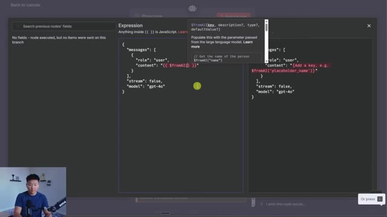
*⏱️ 00:05:52 — Interface d'édition de code (expression JSON) avec infobulle pour la fonction $fromAI dans n8n.*

---

### ⏱️ `[00:06:18 - 00:06:50]` | Segment #15

**🔊 Audio (Transcription Intégrale Mot pour Mot en Français) :**
> il ne reste plus qu'à le tester, à ajuster le prompt système et à continuer à faire quelques tests. C'est donc exactement ce que nous allons faire en premier. Je vais insérer cette requête concernant le document Tesla. Combien de véhicules Tesla a-t-il livrés au deuxième trimestre 2025 ? Et comment cela se compare-t-il au même trimestre en 2024. Encore une fois, ce qui se passe, c'est que cela interroge notre assistant Pinecone, et ensuite, il va nous renvoyer quelques réponses. Vous pouvez donc voir qu'il indique que Tesla a livré un total de 384 000 véhicules, et il nous donne ensuite une ventilation des différents modèles qu'il a réellement livrés. Et il a également indiqué qu'il y avait eu une baisse de 13 % des livraisons totales d'une année sur l'autre.

**👁️ Analyse Visuelle d'Écran (gemini-3.5-flash-lite) :**
**Interface & Outils** : Interface web de workflow (type n8n) avec panneau de chat intégré et logs d'exécution en temps réel.

**Contenu textuel & Code** : Question dans le chat : "How many vehicles did Tesla deliver in Q2 2025, and how did that compare to the same quarter in 2024?". Workflow avec "When chat message received", "AI Agent", "OpenRouter Chat Model", et "Pinecone".

**Action / Démonstration** : Exécution du workflow et test de la requête sur Tesla dans l'assistant de chat.

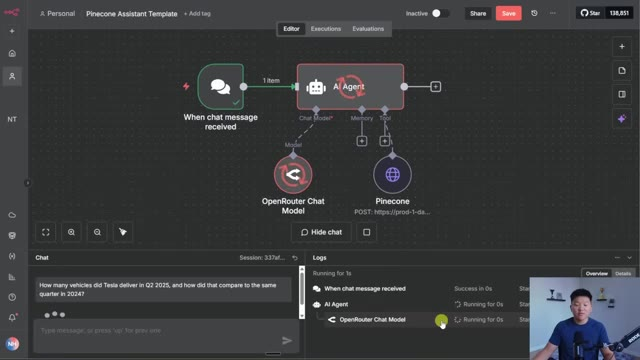
*⏱️ 00:06:26 — Interface de workflow montrant un diagramme de nœuds (Pinecone Assistant Template) avec le panneau de chat en bas à gauche contenant la requête sur Tesla et les logs d'exécution en bas à droite.*

---

### ⏱️ `[00:06:50 - 00:07:12]` | Segment #16

**🔊 Audio (Transcription Intégrale Mot pour Mot en Français) :**
> je viens juste de vérifier tout ça. C'est correct. Maintenant, gardez à l'esprit qu'il n'y a pas de prompt système dans cet agent IA, ce qui explique pourquoi nous n'obtenons aucune information de source, comme le PDF d'où il provient et les numéros de page où il a été trouvé. Donc, ce que je vais faire très rapidement, c'est lui donner un prompt système juste ici, qui est ce qui définit le comportement de notre agent IA. Je vais donc ouvrir ceci en plein écran et je vais simplement coller ce prompt que j'utilisais tout à l'heure.

**👁️ Analyse Visuelle d'Écran (gemini-3.5-flash-lite) :**
**Interface & Outils** : n8n (éditeur de workflows d'automatisation IA)

**Contenu textuel & Code** : Workflow d'agent IA connecté à Pinecone et OpenRouter, avec les paramètres du nœud AI Agent affichant le champ System Message.

**Action / Démonstration** : Navigation et configuration des paramètres du nœud de l'agent IA pour inspecter le message système.

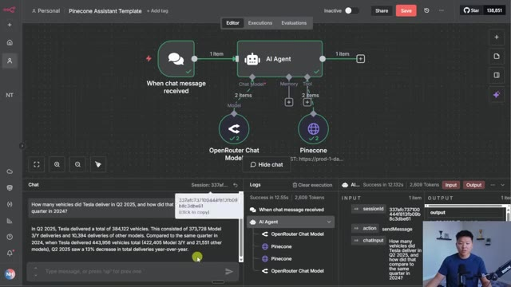
*⏱️ 00:06:56 — Vue d'ensemble du workflow n8n montrant un assistant Pinecone avec les nœuds de déclenchement, l'agent IA, le modèle OpenRouter et Pinecone, ainsi qu'une fenêtre de chat en bas à gauche affichant une question sur les livraisons de Tesla.*

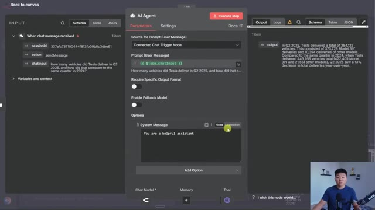
*⏱️ 00:07:07 — Gros plan sur les paramètres du nœud "AI Agent" dans n8n, montrant la section System Message configurée simplement avec "You are a helpful assistant" sans instructions sur les sources PDF.*

---

### ⏱️ `[00:07:13 - 00:07:31]` | Segment #17

**🔊 Audio (Transcription Intégrale Mot pour Mot en Français) :**
> C'est vraiment, vraiment simple. J'ai dit, tu es un agent IA spécialisé dans l'analyse de données de rapports de bénéfices. Utilise ton outil Pinecone pour faire des recherches dans les rapports de bénéfices de Tesla, Nike et NVIDIA. En répondant à la question de l'utilisateur, cite toujours tes sources en indiquant de quel document tu l'as tiré, de quelle page, de quelle section, ainsi qu'une citation textuelle exacte provenant de la source originale.

**👁️ Analyse Visuelle d'Écran (gemini-3.5-flash-lite) :**
**Interface & Outils** : Interface web d'automatisation (n8n), panneau de configuration de nœud avec volet d'expression et aperçu des résultats.

**Contenu textuel & Code** : Texte du prompt configuré pour l'agent IA : "# Overview\nYou are an AI agent specialized in analyzing earnings report data.\nUse your Pinecone tool to search through earnings reports from Tesla, Nike, and Nvidia.\nWhen answering the user's question, always cite your sources as far as: what document you got it from, what page it was from, what section, and an exact text based quote from the original source" ainsi que les variables d'entrée (sessionId, action, chatInput).

**Action / Démonstration** : Visualisation et explication de la configuration du prompt système de l'agent IA dans l'éditeur de flux de travail.

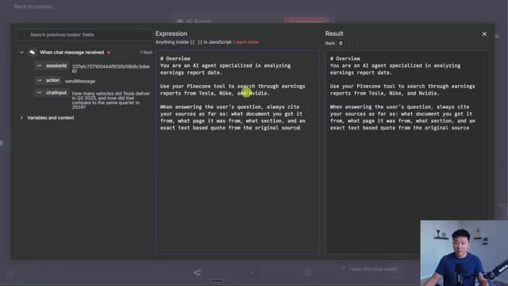
*⏱️ 00:07:17 — Interface d'un panneau de configuration de nœud d'automatisation (n8n ou similaire) affichant les détails d'un prompt système pour un agent IA spécialisé dans l'analyse de rapports financiers.*

---

### ⏱️ `[00:07:32 - 00:07:57]` | Segment #18

**🔊 Audio (Transcription Intégrale Mot pour Mot en Français) :**
> Parce que lorsque nous faisons du RAG et de la recherche vectorielle, il est vraiment important de voir d'où notre agent a tiré l'information afin que nous puissions lui faire confiance. C'est donc simplement un excellent exemple de la définition du comportement de l'agent. Car ce qui est intéressant, c'est que vous remarquerez que lorsqu'il a cherché dans l'outil Pinecone, nous obtenions réellement cette information. Si je devais faire défiler vers le bas par ici, vous pourriez voir que ce que nous récupérions de Pinecone, ce sont les pages exactes d'où il a tiré cette information, ainsi que le nom du PDF d'où il l'a trouvée.

**👁️ Analyse Visuelle d'Écran (gemini-3.5-flash-lite) :**
**Interface & Outils** : n8n (éditeur de workflow d'automatisation)

**Contenu textuel & Code** : Un prompt définissant le comportement d'un agent IA spécialisé dans l'analyse de rapports financiers (exigeant de citer les sources, documents, pages et citations exactes).

**Action / Démonstration** : Visualisation et configuration du prompt système de l'agent d'automatisation.

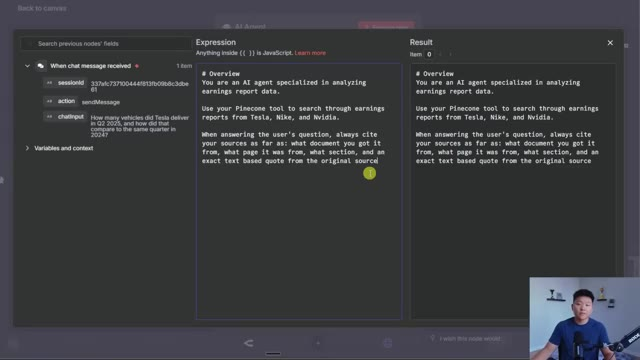
*⏱️ 00:07:38 — Interface d'un éditeur de workflow de type n8n montrant la configuration des instructions d'un agent IA pour le RAG.*

---

### ⏱️ `[00:07:57 - 00:08:19]` | Segment #19

**🔊 Audio (Transcription Intégrale Mot pour Mot en Français) :**
> L'agent IA ne savait tout simplement pas comment nous communiquer réellement cette information. Très rapidement, les gars, excusez l'éclairage. Je suis assis ici en train d'éditer cette vidéo de nuit et je me suis rendu compte que je n'avais pas montré ce que je voulais dire par le fait que l'agent remplissait la requête ici en bas tout seul. Donc si vous vous souvenez, cette question que nous avons posée était : combien de véhicules Tesla a-t-il livrés au deuxième trimestre 2025 et comment cela se comparait-il au même trimestre en 2024 ?

**👁️ Analyse Visuelle d'Écran (gemini-3.5-flash-lite) :**
**Interface & Outils** : n8n (éditeur de workflow low-code pour l'automatisation par IA)

**Contenu textuel & Code** : Diagramme de nœuds, configuration JSON avec corps de requête et variables dynamiques, données de test affichant une question sur les livraisons de Tesla.

**Action / Démonstration** : Navigation et explication de la configuration d'un agent IA et de ses nœuds de données dans n8n.

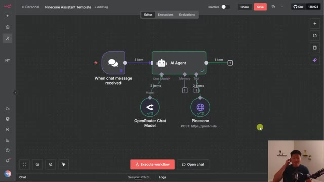
*⏱️ 00:08:03 — Vue globale du workflow n8n montrant un agent IA connecté à un modèle OpenRouter et Pinecone.*

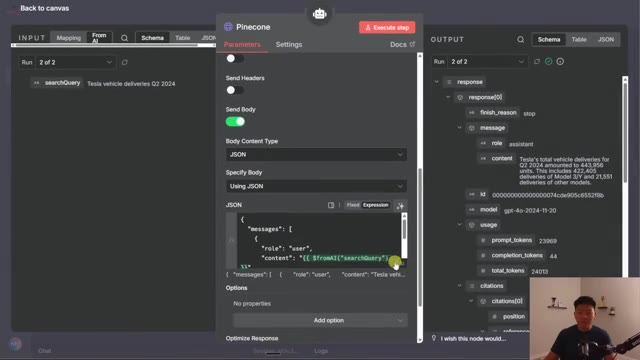
*⏱️ 00:08:08 — Panneau de configuration d'un nœud Pinecone dans n8n avec la structure JSON et les données de sortie.*

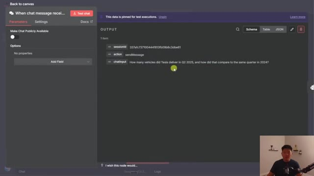
*⏱️ 00:08:14 — Panneau des paramètres et de sortie du nœud déclencheur de chat n8n affichant la requête utilisateur.*

---

### ⏱️ `[00:08:20 - 00:08:49]` | Segment #20

**🔊 Audio (Transcription Intégrale Mot pour Mot en Français) :**
> Donc, ce qui s'est passé ici, c'est qu'on peut voir que l'agent a appelé l'outil Pinecone deux fois. On peut voir qu'il y avait deux éléments. Et si on clique dessus, on peut voir les deux recherches différentes qu'il a faites auprès de notre assistant Pinecone. En haut à gauche, si on va sur l'exécution numéro un sur deux, il a cherché dans l'assistant Pinecone « Tesla Vehicle Delivers Q2 2025 ». Et ensuite, il a su qu'il devait comparer cela à 2024. Alors il a fait une nouvelle recherche. Et il a dit « Tesla Vehicle Deliveries Q2 2024 ». Et donc cette requête de recherche est la variable que nous avons ici en bas, parce que l'agent décide fondamentalement quelle sera ma requête de recherche ?

**👁️ Analyse Visuelle d'Écran (gemini-3.5-flash-lite) :**
**Interface & Outils** : Interface web de plateforme d'automatisation IA / workflow (type Flowise ou équivalent).

**Contenu textuel & Code** : Paramètres de l'outil Pinecone (URL, méthode POST, authentification) avec le champ searchQuery indiquant 'Tesla vehicle deliveries Q2 2024' et la réponse JSON de l'assistant.

**Action / Démonstration** : Visualisation et inspection des détails d'un appel d'outil Pinecone suite à son exécution par l'agent.

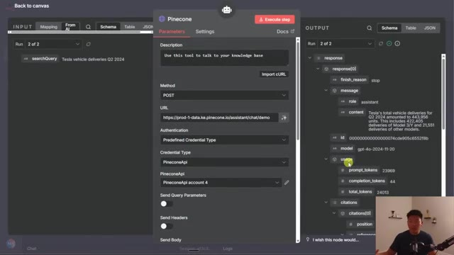
*⏱️ 00:08:27 — Interface d'un tableau de bord d'agent IA montrant les détails d'exécution de l'outil Pinecone avec les requêtes d'entrée et les réponses de sortie.*

---

### ⏱️ `[00:08:50 - 00:09:09]` | Segment #21

**🔊 Audio (Transcription Intégrale Mot pour Mot en Français) :**
> Et combien de fois dois-je faire une requête de recherche ? Et c'est pourquoi sur ce côté droit, nous avons aussi deux exécutions distinctes et deux résultats distincts. Donc pour tous les exemples futurs, gardez simplement cela à l'esprit. L'agent décide de la requête de recherche, et c'est ainsi qu'il parvient à obtenir les bonnes informations à chaque fois. Encore une fois, excusez l'éclairage. Je travaille pour obtenir un éclairage professionnel ici derrière. Comme ça, si je m'enregistre dans le noir, je n'aurai pas l'air terrifiant comme ça.

**👁️ Analyse Visuelle d'Écran (gemini-3.5-flash-lite) :**
**Interface & Outils** : Interface web de workflow et d'automatisation de type nœuds (Pinecone Assistant Template).

**Contenu textuel & Code** : Schéma d'agent IA connectant un module "When chat message received" à un "AI Agent", relié à "OpenRouter Chat Model" et "Pinecone".

**Action / Démonstration** : Présentation et explication du fonctionnement des exécutions multiples et de la structure d'un agent IA avec ses outils de recherche.

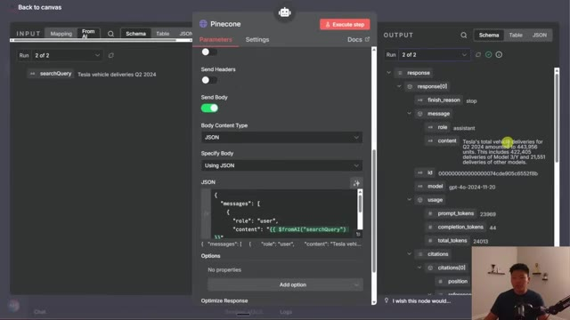
*⏱️ 00:08:54 — Interface détaillée montrant les entrées, paramètres et sorties d'un nœud Pinecone avec les résultats JSON des exécutions.*

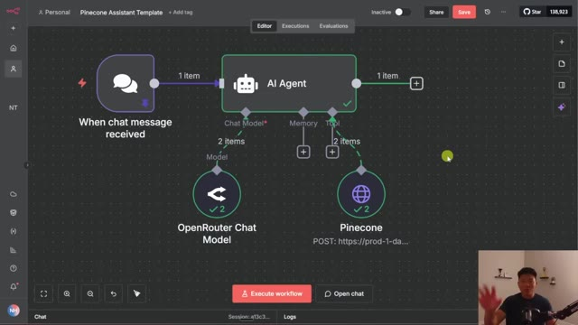
*⏱️ 00:09:04 — Vue d'ensemble d'un workflow d'agent IA montrant les connexions entre le déclencheur de chat, le modèle OpenRouter et l'outil Pinecone.*

---

### ⏱️ `[00:09:09 - 00:09:43]` | Segment #22

**🔊 Audio (Transcription Intégrale Mot pour Mot en Français) :**
> Revenons à la vidéo. Donc, juste pour vous montrer que ce prompt a fonctionné, je vais republier exactement le même message. Et ce qu'on va voir, c'est que ça nous donne la bonne réponse une fois de plus, mais cette fois, il y aura le nom d'un PDF et des pages. Donc voilà. On a eu la même réponse et cette fois, on a notre source de Tesla Q2 et on a nos numéros de page ici en bas. Mais ce que vous remarquez peut-être maintenant, c'est qu'on n'obtient pas la citation textuelle du PDF. Et la raison pour laquelle ce n'est pas le cas, c'est parce que ce qui se passe dans ce nœud Pinecone, et je ne vais pas essayer d'entrer trop dans les détails techniques ici, mais l'assistant Pinecone sur ce serveur

**👁️ Analyse Visuelle d'Écran (gemini-3.5-flash-lite) :**
**Interface & Outils** : Interface web de Pinecone Assistant Template (style n8n ou plateforme de workflow d'IA)

**Contenu textuel & Code** : Schéma de workflow connectant "When chat message received" à un "AI Agent", relié à OpenRouter Chat Model et Pinecone. Dans le chat, une question sur les livraisons de Tesla en Q2 2025 est affichée.

**Action / Démonstration** : Exécution d'un message de chat testant l'agent IA, avec les logs montrant l'appel en cours à Pinecone.

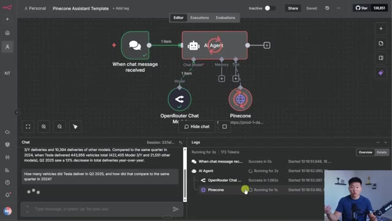
*⏱️ 00:09:18 — Interface utilisateur montrant un éditeur de workflow avec un nœud AI Agent, un module OpenRouter Chat Model et un outil Pinecone, accompagné d'un panneau de chat en bas à gauche et de logs d'exécution en bas à droite.*

---

### ⏱️ `[00:09:43 - 00:10:02]` | Segment #23

**🔊 Audio (Transcription Intégrale Mot pour Mot en Français) :**
> Il effectue des recherches dans la base de connaissances et nous donne ensuite pour ainsi dire un bref résumé avec la bonne réponse. Ceci n'est pas une citation exacte basée sur du texte, mais c'est ce que notre agent IA NNN utilise pour nous donner une réponse. Et pour souligner ce point, je vais vous montrer un meilleur exemple de cela. Je demande quels ont été les revenus de Nike pour le quatrième trimestre de l'exercice fiscal 2025 et comment ils se comparent à ceux de l'année dernière ?

**👁️ Analyse Visuelle d'Écran (gemini-3.5-flash-lite) :**
**Interface & Outils** : Interface web d'automatisation de workflow (style n8n ou plateforme similaire).

**Contenu textuel & Code** : Configuration du connecteur Pinecone, structure JSON de sortie (réponse de l'assistant sur les livraisons Tesla) et prompt de chat sur Nike.

**Action / Démonstration** : Exécution d'une étape de test d'API pour interroger la base de connaissances Pinecone et affichage des résultats.

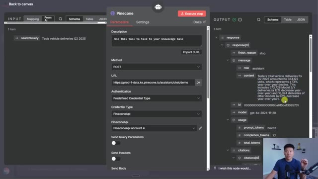
*⏱️ 00:09:48 — Interface détaillée d'un nœud d'API Pinecone montrant les paramètres de configuration et la réponse JSON structurée.*

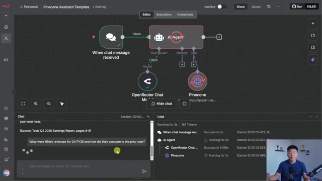
*⏱️ 00:09:57 — Vue d'ensemble du canevas d'un agent IA connecté à OpenRouter et Pinecone avec un panneau de chat en bas à gauche.*

---

### ⏱️ `[00:10:02 - 00:10:35]` | Segment #24

**🔊 Audio (Transcription Intégrale Mot pour Mot en Français) :**
> Et ce que vous allez voir se produire, c'est que cela nous donne la bonne réponse, mais maintenant cela nous donne la citation exacte, ce qui est faux. Donc si je devais copier cette citation et aller dans le document Nike, qui était celui-ci. Et si je colle ceci dedans, nous n'obtenons aucun résultat. Nous obtenons zéro correspondance. Et c'est parce que, encore une fois, ce qui se passe, c'est que le contenu de Pinecone qui revient est un résumé. C'est la réponse de l'assistant Pinecone qu'il a générée à partir du texte exact. Donc la façon dont nous corrigeons cela, c'est que nous devons comprendre le type de requête que nous faisons à l'assistant Pinecone. Et pour ce faire,

**👁️ Analyse Visuelle d'Écran (gemini-3.5-flash-lite) :**
**Interface & Outils** : Pinecone Assistant (plateforme de workflow), Visionneuse PDF (Navigateur web).

**Contenu textuel & Code** : Prompts de requête sur les revenus de Nike pour le T4 FY25, logs d'exécution de l'agent, structure JSON avec les champs "message", "content" et "citations".

**Action / Démonstration** : Démonstration du processus de débogage : l'utilisateur vérifie la cohérence d'une citation fournie par l'IA en la comparant manuellement avec le document source PDF officiel de Nike.

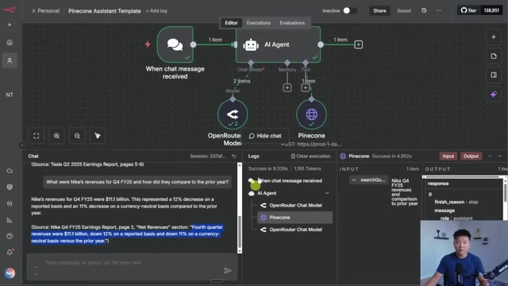
*⏱️ 00:10:10 — Interface de Pinecone Assistant montrant le workflow de l'agent IA avec les résultats du chat affichant une réponse générée et une citation mise en évidence.*

*⏱️ 00:10:18 — Visionneuse PDF affichant le rapport financier "NIKE, INC. REPORTS FISCAL 2025" avec une barre de recherche active en haut de page.*

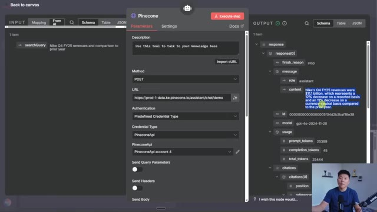
*⏱️ 00:10:27 — Fenêtre de configuration de noeud Pinecone dans un éditeur de workflow, montrant les paramètres API et la structure JSON de la réponse de l'agent.*

---

### ⏱️ `[00:10:35 - 00:10:53]` | Segment #25

**🔊 Audio (Transcription Intégrale Mot pour Mot en Français) :**
> nous devons regarder la documentation de l'API, que je vais faire glisser ici. C'est donc essentiellement la documentation qui nous indique comment utiliser l'Assistant via l'API. Nous pouvons voir des choses comme la réponse en streaming, l'extraction du contenu de la réponse, le choix d'un modèle, tout ce genre de choses. Mais ce qui m'intéresse, c'est cette section du bas qui dit inclure les surbbrillances de citation dans la réponse.

**👁️ Analyse Visuelle d'Écran (gemini-3.5-flash-lite) :**
**Interface & Outils** : Navigateur web affichant la documentation de Pinecone.

**Contenu textuel & Code** : Documentation technique avec des exemples de code cURL, Python et JavaScript pour interagir avec l'Assistant Pinecone, incluant les paramètres de messages et de température.

**Action / Démonstration** : Le présentateur commente la structure de la documentation d'API et les paramètres disponibles comme la température d'échantillonnage et la réponse en streaming.

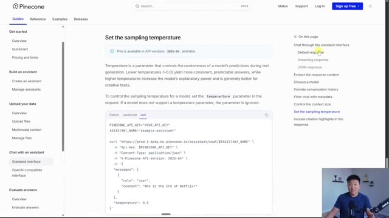
*⏱️ 00:10:39 — Capture d'écran montrant la documentation officielle de l'API Pinecone, avec un exemple de requête curl pour configurer la température d'échantillonnage de l'assistant.*

---

### ⏱️ `[00:10:54 - 00:11:24]` | Segment #26

**🔊 Audio (Transcription Intégrale Mot pour Mot en Français) :**
> Donc, tout ce que nous avons à faire pour obtenir une citation exacte, c'est d'ajouter cette chose ici en bas qui dit « include highlights ». C'est essentiellement juste un petit levier sur lequel nous pouvons tirer pour modifier le fonctionnement de l'Assistant. Alors gardez en tête la façon dont cette citation n'a pas fonctionné. Je vais aller dans la requête HTTP et tout ce que je vais faire, c'est ajouter cette petite section « include highlights equals true ». Et maintenant, je vais enregistrer ceci et poser exactement la même question. Donc nous posons exactement la même question. La réponse va revenir correcte à nouveau parce que l'assistant Pinecone va être plutôt bon pour donner la bonne réponse.

**👁️ Analyse Visuelle d'Écran (gemini-3.5-flash-lite) :**
**Interface & Outils** : Documentation web Pinecone, éditeur de workflow visuel type n8n / Flowise.

**Contenu textuel & Code** : Requête cURL avec paramètre d'API « include_highlights: true » et structure JSON pour l'Assistant Pinecone.

**Action / Démonstration** : Explication et configuration des paramètres de l'API Pinecone pour inclure les citations et surbrillances dans les réponses de l'assistant IA.

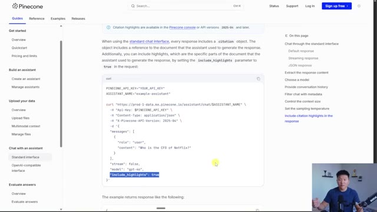
*⏱️ 00:11:02 — Documentation de Pinecone montrant un exemple de requête cURL avec le paramètre « include_highlights » mis en surbrillance.*

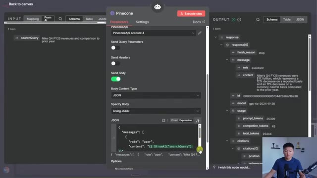
*⏱️ 00:11:09 — Interface de configuration du nœud Pinecone dans un éditeur de workflow montrant le corps JSON avec les messages.*

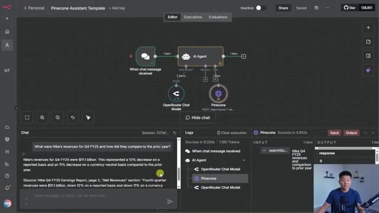
*⏱️ 00:11:17 — Interface complète d'un workflow de type n8n avec un agent IA connectant OpenRouter et Pinecone, et une fenêtre de chat en bas à gauche.*

---

### ⏱️ `[00:11:25 - 00:11:58]` | Segment #27

**🔊 Audio (Transcription Intégrale Mot pour Mot en Français) :**
> Mais maintenant, nous allons voir qu'une citation exacte ressort également. Donc, juste ici, on obtient cette citation exacte. Je vais copier ça, retourner dans le document Nike. Et maintenant, si je colle ça, on peut voir qu'il extrait la citation exacte. Et la raison pour laquelle il a pu faire ça, c'est parce que dans Pinecone, encore une fois, cette section appelée « content » n'est pas la citation exacte. Mais si je fais défiler tout en bas, vous pouvez voir qu'on a une nouvelle section qui a été ajoutée, appelée « content ». Et c'est en fait ce qui va extraire exactement ce qui a été trouvé dans le document. C'est donc un très bon exemple non seulement de pouvoir comprendre ce qui se passe, mais aussi de pouvoir comprendre que si je veux changer

**👁️ Analyse Visuelle d'Écran (gemini-3.5-flash-lite) :**
**Interface & Outils** : Visionneuse PDF, interface Pinecone (tableau de bord d'assistant IA).

**Contenu textuel & Code** : Document financier Nike, requêtes de recherche et réponses JSON structurées avec citations.

**Action / Démonstration** : Copie et collage d'une citation exacte extraite du document financier via l'assistant Pinecone.

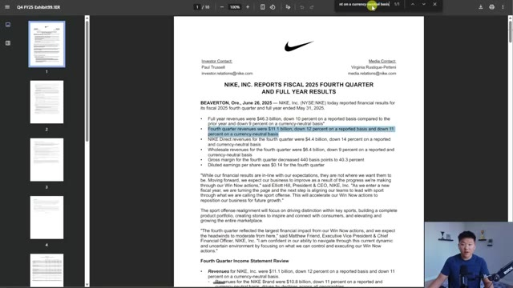
*⏱️ 00:11:33 — Document PDF Nike affiché avec du texte surligné en bleu.*

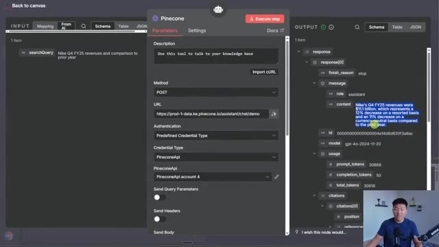
*⏱️ 00:11:41 — Interface Pinecone montrant un panneau de configuration API et une réponse JSON avec le contenu généré.*

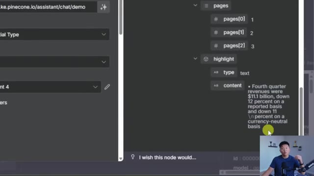
*⏱️ 00:11:50 — Gros plan sur l'interface Pinecone montrant les métadonnées de citation avec le texte extrait et surligné.*

---

### ⏱️ `[00:11:58 - 00:12:19]` | Segment #28

**🔊 Audio (Transcription Intégrale Mot pour Mot en Français) :**
> le comportement, je peux aller parcourir la documentation de l'API. Et c'est ainsi que je peux aussi modifier des éléments comme la température d'échantillonnage, ou je peux changer le modèle. Parce qu'une chose que vous remarquerez, c'est que si vous êtes dans votre playground d'assistant juste ici et que vous changez le modèle de chat avec lequel interagir, vous pouvez voir que j'ai changé le modèle. Si je survole ceci, il est écrit : sélectionnez le modèle à utiliser par l'assistant dans cette conversation.

**👁️ Analyse Visuelle d'Écran (gemini-3.5-flash-lite) :**
**Interface & Outils** : Navigateur web affichant la documentation Pinecone.

**Contenu textuel & Code** : Documentation technique avec extraits de code cURL et JSON illustrant l'utilisation du paramètre "temperature".

**Action / Démonstration** : Consultation de la documentation de l'API Pinecone pour configurer les paramètres du modèle.

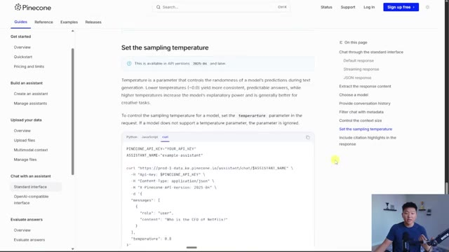
*⏱️ 00:12:03 — Documentation officielle de Pinecone montrant la section sur le réglage de la température d'échantillonnage ("Set the sampling temperature") avec un exemple de requête cURL.*

---

### ⏱️ `[00:12:19 - 00:12:45]` | Segment #29

**🔊 Audio (Transcription Intégrale Mot pour Mot en Français) :**
> Pour persister ce choix dans votre application, rappelez-vous que vous devez définir votre modèle dans vos appels API. Donc, en retournant sur NNN dans la requête HTTP, ici en bas, nous avons un modèle. Et donc, si je voulais changer le modèle que nous utilisons pour interagir du côté de l'assistant Pinecone, nous devrions le modifier ici même. Très bien. Désolé si je suis entré un peu dans les détails techniques. Je pense simplement qu'il est vraiment important que vous compreniez comment cela fonctionne réellement. Si vous cherchez à comprendre un peu mieux tout cela, j'ai une vidéo sur l'API que vous pouvez regarder. Je vais la taguer juste ici en haut.

**👁️ Analyse Visuelle d'Écran (gemini-3.5-flash-lite) :**
**Interface & Outils** : Interface web de type n8n ou plateforme d'automatisation similaire.

**Contenu textuel & Code** : Nœuds de workflow : "When chat message received", "AI Agent", "OpenRouter Chat Model", et "Pinecone", avec les logs d'exécution et une interface de chat interactive.

**Action / Démonstration** : Le présentateur explique la configuration des modèles dans les appels API du workflow en montrant les différents nœuds connectés à l'agent IA.

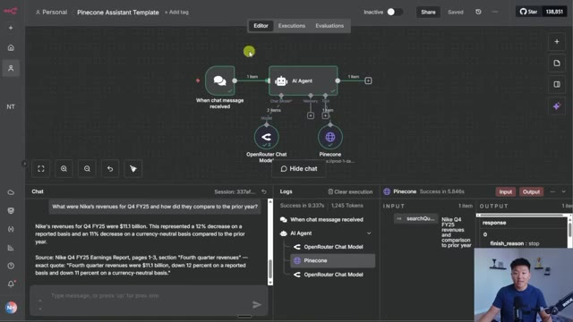
*⏱️ 00:12:25 — Capture d'écran montrant l'interface d'un outil de workflow d'automatisation avec un agent IA relié à OpenRouter et Pinecone, ainsi qu'une fenêtre de chat ouverte en bas à gauche.*

---

### ⏱️ `[00:12:45 - 00:13:18]` | Segment #30

**🔊 Audio (Transcription Intégrale Mot pour Mot en Français) :**
> Ou vous pouvez également consulter ma communauté Plus. Le lien pour celle-ci se trouve dans la description. C'est là que vous recevrez un accompagnement plus structuré et que vous trouverez une communauté de personnes qui construisent chaque jour. Quoi qu'il en soit, très rapidement maintenant, je veux vous montrer la différence, car je suis sûr que vous vous demandez pourquoi je n'utiliserais pas simplement une base de vecteurs Pinecone ou une base de vecteurs Supabase ? Pourquoi est-ce plus rapide, plus facile et peut-être même meilleur ? Donc, la raison pour laquelle je suis un grand fan de ça en ce moment, c'est parce que ce qui se passe ici, c'est que Pinecone, en arrière-plan, gère toute l'indexation, l'incorporation, le découpage. Il gère tout cela afin de vous faciliter la tâche pour que vous n'ayez pas à tout gérer pour récupérer vos sources précises. Parce que comme je l'ai dit, si

**👁️ Analyse Visuelle d'Écran (gemini-3.5-flash-lite) :**
**Interface & Outils** : Interface web de Pinecone Assistant / Flowise (ou outil similaire de workflow d'agents IA)

**Contenu textuel & Code** : Diagramme de workflow avec des nœuds connectés (Pinecone Assistant, Pinecone Vector, Supabase Vector, OpenRouter Chat Model) et une zone de chat en bas.

**Action / Démonstration** : Visualisation et configuration d'un workflow d'automatisation IA avec plusieurs modèles et bases de données vectorielles.

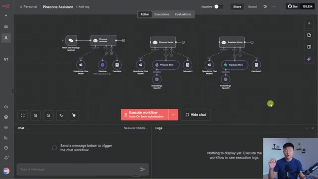
*⏱️ 00:12:53 — Interface d'un éditeur de workflow montrant un assistant Pinecone et des blocs de données connectés.*

---

### ⏱️ `[00:13:18 - 00:13:42]` | Segment #31

**🔊 Audio (Transcription Intégrale Mot pour Mot en Français) :**
> si vous adoptez l'approche vectorielle classique, il y a beaucoup plus de travail en amont. Vous ne pouvez pas simplement déposer un fichier et être prêt à démarrer. Vous devez configurer un pipeline pour inclure un filtrage des métadonnées et peut-être même différents types de découpage et de segmentation. Je ne vais pas entrer dans les détails à ce sujet pour l'instant, car je ne veux pas que la vidéo soit trop longue, mais je veux vous montrer une comparaison très rapide. Ainsi, ces trois agents ont exactement le même prompt et les mêmes documents, à la différence qu'ils sont simplement stockés différemment.

**👁️ Analyse Visuelle d'Écran (gemini-3.5-flash-lite) :**
**Interface & Outils** : Interface web de gestion de flux de travail / Pinecone Assistant.

**Contenu textuel & Code** : Nœuds de workflow représentant Pinecone Assistant, Pinecone Vector, Supabase Vector, OpenRouter Chat Model, et Pinecone/Supabase Store avec des embeddings OpenAI.

**Action / Démonstration** : Présentation et configuration visuelle d'un pipeline vectoriel avec des nœuds connectés.

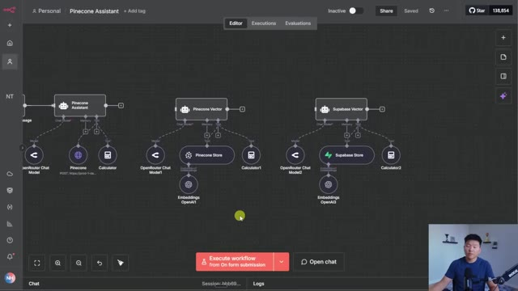
*⏱️ 00:13:24 — Interface graphique montrant un diagramme de workflow avec différents nœuds connectés pour Pinecone Assistant, Pinecone Vector et Supabase Vector.*

---

### ⏱️ `[00:13:43 - 00:14:17]` | Segment #32

**🔊 Audio (Transcription Intégrale Mot pour Mot en Français) :**
> Donc, je vais poser cette question dès maintenant à notre assistant Pinecone qui demande : quelle était la marge opérationnelle de Tesla au deuxième trimestre 2025 ? Vous verrez donc qu'il répond que la marge opérationnelle était de 4,1 %, ce qui est correct. Vous pouvez voir qu'il nous donne le document, il nous donne les numéros de page ainsi qu'une citation exacte. Et gardez également à l'esprit que nous avons obtenu cette réponse. Juste ici, il est écrit 1 277 jetons. Gardez donc ce chiffre en tête. Maintenant, si nous passons à cet agent du milieu qui utilise un magasin de vecteurs Pinecone plutôt que l'assistant, nous allons poser exactement la même question. Et rappelez-vous que nous cherchons la réponse 4,1 %. Donc, ce que nous obtenons en retour

**👁️ Analyse Visuelle d'Écran (gemini-3.5-flash-lite) :**
**Interface & Outils** : Interface web d'un outil de workflow et d'assistant IA (type Make/n8n ou interface personnalisée Pinecone).

**Contenu textuel & Code** : Workflow avec les nœuds "When chat message received", "Pinecone Assistant", "OpenRouter Chat Model", "Pinecone", et "Calculator". Dans le chat : "What was Tesla's operating margin in Q2 2025 ?" et la réponse "Tesla's operating margin in Q2 2025 was 4.1%." avec les sources.

**Action / Démonstration** : Exécution d'un workflow interactif pour interroger l'assistant sur les données financières de Tesla.

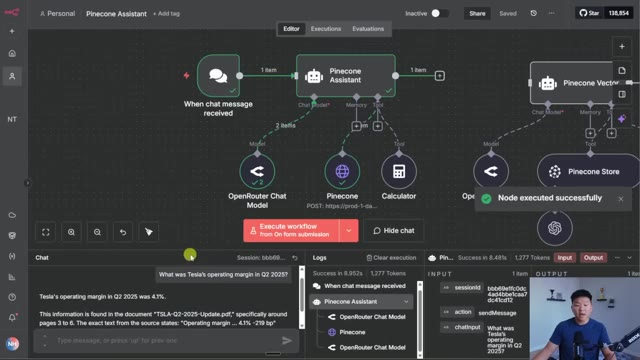
*⏱️ 00:13:51 — Capture d'écran montrant l'interface d'un outil d'automatisation avec un workflow de type nœuds (Pinecone Assistant) et un panneau de chat en bas à gauche affichant la réponse de l'assistant concernant la marge opérationnelle de Tesla.*

---

### ⏱️ `[00:14:17 - 00:14:50]` | Segment #33

**🔊 Audio (Transcription Intégrale Mot pour Mot en Français) :**
> c’est que je ne sais pas vraiment quelle est la réponse. Et vous pouvez voir que cela a pris près de 30 000 jetons. Nous avons donc obtenu une réponse incorrecte et cela nous a coûté environ 15 fois plus, plus de 15 fois plus. Oui, c'était un calcul horrible, mais vous voyez l'idée. Et comme nous avons adopté une approche classique par morceaux vectoriels où nous étions en charge de tout le prétraitement de ces morceaux, je suppose que cela fera exactement la même chose lorsque nous essaierons cela avec notre base de données vectorielle Supabase. Vous pouvez donc voir ici à peu près la même réponse. Il n'a pas été capable de trouver le chiffre exact. Nous recherchions 4,1 % et celui-ci n'a pris que 5 000 jetons.

**👁️ Analyse Visuelle d'Écran (gemini-3.5-flash-lite) :**
**Interface & Outils** : Interface web de Pinecone Assistant / Outil de workflow visuel

**Contenu textuel & Code** : Diagramme de flux de travail d'automatisation IA comprenant des modules de chat, de vectorisation et de calcul, ainsi que les logs d'exécution indiquant 29,459 jetons et une sortie textuelle sur la marge opérationnelle de Tesla.

**Action / Démonstration** : Visualisation des résultats d'exécution d'un workflow d'assistant IA montrant les coûts en jetons et la réponse textuelle générée.

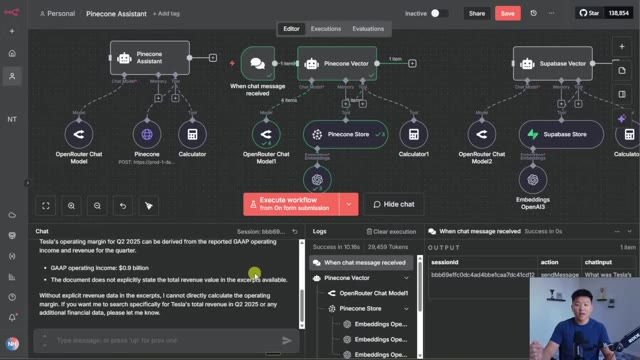
*⏱️ 00:14:25 — Interface de Pinecone Assistant affichant un diagramme de workflow complexe avec des nœuds connectés (Pinecone Vector, Supabase Vector, OpenRouter Chat Model) et un panneau de chat en bas montrant le résultat d'une exécution.*

---

### ⏱️ `[00:14:50 - 00:15:16]` | Segment #34

**🔊 Audio (Transcription Intégrale Mot pour Mot en Français) :**
> ce qui est encore environ trois fois plus cher que l'assistant Pinecone. C'est donc tout ce dont je vais parler aujourd'hui. Je ne dis pas que l'assistant Pinecone est toujours la meilleure option, car vous avez aussi ce coût de fonctionnement de cinq cents par heure. Mais ce que je veux dire, c'est que si vous voulez mettre quelque chose en place rapidement et voir comment cela fonctionne, cet assistant Pinecone change la donne, surtout si vous êtes débutant et que vous voulez expérimenter avec des trucs comme des agents RAG. Et je voulais aussi saluer rapidement la légende, Mark Kashoff.

**👁️ Analyse Visuelle d'Écran (gemini-3.5-flash-lite) :**
**Interface & Outils** : Interface web d'automatisation de workflow (semblable à Flowise ou Langflow)

**Contenu textuel & Code** : Blocs fonctionnels : "When chat message received", "Pinecone Assistant", "Pinecone Vector", "Supabase Vector", reliés à des modèles de chat (OpenRouter), des stockages (Pinecone Store, Supabase Store), et des outils (Calculator, Embeddings).

**Action / Démonstration** : Visualisation et configuration d'un diagramme de workflow d'intelligence artificielle avec le curseur de la souris positionné sur le modèle OpenRouter Chat.

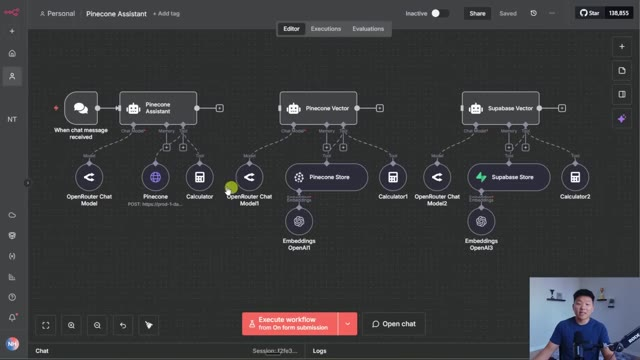
*⏱️ 00:14:56 — Capture d'écran montrant l'interface graphique d'un éditeur de workflow avec trois blocs principaux connectés à différents services (Pinecone Assistant, Pinecone Vector, Supabase Vector) ainsi que le présentateur en incrustation vidéo en bas à droite.*

---

### ⏱️ `[00:15:16 - 00:15:51]` | Segment #35

**🔊 Audio (Transcription Intégrale Mot pour Mot en Français) :**
> C'est lui qui m'a fait découvrir ces assistants Pinecone. Et comme je l'ai dit, je trouve ça super cool. J'espère donc que vous comprenez maintenant comment vous pouvez tester l'assistant Pinecone par vous-même. Et si vous voulez télécharger ce modèle pour pouvoir vous amuser un peu avec les différences, vous pouvez l'obtenir gratuitement en rejoignant ma communauté School gratuite. Et si vous aimez voir ce genre de choses et que vous voulez un apprentissage un peu plus structuré, alors allez absolument jeter un œil à ma communauté Plus. Le lien pour cela se trouve également dans la description. Nous avons une super communauté de plus de 2 500 membres. Tout le monde, chaque jour, construit et gagne sa vie avec N8N. Et nous avons une section de cours complète avec trois cours complets. Agent Zero est les bases pour les débutants. De 10 heures à 10 secondes plonge dans N8N. Et puis notre nouveau cours sur l'agence IA unipersonnelle est disponible pour nos

**👁️ Analyse Visuelle d'Écran (gemini-3.5-flash-lite) :**
**Interface & Outils** : Interface web de workflow et plateforme communautaire Skool (AI Automation Society Plus).

**Contenu textuel & Code** : Nœuds de workflow : "Pinecone Assistant", "Pinecone Vector", "Supabase Vector", "OpenRouter Chat Model", "Pinecone Store", "Supabase Store" et "Calculator".

**Action / Démonstration** : Visualisation d'un schéma d'automatisation d'IA et navigation dans la plateforme de cours de la communauté.

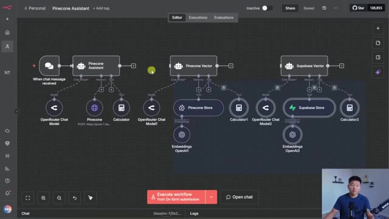
*⏱️ 00:15:25 — Un éditeur de workflow avec des nœuds connectés pour Pinecone Assistant, Pinecone Vector et Supabase Vector.*

---

### ⏱️ `[00:15:51 - 00:16:08]` | Segment #36

**🔊 Audio (Transcription Intégrale Mot pour Mot en Français) :**
> membres annuels. Et cela explique comment poser les bases pour créer une entreprise d'automatisation IA. Donc j'adorerais vous voir dans ces communautés, mais ce sera tout pour cette vidéo. J'espère que vous avez apprécié. Si vous avez appris quelque chose de nouveau, n'hésitez pas à laisser un j'aime. Ça m'aide vraiment énormément. Et comme toujours, j'apprécie que vous soyez allés jusqu'à la fin de la vidéo. On se retrouve tous dans la prochaine. Merci les gars.

**👁️ Analyse Visuelle d'Écran (gemini-3.5-flash-lite) :**
**Interface & Outils** : Navigateur web, plateforme communautaire en ligne, éditeur de flux d'automatisation visuel.

**Contenu textuel & Code** : Modules de cours sur l'automatisation IA et diagramme de workflow intégrant des bases de données vectorielles (Pinecone, Supabase) et des modèles de langage.
[DESC_IMAGE_1] Présentation des ressources de la communauté et des modules de formation pour créer une agence d'automatisation IA.
[DESC_IMAGE_2] Visualisation d'un workflow complexe connectant des assistants IA et des outils de calcul.

**Action / Démonstration** : Explications face caméra et démonstration conceptuelle.

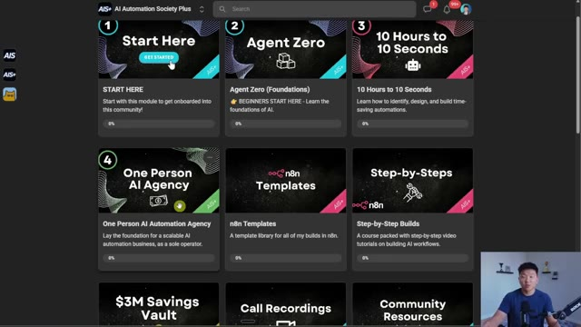
*⏱️ 00:15:56 — Interface web de la communauté "AI Automation Society Plus" montrant différents modules de formation (Start Here, Agent Zero, n8n Templates, etc.).*

*⏱️ 00:16:00 — Éditeur de workflow de type n8n ou similaire montrant un pipeline d'automatisation avec des nœuds pour Pinecone Assistant, Supabase Vector, OpenRouter Chat Model et Calculator.*

---

