# 🎬 n8n's NEW Native Data Tables Just Made Building Agents So Much Easier

> **Chaîne** : [Nate Herk | AI Automation](https://www.youtube.com/@nateherk/featured)  
> **Lien YouTube** : [https://www.youtube.com/watch?v=QCjMBOEhpLE](https://www.youtube.com/watch?v=QCjMBOEhpLE)  
> **Date de publication** : 20250922  
> **Durée** : 00:14:32  
> **Identifiant vidéo** : `QCjMBOEhpLE`  
> **Transcription & Analyse** : `whisper-v3-large-turbo+gemini-3.5-flash-lite`  

---

## 📌 Synthèse Exécutive & Outils

### 💡 Résumé

Cette vidéo de la chaîne Nate Herk | AI Automation explore l'intégration majeure des tables de données natives au sein de la plateforme d'automatisation n8n. Conçue pour s'affranchir des contraintes et de la latence des services externes comme Google Sheets, cette fonctionnalité permet de stocker, manipuler et interroger des données structurées directement dans l'environnement de travail local. L'auteur démontre l'efficacité de ce nouveau stockage natif à travers deux cas d'usage pratiques : l'enrichissement contextuel d'un agent de support client via un carnet de contacts filtré, et l'analyse financière autonome d'un agent IA connecté à une base de données de ventes. 

Au cœur des démonstrations, la mise en œuvre technique met en lumière la fluidité des transferts de données et l'utilisation de nœuds dédiés capables d'exécuter des opérations CRUD (Créer, Lire, Mettre à jour, Supprimer) ainsi que des filtres conditionnels précis. En évitant les appels API externes et l'authentification tierce, les flux de travail gagnent considérablement en vitesse d'exécution. De plus, la capacité à filtrer rigoureusement les données en amont de leur transmission à un modèle de langage (LLM) réduit drastiquement la consommation de jetons et minimise les risques d'hallucination, tout en abaissant les coûts opérationnels globaux.

Les exemples présentés illustrent la synergie entre les tables de données et les agents IA dotés d'outils de calcul et de requête. Qu'il s'agisse de croiser l'e-mail d'un expéditeur entrant avec des notes contextuelles de profil pour rédiger un message sur-mesure, ou d'interroger un historique de ventes par date pour sommer des volumes de produits, n8n démontre sa maturité pour orchestrer des architectures logiques complexes, déterministes et hautement performantes.

### 🛠️ Outils, Modèles & Logiciels Présentés

* **n8n** : Plateforme d'automatisation de flux de travail open-source et low-code intégrant désormais des tables de données natives pour un stockage et une manipulation ultra-rapides des données.
* **Tables de données n8n (Data Tables)** : Nouvelle fonctionnalité native permettant de stocker de manière permanente des jeux de données structurés (chaînes, nombres, booléens, dates) sans dépendre d'outils tiers.
* **Google Sheets** : Tableur cloud utilisé dans la vidéo comme source de données initiale pour être ensuite importé et centralisé dans l'environnement natif de n8n.
* **Agents IA (n8n AI Agents)** : Modules cognitifs autonomes capables d'utiliser dynamiquement des outils de requête et de calcul pour interroger les tables de données et raisonner sur l'information.
* **Gmail** : Nœud de messagerie utilisé pour déclencher des flux automatisés basés sur la réception d'e-mails entrants.
* **ChatGPT (OpenAI)** : Mentionné comme outil d'assistance pour générer rapidement des données textuelles synthétiques destinées à alimenter les fiches de contacts.

### 🔑 Points Clés & Enseignements Stratégiques

* **Stockage natif intégré** : L'introduction des tables de données natives dans n8n élimine la dépendance aux bases de données externes ou aux feuilles de calcul tierces pour les flux quotidiens.
* **Suppression des identifiants tiers** : L'utilisation de tables internes simplifie l'architecture technique en s'affranchissant de la configuration et de la gestion de jetons d'authentification API externes.
* **Optimisation de la consommation de jetons** : Filtrer strictement les données en amont de l'agent IA évite d'injecter des centaines ou des milliers de lignes superflues, réduisant ainsi les coûts de tokens.
* **Atténuation des hallucinations** : Réduire le bruit et limiter le contexte transmis aux grands modèles de langage (LLM) renforce la précision de leurs réponses et leur fiabilité déterministe.
* **Migration et import simplifiés** : Les données provenant d'outils externes (comme Google Sheets) peuvent être facilement transférées et insérées en masse dans les tables natives grâce à des nœuds d'écriture dédiés.
* **Typage strict des données** : Les colonnes des tables natives exigent un typage rigoureux (chaîne, nombre, booléen, date), garantissant l'intégrité des données et évitant les erreurs d'insertion.
* **Filtrage conditionnel granulaire** : Les nœuds de récupération permettent d'appliquer des conditions logiques complexes (comme l'égalité d'un e-mail ou d'une date) pour extraire uniquement la ressource pertinente.
* **Fonctions CRUD complètes** : Les tables prennent en charge toutes les opérations essentielles : insertion, mise à jour, suppression, obtention de lignes et transactions de type *upsert*.
* **Augmentation des agents IA par outils** : Combiner un agent IA avec des outils de requête spécifiques et une calculatrice lui permet de réaliser des calculs arithmétiques précis et vérifiables sur les données métier.
* **Personnalisation contextuelle avancée** : L'association des tables de contacts aux e-mails entrants permet d'injecter des notes comportementales ou préférentielles pour générer des réponses hautement personnalisées.
* **Architecture hybride (déterministe et cognitive)** : Le flux combine des étapes logiques déterministes (filtrage SQL-like des tables) et des étapes cognitives (rédaction par l'agent IA), optimisant la robustesse du système.
* **Gain de performance et de vitesse** : L'absence de requêtes réseau vers des services cloud tiers se traduit par des exécutions quasi instantanées des flux de travail.

---

## ⏱️ Chronologie & Transcription Complète Audio & Visuelle (Mot pour Mot)

### ⏱️ `[00:00:00 - 00:00:36]` | Segment #01

**🔊 Audio (Transcription Intégrale Mot pour Mot en Français) :**
> Très bien, donc nous avons notre agent IA de données de vente juste ici, et il est connecté à tous ces outils afin qu'il puisse interroger notre base de données de ventes. Je vais donc ouvrir le chat, et je vais lui demander : quel est le chiffre d'affaires total que nous avons réalisé grâce à notre haut-parleur Bluetooth ? Et donc ce qu'il va faire, c'est utiliser ces outils juste ici, et il a utilisé la requête de nom de produit pour examiner toutes les fois où nous avons vendu un haut-parleur Bluetooth, et ensuite il a simplement utilisé son outil de calcul pour déterminer ce total. Donc il vient de terminer. Si j'ouvre le chat, vous pouvez voir que nous avons obtenu la réponse : le chiffre d'affaires total du haut-parleur Bluetooth était de 546 dollars. Il a calculé cela en récupérant toutes les lignes de vente pour le haut-parleur Bluetooth, et ensuite il a additionné le chiffre d'affaires total de chaque ligne,

**👁️ Analyse Visuelle d'Écran (gemini-3.5-flash-lite) :**
**Interface & Outils** : Interface web de workflow / automatisation d'agents IA (type n8n ou similaire).

**Contenu textuel & Code** : Question dans le chat : 'How much total revenue have we made from our bluetooth speaker?'. Réponse de l'agent : 'Total revenue from Bluetooth Speaker (product ID BS002): $546.00'.

**Action / Démonstration** : Saisie et envoi d'une requête textuelle dans le chat de l'agent IA pour interroger la base de données de ventes.

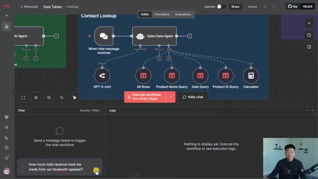
*⏱️ 00:00:09 — Interface d'un outil de workflow d'agent IA montrant un schéma de nœuds avec 'Sales Data Agent' relié à plusieurs outils de données, et un panneau de chat en bas avec une question pré-remplie.*

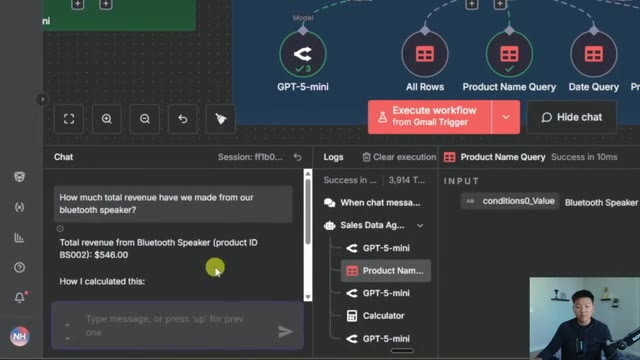
*⏱️ 00:00:27 — Même interface de workflow après l'exécution du chat, affichant la réponse de l'agent IA indiquant le chiffre d'affaires total pour le haut-parleur Bluetooth ($546.00) ainsi que les journaux d'exécution à droite.*

---

### ⏱️ `[00:00:36 - 00:01:09]` | Segment #02

**🔊 Audio (Transcription Intégrale Mot pour Mot en Français) :**
> et c'est pourquoi il a utilisé sa calculatrice et est arrivé au résultat de 546, ce qui est correct. Et donc vous n'avez peut-être jamais vu ce nœud auparavant. Ce sont des tables de données qui sont stockées de manière native dans N8N, et cela ressemble à ceci juste ici. Vous pouvez voir qu'il s'agit de la table de données, et ce sont les différents produits, ainsi que les quantités, les prix et le chiffre d'affaires, et c'est ce qu'il vient de parcourir afin de répondre à notre question avec précision. Et encore une fois, celles-ci se trouvent de manière native dans N8N, donc notre agent n'a pas eu besoin d'aller sur Internet ou d'effectuer un appel API quelque part pour accéder à ces données. Elles résident ici même dans notre environnement, dans un nouvel onglet juste ici appelé tables de données. C'est donc ce que nous allons

**👁️ Analyse Visuelle d'Écran (gemini-3.5-flash-lite) :**
**Interface & Outils** : N8N (Interface de workflow et tables de données natives)

**Contenu textuel & Code** : Nœuds de workflow N8N, agent LLM (Sales Data Agent), outils de requête, calculatrice, et tableau de données de ventes avec des lignes de transactions.

**Action / Démonstration** : Présentation d'un workflow N8N et démonstration visuelle des tables de données natives utilisées pour alimenter l'agent IA en informations commerciales.

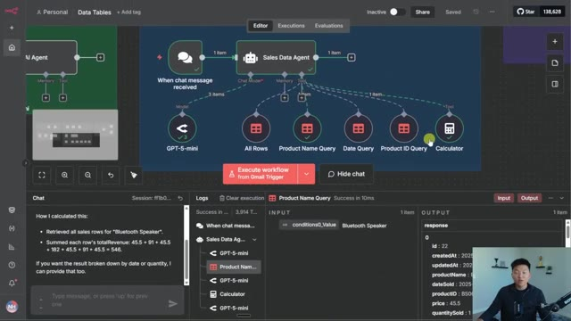
*⏱️ 00:00:44 — Vue d'ensemble du workflow N8N montrant l'agent IA de données de ventes connecté à plusieurs sous-outils et tables, avec le panneau de chat affichant le résultat du calcul du revenu total.*

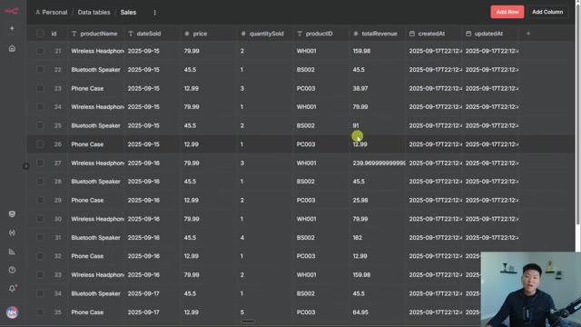
*⏱️ 00:00:52 — Interface de la table de données native dans N8N nommée 'Sales', présentant un tableau structuré avec des colonnes telles que id, productName, dateSold, price, quantitySold, productID, totalRevenue, createdAt et updatedAt.*

---

### ⏱️ `[00:01:09 - 00:01:38]` | Segment #03

**🔊 Audio (Transcription Intégrale Mot pour Mot en Français) :**
> dont nous allons parler aujourd'hui. Comme toujours, vous obtiendrez ce flux de travail ainsi que les deux jeux de données d'exemple de manière totalement gratuite afin de pouvoir venir ici, mettre les mains dans le cambouis et commencer simplement à l'utiliser pour comprendre comment cela fonctionne. Mais entrons dans le vif du sujet. Voici à quoi ressemble l'onglet des tables de données dans n8n. J'enregistre cette vidéo avant qu'il ne soit réellement déployé pour tout le monde. Donc, si vous ne le voyez pas pour l'instant, tout ce que vous aurez à faire, c'est de vous assurer de mettre à jour votre n8n vers la dernière version, et vous devriez alors voir les tables de données. C'est juste ici sur mon écran d'accueil. J'ai mes flux de travail, mes identifiants, mes exécutions, et ensuite j'ai mes tables de données.

**👁️ Analyse Visuelle d'Écran (gemini-3.5-flash-lite) :**
**Interface & Outils** : Interface web d'automatisation de workflows (type n8n)

**Contenu textuel & Code** : Workflows intitulés 'From Sheets to Data Table', 'Inserting Sales Data', 'Contact Lookup' avec des nœuds de déclenchement (Gmail Trigger), d'IA (GPT-4o-mini) et de manipulation de données.

**Action / Démonstration** : Présentation générale du flux de travail d'automatisation et de ses différents blocs fonctionnels.

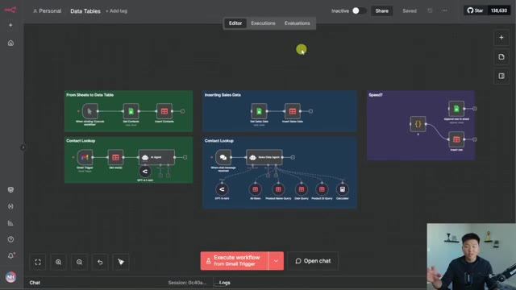
*⏱️ 00:01:16 — Capture d'écran montrant l'interface d'une application d'automatisation de type n8n ou similaire avec plusieurs blocs de workflows pour la gestion de tables de données et d'agents IA, et le présentateur en médaillon dans le coin inférieur droit.*

---

### ⏱️ `[00:01:39 - 00:02:03]` | Segment #04

**🔊 Audio (Transcription Intégrale Mot pour Mot en Français) :**
> Et tout ce que j'ai à faire pour en créer un nouveau, c'est de cliquer sur ce petit menu déroulant, de cliquer sur créer une table de données. Je vais appeler celle-ci « demo » avec un antislash, ou peut-être un slash. Et ensuite, ce que nous avons, c'e sont deux colonnes par défaut, qui sont une date de création et une date de mise à jour. Et ensuite, si nous voulons ajouter différentes colonnes, nous aurions juste à taper ici pour ajouter une colonne. Et ensuite, nous devons choisir un type de données. Nous avons donc chaîne de caractères, nombre, booléen, ou date. Une fois que j'ajoute cette colonne, je suis alors capable d'ajouter une ligne.

**👁️ Analyse Visuelle d'Écran (gemini-3.5-flash-lite) :**
**Interface & Outils** : Interface web d'application de gestion de données.

**Contenu textuel & Code** : Nom de la table « demo\ », colonnes par défaut « id », « createdAt », « updatedAt », message « No Rows To Show ».

**Action / Démonstration** : Création et affichage d'une nouvelle table de données vide nommée « demo\ ».

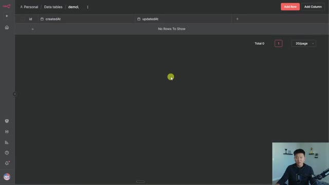
*⏱️ 00:01:45 — Interface montrant une table de données nommée « demo\ » avec deux colonnes par défaut (« id », « createdAt », « updatedAt ») et des boutons « Add Row » et « Add Column ».*

---

### ⏱️ `[00:02:03 - 00:02:38]` | Segment #05

**🔊 Audio (Transcription Intégrale Mot pour Mot en Français) :**
> Et ensuite, je peux simplement remplir les données ici même. Ou je voulais taper Nate en fait. Ou au lieu de remplir des trucs manuellement, vous pouvez importer d'autres feuilles de données dans N8N. Donc disons que j'ai cette feuille de contacts que j'utilise dans Google Sheets, mais je veux la déplacer vers N8N. Laissez-moi vous montrer comment nous faisons cela. Donc nous voici de retour dans N8N et nous avons ces nœuds orange. Il vous suffirait d'appuyer sur tab ou de cliquer sur le plus en haut à droite. Et si vous cherchez des tables de données, vous pouvez maintenant voir que nous avons ce nouveau nœud, qui dit enregistrer définitivement des données lors des exécutions de flux de travail dans une table. Et si j'ouvre cela, nous avons les fonctions qui sont assez similaires à Google Sheets, comme la suppression d'une ligne, l'obtention d'un

**👁️ Analyse Visuelle d'Écran (gemini-3.5-flash-lite) :**
**Interface & Outils** : n8n (Interface web d'automatisation)

**Contenu textuel & Code** : Nœuds de workflow n8n ("Get Contacts", "Insert Contacts", "Gmail Trigger", "Get row(s)", "AI Agent"), table de données avec colonnes "id", "Name", "createdAt", "updatedAt".

**Action / Démonstration** : Navigation et présentation de la table de données intégrée dans n8n, puis affichage du workflow complet connectant Google Sheets, Data Table et un Agent IA avec Gmail.

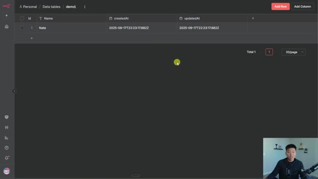
*⏱️ 00:02:12 — Interface N8N affichant une table de données ("Data tables / demo") avec une ligne contenant le nom "Nate".*

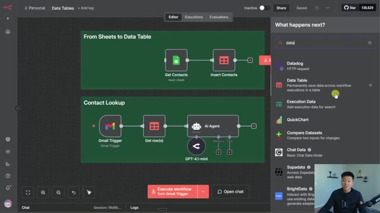
*⏱️ 00:02:29 — Interface N8N affichant un éditeur de workflow avec deux blocs principaux ("From Sheets to Data Table" et "Contact Lookup") et le panneau latéral de recherche de nœuds.*

---

### ⏱️ `[00:02:38 - 00:03:13]` | Segment #06

**🔊 Audio (Transcription Intégrale Mot pour Mot en Français) :**
> ligne, l'insertion d'une ligne, la mise à jour ou l'upsert. Donc, juste pour vous montrer comment cela fonctionne, nous allons récupérer mes contacts de cette feuille Google Sheets et nous allons les importer dans cette table de données de contacts dans N8N. Donc, très rapidement, je vais juste supprimer toutes ces lignes et gardez à l'esprit, vous pouvez voir ici, la dernière ligne commence à l'ID 20. Et quand je les supprime, on dirait que ça se réinitialise, mais quand nous écrirons d'autres lignes, cela commencera à 21 parce que cette table de données s'en souvient, mais c'est un détail très mineur. Comme je l'ai dit, exécutons cela très rapidement et ensuite je vous montrerai ce qui se passe. Donc, vous pouvez voir que c'est arrivé très, très vite. Nous récupérons

**👁️ Analyse Visuelle d'Écran (gemini-3.5-flash-lite) :**
**Interface & Outils** : Google Sheets et n8n (Data Tables)

**Contenu textuel & Code** : Données de contacts structurées en colonnes (Nate Herkelman, Michael Scott, Mark Johnson, etc.) et table n8n vide puis remplie.

**Action / Démonstration** : Navigation entre la source Google Sheets et la table de données n8n pour illustrer l'importation et la gestion des contacts.

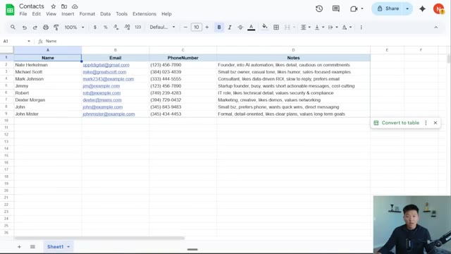
*⏱️ 00:02:47 — Une feuille Google Sheets affichant une liste de contacts avec les colonnes Nom, Email, Numéro de téléphone et Notes.*

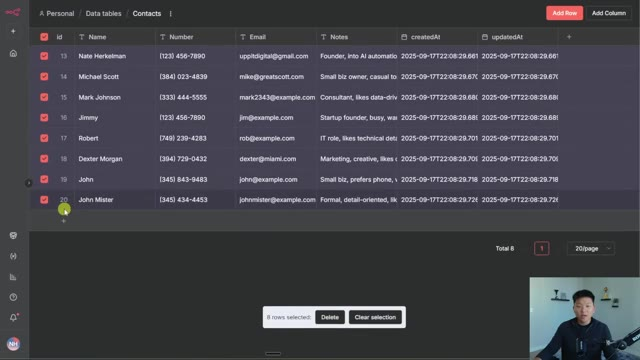
*⏱️ 00:02:56 — L'interface d'une table de données dans n8n montrant plusieurs lignes de contacts importées avec leurs ID, noms, numéros et horodatages.*

*⏱️ 00:03:04 — La même table de données n8n pour les contacts, affichant actuellement "No Rows To Show" avant l'importation.*

---

### ⏱️ `[00:03:13 - 00:03:48]` | Segment #07

**🔊 Audio (Transcription Intégrale Mot pour Mot en Français) :**
> dans toutes les lignes de ma feuille de contacts, et ensuite nous les écrivons dans une table de données. Et vous pouvez simplement choisir dans une liste. Vous remarquerez qu'il n'y a pas de section d'identifiants parce que nous n'allons pas sur Internet. Nous récupérons simplement cela de manière native depuis N8N. Et ensuite, nous devons juste mapper nos colonnes. Donc le nom, j'ai glissé le nom, l'adresse e-mail, le numéro, les notes, tout ce genre de choses. Vous devez simplement vous assurer que les types de données correspondent. Sinon, cela ne vous permettra pas d'insérer ces valeurs. Donc maintenant que nous avons fait cela, si je retourne dans ma table de données N8N pour les contacts et que je clique sur actualiser, nous devrions voir que ces lignes de contacts sont arrivées dans notre instance. Donc j'espère que vous

**👁️ Analyse Visuelle d'Écran (gemini-3.5-flash-lite) :**
**Interface & Outils** : n8n (outil d'automatisation de workflows low-code)

**Contenu textuel & Code** : Nœuds de workflow : "When clicking 'Execute workflow'", "Get Contacts", "Insert Contacts", "Gmail Trigger", et "AI Agent".

**Action / Démonstration** : Configuration des paramètres du nœud 'Insert Contacts' pour mapper les colonnes de données issues d'une feuille de calcul.

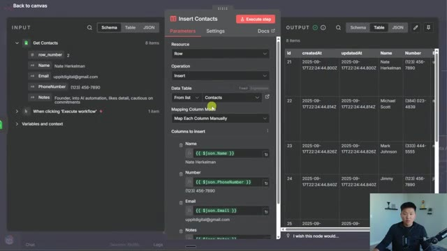
*⏱️ 00:03:22 — Interface d'un éditeur de workflow avec un panneau de configuration ouvert au centre montrant les paramètres d'insertion de contacts dans une table de données.*

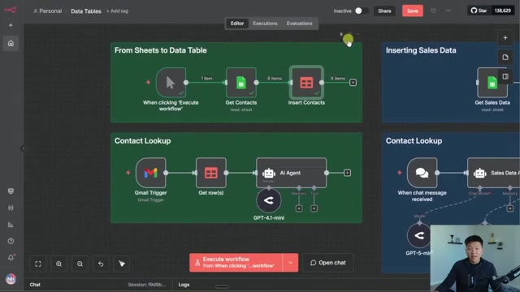
*⏱️ 00:03:40 — Vue d'ensemble du canvas d'automatisation montrant plusieurs workflows de traitement de données et d'agents IA (n8n).*

---

### ⏱️ `[00:03:48 - 00:04:25]` | Segment #08

**🔊 Audio (Transcription Intégrale Mot pour Mot en Français) :**
> voyez comment cela ouvre quelques opportunités. Nous n'allons pas pouvoir plonger dans tous les cas d'utilisation aujourd'hui, mais laissez-moi vous en montrer un auquel vous pourriez penser. Donc nous avons nos données de contact dans n8n, et ce que nous pourrions faire, c'est fondamentalement utiliser quelque chose comme ceci, où nous allons répondre à un e-mail, mais avant de répondre à l'e-mail, nous voulons rechercher ce contact et filtrer à travers toutes nos données, tous nos contacts pour ne garder que celui que nous recherchons. Donc je vais récupérer un nouvel e-mail à partir de notre déclencheur Gmail. Nous pouvons voir que l'e-mail d'où cela provient est upatdigital@gmail.com et nous avons Nate Herkelman. Donc ce que je vais faire ensuite, c'est que nous utilisons un nœud pour obtenir des lignes à partir d'une table de données, mais nous utilisons un filtre et nous disons que nous voulons seulement récupérer les lignes qui correspondent

**👁️ Analyse Visuelle d'Écran (gemini-3.5-flash-lite) :**
**Interface & Outils** : n8n (éditeur de workflows d'automatisation)

**Contenu textuel & Code** : Nœuds de workflow n8n (Gmail Trigger, Get row(s), AI Agent GPT-4o-mini) et données JSON/HTML de sortie d'un e-mail reçu.

**Action / Démonstration** : Navigation et présentation des différents scénarios d'automatisation et de recherche de contacts basés sur les e-mails dans n8n.

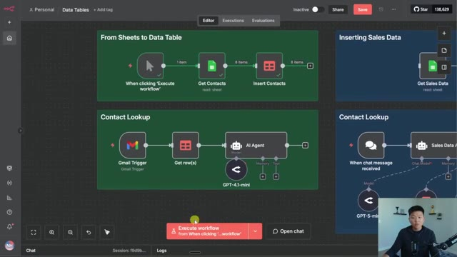
*⏱️ 00:03:57 — Vue d'ensemble de l'interface n8n montrant plusieurs workflows automatisés, incluant 'From Sheets to Data Table' et 'Contact Lookup' avec un agent IA GPT-4o-mini.*

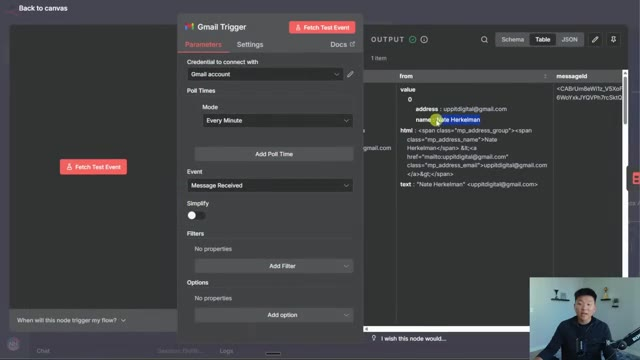
*⏱️ 00:04:16 — Panneau de configuration du nœud 'Gmail Trigger' dans n8n, affichant les paramètres de déclenchement (toutes les minutes, réception de message) et le panneau de sortie des données (Output).*

---

### ⏱️ `[00:04:25 - 00:05:01]` | Segment #09

**🔊 Audio (Transcription Intégrale Mot pour Mot en Français) :**
> cette condition spécifique. Et la condition est que l'e-mail doit correspondre à l'e-mail qui a déclenché tout ce flux ici. Donc je suis essentiellement descendu et j'ai glissé ça directement ici. Et maintenant, quand j'exécute ceci, nous allons seulement obtenir la ligne pour Nate Herkelman avec cet e-mail. Et maintenant, ce que je peux faire, c'est que je peux injecter les notes juste ici concernant cette personne dans l'agent IA qui va rédiger l'e-mail. Donc si je vais à l'étape suivante, je vais juste exécuter ceci rapidement, mais regardons quel est le prompt utilisateur. Donc l'agent IA examine le prompt utilisateur, qui est l'objet de l'e-mail, le corps de l'e-mail, le nom de cette personne et les notes concernant cette personne. Et ces éléments proviennent

**👁️ Analyse Visuelle d'Écran (gemini-3.5-flash-lite) :**
**Interface & Outils** : Interface web d'un outil d'automatisation de workflow (type n8n ou Make) avec un panneau latéral de configuration et un aperçu des données JSON.

**Contenu textuel & Code** : Configuration du nœud : opération 'Get', table de données 'Contacts', condition de correspondance 'Email - (string)' Equals '{{ $json.from.value[0].address }}'. Données JSON affichant les détails d'un e-mail avec les adresses de Nate Herkelman.

**Action / Démonstration** : Configuration et association d'une condition dynamique pour filtrer les lignes en fonction de l'adresse e-mail source du déclencheur.

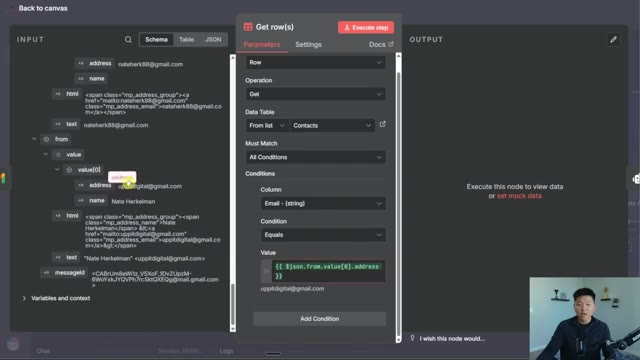
*⏱️ 00:04:34 — Capture d'écran montrant l'interface de configuration d'un nœud d'automatisation (Get row(s)) avec un panneau de données d'entrée JSON à gauche et le présentateur en médaillon en bas à droite.*

---

### ⏱️ `[00:05:01 - 00:05:29]` | Segment #10

**🔊 Audio (Transcription Intégrale Mot pour Mot en Français) :**
> depuis le tableau de données. Il peut donc voir que le sujet était, j'ai besoin d'aide. Le corps de l'e-mail est, hé, j'ai besoin d'aide pour mon entreprise. Des suggestions de Nate Herkelman, qui est un fondateur spécialisé dans l'automatisation par IA, aime les détails, prudent sur les engagements. Ceci a en fait été tiré de ChatGPT à mon sujet lorsque j'ai dit, hé, j'ai besoin de notes rapides pour une base de données de contacts. C'est donc intéressant. Quoi qu'il en soit, ensuite, bien sûr, notre message système est simplement d'écrire un e-mail amical qui est personnalisé. Et vous pouvez voir qu'il répond en disant, hé, Nate, merci d'avoir contacté. J'aimerais beaucoup vous aider avec votre entreprise.

**👁️ Analyse Visuelle d'Écran (gemini-3.5-flash-lite) :**
**Interface & Outils** : Éditeur de workflow de type n8n avec un panneau d'expressions et de résultats.

**Contenu textuel & Code** : Expressions JavaScript configurant le sujet et le corps de l'e-mail (Email Subject, Email Body, Name, Notes) et affichant le résultat de l'exécution avec les informations de Nate Herkelman.

**Action / Démonstration** : Visualisation et vérification du mapping des données d'un nœud dans l'automatisation.

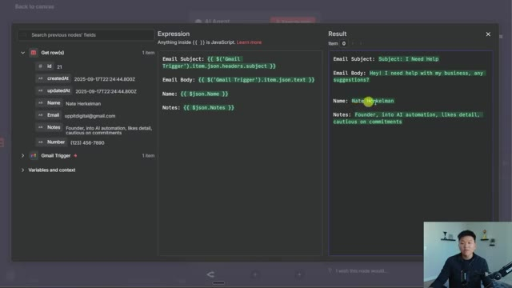
*⏱️ 00:05:08 — Interface d'un éditeur de workflow montrant un panneau de configuration avec des expressions JavaScript pour mapper les données d'un e-mail et d'une base de données, ainsi que le résultat correspondant.*

---

### ⏱️ `[00:05:29 - 00:06:01]` | Segment #11

**🔊 Audio (Transcription Intégrale Mot pour Mot en Français) :**
> Puisque tu t'intéresses à l'automatisation par IA et que tu apprécies une approche détaillée, nous pouvons explorer quelques solutions sur mesure qui correspondent à tes besoins sans te donner l'impression d'être poussé à t'engager. Donc comme je l'ai dit, un cas d'usage super, super simple, mais la clé ici était de vous montrer que vous êtes capable de filtrer et d'avoir des conditions lorsque vous extrayez des lignes de votre ensemble de données, ce qui va être très important à mesure que votre base de données grandit et grandit. Sinon, vous allez transmettre des centaines, potentiellement des milliers de lignes à l'IA, et tout ce que vous faites là, c'est ajouter plus de jetons, ce qui peut amener l'IA à halluciner un peu plus.

**👁️ Analyse Visuelle d'Écran (gemini-3.5-flash-lite) :**
**Interface & Outils** : Application de workflow d'automatisation (type n8n ou similaire) avec un nœud "AI Agent" actif au centre.

**Contenu textuel & Code** : Données JSON en entrée (nom, email, notes, numéro), prompt utilisateur configuré avec les variables du déclencheur Gmail, et message de sortie généré sous forme d'e-mail de réponse.

**Action / Démonstration** : Configuration des paramètres et du prompt d'un agent IA pour automatiser la rédaction d'un e-mail de réponse en fonction des données reçues.

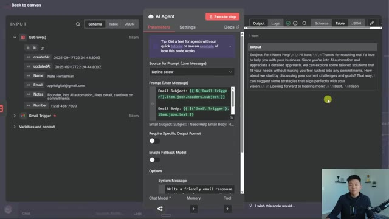
*⏱️ 00:05:37 — Interface d'un workflow d'automatisation montrant les données d'entrée (Get row, Gmail Trigger), la configuration d'un agent IA au centre avec son prompt et ses paramètres, ainsi que le résultat généré dans le panneau de droite.*

---

### ⏱️ `[00:06:01 - 00:06:22]` | Segment #12

**🔊 Audio (Transcription Intégrale Mot pour Mot en Français) :**
> Et la principale raison, c'est que ça va simplement être plus cher. Et bien sûr, ça ne doit pas nécessairement être ça. Nous avons adopté ici l'approche linéaire déterministe, mais vous pourriez aussi ajouter des outils de table de données comme nous le verrons dans un exemple futur, où vous pouvez choisir à partir d'une certaine table de données et ensuite vous pouvez avoir toutes ces lignes comme l'insertion de choses, le filtrage à travers des éléments, l'ajout de conditions, la mise à jour de lignes, la suppression de lignes.

**👁️ Analyse Visuelle d'Écran (gemini-3.5-flash-lite) :**
**Interface & Outils** : Interface web d'automatisation (n8n / workflow visuel)

**Contenu textuel & Code** : Diagrammes de flux avec des nœuds pour "From Sheets to Data Table" et "Contact Lookup", intégrant des déclencheurs Gmail, des feuilles de calcul et un agent IA propulsé par GPT-4.1-mini.

**Action / Démonstration** : Présentation et visualisation de workflows d'automatisation incluant des tables de données et des agents IA.

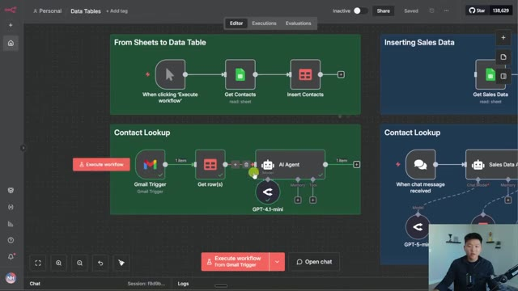
*⏱️ 00:06:06 — Capture d'écran montrant l'interface d'un outil d'automatisation de flux de travail de type n8n, illustrant des blocs pour les tables de données et des agents IA.*

---

### ⏱️ `[00:06:22 - 00:06:46]` | Segment #13

**🔊 Audio (Transcription Intégrale Mot pour Mot en Français) :**
> Donc tout ce que vous feriez typiquement avec Google Sheets, mais maintenant c'est plus rapide et c'est dans nnn. Cool. Passons donc à un exemple différent ici. Laissez-moi simplement attraper mon déclencheur manuel et le déplacer là-bas. Donc maintenant nous allons traiter les données de ventes. J'ai donc une feuille de données de ventes ici même dans Google Sheets. Vous pouvez voir qu'il y a 20 lignes. Nous avons un total de trois produits à analyser. Nous avons un total de trois jours à analyser. Nous avons des prix, des quantités, et le chiffre d'affaires total, ce genre de choses.

**👁️ Analyse Visuelle d'Écran (gemini-3.5-flash-lite) :**
**Interface & Outils** : n8n, Google Sheets

**Contenu textuel & Code** : Tableur avec données de ventes (Wireless Headphones, Bluetooth Speaker, Phone Case, dates, prix, quantités, ID produit et revenus totaux).

**Action / Démonstration** : Navigation et présentation d'exemples de traitement des données de ventes dans Google Sheets et n8n.

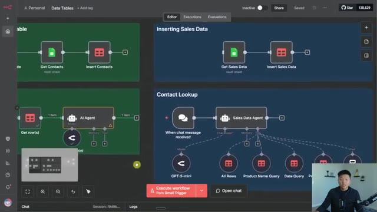
*⏱️ 00:06:28 — Interface n8n montrant plusieurs workflows d'automatisation et un agent IA configuré pour traiter des données.*

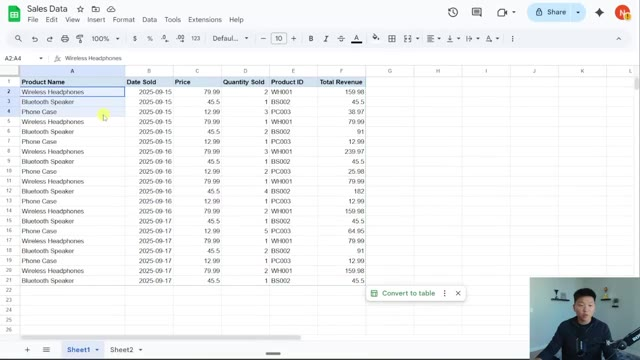
*⏱️ 00:06:40 — Fichier Google Sheets intitulé 'Sales Data' contenant un tableau de ventes avec des colonnes de produits, dates, prix et quantités.*

---

### ⏱️ `[00:06:46 - 00:07:07]` | Segment #14

**🔊 Audio (Transcription Intégrale Mot pour Mot en Français) :**
> Et nous allons, tout d'abord, intégrer ceci dans notre table de données NN. Donc dans ma table de données de vente et NNN, je vais simplement aller de l'avant et m'assurer que nous supprimons toutes ces lignes. Je ne veux rien ici, juste pour vous montrer à quel temps il est facile de tout y inscrire. Donc, de retour dans notre flux de travail, tout ce que j'ai à faire maintenant, c'est d'exécuter ce flux de travail. Nous allons récupérer les 20 lignes et les lire, ou désolé, et les écrire dans notre table de données et l'en terminer.

**👁️ Analyse Visuelle d'Écran (gemini-3.5-flash-lite) :**
**Interface & Outils** : Application web de gestion de bases de données / tables de données (interface de type Airtable ou outil d'automatisation n8n)

**Contenu textuel & Code** : Données tabulaires de vente avec colonnes : id, productName, dateSold, price, quantitySold, productID, totalRevenue, createdAt, updatedAt

**Action / Démonstration** : Suppression de l'ensemble des lignes de la table de données "Sales" pour repartir d'une table vide.

*⏱️ 00:06:52 — L'image montre une table de données nommée "Sales" avec plusieurs lignes de ventes de produits (Wireless Headphone, Bluetooth Speaker, Phone Case) affichant les colonnes id, productName, dateSold, price, quantitySold, productID, totalRevenue, createdAt et updatedAt. Le présentateur est visible en incrustation vidéo en bas à droite.*

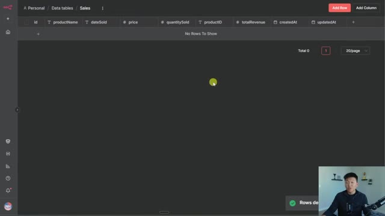
*⏱️ 00:06:57 — L'image montre la même table de données "Sales" après la suppression de toutes les lignes, affichant le message "No Rows To Show" avec un total de 0 lignes et une notification de succès "Rows deleted" en bas à droite.*

---

### ⏱️ `[00:07:08 - 00:07:38]` | Segment #15

**🔊 Audio (Transcription Intégrale Mot pour Mot en Français) :**
> Donc je devrais pouvoir actualiser ceci et maintenant nous voyons nos données de ventes. Et ensuite, parce que nous avons cet agent d'IA connecté à cela et que nous avons différents outils, il devrait être capable de répondre à la majorité de nos questions en utilisant une combinaison de ces outils et de la calculatrice. Faisons donc quelques exemples et je vais vous montrer ce qui se passe à l'intérieur des outils. Très bien, donc si je lui pose cette première question, qui est combien de produits ont été vendus le 15 septembre de cette année, ce qu'il devrait faire, c'est aller à cet outil de requête de date et il ne devrait ramener que les lignes où la date est égale au 15 septembre.

**👁️ Analyse Visuelle d'Écran (gemini-3.5-flash-lite) :**
**Interface & Outils** : Interface web de type n8n ou plateforme d'automatisation low-code.

**Contenu textuel & Code** : Workflow nommé 'Contact Lookup' avec un agent 'Sales Data Agent' relié à des outils : 'GPT-5-mini', 'All Rows', 'Product Name Query', 'Date Query', 'Product ID Query', et 'Calculator'.

**Action / Démonstration** : Le présentateur survole ou configure les différents outils et requêtes connectés à l'agent d'IA.

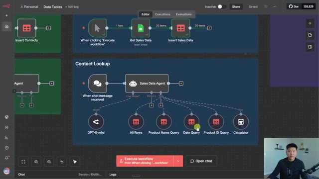
*⏱️ 00:07:15 — Interface d'un constructeur de workflow d'IA montrant un agent connecté à divers outils de requêtes de données et un modèle LLM.*

---

### ⏱️ `[00:07:38 - 00:07:58]` | Segment #16

**🔊 Audio (Transcription Intégrale Mot pour Mot en Français) :**
> Et ensuite, il va probablement utiliser sa calculatrice pour s'assurer qu'il fait bien le calcul correctement. Donc vous pouvez voir qu'il a obtenu la réponse de 10, ce qui est correct. Et vous pouvez voir ce qu'il a fait, c'est qu'il a récupéré tous les enregistrements de ventes pour 2025, 9, 15, ce qui fait le 15 septembre. Il y avait six transactions au total et il les a toutes résumées en utilisant la calculatrice. Donc c'était deux plus un plus trois, bla, bla, bla, ce qui faisait 10.

**👁️ Analyse Visuelle d'Écran (gemini-3.5-flash-lite) :**
**Interface & Outils** : n8n (outil d'automatisation de workflows).

**Contenu textuel & Code** : Workflow automatisé avec des nœuds : "Sales Data Agent", "GPT-5-mini", "All Rows", "Date Query", "Calculator". Logs d'exécution détaillant les étapes de calcul. Fenêtre de chat affichant le raisonnement de l'agent : "Total products sold on 2025-09-15: 10 units".

**Action / Démonstration** : Exécution d'un workflow automatisé pour interroger des données de ventes, calculer la somme via un outil "Calculator" et générer une réponse textuelle dans le chat.

*⏱️ 00:07:43 — Une interface de workflow visuel (type n8n) affichant un "Sales Data Agent" connecté à divers outils dont un modèle GPT-4o-mini, des requêtes de base de données et une calculatrice. Le panneau de chat à gauche affiche la réponse finale "10 unités" pour une requête sur les ventes du 15 septembre 2025.*

---

### ⏱️ `[00:07:59 - 00:08:31]` | Segment #17

**🔊 Audio (Transcription Intégrale Mot pour Mot en Français) :**
> Donc, si je clique sur l'outil de requête de données qu'il a décidé d'utiliser, vous pouvez voir que la raison pour laquelle cela fonctionne, c'est parce que nous avons la condition, qui est que la date de vente soit égale à la valeur que l'IA renseigne. Et l'IA a renseigné la valeur juste ici, ce qui est exactement la façon dont nous la voyons dans notre tableau de données de ventes, parce que nous lui avons dit que c'est en gros le format des dates. Et une chose que je voulais souligner très rapidement, c'est que vous pouvez voir que c'est configuré comme une chaîne de caractères. Ce n'est pas le véritable type de données « date », et la raison pour laquelle nous avons fait cela, c'est parce que dans nos données de ventes sur Google Sheets, c'était formaté comme ceci et les tirets en font fondamentalement une chaîne de caractères.

**👁️ Analyse Visuelle d'Écran (gemini-3.5-flash-lite) :**
**Interface & Outils** : Interface web d'automatisation et de gestion de bases de données (type outil low-code/IA).

**Contenu textuel & Code** : Paramètres de requête de données avec conditions de filtrage par date et tableau de données répertoriant les ventes.

**Action / Démonstration** : Navigation et explication des paramètres de l'outil de requête de données configuré pour l'IA.

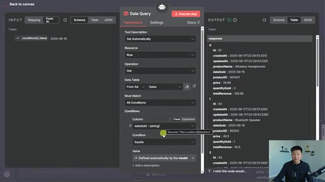
*⏱️ 00:08:07 — Interface d'un outil de requête de données avec le panneau 'Date Query' ouvert, affichant les conditions et les paramètres de filtrage par IA.*

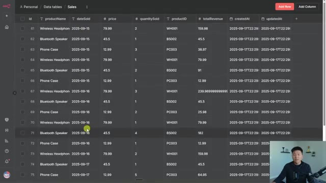
*⏱️ 00:08:15 — Tableau de données nommé 'Sales' affichant des enregistrements de ventes avec des colonnes telles que productID, dateSold, price et quantitySold.*

---

### ⏱️ `[00:08:31 - 00:08:50]` | Segment #18

**🔊 Audio (Transcription Intégrale Mot pour Mot en Français) :**
> Donc c'est pour ça que c'est une chaîne de caractères ici. Mais bref, comme je l'ai dit, il a trouvé qu'ici à travers ici avaient tous une date égale au 9/15 et ensuite il a juste additionné ces quantités. Faisons donc un autre exemple rapide. Combien de casques sans fil avons-nous vendus ? Il va faire une requête sur le nom du produit puisqu'il a le nom du produit.

**👁️ Analyse Visuelle d'Écran (gemini-3.5-flash-lite) :**
**Interface & Outils** : Interface web d'automatisation et de gestion de bases de données (style outil low-code/n8n/agent builder).

**Contenu textuel & Code** : Tableau de données avec des produits (Wireless Headphone, Bluetooth Speaker, Phone Case) et requêtes de chat (ex: "How many wireless headphones have we sold?").

**Action / Démonstration** : Navigation et explication d'un tableau de données de ventes, puis basculement sur un agent IA exécutant un workflow avec des requêtes textuelles.

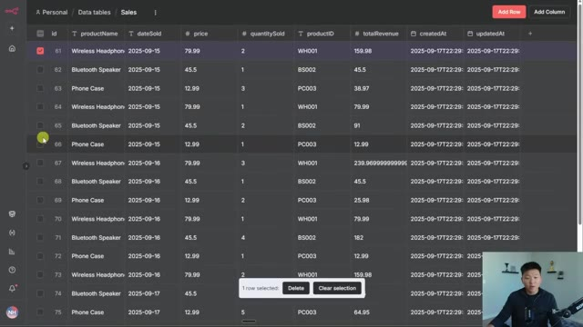
*⏱️ 00:08:36 — Vue d'un tableau de données (Data tables) nommé Sales montrant des enregistrements de ventes avec ID, nom de produit, date, prix, quantité et ID de produit.*

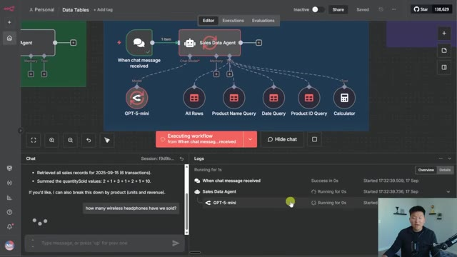
*⏱️ 00:08:45 — Interface de workflow d'automatisation IA montrant un agent "Sales Data Agent" connecté à GPT-5-mini, avec un panneau de chat interactif en bas à gauche et des journaux d'exécution à droite.*

---

### ⏱️ `[00:08:50 - 00:09:09]` | Segment #19

**🔊 Audio (Transcription Intégrale Mot pour Mot en Français) :**
> Et voilà. Vous pouvez voir qu'il vient tout juste de l'atteindre. Je peux en fait cliquer là-dedans très rapidement. Vous pouvez voir qu'il a rempli la condition juste ici sous la forme de casque sans fil. Donc c'est ce qu'il cherche. Nous pourrions aller vérifier que pour toutes les lignes qu'il a récupérées, vous pouvez voir que le nom du produit doit être égal à casque sans fil. Et ensuite, ce qu'il a fait, c'est qu'il a simplement additionné toutes ces quantités vendues et il a obtenu la réponse 12, ce qui est correct.

**👁️ Analyse Visuelle d'Écran (gemini-3.5-flash-lite) :**
**Interface & Outils** : Interface web d'un outil d'automatisation de type workflow/no-code avec configuration de paramètres et visualisation de données tabulaires.

**Contenu textuel & Code** : Paramètres de requête de nom de produit (Product Name Query), conditions de filtrage sur la colonne 'productName' égale à 'Wireless Headphones' (casque sans fil), et données de sortie JSON montrant plusieurs objets avec 'productName' réglé sur 'Wireless Headphones'.

**Action / Démonstration** : Consultation et vérification des paramètres de condition et des données de sortie correspondantes dans l'interface de l'outil d'automatisation.

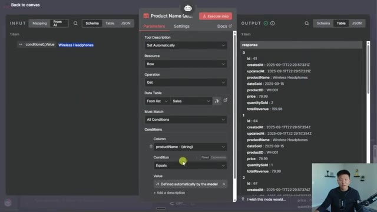
*⏱️ 00:08:55 — Interface d'un outil d'automatisation avec un panneau de configuration de nœud au centre, affichant les entrées à gauche et les résultats JSON structurés sous forme de tableau à droite, avec le présentateur en médaillon en bas à droite.*

---

### ⏱️ `[00:09:10 - 00:09:45]` | Segment #20

**🔊 Audio (Transcription Intégrale Mot pour Mot en Français) :**
> D'accord. Et pour une dernière question, celle-ci est un peu plus délicate. Quel est le nombre moyen du produit ID BS002 que nous vendons par jour ? Il a donc utilisé la requête par ID produit et va en gros examiner les trois jours, déterminer combien ont été vendus chaque jour, puis trouver la moyenne de cela. Vous pouvez voir qu'il vient d'utiliser la calculatrice. Je pense donc qu'il est sur le point de nous donner notre réponse. La réponse que nous recherchons est quatre. Et nous sommes sur le point de l'obtenir. D'accord, donc le résumé pour l'ID produit, il indique que les données utilisées sont toutes les lignes de vente pour cet ID produit. Le nombre total vendu était de 12. Il y avait trois jours différents. Donc 12 divisé

**👁️ Analyse Visuelle d'Écran (gemini-3.5-flash-lite) :**
**Interface & Outils** : Interface web de construction de workflows / plateforme d'agents IA.

**Contenu textuel & Code** : Diagramme de nœuds interconnectés (When chat message received, Sales Data Agent, GPT-5-mini, All Rows, Product Name Query, Date Query, Product ID Query, Calculator) et logs d'exécution en bas à droite.

**Action / Démonstration** : L'agent IA exécute le workflow et traite la requête textuelle concernant le nombre moyen de ventes quotidiennes pour le produit ID BS002.

*⏱️ 00:09:19 — Interface de workflow d'un agent IA affichant un diagramme de flux avec le module 'Sales Data Agent' et différents outils de requête (All Rows, Product Name Query, Date Query, Product ID Query, Calculator), ainsi qu'un panneau de discussion montrant la question sur le produit ID BS002 et les logs d'exécution.*

---

### ⏱️ `[00:09:45 - 00:10:10]` | Segment #21

**🔊 Audio (Transcription Intégrale Mot pour Mot en Français) :**
> par trois donne quatre unités par jour, ce qui est correct. Donc je sais qu'on va un petit peu vite là-dessus, mais vous pourrez télécharger l'intégralité de ce flux de travail ainsi que toutes les ressources Google Sheets dont vous avez besoin juste ici, tout à fait gratuitement. Tout ce que vous avez à faire, c'est de rejoindre ma communauté School gratuite. Le lien pour cela se trouve dans la description. Et quand vous y serez, vous irez dans les ressources YouTube. Et lorsque vous trouverez la publication associée à cette vidéo, disons que c'était celle-ci, vous pourrez voir qu'il y a des fichiers JSON ici et il vous suffit de les télécharger et de les importer.

**👁️ Analyse Visuelle d'Écran (gemini-3.5-flash-lite) :**
**Interface & Outils** : n8n, Google Sheets, Skool (AI Automation Society)

**Contenu textuel & Code** : Workflow automatisé (n8n), liste de données CRM (Google Sheets), fils de discussion communautaires (Skool).

**Action / Démonstration** : Présentation des outils de workflow, démonstration des données sources et partage des ressources de la communauté.

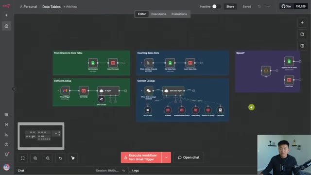
*⏱️ 00:09:51 — Interface de la plateforme n8n affichant plusieurs workflows automatisés connectés à des outils comme Gmail, des agents IA et des bases de données.*

*⏱️ 00:09:57 — Feuille de calcul Google Sheets contenant une base de données de contacts avec des colonnes pour le nom, l'email, le numéro de téléphone et des notes.*

*⏱️ 00:10:04 — Interface de la communauté Skool "AI Automation Society" montrant les derniers posts, les ressources vidéo et les statistiques des membres.*

---

### ⏱️ `[00:10:10 - 00:10:43]` | Segment #22

**🔊 Audio (Transcription Intégrale Mot pour Mot en Français) :**
> Et puis il y aura aussi des liens pour faire une copie de ces tableurs si vous voulez les tester dans les tables de données NNN. Et la raison pour laquelle je mentionne cela, c'est parce que je ne vais pas plonger dans l'intégralité de cette invite système, mais je vais juste vous montrer rapidement ce que j'ai dit. Fondamentalement, vous êtes un analyste de données de vente expert. Vous avez ces outils. Voici à quoi sert chacun d'eux. Et ensuite, ce que j'ai fait, c'est que je lui ai donné les noms valides qui vont dans chaque catégorie. Donc pour les noms de produits, je lui ai donné les trois produits. Pour les dates, je lui ai indiqué le format sous lequel il doit structurer ses dates. Et ensuite, pour les identifiants de produits, je lui ai également donné les trois identifiants de produits, juste pour le plaisir de

**👁️ Analyse Visuelle d'Écran (gemini-3.5-flash-lite) :**
**Interface & Outils** : n8n (plateforme d'automatisation de workflow).

**Contenu textuel & Code** : - Nœud "Sales Data Agent" avec connexions vers GPT-4o-mini et outils de base de données.
- Prompt système : "You are Master Sales Data Analyst AI, an expert in analyzing sales data...", listant les outils AllRows, ProductNameQuery, DateQuery, ProductIDQuery, et Calculator.
- Entrée utilisateur exemple : "what's the average number of product ID: BS002 we are selling per day?".

**Action / Démonstration** : Présentation visuelle de l'architecture d'un agent IA dans n8n suivie de l'ouverture de l'éditeur pour inspecter le prompt système du nœud agent.

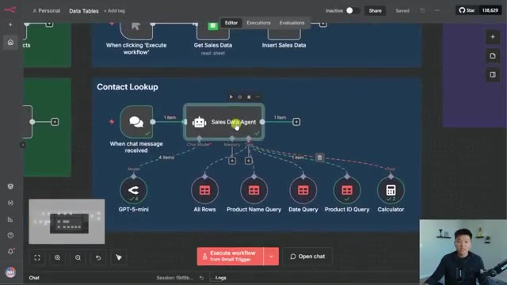
*⏱️ 00:10:19 — Interface n8n montrant un workflow d'automatisation avec un nœud central "Sales Data Agent" connecté à un modèle GPT-4o-mini et plusieurs outils de données (All Rows, Product Name/Date/ID Query, Calculator).*

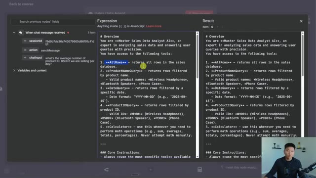
*⏱️ 00:10:27 — Éditeur de configuration du "Sales Data Agent" dans n8n, affichant l'invite système (system prompt) qui définit le rôle d'analyste de données et les outils disponibles.*

---

### ⏱️ `[00:10:43 - 00:11:20]` | Segment #23

**🔊 Audio (Transcription Intégrale Mot pour Mot en Français) :**
> de l'exemple, nous pouvions voir comment fonctionne le filtrage. D'accord. Donc, pour le dernier exemple que nous allons faire, j'ai simplement un nœud de code ici qui génère essentiellement 400 éléments. Il compte simplement de un à 400. Et ce que je veux faire, c'est que nous allons simplement voir la différence de vitesse en raison du fait que nous ne passons pas par Internet pour faire cet appel d'API. Nous avons donc cette feuille ici appelée test, et elle a juste une colonne appelée nombre. Et tout ce que je vais faire, c'est que nous allons exécuter ceci, puis nous allons voir combien de temps met ce nœud pour écrire 400 lignes. Nous allons donc l'exécuter. Nous pouvons voir que ça tourne. Il vient d'écrire toutes les données. Donc nous

**👁️ Analyse Visuelle d'Écran (gemini-3.5-flash-lite) :**
**Interface & Outils** : n8n (interface de workflow d'automatisation)

**Contenu textuel & Code** : Nœuds de workflow : déclencheur "When clicking 'Execute workflow'", nœud de code nommé "400" générant 400 éléments, et deux nœuds "Append row in sheet" et "Insert row".

**Action / Démonstration** : Présentation du dernier exemple de workflow avec un nœud de code générant 400 éléments connectés à des feuilles de calcul.

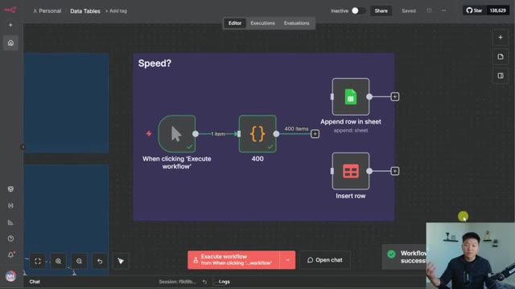
*⏱️ 00:10:53 — Interface d'automatisation n8n montrant un workflow avec un nœud déclencheur, un nœud de code générant 400 éléments, et deux nœuds de destination (Google Sheets et autre).*

---

### ⏱️ `[00:11:20 - 00:11:53]` | Segment #24

**🔊 Audio (Transcription Intégrale Mot pour Mot en Français) :**
> on peut voir que si je fais défiler tout en bas jusqu'à 400, vous pouvez voir qu'il est là. Et maintenant, si nous allons dans le nœud, nous pouvons voir juste ici qu'il s'est exécuté en 2000 millisecondes, 2080. Donc 2080 millisecondes. Maintenant, regardez ce qui se passe lorsque nous le connectons à notre table de données NN, connecté à une table de données appelée test. Nous écrivons exactement les mêmes données. Donc, lorsque j'exécute celui-ci, vous pouvez voir, oh, cela a honnêtement semblé plutôt similaire. Voyons comment c'était. C'était 2511 millisecondes, ce qui est vraiment

**👁️ Analyse Visuelle d'Écran (gemini-3.5-flash-lite) :**
**Interface & Outils** : n8n (éditeur de workflow d'automatisation)

**Contenu textuel & Code** : Configuration du nœud Google Sheets ('Append row in sheet') et affichage des résultats JSON avec 400 éléments.

**Action / Démonstration** : Consultation des détails d'exécution d'un nœud dans n8n puis retour sur le canevas principal pour connecter un nouveau nœud.

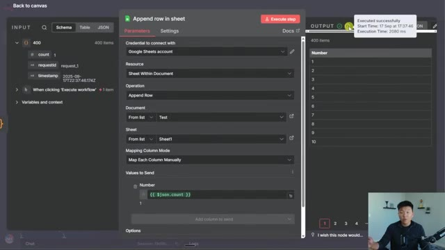
*⏱️ 00:11:29 — Interface détaillée d'un nœud n8n 'Append row in sheet' montrant les paramètres de configuration et les données de sortie avec le temps d'exécution.*

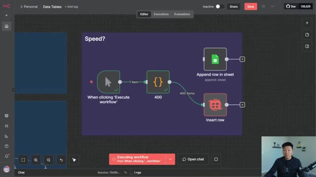
*⏱️ 00:11:45 — Vue d'ensemble du canevas de l'éditeur de workflow n8n montrant plusieurs nœuds connectés et l'exécution en cours.*

---

### ⏱️ `[00:11:53 - 00:12:20]` | Segment #25

**🔊 Audio (Transcription Intégrale Mot pour Mot en Français) :**
> Intéressant parce que presque tous mes exemples précédents, la table de données a été plus rapide. D'accord. Donc c'était assez intéressant pour moi. Nous allons le refaire avec 60. Mon hypothèse était peut-être que quand c'est moins, Google Sheets a toujours en quelque sorte plus de temps, mais avec les fonctions en masse, c'est plus rapide. Je ne sais pas. Nous verrons. Donc nous allons exécuter ceci avec 60. Google Sheets vient de prendre 1700 millisecondes. Maintenant nous allons aller sur notre table de données N8N, l'exécuter à nouveau.

**👁️ Analyse Visuelle d'Écran (gemini-3.5-flash-lite) :**
**Interface & Outils** : Interface web n8n (éditeur de workflow).

**Contenu textuel & Code** : Nœud de déclenchement « When clicking 'Execute workflow' », nœud de configuration « 60 », nœud « Append row in sheet » (Google Sheets) et nœud « Insert row » (Data Tables).

**Action / Démonstration** : Visualisation et configuration d'un workflow de test de performance comparatif.

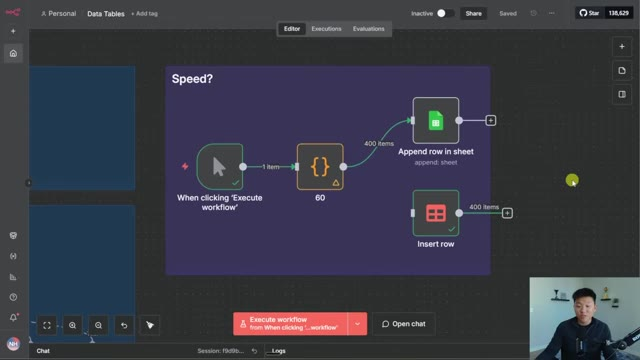
*⏱️ 00:12:00 — Un diagramme de workflow sur n8n comparant la vitesse entre Google Sheets et Data Tables avec 60 éléments.*

---

### ⏱️ `[00:12:20 - 00:12:42]` | Segment #26

**🔊 Audio (Transcription Intégrale Mot pour Mot en Français) :**
> Et c'était beaucoup plus rapide cette fois-ci. Et celui-ci a pris 300 millisecondes. Et maintenant, juste pour confirmer mon hypothèse une fois de plus, nous allons le refaire avec 20. Donc 20 vers Google Sheets nous a pris un total de 1700 millisecondes encore une fois. Donc c'est peut-être juste en quelque sorte sa limite minimale. Mais quand nous allons aux tableaux de données NNN, c'était instantané. Genre, ça a pris 97 millisecondes. Donc c'était intéressant.

**👁️ Analyse Visuelle d'Écran (gemini-3.5-flash-lite) :**
**Interface & Outils** : Éditeur de workflow (style n8n)

**Contenu textuel & Code** : Nœuds : 'When clicking Execute workflow', nœud de données '20', 'Append row in sheet' (Google Sheets) et 'Insert row'.

**Action / Démonstration** : Le présentateur explique et analyse les résultats de vitesse et de performance du workflow avec 20 éléments.

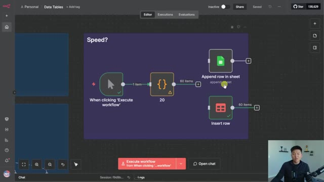
*⏱️ 00:12:25 — Interface d'un éditeur de workflow montrant un test de vitesse avec plusieurs nœuds connectés, dont un déclencheur, un nœud de données '20' et des actions d'insertion vers Google Sheets.*

---

### ⏱️ `[00:12:42 - 00:13:17]` | Segment #27

**🔊 Audio (Transcription Intégrale Mot pour Mot en Français) :**
> Si vous en avez des tonnes et des tonnes, par centaines, ça va être similaire. NNN sera peut-être même un peu plus lent, mais pour la majorité de vos écritures, et surtout si vous faites une ligne ou deux lignes, ce qui en fait, essayons juste rapidement. Désolé, c' donc juste trop amusant. Donc nous allons essayer deux lignes. Google Sheets a pris une minute. Ça a pris 1600 millisecondes. Et si nous allons dans NNN data tables, ça va être instantané. Ça a pris 11 millisecondes. Donc vous pouvez voir que quand vous en avez moins, NNN data tables va être fondamentalement instantané. Mais si vous avez un grand nombre, comme la première fois où nous en avons fait 400, ça va être assez comparable. Donc ouais, j'espère que vous avez apprécié celui-ci

**👁️ Analyse Visuelle d'Écran (gemini-3.5-flash-lite) :**
**Interface & Outils** : Éditeur de workflow de type n8n ou similaire dans un navigateur web.

**Contenu textuel & Code** : Nœuds du workflow : "When clicking 'Execute workflow'", un nœud JSON intermédiaire ("20"), et deux nœuds d'action parallèle ("Append row in sheet" et "Insert row").

**Action / Démonstration** : Le présentateur survole ou manipule les blocs du workflow en vue d'exécuter un test rapide des écritures de données.

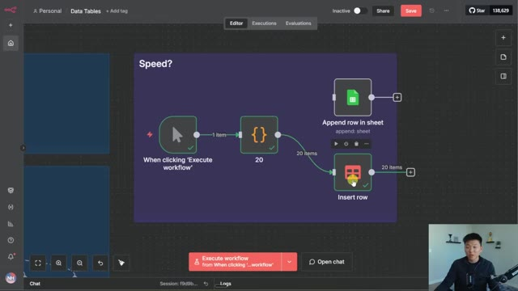
*⏱️ 00:12:51 — Interface d'un éditeur de workflow montrant un diagramme avec plusieurs nœuds connectés, incluant un déclencheur manuel, un nœud de transformation de données, et des actions d'insertion de lignes dans des tableaux de données.*

---

### ⏱️ `[00:13:17 - 00:13:52]` | Segment #28

**🔊 Audio (Transcription Intégrale Mot pour Mot en Français) :**
> Intéressant. Je voulais juste faire une petite vidéo pour vous montrer comment vous pouvez utiliser ces tables de données et un peu la différence entre l'utilisation de quelque chose comme celles-ci et Google Sheets. Une autre chose à laquelle je pensais est que vous pourriez vous heurte à des limites de taux avec Google Sheets parce que vous faites un appel d'API. Donc si vous le spamez trop souvent, vous risquez en fait d'être limité par le taux et vous devrez peut-être intégrer des pauses ou des nouvelles tentatives. Mais je ne vois pas cela se produire avec n8n parce qu'encore une fois, tout reste en interne. Donc n'oubliez pas que vous pouvez également récupérer tout ce flux de travail ainsi que les deux jeux de données de test si vous voulez simplement tester des trucs afin de pouvoir essentiellement imiter ce flux de travail et voir comment il fonctionne. Tout ce que vous avez à faire pour cela, c'est de rejoindre ma communauté School gratuite.

**👁️ Analyse Visuelle d'Écran (gemini-3.5-flash-lite) :**
**Interface & Outils** : Interface de workflow d'automatisation (n8n/Make) et Google Sheets.

**Contenu textuel & Code** : Nœuds de workflow ("From Sheets to Data Table", "Contact Lookup", "Sales Data Agent") et tableau de données de vente (Product Name, Date Sold, Price, Quantity Sold, Total Revenue).

**Action / Démonstration** : Présentation comparative entre l'utilisation des tables de données dans un outil d'automatisation et Google Sheets.

*⏱️ 00:13:26 — Vue d'ensemble d'une interface de workflow d'automatisation montrant plusieurs flux de données interconnectés avec des agents IA.*

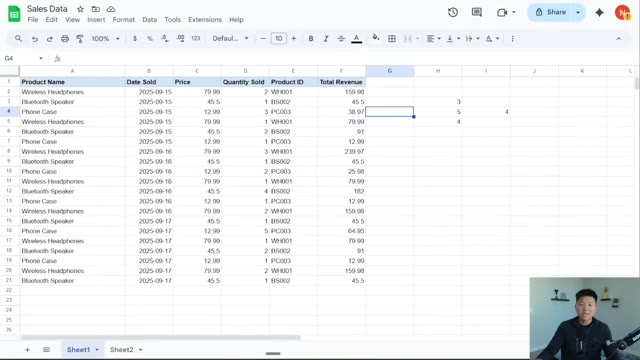
*⏱️ 00:13:43 — Affichage d'un tableau Google Sheets intitulé "Sales Data" contenant des données de ventes par produit, date et prix.*

---

### ⏱️ `[00:13:52 - 00:14:19]` | Segment #29

**🔊 Audio (Transcription Intégrale Mot pour Mot en Français) :**
> Le lien pour ça est dans la description, c'est totalement gratuit. Et si vous cherchez des conseils un peu plus structurés et que vous voulez aller un peu plus loin dans vos apprentissages, alors consultez définitivement ma communauté Plus. Le lien pour cela est également dans la description. Nous avons une communauté de plus de 2 500 membres qui construisent et gagnent de l'argent avec n8n. Nous avons une section de cours complète avec Agent Zero pour les débutants. Nous avons 10 heures et 10 secondes où nous plongeons dans n8n. Et puis nous avons un nouveau cours appelé Agence d'automatisation IA d'une seule personne, qui est un bonus pour les membres annuels. Et tout cela consiste à poser les bases pour construire une entreprise d'automatisation IA évolutive.

**👁️ Analyse Visuelle d'Écran (gemini-3.5-flash-lite) :**
**Interface & Outils** : Plateforme communautaire en ligne (Skool)

**Contenu textuel & Code** : Publications de communauté, annonces de hackathons et modules de formation en IA et automatisation

**Action / Démonstration** : Navigation dans la communauté en ligne et présentation des modules de formation de la plateforme Plus

*⏱️ 00:13:59 — Capture d'écran montrant l'interface de la communauté "AI Automation Society Plus" sur Skool, affichant le fil d'actualité principal avec les publications épinglées.*

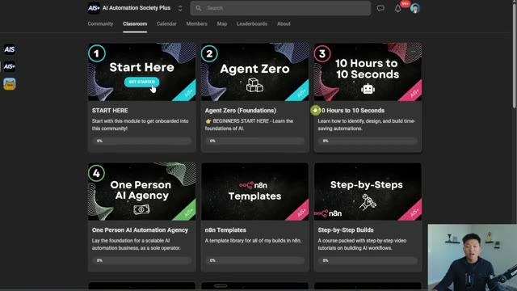
*⏱️ 00:14:06 — Capture d'écran montrant l'onglet "Classroom" de la communauté, listant les différents modules de formation disponibles (Start Here, Agent Zero, 10 Hours to 10 Seconds, One Person AI Agency, etc.).*

---

### ⏱️ `[00:14:20 - 00:14:32]` | Segment #30

**🔊 Audio (Transcription Intégrale Mot pour Mot en Français) :**
> Donc j'adorerais vous voir les gars dans cette communauté, mais c'est tout pour la vidéo d'aujourd'hui. Si vous avez apprécié ou si vous avez appris quelque chose de nouveau, veuillez s'il vous plaît lui donner un j'aime. Ça m'aide vraiment énormément. Et comme toujours, je vous remercie d'être arrivés jusqu'à la fin de la vidéo. On se voit dans la prochaine. Merci tout le monde.

**👁️ Analyse Visuelle d'Écran (gemini-3.5-flash-lite) :**
**Interface & Outils** : n8n (Interface web de gestion de workflows et d'agents IA)

**Contenu textuel & Code** : Diagrammes de flux : "From Sheets to Data Table", "Inserting Sales Data", "Contact Lookup" avec divers nœuds (Google Sheets, AI Agent GPT-4o-mini).

**Action / Démonstration** : Visualisation et présentation de différents workflows d'automatisation configurés dans l'interface.

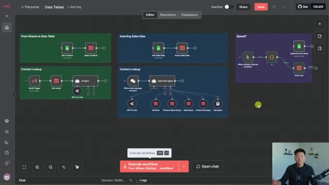
*⏱️ 00:14:23 — Vue d'ensemble d'une interface de workflow (n8n) montrant plusieurs diagrammes d'automatisation et d'agents IA, avec la webcam du présentateur en bas à droite.*

---

