# 🎬 Stop Selling AI Agents, Sell AI Solutions Instead

> **Chaîne** : [Nate Herk | AI Automation](https://www.youtube.com/@nateherk/featured)  
> **Lien YouTube** : [https://www.youtube.com/watch?v=w9-gfaV5vlM](https://www.youtube.com/watch?v=w9-gfaV5vlM)  
> **Date de publication** : 20250924  
> **Durée** : 00:14:09  
> **Identifiant vidéo** : `w9-gfaV5vlM`  
> **Transcription & Analyse** : `whisper-v3-large-turbo+gemini-3.5-flash-lite`  

---

## 📌 Synthèse Exécutive & Outils

### 💡 Résumé

La vidéo de la chaîne *Nate Herk | AI Automation* pose un constat sans équivoque pour les développeurs, ingénieurs IA et solopreneurs : vendre des agents IA sophistiqués ou des flux de travail complexes est une impasse commerciale. Le marché de l'automatisation par l'IA est saturé par les « buzzwords » et se livre à une course effrénée vers le bas en matière de prix. Les entreprises et PME ne cherchent pas à accumuler des nœuds d'API, des configurations multi-agents ou des architectures techniques tape-à-l'œil, mais à résoudre des frictions opérationnelles concrètes. 

L'analyse démontre que la valeur réelle ne réside pas dans l'outil technologique déployé, mais dans le résultat mesurable qu'il procure. Les entreprises se soucient exclusivement de trois leviers fondamentaux : le gain de temps, l'optimisation financière et la préservation de la concentration. L'analogie du taxi ou de la médecine illustre parfaitement cette posture : le client se désintéresse de la complexité sous-jacente du moteur ou de la pilule, tant que la douleur disparaît rapidement et sans stress.

Pour basculer du statut de simple « vendeur de scripts » à celui de partenaire stratégique en solutions IA, l'intervenant propose une méthodologie rigoureuse en quatre étapes : Diagnostiquer les points de douleur, Résoudre le problème par un système adapté, Valoriser les gains en chiffres précis (heures et dollars économisés), et enfin Tarifer l'offre comme une fraction de la valeur générée. En ciblant des niches spécifiques et en menant des entretiens de découverte orientés sur les inefficacités (tâches de copier-coller, interruptions, erreurs récurrentes), l'ingénieur en automatisation transforme une offre technologique abstraite en un investissement évident et ultra-rentable pour ses clients.

### 🛠️ Outils, Modèles & Logiciels Présentés

* **Effort Level** : Paramètre d'inférence avancé permettant de moduler la profondeur de raisonnement et la complexité des réponses des modèles d'IA selon la criticité de la tâche.
* **Anthropic** : Entreprise de pointe en recherche et développement d'intelligence artificielle, reconnue pour la robustesse et la sécurité de ses modèles de langage.
* **Claude Code** : Outil de développement assisté par IA conçu pour rationaliser les flux de travail de programmation et automatiser l'ingénierie logicielle directement depuis la ligne de commande.
* **Opus 5.5** : Modèle de langage haut de gamme (hypothétique/mentionné dans le contexte de la chaîne) taillé pour les raisonnements complexes et l'automatisation de processus de niveau entreprise.
* **Agents IA / Workflows d'automatisation** : Outils techniques (impliquant des requêtes HTTP, des nœuds et des architectures multi-agents) utilisés comme briques de construction sous-jacentes pour bâtir des solutions métiers.

### 🔑 Points Clés & Enseignements Stratégiques

* **Le piège de la technicité :** Se concentrer sur les aspects tape-à-l'œil (nœuds complexes, requêtes HTTP, architectures multi-agents) éloigne l'ingénieur des véritables priorités des entreprises, créant une barrière psychologique à l'achat.
* **La règle d'or des entreprises :** Les clients finaux ne se soucient que de trois variables tangibles : le temps gagné, l'argent économisé et la concentration préservée, indépendamment de la technologie utilisée (IA, assistant virtuel ou script classique).
* **Saturation du marché des flux « prêts-à-l'emploi » :** Revendre des bibliothèques de modèles ou des bots de prospection génériques est une course vers le bas (« race to the bottom ») qui dévalorise l'expertise en automatisation.
* **Le changement de paradigme (Outil vs Solution) :** Vendre un chatbot ou un agent est un produit commoditisé ; vendre une réduction de 60 % du support client ou l'automatisation de l'intégration client constitue une solution à haute valeur ajoutée.
* **Le cadre stratégique L-R-V-T :** Structurer toute démarche commerciale autour d'un processus séquentiel infaillible : Diagnostiquer la douleur, Résoudre par le système, Valoriser financièrement, et Tarifer en fonction de la valeur apportée.
* **L'analogie médicale et du bâtiment :** Tout comme un patient se fiche du nom de la pilule tant que son mal de tête disparaît, une entreprise se moque de la pile technologique si la solution garantit un retour sur investissement mesurable.
* **La qualification par le ciblage sectoriel :** Choisir une niche précise (agences, immobilier, e-commerce, services locaux) permet de répéter les processus d'automatisation, d'accumuler les cas de succès et de parler instantanément la langue du client.
* **Technique d'entretien L.R.P. (Écouter, Répéter, Creuser) :** Mener les appels de découverte en écoutant les descriptions de processus, en répétant les schémas pour valider l'alignement, puis en creusant pour quantifier les pertes en heures et en coûts.
* **La quantification implacable de la douleur :** Transformer des inefficacités opérationnelles en métriques financières (ex: 200 heures économisées par an à 50 $/heure = 10 000 $ de gains) pour rendre le coût de la solution insignifiant face aux bénéfices.
* **Évolution du positionnement professionnel :** Passer du statut de simple freelance en automatisation ou vendeur d'agents à celui de partenaire stratégique capable d'auditer les inefficacités d'une entreprise et de concevoir des architectures correctives durables.

---

## ⏱️ Chronologie & Transcription Complète Audio & Visuelle (Mot pour Mot)

### ⏱️ `[00:00:00 - 00:00:21]` | Segment #01

**🔊 Audio (Transcription Intégrale Mot pour Mot en Français) :**
> Si vous voulez gagner de l'argent avec l'IA, vous devez arrêter de vendre des agents et des flux de travail en IA et commencer à vendre des solutions en IA. Et je ne parle pas de systèmes d'exploitation en IA ou d'automatisations ordinaires. Je parle de diagnostiquer les problèmes auxquels les entreprises font face et d'utiliser ensuite l'IA pour résoudre ces problèmes. Donc, dans cette vidéo, je vais expliquer pourquoi vendre des agents ne suffit pas, quoi vendre à la place qui vous fera réellement gagner de l'argent, et comment le faire vous-même étape par étape.

**👁️ Analyse Visuelle d'Écran (gemini-3.5-flash-lite) :**
**Interface & Outils** : Aucun éditeur de code, terminal ou outil d'automatisation réel n'est affiché.

**Contenu textuel & Code** : Aucun code source, commande ou prompt visible.

**Action / Démonstration** : Aucune manipulation technique ou démonstration logicielle en cours.

---

### ⏱️ `[00:00:21 - 00:00:42]` | Segment #02

**🔊 Audio (Transcription Intégrale Mot pour Mot en Français) :**
> Alors, pourquoi êtes-vous tous ici à regarder cette vidéo ? Parce que l'IA a explosé. Et avec cette explosion vient le battage médiatique. Des tonnes de personnes balancent des mots à la mode comme agents et flux de travaux. Et ce qui est drôle, c'est que l'automatisation existe depuis toujours. Ce n'est rien de nouveau. Quand je travaillais à temps plein chez Goldman Sachs en intelligence d'affaires, l'automatisation était tout mon rôle, et ce travail existait depuis des années. Mais la majorité des petites et moyennes entreprises, il n'y a pratiquement aucune automatisation en place.

**👁️ Analyse Visuelle d'Écran (gemini-3.5-flash-lite) :**
**Interface & Outils** : Navigateur web / Plateforme d'automatisation no-code (Zapier)

**Contenu textuel & Code** : Étapes de workflow : '1. New Form Response' et '2. Send Email' avec un panneau latéral de configuration pour Gmail et une fenêtre Copilot AI.

**Action / Démonstration** : Configuration d'un flux de travail automatisé reliant une soumission de formulaire Google à l'envoi d'un e-mail via Gmail.

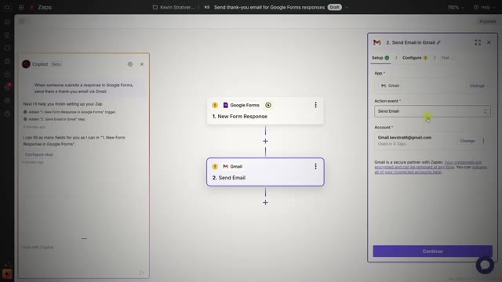
*⏱️ 00:00:32 — Une interface de workflow d'automatisation no-code (semblable à Zapier) montrant les étapes d'intégration entre Google Forms et Gmail.*

---

### ⏱️ `[00:00:42 - 00:01:14]` | Segment #03

**🔊 Audio (Transcription Intégrale Mot pour Mot en Français) :**
> La différence maintenant, c'est qu'en mettant le mot IA devant, tout d'un coup, les chefs d'entreprise y prêtent attention. C'est comme mettre une enseigne au néon sur un vieux restaurant. La nourriture n'a pas changé, il n'y a rien de nouveau, mais soudain les gens le remarquent. Et le problème, c'est que la plupart des débutants se trompent sur ce point. Ils se font prendre par la technologie, les nœuds, les requêtes HTTP, les architectures multi-agents, ils sont tellement concentrés sur les aspects tape-à-l'œil que ça leur fait oublier ce qui importe réellement pour les entreprises. Et je me suis moi aussi définitivement emballé là-dessus. En fait, mes vidéos YouTube qui marchent le mieux sont celles qui sont vraiment tape-à-l'œil et qui ont plusieurs agents parce que c'était tendance et plus cool. Mais si vous me demandiez quelles constructions sur YouTube ont réellement été les plus

**👁️ Analyse Visuelle d'Écran (gemini-3.5-flash-lite) :**
**Interface & Outils** : Interface web de workflow / automatisation (style n8n) avec incrustation vidéo du présentateur.

**Contenu textuel & Code** : Blocs fonctionnels interconnectés : Trigger, Voice or Text, Marketing Team, Response, Brain, Content Creation, Image Creation, Image Database.

**Action / Démonstration** : Navigation et présentation d'une architecture de workflow multi-agents pour le marketing automatisé.

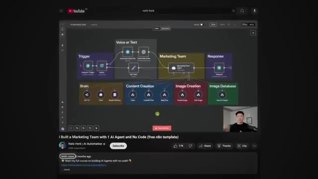
*⏱️ 00:01:06 — Vue d'ensemble d'un tableau de bord de workflow (type n8n) avec différents blocs fonctionnels pour agents IA.*

---

### ⏱️ `[00:01:14 - 00:01:47]` | Segment #04

**🔊 Audio (Transcription Intégrale Mot pour Mot en Français) :**
> pratique et au retour sur investissement le plus élevé, c'était mes vidéos aux performances les plus faibles. Quand j'ai vendu mon tout premier flux de travail à 1 200 dollars, je n'ai pas débarqué en disant, hé, j'ai créé ceci avec 15 nœuds et un appel d'API vers blablabla. J'ai dit, cela vous fera gagner des heures chaque semaine sur la création de contenu. Et c'est ce qui a rendu la décision évidente. Et voici la vérité. Les entreprises ne se soucient vraiment que de trois choses. Le temps, l'argent, la concentration. C'est tout. Elles se fichent que vous le réalisiez avec de l'intelligence artificielle, un assistant virtuel ou du scotch et du chewing-gum. Voyez cela comme un trajet en taxi. Si vous devez traverser la ville, vous vous moquez de savoir si vous montez dans une Prius, une Tesla ou une calèche tirée par un cheval. Enfin, je suppose que certains d'entre nous s'en soucient,

**👁️ Analyse Visuelle d'Écran (gemini-3.5-flash-lite) :**
**Interface & Outils** : Interface de visioconférence (simulée sur Zoom)

**Contenu textuel & Code** : Texte dans une bulle de discussion : 'Hey, I got this build with 50 nodes'

**Action / Démonstration** : Illustration visuelle par infographie d'une conversation de vente avec un client, montrant une approche centrée sur la complexité technique plutôt que sur la valeur.

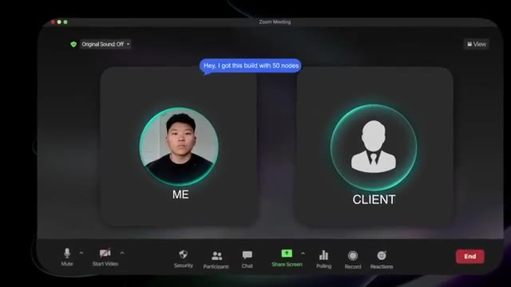
*⏱️ 00:01:23 — Simulation d'une interface de réunion Zoom illustrant un échange entre le présentateur ('ME') et un client ('CLIENT') avec une bulle de dialogue 'Hey, I got this build with 50 nodes'.*

---

### ⏱️ `[00:01:48 - 00:02:23]` | Segment #05

**🔊 Audio (Transcription Intégrale Mot pour Mot en Français) :**
> mais c'est accessoire. Tout ce qui vous importe, c'est qu'il vous conduise à destination rapidement, à bas coût et sans stress. Les entreprises ressentent la même chose. Elles ne vouent pas un culte à l'IA en soi. Elles vouent un culte aux résultats. C'est pourquoi la vente centrée sur l'IA ne fonctionne pas. Vendre des agents ou des workflows en tant que produits est déjà un marché saturé et banalisé. Vous avez probablement vu des personnes proposer des bibliothèques entières de modèles de bout en bout, prétendant que vous pouvez tous les revendre pour 5 000 dollars par mois. Pourtant, elles ne vous facturent que 200 dollars pour accéder à ce lot de modèles. Pourquoi ? Parce que c'est une course vers le bas en matière de prix. Prenez l'exemple des bots de prospection sur LinkedIn. Vous pourriez créer le bot le plus voyant et le plus complexe qui soit. Mais si vous le présentez simplement comme un agent de prospection LinkedIn, tout le monde s'en fichera

**👁️ Analyse Visuelle d'Écran (gemini-3.5-flash-lite) :**
**Interface & Outils** : GitHub

**Contenu textuel & Code** : Liste de fichiers et répertoires de templates d'automatisation IA (RAG, analyse de données, assistants).

**Action / Démonstration** : Navigation dans un dépôt GitHub de templates d'automatisation.

*⏱️ 00:02:06 — Interface GitHub montrant un dépôt de templates de workflows et d'automatisations IA.*

---

### ⏱️ `[00:02:23 - 00:02:51]` | Segment #06

**🔊 Audio (Transcription Intégrale Mot pour Mot en Français) :**
> tant que ça. Mais quand c'est présenté comme un système qui vous aide à générer des prospects qualifiés sans dépenser en publicité, soudainement les gens voient la valeur et ils le veulent. Le changement est simple. Arrêtez de vendre des outils d'IA et commencez à vendre les résultats de ces outils. Mettez en lumière la douleur, présentez la solution autour du temps, de l'argent et de la concentration, et c'est comme ça que vous gagnez. Et cela nous mène directement à la section suivante. Que devriez-vous réellement vendre ? Des solutions d'IA. La différence est qu'un flux de travail d'IA n'est qu'un outil, mais une solution d'IA est un outil directement lié à la résolution d'un véritable problème commercial.

**👁️ Analyse Visuelle d'Écran (gemini-3.5-flash-lite) :**
**Interface & Outils** : AUCUNE

**Contenu textuel & Code** : AUCUNE

**Action / Démonstration** : AUCUNE

---

### ⏱️ `[00:02:51 - 00:03:13]` | Segment #07

**🔊 Audio (Transcription Intégrale Mot pour Mot en Français) :**
> Lorsque vous proposez une solution, vous ne dites pas je vais vous fabriquer un chatbot. Vous dites je vais réduire votre charge de travail de support client de 60 %. J'automatiserai l'intégration de vos clients pour que vous économisiez 10 heures par semaine ou je vous aiderai à créer du contenu assisté par IA afin que vous puissiez réduire vos dépenses marketing de 30 %. Et pour finir d'enfoncer le clou, je vais vous lancer une autre terrible analogie. Pensez-y comme à de la médecine. Si vous avez mal à la tête, la plupart des gens se fichent que vous prescriviez de l'Advil, du Tylenol ou un remède à base de plantes.

**👁️ Analyse Visuelle d'Écran (gemini-3.5-flash-lite) :**
**Interface & Outils** : Animation graphique de présentation (Motion Graphics)

**Contenu textuel & Code** : Texte à l'écran : '01', '60%', 'CUT DOWN YOUR CUSTOMER SUPPORT WORKLOAD'

**Action / Démonstration** : Affichage visuel d'un point clé de la proposition de valeur axé sur les résultats chiffrés.

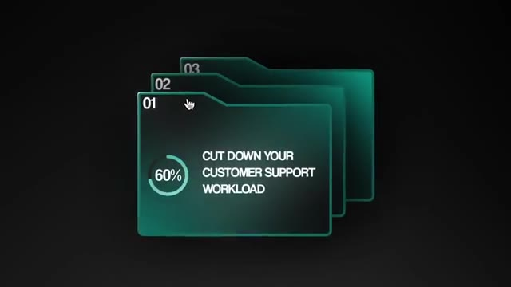
*⏱️ 00:02:57 — Une infographie animée sur fond noir montrant trois dossiers verts superposés, avec le premier dossier affichant le texte 'CUT DOWN YOUR CUSTOMER SUPPORT WORKLOAD' et un indicateur circulaire '60%'.*

---

### ⏱️ `[00:03:13 - 00:03:46]` | Segment #08

**🔊 Audio (Transcription Intégrale Mot pour Mot en Français) :**
> Ils se soucient simplement de voir leur mal de tête disparaître. La pilule est l'outil, le résultat est le soulagement de la douleur. C'est exactement ainsi que les entreprises voient l'IA. Le cadre dont nous allons parler aujourd'hui consiste donc à diagnostiquer, puis résoudre, puis valoriser, puis tarifer. Et c'est un processus simple que j'utilise à chaque fois. Diagnostiquer signifie trouver le point de douleur. Où l'entreprise perd-elle du temps, de l'argent ou de la concentration ? Résoudre signifie construire le système qui corrige cette douleur exacte. Valoriser, c'est traduire cette correction en chiffres : heures économisées, dollars économisés, revenus générés. Et enfin, tarifer, c'est ancrer votre offre autour de cette valeur. Et lorsque vous pensez à ce cadre et que vous pensez au problème fondamental que vous essayez de résoudre,

**👁️ Analyse Visuelle d'Écran (gemini-3.5-flash-lite) :**
**Interface & Outils** : Aucune interface technique ou de développement visible.

**Contenu textuel & Code** : Aucun code source, terminal ou prompt visible.

**Action / Démonstration** : Aucune action technique ou manipulation logicielle en cours.

---

### ⏱️ `[00:03:46 - 00:04:04]` | Segment #09

**🔊 Audio (Transcription Intégrale Mot pour Mot en Français) :**
> tu peux voir comment revendre un lot de 20 modèles NNN ne fait pas vraiment ça. Alors jetons un coup d'œil à un exemple, l'automatisation de l'intégration des clients. D'abord, nous diagnostiquons. En ce moment, ton équipe passe cinq heures par semaine à intégrer de nouveaux clients. Ensuite, nous résolvons. Je vais construire un système qui peut automatiser 80 % de cela. Ensuite, nous transformons cela en valeur, ce qui représente plus de 200 heures économisées par an à 50 dollars de l'heure.

**👁️ Analyse Visuelle d'Écran (gemini-3.5-flash-lite) :**
**Interface & Outils** : Graphismes d'illustration vidéo et incrustations textuelles.

**Contenu textuel & Code** : Les mots clés "TEMPLATES", "DIAGNOSE" et "5HRS".
[DESC_IMAGE_2] Le présentateur illustre les étapes du processus avec des graphismes à l'écran.

**Action / Démonstration** : Explications face caméra et démonstration conceptuelle.

---

### ⏱️ `[00:04:04 - 00:04:36]` | Segment #10

**🔊 Audio (Transcription Intégrale Mot pour Mot en Français) :**
> Ça fait 10 000 dollars de plus dans votre poche chaque année. Et ensuite vous fixez votre prix. Je vous fais économiser 10 000 par an. Je vais seulement vous en facturer 3 000 dès maintenant. Soudain, le prix n'est plus un coût. Ce n'est plus qu'une fraction de la valeur qu'ils obtiennent. Voici une autre analogie. Pensez-y comme à une rénovation de maison. Si vous êtes un entrepreneur et que vous entrez dans la maison de quelqu'un et que vous dites, j'ai le meilleur marteau, j'ai les clous les plus solides, les scies les plus sophistiquées, bla, bla, bla, tout le monde s'en moque. Mais si vous dites, cette rénovation va augmenter la valeur de votre maison de 50 000 dollars et nous pouvons le faire en deux fois moins de temps que les autres entrepreneurs, là vous avez leur attention. Le marteau n'a pas d'importance, ce sont les résultats qui comptent. C'est pourquoi lorsque je suis sur

**👁️ Analyse Visuelle d'Écran (gemini-3.5-flash-lite) :**
**Interface & Outils** : AUCUNE

**Contenu textuel & Code** : AUCUNE

**Action / Démonstration** : AUCUNE

---

### ⏱️ `[00:04:36 - 00:05:11]` | Segment #11

**🔊 Audio (Transcription Intégrale Mot pour Mot en Français) :**
> appels, je ne commence pas par, laissez-moi vous montrer mon flux de travail, je commence par des questions. Où perdez-vous le plus de temps dans votre entreprise ? Quels processus aimeriez-vous voir s'exécuter tout seuls ? Parce que le diagnostic me mène toujours à la solution. Et la solution renvoie toujours à une valeur commerciale mesurable. Et quand vous devenez bon à cela, vous arrêtez d'être juste un autre freelance en automatisation. Vous devenez la personne qui peut examiner une entreprise, repérer les inefficacités et concevoir des solutions qui leur font gagner du temps, de l'argent et de la concentration. C'est le passage de vendeur d'agents à vendeur de solutions, et d'être perçu comme un expert en IA ou un partenaire en IA. Donc vous savez pourquoi vendre de l'IA ne fonctionne pas et que vous devez vendre des solutions d'IA, mais comment faites-vous cela concrètement pour

**👁️ Analyse Visuelle d'Écran (gemini-3.5-flash-lite) :**
**Interface & Outils** : n8n / Éditeur de workflows d'automatisation

**Contenu textuel & Code** : Diagramme de workflow avec déclencheur Telegram, nœuds de routage (Switch), modèles d'IA (GPT-4) et mémoire simple.

**Action / Démonstration** : Présentation visuelle d'un workflow d'automatisation par l'orateur.

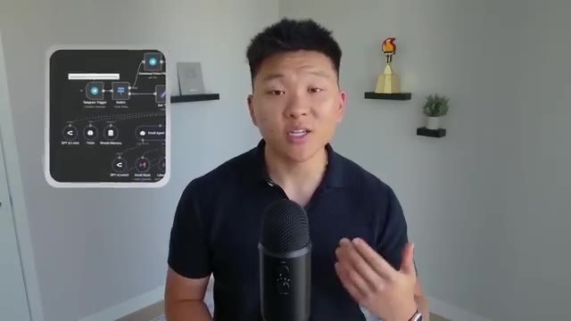
*⏱️ 00:05:02 — Le présentateur parle face caméra tout en présentant en médaillon à gauche un diagramme de workflow d'automatisation.*

---

### ⏱️ `[00:05:11 - 00:05:38]` | Segment #12

**🔊 Audio (Transcription Intégrale Mot pour Mot en Français) :**
> vous-même étape par étape ? C'est ce que nous allons voir maintenant en quelques étapes simples. Et rappelez-vous, nous allons relier le tout au même cadre dont nous venons de parler. Diagnostiquer, résoudre, valeur, prix. D'accord. Alors, étape un, choisissez une niche et diagnostiquez le paysage. L'objectif ici est simple. Choisissez un groupe pour que les problèmes se répètent et que vos victoires se cumulent. Passez 10 minutes à décider si vous allez servir les agences, l'immobilier, le commerce électronique, les coachs, les services locaux comme le dentaire ou le CVC, les startups SaaS, tout ce que vous voulez qu'il soit. Passez votre choix au crible de ces filtres rapides.

**👁️ Analyse Visuelle d'Écran (gemini-3.5-flash-lite) :**
**Interface & Outils** : Interface graphique animée de présentation vidéo.

**Contenu textuel & Code** : Texte "DIAGNOSE" et "ECOMMERCE" avec des icônes d'étapes.

**Action / Démonstration** : Présentation visuelle des étapes du framework d'automatisation IA.

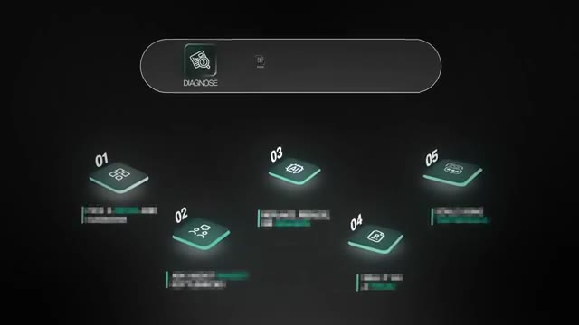
*⏱️ 00:05:18 — Schéma graphique illustrant 5 étapes numérotées, avec l'étape 1 en surbrillance (Diagnose).*

*⏱️ 00:05:31 — Illustration du secteur E-commerce avec un ordinateur portable en arrière-plan.*

---

### ⏱️ `[00:05:39 - 00:06:06]` | Segment #13

**🔊 Audio (Transcription Intégrale Mot pour Mot en Français) :**
> Répètent-ils des processus chaque semaine ? Peuvent-ils dire oui et payer rapidement ? Et parlez-vous déjà leur langue grâce au contenu que vous avez créé, à votre travail passé ou à vos centres d'intérêt ? Lorsque vous pensez aux douleurs répétitives, imaginez des agences aux prises avec la qualification des prospects, l'intégration des clients, les rapports et les opérations de contenu. Des équipes immobilières jonglant avec le tri des prospects entrantes, la coordination des visites et la collecte de documents. Des marques de commerce électronique ayant besoin du déroutement des tickets du service client, de l'automatisation des retours, de contenu produit et de rapports opérationnels, ou des coachs suppliant pour le filtrage des candidatures, le tri des calendriers et la réutilisation de contenu.

**👁️ Analyse Visuelle d'Écran (gemini-3.5-flash-lite) :**
**Interface & Outils** : Présentation vidéo avec incrustations graphiques d'éléments textuels et listes à puces.

**Contenu textuel & Code** : Listes des secteurs d'activité (Agences, E-commerce) et des tâches répétitives ou points de douleur associés.
[DESC_IMAGE_1_OFF] Non retenue car il s'agit d'une illustration animée et non d'une démonstration technique ou d'un outil logiciel.

**Action / Démonstration** : Présentation visuelle des différents types d'entreprises et de processus cibles pour l'automatisation par IA.

*⏱️ 00:05:53 — Le présentateur parle face caméra avec un encadré à gauche listant les points clés pour les agences : Lead qualification, Client onboarding, Reporting, Content ops.*

*⏱️ 00:05:59 — Le présentateur parle face caméra avec un encadré à gauche listant les points clés pour l'E-commerce : CX ticket deflection.*

---

### ⏱️ `[00:06:06 - 00:06:30]` | Segment #14

**🔊 Audio (Transcription Intégrale Mot pour Mot en Français) :**
> Le résultat de cette étape est simplement d'avoir une courte liste de créneaux dans lesquels vous avez assez confiance pour passer à cette étape suivante. Deuxième étape, parlez à cinq ou dix entreprises et diagnostiquez la douleur. Traitez-les comme des entretiens d'information qui peuvent souvent se transformer en appels de découverte et en travail rémunéré. J'aime commencer par un message simple. Hé, [nom], je cartographie les principales fuites dans le créneau X. En 15 minutes, je vais essayer de quantifier votre plus gros goulet d'étranglement et de partager là où l'IA aide réellement et là où elle n'aide pas.

**👁️ Analyse Visuelle d'Écran (gemini-3.5-flash-lite) :**
**Interface & Outils** : Application de messagerie mobile (mockup de smartphone)

**Contenu textuel & Code** : "Hey < name >. I'm mapping the top drains in x niche"

**Action / Démonstration** : Affichage d'un modèle de message pour illustrer la prospection par SMS ou chat.

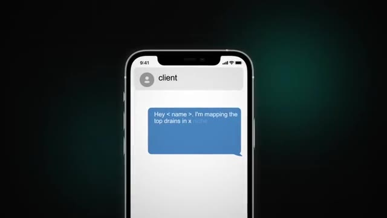
*⏱️ 00:06:24 — Une simulation d'écran de smartphone affichant une application de messagerie avec un message type pour contacter des clients.*

---

### ⏱️ `[00:06:30 - 00:06:49]` | Segment #15

**🔊 Audio (Transcription Intégrale Mot pour Mot en Français) :**
> Pas de pitch à moins que vous ne demandiez. J'essaie sincèrement juste d'apprendre comment je peux apporter de la valeur aux entreprises. Lors de l'appel, j'utiliserais ensuite le cadre LRP. Le « écouter, répéter, creuser ». Cela signifie essentiellement que j'écoute pendant qu'ils décrivent leur semaine ou leurs processus. Je répète le schéma pour confirmer notre alignement. Et ensuite, je creuse pour le quantifier. Disons donc que le propriétaire d'entreprise me parle de certains flux d'intégration et de reporting.

**👁️ Analyse Visuelle d'Écran (gemini-3.5-flash-lite) :**
**Interface & Outils** : Graphismes animés incrustés en bas de vidéo.

**Contenu textuel & Code** : Texte des étapes du cadre LRP : "LISTEN", "REPEAT", "POKE".

**Action / Démonstration** : Apparition des graphismes illustrant les étapes du cadre méthodologique expliqué par le présentateur.

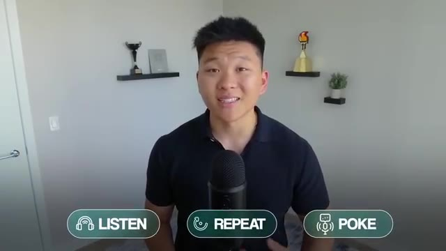
*⏱️ 00:06:39 — Le présentateur avec trois encadrés animés en bas de l'écran affichant les étapes du cadre LRP : "LISTEN", "REPEAT" et "POKE".*

---

### ⏱️ `[00:06:50 - 00:07:08]` | Segment #16

**🔊 Audio (Transcription Intégrale Mot pour Mot en Français) :**
> Et je découvre que cela prend environ six à huit heures par semaine. Je répliquerais alors avec une question comme : à qui appartiennent ces heures ? Quelle est leur valeur horaire ? À quelle fréquence ce processus entraîne-t-il une erreur ? Vous pourriez aussi parler d'argent. Où payez-vous des gens pour faire du copier-coller ou pourchasser des informations ? Vous pourriez parler de concentration. Qu'est-ce qui vous interrompt le plus entre neuf heures et midi ? Vous pouvez parler d'erreurs. Où les erreurs provoquent-elles du retravail, des rembourssements ou du désabonnement ?

**👁️ Analyse Visuelle d'Écran (gemini-3.5-flash-lite) :**
**Interface & Outils** : Présentation vidéo avec infographies textuelles.

**Contenu textuel & Code** : Texte à l'écran : "BUSINESS PAINPOINT LIST", "How often does this process result in an error ?", et "Where".

**Action / Démonstration** : Affichage des questions clés pour analyser les points de friction et les coûts dans les processus métier.

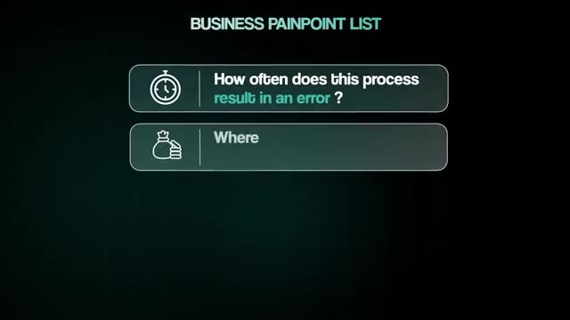
*⏱️ 00:06:59 — Une liste de points de douleur pour les entreprises (BUSINESS PAINPOINT LIST) avec des encadrés sur les erreurs de processus et les coûts.*

---

### ⏱️ `[00:07:09 - 00:07:28]` | Segment #17

**🔊 Audio (Transcription Intégrale Mot pour Mot en Français) :**
> Et enfin, vous pourriez parler d'un déclencheur. Si je pouvais éliminer un incendie hebdomadaire, lequel changerait votre semaine ? Le résultat de cette étape est d'avoir une liste classée de véritables points de douleur commerciaux avec des chiffres approximatifs associés. Ces chiffres étant les heures, le coût, la fréquence, le taux d'erreur, ce genre de choses. Nous pouvons ensuite prendre cette liste et passer à l'étape trois, qui consiste à construire une solution simple et à résoudre.

**👁️ Analyse Visuelle d'Écran (gemini-3.5-flash-lite) :**
**Interface & Outils** : Aucun outil technique, éditeur ou interface logicielle affiché.

**Contenu textuel & Code** : Schéma visuel sans code ni données textuelles détaillées.

**Action / Démonstration** : Présentation orale des concepts par le créateur.

---

### ⏱️ `[00:07:28 - 00:07:46]` | Segment #18

**🔊 Audio (Transcription Intégrale Mot pour Mot en Français) :**
> Une fois que vous avez diagnostiqué un problème clair, prototypez la solution. Et remarquez comment je viens de dire « prototype ». Il ne s'agit pas d'avoir un système parfait prêt pour la production. C'est un POC, ou une preuve de concept, qui montre que vous comprenez leur univers et prouve votre expertise technique. Cela ne signifie pas que vous devez y consacrer une semaine entière. Voici comment vous pourriez en monter un en une heure et demie. Passez environ 15 minutes à dessiner le flux.

**👁️ Analyse Visuelle d'Écran (gemini-3.5-flash-lite) :**
**Interface & Outils** : Aucune interface logicielle ou de développement affichée.

**Contenu textuel & Code** : Aucun code source ni données affichés, uniquement du texte à l'écran illustrant le concept de 'POC'.

**Action / Démonstration** : Présentation orale et explication conceptuelle par le présentateur.

---

### ⏱️ `[00:07:46 - 00:08:06]` | Segment #19

**🔊 Audio (Transcription Intégrale Mot pour Mot en Français) :**
> Maintenant que vous comprenez le processus, tracez simplement le déclencheur, les étapes, les sources de données, les sorties et une définition claire de ce qui est terminé. Passez la prochaine heure à faire une construction sommaire sur une plateforme, comme NNN, pour avoir quelque chose de réel à parcourir et à présenter. Et enfin, utilisez les 15 dernières minutes pour enregistrer une rapide vidéo Loom de trois minutes qui présente l'état initial, la solution proprement dite, puis le résultat.

**👁️ Analyse Visuelle d'Écran (gemini-3.5-flash-lite) :**
**Interface & Outils** : Interface graphique de workflow et panneau de configuration OpenRouter

**Contenu textuel & Code** : Schéma d'agent analyste avec ses connexions et paramètres de configuration de clé API OpenRouter.

**Action / Démonstration** : Présentation des étapes et de la configuration des outils pour la construction du flux d'automatisation.

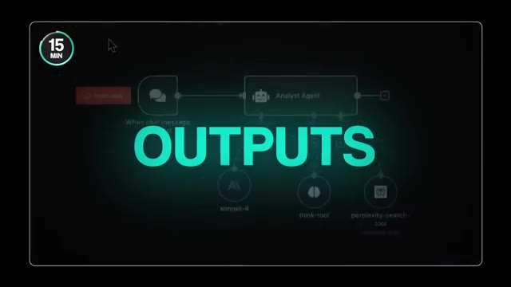
*⏱️ 00:07:51 — Un schéma de workflow avec le mot 'OUTPUTS' affiché en surimpression au premier plan.*

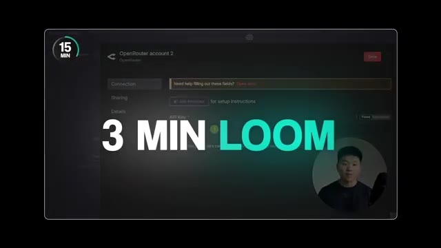
*⏱️ 00:08:01 — Une interface de configuration de compte OpenRouter avec le texte '3 MIN LOOM' en surimpression et la webcam du présentateur en bas à droite.*

---

### ⏱️ `[00:08:06 - 00:08:29]` | Segment #20

**🔊 Audio (Transcription Intégrale Mot pour Mot en Français) :**
> Et assurez-vous d'avoir votre caméra allumée parce que les gens veulent embaucher des gens, pas des écrans sans visage. C'est exactement pourquoi mon flux de travail LinkedIn pas si sophistiqué a semblé magique à ce premier client, car il a éliminé la douleur de la recherche d'idées, de la recherche et de la rédaction, et il n'avait pas besoin d'être super sophistiqué pour faire cela. Évitez donc les pièges classiques, ne vous laissez pas entraîner dans des fantaisies multi-agents, n'assemblez pas cinq fournisseurs juste pour les essayer, et ne commencez pas à construire une plateforme alors que le travail consiste simplement à résoudre le goulot d'étranglement de mardi.

**👁️ Analyse Visuelle d'Écran (gemini-3.5-flash-lite) :**
**Interface & Outils** : Interface utilisateur web ou application logicielle sous forme de grille de cartes.

**Contenu textuel & Code** : Texte 'TRY OUT VENDORS' et icônes sur des vignettes rectangulaires sombres et colorées.

**Action / Démonstration** : Navigation visuelle à travers une interface de blocs ou de modules interconnectés.

*⏱️ 00:08:23 — Interface graphique sombre affichant une grille de cartes interactives, avec notamment une carte verte mise en avant portant la mention 'TRY OUT VENDORS'.*

---

### ⏱️ `[00:08:29 - 00:08:51]` | Segment #21

**🔊 Audio (Transcription Intégrale Mot pour Mot en Français) :**
> Essayez simplement de prendre du recul et de réfléchir au problème réel que vous essayez de résoudre, car bien souvent, vous n'avez peut-être même pas besoin d'un agent de réseau de neurones très personnalisé. Parfois, il existe déjà une plateforme, ou parfois vous pouvez déjà le faire naturellement dans le CRM de quelqu'un. Ne faites pas de sur-ingénierie, faites simplement preuve d'ingéniosité et résolvez les problèmes. Le résultat de cette étape est que vous disposez désormais d'une vidéo de démonstration que vous pouvez envoyer à certains de vos autres prospects nourris pour leur montrer comment vous pouvez résoudre leurs points de douleur spécifiques.

**👁️ Analyse Visuelle d'Écran (gemini-3.5-flash-lite) :**
**Interface & Outils** : Éditeur de code / IDE sur ordinateur portable

**Contenu textuel & Code** : Lignes de code source ou interface de développement textuelle affichées sur l'écran du portable.

**Action / Démonstration** : Saisie de code sur un ordinateur portable par un utilisateur.

*⏱️ 00:08:40 — Vue de profil montrant une personne en train de taper sur un ordinateur portable affichant du code ou une interface technique.*

---

### ⏱️ `[00:08:52 - 00:09:11]` | Segment #22

**🔊 Audio (Transcription Intégrale Mot pour Mot en Français) :**
> Ensuite, c'est l'étape quatre, qui peut piéger beaucoup de débutants. Il s'agit de transformer votre solution en un prix. Et le moyen le plus simple d'y parvenir est de traduire ce que vous avez construit en mathématiques simples qu'un propriétaire d'entreprise peut comprendre et auxquelles il peut s'identifier. Voici comment je l'explique lors des appels. D'abord, vous devez déterminer combien de temps le processus prend aujourd'hui. Espérons que vous l'avez déjà fait plus tôt à l'étape deux. Disons qu'une équipe passe 10 heures par semaine sur l'intégration des clients.

**👁️ Analyse Visuelle d'Écran (gemini-3.5-flash-lite) :**
**Interface & Outils** : Aucune interface logicielle ou technique affichée.

**Contenu textuel & Code** : Aucun code, terminal ou prompt visible.

**Action / Démonstration** : Présentation orale du contenu de la vidéo sans manipulation technique.

---

### ⏱️ `[00:09:11 - 00:09:45]` | Segment #23

**🔊 Audio (Transcription Intégrale Mot pour Mot en Français) :**
> Ensuite, demandez ce que valent ces heures. Si l'employé moyen est payé 25 dollars de l'heure, cela fait 250 dollars par semaine. Multipliez cela par quatre semaines pour obtenir un mois. Et soudain, le processus coûte à l'entreprise environ 1 000 dollars par mois ou 12 000 dollars par an. Maintenant, disons que vous ne parvenez à automatiser que 60 % de cette charge de travail. Cela représente tout de même 600 dollars économisés chaque mois. Sur le ഒരു d'une année, cela fait plus de 7 000 dollars remis dans la poche de ce propriétaire d'entreprise. Donc, lorsque vous vous retournez et dites, hé, je ne vais vous facturer que 3 000 dollars pour la solution, ce n'est plus une dépense. C'est un investissement qui a un retour sur investissement très clair et mesurable, qui se rembourse déjà en cinq mois et qui continue d'économiser encore plus d'argent chaque mois par la suite.

**👁️ Analyse Visuelle d'Écran (gemini-3.5-flash-lite) :**
**Interface & Outils** : Interface graphique de présentation et de graphiques financiers.

**Contenu textuel & Code** : Graphique montrant l'évolution des coûts de processus ($1 000/mois, $12 000/an).

**Action / Démonstration** : Affichage d'un graphique illustrant le calcul des coûts de main-d'œuvre et des économies.

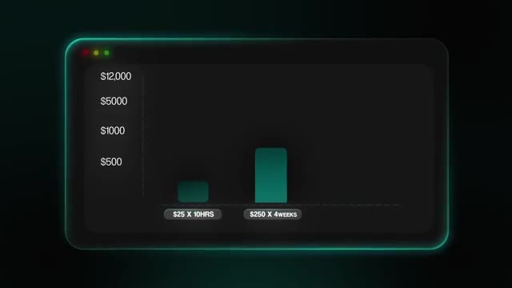
*⏱️ 00:09:19 — Un graphique financier illustrant le coût du processus avec des montants en dollars ($25 x 10HRS, $250 x 4WEEKS) et des axes de 500 à 12 000 dollars.*

---

### ⏱️ `[00:09:45 - 00:10:20]` | Segment #24

**🔊 Audio (Transcription Intégrale Mot pour Mot en Français) :**
> ça. Et c'est comme ça qu'on rend ça incontournable. Et bien sûr, il faut se rappeler que la valeur n'est pas égale au temps. Le client ne vous paie pas pour le temps que ça a pris. Quand j'ai construit mon tout premier flux de travail pour 1 200 dollars, ça m'a pris seulement environ deux heures, ce qui fait 600 dollars de l'heure, ce qui est un taux fou. Mais encore une fois, le client ne me payait pas pour les heures, il payait pour le résultat, qui était de leur faire économiser des heures de création de contenu chaque semaine. Enfin, assurez-vous de garder votre périmètre clair et simple. Écrivez l'objectif, ce qui est inclus, ce qui n'est pas inclus, le calendrier, ce qui est attendu du client, les conditions de paiement, des choses comme ça. Cela évite la confusion, l'ambiguïté, cela vous protège contre l'élargissement du périmètre, et cela vous fait paraître professionnel. Le numéro un

**👁️ Analyse Visuelle d'Écran (gemini-3.5-flash-lite) :**
**Interface & Outils** : Interface de type éditeur de flux de travail / diagramme animé.

**Contenu textuel & Code** : Diagramme de workflow avec des nœuds connectés et schéma conceptuel autour du mot "SCOPE".

**Action / Démonstration** : Affichage d'un flux de travail et d'un schéma explicatif sur la gestion du périmètre de projet.

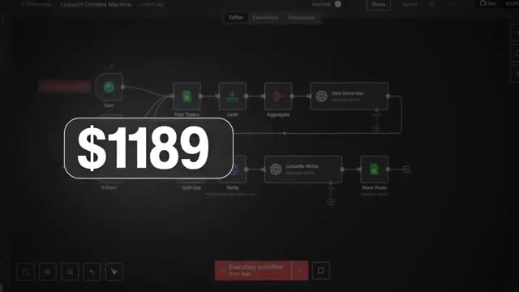
*⏱️ 00:09:53 — Capture montrant un diagramme de flux de travail (workflow) avec une superposition indiquant un montant de 1189 dollars.*

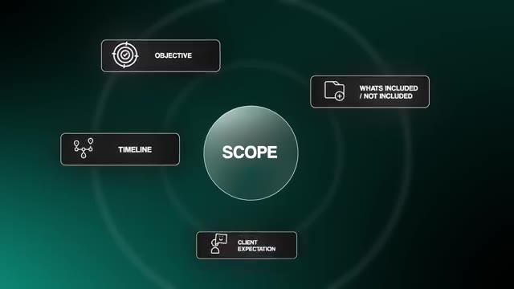
*⏱️ 00:10:11 — Schéma graphique animé illustrant le concept de "Scope" avec quatre éléments satellites (Objective, Timeline, Client Expectation, Whats Included / Not Included).*

---

### ⏱️ `[00:10:20 - 00:10:49]` | Segment #25

**🔊 Audio (Transcription Intégrale Mot pour Mot en Français) :**
> La plus grande erreur que j'ai commise quand je débutais, c'était de sous-estimer la portée du projet et de devoir ensuite gérer toute cette ambiguïté. Donc, si vous pouvez rendre vos propositions aussi spécifiques que possible et dire que ces 10 éléments constituent la fonctionnalité exacte du système, que c'est exactement la définition de terminé, alors vous allez vraiment vous protéger et vous remercier plus tard. Donc, pour résumer, la formule est on ne peut plus simple : découvrez combien de temps et d'argent le processus coûte actuellement, construisez un prototype et montrez comment votre solution réduit ce temps et cet argent, puis tarifez votre projet à une fraction de ces économies annuelles. Les entreprises paieront volontiers dès que ce calcul aura du sens.

**👁️ Analyse Visuelle d'Écran (gemini-3.5-flash-lite) :**
**Interface & Outils** : Interface graphique de type plateforme d'automatisation de workflows (n8n ou similaire).

**Contenu textuel & Code** : Nœuds de workflow pour un agent de navigation web (Browser Agent, Start Browser, Click, Type, Query, Load URL, End Session) et modèle de langage (3.5 Sonnet).

**Action / Démonstration** : Affichage de l'architecture d'un agent d'automatisation de navigateur (POC).

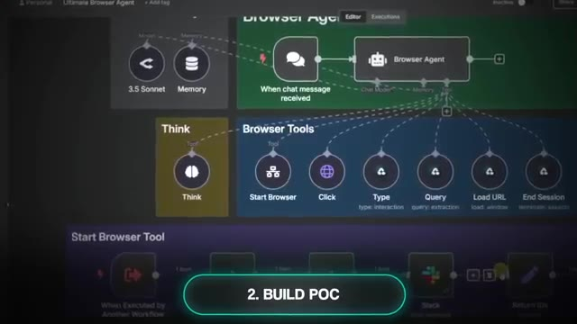
*⏱️ 00:10:42 — Capture d'écran montrant un diagramme de workflow de type n8n ou agent d'automatisation avec des sections telles que 'Browser Agent', 'Browser Tools', et un encadré '2. BUILD POC'.*

---

### ⏱️ `[00:10:49 - 00:11:22]` | Segment #26

**🔊 Audio (Transcription Intégrale Mot pour Mot en Français) :**
> Très bien, passons à l'étape cinq, qui consiste à accumuler des preuves, renforcer la confiance, puis passer à l'échelle. Je vais être honnête très rapidement. Quand vous débutez, le syndrome de l'imposteur est normal. Vous allez vous demander si vous pouvez assurer et si le client sera satisfait. J'ai ressenti exactement la même chose. Quand j'ai commencé à travailler avec des clients, je ne me qualifiais même pas d'expert. J'étais juste curieux, je construisais pour le plaisir, je partageais des choses en ligne, et des clients ont commencé à me contacter. À ce stade, j'aurais été heureux de travailler gratuitement juste pour acquérir de l'expérience. Et le fait d'être payé était un gros bonus. Et si vous êtes bloqué par cette inquiétude, vous avez deux excellentes options. La première est de faire du travail gratuit ou très bon marché en échange de preuves. Dites, hé, je vais essayer de réaliser ce projet pour

**👁️ Analyse Visuelle d'Écran (gemini-3.5-flash-lite) :**
**Interface & Outils** : n8n / Interface de workflow visuel et application de messagerie Telegram.

**Contenu textuel & Code** : Diagramme d'automatisation avec des nœuds (Telegram Trigger, Switch, OpenAI Chat Model, Vector Store Text) et messages de chat d'assistant personnel.

**Action / Démonstration** : Présentation et démonstration visuelle d'un workflow d'agent IA intégré avec Telegram.

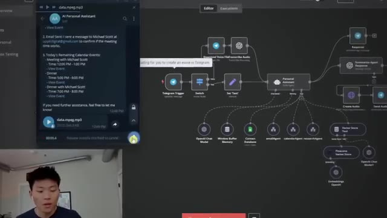
*⏱️ 00:11:06 — Un éditeur de workflow (style n8n ou Make) affichant un diagramme d'agent IA personnel avec des nœuds connectés, accompagné d'une fenêtre de chat Telegram à gauche montrant des interactions.*

---

### ⏱️ `[00:11:22 - 00:11:50]` | Segment #27

**🔊 Audio (Transcription Intégrale Mot pour Mot en Français) :**
> pour vous gratuitement. Dans les deux cas, le système sera le vôtre. Je veux juste voir si je peux vous aider à créer quelque chose de précieux pour vous et votre entreprise. Cela supprime la pression et vous permet d'optimiser pour les répétitions, pas pour l'argent, ce qui est exactement ce que vous devriez faire lorsque vous débutez. Parce que les témoignages, les études de cas et la confiance que vous allez acquérir valent bien plus à long terme qu'un gain rapide de 1 200 $ aujourd'hui. Et ces trois à cinq premiers projets devraient vraiment être considérés simplement comme de la pratique rémunérée. Ils existent pour vous enseigner le processus, vous donner ces études de cas et fournir des preuves. Votre autre option, si vous préférez ne pas le faire gratuitement, est de simplement offrir une garantie de remboursement.

**👁️ Analyse Visuelle d'Écran (gemini-3.5-flash-lite) :**
**Interface & Outils** : Ordinateur portable avec application logicielle ou éditeur affichant une interface sombre.

**Contenu textuel & Code** : Interface utilisateur avec des listes textuelles et du code/paramètres.
[DESC_IMAGE_3_SUPPRIMÉE_OU_NON_RETENUE]

**Action / Démonstration** : Saisie au clavier sur un ordinateur portable par un utilisateur.

*⏱️ 00:11:36 — Vue par-dessus l'épaule d'une personne tapant sur le clavier d'un ordinateur portable affichant une application avec du code ou des listes.*

---

### ⏱️ `[00:11:50 - 00:12:14]` | Segment #28

**🔊 Audio (Transcription Intégrale Mot pour Mot en Français) :**
> Dis : "Hé, si vous n'êtes pas satisfait quand je vous le livre ou si cela n'apporte pas la valeur dont nous avons discuté, vous récupérez tout votre argent." Cela inverse le risque, crée un environnement sans stress pour vous permettre d'apprendre et d'expérimenter, tout en garantissant un résultat équitable pour le client. C'est important parce qu'au début, encore une fois, vous optimisez pour l'expérience, la preuve, les répétitions, et non pour l'argent. Et une fois que vous avez toute cette confiance, vous pouvez réellement passer du statut de freelance à celui de consultant, et finir par décrocher des factures de plus en plus grosses et des contrats de plus en plus importants.

**👁️ Analyse Visuelle d'Écran (gemini-3.5-flash-lite) :**
**Interface & Outils** : Aucune interface logicielle ou technique affichée.

**Contenu textuel & Code** : Aucun code, terminal ou donnée affiché (uniquement des sous-titres/bulle de texte).

**Action / Démonstration** : Le présentateur s'adresse directement au public pour expliquer sa garantie de remboursement.

---

### ⏱️ `[00:12:14 - 00:12:33]` | Segment #29

**🔊 Audio (Transcription Intégrale Mot pour Mot en Français) :**
> Au cours de l'année passée, nous avons travaillé sur des projets qui sont allés de 1 000 $ à 2 000 $ jusqu'à 30 000 $ et plus. Et rien de tout cela ne se serait produit sans ce projet à faible enjeu qui a renforcé ma confiance et mon portfolio, ce qui m'a permis de facturer de plus en plus confortablement à chaque fois que nous concevons des réalisations. Et honnêtement, je pense toujours que pour beaucoup de nos projets, nous avons sous-facturé, mais c'est une discussion pour une autre fois.

**👁️ Analyse Visuelle d'Écran (gemini-3.5-flash-lite) :**
**Interface & Outils** : n8n (Interface de conception de workflows no-code) et YouTube

**Contenu textuel & Code** : Nœuds de workflow pour Telegram Trigger, Switch, Download File, Upload file, Photoshop Agent, GPT-5 mini, Sonnet 3.5 et outils de manipulation d'images.

**Action / Démonstration** : Navigation et présentation visuelle d'un workflow d'automatisation complexe combinant des déclencheurs Telegram et des agents d'intelligence artificielle.

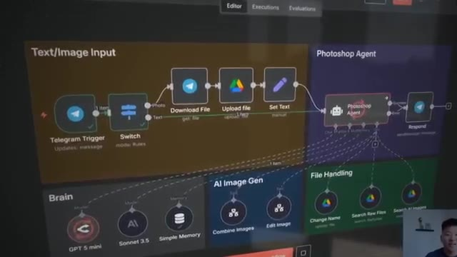
*⏱️ 00:12:28 — Vue détaillée d'un diagramme de workflow sur n8n ou une plateforme similaire intégrant Telegram, Google Drive et des agents IA de traitement d'images.*

---

### ⏱️ `[00:12:33 - 00:13:06]` | Segment #30

**🔊 Audio (Transcription Intégrale Mot pour Mot en Français) :**
> Quoi qu'il en soit, une fois que vous avez ces premières victoires à votre actif, assurez-vous de recueillir ces données de référence et d'après. Donc vos heures économisées, vos erreurs réduites, votre argent économisé, et ensuite transformez-les en études de cas simples. Bien sûr, vous voulez demander des témoignages et des recommandations, puis refaire tourner le framework avec de nouveaux prospects. Mais maintenant que vous avez la preuve en main, ça va être beaucoup plus facile parce qu'à ce moment-là, vous ne dites plus, je pense pouvoir vous aider. Vous dites j'ai déjà aidé trois entreprises exactement comme la vôtre. Voici la preuve. Voici les résultats. Vous voulez que je fasse la même chose pour vous. Et c'est là que le syndrome de l'imposteur s'estompe parce que le marché valide réellement que ce que vous faites fonctionne. Et c'est à peu près la boucle complète. Diagnostiquer le problème,

**👁️ Analyse Visuelle d'Écran (gemini-3.5-flash-lite) :**
**Interface & Outils** : Graphiques animés et interface de messagerie (type iMessage)

**Contenu textuel & Code** : Indicateurs de performance (heures, erreurs, argent) et messages de prospection commerciale.

**Action / Démonstration** : Illustration visuelle des métriques de succès et d'une conversation de prospection par message.

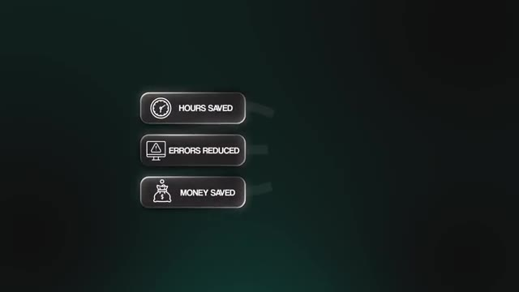
*⏱️ 00:12:41 — Graphique montrant trois indicateurs clés : 'Hours Saved', 'Errors Reduced', 'Money Saved'.*

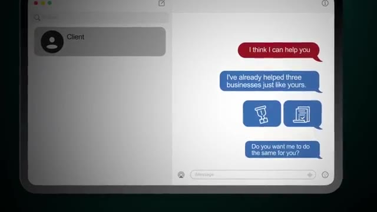
*⏱️ 00:12:58 — Interface de messagerie montrant une conversation avec un client potentiel proposant de l'aider.*

---

### ⏱️ `[00:13:06 - 00:13:29]` | Segment #31

**🔊 Audio (Transcription Intégrale Mot pour Mot en Français) :**
> Résolvez-le avec un système simple, reliez-le à la valeur commerciale, puis fixez vos prix en conséquence. À partir de là, vous accumulez vos preuves jusqu'à ce que vous puissiez passer à l'échelle en toute confiance. Si vous voulez réussir à vendre de l'IA, vous devez laisser votre obsession pour la technologie de côté et penser uniquement au client, c'est-à-dire l'entreprise à laquelle vous vendez. Alors, je sais que cela faisait beaucoup d'informations. J'ai essayé de rendre cette vidéo aussi précieuse que possible. Ce que je vais faire, c'est condenser tout cela dans une ressource à laquelle vous pourrez accéder et consulter plus tard.

**👁️ Analyse Visuelle d'Écran (gemini-3.5-flash-lite) :**
**Interface & Outils** : AUCUNE

**Contenu textuel & Code** : AUCUNE

**Action / Démonstration** : AUCUNE

---

### ⏱️ `[00:13:29 - 00:14:02]` | Segment #32

**🔊 Audio (Transcription Intégrale Mot pour Mot en Français) :**
> Je vais mettre cela dans ma communauté FreeSchool. Encore une fois, c'est totalement gratuit. Le lien pour cela se trouve ci-dessous dans la description. Et si vous avez trouvé cette vidéo utile et que vous cherchez un cours complet, à peu près comme celui-ci, alors jetez un œil à ma communauté Plus. Le lien pour cela est également ci-dessous dans la description. Nous venons d'y publier un cours complet intitulé « One Person AI Agency ». Vous pourrez donc accéder à du matériel de cours officiel qui explique comment lancer votre agence IA individuelle en partant de zéro. Et ce qui est génial avec cette communauté, c'est que nous avons plus de 2 000 autres personnes qui essaient également de faire exactement la même chose. C'est donc un excellent endroit pour rencontrer des gens, potentiellement un associé, et peut-être même effectuer quelques recrutements ou décrocher vos premiers contrats. Alors si vous avez apprécié la vidéo ou si vous avez appris quelque chose de nouveau, n'hésitez pas à laisser un j'aime.

**👁️ Analyse Visuelle d'Écran (gemini-3.5-flash-lite) :**
**Interface & Outils** : Interface web de la plateforme de communauté (FreeSchool / Skool).

**Contenu textuel & Code** : Modules de formation et ressources de la communauté, avec le cours "One Person AI Agency".

**Action / Démonstration** : Présentation visuelle de la communauté payante ou de la plateforme de cours "Plus".

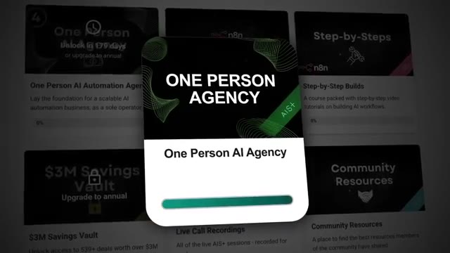
*⏱️ 00:13:45 — Capture d'écran montrant l'interface d'une plateforme de cours avec une carte mise en avant intitulée "ONE PERSON AGENCY" / "One Person AI Agency".*

---

### ⏱️ `[00:14:02 - 00:14:11]` | Segment #33

**🔊 Audio (Transcription Intégrale Mot pour Mot en Français) :**
> Ça m'aide vraiment énormément. Et comme toujours, j'apprécie que vous soyez allés jusqu'à la fin de la vidéo. Je vous retrouve tous dans la prochaine. Merci les gars.

**👁️ Analyse Visuelle d'Écran (gemini-3.5-flash-lite) :**
**Interface & Outils** : Lecteur vidéo YouTube (interface web).

**Contenu textuel & Code** : Titre de la vidéo affiché en bas : 'Stop Selling AI Agents, Do This Instead' avec le nom de la chaîne 'Nate Herk | AI Automation'.

**Action / Démonstration** : Le présentateur fait ses adieux et conclut la vidéo, sans aucune démonstration technique ni code source affiché.

---

