# 🎬 3 Hidden Data Table Hacks for Smarter AI Agents

> **Chaîne** : [Nate Herk | AI Automation](https://www.youtube.com/@nateherk/featured)  
> **Lien YouTube** : [https://www.youtube.com/watch?v=lcNN3X9gXls](https://www.youtube.com/watch?v=lcNN3X9gXls)  
> **Date de publication** : 20250926  
> **Durée** : 00:15:17  
> **Identifiant vidéo** : `lcNN3X9gXls`  
> **Transcription & Analyse** : `whisper-v3-large-turbo+gemini-3.5-flash-lite`  

---

## 📌 Synthèse Exécutive & Outils

### 💡 Résumé

Cette vidéo animée par Nate Herk sur la chaîne *Nate Herk | AI Automation* explore l'utilisation avancée des tables de données natives de n8n pour concevoir, piloter et monitorer des agents IA plus intelligents et autonomes, sans dépendre d'appels API externes vers des tableurs tiers comme Google Sheets ou Airtable. Le cœur de la démonstration repose sur le découplage de la logique applicative et de la configuration des agents : les modèles de langage, les invites système (*system prompts*) et les instructions utilisateur ne sont plus codés en dur dans les flux de travail, mais externalisés dans des tables de données centralisées. Cette architecture permet à la fois de protéger sa propriété intellectuelle — en masquant les invites système lors du partage de workflows — et de faciliter la maintenance ou la collaboration avec des utilisateurs non techniques.

La démonstration technique s'articule autour de deux cas d'usage majeurs : un agent de recherche simple et un système de newsletter multi-agents plus complexe. Dans le premier cas, le workflow interroge dynamiquement une table pour récupérer le modèle de chat adéquat (comme Anthropic Claude 3.7 Sonnet) et l'invite système associée avant d'exécuter des recherches via Perplexity ou Tavily. Dans le second cas, le système orchestre plusieurs agents (planificateur, rédacteur, éditeur) en injectant dynamiquement des variables contextuelles. La vidéo aborde également des aspects pratiques indispensables à la mise en production, tels que la synchronisation bidirectionnelle entre les tables n8n et Google Sheets pour pallier certaines limitations ergonomiques actuelles des tables natives (absence de menus déroulants ou de sélection par liste pré-codée), ainsi que la journalisation détaillée des actions et des étapes intermédiaires des agents.

### 🛠️ Outils, Modèles & Logiciels Présentés

* **n8n** : Plateforme d'automatisation des flux de travail open-source et low-code, dotée de tables de données natives permettant de stocker et d'interroger des données en interne sans dépendre d'API externes.
* **Anthropic Claude (dont Claude 3.7 Sonnet)** : Modèle de langage de pointe d'Anthropic, utilisé ici pour sa puissance d'exécution et sa capacité à orchestrer des recherches autonomes complexes.
* **Claude Code** : Environnement et assistant de développement avancé d'Anthropic destiné aux ingénieurs logiciels pour coder et automatiser des tâches d'ingénierie.
* **Opus 5.5** : Modèle linguistique de pointe évoqué dans l'écosystème d'IA générative pour sa robustesse dans le traitement des tâches complexes.
* **OpenRouter** : Routeur d'API unifié permettant d'accéder à une multitude de grands modèles de langage via une interface unique et dynamique.
* **Perplexity** : Moteur de recherche conversationnel basé sur l'IA, utilisé comme outil externe par les agents pour effectuer des recherches documentaires en temps réel.
* **Tavily (ou Tavoli)** : API de recherche spécifiquement optimisée pour les agents IA et les LLM, offrant des résultats structurés et pertinents pour l'ingénierie de recherche autonome.
* **Google Sheets** : Outil de tableur cloud utilisé en solution de contournement ou de synchronisation pour bénéficier d'interfaces de saisie plus ergonomiques (menus déroulants) et sécuriser les données.

### 🔑 Points Clés & Enseignements Stratégiques

* **Externalisation de la configuration** : Stocker les prompts et les modèles de chat dans des tables de données permet de modifier le comportement des agents en production sans avoir à modifier la structure interne des flux de travail n8n.
* **Protection de la propriété intellectuelle** : Séparer les invites système du code du workflow permet de partager ou de distribuer des modèles d'automatisation tout en gardant secrètes les instructions stratégiques et les prompts propriétaires qui font la valeur du système.
* **Accessibilité pour les non-techniciens** : Offrir une interface frontale simplifiée via les tables de données permet à des clients ou des collaborateurs de mettre à jour des paramètres critiques (modèles, thématiques) sans risque de corrompre la logique technique du workflow.
* **Injection dynamique de variables** : Les tables de données permettent de coupler des invites système fixes avec des invites utilisateur dynamiques générées par les étapes précédentes du flux (comme des requêtes de recherche contextuelles).
* **Adaptabilité des agents autonomes** : L'utilisation de modèles puissants comme Claude 3.7 Sonnet combinés à des outils de recherche multiples (Perplexity, Tavily) permet à l'agent de décider de manière autonome de la stratégie de recherche optimale selon la complexité de la tâche.
* **Synchronisation des bases de données** : Pour pallier les limites ergonomiques des tables de données natives n8n (absence de listes déroulantes, risque d'erreurs de saisie textuelle), il est possible de mettre en place des flux de synchronisation quotidienne bidirectionnelle avec Google Sheets.
* **Sécurisation des données via des menus déroulants** : L'utilisation de Google Sheets en interface de saisie permet d'implémenter des listes déroulantes pour les noms de modèles (ex: GPT-5 mini, Claude 3.7 Sonnet), éliminant ainsi tout risque de faute de frappe ou d'erreur de syntaxe.
* **Journalisation et traçabilité en production** : Il est impératif d'enregistrer systématiquement les exécutions des agents (horodatage, entrées, sorties, actions, consommation de jetons) dans une table dédiée pour auditer les performances et identifier les axes d'amélioration.
* **Capture des étapes intermédiaires** : L'activation de l'option « retourner les étapes intermédiaires » au sein des nœuds d'agents IA est indispensable pour analyser précisément le raisonnement pas-à-pas de l'agent et déboguer les comportements inattendus.
* **Détection des tendances et cas limites** : L'analyse régulière des journaux d'exécution stockés dans les tables permet d'identifier des tendances récurrentes, facilitant la création de barrières de protection (*guardrails*) contre les cas limites d'échec.

---

## ⏱️ Chronologie & Transcription Complète Audio & Visuelle (Mot pour Mot)

### ⏱️ `[00:00:00 - 00:00:37]` | Segment #01

**🔊 Audio (Transcription Intégrale Mot pour Mot en Français) :**
> Donc NNN a publié leurs tables de données, ce qui signifie que nous pouvons stocker des données dans NNN et que nous pouvons faire en sorte que nos agents les utilisent sans avoir à faire une sorte d'appel API externe vers un Google Sheets ou un Airtable. Donc si vous n'avez pas regardé ma vidéo précédente sur les tables de données où je montre comment elles fonctionnent et ce que vous pouvez faire avec, alors je vous recommanderais vraiment de la regarder d'abord et de revenir ensuite à cette vidéo. Je vais taguer celle-là juste ici, car aujourd'hui ce que nous allons aborder, ce sont des cas d'utilisation secrets pour ces tables de données et comment vous pouvez les utiliser pour rendre vos agents de plus en plus intelligents. Donc je ne veux pas perdre de temps. J'ai préparé trois astuces différentes pour vous. Entrons donc dans le vif de la vidéo. Donc la première astuce que nous allons examiner aujourd'hui consiste à utiliser les tables de données pour stocker vos modèles et vos prompts pour vos agents IA. Et qu'est-ce que je veux dire par là ?

**👁️ Analyse Visuelle d'Écran (gemini-3.5-flash-lite) :**
**Interface & Outils** : n8n (éditeur de workflow d'automatisation)

**Contenu textuel & Code** : Nœuds de workflow : When chat message received, Sales Data Agent, GPT-5-mini, All Rows, Product Name Query, Date Query, Research Agent, OpenRouter, Perplexity, Tavily, Clean Up, Update Log2, Send a text message, Ultimate Media Agent.

**Action / Démonstration** : Présentation et explication des différents workflows d'agents IA utilisant des tables de données internes et des intégrations d'outils.

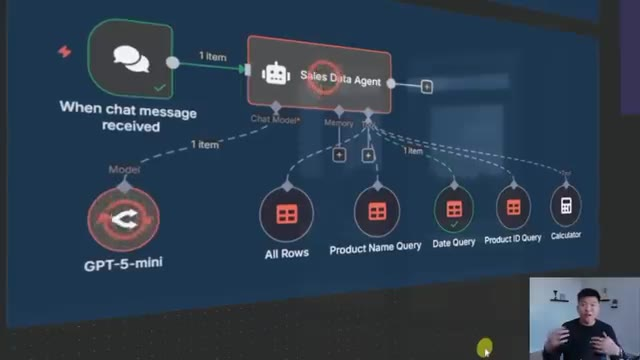
*⏱️ 00:00:09 — Un diagramme de workflow d'automatisation montrant un "Sales Data Agent" connecté à divers outils de requête et de modèles de langage.*

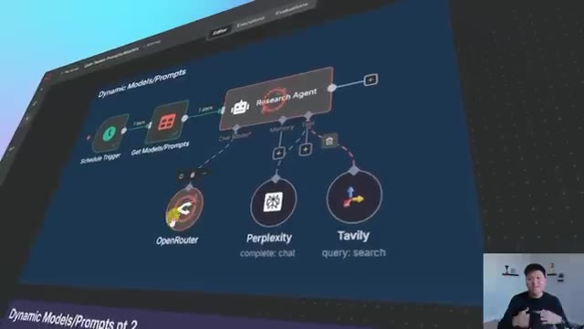
*⏱️ 00:00:19 — Un diagramme de workflow nommé "Dynamic Models/Prompts" avec un "Research Agent" relié à des outils de recherche comme Perplexity et Tavily.*

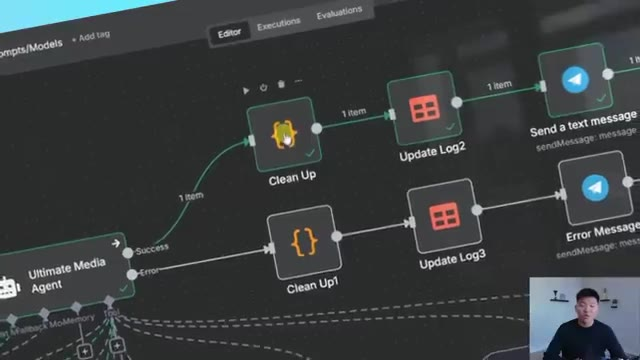
*⏱️ 00:00:28 — Un workflow complexe montrant l'"Ultimate Media Agent" avec des branches de succès et d'erreur connectées à des nœuds de nettoyage et de notification Telegram.*

---

### ⏱️ `[00:00:37 - 00:01:10]` | Segment #02

**🔊 Audio (Transcription Intégrale Mot pour Mot en Français) :**
> Jetons un coup d'œil à un exemple d'agent de recherche super simple. Donc je vais en fait simplement exécuter cet agent IA. Nous le verrons utiliser son modèle de chat. Il va utiliser ses invites système, et il va faire des recherches en utilisant Perplexity. Et vous pouvez voir qu'avant d'arriver à l'étape de l'agent, nous avons une table de données NNN. Donc si je clique dessus, vous pouvez voir ce qu'il fait, c'est qu'il extrait des données de notre table de données appelée modèles et invites, et nous faisons correspondre une condition de flux de travail égal à agent de recherche. Donc ce que cela signifie, c'est que nous avons une table de données dans n8n qui ressemble à ceci, et nous avons différents flux de travail, et dans ces flux de travail, nous stockons des modèles de chat, des invites utilisateur,

**👁️ Analyse Visuelle d'Écran (gemini-3.5-flash-lite) :**
**Interface & Outils** : Interface graphique de type n8n montrant un éditeur de workflow d'agents IA.

**Contenu textuel & Code** : Données JSON d'entrée avec horodatage, paramètres de nœud et tableau de données "Models/Prompts".

**Action / Démonstration** : Exécution du workflow et affichage des paramètres de configuration du nœud de récupération de modèles.

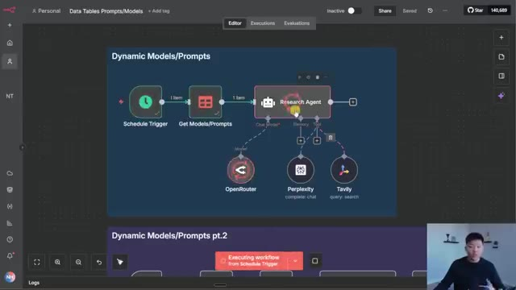
*⏱️ 00:00:45 — Vue d'ensemble d'un workflow d'automatisation montrant un déclencheur planifié et un nœud "Research Agent" connecté à OpenRouter, Perplexity et Tavily.*

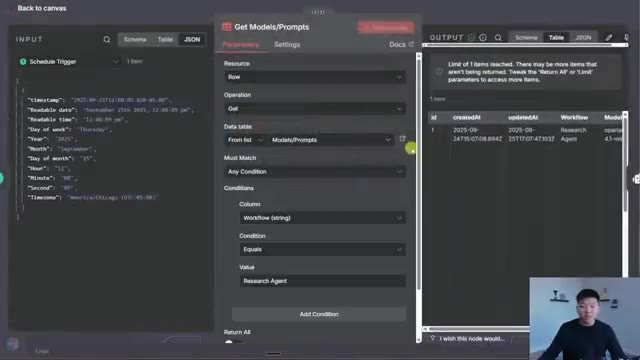
*⏱️ 00:00:54 — Panneau de configuration du nœud "Get Models/Prompts" avec les données JSON d'entrée à gauche et les résultats tabulaires à droite.*

---

### ⏱️ `[00:01:10 - 00:01:43]` | Segment #03

**🔊 Audio (Transcription Intégrale Mot pour Mot en Français) :**
> et des invites système. L'avantage ici est que nous pouvons avoir un environnement frontal comme cette table de données où nous pouvons contrôler les invites système et les modèles de chat pour tous nos flux de travail. Peut-être avez-vous un client qui n'aime pas être dans cet environnement parce qu'il ou elle a peur de casser quelque chose, mais vous pouvez lui donner accès à cette table de données et dire, hé, tout ce que vous avez à faire est de changer le modèle de chat pour l'agent respectif et cela se mettra à jour dans le flux de travail. Et c'est vraiment, vraiment simple. Nous faisons le filtre pour récupérer la bonne ligne et ensuite, dans l'agent de recherche réel, nous glissons simplement l'invite utilisateur, qui, comme vous pouvez le voir, provient de la table de données. Nous disons que nous voulons faire des recherches sur cette industrie, qui est les dentistes. Donc si soudainement nous voulions

**👁️ Analyse Visuelle d'Écran (gemini-3.5-flash-lite) :**
**Interface & Outils** : Interface web d'automatisation et de gestion de workflows / agents IA.

**Contenu textuel & Code** : Tableaux de données avec colonnes Workflow, Model, UserPrompt, SystemPrompt, et panneaux de configuration JSON et paramètres d'agents.

**Action / Démonstration** : Navigation et présentation de la table de données centrale pour contrôler les prompts et modèles de chat, puis visualisation des paramètres et de la sortie d'un agent de recherche.

*⏱️ 00:01:18 — Interface sous forme de tableau de données affichant les flux de travail, les modèles, les invites utilisateur et les invites système, avec le présentateur en incrustation vidéo en bas à droite.*

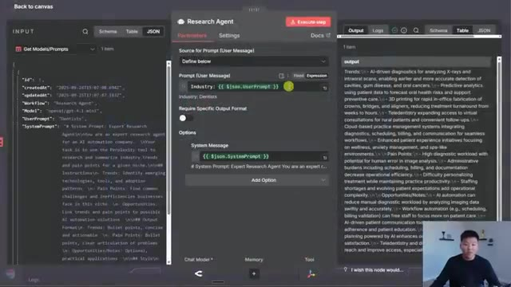
*⏱️ 00:01:34 — Interface de configuration d'un agent de recherche (Research Agent) divisée en trois volets (Input, Parameters, Output) affichant le JSON, les prompts et les résultats textuels.*

---

### ⏱️ `[00:01:43 - 00:02:17]` | Segment #04

**🔊 Audio (Transcription Intégrale Mot pour Mot en Français) :**
> faire des recherches sur une autre industrie, nous pourrions simplement changer cela ici même dans l'invite utilisateur au lieu d'aller fouiller dans différents flux de travail. Vous pouvez également voir que nous avons notre invite système en bas, qui n'est qu'une variable, mais lorsque nous l'ouvrons, nous pouvons la voir comme une invite système complète et elle dit à cet agent IA d'utiliser l'outil Perplexity pour faire ses recherches. Imaginez donc que vous souhaitiez télécharger ce flux de travail et le partager avec quelqu'un d'autre mais que vous vouliez garder vos invites système privées parce qu'aujourd'hui une grande partie de la propriété intellectuelle d'un flux de travail ou d'un modèle réside dans l'invite système elle-même. Et donc de cette façon, si vous partagez le modèle, les gens auraient accès à cette variable mais n'obtiendraient pas réellement cette invite système sur laquelle vous avez passé du temps. Et puis

**👁️ Analyse Visuelle d'Écran (gemini-3.5-flash-lite) :**
**Interface & Outils** : Interface web de flux de travail / outil d'automatisation par agents IA.

**Contenu textuel & Code** : Variables d'entrée pour le prompt utilisateur (Industry: `{{ $json.UserPrompt }}`) et le message système (`{{ $json.SystemPrompt }}`).

**Action / Démonstration** : Le présentateur explique la configuration des variables d'invite pour l'agent de recherche.

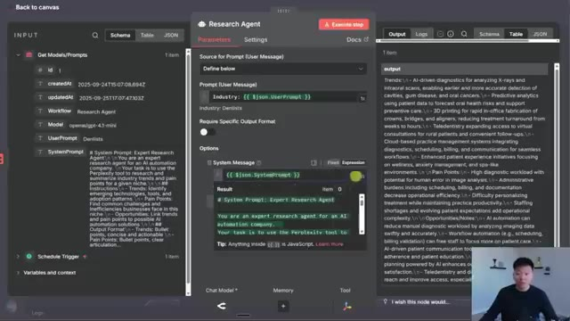
*⏱️ 00:01:51 — Interface d'un outil d'automatisation montrant la configuration d'un agent de recherche avec les paramètres de prompt utilisateur et de message système.*

---

### ⏱️ `[00:02:17 - 00:02:53]` | Segment #05

**🔊 Audio (Transcription Intégrale Mot pour Mot en Français) :**
> Enfin, nous transmettons un modèle de chat dynamique dans OpenRouter, car une fois de plus, il utilise la variable qui provient de la table de données. Donc, juste pour vous montrer comment nous pourrions changer quelque chose comme ça, je vais retourner dans ma table de données. Je vais copier Anthropic Claude 3.7 Sonnet et le coller à la place. Et ensuite, pour les invites système, je vais passer de utiliser l'outil Perplexity à utiliser l'outil Tavoli. Et donc très rapidement, vous pouvez voir que ça sauvegarde, nous retournons dans NNN, et je vais simplement relancer ce flux de travail une fois de plus. Nous devrions voir les nouvelles variables être récupérées. Nous pouvons déjà voir qu'il appelle Tavoli au lieu de Perplexity. Si je clique sur OpenRouter, nous pouvons voir qu'il utilise désormais Anthropic Claude 3.7 Sonnet. Et si nous allons dans

**👁️ Analyse Visuelle d'Écran (gemini-3.5-flash-lite) :**
**Interface & Outils** : Interface de type éditeur de workflow visuel et table de données (outil d'automatisation d'agents IA type n8n ou plateforme similaire).

**Contenu textuel & Code** : Nœuds de workflow 'Schedule Trigger', 'Get Models/Prompts', 'Research Agent', 'OpenRouter', 'Perplexity', 'Tavily' et entrées de table de données avec modèles LLM.

**Action / Démonstration** : Navigation et bascule entre l'éditeur de workflow graphique et la table de données pour configurer des modèles dynamiques.

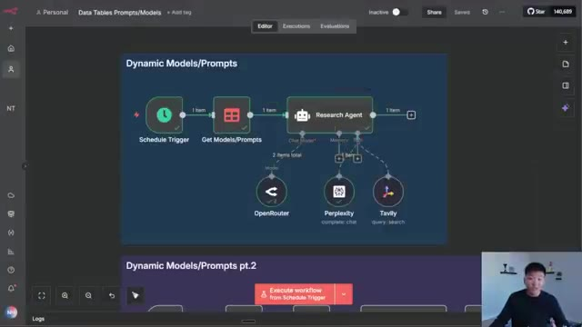
*⏱️ 00:02:26 — Vue d'ensemble d'un workflow d'automatisation d'agent IA montrant un déclencheur, une table de données et un agent connecté à OpenRouter, Perplexity et Tavily.*

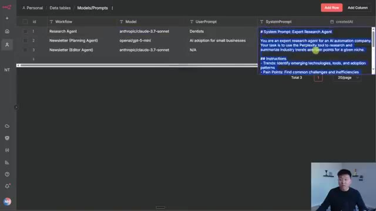
*⏱️ 00:02:35 — Affichage d'une table de données relationnelle contenant les colonnes ID, Workflow, Model, UserPrompt et SystemPrompt avec des détails sur les agents.*

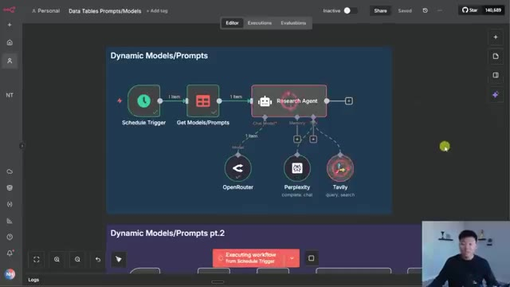
*⏱️ 00:02:44 — Exécution en temps réel du workflow d'automatisation avec des indicateurs visuels d'activité sur le nœud 'Research Agent'.*

---

### ⏱️ `[00:02:53 - 00:03:27]` | Segment #06

**🔊 Audio (Transcription Intégrale Mot pour Mot en Français) :**
> l'agent de recherche, nous pouvons voir que le prompt a été mis à jour maintenant pour utiliser l'outil Tavily. Et vous avez peut-être même remarqué qu'il utilise également Perplexity. C'est simplement parce que Claude 3.7 Sonnet est peut-être un peu plus puissant, et il a décidé qu'il avait besoin de faire plus de recherches en utilisant ses autres outils afin d'avoir le meilleur rapport. Et c'est la puissance des agents autonomes. Et donc vous n'êtes pas obligé de faire cela uniquement avec des agents. Vous pourriez également transmettre des variables à des nœuds comme celui-ci. Lisez donc, je vais lancer ce deuxième flux de travail ici et nous allons analyser ce qui se passe. Il s'agit donc d'un système de newsletter que j'ai construit. J'ai d'ailleurs fait une vidéo étape par étape sur YouTube de cette construction. Vous pouvez voir qu'il s'agit d'un processus plus complexe parce qu'il y a plus de nœuds et

**👁️ Analyse Visuelle d'Écran (gemini-3.5-flash-lite) :**
**Interface & Outils** : Interface web de workflow / plateforme d'automatisation

**Contenu textuel & Code** : Diagramme de flux comprenant 'Schedule Trigger', 'Get Models/Prompts', et 'Research Agent' relié aux outils Perplexity et Tavily.

**Action / Démonstration** : Visualisation du workflow de l'agent de recherche en cours d'exécution.

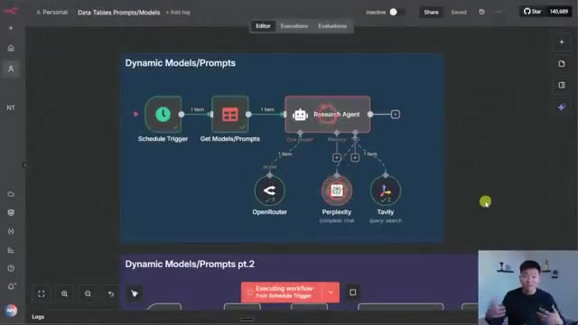
*⏱️ 00:03:01 — Capture d'écran montrant une interface de workflow d'automatisation avec un nœud 'Research Agent' connecté à OpenRouter, Perplexity et Tavily.*

---

### ⏱️ `[00:03:27 - 00:04:00]` | Segment #07

**🔊 Audio (Transcription Intégrale Mot pour Mot en Français) :**
> il y a une autre étape ici où nous extrayons des variables de données en plus de celle-ci. Donc très vite, regardons cette première. Nous faisons la même chose. Nous faisons correspondre une condition où le flux de travail doit être égal à infolettre entre parenthèses agent de planification. Et cela extrait une ligne où nous avons un modèle de chat, nous avons un prompt utilisateur et nous avons un prompt système. Et cette fois, nous passons réellement le prompt utilisateur dans ce nœud de recherche Tavoli. Donc nous avons cette requête, pour que le sujet de notre infolettre soit dynamique, et si nous allions dans notre table de données, nous pourrions changer le sujet de notre infolettre ici même. C'est donc pourquoi nous l'utilisons ici parce que les prompts utilisateurs pour ceci

**👁️ Analyse Visuelle d'Écran (gemini-3.5-flash-lite) :**
**Interface & Outils** : Outil d'automatisation de flux de travail (type interface de type n8n ou similaire).

**Contenu textuel & Code** : Configuration du nœud 'Get Variables' avec la table de données 'Models/Prompts', une condition 'Workflow (string) Equals Newsletter (Planning Agent)', et les données de sortie correspondantes.

**Action / Démonstration** : Le présentateur configure les paramètres et les conditions de filtrage pour extraire des variables de données spécifiques.

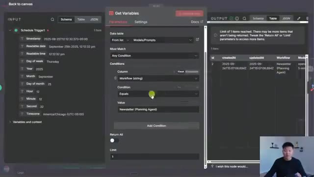
*⏱️ 00:03:35 — Interface d'un outil d'automatisation avec un panneau central 'Get Variables' configurant des conditions de filtrage sur une table de données, et un panneau latéral montrant les résultats de sortie.*

---

### ⏱️ `[00:04:00 - 00:04:30]` | Segment #08

**🔊 Audio (Transcription Intégrale Mot pour Mot en Français) :**
> L'agent doit être dynamique, ce qui signifie qu'il doit être le résultat de l'étape de recherche précédente. Mais encore une fois, nous utilisons l'invite système provenant de la table de données. Comme vous pouvez le voir, nous avons simplement une variable, mais nous obtenons la véritable invite système. Et puis bien sûr, nous transmettons la variable du modèle de chat à la fois à l'agent de planification et à l'agent rédacteur de section. Juste ici, vous pouvez voir que nous transmettons GPT-5 mini. Donc le point que j'essaie de faire valoir ici est que vous pouvez utiliser vos interfaces frontales comme celle-ci pour contrôler le comportement de votre flux de travail sans avoir à entrer dans le flux de travail. Et bien sûr, il est bon d'avoir toutes vos invites système sauvegardées au cas où quelque chose se produirait.

**👁️ Analyse Visuelle d'Écran (gemini-3.5-flash-lite) :**
**Interface & Outils** : Interface de conception de workflows et de tables de données pour l'automatisation d'agents IA.

**Contenu textuel & Code** : Variables dynamiques, prompts système, messages utilisateur et paramètres de modèles d'IA dans un tableau structuré et des nœuds de workflow.

**Action / Démonstration** : Configuration des messages système et navigation entre le workflow principal et les tables de données.

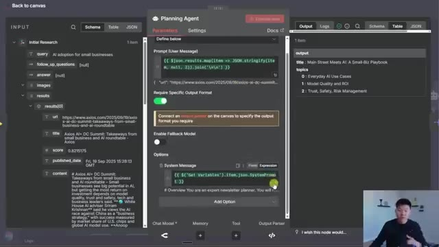
*⏱️ 00:04:07 — Vue détaillée des paramètres d'un nœud "Planning Agent" dans une interface d'automatisation IA, montrant la configuration des messages système et utilisateur.*

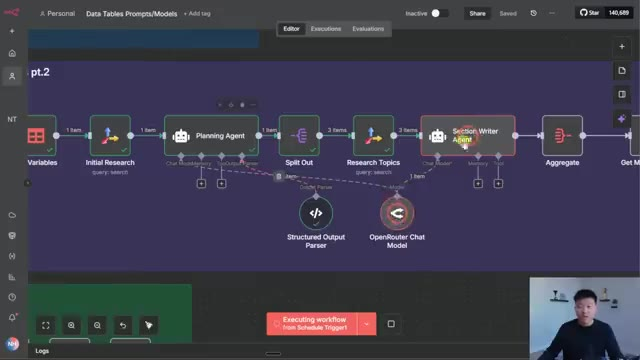
*⏱️ 00:04:15 — Vue d'ensemble d'un workflow d'automatisation complet avec des nœuds connectés pour la recherche, la planification et la rédaction d'agents.*

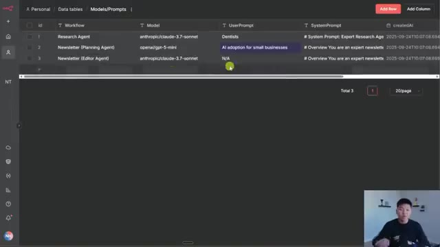
*⏱️ 00:04:23 — Tableau de données affichant les configurations de prompts et de modèles d'IA pour différents workflows d'agents.*

---

### ⏱️ `[00:04:30 - 00:04:50]` | Segment #09

**🔊 Audio (Transcription Intégrale Mot pour Mot en Français) :**
> Et c'est aussi votre propriété intellectuelle. Et ensuite, nous passons à l'agent éditeur. Et ces données, ce tableau les intègre dans l'agent éditeur de la newsletter du flux de travail au lieu de l'agent de planification. Et nous obtenons un modèle, nous n'avons pas de prompts utilisateur et nous avons un système prompt. Et tout cela est transmis ici. Vous pouvez voir bien sûr que le modèle va directement là et ensuite le système prompt descend ici.

**👁️ Analyse Visuelle d'Écran (gemini-3.5-flash-lite) :**
**Interface & Outils** : n8n (éditeur de workflows d'automatisation)

**Contenu textuel & Code** : Configuration du nœud "Get Model/Prompt" avec les conditions de filtrage par nom de workflow (Newsletter Editor Agent).

**Action / Démonstration** : Configuration et exécution du flux de travail automatisé reliant les données de la table aux agents éditeurs.

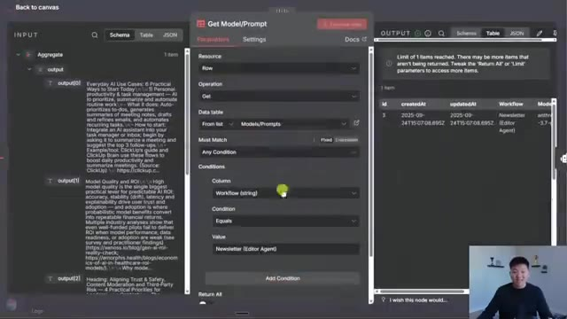
*⏱️ 00:04:35 — Configuration d'un nœud dans n8n pour récupérer les modèles et prompts depuis une table de données.*

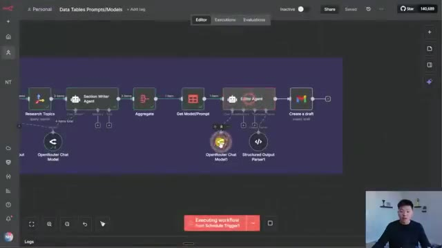
*⏱️ 00:04:45 — Vue globale du workflow n8n montrant la liaison entre les différents agents IA et nœuds d'exécution.*

---

### ⏱️ `[00:04:50 - 00:05:10]` | Segment #10

**🔊 Audio (Transcription Intégrale Mot pour Mot en Français) :**
> Donc c'était le premier truc que je voulais vous montrer les gars. Et voici juste un petit bonus. Vous pouvez synchroniser vos bases de données. Disons donc que vous avez ceci dans NNN parce que c'est facile, c'est juste là, mais vous vous sentiriez aussi plus à l'aise de le stocker dans quelque chose comme une feuille Google également. Je comprends tout à fait. Et c'est aussi super facile de s'assurer qu'elles se synchronisent chaque jour. Disons donc que dans ce scénario du haut, notre base de données end-at-end est notre interface principale.

**👁️ Analyse Visuelle d'Écran (gemini-3.5-flash-lite) :**
**Interface & Outils** : n8n et Google Sheets

**Contenu textuel & Code** : Nœuds de workflow n8n (Schedule Trigger, Get row(s), Clear sheet, Append row in sheet, Delete row(s), Insert row) et tableau Google Sheets avec des prompts système et utilisateur.

**Action / Démonstration** : Présentation d'un workflow de synchronisation entre des bases de données et Google Sheets, illustrant la gestion des données de l'assistant IA.

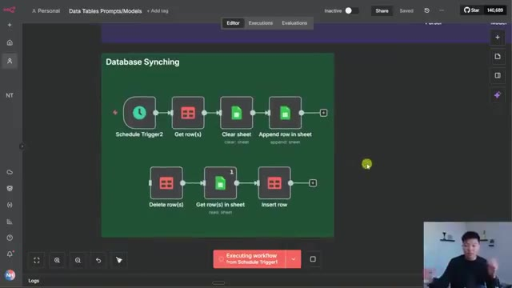
*⏱️ 00:04:55 — Interface n8n affichant un diagramme de workflow de synchronisation de base de données ("Database Synching") avec des nœuds de déclenchement, lecture, effacement et ajout.*

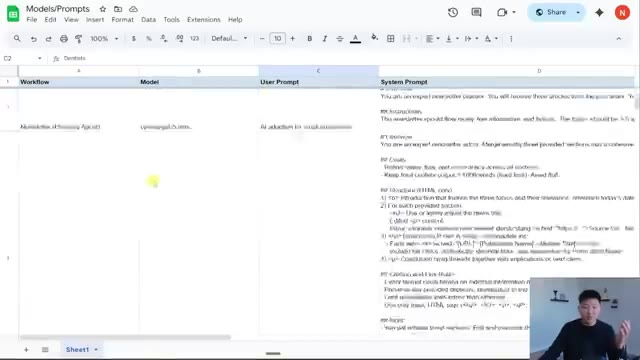
*⏱️ 00:05:00 — Feuille de calcul Google Sheets ("Models/Prompts") contenant des colonnes Workflow, Model, User Prompt et System Prompt.*

*⏱️ 00:05:05 — Retour à l'interface n8n montrant à nouveau le workflow de synchronisation de base de données.*

---

### ⏱️ `[00:05:10 - 00:05:33]` | Segment #11

**🔊 Audio (Transcription Intégrale Mot pour Mot en Français) :**
> Nous obtenions chaque jour des lignes de notre table de bout en bout. Nous effacions l'intégralité du Google Sheet, puis nous réécrivions toutes les lignes d'origine dans le Google Sheet. Et ainsi, les deux bases de données sont toujours synchronisées. Et ensuite, même chose, disons que vous voulez que Google Sheets soit votre interface. Vous pourriez faire cela ici, où vous supprimez les lignes de la table de données de bout en bout. Vous obtenez des lignes du Google Sheet, puis vous les remettez dans la table de données et elles correspondront toujours.

**👁️ Analyse Visuelle d'Écran (gemini-3.5-flash-lite) :**
**Interface & Outils** : Interface web d'un outil d'automatisation de type n8n.

**Contenu textuel & Code** : Workflow composé de nœuds : Schedule Trigger2, Get row(s), Clear sheet, et Append row in sheet (pour le premier scénario), suivis d'un second scénario en bas avec Delete row(s), Get row(s) in sheet, et Insert row.

**Action / Démonstration** : Présentation et explication visuelle du processus de synchronisation des données par effacement et réécriture dans Google Sheets.

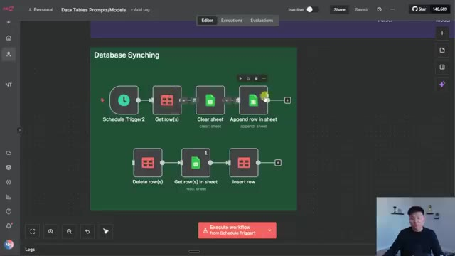
*⏱️ 00:05:16 — Capture d'écran montrant un diagramme de workflow d'automatisation illustrant la synchronisation d'une base de données avec Google Sheets.*

---

### ⏱️ `[00:05:33 - 00:05:54]` | Segment #12

**🔊 Audio (Transcription Intégrale Mot pour Mot en Français) :**
> Et c'est effectivement une limitation en ce moment de ces tableaux de données finaux, c'est qu'ils ne sont pas formidables pour une interface utilisateur, car il est difficile de faire des choses comme je ne pourrais pas copier toutes ces lignes et les coller. Ou dans nos colonnes, nous n'avons que ces quatre types de variables. Ce serait vraiment bien si nous avions des menus déroulants ou des sortes de pilules, car le problème avec le modèle, c'est qu'il faudrait taper ceci exactement de la bonne manière à chaque fois.

**👁️ Analyse Visuelle d'Écran (gemini-3.5-flash-lite) :**
**Interface & Outils** : Application web de gestion de données et d'agents IA (interface utilisateur sous forme de tableau).

**Contenu textuel & Code** : Un tableau de données avec des colonnes telles que id, Workflow (Research Agent, Newsletter Planning/Editor Agent), Model (anthropic/claude-3.7-sonnet, openai/gpt-5-mini), UserPrompt, SystemPrompt et createdAt.

**Action / Démonstration** : Présentation et explication visuelle des tableaux de données finaux et de leurs limitations d'interface utilisateur par le présentateur.

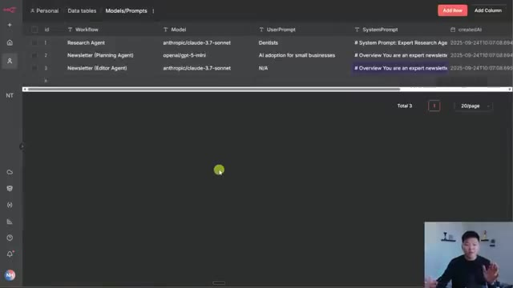
*⏱️ 00:05:38 — Capture d'écran montrant l'interface d'un tableau de données (Data tables) affichant des modèles et des prompts d'agents IA, avec le présentateur visible en incrustation vidéo dans le coin inférieur droit.*

---

### ⏱️ `[00:05:54 - 00:06:12]` | Segment #13

**🔊 Audio (Transcription Intégrale Mot pour Mot en Français) :**
> Plutôt que dans Google Sheets, vous pouvez voir que pour le modèle, j'ai fait un petit menu déroulant. L'utilisateur pourra donc choisir parmi ces modèles et nous les avons déjà pour ainsi dire codés en dur. Je n'ai donc aucune chance de faire de faute d'orthographe, car tout ce que j'aurais à faire, c'est de les inverser comme ça. Mais bref, je voulais juste vous montrer comment vous pourriez utiliser cela et en quoi cela pourrait être bénéfique pour vous et vos agents.

**👁️ Analyse Visuelle d'Écran (gemini-3.5-flash-lite) :**
**Interface & Outils** : Google Sheets, interface de workflow d'automatisation (n8n).

**Contenu textuel & Code** : Noms de modèles d'IA (openai/gpt-4o-mini, openai/gpt-4o, etc.) et diagramme de flux de données (Schedule Trigger, Get row(s), Clear sheet, Append row in sheet).

**Action / Démonstration** : Présentation de la configuration des modèles dans un tableau et de la synchronisation de base de données via un workflow d'automatisation.

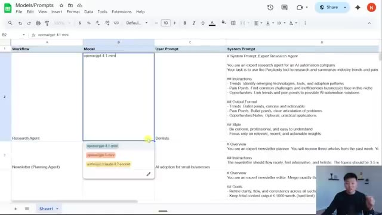
*⏱️ 00:05:58 — Capture d'écran d'un fichier Google Sheets intitulé "Models/Prompts" avec un menu déroulant affichant différents modèles d'IA.*

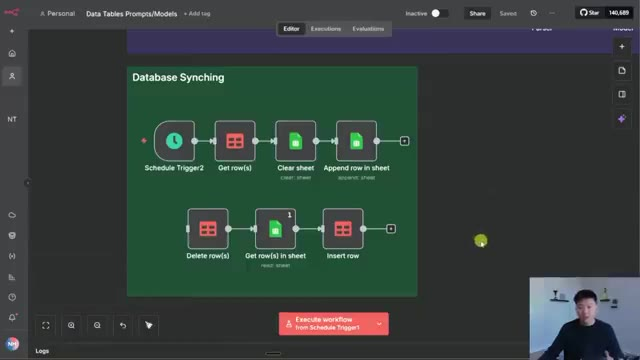
*⏱️ 00:06:08 — Capture d'écran d'un outil d'automatisation de type n8n ou workflow affichant le diagramme "Database Synching" avec des nœuds connectés.*

---

### ⏱️ `[00:06:12 - 00:06:40]` | Segment #14

**🔊 Audio (Transcription Intégrale Mot pour Mot en Français) :**
> Très bien, donc en passant à l'astuce numéro deux, nous avons l'utilisation de tables de données pour stocker les journaux de votre agent et les actions de votre agent. Il est super important de stocker ces informations lorsque vous avez un flux de travail en production, car vous devez voir à quelle fréquence il échoue, pourquoi il échoue, et aussi ce qu'il fait bien afin de pouvoir constamment ajuster le système pour qu'il s'améliore de plus en plus. Parce que vous remarquerez qu'une fois que vous commencez à enregistrer vos exécutions, vous identifierez des tendances, et les tendances sont magnifiques parce que cela signifie que vous faites quelque chose de bien ou cela signifie que vous pouvez construire une barrière de protection contre ces tendances de cas limites.

**👁️ Analyse Visuelle d'Écran (gemini-3.5-flash-lite) :**
**Interface & Outils** : Interface web de conception de flux de travail (type n8n ou plateforme d'automatisation similaire).

**Contenu textuel & Code** : Nœuds connectés représentant divers agents (Email Agent, Google Drive Agent, Creative Agent, Posting Agent, Web Agent, etc.) et des déclencheurs.

**Action / Démonstration** : Visualisation et explication de la structure globale d'un workflow complexe en production.

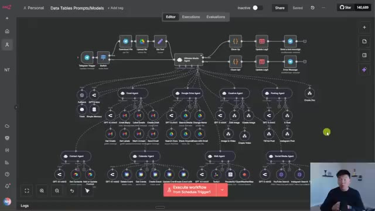
*⏱️ 00:06:19 — Capture d'écran montrant un diagramme de workflow complexe pour un agent IA multi-agents, avec le présentateur en médaillon dans le coin inférieur droit.*

---

### ⏱️ `[00:06:40 - 00:07:03]` | Segment #15

**🔊 Audio (Transcription Intégrale Mot pour Mot en Français) :**
> Donc vous l'avez probablement vu dans quelques-unes de mes autres vidéos, ça ne doit pas nécessairement être un agent aussi grand et complexe, mais dans quelques vidéos j'ai eu l'agent enregistrant toutes ses actions dans une feuille Google Sheet. Donc juste pour vous montrer un exemple rapide de cet Ultimate Media Agent, si vous voulez voir cette vidéo, je vais la marquer juste ici. Nous enregistrions ses exécutions dans cette feuille avec l'horodatage, le flux de travail, l'entrée, la sortie, les actions, les jetons, et le total des jetons qu'il a utilisés.

**👁️ Analyse Visuelle d'Écran (gemini-3.5-flash-lite) :**
**Interface & Outils** : Interface de workflow d'automatisation et Google Sheets

**Contenu textuel & Code** : Nœuds de workflow, connexions d'agents spécialisés (Email, Google Drive, Creative, Social Media), et lignes de logs dans Google Sheets (Timestamp, Workflow, Input, Output, Actions)

**Action / Démonstration** : Présentation d'une architecture d'agent complexe puis passage à l'exemple d'un agent qui enregistre toutes ses actions dans une feuille Google Sheet.

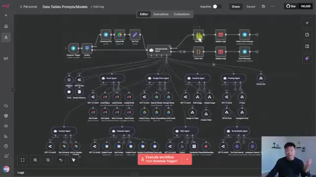
*⏱️ 00:06:46 — Vue d'ensemble d'un diagramme de workflow complexe d'agent IA sur une interface graphique avec de nombreux nœuds interconnectés.*

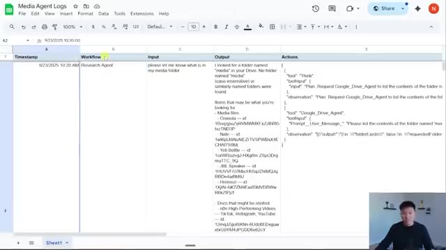
*⏱️ 00:06:57 — Une feuille Google Sheet intitulée 'Media Agent Logs' affichant les détails des actions et des retours d'un agent IA.*

---

### ⏱️ `[00:07:03 - 00:07:25]` | Segment #16

**🔊 Audio (Transcription Intégrale Mot pour Mot en Français) :**
> Et donc tout ce que j'aurais à faire, c'est de créer une table de données NNN avec exactement ces mêmes colonnes ici, comme vous pouvez le voir. Et maintenant, nous pouvons simplement la connecter dans notre agent média ici et, littéralement, remplacer les nœuds Google Sheets par un nœud de table de données. La clé ici, c'est qu'à l'intérieur de l'agent lui-même, vous activez cette option. Donc, si vous ne la voyez pas, vous cliquez sur "ajouter une option", puis sur "retourner les étapes intermédiaires".

**👁️ Analyse Visuelle d'Écran (gemini-3.5-flash-lite) :**
**Interface & Outils** : n8n (Interface de conception de workflows d'automatisation)

**Contenu textuel & Code** : Nœuds de workflow, paramètres d'agent IA, tables de données et logs d'exécution.

**Action / Démonstration** : Navigation entre les tables de données et les workflows pour connecter les nœuds d'agent média.

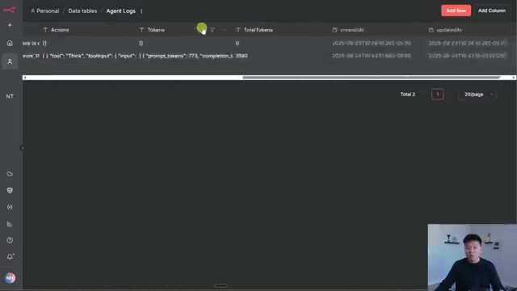
*⏱️ 00:07:09 — Vue d'un tableau de données (Agent Logs) montrant les actions et les tokens.*

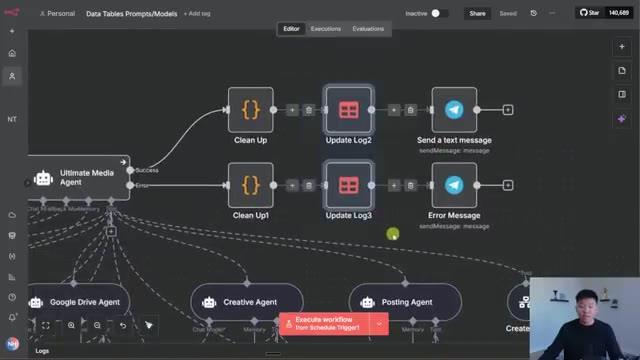
*⏱️ 00:07:14 — Vue d'ensemble d'un workflow d'automatisation avec divers nœuds connectés (Clean Up, Update Log, Telegram).*

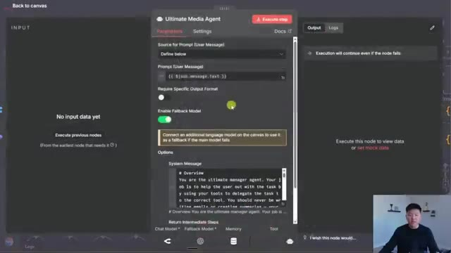
*⏱️ 00:07:19 — Panneau de configuration du nœud 'Ultimate Media Agent' affichant les paramètres et les messages système.*

---

### ⏱️ `[00:07:25 - 00:07:45]` | Segment #17

**🔊 Audio (Transcription Intégrale Mot pour Mot en Français) :**
> Et vous devez vous assurer que c'est bien activé. Et c'est ce qui va permettre à l'agent de produire, non seulement un résultat, mais aussi des étapes intermédiaires. Alors, faisons un essai. Nous allons voir les journaux arriver dans notre tableau de données NNN. Et je vais aussi vous montrer ce que je veux dire par les étapes intermédiaires ici. D'accord, donc l'agent est à notre écoute. Je vais ouvrir Telegram et lui demander de créer un événement dans le calendrier pour aujourd'hui à 15 heures.

**👁️ Analyse Visuelle d'Écran (gemini-3.5-flash-lite) :**
**Interface & Outils** : n8n (interface de workflow d'automatisation IA)

**Contenu textuel & Code** : Configuration des paramètres de l'agent, options "System Message", "Return Intermediate Steps" activé, et interface de chat simulant Telegram.

**Action / Démonstration** : Configuration et activation de l'option pour retourner les étapes intermédiaires de l'agent IA, puis passage à l'exécution du workflow.

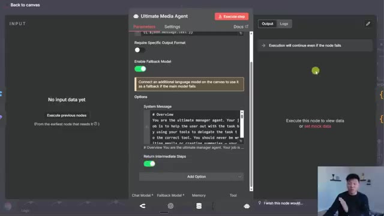
*⏱️ 00:07:30 — Vue rapprochée des paramètres de l'agent (Ultimate Media Agent) avec le bouton "Return Intermediate Steps" activé en vert.*

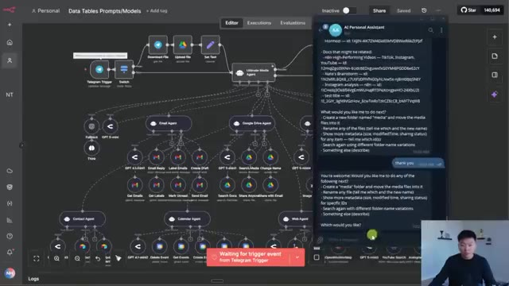
*⏱️ 00:07:40 — Vue d'ensemble du workflow n8n avec un panneau de chat Telegram actif sur la droite montrant les interactions avec l'assistant.*

---

### ⏱️ `[00:07:45 - 00:08:04]` | Segment #18

**🔊 Audio (Transcription Intégrale Mot pour Mot en Français) :**
> pour déjeuner avec Michael Scott. Donc voilà. Ça va appeler plusieurs outils différents. Ça doit appeler l'agent des contacts pour obtenir les informations de Michael Scott. Et ensuite, ça va appeler l'agent du calendrier pour créer cet événement. Et nous pourrons voir tout cela dans les journaux des agents. Je reviendrai donc vers vous une fois que cet agent aura terminé sa tâche. Bon, voilà. Vous pouvez donc voir qu'il vient de terminer.

**👁️ Analyse Visuelle d'Écran (gemini-3.5-flash-lite) :**
**Interface & Outils** : Interface web de gestion de workflow d'agents IA (style tableau de bord no-code).

**Contenu textuel & Code** : Nœuds de workflow représentant des agents (Contact Agent, Calendar Agent) et des outils associés (Get Contacts, Create Event, Get Events, etc.) ainsi qu'une notification 'Executing workflow from Telegram Trigger'.

**Action / Démonstration** : Présentation visuelle du flux d'automatisation montrant comment l'agent des contacts et l'agent du calendrier sont reliés dans le workflow.

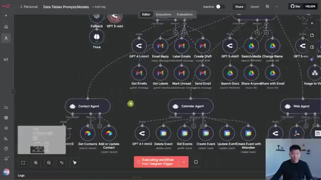
*⏱️ 00:07:50 — Vue d'un diagramme de workflow interactif montrant différents agents IA connectés, incluant 'Contact Agent' et 'Calendar Agent', avec une notification d'exécution en bas.*

---

### ⏱️ `[00:08:04 - 00:08:25]` | Segment #19

**🔊 Audio (Transcription Intégrale Mot pour Mot en Français) :**
> Attends, je bois une gorgée d'eau. Et si je bascule sur mon Google Agenda, vous pouvez voir que nous avons un déjeuner avec Michael Scott et nous avons invité son véritable e-mail dans notre base de données de contacts. Et ensuite, si nous allons dans notre table de données n8n et que je clique sur actualiser, nous devrions voir un nouvel enregistrement avec un horodatage juste ici. Nous avons notre flux de travail, nous avons les entrées, nous avons la sortie, et nous avons aussi les actions, les jetons, le nombre total de jetons que c'était.

**👁️ Analyse Visuelle d'Écran (gemini-3.5-flash-lite) :**
**Interface & Outils** : Google Calendar (Google Agenda) et webcam du présentateur.

**Contenu textuel & Code** : Interface de Google Agenda avec les détails d'un événement "Lunch with Michael Scott" et une adresse e-mail visible.

**Action / Démonstration** : Le présentateur montre son agenda Google pour illustrer l'invitation d'un contact.

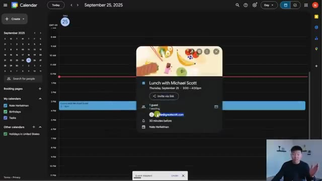
*⏱️ 00:08:09 — Capture d'écran de Google Agenda montrant un événement de déjeuner avec Michael Scott et son adresse e-mail.*

---

### ⏱️ `[00:08:25 - 00:08:46]` | Segment #20

**🔊 Audio (Transcription Intégrale Mot pour Mot en Français) :**
> Et oui, hier j'ai fait un test avec exactement la même entrée. Mais bref, ce que nous avons ici, ce sont les actions. Donc nous pouvons réellement voir chaque outil qu'il a appelé. Laissez-moi juste agrandir ceci. Donc nous pouvons voir que la première chose qu'il a faite a été d'appeler son outil de réflexion. Et c'est là qu'il est fondamentalement capable d'écrire quelques informations sur ce qu'il devrait faire ensuite. Après avoir utilisé son outil de réflexion et élaboré un plan d'action, il a décidé d'utiliser son outil d'agent de contact.

**👁️ Analyse Visuelle d'Écran (gemini-3.5-flash-lite) :**
**Interface & Outils** : Interface web de journalisation d'agent (Agent Logs) avec un tableau de données.

**Contenu textuel & Code** : Données JSON affichant des métadonnées d'exécution d'outils et des observations textuelles (ex: confirmation de création d'événement dans un calendrier).

**Action / Démonstration** : Le présentateur survole ou agrandit une ligne du tableau pour inspecter le détail des actions de l'agent.

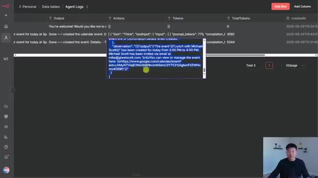
*⏱️ 00:08:31 — Capture d'écran montrant une interface de type tableur ou journal d'agent (Agent Logs) affichant les détails des actions et sorties d'un agent IA, avec une infobulle contenant du code JSON au format texte.*

---

### ⏱️ `[00:08:46 - 00:09:07]` | Segment #21

**🔊 Audio (Transcription Intégrale Mot pour Mot en Français) :**
> Et nous pouvons effectivement voir l'entrée qu'il a envoyée à l'outil et la sortie qu'il a obtenue, qui était les coordonnées de Michael Scott, à savoir ceci. Voici son email juste là. Nous pouvons voir qu'il a ensuite rappelé l'outil de réflexion parce qu'il s'est dit, bon, maintenant j'ai l'email, qu'est-ce que je fais ? Et puis après cela, il a décidé, d'accord, je dois utiliser l'agent calendrier. Et dans l'agent calendrier, nous avons pu créer cet événement, déjeuner avec Michael Scott à 15 heures.

**👁️ Analyse Visuelle d'Écran (gemini-3.5-flash-lite) :**
**Interface & Outils** : Application web de tableau de bord pour les journaux d'agent IA (Agent Logs).

**Contenu textuel & Code** : Code JSON contenant les appels d'outils, les entrées ('toolInput') et les observations ('observation') concernant la recherche des coordonnées de Michael Scott et la création d'un événement de calendrier.

**Action / Démonstration** : Le présentateur survole et examine les journaux d'exécution et les entrées/sorties JSON des différents agents.

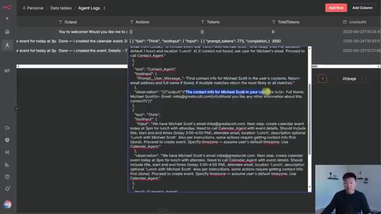
*⏱️ 00:08:51 — Tableau de bord affichant les journaux d'activité d'un agent IA avec un volet de détails en JSON montrant les entrées et sorties des outils de contact et de calendrier.*

---

### ⏱️ `[00:09:07 - 00:09:32]` | Segment #22

**🔊 Audio (Transcription Intégrale Mot pour Mot en Français) :**
> Et donc normalement vos agents ne vont pas sortir toutes ces informations. Nous sommes également capables de voir les informations sur les jetons et quel modèle de prompt a été utilisé. Et nous sommes capables de faire tout cela parce qu'encore une fois, dans l'agent, nous avons activé le retour des étapes intermédiaires. Et c'est là que nous obtenons non seulement cette sortie ici même, mais nous obtenons toutes ces étapes intermédiaires. Et ce sont les actions que nous venions de regarder ensemble dans ce tableau de données de bout en bout où il appelle différents outils et nous dit combien de jetons chaque outil a utilisés.

**👁️ Analyse Visuelle d'Écran (gemini-3.5-flash-lite) :**
**Interface & Outils** : Interface web de type constructeur de workflow (n8n ou similaire) et tableau de bord de logs.

**Contenu textuel & Code** : Paramètres d'agent IA, messages système, options de retour des étapes intermédiaires (Return Intermediate Steps) et statistiques d'utilisation des jetons (prompt_tokens, completion_tokens, model_name).
[DESC_IMAGE_3] Explication de la configuration de l'agent pour retourner les étapes intermédiaires et analyse des informations de jetons et des modèles de prompt.

**Action / Démonstration** : Explications face caméra et démonstration conceptuelle.

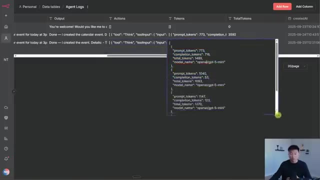
*⏱️ 00:09:13 — Vue d'un tableau de bord de logs d'agent montrant les détails des jetons et des modèles utilisés (comme gpt-4o-mini).*

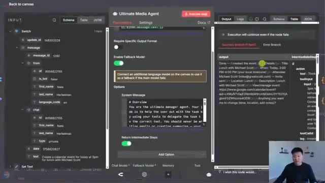
*⏱️ 00:09:20 — Interface d'un constructeur de workflow montrant les paramètres de l'agent (Ultimate Media Agent) avec l'option "Return Intermediate Steps" activée.*

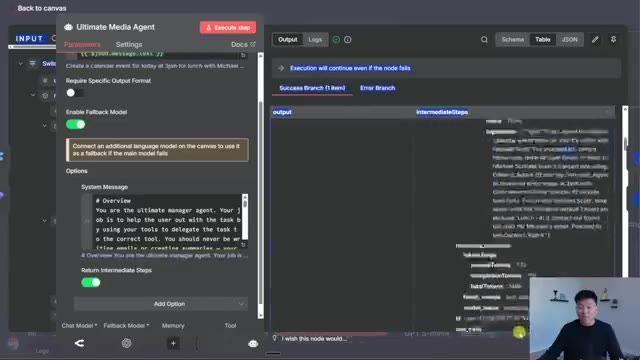
*⏱️ 00:09:26 — Vue de l'interface de workflow affichant dans le panneau de droite les étapes intermédiaires et les détails d'utilisation des jetons.*

---

### ⏱️ `[00:09:32 - 00:09:52]` | Segment #23

**🔊 Audio (Transcription Intégrale Mot pour Mot en Français) :**
> C'est une petite astuce sympa. Elle est plutôt bien cachée. Donc ça m'a pris un certain temps pour la trouver. Mais une fois que je l'ai fait, ça a tout changé parce que maintenant nous avons des enregistrements de tout ce que l'agent fait et nous sommes capables d'ajuster les prompts, d'ajuster les outils et d'améliorer les systèmes de plus en plus au fil du temps. Nous avons bien le nœud de code ici qui nettoie fondamentalement les choses et qui nous aide avec notre nombre de jetons. Mais j'ai une vidéo complète où je me suis plongé dans la façon dont j'ai réellement fait cela.

**👁️ Analyse Visuelle d'Écran (gemini-3.5-flash-lite) :**
**Interface & Outils** : Interface graphique de type n8n ou plateforme similaire de gestion de workflows et d'agents IA.

**Contenu textuel & Code** : Nœuds de workflow, blocs de code JSON, métriques de tokens d'IA, et tables de données de journalisation.

**Action / Démonstration** : Navigation et explication des enregistrements (logs) d'exécution des agents et des structures de flux de travail.

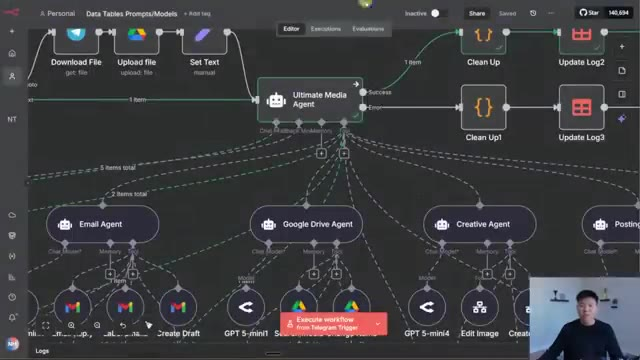
*⏱️ 00:09:37 — Vue d'ensemble d'un workflow complexe d'automatisation d'agents IA montrant des nœuds interconnectés comme Ultimate Media Agent, Email Agent et Google Drive Agent.*

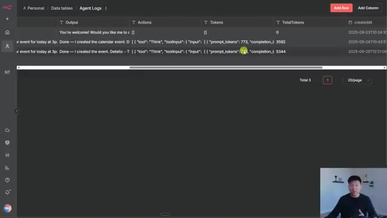
*⏱️ 00:09:42 — Tableau de bord affichant les logs et enregistrements des agents IA (Agent Logs) avec les colonnes Output, Actions, Tokens et createdAt.*

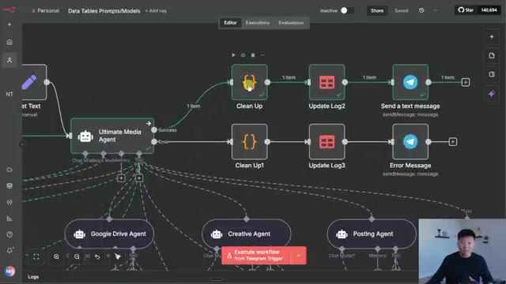
*⏱️ 00:09:47 — Gros plan sur la section supérieure du workflow montrant les étapes de nettoyage (Clean Up), de mise à jour des logs (Update Log) et d'envoi de messages Telegram.*

---

### ⏱️ `[00:09:52 - 00:10:10]` | Segment #24

**🔊 Audio (Transcription Intégrale Mot pour Mot en Français) :**
> Si vous voulez regarder ça, je vais le marquer juste ici. Aussi, un tout petit bonus de plus pour vous sur la même idée de suivre les actions de vos agents, vous pouvez également suivre toutes vos erreurs dans une table de données n8n également. Parce que ప్రస్తుతం, j'ai mon gestionnaire d'erreurs qui va vers une feuille Google Sheets qui ressemble à ça. Ignorez ces erreurs, il se passait quelque chose avec le modèle de chat ce jour-là.

**👁️ Analyse Visuelle d'Écran (gemini-3.5-flash-lite) :**
**Interface & Outils** : Application web n8n (éditeur de workflow)

**Contenu textuel & Code** : Nœuds 'Error Trigger' et 'Log Errors' (append: sheet) connectés au sein d'un workflow nommé 'ERROR Handler'.

**Action / Démonstration** : Présentation visuelle du workflow de gestion et de journalisation des erreurs dans n8n.

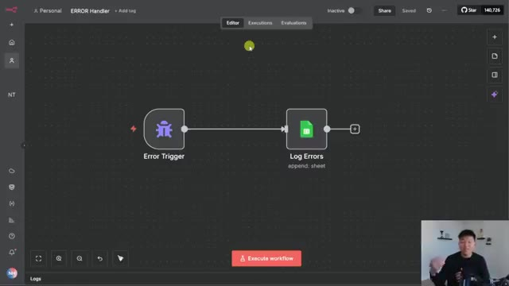
*⏱️ 00:09:57 — Interface d'un workflow n8n montrant un gestionnaire d'erreurs avec un nœud Error Trigger relié à un nœud de journalisation Log Errors.*

---

### ⏱️ `[00:10:10 - 00:10:29]` | Segment #25

**🔊 Audio (Transcription Intégrale Mot pour Mot en Français) :**
> Mais de toute façon, maintenant au lieu d'aller sur Google Sheets, je peux avoir une table de données juste ici qui s'appelle mon journal d'erreurs. Et je pourrais alors voir à travers tous mes flux de travail dans n8n même, lesquels rencontrent des erreurs et à quelle heure et ce qui se passe. Et tout ce que j'aurais à faire est de créer une nouvelle table de données. Donc j'en créerais une nouvelle. Je l'appellerais un journal d'erreurs. Et ensuite, je m'assurerais simplement qu'elle a les mêmes colonnes que mon journal d'erreurs actuel.

**👁️ Analyse Visuelle d'Écran (gemini-3.5-flash-lite) :**
**Interface & Outils** : n8n (Interface web d'automatisation)

**Contenu textuel & Code** : Tableau de bord répertoriant les tables de données ("Data tables") disponibles dans le système : Eval, Agent Logs, Models/Prompts, avec leurs métadonnées (taille en Mo, nombre de colonnes, date de mise à jour).

**Action / Démonstration** : Le présentateur présente l'interface des tables de données intégrées dans n8n pour le suivi des journaux et des erreurs.

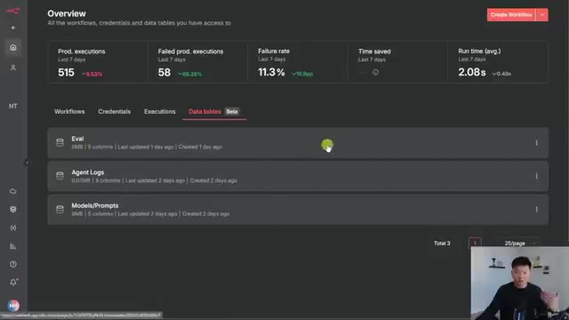
*⏱️ 00:10:15 — Capture d'écran montrant l'interface d'administration de n8n avec l'onglet "Data tables (Beta)" ouvert, affichant plusieurs tables de données dont "Eval", "Agent Logs" et "Models/Prompts".*

---

### ⏱️ `[00:10:29 - 00:10:51]` | Segment #26

**🔊 Audio (Transcription Intégrale Mot pour Mot en Français) :**
> Donc date, heure, message d'erreur, nœud d'erreur. J'ajouterais probablement aussi un au début pour savoir de quel flux de travail il provient réellement. Nous pourrions même en ajouter un nouveau ici pour une table de données et nous y écririons des données. Ainsi, nos erreurs sont enregistrées à deux endroits et nous pourrions également ajouter une notification Slack ou une notification Telegram, tout ce que nous voulons. Ensuite, dans votre flux de travail actif réel, vous iriez simplement ici dans vos paramètres et vous changeriez le flux de travail d'erreur.

**👁️ Analyse Visuelle d'Écran (gemini-3.5-flash-lite) :**
**Interface & Outils** : n8n (outil d'automatisation de workflows).

**Contenu textuel & Code** : Workflow nommé 'ERROR Handler' affichant un déclencheur d'erreur relié à une action Google Sheets pour consigner les erreurs.

**Action / Démonstration** : Le présentateur explique la configuration d'un sous-flux de gestion des erreurs pour enregistrer les données d'erreur dans une feuille de calcul.

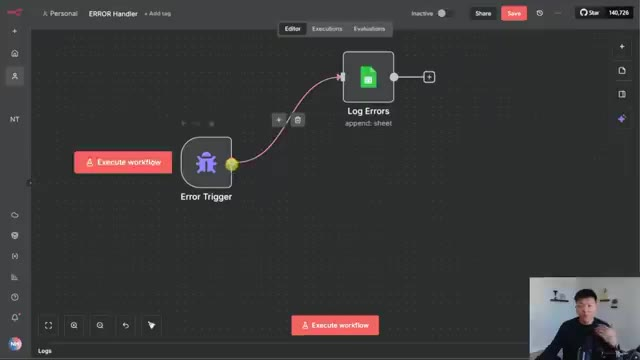
*⏱️ 00:10:34 — Interface d'un éditeur de workflow avec deux nœuds connectés : 'Error Trigger' et 'Log Errors'.*

---

### ⏱️ `[00:10:51 - 00:11:14]` | Segment #27

**🔊 Audio (Transcription Intégrale Mot pour Mot en Français) :**
> ou si vous en avez déjà un et que vous êtes simplement en train de le modifier, alors vous pouvez garder tout à l'identique. Mais maintenant, nous avons un flux de travail d'erreur connecté de sorte que chaque fois que ce flux de travail actif, mot-clé flux de travail actif, rencontre des erreurs, il enverra automatiquement des données à votre Google Sheet ou à votre journal d'erreurs nouvellement créé dans NNN. Et très rapidement, juste pour vous montrer comment vous pouvez accéder à vos variables de flux de travail, vous pouvez voir sur ce côté gauche, nous avons des variables dans le contexte.

**👁️ Analyse Visuelle d'Écran (gemini-3.5-flash-lite) :**
**Interface & Outils** : n8n (éditeur de workflow) et Google Sheets

**Contenu textuel & Code** : Configuration du paramètre "Error Workflow" dans n8n et tableau de logs d'erreurs répertoriant les messages d'erreur ("Cannot read properties of undefined").

**Action / Démonstration** : Configuration d'un flux de gestion d'erreurs connecté pour notifier en cas de dysfonctionnement du workflow principal.

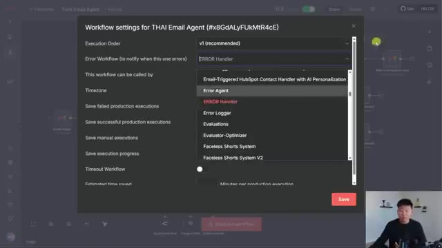
*⏱️ 00:10:56 — Paramètres du workflow n8n (Workflow settings) permettant de configurer un gestionnaire d'erreurs (Error Workflow).*

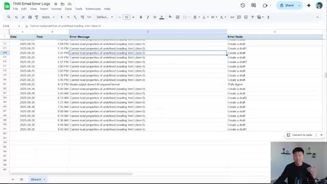
*⏱️ 00:11:02 — Feuille de calcul Google Sheets affichant l'historique des journaux d'erreurs des e-mails (THAI Email Error Logs) avec les messages d'erreur et les nœuds concernés.*

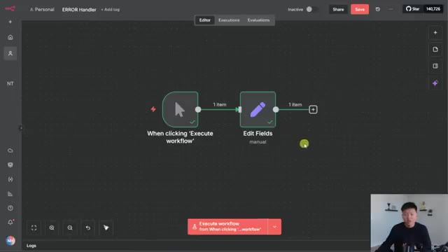
*⏱️ 00:11:08 — Interface de l'éditeur de workflow n8n montrant un flux de gestion des erreurs (ERROR Handler) avec un déclencheur et un nœud de modification de champs.*

---

### ⏱️ `[00:11:14 - 00:11:32]` | Segment #28

**🔊 Audio (Transcription Intégrale Mot pour Mot en Français) :**
> Donc nous avons maintenant, nous avons aujourd'hui, nous avons certaines variables globales. Vous pouvez également obtenir l'ID d'exécution et vous pouvez obtenir l'ID et le nom du workflow également. C'est donc ainsi que vous pourriez inclure certaines de ces choses dans votre journal d'erreurs pour obtenir plus de détails. Très bien, passons au dernier "hack", qui n'est vraiment pas le troisième. C'est plutôt le quatrième ou le cinquième. Exécuter des évaluations sur vos agents IA avec les tables de données NNN.

**👁️ Analyse Visuelle d'Écran (gemini-3.5-flash-lite) :**
**Interface & Outils** : n8n (éditeur de workflows d'automatisation)

**Contenu textuel & Code** : Variables globales n8n : $now, $today, $vars, $execution (id, mode, resumeUrl), et $workflow (id, name, active).

**Action / Démonstration** : Exploration des variables globales et du contexte d'exécution disponibles dans le panneau d'entrée de n8n pour les intégrer dans un journal d'erreurs.

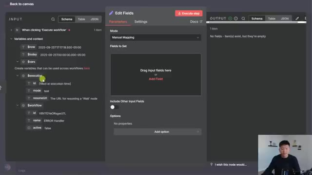
*⏱️ 00:11:18 — L'interface de n8n montrant le volet d'entrée avec les variables globales et le contexte d'exécution ($execution, $workflow).*

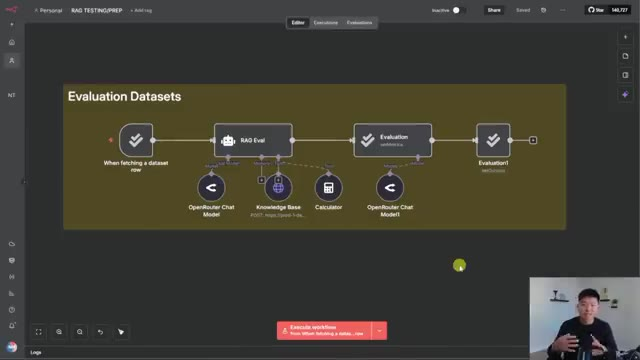
*⏱️ 00:11:28 — Le canevas principal du workflow n8n intitulé "RAG TESTING/PREP" avec les différents nœuds connectés (RAG Eval, Evaluation, Knowledge Base, OpenRouter Chat Model).*

---

### ⏱️ `[00:11:33 - 00:11:52]` | Segment #29

**🔊 Audio (Transcription Intégrale Mot pour Mot en Français) :**
> Donc, si vous n'avez jamais utilisé la fonction d'évaluation de NNN, ce qu'elle fait, c'est qu'elle vous permet de faire passer une tonne d'ensembles de données à travers vos agents. Vous pouvez lui donner l'exemple d'entrée et la sortie attendue, et l'évaluation déterminera fondamentalement à quel point votre flux de travail est bon. Et vous êtes capable de suivre au fil du temps avec différentes variables de différents prompts, de différents modèles, de différents outils, tout ce genre de choses.

**👁️ Analyse Visuelle d'Écran (gemini-3.5-flash-lite) :**
**Interface & Outils** : Interface web de test et d'évaluation RAG / plateforme de gestion d'agents IA.

**Contenu textuel & Code** : Tableau de données d'exécution avec les colonnes Run, Run at, Status, completionTokens, promptTokens, totalTokens, executionTime, et Correctness, ainsi qu'un graphique de suivi.

**Action / Démonstration** : Présentation de la fonctionnalité d'évaluation (Evaluations) montrant les résultats d'un ensemble de tests passés à travers les agents.

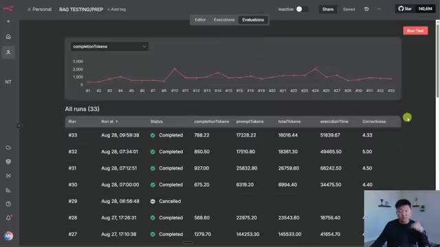
*⏱️ 00:11:38 — Capture d'écran montrant l'interface d'évaluation de la plateforme RAG (RAG TESTING/PREP) avec un graphique des jetons de complétion et un tableau récapitulatif des 33 exécutions (runs) avec leurs métriques (tokens, temps d'exécution, score de correction).*

---

### ⏱️ `[00:11:52 - 00:12:11]` | Segment #30

**🔊 Audio (Transcription Intégrale Mot pour Mot en Français) :**
> Et ensuite, vous êtes capable de suivre vos scores au fil du temps et de voir si vos flux de travail s'améliorent réellement ou si vous les détériorez. J'ai donc fait une vidéo complète sur les évaluations. Si vous ne l'avez pas vue, je vais la taguer juste ici. Je tague tellement de vidéos, mais ouais. Quoi qu'il en soit, en général, vous connecteriez des Google Sheets et vous feriez passer l'ensemble de données dans le flux de travail, puis cela l'écrirait de nouveau dans un Google Sheet. Ça ressemblerait à ça.

**👁️ Analyse Visuelle d'Écran (gemini-3.5-flash-lite) :**
**Interface & Outils** : Application web de gestion de workflows et d'évaluations IA (type Langflow ou plateforme similaire).

**Contenu textuel & Code** : Graphiques de performance, scores d'évaluation au fil du temps (runs #27 à #33), et diagramme de flux de données pour l'évaluation RAG.
[DESC_IMAGE_2] Le présentateur commente le suivi des scores et la visualisation des performances des flux de travail au fil du temps.

**Action / Démonstration** : Explications face caméra et démonstration conceptuelle.

*⏱️ 00:11:57 — Tableau de bord d'évaluation affichant un graphique de score d'exactitude (Correctness) au fil du temps et un tableau récapitulatif des exécutions (runs) de workflows.*

*⏱️ 00:12:02 — Interface de conception de workflow montrant un diagramme intitulé "Evaluation Datasets" avec plusieurs nœuds interconnectés (RAG Eval, OpenRouter Chat Model, Knowledge Base, Evaluation).*

---

### ⏱️ `[00:12:11 - 00:12:33]` | Segment #31

**🔊 Audio (Transcription Intégrale Mot pour Mot en Français) :**
> Encore une fois, je l'ai dit, vous avez une entrée, une réponse attendue. Vous avez votre réponse réelle que votre système fournit, puis un score de exactitude. Donc ce que j'ai fait, c'est que j'ai créé exactement les mêmes noms de colonnes dans cette table de données NNN, entrée, réponse attendue, réponse réelle et score. Et maintenant, nous pouvons connecter cet ensemble de données NNN à notre agent pour l'évaluation RAG au lieu de passer par une feuille Google Sheet.

**👁️ Analyse Visuelle d'Écran (gemini-3.5-flash-lite) :**
**Interface & Outils** : Google Sheets et interface de plateforme de workflow d'agents IA (type Flowise ou Langflow).

**Contenu textuel & Code** : Tableaux de données de test RAG contenant des questions et réponses attendues sur Tesla.

**Action / Démonstration** : Présentation de la structure de données d'évaluation et du workflow de test RAG.

*⏱️ 00:12:16 — Capture d'écran montrant un tableur Google Sheets intitulé 'RAG Testing Agentic Arena' avec des colonnes Input, Expected Answer, Actual Answer et Correctness.*

*⏱️ 00:12:22 — Interface de gestion de table de données avec des colonnes id, Input, ExpectedAnswer, ActualAnswer, Score et createdAt.*

*⏱️ 00:12:27 — Vue d'un éditeur de workflow visuel intitulé 'Evaluation Datasets' avec des nœuds connectés pour le RAG Eval et l'évaluation.*

---

### ⏱️ `[00:12:33 - 00:12:59]` | Segment #32

**🔊 Audio (Transcription Intégrale Mot pour Mot en Français) :**
> Donc, pour vous montrer comment cela fonctionne et à quoi cela ressemble, je vais exécuter ceci très rapidement, et ça va commencer à traiter cet agent RAG. Et puis, juste ici, se trouve l'étape d'évaluation réelle où il attribue un score de exactitude. Donc, nous extrayons des données d'un ensemble de données NNN ; vous pouvez voir que cela provient de notre table de données appelée eval. Il extrait l'entrée et la réponse attendue. L'agent va maintenant chercher dans sa base de connaissances et il va créer une réponse. Et ensuite, cette étape évalue à quel point la réponse de l'agent est proche de la réponse attendue.

**👁️ Analyse Visuelle d'Écran (gemini-3.5-flash-lite) :**
**Interface & Outils** : Interface web de type n8n ou plateforme d'automatisation de workflow d'agents IA.

**Contenu textuel & Code** : Nœuds de workflow : When fetching a dataset row, RAG Eval, Evaluation, Knowledge Base, OpenRouter Chat Model.

**Action / Démonstration** : Exécution d'un workflow de test d'agent RAG et visualisation des données de datasets extraites.

*⏱️ 00:12:39 — Vue d'ensemble d'un workflow de test d'évaluation RAG en cours d'exécution dans une interface d'automatisation.*

*⏱️ 00:12:46 — Panneau latéral affichant les données d'un tableau de dataset et ses colonnes d'entrées/sorties (Input, ExpectedAnswer).*

*⏱️ 00:12:52 — Retour sur le diagramme de workflow interactif avec les différents nœuds d'IA et d'évaluation connectés.*

---

### ⏱️ `[00:12:59 - 00:13:21]` | Segment #33

**🔊 Audio (Transcription Intégrale Mot pour Mot en Français) :**
> Wouah. Donc vous pouvez voir que l'agent a appelé sa base de connaissances trois fois et qu'il a appelé l'outil de calcul deux fois. Donc j'espère qu'il nous prépare une bonne réponse. On passe à cette étape d'évaluation où maintenant vous pouvez voir que c'est la réponse attendue et c'est bon. Je suis passé à la suivante. Je vais revenir à l'exécution et vous montrer ce que je voulais dire par là. Donc voici la réponse attendue pour cette première exécution, qui était que le résultat opérationnel de Tesla a diminué de 42 %.

**👁️ Analyse Visuelle d'Écran (gemini-3.5-flash-lite) :**
**Interface & Outils** : Interface web d'automatisation de workflow (type n8n)

**Contenu textuel & Code** : Expressions de configuration pour les métriques d'évaluation et données de test RAG

**Action / Démonstration** : Visualisation et configuration du nœud d'évaluation de la réponse attendue de l'agent

*⏱️ 00:13:05 — Vue d'ensemble du workflow d'évaluation RAG affichant les différents nœuds (OpenRouter Chat Model, Knowledge Base, Calculator, Evaluation) avec un indicateur d'exécution en cours.*

*⏱️ 00:13:10 — Interface de configuration du nœud d'évaluation montrant les paramètres de métriques (Correctness AI-based), Expected Answer et Actual Answer.*

---

### ⏱️ `[00:13:21 - 00:13:42]` | Segment #34

**🔊 Audio (Transcription Intégrale Mot pour Mot en Français) :**
> Et ensuite, si nous allons à la réponse réelle, nous avons : le résultat opérationnel de Tesla a baissé de 42 %. Et donc, il examine celles-ci, il compare à quel point elles sont similaires, et il génère un score de exactitude de cinq. Et si nous allons dans notre table de données finale, vous pouvez voir que si je rafraîchis, il va commencer à réécrire les résultats juste ici. Donc nous pouvons réellement évaluer à quel point il s'en sort. Donc en ce moment, il parcourt le deuxième ensemble d'évaluations et il mettra à jour la ligne juste ici.

**👁️ Analyse Visuelle d'Écran (gemini-3.5-flash-lite) :**
**Interface & Outils** : Interface web d'automatisation (type n8n ou plateforme RAG personnalisée).

**Contenu textuel & Code** : Données textuelles d'évaluation sur Tesla et tableau de scores d'exactitude.

**Action / Démonstration** : Navigation et présentation des résultats d'évaluation RAG dans le tableau de données.

*⏱️ 00:13:26 — Interface d'évaluation RAG affichant les données de sortie JSON avec les détails sur les résultats opérationnels de Tesla.*

*⏱️ 00:13:37 — Table de données finale montrant les colonnes Input, ExpectedAnswer, ActualAnswer et Score pour l'évaluation.*

---

### ⏱️ `[00:13:43 - 00:14:01]` | Segment #35

**🔊 Audio (Transcription Intégrale Mot pour Mot en Français) :**
> Donc si je rafraîchis celui-ci rapidement, nous devrions voir que le deuxième est terminé et cette fois il a obtenu un quatre. Donc mon point de vue, c'est que si vous voulez vraiment que vos agents s'améliorent de plus en plus avec le temps ou que vos flux de travail s'améliorent de plus en plus avec le temps, vous devez exécuter des évaluations. Mais la clé, c'est que lorsque vous exécutez vos évaluations, vous devez réellement connaître l'exécution 33. Qu'ai-je fait dans l'exécution 33 ?

**👁️ Analyse Visuelle d'Écran (gemini-3.5-flash-lite) :**
**Interface & Outils** : Interface web d'automatisation et d'évaluation (style n8n ou plateforme similaire de gestion d'agents IA)

**Contenu textuel & Code** : Tableaux de données d'évaluation (entrées, réponses, scores) et diagramme de flux d'évaluation RAG

**Action / Démonstration** : Présentation des résultats d'évaluation des agents et des scores obtenus dans le tableau de bord

*⏱️ 00:13:47 — Image montrant un tableau de données d'évaluation avec des scores, des entrées et des réponses attendues ou réelles.*

*⏱️ 00:13:52 — Image montrant un éditeur de flux de travail (workflow) avec des nœuds connectés pour "RAG Eval", "Evaluation" et des outils associés.*

---

### ⏱️ `[00:14:01 - 00:14:23]` | Segment #36

**🔊 Audio (Transcription Intégrale Mot pour Mot en Français) :**
> Quel modèle de chat ai-je utilisé ? Quel prompt ai-je utilisé ? De quels outils disposais-je ? Et à chaque fois que vous faites un nouvel essai, ne changez qu'une seule variable. Isolez une variable pour savoir comment elle affecte réellement le flux de travail. Mais vous pouvez voir que c'est une fonctionnalité vraiment cool parce que nous obtenons une tonne de métriques comme le nombre moyen de jetons utilisés, le temps moyen que cela a pris, et le score de exactitude. Vous pouvez donc vraiment essayer d'optimiser pour la vitesse, le coût et la qualité.

**👁️ Analyse Visuelle d'Écran (gemini-3.5-flash-lite) :**
**Interface & Outils** : LangSmith (plateforme de monitoring et de test pour applications LLM).

**Contenu textuel & Code** : Un tableau de données techniques montrant pour chaque exécution (Run #27 à #33) : la date/heure, le statut (Completed/Cancelled), le nombre de jetons (completionTokens, promptTokens, totalTokens), le temps d'exécution (executionTime) et une métrique de précision (Correctness).

**Action / Démonstration** : Le curseur de la souris survole une ligne du tableau de bord pour inspecter les performances d'une exécution spécifique (Run #32) dans le cadre d'un test de RAG.

*⏱️ 00:14:07 — Interface de monitoring d'évaluations ("Evaluations") affichant un graphique des "completionTokens" et un tableau récapitulatif des différentes exécutions de tests ("All runs").*

---

### ⏱️ `[00:14:23 - 00:14:46]` | Segment #37

**🔊 Audio (Transcription Intégrale Mot pour Mot en Français) :**
> Quoi qu'il en soit, c'était rapide aujourd'hui, mais j'espère que ces conseils vous ont été utiles. Et j'espère que cela vous donnera des idées sur la façon dont vous pouvez utiliser les nouvelles tables de données natives de n8n. Si vous cherchez une communauté de personnes avec qui échanger des idées sur ce genre de choses, ou si vous cherchez un accompagnement plus structuré, n'hésitez surtout pas à jeter un coup d'œil à ma communauté Plus. Le lien pour cela se trouve ci-dessous dans la description. Nous avons une super communauté de plus de 2 500 membres qui construisent avec n8n chaque jour et créent des entreprises avec n8n chaque jour. Et nous avons aussi une section cours avec trois formations complètes.

**👁️ Analyse Visuelle d'Écran (gemini-3.5-flash-lite) :**
**Interface & Outils** : n8n (éditeur de workflows) et plateforme de communauté en ligne (AI Automation Society Plus).

**Contenu textuel & Code** : Noms de workflows n8n ("Dynamic Models/Prompts", "Database Synching") et fils de discussion de la communauté sur l'intégration n8n et ElevenLabs.

**Action / Démonstration** : Navigation et présentation des outils d'automatisation n8n et de la communauté d'échange associée.

*⏱️ 00:14:29 — Vue d'ensemble de l'interface n8n montrant plusieurs workflows automatisés liés aux tables de données, avec le présentateur en médaillon en bas à droite.*

*⏱️ 00:14:41 — Interface de la communauté "AI Automation Society Plus" affichant des discussions et publications de membres, avec le présentateur en bas à droite.*

---

### ⏱️ `[00:14:47 - 00:15:16]` | Segment #38

**🔊 Audio (Transcription Intégrale Mot pour Mot en Français) :**
> Agent Zero est la base de l'automatisation par l'IA et pour les débutants. De 10 heures à 10 secondes, c'est là que nous plongeons dans NNN et que nous apprenons à identifier et à concevoir des systèmes évolutifs. Et puis nous avons One Person AI Agency, qui est notre nouveau cours pour les membres annuels. Et nous posons les bases pour construire une entreprise d'automatisation par l'IA évolutive. J'aimerais donc vous voir dans cette communauté, mais c'est tout pour aujourd'hui. Si vous avez trouvé la vidéo utile ou si vous l'avez appréciée, n'hésitez pas à mettre un pouce bleu. Ça m'aide vraiment énormément. Et comme toujours, je vous remercie d'être arrivés jusqu'à la fin de la vidéo. On se retrouve dans la prochaine. Merci à tous.

**👁️ Analyse Visuelle d'Écran (gemini-3.5-flash-lite) :**
**Interface & Outils** : Interface web n8n et tableau de bord de la communauté de formation

**Contenu textuel & Code** : Diagrammes de flux d'automatisation n8n avec nœuds de déclenchement, agents de recherche, modèles OpenRouter et intégrations de bases de données

**Action / Démonstration** : Navigation et présentation des workflows d'automatisation par IA et des modules de formation de la communauté

*⏱️ 00:15:09 — Interface de workflow n8n affichant plusieurs schémas d'automatisation d'agents IA (Dynamic Models/Prompts, Database Synching, Research Agent).*

---

