# 🎬 How to Automate ANY Content with Poppy and n8n (no code)

> **Chaîne** : [Nate Herk | AI Automation](https://www.youtube.com/@nateherk/featured)  
> **Lien YouTube** : [https://www.youtube.com/watch?v=FgP_AEfnfok](https://www.youtube.com/watch?v=FgP_AEfnfok)  
> **Date de publication** : 20250930  
> **Durée** : 00:20:39  
> **Identifiant vidéo** : `FgP_AEfnfok`  
> **Transcription & Analyse** : `whisper-v3-large-turbo+gemini-3.5-flash-lite`  

---

## 📌 Synthèse Exécutive & Outils

### 💡 Résumé

Cette vidéo de la chaîne *Nate Herk | AI Automation* explore l'intégration stratégique entre **Poppy** et **n8n** pour automatiser la création et la gestion de contenus multicanaux à grande échelle (newsletters, scripts de vidéos, publications sur les réseaux sociaux). Le présentateur démontre comment Poppy simplifie radicalement l'ingestion de sources de données hétérogènes — qu'il s'agisse de vidéos YouTube, de sites web, de fichiers PDF, d'images ou de publications sur les réseaux sociaux — en un simple glisser-déposer. L'outil transcrit, analyse et centralise instantanément l'information au sein d'un espace de travail visuel collaboratif, éliminant la complexité de la gestion manuelle de multiples projets ou GPTs personnalisés.

La démonstration technique se concentre ensuite sur la complémentarité entre l'interface no-code de Poppy et les moteurs d'automatisation de n8n. Alors que Poppy excelle dans la restitution contextuelle et le respect de lignes éditoriales précises, n8n intervient en amont et en aval pour orchestrer des flux de travail complexes. Le cas pratique présenté illustre la création d'un système de newsletter automatisé : un déclencheur planifié active un outil de recherche web (Tavoli) pour collecter les dernières tendances de santé, dont les données brutes sont ensuite injectées dans un assistant Poppy spécialisé dans le copywriting, la narration et la vente par e-mail, enrichi par des méthodologies marketing éprouvées (comme celles d'Alex Hormozi).

L'approche enseignée démontre comment concevoir des pipelines de contenu autonomes tout en évitant la sur-ingénierie. Elle permet aux créateurs de contenu comme aux agences d'automatisation d'industrialiser la production de valeur, de s'affranchir des tâches répétitives et d'injecter des données temps réel dans des agents IA hautement spécialisés, connectés via API pour propulser l'ensemble de l'écosystème marketing.

### 🛠️ Outils, Modèles & Logiciels Présentés

* **Poppy** : Constructeur visuel sans code permettant d'agréger n'importe quelle source de données multimédia hétérogène et de dialoguer instantanément avec elles via des assistants IA spécialisés.
* **n8n** : Outil d'automatisation de flux de travail open-source et sans code permettant d'orchestrer des agents IA, de connecter des API et d'exécuter des pipelines complexes de traitement de données.
* **Claude / Claude Force Sonnet** : Modèle de langage avancé développé par Anthropic, utilisé par défaut dans Poppy pour alimenter les assistants textuels avec un haut niveau de raisonnement et de fidélité rédactionnelle.
* **Tavoli (Tavily)** : Outil de recherche et de récupération de données web en temps réel utilisé dans n8n pour sourcer des actualités fraîches et des tendances sectorielles ciblées.
* **HeyGen** : Solution de génération de vidéos par avatars IA, intégrable dans les flux n8n pour transformer des scripts textuels en contenus vidéo dynamiques.
* **Ultimate Media Agent** : Agent média personnalisé capable de coordonner la création et la publication automatisée de contenus visuels et vidéo (UGC, Reels, TikToks).

### 🔑 Points Clés & Enseignements Stratégiques

* **Centralisation intelligente des connaissances** : Poppy permet de regrouper des sources de données variées (transcriptions YouTube, sites web, PDF, feuilles de calcul) dans un tableau visuel unique, simplifiant la gestion par rapport à une multitude de GPTs personnalisés cloisonnés.
* **Suppression de la friction d'ingestion** : L'ergonomie de Poppy repose sur la simplicité radicale du copier-coller de liens (Réseaux sociaux, sites, vidéos), l'outil se chargeant automatiquement de la transcription, de l'analyse visuelle et de l'indexation contextuelle.
* **Modularité des assistants spécialisés** : Il est possible de créer plusieurs assistants au sein d'un même tableau Poppy et de leur assigner des sous-ensembles de sources de données spécifiques pour cibler des cas d'usage précis (vente, rédaction, stratégie).
* **Architecture de décision n8n vs Poppy** : Il convient de ne pas sur-ingénierer les flux : si une tâche de génération ponctuelle peut être réalisée directement dans l'interface de Poppy, n8n ne doit être activé que lorsque des traitements amont ou aval sont requis (recherche de tendances, enrichissement de données, publication automatisée).
* **Orchestration de newsletters dynamiques** : Un flux n8n idéal combine un déclencheur planifié quotidien, un module de recherche web pour collecter les tendances fraîches, un passage par l'assistant Poppy pour la mise en forme éditoriale, puis une diffusion ou un enrichissement visuel automatisé.
* **Injection d'expertises exogènes** : L'alimentation des assistants Poppy avec du contenu expert tiers (ex. : vidéos de techniques de vente d'Alex Hormozi) permet d'imprégner les productions automatisées de méthodologies marketing éprouvées et hautement convertissantes.
* **Intégration par API pour l'évolutivité** : La capacité à communiquer avec les assistants Poppy via l'API permet de les intégrer sans couture dans des boucles d'automatisation n8n, transformant des interfaces de chat isolées en véritables briques logicielles d'entreprise.
* **Alignement sur les résultats commerciaux** : Les instructions données aux agents IA doivent systématiquement privilégier la valeur client, les résultats tangibles et la preuve par l'exemple plutôt que l'étalage de jargon technique ou d'architectures sous-jacentes.
* **Industrialisation pour les agences d'automatisation** : Cette combinaison technologique offre aux agences la capacité de promettre et de livrer à leurs clients des systèmes de création de contenu réguliers, qualitatifs et industrialisés, réduisant drastiquement les coûts de production.
* **Gestion des modèles de langage** : La possibilité de basculer facilement entre différents LLM (tels que Claude Force Sonnet) au sein des interfaces de chat garantit une flexibilité optimale pour ajuster la qualité de la génération selon la complexité de la tâche éditoriale.

---

## ⏱️ Chronologie & Transcription Complète Audio & Visuelle (Mot pour Mot)

### ⏱️ `[00:00:00 - 00:00:32]` | Segment #01

**🔊 Audio (Transcription Intégrale Mot pour Mot en Français) :**
> Aujourd'hui, nous allons parler de la façon dont vous pouvez automatiser n'importe quel contenu avec Poppy et N8N. À ce stade, je suppose que vous connaissez tous N8N, mais si ce n'est pas le cas, c'est un outil d'automatisation des flux de travail qui ressemble à ceci, et vous êtes capable de créer des agents IA sans code et des automatisations IA. Et si vous ne connaissez pas Poppy, c'est aussi un constructeur visuel sans code qui vous permet de coller n'importe quelle source de données que vous voulez et ensuite de discuter avec elles. Et quand je dis que vous pouvez coller n'importe quoi, je veux vraiment dire n'importe quoi. Vous pouvez coller des Reels Instagram, des TikToks, des sites web, des articles, des vidéos YouTube, des fichiers locaux comme des images, des PDF, des feuilles Google Sheets, des fichiers Excel,

**👁️ Analyse Visuelle d'Écran (gemini-3.5-flash-lite) :**
**Interface & Outils** : Tableau blanc / Application de mindmapping et interface de présentation vidéo.

**Contenu textuel & Code** : Titre de la vidéo, logos de Poppy et n8n, diagrammes conceptuels et aperçus de contenus.
[DESC_IMAGE_2] Présentation du sujet et introduction aux outils utilisés dans le tutoriel d'automatisation.

**Action / Démonstration** : Explications face caméra et démonstration conceptuelle.

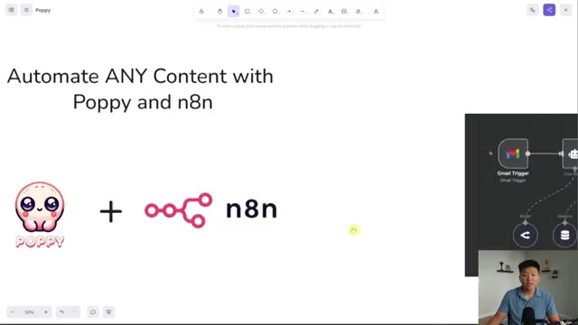
*⏱️ 00:00:08 — Écran de présentation avec le titre 'Automate ANY Content with Poppy and n8n', montrant les logos de Poppy et n8n, ainsi que le présentateur en bas à droite.*

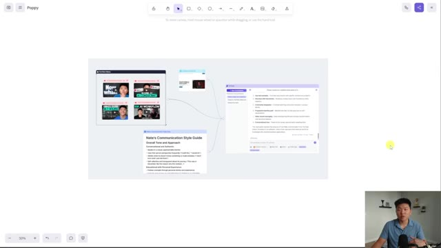
*⏱️ 00:00:16 — Vue d'un tableau blanc interactif ou d'une mindmap montrant différents éléments de contenu reliés entre eux, avec le présentateur en bas à droite.*

---

### ⏱️ `[00:00:32 - 00:01:04]` | Segment #02

**🔊 Audio (Transcription Intégrale Mot pour Mot en Français) :**
> ce que vous voulez. Et ensuite, c'est aussi simple que de connecter un bloc à un assistant IA, et il a maintenant scanné toute la vidéo YouTube, toute la transcription, la miniature, absolument tout. Je veux donc vous montrer ce que je veux Gire par là très rapidement, et ensuite nous passerons au reste de la vidéo. Me voici donc sur ma chaîne YouTube. Je vais copier le lien de ma dernière vidéo YouTube, ouvrir un nouveau Poppy, et je clique simplement sur coller. Et maintenant, ce qu'il fait, c'est qu'il a déjà transcrit cette vidéo, il a analysé la miniature et il sait ce qui s'y passe. Je pourrais ensuite me rendre sur mon site web, copier ce lien, retourner dans Poppy et le coller, et maintenant il est capable de consulter

**👁️ Analyse Visuelle d'Écran (gemini-3.5-flash-lite) :**
**Interface & Outils** : Navigateur web, plateforme d'application web (tableau blanc interactif), YouTube Studio / chaîne YouTube.

**Contenu textuel & Code** : Miniature de vidéo YouTube intégrée dans un bloc logiciel avec une interface d'annotation pour l'intelligence artificielle.

**Action / Démonstration** : Connexion ou intégration d'une vidéo YouTube dans un bloc de l'application pour l'analyser avec l'assistant IA.

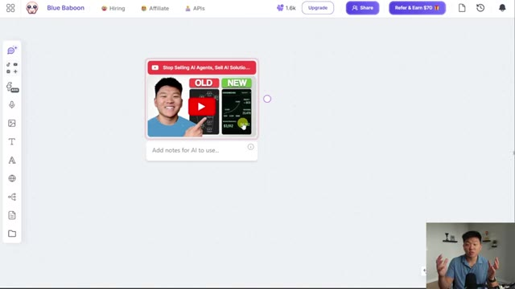
*⏱️ 00:00:56 — L'interface web de l'application montrant un bloc interactif contenant la miniature d'une vidéo YouTube et un champ de texte 'Add notes for AI to use...'.*

---

### ⏱️ `[00:01:04 - 00:01:28]` | Segment #03

**🔊 Audio (Transcription Intégrale Mot pour Mot en Français) :**
> tout sur ce site web. Donc maintenant que nous avons ces sources de données ici, je peux cliquer sur ce bouton qui fait apparaître un chat IA, et tout ce que j'ai à faire est d'utiliser ces cercles pour m'assurer que le chat peut lire ces deux sources de données. Il ne sait probablement pas que True Horizon AI est notre entreprise d'IA, donc je pourrais simplement ajouter une note rapide et, maintenant qu'il voit cela, je peux aller de l'avant et lui demander de me donner trois points clés de ma vidéo YouTube, ainsi que la manière dont cela s'applique à True Horizon AI.

**👁️ Analyse Visuelle d'Écran (gemini-3.5-flash-lite) :**
**Interface & Outils** : Interface web Blue Baboon, outil de mindmapping et de chat IA.

**Contenu textuel & Code** : Sources de données (vidéo YouTube et site web TrueHorizon) et interface de chat utilisant Claude 4 Sonnet.

**Action / Démonstration** : Connexion visuelle des sources de données au chat IA pour permettre à l'assistant de les lire et de les analyser.

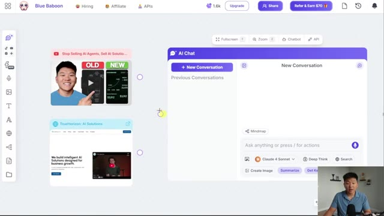
*⏱️ 00:01:10 — Interface de l'application Blue Baboon montrant deux sources de données sur la gauche et une fenêtre de chat IA sur la droite, avec une webcam du présentateur en bas à droite.*

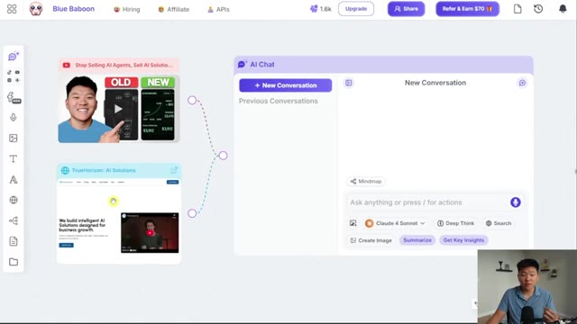
*⏱️ 00:01:16 — Même interface avec des lignes de connexion tracées entre les deux sources de données à gauche et le module de chat IA à droite.*

---

### ⏱️ `[00:01:28 - 00:02:01]` | Segment #04

**🔊 Audio (Transcription Intégrale Mot pour Mot en Français) :**
> Donc je vais envoyer ça. Vous pouvez voir qu'on utilise Claude Force Sonnet, mais on a aussi la possibilité de basculer vers ces autres modèles. Et vous pouvez voir qu'il nous donne maintenant une réponse. Donc sur la base de la vidéo YouTube, Arrêtez de vendre des agents IA, vendez plutôt des solutions IA, voici trois points clés et comment ils s'appliquent à True Horizon. Donc nous avons : se concentrer sur les résultats commerciaux, pas sur la technologie. C'est exact. Voici le cadre dont j'ai parlé à la fin, et ensuite commencer par la preuve et passer à l'échelle en toute confiance. Comment cela s'applique à True Horizon AI. True Horizon AI incarne déjà magnifiquement ces principes. Votre site web ne met pas en avant du jargon technique sur les architectures multi-agents ou les requêtes HTTP. Au lieu de cela, vous vous concentrez sur les résultats commerciaux, bla, bla, bla. Et encore une fois, ceci

**👁️ Analyse Visuelle d'Écran (gemini-3.5-flash-lite) :**
**Interface & Outils** : Interface web "Blue Baboon" (outil d'IA et de mindmap).

**Contenu textuel & Code** : Réponse générée par l'IA basée sur une vidéo YouTube ("Stop Selling AI Agents, Sell AI Solutions Instead") avec des points clés.

**Action / Démonstration** : Affichage de la réponse textuelle générée par le modèle Claude dans l'interface de chat.

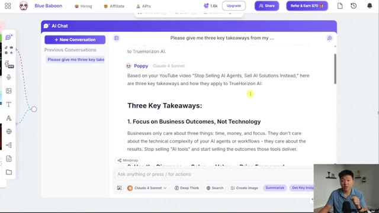
*⏱️ 00:01:36 — Interface web montrant une conversation de chat avec un assistant IA nommé Poppy utilisant Claude Sonnet.*

---

### ⏱️ `[00:02:01 - 00:02:22]` | Segment #05

**🔊 Audio (Transcription Intégrale Mot pour Mot en Français) :**
> ça ne doit même pas forcément être uniquement vos propres sources de données. Nous pourrions aller sur YouTube et dire, d'accord, Alex Hormozzi a des années et des années et des années d'expérience dans la création d'entreprises et la vente. Et donc si je veux simplement récupérer ces huit minutes de contenu, je pourrais fondamentalement copier le lien de cette vidéo, me rendre dans mon poppy. Et une fois que je colle cette vidéo YouTube, elle va désormais avoir accès aux connaissances d'Alex Hormozzi sur la vente.

**👁️ Analyse Visuelle d'Écran (gemini-3.5-flash-lite) :**
**Interface & Outils** : YouTube, Blue Baboon (interface de workflow / chat IA)

**Contenu textuel & Code** : Résultats de recherche YouTube pour "sales" et interface de discussion générant des résumés à partir de vidéos.

**Action / Démonstration** : Navigation sur YouTube pour trouver des sources de données et utilisation d'une application d'IA pour analyser le contenu vidéo.

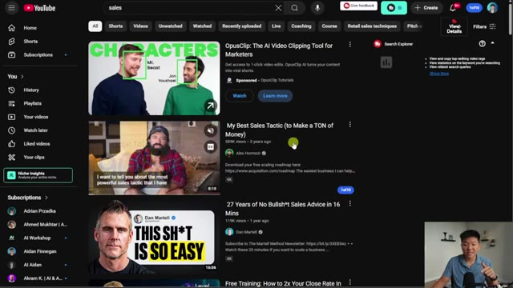
*⏱️ 00:02:06 — Une capture d'écran montrant une recherche YouTube avec des vidéos de vente, incluant une vidéo d'Alex Hormozzi.*

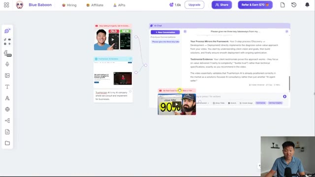
*⏱️ 00:02:17 — Une interface de workflow avec un panneau de chat IA affichant l'analyse d'une vidéo YouTube d'Alex Hormozzi.*

---

### ⏱️ `[00:02:23 - 00:02:42]` | Segment #06

**🔊 Audio (Transcription Intégrale Mot pour Mot en Français) :**
> Donc je pourrais aller dans le chat et dire, basé sur la vidéo YouTube concernant les techniques de vente d'Alex Hormozzi, comment Alex Hormozzi aiderait-il True Horizon à mieux vendre leurs solutions ? Donc je vais envoyer ça et je reviendrai vers vous une fois qu'on aura la réponse. Donc ça prend un aperçu directement de la vidéo d'Alex Hormozzi sur la vente et ça l'applique à True Horizon et à la façon dont nous pouvons l'utiliser.

**👁️ Analyse Visuelle d'Écran (gemini-3.5-flash-lite) :**
**Interface & Outils** : Blue Babon (Application Web / Interface de workflow et chat IA)

**Contenu textuel & Code** : Texte généré par l'IA dans la fenêtre de chat abordant les stratégies commerciales, la structure des processus et l'implémentation pour TrueHorizon.

**Action / Démonstration** : Interaction avec l'interface de chat pour consulter les résultats de l'analyse basée sur la vidéo YouTube d'Alex Hormozzi.

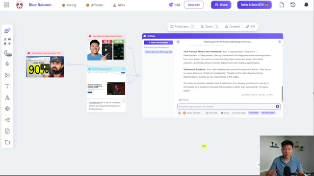
*⏱️ 00:02:27 — Vue d'ensemble de l'interface Blue Babon montrant un workflow d'agents IA connectant des sources vidéo YouTube et des documents textuels à une interface de chat (AI Chat).*

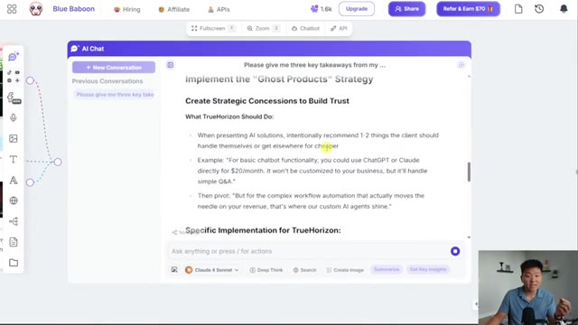
*⏱️ 00:02:37 — Gros plan sur l'interface de chat (AI Chat) affichant les résultats de l'analyse IA concernant la stratégie "Ghost Products" et son implémentation pour TrueHorizon.*

---

### ⏱️ `[00:02:42 - 00:03:02]` | Segment #07

**🔊 Audio (Transcription Intégrale Mot pour Mot en Français) :**
> Ça nous donne une mise en œuvre spécifique. Donc, commencer par une concession, bâtir la confiance par l'honnêteté, puis vendre du travail à forte valeur ajoutée. Ça applique également une autre méthode appelée la méthode de conclusion prescriptive. Ne vous contentez pas de vendre des solutions, coachez la mise en œuvre. Ça nous aide donc littéralement à prendre un texte de notre site web et à le modifier selon la façon dont Hormozi le vendrait. Donc bref, juste une démonstration très rapide pour vous donner un aperçu de ce que nous examinons aujourd'hui.

**👁️ Analyse Visuelle d'Écran (gemini-3.5-flash-lite) :**
**Interface & Outils** : Application web "Blue Baboon" avec interface de chat IA.

**Contenu textuel & Code** : Texte généré par l'IA détaillant une implémentation spécifique pour des appels de découverte : "1. Lead with a concession", "2. Build trust through honesty", "3. Then sell the high-value work", et "Apply the 'Prescriptive Close' Method".

**Action / Démonstration** : Le présentateur explique la stratégie commerciale affichée à l'écran, avec une ligne de texte sélectionnée en surbrillance bleue.

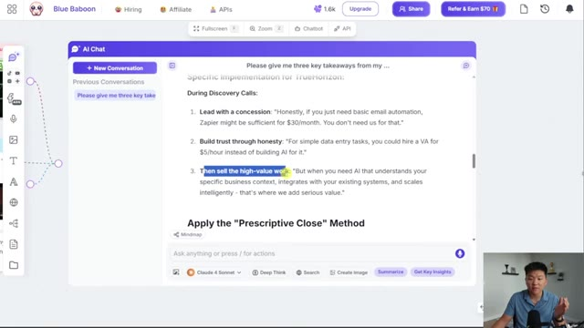
*⏱️ 00:02:47 — Interface web montrant une conversation avec une IA (Blue Baboon) listant des conseils de vente pour des appels de découverte, avec le présentateur en bas à droite.*

---

### ⏱️ `[00:03:02 - 00:03:26]` | Segment #08

**🔊 Audio (Transcription Intégrale Mot pour Mot en Français) :**
> Nous avons d'autres projets prévus. Et ce que certains d'entre vous se disent en ce moment, c'est en quoi est-ce différent de créer un projet cloud ou un GPT personnalisé et d'y insérer des transcriptions ? Eh bien, c'est une bonne question et c'est une question légitime, car en fin de compte, ce qui se passe dans les coulisses de Poppy est assez simple, mais ce qu'ils ont fait, c'est de nous rendre les choses vraiment faciles. Parce que maintenant, vous pouvez accéder à ces tableaux plus grands où vous avez plusieurs chats IA différents et tous ceux-ci sont en quelque sorte spécialisés dans un domaine de connaissances.

**👁️ Analyse Visuelle d'Écran (gemini-3.5-flash-lite) :**
**Interface & Outils** : Tableau blanc interactif et interface visuelle de type canvas/workflow.

**Contenu textuel & Code** : Icônes de fichiers et de réseaux sociaux autour du logo central 'Poppy' sur l'image 1 ; blocs de workflow interconnectés, miniatures de vidéos YouTube et notes textuelles sur l'image 2.

**Action / Démonstration** : Présentation conceptuelle et schématique des différents types de données et sources connectées au projet d'automatisation.

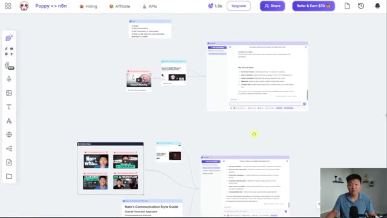
*⏱️ 00:03:20 — Une vue d'ensemble d'un tableau de bord ou d'une interface de workflow (type canvas ou mindmap) connectant divers blocs d'automatisation, notamment des éléments visuels liés à YouTube et du texte formaté.*

---

### ⏱️ `[00:03:27 - 00:03:51]` | Segment #09

**🔊 Audio (Transcription Intégrale Mot pour Mot en Français) :**
> Et plutôt que d'avoir à gérer des tonnes de GPT et de projets différents, je peux désormais simplement regrouper toutes ces sources de données ici et les relier à autant d'assistants différents que je le souhaite. Et puis bien sûr, nous pouvons communiquer avec ces assistants via l'API, et c'est ainsi que nous les connectons à N8N, ce qui devient vraiment puissant. La clé ici est donc de déterminer à quel moment N8N est réellement nécessaire. Par exemple, ce que je viens de faire, c'est que j'ai quatre de mes publications LinkedIn qui ont bien fonctionné, et j'ai trois articles sur les meilleures pratiques de LinkedIn.

**👁️ Analyse Visuelle d'Écran (gemini-3.5-flash-lite) :**
**Interface & Outils** : Interface web de gestion de sources de données et d'assistants IA (type outil de mind mapping / Knowledge Base).

**Contenu textuel & Code** : Blocs textuels comprenant des notes, des guides de style de communication et des extraits de données reliés par des connexions graphiques.

**Action / Démonstration** : Navigation et présentation des différentes sources de données regroupées et reliées entre elles.

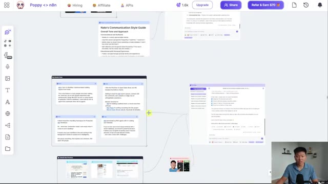
*⏱️ 00:03:33 — Vue d'ensemble d'une interface de tableau de bord ou de mind mapping montrant des blocs de contenu textuel et des sources de données interconnectées.*

---

### ⏱️ `[00:03:51 - 00:04:11]` | Segment #10

**🔊 Audio (Transcription Intégrale Mot pour Mot en Français) :**
> Et ensuite, je suis venu ici et j'ai collé ma dernière vidéo YouTube, je l'ai donnée à l'assistant et je lui ai dit de créer une publication LinkedIn basée sur mon style d'écriture et mes meilleures pratiques. Et donc j'aurais facilement pu créer une automatisation pour faire cela. Elle se déclencherait lorsque je publie une nouvelle vidéo, elle appellerait cet assistant Poppy, et ensuite elle générerait des publications LinkedIn pour moi. Mais je dirais que ce serait peut-être exagéré, car je pourrais tout aussi bien venir ici, coller cela et obtenir ma publication LinkedIn immédiatement.

**👁️ Analyse Visuelle d'Écran (gemini-3.5-flash-lite) :**
**Interface & Outils** : n8n (interface web)

**Contenu textuel & Code** : Publications LinkedIn générées, miniatures de vidéos et interface de chat interactif avec l'assistant IA.

**Action / Démonstration** : Le présentateur explique comment l'assistant IA convertit une vidéo YouTube en publication LinkedIn selon ses meilleures pratiques.

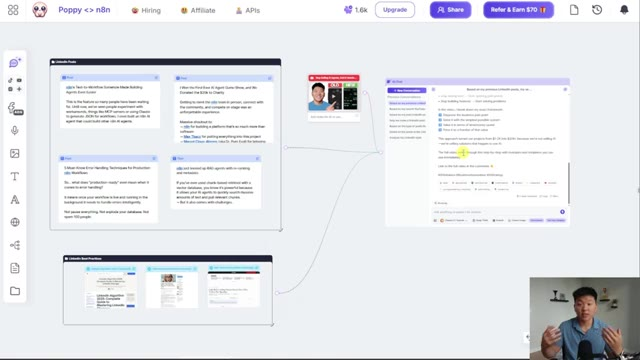
*⏱️ 00:03:56 — Interface de l'application n8n montrant un flux de travail avec des blocs de contenu textuel et une fenêtre de chat d'assistant IA générant une publication LinkedIn.*

---

### ⏱️ `[00:04:11 - 00:04:34]` | Segment #11

**🔊 Audio (Transcription Intégrale Mot pour Mot en Français) :**
> Quand vous voulez penser à utiliser N8N, c'est lorsque vous avez besoin que quelque chose se produise avant d'appuyer sur Poppy. Disons donc que nous voulons automatiser une newsletter quotidienne. Dans N8N, nous pourrions faire en sorte qu'elle se déclenche chaque jour. Et avant d'envoyer la moindre donnée à Poppy, nous pourrions faire en sorte que la newsletter effectue des recherches sur les tendances de l'industrie. Ensuite, une fois que nous avons cette recherche, nous pourrions l'envoyer à Poppy. Et l'assistant Poppy pourrait être parfaitement formé pour raconter des histoires, rédiger des newsletters et faire du marketing par e-mail.

**👁️ Analyse Visuelle d'Écran (gemini-3.5-flash-lite) :**
**Interface & Outils** : Application de tableau blanc / schéma en ligne (type Miro ou Excalidraw)

**Contenu textuel & Code** : Schéma conceptuel montrant "Poppy" au centre entourée d'icônes (feuille de calcul, PDF, image JPEG, YouTube, globe, Instagram) et le logo de n8n.

**Action / Démonstration** : Le présentateur explique visuellement la relation et l'interaction entre n8n et Poppy par rapport aux différentes sources de données et intégrations.

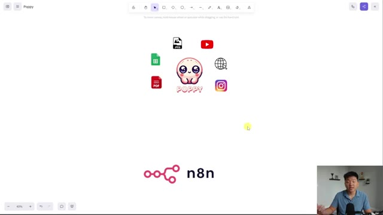
*⏱️ 00:04:17 — Un schéma explicatif sur fond blanc illustrant l'application "Poppy" au centre entourée d'icônes (fichiers, réseaux sociaux, web) et le logo "n8n" en bas, avec le présentateur visible en incrustation dans le coin inférieur droit.*

---

### ⏱️ `[00:04:35 - 00:04:53]` | Segment #12

**🔊 Audio (Transcription Intégrale Mot pour Mot en Français) :**
> Ensuite, une fois que notre assistant spécialisé Poppy a terminé cette info-lettre, nous pourrions revenir à NNN. Et ensuite, NNN pourrait aller l'envoyer ou potentiellement aller ajouter des images ou tout ce que nous voulons d'autre faire avec. Et c'est donc la valeur de ce genre de système, parce que vous pouvez maintenant déclencher du contenu de son propre chef. Vous pouvez faire des recherches avant ou après, et vous pouvez même ajouter des éléments supplémentaires après que Poppy vous a rendu le texte.

**👁️ Analyse Visuelle d'Écran (gemini-3.5-flash-lite) :**
**Interface & Outils** : Application de tableau blanc / mind mapping (ex: Excalidraw)

**Contenu textuel & Code** : Schéma avec le logo de Poppy relié par des flèches au logo de n8n et entouré d'icônes (PDF, Google Sheets, JPEG, YouTube, Instagram, web).

**Action / Démonstration** : Le présentateur explique visuellement le flux de travail reliant l'assistant Poppy et n8n pour automatiser les tâches.

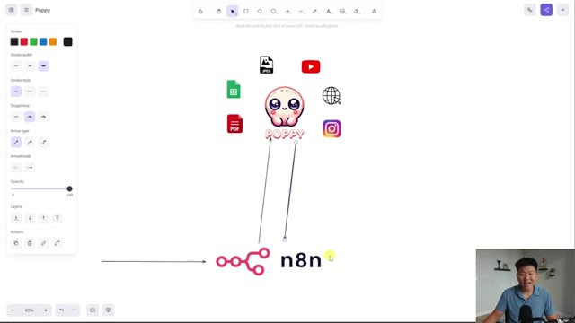
*⏱️ 00:04:39 — Schéma explicatif sur tableau blanc montrant l'interaction entre l'assistant Poppy et n8n entouré d'icônes d'applications.*

---

### ⏱️ `[00:04:54 - 00:05:26]` | Segment #13

**🔊 Audio (Transcription Intégrale Mot pour Mot en Français) :**
> C'est un exemple complexe, mais c'est quand même un bon exemple. Disons que nous avons NNN qui fait des recherches sur les TikToks et les reels Instagram qui sont tendance. Nous les envoyons à Poppy pour qu'il nous crée de nouveaux scripts. Et ensuite, de retour dans NNN, nous injectons ces scripts dans quelque chose comme mon Ultimate Media Agent et il est capable de créer soit ces vidéos d'avatar HeyGen, soit des vidéos UGC, n'importe quoi de ce genre, et ensuite même de s'occuper de toute la programmation automatique et de la publication pour nous. Si vous voulez voir une vidéo sur l'agent média, je vais la marquer juste ici en haut. Quoi qu'il en soit, laissez-moi passer à un vrai exemple et vous montrer comment nous pouvons configurer un flux de travail d'édition pour parler à Poppy et comment nous pouvons

**👁️ Analyse Visuelle d'Écran (gemini-3.5-flash-lite) :**
**Interface & Outils** : Application web n8n et tableau blanc explicatif

**Contenu textuel & Code** : Diagramme d'automatisation avec des nœuds connectés pour la gestion des médias sociaux, des agents IA et des intégrations d'outils.
[DESC_IMAGE_2] Le présentateur explique l'architecture d'un agent complexe basé sur n8n et Poppy pour automatiser la recherche et la création de contenus sur TikTok et Instagram.

**Action / Démonstration** : Explications face caméra et démonstration conceptuelle.

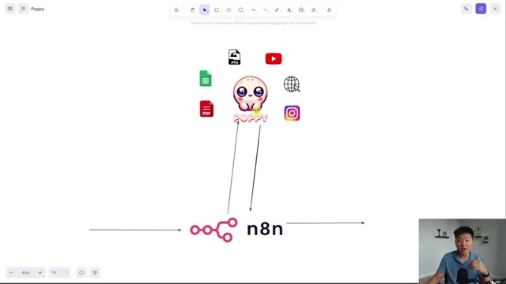
*⏱️ 00:05:02 — Schéma explicatif montrant les flux d'interaction entre l'outil 'n8n' et l'agent 'Poppy' entouré de diverses icônes de médias et formats de fichiers.*

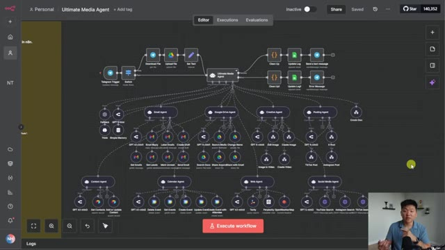
*⏱️ 00:05:10 — Interface de l'éditeur de workflows n8n affichant un diagramme complexe nommé 'Ultimate Media Agent' avec de multiples sous-agents connectés.*

---

### ⏱️ `[00:05:26 - 00:06:02]` | Segment #14

**🔊 Audio (Transcription Intégrale Mot pour Mot en Français) :**
> entraîner notre assistant Poppy à faire quelque chose d'extraordinaire. Donc, que vous créiez vous-même du contenu ou que vous souhaitiez être plus régulier dans la création de contenu, ou que vous dirigiez une agence d'automatisation de l'IA où vous devez aider vos clients à créer plus de contenu, de manière plus régulière et avec une meilleure qualité, alors cette combinaison de Poppy et de NNN va s'avérer extrêmement puissante pour vous à apprendre. Entrons donc dans le vif du sujet. Très bien. Ce que nous allons faire aujourd'hui, c'est que nous allons construire un système d'automatisation de newsletter. Et je vais vous montrer à quelle vitesse et avec quelle facilité nous allons pouvoir mettre en place une très bonne newsletter. Tout d'abord, je vais simplement ajouter un déclencheur, qui sera un déclencheur planifié. Et nous allons simplement faire comme si celui-ci allait se déclencher tous les jours, une fois par jour. Une fois que le déclencheur planifié s'est déclenché, qu'est-ce que nous voulons faire ? Faire des recherches sur

**👁️ Analyse Visuelle d'Écran (gemini-3.5-flash-lite) :**
**Interface & Outils** : Tableau blanc de dessin (Image 1) et interface web n8n (Image 2)

**Contenu textuel & Code** : Icônes de formats de fichiers et de réseaux sociaux connectés à l'assistant Poppy et n8n.

**Action / Démonstration** : Présentation du schéma conceptuel du workflow (Image 1) puis bascule sur l'éditeur n8n vide pour commencer la création (Image 2).

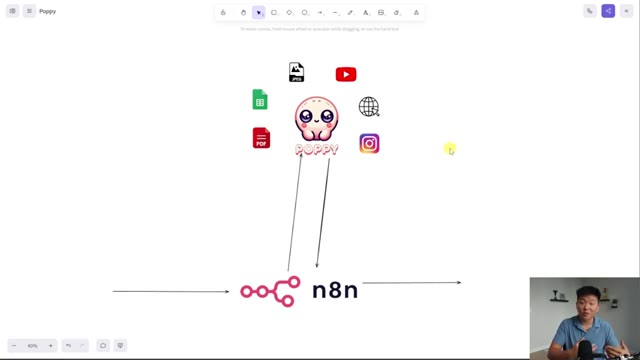
*⏱️ 00:05:35 — Schéma explicatif montrant l'assistant Poppy interfaçant divers formats (PDF, Google Sheets, images, YouTube, Instagram) avec n8n.*

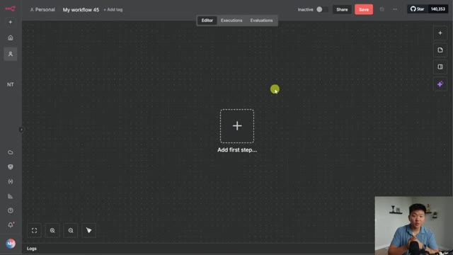
*⏱️ 00:05:44 — Interface vide de l'éditeur de workflow n8n avec un bouton "Add first step..." au centre.*

---

### ⏱️ `[00:06:02 - 00:06:21]` | Segment #15

**🔊 Audio (Transcription Intégrale Mot pour Mot en Français) :**
> notre secteur ou créneau de newsletter. Donc je vais aller de l'avant et ajouter une étape Tavoli, qui va nous aider à mener nos recherches. Et notre newsletter va se concentrer sur la santé. Et nous allons essayer de vendre des compléments alimentaires en nous basant sur, disons, imaginons que nous ayons des liens d'affiliation. Donc la requête de recherche que je veux chaque jour pour que Tavoli effectue ses recherches est : derniers tendances de santé et points de douleur.

**👁️ Analyse Visuelle d'Écran (gemini-3.5-flash-lite) :**
**Interface & Outils** : Interface de création de workflows d'automatisation (type n8n ou équivalent).

**Contenu textuel & Code** : Nœuds 'Schedule Trigger' et intégration de l'API Tavily (actions Search et Extract), avec champ de requête de recherche.

**Action / Démonstration** : Ajout et configuration d'un nœud de recherche Tavily dans le workflow d'automatisation.

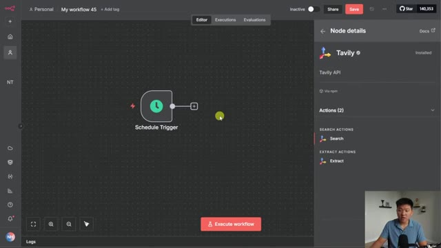
*⏱️ 00:06:07 — Vue d'ensemble du workflow avec un nœud déclencheur 'Schedule Trigger' et le panneau latéral affichant les détails du nœud Tavily.*

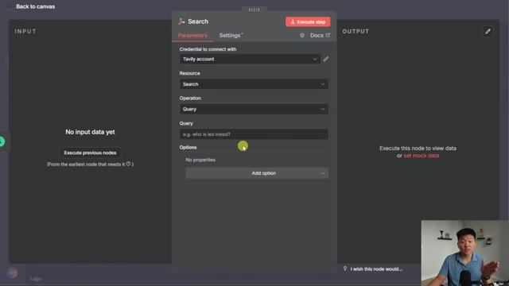
*⏱️ 00:06:11 — Fenêtre de configuration de l'action 'Search' de l'étape Tavily avec les paramètres de requête.*

---

### ⏱️ `[00:06:21 - 00:06:46]` | Segment #16

**🔊 Audio (Transcription Intégrale Mot pour Mot en Français) :**
> Donc ça va rechercher les dernières tendances en matière de santé et les points de douleur chaque jour. Je vais aussi m'assurer que le sujet est l'actualité. Donc ça regarde des choses plus récentes plutôt que générales. et ensuite je vais aussi inclure la réponse comme avancée. Donc fondamentalement, ce que cela dit, c'est que Tablo va aller chercher cinq articles par jour sur les dernières tendances de santé et ensuite il va nous donner une réponse en quelque sorte comme un résumé de ce qu'il a trouvé. Et juste pour vous montrer à quoi cela ressemble, nous allons exécuter cette étape et je vais vous montrer quel type de réponse nous obtenons en retour.

**👁️ Analyse Visuelle d'Écran (gemini-3.5-flash-lite) :**
**Interface & Outils** : Interface web d'automatisation de workflow (type n8n ou équivalent) avec un panneau de configuration de nœud et la webcam du présentateur en bas à droite.

**Contenu textuel & Code** : Paramètres du nœud de recherche : compte Tavily, ressource Search, opération Query, requête "Latest health trends and pain points", et option Topic configurée sur "News".

**Action / Démonstration** : Configuration des paramètres d'un nœud de recherche pour cibler les actualités et tendances de santé.

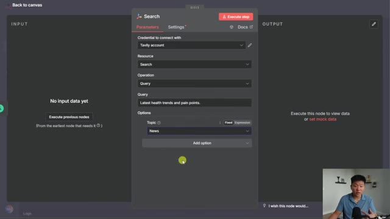
*⏱️ 00:06:27 — Configuration d'un nœud de recherche (Search) dans une interface de workflow avec les paramètres Tavily, une requête sur les tendances de santé ("Latest health trends and pain points") et l'option "News".*

---

### ⏱️ `[00:06:46 - 00:07:20]` | Segment #17

**🔊 Audio (Transcription Intégrale Mot pour Mot en Français) :**
> Donc, comme vous pouvez le voir sur le côté droit, nous obtenons cette réponse qui est basée sur les données les plus récentes : plusieurs tendances de santé importantes et points de douleur émergent. Pilates, bla-bla-bla, la douleur chronique représente un problème majeur, bla-bla-bla, des recherches médicales récentes. Donc, comme vous pouvez le voir, cela nous donne une réponse avec ces cinq sources réelles qu'il a trouvées. Donc, ce qui vient ensuite, c'est que nous voulons envoyer cette recherche à un assistant Poppy qui est formé sur la façon de vendre par e-mail, sur la façon d'écrire des bulletins d'information, sur la façon de raconter de bonnes histoires et des choses de ce genre. Je vais donc ouvrir ce tableau Poppy que nous regardions tout à l'heure, et je vais cliquer sur ce bouton en haut juste pour ajouter un chat différent, car nous créons essentiellement un nouvel assistant maintenant qui va être

**👁️ Analyse Visuelle d'Écran (gemini-3.5-flash-lite) :**
**Interface & Outils** : n8n (Interface de conception de workflow d'automatisation)

**Contenu textuel & Code** : Paramètres du nœud de recherche Tavily avec la requête "Latest health trends and pain points" et le panneau de sortie affichant les données textuelles structurées sous forme de tableau.

**Action / Démonstration** : Visualisation des résultats de test d'un nœud de recherche d'actualités dans l'automatisation.

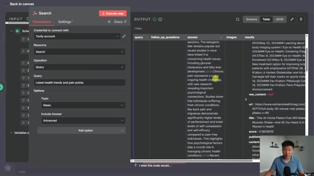
*⏱️ 00:06:55 — Vue rapprochée d'un panneau de configuration de nœud dans n8n montrant les paramètres de recherche Tavily et les résultats textuels générés.*

---

### ⏱️ `[00:07:20 - 00:07:54]` | Segment #18

**🔊 Audio (Transcription Intégrale Mot pour Mot en Français) :**
> entraîné sur des informations différentes de celles sur lesquelles cet assistant ici a été entraîné. Et une chose que je vais réellement faire, c'est que je vais simplement faire glisser ce type ici pour la vidéo de vente d'Alex Hormozi et la glisser également parce que cela sera important pour nous d'avoir lorsque nous essayons de vendre des produits via une newsletter. Je viens aussi de trouver cette autre vidéo d'Alex Hormozi sur le marketing par e-mail, puis j'en ai juste trouvé une de plus de Callaway sur comment devenir un maître de la narration. Donc ces trois-là seront de bonnes sources de données pour faire essentiellement de cet assistant IA un rédacteur de newsletters de maître. Et donc en fait, ce que je veux faire, c'est que je vais supprimer ces connexions très rapidement parce que ce que je veux faire, c'est créer un groupe. J'ai donc cliqué sur ce bouton en bas pour faire un

**👁️ Analyse Visuelle d'Écran (gemini-3.5-flash-lite) :**
**Interface & Outils** : Blue Baboon (interface web de mindmapping et d'IA)

**Contenu textuel & Code** : Une mindmap interactive avec un nœud contenant la vidéo de vente d'Alex Hormozi et un nœud de chat IA ("AI Chat") avec des options de prompts.

**Action / Démonstration** : Glisser-déposer d'une vidéo dans l'interface pour l'intégrer au flux de travail de l'assistant IA.

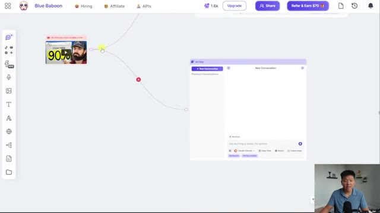
*⏱️ 00:07:28 — Interface de l'application Blue Baboon montrant un diagramme de mindmap avec une vignette vidéo d'Alex Hormozi et une fenêtre de chat IA.*

---

### ⏱️ `[00:07:54 - 00:08:29]` | Segment #19

**🔊 Audio (Transcription Intégrale Mot pour Mot en Français) :**
> groupe et je vais simplement glisser ces trois vidéos dans le groupe parce que ces trois-là sont fondamentalement utilisées pour la même chose, c'est-à-dire entraîner l'agent à rédiger de bons textes publicitaires. Donc j'ai pris les devants et j'ai appelé ce groupe storytelling et ventes, et si je le connecte à l'assistant maintenant, il examine tout ce qui se trouve réellement dans ce groupe. Donc maintenant, je vais lui donner les sites web des deux produits que nous allons faire semblant de vendre dans cette infolettre. Le premier est juste ici, c'est AG1. Et ensuite le deuxième est NeuroGum. Et donc, même chose, je vais créer un groupe. Je vais glisser ces deux produits dans le groupe. Et nous allons appeler ce groupe produits. Et aussi

**👁️ Analyse Visuelle d'Écran (gemini-3.5-flash-lite) :**
**Interface & Outils** : Blue Babon (application web de tableau de bord visuel et d'intelligence artificielle)

**Contenu textuel & Code** : Groupe d'éléments multimédias étiqueté "Storytelling and Sales" regroupant trois vignettes vidéo YouTube axées sur le marketing et la rédaction publicitaire.

**Action / Démonstration** : Regroupement de trois vidéos dans un dossier de projet et renommage de ce groupe en "Storytelling and Sales" pour entraîner l'agent IA.

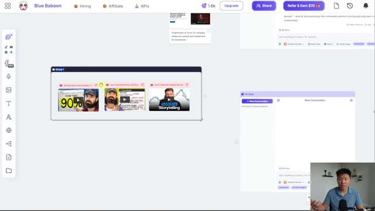
*⏱️ 00:08:03 — Interface Blue Babon montrant un groupe d'éléments visuels contenant trois vidéos de formation sur le marketing et la vente.*

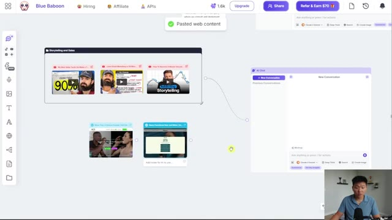
*⏱️ 00:08:20 — Interface Blue Babon montrant le groupe renommé "Storytelling and Sales" avec les trois vidéos et un lien vers un volet de chat IA.*

---

### ⏱️ `[00:08:29 - 00:08:52]` | Segment #20

**🔊 Audio (Transcription Intégrale Mot pour Mot en Français) :**
> juste pour m'assurer qu'il comprend que ce sont des produits que nous voulons vendre dans notre bulletin d'information, je vais ajouter des notes, ce qui va être, c'est un produit que je veux vendre dans le bulletin d'information. Je vais simplement l'ajouter à ces deux produits et le connecter à l'assistant. Donc maintenant, il comprend ce que nous regardons dans ce groupe. Et puis un élément de plus qui va être vraiment, vraiment important pour ce bulletin d'information, c'est le style et plus particulièrement le styliser en HTML.

**👁️ Analyse Visuelle d'Écran (gemini-3.5-flash-lite) :**
**Interface & Outils** : Blue Baboon (application web de workflow / mindmapping avec IA)

**Contenu textuel & Code** : Dossiers "Storytelling and Sales" et "Products" contenant des miniatures de vidéos et de sites web, avec des notes textuelles ajoutées pour l'IA.

**Action / Démonstration** : Ajout de notes contextuelles sous les produits dans le tableau de bord pour les lier au module de chat de l'intelligence artificielle.

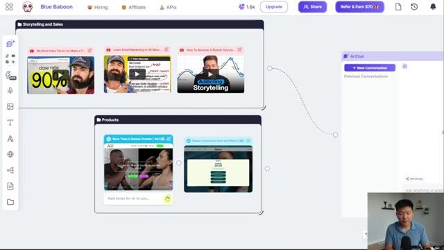
*⏱️ 00:08:35 — Vue d'ensemble de l'interface de l'application Blue Baboon montrant des sections de dossiers pour le contenu et les produits, avec le curseur sur le champ de notes d'un produit.*

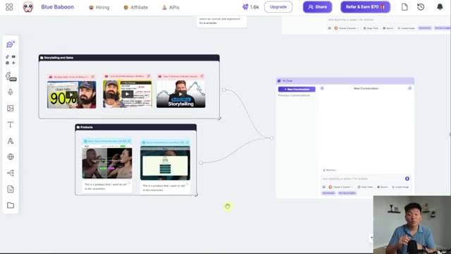
*⏱️ 00:08:46 — La même interface de workflow montrant les notes ajoutées sous les deux produits, connectées au panneau de chat IA à droite.*

---

### ⏱️ `[00:08:52 - 00:09:27]` | Segment #21

**🔊 Audio (Transcription Intégrale Mot pour Mot en Français) :**
> Et ce n'est pas quelque chose dont je suis un expert ou que je sais rédiger. Il m'est donc tellement plus facile d'aller chercher un site web. Donc, un article sur le HTML expliqué et de le connecter à l'assistant. Ainsi, il possède également toutes ces connaissances. Et j'ai juste ajouté une petite note rapide ici, un guide de style HTML, pour qu'il sache ce qu'il regarde. Cela m'a donc pris deux minutes pour aller récupérer ces six sources de données. Et maintenant, je suis plutôt confiant : si nous sollicitons cet assistant IA depuis N8N, il va cracher une très, très bonne infonulettre. Tout ce que j'ai à faire pour m'y connecter dans N8N, c'est de cliquer ici en haut et de cliquer sur API. Vous devez effectivement être sur un certain abonnement pour pouvoir accéder à l'API.

**👁️ Analyse Visuelle d'Écran (gemini-3.5-flash-lite) :**
**Interface & Outils** : Application web Blue Baboon (outil de flux de travail et d'assistant IA visuel).

**Contenu textuel & Code** : Blocs de données avec liens vidéo et articles web (notamment un article sur le HTML), connectés par des lignes de flux à une interface "AI Chat".

**Action / Démonstration** : Connexion de sources de connaissances externes (articles web et vidéos) à l'assistant conversationnel de l'application.

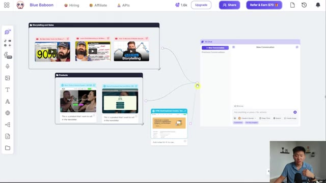
*⏱️ 00:09:01 — Interface Blue Baboon montrant un diagramme de flux visuel avec des dossiers de données (Storytelling and Sales, Products) connectés à un module de chat IA, ainsi qu'une note web sur le HTML.*

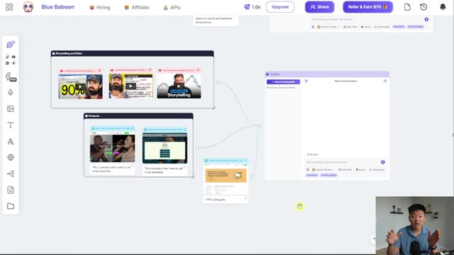
*⏱️ 00:09:10 — Vue légèrement dézoomée du même diagramme de flux sur l'interface Blue Baboon, montrant la connexion finale entre l'article HTML et le module AI Chat.*

---

### ⏱️ `[00:09:28 - 00:10:02]` | Segment #22

**🔊 Audio (Transcription Intégrale Mot pour Mot en Français) :**
> Et Poppy n'est vraiment pas l'outil le plus bon marché du marché. Je voulais donc m'assurer de pouvoir vous proposer une réduction. Si vous utilisez le lien dans la description, vous pourrez économiser de l'argent. De plus, si vous vous souvenez de ma communauté Plus, j'ai pu vous obtenir une réduction encore plus importante. Vous verrez donc comment l'obtenir dans la communauté Plus. Quoi qu'il en soit, je vais passer ceci en méthode POST parce que nous voulons envoyer un long prompt à notre agent. Nous allons interagir avec lui en nous basant uniquement sur sa base de connaissances. Et ensuite, je vais vous montrer à quel point c'est facile à configurer. La première chose que nous allons faire, c'est récupérer ce lien de chat, qui est fondamentalement notre point de terminaison API. Je vais retourner dans N8N. Nous allons ajouter une requête HTTP. Ce sera une méthode POST et

**👁️ Analyse Visuelle d'Écran (gemini-3.5-flash-lite) :**
**Interface & Outils** : Interface web Poppy / Blue Baboon

**Contenu textuel & Code** : Fenêtre modale "Use your AI assistant as an API" avec les champs "Conversations" (Knowledgebase only), "Prompt" ("just respond with EXACTLY THIS and nothing else 'Hi! API ran successfully!..."), et "Chat Link" (https://api.getpoppy.ai/api/conversation...).

**Action / Démonstration** : Visualisation des options de configuration de l'API de Poppy et du lien d'intégration.

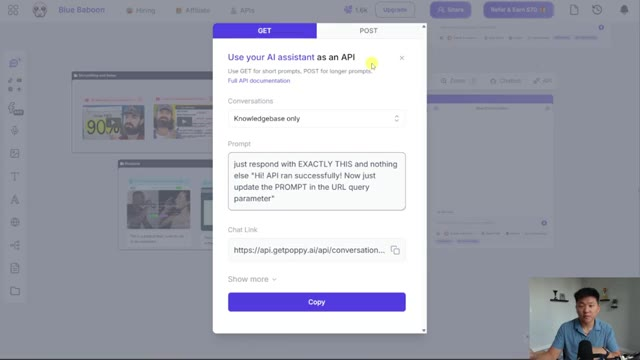
*⏱️ 00:09:36 — Interface web de l'application Poppy affichant une fenêtre modale de configuration d'API avec un prompt personnalisé et un lien de chat, avec le présentateur en incrustation vidéo en bas à droite.*

---

### ⏱️ `[00:10:02 - 00:10:38]` | Segment #23

**🔊 Audio (Transcription Intégrale Mot pour Mot en Français) :**
> ensuite, je vais coller le point de terminaison juste ici. Et la raison pour laquelle je ne vous ai pas montré ça, c'est parce qu'à la fin, nous avons une clé API. Vous n'avez donc pas besoin de configurer d'authentification. Vous avez juste à coller ce lien de chat. Et ensuite, de retour dans Poppy, nous pouvons voir que nous avons deux champs de corps JSON à envoyer. Le premier étant prompt et le deuxième étant model. Donc dans NNN, je vais envoyer un corps. Je vais nommer l'un d'eux prompt. Nous allons en ajouter un autre et nommer celui-ci model. Et maintenant, nous avons juste besoin d'envoyer quel modèle de chat nous voulons utiliser et quel est le prompt réel que nous envoyons à Poppy. Et par prompt, cela signifie simplement ce que vous taperiez juste ici si vous vouliez utiliser l'assistant IA. Donc pour le prompt, ce que je vais dire

**👁️ Analyse Visuelle d'Écran (gemini-3.5-flash-lite) :**
**Interface & Outils** : Interface de workflow d'automatisation (n8n ou similaire)

**Contenu textuel & Code** : URL de l'API : https://api.getpoppy.ai/api/conversation?board_id=... avec méthode POST et authentification None

**Action / Démonstration** : Collage et configuration du point de terminaison HTTP Request avec clé API intégrée dans l'URL

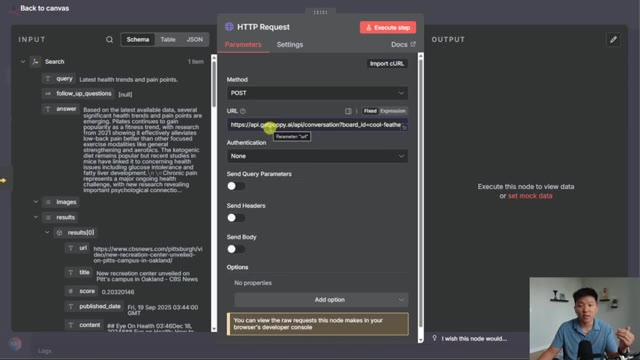
*⏱️ 00:10:11 — Configuration d'un nœud de requête HTTP dans un outil d'automatisation montrant l'URL de l'API avec une clé intégrée et l'authentification définie sur 'None'.*

---

### ⏱️ `[00:10:38 - 00:10:58]` | Segment #24

**🔊 Audio (Transcription Intégrale Mot pour Mot en Français) :**
> je vais coller ces informations, qui sont basées sur mes produits, le storytelling et les meilleures pratiques de vente, ainsi que sur la recherche ci-dessous concernant les tendances en matière de santé, provenant de Tavoli que nous venons de configurer et de terminer. Crée-moi une newsletter stylisée en HTML optimisée pour convertir et vendre les produits de manière naturelle et utile. Important, ne sors que la newsletter HTML stylisée.

**👁️ Analyse Visuelle d'Écran (gemini-3.5-flash-lite) :**
**Interface & Outils** : Interface web d'automatisation de workflow (type n8n) avec un panneau d'expression de code.

**Contenu textuel & Code** : Texte du prompt configuré : "Based on my products, Storytelling and Sales best practices, and the below research on health trends, create me an HTML stylized newsletter optimized to convert to selling the products in an organic and helpful manner. Research: {{ $json.answer }}"

**Action / Démonstration** : Configuration d'une expression JavaScript intégrant les résultats de recherche de Tavily dans un prompt de génération de newsletter.

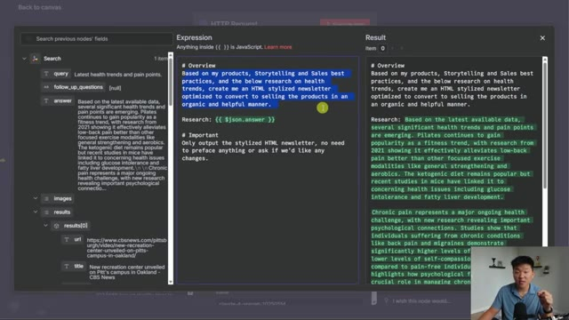
*⏱️ 00:10:43 — Interface d'un éditeur de nœud de workflow montrant la configuration d'un prompt pour générer une newsletter HTML basée sur des données de recherche de santé.*

---

### ⏱️ `[00:10:58 - 00:11:20]` | Segment #25

**🔊 Audio (Transcription Intégrale Mot pour Mot en Français) :**
> Pas besoin d'introduire quoi que ce soit ou de demander si nous souhaitons des modifications. Vous pouvez donc voir qu'il récupère cette information. Il récupère la recherche de Tavoli. Et maintenant, tout ce que nous avons à faire, c'est d'envoyer ceci à Poppy et cela nous renverra une lettre d'information. Je vais donc me lancer et exécuter cette étape. Et pendant que nous attendons que cela s'exécute, je voulais juste vous montrer pourquoi c'est en fait tellement plus simple, parce que je viens de faire une autre vidéo YouTube étape par étape où nous avons construit cet agent de lettres d'information.

**👁️ Analyse Visuelle d'Écran (gemini-3.5-flash-lite) :**
**Interface & Outils** : n8n (outil d'automatisation de workflow low-code).

**Contenu textuel & Code** : Prompt : "Based on my products, Storytelling and Sales best practices, and the below research on health trends, create me an HTML stylized newsletter..." ; configuration de nœud HTTP POST vers l'API de Poppy.

**Action / Démonstration** : Configuration et exécution du flux de travail automatisé pour transformer des données de recherche en newsletter via une requête API.

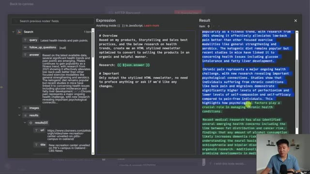
*⏱️ 00:11:04 — Vue détaillée d'un nœud de configuration dans n8n montrant un champ d'expression rempli d'un prompt pour générer une newsletter HTML à partir de données de recherche.*

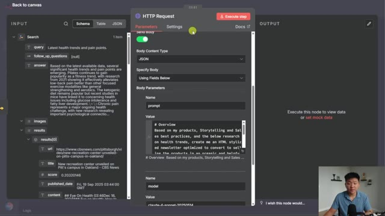
*⏱️ 00:11:09 — Interface de configuration "HTTP Request" dans n8n, paramétrée pour envoyer une requête JSON à un modèle (claude-3-opus) incluant le prompt de génération de newsletter.*

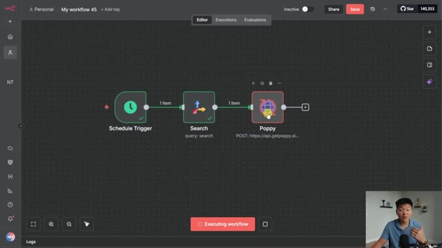
*⏱️ 00:11:15 — Vue globale du workflow n8n montrant l'enchaînement "Schedule Trigger" -> "Search" -> "Poppy", illustrant l'automatisation du processus de recherche et d'envoi.*

---

### ⏱️ `[00:11:21 - 00:11:42]` | Segment #26

**🔊 Audio (Transcription Intégrale Mot pour Mot en Français) :**
> Et vous pouvez voir que c'est beaucoup plus complexe parce que j'ai dû construire un agent de planification, j'ai fait plus de recherches, j'ai construit un rédacteur de sections, et ensuite j'ai dû construire un agent éditeur. Et ici, nous lui disons essentiellement, comment est-ce qu'on stylise réellement les choses en HTML ? Et il y a beaucoup plus de choses à parcourir et ça ne donne même pas un aussi bon résultat. Donc ce que je vais faire très rapidement, c'est exécuter cet agent et ensuite nous comparerons cette newsletter à la finale que Poppy nous a donnée.

**👁️ Analyse Visuelle d'Écran (gemini-3.5-flash-lite) :**
**Interface & Outils** : Plateforme d'automatisation de workflows n8n.

**Contenu textuel & Code** : Workflow complet avec des nœuds de planification, de recherche, de rédaction et d'édition ; prompts système incluant des règles de citation, de formatage HTML et de contraintes de longueur.

**Action / Démonstration** : Présentation de la logique de construction d'un système multi-agents, passant de la vue d'ensemble du flux de travail aux détails de configuration du prompt de l'agent éditeur.

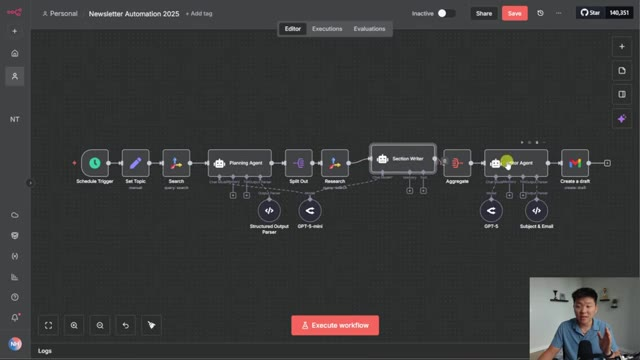
*⏱️ 00:11:26 — Interface de conception de workflow dans n8n montrant une chaîne d'automatisation avec divers agents (Planning, Section Writer, Editor Agent).*

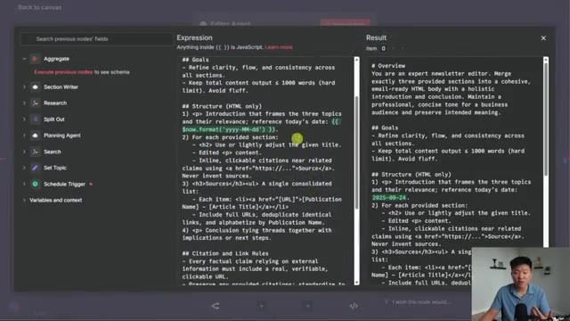
*⏱️ 00:11:31 — Éditeur de configuration du nœud "Editor Agent" montrant des instructions système détaillées en Markdown pour la rédaction et le formatage HTML d'une newsletter.*

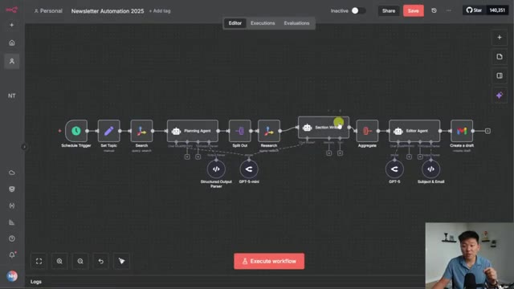
*⏱️ 00:11:37 — Retour à la vue d'ensemble du workflow dans n8n, identique à l'image 1, illustrant la structure globale du pipeline d'automatisation.*

---

### ⏱️ `[00:11:42 - 00:12:15]` | Segment #27

**🔊 Audio (Transcription Intégrale Mot pour Mot en Français) :**
> Très bien, donc la newsletter Poppy vient de se terminer et regardez ça. Vous pouvez voir que le style a déjà l'air vraiment bien. Une petite erreur ici, mais on peut facilement se débarrasser de ce code HTML en haut. Bref, la connexion corps-esprit, votre percée santé de la semaine. Salut, Sarah pensait qu'elle faisait tout bien. Elle a essayé tous les traitements pour ses douleurs lombaires chroniques, la kinésithérapie, les médicaments, même des procédures coûteuses, mais rien ne semblait fonctionner sur le long terme. Puis son médecin lui a posé une seule question qui a tout changé. Êtes-vous perfectionniste ? Donc tout d'abord, cela s'inspire clairement de la façon de raconter de bonnes histoires parce que cela attire le lecteur.

**👁️ Analyse Visuelle d'Écran (gemini-3.5-flash-lite) :**
**Interface & Outils** : Gmail (interface web)

**Contenu textuel & Code** : E-mail intitulé "The Mind-Body: Sep 24, 2025" contenant un bandeau violet "The Mind-Body Connection" et du texte au format HTML.

**Action / Démonstration** : Présentation et vérification du rendu visuel de la newsletter générée reçue dans la boîte de réception.

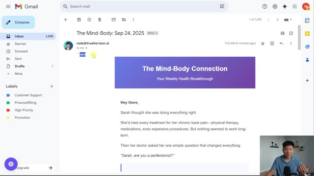
*⏱️ 00:11:51 — Aperçu d'un e-mail dans Gmail affichant la newsletter "The Mind-Body Connection" avec une petite balise HTML parasite visible en haut à gauche.*

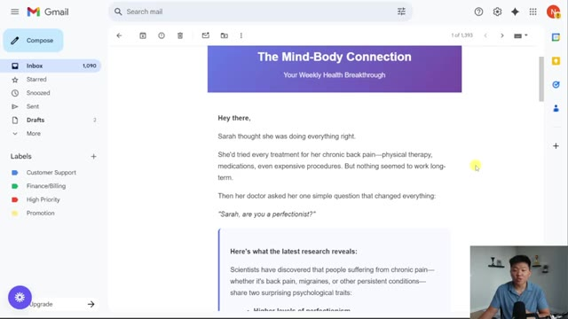
*⏱️ 00:11:59 — Aperçu de la même newsletter dans Gmail après le défilement vers le bas, montrant le contenu textuel et la mise en page.*

---

### ⏱️ `[00:12:15 - 00:12:51]` | Segment #28

**🔊 Audio (Transcription Intégrale Mot pour Mot en Français) :**
> ... avec quelque chose à quoi on peut s'identifier. Et on n'a pas l'impression qu'on nous balance juste des faits au visage comme le font peut-être d'autres newsletters. C'est comme une histoire. Bref, voici ce que révèlent les dernières recherches. Les scientifiques ont découvert que les personnes souffrant de maux de dos partagent deux traits surprenants : un niveau plus élevé de perfectionnisme et un niveau plus faible d'autocompassion. Mais voici la bonne nouvelle. Voici comment Sarah a réglé ça. Voici comment elle a fait baisser son niveau de douleur de 60 % en seulement huit semaines. On nous balance encore quelques stats, bien sûr. Et ensuite, on arrive ici pour commencer par « donner à votre cerveau le bon carburant et la bonne concentration ». Et c'est là que ça intègre NeuroGum de manière vraiment authentique. Je pourrais aussi cliquer sur ce lien juste ici et ça nous amène directement sur NeuroGum.

**👁️ Analyse Visuelle d'Écran (gemini-3.5-flash-lite) :**
**Interface & Outils** : Gmail (interface web).

**Contenu textuel & Code** : Texte promotionnel et informatif sous forme de newsletter : "Here's what the latest research reveals", "Breakthrough: Neuro Energy & Focus Gum", et un bouton d'appel à l'action "Get Neuro Gum".

**Action / Démonstration** : Défilement vertical du contenu d'un e-mail à des fins de lecture lors de la présentation.

---

### ⏱️ `[00:12:51 - 00:13:11]` | Segment #29

**🔊 Audio (Transcription Intégrale Mot pour Mot en Français) :**
> Si on continue de faire défiler vers le bas, il est écrit : « Mais la clarté mentale n'est que la première étape. Votre corps a aussi besoin d'un soutien nutritionnel, et c'est là qu'intervient AG1. » Vous pouvez aussi voir que l'appel à l'action consiste à essayer AG1 sans risque, et cela nous emmène sur le site web. Donc, ensuite, ça se termine par une recommandation. Nous avons à nouveau les liens hypertexte ici en bas. Et puis encore une chose, vous vous souvenez de Sarah ? Six mois plus tard, elle n'est pas seulement libérée de ses douleurs.

**👁️ Analyse Visuelle d'Écran (gemini-3.5-flash-lite) :**
**Interface & Outils** : Gmail, site web AG1

**Contenu textuel & Code** : Texte d'un e-mail promotionnel pour AG1 et site web officiel AG1.

**Action / Démonstration** : Navigation et défilement dans un e-mail de recommandation produit vers le site web d'AG1.

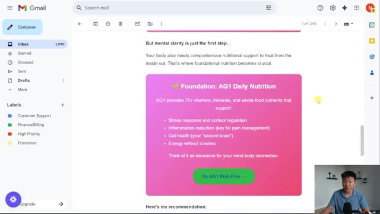
*⏱️ 00:12:56 — Interface de Gmail affichant un e-mail avec un encadré rose pour AG1 Daily Nutrition et un bouton vert "Try AG1 Risk-Free".*

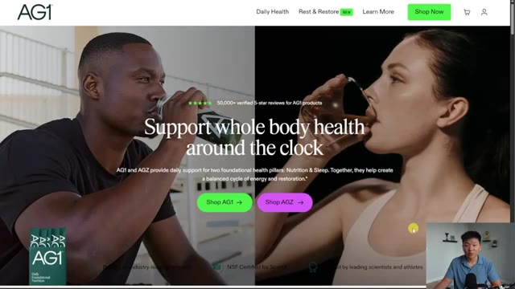
*⏱️ 00:13:01 — Page web officielle d'AG1 montrant des personnes buvant le produit avec le slogan "Support whole body health around the clock".*

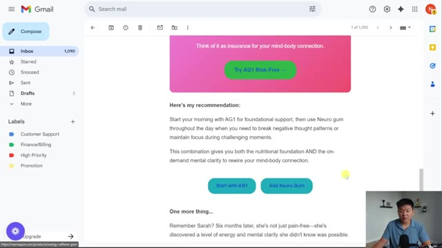
*⏱️ 00:13:06 — Suite de l'e-mail dans Gmail avec des recommandations d'utilisation d'AG1 et de Neuro gum, incluant des boutons d'action.*

---

### ⏱️ `[00:13:12 - 00:13:31]` | Segment #30

**🔊 Audio (Transcription Intégrale Mot pour Mot en Français) :**
> Elle a découvert un niveau d'énergie et de clarté mentale qu'elle ne soupçonnait pas possible. P.S. La recherche sur le perfectionnisme et la douleur n'est que la partie émergée de l'iceberg. La semaine prochaine, je partagerai le lien surprenant entre la santé intestinale et l'anxiété qui est en train de changer notre façon de concevoir le bien-être mental. Restez à l'écoute. Il y a même ce truc tout en bas pour se désabonner et un petit pied de page. Alors, laissez bien tout cela mijoter une petite seconde.

**👁️ Analyse Visuelle d'Écran (gemini-3.5-flash-lite) :**
**Interface & Outils** : Navigateur web, interface Gmail.

**Contenu textuel & Code** : Texte d'un e-mail promotionnel ou informatif sur la santé, incluant la phrase sur le perfectionnisme et la douleur chronique (« P.S. The research on perfectionism and chronic pain is just the tip of the iceberg... »).

**Action / Démonstration** : Navigation et lecture d'un e-mail reçu dans la boîte de réception.

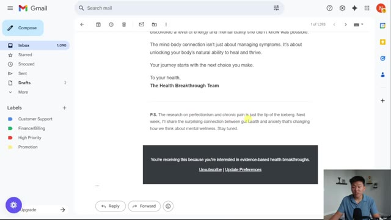
*⏱️ 00:13:16 — Vue d'une interface Gmail affichant un e-mail avec le texte sur le perfectionnisme et la santé, avec le présentateur en médaillon en bas à droite.*

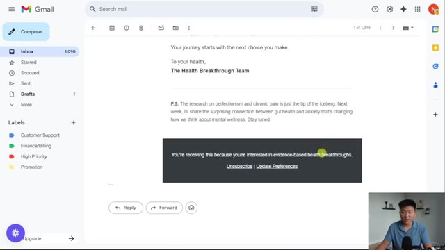
*⏱️ 00:13:26 — Vue similaire de l'interface Gmail défilant légèrement pour montrer le bas du message avec le pied de page de désabonnement.*

---

### ⏱️ `[00:13:31 - 00:14:03]` | Segment #31

**🔊 Audio (Transcription Intégrale Mot pour Mot en Français) :**
> Je n'ai pas du tout fait de "prompt" pour ça. J'ai simplement intégré les connaissances d'Alex Hormozi, celles de Callaway, et celles de quelqu'un qui a écrit un article sur la façon d'écrire en HTML. Et maintenant, si je pouvais juste apporter quelques ajustements supplémentaires à ce flux de travail n8n, qui ne comporte que quatre nœuds, je pourrais probablement l'automatiser confortablement chaque semaine, à condition de lui donner une sorte de mémoire pour qu'il ne raconte pas les mêmes histoires chaque semaine ou qu'il ne promette pas quelque chose la semaine prochaine pour ne rien sortir ensuite. Mais ça a pris environ 10 minutes et c'est vraiment bien. Et maintenant, nous avons juste l'autre bulletin d'information, qui est un flux de travail que j'ai créé et qui est tellement moins bon. Vous savez, il y a un en-tête ici. Il y a des sources intégrées,

**👁️ Analyse Visuelle d'Écran (gemini-3.5-flash-lite) :**
**Interface & Outils** : Gmail, n8n (éditeur de workflow d'automatisation)

**Contenu textuel & Code** : Workflow n8n à 4 nœuds (Schedule Trigger, Search, Poppy, Send a message) et aperçus d'emails HTML.

**Action / Démonstration** : Présentation du résultat du flux de travail automatisé d'envoi d'emails.

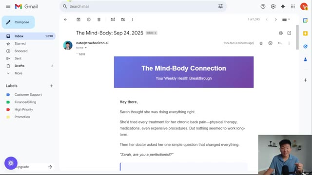
*⏱️ 00:13:39 — Aperçu d'un email formaté en HTML reçu dans Gmail montrant le contenu généré.*

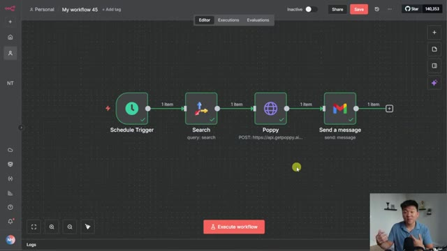
*⏱️ 00:13:47 — Interface n8n affichant un workflow complet avec Schedule Trigger, Search, Poppy et Send a message.*

*⏱️ 00:13:55 — Interface de rédaction d'un message dans Gmail montrant un article structuré.*

---

### ⏱️ `[00:14:03 - 00:14:27]` | Segment #32

**🔊 Audio (Transcription Intégrale Mot pour Mot en Français) :**
> qui sont sympas. On pourrait cliquer sur tous ces liens. Nous avons aussi une section de sources en bas. Mais niveau divertissement, pas du tout. Est-ce que j'achèterais quelque chose de cette newsletter ? Probablement pas. Et bien sûr, ce flux de travail m'a pris beaucoup plus de temps à construire que le simple de Poppy. J'espère donc que vous voyez la différence et à quel point cela simplifie les choses. D'accord. C'était donc un cas d'utilisation simple et vraiment bon où vous pourriez vouloir utiliser réellement Make pour automatiser ce genre de choses.

**👁️ Analyse Visuelle d'Écran (gemini-3.5-flash-lite) :**
**Interface & Outils** : - Image #1 : Gmail (Interface de rédaction).
- Image #2 : Blue Baboon (Plateforme de workflow visuel / automatisation).

**Contenu textuel & Code** : - Image #1 : Texte détaillé sur l'adoption de l'IA, les défis ROI et un plan d'action en 6 points avec des hyperliens de sources.
- Image #2 : Diagramme de workflow reliant des éléments de contenu (vidéos, produits) à une interface de chat, incluant des miniatures de vidéos YouTube.

**Action / Démonstration** : - Image #1 : Présentation/relecture du contenu d'une newsletter en cours de rédaction.
- Image #2 : Visualisation et organisation du flux de travail automatisé dans l'outil Blue Baboon.

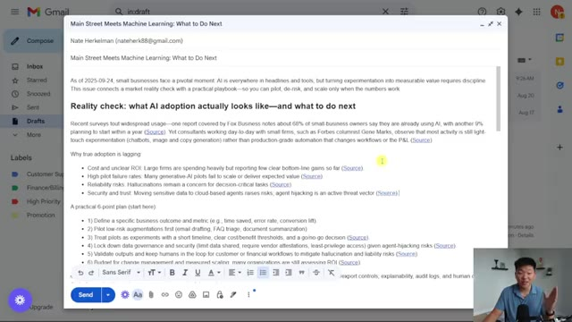
*⏱️ 00:14:09 — Une fenêtre de rédaction d'e-mail dans Gmail affichant un brouillon technique structuré sur l'adoption de l'IA par les petites entreprises.*

*⏱️ 00:14:21 — Interface de la plateforme "Blue Baboon" montrant un canevas visuel avec des blocs connectés (Storytelling, Produits) reliés à une fenêtre de chat IA.*

---

### ⏱️ `[00:14:27 - 00:14:49]` | Segment #33

**🔊 Audio (Transcription Intégrale Mot pour Mot en Français) :**
> Je voulais maintenant vous montrer quelques astuces dans Poppy pour mieux l'utiliser. J'ai donc créé ce groupe où j'ai mis en ligne quatre vidéos YouTube juste ici. Je vais ouvrir une nouvelle conversation et je la configurerais comme ceci. Et je pourrais maintenant dire, à partir de mes vidéos YouTube, s'il vous plaît, créez un guide de style pour ma façon de communiquer et mes valeurs en parlant sur YouTube.

**👁️ Analyse Visuelle d'Écran (gemini-3.5-flash-lite) :**
**Interface & Outils** : Application web "Blue Baboon" (plateforme d'automatisation/organisation de flux de travail IA).

**Contenu textuel & Code** : Miniatures YouTube de Nate Herk, barre de saisie de chat IA ("Ask anything or press / for actions"), options de modèle (Claude 3.5 Sonnet) et outils de recherche/analyse.

**Action / Démonstration** : Démonstration de l'organisation des ressources (vidéos) dans des groupes pour alimenter ensuite une conversation avec l'IA.

*⏱️ 00:14:33 — Interface de l'outil "Blue Baboon" affichant un plan de travail avec un "Group 3" contenant quatre miniatures de vidéos YouTube de l'auteur.*

*⏱️ 00:14:43 — Interface divisée avec le "Group 3" à gauche et une nouvelle fenêtre de chat IA "Ai Chat" ouverte à droite, prête à interagir avec le contenu des vidéos.*

---

### ⏱️ `[00:14:49 - 00:15:10]` | Segment #34

**🔊 Audio (Transcription Intégrale Mot pour Mot en Français) :**
> Donc je peux y aller et envoyer ça. Et ce que ça va faire, c'est que ça va nous donner un guide de style, ce qui est vraiment important, et voici pourquoi. Donc, la façon dont Poppy fonctionne réellement sous le capot, c'est qu'il va lire l'ensemble de ces quatre transcriptions à chaque fois que je lui pose une question. Et ce que ça fait, c'est que ça va vraiment augmenter votre fenêtre de contexte. Et comme nous le savons tous, plus il y a de contexte, plus il y a de tokens, plus cela va vous coûter cher.

**👁️ Analyse Visuelle d'Écran (gemini-3.5-flash-lite) :**
**Interface & Outils** : Blue Baboon (application web) avec un panneau de chat IA (Claude 4 Sonnet)

**Contenu textuel & Code** : Quatre miniatures de vidéos YouTube dans un panneau étiqueté « Group 3 » et un guide de style intitulé « Core Communication Values » (1. Authenticity Over Expertise, 2. Practical Value First) dans le panneau de chat IA.

**Action / Démonstration** : Le présentateur explique comment l'agent IA analyse les transcriptions de vidéos pour générer un guide de style.

*⏱️ 00:14:54 — Interface de l'application web Blue Baboon montrant un groupe de quatre vidéos YouTube et un panneau de chat IA affichant les valeurs de communication de base.*

---

### ⏱️ `[00:15:10 - 00:15:28]` | Segment #35

**🔊 Audio (Transcription Intégrale Mot pour Mot en Français) :**
> Donc ce que nous pouvons faire, c'est simplement copier ce guide de style ici, qui utilise indéniablement moins de jetons que ces quatre vidéos YouTube réunies. Je pourrais ensuite simplement cliquer sur ce T pour ajouter un bloc de texte et y coller ce guide de style de communication. Ainsi, au lieu d'avoir ces quatre vidéos YouTube connectées, je pourrais simplement connecter ce guide de style.

**👁️ Analyse Visuelle d'Écran (gemini-3.5-flash-lite) :**
**Interface & Outils** : Blue Baboon (application web d'IA et de gestion de contenu)

**Contenu textuel & Code** : Génération d'un « Communication Style Guide » par l'IA (Claude 4 Sonnet) et manipulation de blocs de texte dans l'espace de travail.

**Action / Démonstration** : Copie et ajout d'un bloc de texte contenant le guide de style de communication dans l'application Blue Baboon.

*⏱️ 00:15:15 — L'interface de Blue Baboon montre un panneau à gauche avec quatre vidéos YouTube et un panneau de chat IA à droite générant un « Communication Style Guide ».*

*⏱️ 00:15:19 — L'utilisateur clique pour ajouter un nouveau bloc de texte (« T ») au centre de l'espace de travail.*

*⏱️ 00:15:24 — Le bloc de texte nouvellement créé contient le guide de style de communication copié depuis le panneau de chat IA.*

---

### ⏱️ `[00:15:28 - 00:15:49]` | Segment #36

**🔊 Audio (Transcription Intégrale Mot pour Mot en Français) :**
> Et maintenant, cet assistant est entraîné sur ma façon de parler et sur ce que je valorise. Donc vous pouvez voir les mêmes choses comme l'authenticité plutôt que l'expertise, la valeur pratique, une communication axée sur les affaires. Il met également en valeur certains mots ou expressions que je dis constamment afin que, si je voulais que cet outil m'aide à rédiger des scripts pour mes futures vidéos YouTube, il puisse réellement me ressembler. La proposition de valeur principale étant encore une fois que c'est beaucoup moins cher.

**👁️ Analyse Visuelle d'Écran (gemini-3.5-flash-lite) :**
**Interface & Outils** : Interface web Blue Baboon (outil de mind mapping ou de gestion de contenu avec IA)

**Contenu textuel & Code** : Un document intitulé "Communication Style Guide" listant les valeurs clés : "1. Authenticity Over Expertise", "2. Practical Value First", et "3. Business-Focused Communication", avec un panneau de chat IA sur la droite.

**Action / Démonstration** : Affichage et revue du guide de communication généré par l'assistant IA basé sur les vidéos YouTube du créateur.

*⏱️ 00:15:34 — Interface de l'application Blue Baboon montrant un guide de style de communication généré à partir de vidéos YouTube.*

---

### ⏱️ `[00:15:49 - 00:16:08]` | Segment #37

**🔊 Audio (Transcription Intégrale Mot pour Mot en Français) :**
> Et c'est la même chose lorsque vous utilisez GPT ou Claude, plus vous parlez dans un fil de discussion, pire cela peut devenir et aussi plus c'est coûteux. Donc ce que vous devriez faire, c'est que, selon votre projet ou votre tâche, vous ayez quelques discussions, mais ensuite, lorsque vous êtes prêt à passer à un sujet différent, créez simplement une nouvelle conversation et recommencez à zéro.

**👁️ Analyse Visuelle d'Écran (gemini-3.5-flash-lite) :**
**Interface & Outils** : Application web Blue Baboon (interface de gestion de contenu/flux de travail avec assistant IA)

**Contenu textuel & Code** : Document textuel "Communication Style Guide" avec des sections sur les valeurs de communication et une interface "AI Chat" avec des exemples de prompts et de réponses.

**Action / Démonstration** : Navigation et présentation visuelle d'un guide de style et d'une interface de chat IA connectée à des vidéos YouTube.

*⏱️ 00:15:54 — Capture d'écran montrant une interface de type tableau blanc interactif ou application web (Blue Baboon) avec un guide de style de communication et une fenêtre de chat IA.*

---

### ⏱️ `[00:16:08 - 00:16:27]` | Segment #38

**🔊 Audio (Transcription Intégrale Mot pour Mot en Français) :**
> Donc, disons que je voulais insérer quelque chose comme une publication LinkedIn. J'ai fait cette publication il y a quelques jours et je vais en copier le lien, mais remarquez qu'elle a une image. Et la plupart de mes publications ont soit des images, soit des vidéos dedans. Donc, quand je retourne sur Poppy et que je colle ça, ce que ça va faire, c'est que ça récupère le média plutôt que le contenu textuel. Donc, encore une fois, correction super facile.

**👁️ Analyse Visuelle d'Écran (gemini-3.5-flash-lite) :**
**Interface & Outils** : LinkedIn et Blue Baboon (application web)

**Contenu textuel & Code** : Publication LinkedIn de Nate Herkelman, interface de canvas/workflow Blue Baboon avec texte et blocs.

**Action / Démonstration** : Copie du lien d'une publication LinkedIn et navigation vers l'interface de l'application Blue Baboon.

*⏱️ 00:16:12 — Capture d'écran montrant le fil d'actualité LinkedIn avec une publication de Nate Herkelman et une notification de copie de lien en bas à gauche.*

*⏱️ 00:16:22 — Interface de l'application Blue Baboon affichant un tableau de bord visuel avec un bloc de contenu LinkedIn.*

---

### ⏱️ `[00:16:27 - 00:16:47]` | Segment #39

**🔊 Audio (Transcription Intégrale Mot pour Mot en Français) :**
> Je retournerais simplement sur LinkedIn. Je copiereis directement ici le texte exact dont je veux qu'il ait connaissance. Et ensuite, je pourrais simplement cliquer sur T pour ajouter un bloc de texte et y coller cela. Et puis ce que je ferais, c'est en gros faire simplement cela pour quelques-unes de mes publications LinkedIn, comme je l'ai fait par ici. Et ensuite, je pourrais ajouter toutes mes publications LinkedIn à ce groupe, qui rassemble l'ensemble de mes écrits textuels sur LinkedIn.

**👁️ Analyse Visuelle d'Écran (gemini-3.5-flash-lite) :**
**Interface & Outils** : Interface web de Blue Baboon et profil LinkedIn

**Contenu textuel & Code** : Publication LinkedIn copiée ("Last week, I was in Malibu...") et affichée dans un bloc de texte de l'application.

**Action / Démonstration** : Copie de texte depuis LinkedIn et collage dans des blocs de texte successifs au sein de l'application Blue Baboon.

*⏱️ 00:16:32 — Capture d'écran montrant un profil LinkedIn avec du texte sélectionné en surbrillance bleue.*

*⏱️ 00:16:37 — Interface de l'application Blue Baboon avec un bloc de texte contenant le contenu collé depuis LinkedIn.*

*⏱️ 00:16:42 — Vue d'ensemble sur l'application Blue Baboon montrant plusieurs blocs de texte avec du contenu LinkedIn collé.*

---

### ⏱️ `[00:16:47 - 00:17:08]` | Segment #40

**🔊 Audio (Transcription Intégrale Mot pour Mot en Français) :**
> Et ensuite, encore une fois, au lieu de demander à l'intelligence artificielle de lire ces cinq publications à chaque fois, je peux simplement la connecter à cet assistant et je peux dire, s'il te plaît, analyse mes publications LinkedIn et crée-moi un guide de style de communication et de valeur spécifiquement pour LinkedIn. Et maintenant, elle les lit et elle crache un guide LinkedIn. Donc ensuite, je peux aller copier ce guide de style LinkedIn, l'ajouter sous forme de champ de texte.

**👁️ Analyse Visuelle d'Écran (gemini-3.5-flash-lite) :**
**Interface & Outils** : Interface web de type canvas/workflow d'intelligence artificielle (Blue Baboon).

**Contenu textuel & Code** : Blocs interactifs comprenant un "Communication Style Guide", un module de chat IA et des aperçus de publications.

**Action / Démonstration** : Présentation du workflow connectant les publications LinkedIn pour générer un guide de style.

*⏱️ 00:16:52 — Un tableau de bord de type workflow ou assistant d'IA (Blue Baboon) montrant un guide de style de communication et des blocs connectés.*

---

### ⏱️ `[00:17:09 - 00:17:41]` | Segment #41

**🔊 Audio (Transcription Intégrale Mot pour Mot en Français) :**
> Et maintenant je n'ai pas besoin que l'IA regarde ces deux dossiers, mais je peux quand même les garder ici au cas où je voudrais les rebrancher pour quelque chose de plus spécifique. Donc maintenant, cet assistant IA ici présent est entraîné sur ma façon de parler à la fois sur YouTube et sur LinkedIn. Et maintenant, je pourrais peut-être l'utiliser pour un agent IA destiné à l'automatisation. Je pourrais connecter cette IA à mon agent de réponse aux e-mails, car ainsi les e-mails vont davantage me ressembler. Ou pour rendre cela encore plus professionnel, je pourrais lui donner accès à genre une centaine de mes e-mails, puis lui faire créer un guide de style pour les e-mails. J'espère donc que vous voyez que les possibilités sont infinies, mais cela demande un tout petit peu de tests pour voir ce qui fonctionne le mieux et comment vous pouvez limiter le nombre de jetons que

**👁️ Analyse Visuelle d'Écran (gemini-3.5-flash-lite) :**
**Interface & Outils** : Interface web Blue Baboon

**Contenu textuel & Code** : Blocs de guides de style pour YouTube et LinkedIn, connectés à une interface de chat IA (AI Chat) affichant des analyses de posts LinkedIn.

**Action / Démonstration** : Le présentateur explique comment l'assistant IA est entraîné sur son style de communication à partir de ses données YouTube et LinkedIn.

*⏱️ 00:17:17 — Capture d'écran montrant l'interface de l'application 'Blue Baboon' avec des blocs de guides de style de communication et une fenêtre de chat IA à droite.*

---

### ⏱️ `[00:17:41 - 00:18:00]` | Segment #42

**🔊 Audio (Transcription Intégrale Mot pour Mot en Français) :**
> que vous utilisez. Encore une fois, ce n'est pas la plateforme la moins chère du marché, mais j'ai travaillé avec Poppy pour vous obtenir un rabais. Utilisez donc le lien ci-dessous ou le code Nate25 et vous obtiendrez une réduction. Nous allons donc commencer à conclure la vidéo ici. Je ne veux pas qu'elle dure trop longtemps. Et si j'essayais de vous montrer tous les cas d'utilisation de Poppy, elle durerait bien trop longtemps. Bien sûr, vous pouvez y coller des éléments comme des reels Instagram. J'étais donc en train de tester certains des reels de Nick.

**👁️ Analyse Visuelle d'Écran (gemini-3.5-flash-lite) :**
**Interface & Outils** : Navigateur web, interface de tableau de bord Blue Baboon.

**Contenu textuel & Code** : Blocs de texte, guides de communication (« Communication Style Guide »), vignettes de vidéos YouTube, et fils de discussion d'intelligence artificielle.

**Action / Démonstration** : Navigation et présentation du flux de travail visuel et des fonctionnalités de la plateforme.

*⏱️ 00:17:45 — Interface web montrant un tableau de bord visuel interconnecté (Blue Baboon) avec des cartes de contenu, des guides de style et le présentateur visible en bas à droite.*

---

### ⏱️ `[00:18:00 - 00:18:22]` | Segment #43

**🔊 Audio (Transcription Intégrale Mot pour Mot en Français) :**
> Tu peux télécharger des TikToks. Et comme je l'ai dit, des fichiers locaux, des PDF, des feuilles de calcul, des images. Mais ce que je trouve être le cas d'utilisation le plus cool, c'est un peu comme ce qu'on a fait avec cette newsletter, c'est quand tu télécharges des vidéos d'autres personnes parce que tu veux appliquer leur expertise à ton expertise. Donc ce qu'on a juste ici, c'est une conférence TED et je vais la connecter à cet assistant IA. Donc cette conférence TED parle des risques catastrophiques de l'IA et d'une voie plus sûre.

**👁️ Analyse Visuelle d'Écran (gemini-3.5-flash-lite) :**
**Interface & Outils** : Interface web de Blue Baboon

**Contenu textuel & Code** : Blocs connectés comprenant des guides de style de communication et une fenêtre de chat IA.

**Action / Démonstration** : Navigation et présentation visuelle d'un workflow de traitement de contenu.

*⏱️ 00:18:06 — Interface de l'application 'Blue Baboon' montrant un tableau de bord avec des blocs de contenu et de workflow.*

---

### ⏱️ `[00:18:22 - 00:18:45]` | Segment #44

**🔊 Audio (Transcription Intégrale Mot pour Mot en Français) :**
> Alors disons que j'ai été vraiment inspiré par cette vidéo et que je voulais faire une publication LinkedIn et peut-être même une vidéo YouTube à ce sujet. En me basant sur mon style sur LinkedIn et mon style sur YouTube, aide-moi à créer une publication LinkedIn à partir de la nouvelle vidéo que je t'ai fournie, les risques catastrophiques de l'intelligence artificielle, et donne-moi aussi quelques idées sur la façon dont je pourrais faire une vidéo YouTube sur ce sujet. Donc je vais envoyer ça. Cela fonctionnerait probablement mieux avec le prompt YouTube si je lui fournissais également quelques vidéos sur le positionnement sur YouTube.

**👁️ Analyse Visuelle d'Écran (gemini-3.5-flash-lite) :**
**Interface & Outils** : Application web Blue Baboon avec un assistant conversationnel (AI Chat) et un éditeur de mindmap.

**Contenu textuel & Code** : Historique des conversations dans l'assistant IA et directives de style LinkedIn visibles sur les blocs de texte à gauche.

**Action / Démonstration** : L'utilisateur configure un prompt dans l'assistant IA pour générer du contenu basé sur son style LinkedIn.

*⏱️ 00:18:27 — Interface de l'application web Blue Baboon montrant un panneau de discussion avec une intelligence artificielle (AI Chat) et des notes de style sur le côté gauche.*

---

### ⏱️ `[00:18:45 - 00:19:05]` | Segment #45

**🔊 Audio (Transcription Intégrale Mot pour Mot en Français) :**
> Donc je pourrais aller voir un expert de YouTube comme Ed ou Charlie et je pourrais utiliser une tonne de leurs formations sur YouTube concernant YouTube et je pourrais injecter ça également. Alors voyons ce qu'on a. Voici la publication LinkedIn. Donc la sécurité de l'IA vient de devenir une réalité et nous devons en parler. La semaine dernière, j'ai regardé bla, bla, bla. Le truc, c'est que Benji n'est pas un prophète de malheur ordinaire.

**👁️ Analyse Visuelle d'Écran (gemini-3.5-flash-lite) :**
**Interface & Outils** : Application web Blue Baboon (interface de chat IA)

**Contenu textuel & Code** : Publication LinkedIn générée sur l'IA et suggestions de titres de vidéos YouTube ("YouTube Video Ideas Based on This Topic").

**Action / Démonstration** : Le présentateur commente le texte généré par l'IA basé sur les données injectées.

*⏱️ 00:18:50 — Interface web montrant un chat IA (Blue Baboon) affichant une publication LinkedIn et des idées de vidéos YouTube générées, avec le présentateur en médaillon en bas à droite.*

---

### ⏱️ `[00:19:05 - 00:19:23]` | Segment #46

**🔊 Audio (Transcription Intégrale Mot pour Mot en Français) :**
> C'est l'un des parrains de l'IA. Nous avons des points clés. Nous avons ces flèches, que j'utilise toujours dans mes publications LinkedIn. Nous avons un résumé à la fin pour ceux qui construisent avec des outils d'IA, blabla, bla. Cela ressemble vraiment à mon style de publication et ça me ressemble bien. Et puis nous avons aussi quelques idées de vidéos YouTube sur le sujet. Ce n'était probablement pas le meilleur exemple, comme je l'ai dit.

**👁️ Analyse Visuelle d'Écran (gemini-3.5-flash-lite) :**
**Interface & Outils** : Application web Blue Baboon (interface de chat IA avec volet de mindmap et options de modèle de style).

**Contenu textuel & Code** : Texte généré imitant le style LinkedIn avec des points clés ("The key takeaway") et des flèches pour les puces.

**Action / Démonstration** : Affichage et lecture du contenu généré par l'IA correspondant au style de publication de l'utilisateur.

*⏱️ 00:19:09 — Une interface de chat IA (Blue Baboon) affichant un brouillon de publication LinkedIn structuré avec des points clés et des puces en forme de flèches.*

---

### ⏱️ `[00:19:23 - 00:19:45]` | Segment #47

**🔊 Audio (Transcription Intégrale Mot pour Mot en Français) :**
> Mais à partir de là, nous pourrions fondamentalement juste ajouter d'autres sources et continuer à peaufiner nos instructions jusqu'à ce que nous arrivions à un point où nous aimons vraiment la façon dont l'assistant IA se comporte. Et puis, une fois que nous avons entraîné cet outil sur toutes nos données et tout ce que nous aimons, nous pourrions le connecter à n'importe quel flux de travail N8N que nous voulons. J'espère donc que vous êtes impressionnés par Poppy et que vous comprenez la puissance de l'utiliser avec N8N. Si vous voulez voir plus de contenu de ce genre et d'autres cas d'utilisation, alors regardez absolument les autres vidéos sur ma chaîne.

**👁️ Analyse Visuelle d'Écran (gemini-3.5-flash-lite) :**
**Interface & Outils** : Blue Baboon (application web de mind mapping et assistant IA)

**Contenu textuel & Code** : Guide de style de communication, notes textuelles et interface de chat IA (Claude 4 Sonnet)

**Action / Démonstration** : Navigation et présentation des différentes sources de données et instructions configurées dans l'outil d'IA.

*⏱️ 00:19:29 — Interface Blue Baboon montrant une fenêtre de chat IA et des notes connectées sur fond de mind map.*

*⏱️ 00:19:34 — Vue d'ensemble de la mind map dans l'outil Blue Baboon avec plusieurs sources de données connectées.*

---

### ⏱️ `[00:19:45 - 00:20:08]` | Segment #48

**🔊 Audio (Transcription Intégrale Mot pour Mot en Français) :**
> Il y a des tonnes d'automatisations de création de contenu que Poppy pourrait rendre beaucoup plus puissantes. Et si vous recherchez une expérience d'apprentissage plus pratique, alors consultez définitivement ma communauté Plus. Le lien pour cela est dans la description. Et vous pouvez également obtenir une réduction sur Poppy si vous êtes membre. Mais bref, nous avons une communauté de plus de 2 500 membres qui construisent et gagnent de l'argent chaque jour avec N8N. Et nous avons une section salle de classe avec trois cours complets, Agent Zero pour les débutants, 10 heures à 10 secondes où nous plongeons dans N8N.

**👁️ Analyse Visuelle d'Écran (gemini-3.5-flash-lite) :**
**Interface & Outils** : Navigateur web (plateforme communautaire Skool)

**Contenu textuel & Code** : Publications de la communauté, fils de discussion, modules de formation "Start Here", "Agent Zero", "10 Hours to 10 Seconds", "One Person AI Agency", "n8n Templates" et "Step-by-Step Builds".

**Action / Démonstration** : Navigation dans la communauté en ligne et présentation des modules de formation pratique de la communauté Plus.

*⏱️ 00:19:57 — Page d'accueil de la communauté "AI Automation Society Plus" sur Skool montrant le fil d'actualité, les épingles et les discussions de membres.*

*⏱️ 00:20:02 — Onglet "Classroom" de la communauté "AI Automation Society Plus" affichant les différents modules de formation (Start Here, Agent Zero, n8n Templates, etc.).*

---

### ⏱️ `[00:20:08 - 00:20:28]` | Segment #49

**🔊 Audio (Transcription Intégrale Mot pour Mot en Français) :**
> Et ensuite notre nouveau cours pour les membres annuels, qui est l'agence IA d'une seule personne, où vous apprenez à bâtir une entreprise d'automatisation par IA évolutive. Et je pense qu'il y a une énorme opportunité rien qu'en utilisant Poppy seule, avant même de configurer des automatisations, pour apporter beaucoup de valeur aux clients qui créent constamment du contenu ou qui ont besoin de créer constamment du contenu. Et ils veulent que tout ce contenu reste très fidèle à l'image de leur entreprise.

**👁️ Analyse Visuelle d'Écran (gemini-3.5-flash-lite) :**
**Interface & Outils** : Plateforme LMS Skool (AI Automation Society Plus)

**Contenu textuel & Code** : Modules de cours affichés : "Start Here", "Agent Zero", "10 Hours to 10 Seconds", "One Person AI Agency", "n8n Templates", et "Step-by-Step Builds".

**Action / Démonstration** : Navigation et présentation des différents modules de formation disponibles dans la communauté, avec le curseur survolant le module "Start Here".

*⏱️ 00:20:13 — Capture d'écran de l'interface de la plateforme Skool montrant la section "Classroom" de la communauté AI Automation Society Plus avec plusieurs modules de cours.*

---

### ⏱️ `[00:20:28 - 00:20:39]` | Segment #50

**🔊 Audio (Transcription Intégrale Mot pour Mot en Français) :**
> Mais c'est tout pour la vidéo d'aujourd'hui. Si vous avez appris quelque chose de nouveau ou si vous avez aimé, veuillez mettre un pouce bleu, ça m'aide vraiment énormément. Et comme toujours, je vous remercie d'être arrivés jusqu'à la fin de la vidéo. Je vous vois à la prochaine. Merci à tous.

**👁️ Analyse Visuelle d'Écran (gemini-3.5-flash-lite) :**
**Interface & Outils** : Interface web Blue Baboon

**Contenu textuel & Code** : Blocs de contenu, images de miniatures YouTube et liens connectés par des lignes de flux de travail.

**Action / Démonstration** : Présentation du workflow global de l'application ou conclusion de la vidéo.

*⏱️ 00:20:31 — Un diagramme de workflow interactif sur l'interface web "Blue Baboon" montrant des blocs de données interconnectés, avec le présentateur visible en bas à droite.*

---

