# 🎬 Build ANYTHING with Claude Sonnet 4.5 and n8n AI Agents

> **Chaîne** : [Nate Herk | AI Automation](https://www.youtube.com/@nateherk/featured)  
> **Lien YouTube** : [https://www.youtube.com/watch?v=X80ljdCPM_U](https://www.youtube.com/watch?v=X80ljdCPM_U)  
> **Date de publication** : 20251001  
> **Durée** : 00:19:20  
> **Identifiant vidéo** : `X80ljdCPM_U`  
> **Transcription & Analyse** : `whisper-v3-large-turbo+gemini-3.5-flash-lite`  

---

## 📌 Synthèse Exécutive & Outils

### 💡 Résumé
Dans cette vidéo, Nate Herk explore l'impact de la sortie par Anthropic de **Claude Sonnet 4.5**, présenté comme leur modèle d'intelligence artificielle le plus intelligent et performant à ce jour, notamment en matière de codage, de raisonnement complexe et d'automatisation. L'animateur démontre comment intégrer ce modèle de pointe au sein des agents IA de la plateforme d'automatisation **n8n**, soulignant le bond qualitatif qu'il apporte pour la création de flux de travail autonomes et l'exécution de tâches techniques exigeantes.

La session passe rapidement de la théorie aux démonstrations pratiques dans **n8n**, en abordant des cas d'usage concrets tels que la création de contenu, l'évaluation de larges contextes et l'orchestration d'outils multiples sans nécessiter de prompts système complexes. Face aux limitations techniques rencontrées lors de l'appel direct de l'API Anthropic (liées à des paramètres comme `top_p` ou la température), une solution de contournement robuste est mise en avant via **OpenRouter**, illustrant les bonnes pratiques d'ingénierie pour centraliser la facturation et le routage des modèles.

### 🛠️ Outils, Modèles & Logiciels Présentés
*   **Claude Sonnet 4.5** : Le nouveau modèle de pointe d'Anthropic, optimisé pour le codage autonome, le raisonnement avancé, les tâches d'agents du monde réel et l'analyse dans des domaines spécialisés.
*   **n8n** : Une plateforme d'automatisation de flux de travail puissante et accessible, utilisée pour concevoir des agents IA sophistiqués et connecter des modèles de langage à divers outils.
*   **OpenRouter** : Une plateforme de routage d'API agnostique recommandée pour connecter facilement de multiples modèles de chat (dont Sonnet 4.5) tout en centralisant le suivi de l'utilisation et la facturation.
*   **Claude (Haiku, Sonnet, Opus)** : La famille de modèles d'Anthropic, segmentée selon des cas d'usage allant de la vitesse et l'accessibilité (Haiku) au raisonnement à puissance maximale (Opus).
*   **Console Anthropic Claude** : L'environnement développeur permettant de configurer la facturation et de générer les clés API nécessaires à l'utilisation directe des modèles de la marque.

### 🔑 Points Clés & Enseignements Stratégiques
*   **Positionnement et supériorité de Sonnet 4.5** : Le modèle surpasse ses prédécesseurs et certains concurrents (comme GPT-5 et Codex) sur les benchmarks de codage, d'utilisation d'ordinateurs et d'analyse financière, tout en maintenant le même prix que son prédécesseur Sonnet 4.
*   **Performances exceptionnelles en ingénierie logicielle** : Avec un score de 77 à 82 % au benchmark *SWE Bench Verified*, Sonnet 4.5 démontre une capacité quasi-professionnelle à corriger et rédiger du code de manière autonome sur de vastes bases de code.
*   **Expertise sectorielle accrue** : Le modèle surpasse la famille Claude dans des domaines hautement complexes tels que la finance, le droit, la médecine et les STEM, offrant des conseils plus précis et de niveau expert pour les agents décisionnels.
*   **Gestion de la fenêtre de contexte** : Bien que limité à 200 000 jetons dans sa configuration standard (face aux millions de jetons de certains concurrents), Sonnet 4.5 compense par une mémoire plus robuste et une capacité élevée à extraire des informations pertinentes de documents denses.
*   **Contournement des erreurs d'API natives** : En cas de bugs initiaux avec l'API officielle d'Anthropic (liés à des paramètres de requête comme `top_p` ou la température), l'utilisation d'**OpenRouter** s'avère être une alternative stable et recommandée pour l'ingénierie en production.
*   **Centralisation et observabilité** : OpenRouter simplifie le développement sur n8n en permettant de basculer instantanément d'un modèle à l'autre tout en conservant une vision unifiée de la consommation et des coûts.
*   **Réduction de la barrière à l'entrée** : L'alliance de n8n et d'un modèle doté d'un fort raisonnement logique permet aux utilisateurs sans bagage programmatique majeur de concevoir des automatisations IA personnalisées et complexes.
*   **Optimisation des prompts système** : Grâce aux capacités accrues de Sonnet 4.5, les agents nécessitent des instructions système moins rigides ou verbeuses pour interpréter correctement des flux de travail multi-outils.
*   **Évolution vers l'autonomie agentique** : L'IA progresse continuellement sur le spectre de la délégation (passant de 60 % à plus de 80 % de fiabilité autonome), réduisant la charge de travail architecturale des ingénieurs.
*   **Importance de l'expertise métier et de la supervision** : Malgré la puissance des agents, l'intervention humaine reste indispensable pour guider l'IA, valider les processus critiques et maintenir des boucles de rétroaction sécurisées.

---

## ⏱️ Chronologie & Transcription Complète Audio & Visuelle (Mot pour Mot)

### ⏱️ `[00:00:00 - 00:00:35]` | Segment #01

**🔊 Audio (Transcription Intégrale Mot pour Mot en Français) :**
> Donc Anthropic vient de sortir Claude Sonnet 4.5, qui est leur modèle d'intelligence artificielle le plus récent et leur modèle d'intelligence artificielle le plus intelligent à ce jour. Donc aujourd'hui, je vais parler de la façon dont vous pouvez tout construire avec Sonnet 4.5 et les agents IA de N8N. Bien sûr, nous ne allons pas seulement en parler. Je vais aussi vous montrer des choses. Nous allons donc passer dans N8N et nous allons réellement expérimenter quelques trucs avec Sonnet 4.5 et N8N. Mais avant cela, je pense que nous devons juste faire un très bref aperçu de cette nouvelle sortie de Sonnet 4.5. Donc voici ce que nous avons. Sonnet 4.5 est sorti le 29 septembre 2025. Et oui, je sais, on a l'impression qu'un nouveau modèle de base sort à chaque

**👁️ Analyse Visuelle d'Écran (gemini-3.5-flash-lite) :**
**Interface & Outils** : Diapositives de présentation / Diagramme de workflow n8n

**Contenu textuel & Code** : Texte listant les fonctionnalités de Claude Sonnet 4.5 et le plan de l'expérience, ainsi qu'un aperçu de workflow n8n intégrant OpenRouter et des nœuds d'évaluation.

**Action / Démonstration** : Présentation théorique du modèle Claude Sonnet 4.5 et de son intégration prévue avec des agents n8n.

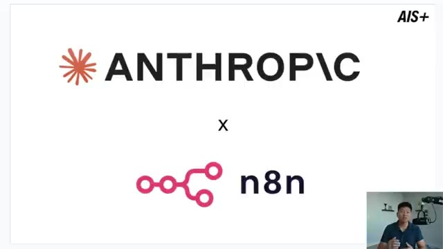
*⏱️ 00:00:09 — Écran titre présentant le partenariat entre Anthropic et n8n.*

*⏱️ 00:00:17 — Aperçu du plan de la vidéo avec une liste de 4 points d'expérimentation et un diagramme de workflow n8n en bas.*

*⏱️ 00:00:26 — Vue d'ensemble de la version Sonnet 4.5 détaillant la date de sortie, la disponibilité et une citation de Sean Ward, CEO de iGent AI.*

---

### ⏱️ `[00:00:35 - 00:01:08]` | Segment #02

**🔊 Audio (Transcription Intégrale Mot pour Mot en Français) :**
> jour. Il est actuellement disponible pour tout le monde, et vous pouvez l'utiliser via le web de Claude, les applications iOS, Android, et vous pouvez également l'utiliser via l'API, c'est pourquoi nous le connectons aujourd'hui à nos agents IA. Et fondamentalement, c'est simplement le dernier modèle d'Anthropic. Claude Sonnet 3.5 est un modèle d'intelligence artificielle conçu pour aider à coder, à construire des agents complexes, à exécuter des flux de travail commerciaux et de recherche, et à utiliser des ordinateurs comme un assistant humain. Voici une citation de Sean Ward, PDG d'iGent AI, Sonnet 3.5 redéfinit nos attentes. Il gère plus de 30 heures de codage autonome, libérant nos ingénieurs pour s'attaquer à des mois de travail architectural complexe.

**👁️ Analyse Visuelle d'Écran (gemini-3.5-flash-lite) :**
**Interface & Outils** : Présentation de diapositives / Document textuel

**Contenu textuel & Code** : Texte présentant les spécifications de Claude Sonnet 4.5 : date de sortie (29 septembre 2025), disponibilité (web, iOS, Android, API) et description de ses capacités (codage, agents IA, flux de travail).

**Action / Démonstration** : Affichage des informations clés concernant le nouveau modèle Sonnet 4.5 pour appuyer les explications du présentateur.

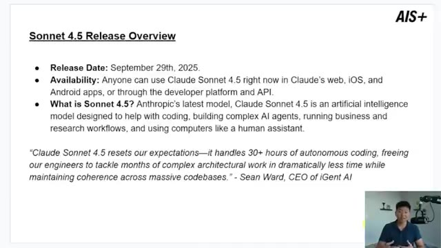
*⏱️ 00:00:43 — Une diapositive de présentation textuelle intitulée « Sonnet 4.5 Release Overview » détaillant la date de sortie, la disponibilité et la définition du modèle, avec une petite fenêtre vidéo du présentateur en bas à droite.*

---

### ⏱️ `[00:01:08 - 00:01:36]` | Segment #03

**🔊 Audio (Transcription Intégrale Mot pour Mot en Français) :**
> en un temps considérablement réduit tout en maintenant la cohérence à travers des bases de données massives, ou désolé, des bases de code. Par le passé, une des limitations de beaucoup de ces modèles a été d'essayer de travailler sur des tonnes et des tonnes et des tonnes de contexte sur des tonnes et des tonnes de temps et comme dans le cadre d'un projet en cours. Il sera donc intéressant de voir comment Sonnet 4.5 change la donne. Et si vous avez entendu parler d'Anthropic, vous avez entendu parler de Claude, vous avez entendu parler d'Opus. Ils font tous fondamentalement partie de la famille de modèles Claude d'Anthropic. Nous en avons donc quelques-uns différents. Nous avons Haiku, nous avons Sonnet, et nous avons Opus.

**👁️ Analyse Visuelle d'Écran (gemini-3.5-flash-lite) :**
**Interface & Outils** : Présentation (diapositive avec texte)

**Contenu textuel & Code** : Texte de présentation : "Sonnet 4.5 Release Overview", "Release Date: September 29th, 2025", "Availability", "What is Sonnet 4.5?" et une citation de Sean Ward, CEO of iGent AI.

**Action / Démonstration** : Présentation des détails de la sortie et des capacités du modèle d'intelligence artificielle Sonnet 4.5.

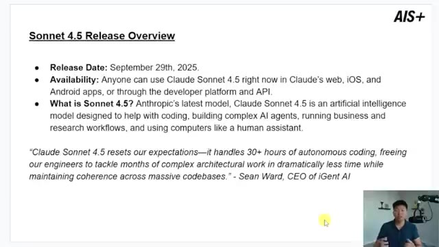
*⏱️ 00:01:15 — Une diapositive de présentation résumant les caractéristiques de Sonnet 4.5, avec le présentateur incrusté en bas à droite.*

---

### ⏱️ `[00:01:36 - 00:02:09]` | Segment #04

**🔊 Audio (Transcription Intégrale Mot pour Mot en Français) :**
> Ils servent tous fondamentalement à des usages différents. Haiku est plus rapide et plus abordable, Sonnet offre un bon équilibre, et puis Opus est comme un modèle de raisonnement à puissance maximale. Et en ce qui concerne le coût, vous pouvez voir la ventilation ici même. Sonnet 4.5 coûte exactement la même chose que Sonnet 4. Et comme vous pouvez le voir, les modèles Opus, qui sont des modèles de raisonnement, sont beaucoup plus chers. Alors pourquoi Sonnet 4.5 est-il meilleur que les modèles Sonnet précédents ? Eh bien, selon les benchmarks et les métriques, que nous examinerons après cette diapositive, Sonnet 4.5 surpasse les modèles antérieurs en matière de codage, de longs parcours et de tâches d'agents du monde réel. Il a une mémoire plus forte et peut gérer des projets plus importants sans oublier. Et il coûte

**👁️ Analyse Visuelle d'Écran (gemini-3.5-flash-lite) :**
**Interface & Outils** : Présentation visuelle (diapositive / tableau)

**Contenu textuel & Code** : Tableaux avec colonnes "Model", "What it's for", "Why Choose It", "Input Cost", "Output Cost" et liste à puces "Why Sonnet 4.5 is Better".

**Action / Démonstration** : Affichage des caractéristiques et de la grille tarifaire des différents modèles Claude lors de la présentation.

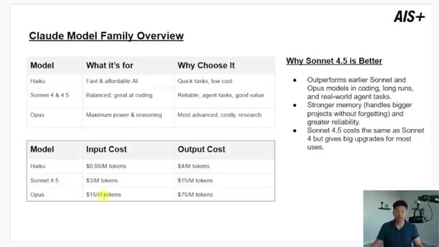
*⏱️ 00:01:44 — Un tableau comparatif des modèles de la famille Claude (Haiku, Sonnet 4 & 4.5, Opus) détaillant leurs cas d'usage, avantages et coûts par million de tokens, accompagné d'une section sur les avantages de Sonnet 4.5.*

---

### ⏱️ `[00:02:09 - 00:02:34]` | Segment #05

**🔊 Audio (Transcription Intégrale Mot pour Mot en Français) :**
> la même chose que Sonnet 4, donc vous en avez plus pour votre argent. Maintenant, un point que je voulais aborder rapidement ici, c'est que la fenêtre de contexte de ce modèle Sonnet est de 200 000, ce qui fait beaucoup plus de jetons que vous ne le pensez probablement, mais ce n'est pas aussi grand que certains autres modèles sur le marché. C'est donc l'une des choses que je qualifiais de limitation de ce modèle. Comme vous pouvez le voir en regardant cette arène Vellum AI avec la fenêtre de contexte, vous pouvez voir, vous savez, Llama, Scout, Llama 4 Maverick, Gemini 2.Flash.

**👁️ Analyse Visuelle d'Écran (gemini-3.5-flash-lite) :**
**Interface & Outils** : Interface web de Vellum (plateforme de comparaison de modèles d'IA)

**Contenu textuel & Code** : Tableau comparatif listant différents modèles (Llama, Gemini, GPT) avec leurs caractéristiques : fenêtre de contexte, coût d'entrée/sortie, vitesse et latence.

**Action / Démonstration** : Le présentateur commente le tableau de comparaison des fenêtres de contexte et des coûts des différents modèles d'IA sur le site de Vellum.

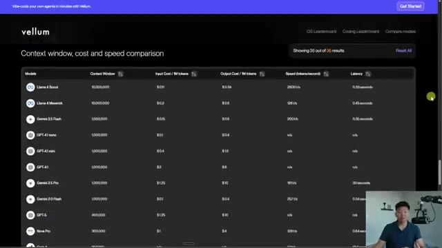
*⏱️ 00:02:28 — Interface web de Vellum affichant un tableau comparatif des fenêtres de contexte, des coûts et de la vitesse des modèles d'IA.*

---

### ⏱️ `[00:02:34 - 00:02:58]` | Segment #06

**🔊 Audio (Transcription Intégrale Mot pour Mot en Français) :**
> Ces types sont dans les millions. Nous avons même GPT 4.1 Nano Mini et 4.1 The Base. C'est aussi un million, 2.5 Pro Gemini. Et vous pouvez voir que GPT-5 en a 400 000. Et le maximum que Claude peut atteindre en ce moment a été de 200 000. À moins d'être sur les versions bêta ou entreprise, je crois que celles-ci montent jusqu'à un million. Mais quand même, je vais vous montrer combien de contexte nous allons fourrer dans cet agent et comment 200 000, c'est encore beaucoup de jetons.

**👁️ Analyse Visuelle d'Écran (gemini-3.5-flash-lite) :**
**Interface & Outils** : Interface web de Vellum (tableau de comparaison des modèles d'IA).

**Contenu textuel & Code** : Tableau listant les modèles (Llama 4 Scout, Gemini 2.5 Flash, GPT-4.1, GPT-5, etc.) avec leurs fenêtres de contexte (ex: 10 000 000, 1 000 000, 400 000), coûts d'entrée/sortie et latence.

**Action / Démonstration** : Navigation et présentation du comparateur de modèles d'IA, illustrant les différentes tailles de fenêtres de contexte.

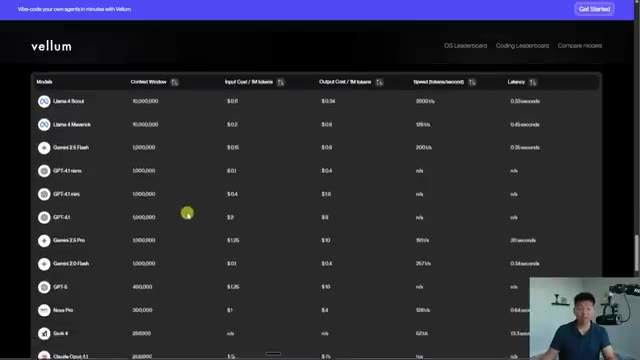
*⏱️ 00:02:40 — Capture d'écran montrant le tableau comparatif des modèles d'IA sur le site Vellum, détaillant la taille de la fenêtre de contexte, les coûts et la vitesse.*

---

### ⏱️ `[00:02:58 - 00:03:21]` | Segment #07

**🔊 Audio (Transcription Intégrale Mot pour Mot en Français) :**
> Donc, bien sûr, je voulais vous montrer quelques repères. Alors regardons certains de ces tests. Le premier est le SWE Bench Verified, qui est un peu comme un examen de codage ou d'ingénierie logicielle. Sonnet 4.5 a obtenu un score de 77 à 82 pour cent, leader de l'industrie, à cet examen, ce qui signifie qu'il peut corriger ou écrire automatiquement des logiciels du monde entier et gérer des tâches de codage avec la compétence d'un développeur professionnel, ce qui est énorme pour les débutants comme moi en codage.

**👁️ Analyse Visuelle d'Écran (gemini-3.5-flash-lite) :**
**Interface & Outils** : Présentation visuelle (diapositive avec graphique et texte explicatif) et incrustation vidéo du présentateur en bas à droite.

**Contenu textuel & Code** : Graphique comparatif des performances ("Software engineering SWE-bench Verified") avec les scores de Sonnet 4.5 (82.0%), Opus 4.1, Sonnet 4, GPT-5 Codex, GPT-5 et Gemini 2.5 Pro, ainsi qu'un texte descriptif sur les capacités de Claude Sonnet 4.5.

**Action / Démonstration** : Présentation des résultats de benchmarks et comparaison des performances des modèles de langage en ingénierie logicielle.

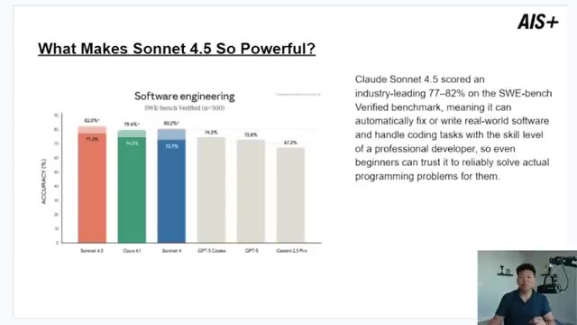
*⏱️ 00:03:04 — Une diapositive de présentation montrant un graphique en barres des scores au test SWE-bench Verified pour différents modèles d'IA, avec Sonnet 4.5 en tête.*

---

### ⏱️ `[00:03:22 - 00:03:51]` | Segment #08

**🔊 Audio (Transcription Intégrale Mot pour Mot en Français) :**
> parce que nous pouvons réellement lui faire confiance pour nous aider à résoudre nos problèmes de programmation. Et j'ai récemment fait l'une de ces mêmes types de vidéos lorsque GPT-5 est sorti, et vous pouvez voir que GPT-5 s'est classé ici, et que Sonnet 4.5 bat déjà GPT-5 et Codex. Nous pouvons également voir, selon ce tableau, que Sonnet 4.5 domine tous les modèles dans des tests clés comme le codage, l'utilisation d'ordinateurs, l'analyse financière, ce qui signifie qu'il est actuellement le meilleur pour automatiser de véritables emplois de logiciels et gérer des tâches informatiques complexes.

**👁️ Analyse Visuelle d'Écran (gemini-3.5-flash-lite) :**
**Interface & Outils** : Présentation vidéo avec graphique statistique et vignette du présentateur en bas à droite.

**Contenu textuel & Code** : Graphique montrant les scores de précision de Sonnet 4.5, Opus 4.1, Sonnet 4, GPT-5 Codex, GPT-5 et Gemini 2.5 Pro, ainsi qu'un texte explicatif sur les capacités de codage de Claude Sonnet 4.5.

**Action / Démonstration** : Le présentateur commente le graphique comparatif des performances des modèles d'IA en génie logiciel.

*⏱️ 00:03:29 — Un graphique en barres comparant les performances de différents modèles d'IA sur le benchmark SWE-bench Verified (Logiciel d'ingénierie), avec Sonnet 4.5 en tête.*

---

### ⏱️ `[00:03:51 - 00:04:09]` | Segment #09

**🔊 Audio (Transcription Intégrale Mot pour Mot en Français) :**
> Et je sais que je vais assez vite là-dessus, je veux juste passer aux choses amusantes dans n8n. Donc si vous voulez voir le document de sortie officiel d'Anthropic, cherchez simplement les notes de version de Claude Sonnet 3.5, ou je les mettrai également dans la description de cette vidéo. Maintenant, celui-ci, j'ai trouvé ça assez intéressant, qui se trouve également dans le document de sortie d'Anthropic, mais vous pouvez voir que nous avons la finance, la médecine, le droit et les STEM.

**👁️ Analyse Visuelle d'Écran (gemini-3.5-flash-lite) :**
**Interface & Outils** : Présentation de diapositives / Document de performance des modèles d'IA

**Contenu textuel & Code** : Tableau comparatif intitulé "What Makes Sonnet 4.5 So Powerful?" listant divers benchmarks (agentic coding, computer use, financial analysis) pour Claude Sonnet 4.5, Claude Opus 4.1, Claude Sonnet 4, GPT-5 et Gemini 2.5 Pro. Texte explicatif à droite.

**Action / Démonstration** : Le présentateur commente le tableau comparatif des performances des modèles d'IA.

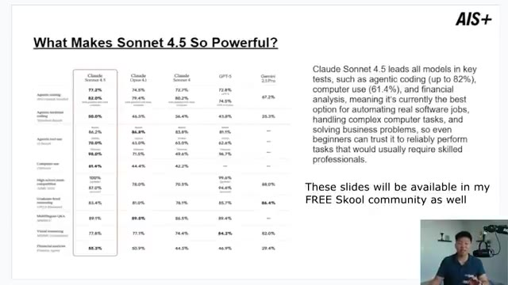
*⏱️ 00:03:55 — Une diapositive de présentation montrant un tableau comparatif des performances de différents modèles d'IA, avec le présentateur en bas à droite.*

---

### ⏱️ `[00:04:10 - 00:04:31]` | Segment #10

**🔊 Audio (Transcription Intégrale Mot pour Mot en Français) :**
> Et en orange tout en haut, nous avons Sonnet 4.5, qui surpasse à peu près tous les autres modèles de la famille Claude dans ces catégories. Et cela signifie fondamentalement que Sonnet 4.5 est bien meilleur pour répondre à des questions compliquées sur la finance, le droit, la médecine et la science que les modèles d'IA précédents. Il donne donc des conseils plus précis et de niveau expert sur ces sujets, ce qui va être vraiment important lorsque vous utiliserez des agents IA.

**👁️ Analyse Visuelle d'Écran (gemini-3.5-flash-lite) :**
**Interface & Outils** : Présentation visuelle (diapositive explicative)

**Contenu textuel & Code** : Graphiques de performance (Winrate vs baseline en %) pour différents modèles de la famille Claude, avec Sonnet 4.5 en tête, accompagnés d'un texte explicatif en anglais.

**Action / Démonstration** : Comparaison graphique des performances des modèles d'IA par le présentateur.

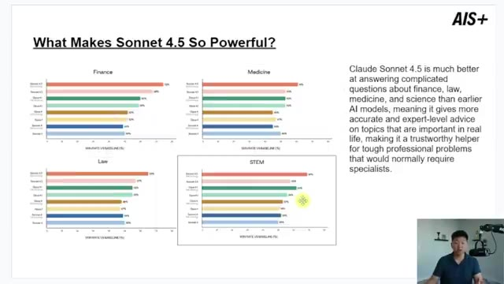
*⏱️ 00:04:15 — Une diapositive intitulée "What Makes Sonnet 4.5 So Powerful?" présentant quatre graphiques à barres comparant les performances des modèles dans les domaines de la Finance, la Médecine, le Droit et les STEM, avec le présentateur en bas à droite.*

---

### ⏱️ `[00:04:31 - 00:04:53]` | Segment #11

**🔊 Audio (Transcription Intégrale Mot pour Mot en Français) :**
> Vous devez toujours guider vos agents avec votre expertise métier et leur donner les bons outils et le contexte dont ils ont besoin pour accomplir le travail, mais c'est vraiment une excellente base de départ. Maintenant, bien sûr, à quel point tout cela est-il pratique ? Comment Sonnet 4.5 et N8N révolutionnent-ils l'automatisation ? Eh bien, nous avons une automatisation plus intelligente pour commencer. Les compétences expertes de Sonnet en matière de raisonnement et de codage permettent aux automatisations N8N de réfléchir, de résoudre des problèmes et de s'adapter aux problèmes.

**👁️ Analyse Visuelle d'Écran (gemini-3.5-flash-lite) :**
**Interface & Outils** : Présentation vidéo avec diapositive explicative et incrustation vidéo du présentateur.

**Contenu textuel & Code** : Graphiques à barres horizontales comparant les performances de différents modèles d'IA (dont Sonnet 4.5) dans les domaines de la finance, de la médecine, du droit et des sciences/technologie/ingénierie/mathématiques (STEM), accompagnés d'un texte descriptif.

**Action / Démonstration** : Le présentateur commente les performances comparatives et la puissance du modèle Sonnet 4.5 par rapport aux versions précédentes.

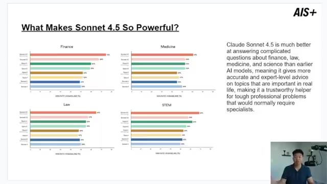
*⏱️ 00:04:36 — Une diapositive intitulée "What Makes Sonnet 4.5 So Powerful?" présentant des graphiques de performance dans quatre domaines (Finance, Médecine, Droit, STEM) avec une explication textuelle sur les capacités de Claude Sonnet 4.5.*

---

### ⏱️ `[00:04:53 - 00:05:14]` | Segment #12

**🔊 Audio (Transcription Intégrale Mot pour Mot en Français) :**
> Nous avons également énormément de puissance personnalisée dans un seul flux de travail, car nous pouvons exécuter des flux vraiment avancés et y intégrer également ces modèles vraiment avancés. Et l'idée reste que l'intelligence artificielle doit automatiser des choses, mais que vous devez être présent pour l'approbation humaine et les boucles de rétroaction. Mais nous nous rapprochons du point où c'était du genre, bon, je ferais confiance à l'intelligence artificielle pour faire 60 %, puis 70 %, puis 80 %, et nous progressons lentement sur ce spectre.

**👁️ Analyse Visuelle d'Écran (gemini-3.5-flash-lite) :**
**Interface & Outils** : Logiciel de présentation / Document texte

**Contenu textuel & Code** : Texte à puces détaillant les points clés : "Smarter Automation", "All-in-One Power", "Accessible AI", "Industry Impact" et "Bottom Line".

**Action / Démonstration** : Le présentateur explique les avantages de l'intégration de modèles avancés dans les flux de travail d'automatisation.

*⏱️ 00:04:58 — Diapositive de présentation résumant l'impact de l'association entre Sonnet 4.5 et n8n sur l'automatisation, avec le présentateur visible en bas à droite.*

---

### ⏱️ `[00:05:14 - 00:05:33]` | Segment #13

**🔊 Audio (Transcription Intégrale Mot pour Mot en Français) :**
> Bien sûr, cela devient de plus en plus accessible. Donc NNN est déjà très accessible au début. Je n'ai pas de bagage en programmation. Beaucoup des gens à qui j'enseigne n'ont pas de bagage en programmation. Donc NNN plus un modèle qui devient de plus en plus performant en programmation et en raisonnement et qui a besoin de moins d'invite système, cela réduit simplement la barrière à l'entrée pour se lancer dans la création d'automatisations IA personnalisées.

**👁️ Analyse Visuelle d'Écran (gemini-3.5-flash-lite) :**
**Interface & Outils** : Logiciel de présentation / diapositives

**Contenu textuel & Code** : Texte détaillé : "How Sonnet 4.5 + n8n Revolutionizes Automation", avec des points clés sur Smarter Automation, All-in-One Power, Accessible AI, Industry Impact et Bottom Line.

**Action / Démonstration** : Présentation visuelle des points clés par le présentateur en incrustation.

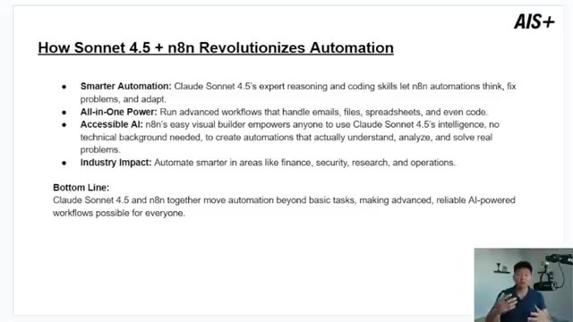
*⏱️ 00:05:19 — Une diapositive de présentation listant les avantages de la combinaison de Claude Sonnet 4.5 et n8n, avec le présentateur visible en incrustation vidéo dans le coin inférieur droit.*

---

### ⏱️ `[00:05:34 - 00:06:08]` | Segment #14

**🔊 Audio (Transcription Intégrale Mot pour Mot en Français) :**
> Et puis bien sûr, l'impact sur l'industrie d'être plus intelligent dans des domaines vraiment clés, comme la finance, le droit, la médecine et la science. Et bien sûr, le code. Donc nous sommes sur le point d'aborder NNN. Je vais vous montrer comment nous pouvons connecter Sonnet 4.5 à nos agents IA. Je vais vous montrer un exemple de création de contenu avec le modèle de base. Nous allons le comparer à d'autres modèles et voir ses performances. Nous allons également faire une évaluation de la fenêtre de contexte. Nous allons donc y insérer une tonne d'informations et voir dans quelle mesure il est capable d'extraire les bonnes réponses de ce contexte. Et puis nous allons lui lancer une tonne d'outils sans même lui donner de prompt système et voir comment il peut tous les gérer. Donc ça a l'air bien. Passons à NNN. Très bien. Donc, première chose, je veux vous montrer

**👁️ Analyse Visuelle d'Écran (gemini-3.5-flash-lite) :**
**Interface & Outils** : Présentation avec aperçu de workflow n8n et le présentateur en incrustation vidéo en bas à droite.

**Contenu textuel & Code** : Texte listant "Today's Experiment" (1. Connecting to a Sonnet 4.5 AI Agent in n8n, 2. Content Creation, 3. Context Window Evaluation, 4. Ultimate Assistant Tool Calling) et un schéma de workflow n8n intitulé "Evaluation Datasets".

**Action / Démonstration** : Le présentateur introduit les étapes de l'expérimentation du jour en affichant l'agenda à l'écran.

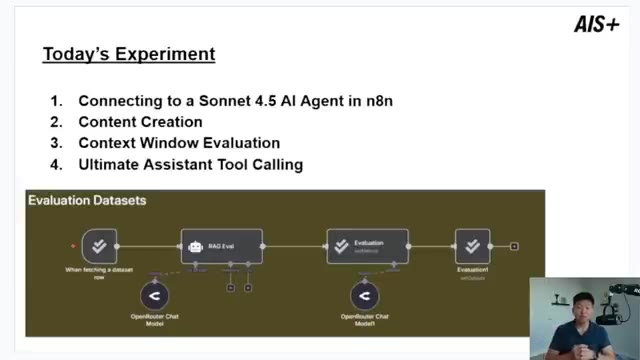
*⏱️ 00:05:42 — Diapositive de présentation listant les quatre points de l'expérience du jour, avec en bas un aperçu d'un diagramme de workflow n8n pour l'évaluation de datasets.*

---

### ⏱️ `[00:06:08 - 00:06:42]` | Segment #15

**🔊 Audio (Transcription Intégrale Mot pour Mot en Français) :**
> vous les gars comment nous pouvons nous connecter à Sonnet 4.5 au sein de nos agents IA. Vous pouvez donc voir que nous avons un agent IA ici. Et ce que nous devons faire, c'est connecter un cerveau. Je vais donc cliquer sur le modèle de chat et je vais choisir Anthropic, mais j'ai remarqué un problème avec cela. Laissez-moi vous montrer ce que je veux dire par là. Et ensuite je vous montrerai comment nous pouvons le réparer. Mais ce que nous avons ici c'est Anthropic, ce que vous devez faire c'est aller ici et créer un compte Anthropic. Donc vous viendriez simplement ici, cliqueriez, créeriez de nouveaux identifiants, et cela vous demande une clé API. Vous iriez alors simplement sur Google et taperiez console Anthropic Claude. Et cela devrait ressembler à ceci. Une fois que vous êtes entré ici, c'est différent de votre environnement habituel de chat avec Claude. Vous devez vous assurer que vous

**👁️ Analyse Visuelle d'Écran (gemini-3.5-flash-lite) :**
**Interface & Outils** : n8n (outil d'automatisation de workflows visuels)

**Contenu textuel & Code** : Nœuds de workflow n8n (« When chat message received », « AI Agent1 ») et options de modèles de langage (Anthropic, Azure OpenAI, AWS Bedrock, Cohere, DeepSeek, Google Gemini).

**Action / Démonstration** : Sélection et configuration d'un modèle de chat Anthropic pour l'intégrer à un agent IA au sein du workflow n8n.

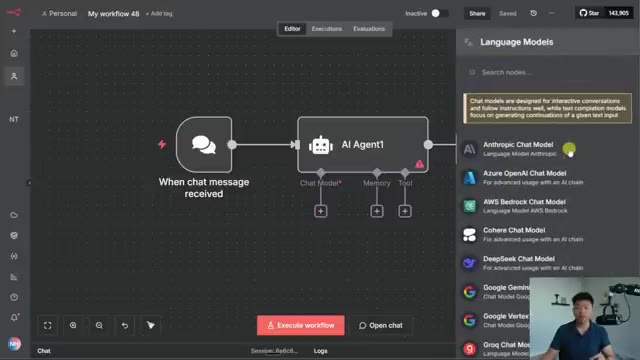
*⏱️ 00:06:16 — Vue d'un workflow n8n avec un agent IA et le panneau latéral affichant les modèles de langage disponibles, montrant la sélection du modèle Anthropic.*

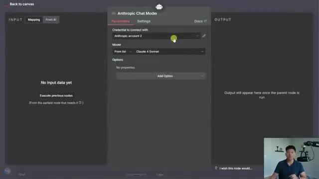
*⏱️ 00:06:25 — Interface de configuration du modèle de chat Anthropic dans n8n, affichant les paramètres de compte et le choix du modèle (Claude Sonnet).*

---

### ⏱️ `[00:06:42 - 00:07:17]` | Segment #16

**🔊 Audio (Transcription Intégrale Mot pour Mot en Français) :**
> entrez quelques informations de facturation. Donc, mettez simplement une carte. Et ensuite, quand vous allez dans cette section en bas appelée clés API, tout ce que vous avez à faire est de cliquer sur créer une clé, de lui donner un nom. Cela vous donnera la chaîne de caractères à copier. Et ensuite, vous allez simplement la coller directement ici, cliquer sur enregistrer, and vous devriez passer au vert. Une fois que vous avez fait cela, vous devriez pouvoir ouvrir cette liste de modèles. Et vous pouvez voir ici, nous avons Sonnet 4.5. Et laissez-moi vous montrer, les gars, ce que j'ai remarqué avec ce modèle. Quand je vais ici et que je dis, bonjour, j'obtiens fondamentalement ce problème, qui est mauvaise requête, vérifiez vos paramètres. Et il est indiqué que top underscore p ne peut pas être défini sur moins un. Et si je vais à top p, il n'est en fait pas défini

**👁️ Analyse Visuelle d'Écran (gemini-3.5-flash-lite) :**
**Interface & Outils** : Console d'administration Anthropic (API Keys) et interface de workflow d'automatisation (n8n).

**Contenu textuel & Code** : Formulaire de création de clé API (nom de la clé, sélection de l'espace de travail) et liste des modèles Anthropic disponibles (Claude Sonnet 4.5, Claude Opus 4, etc.).

**Action / Démonstration** : Navigation dans la console pour créer une clé API, puis configuration des paramètres d'un nœud de chat dans l'outil d'automatisation.

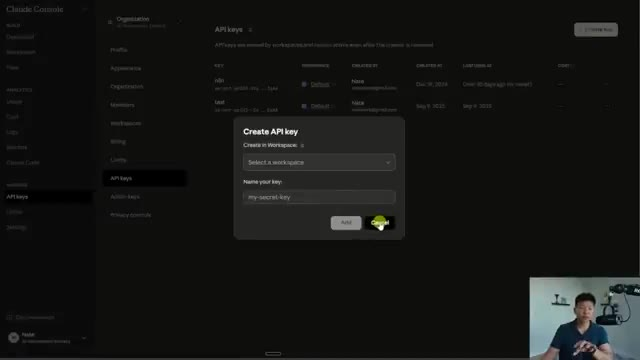
*⏱️ 00:06:51 — Interface de la console Anthropic affichant la section des clés API avec une fenêtre modale pour en créer une nouvelle.*

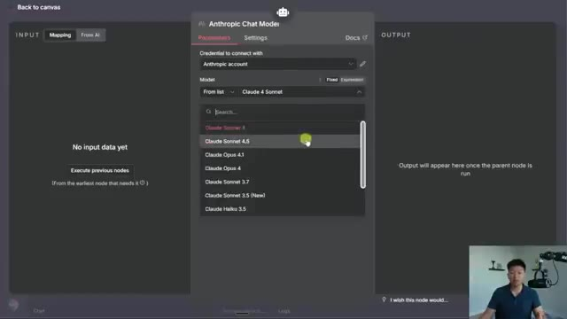
*⏱️ 00:06:59 — Interface de configuration d'un nœud de modèle de chat Anthropic (probablement dans n8n) avec un menu déroulant pour sélectionner différents modèles Claude.*

---

### ⏱️ `[00:07:17 - 00:07:50]` | Segment #17

**🔊 Audio (Transcription Intégrale Mot pour Mot en Français) :**
> à moins un. Et ensuite, j'ai cet autre problème où il est dit que quelque chose ne va pas avec la température. Donc je pense que c'est juste un problème en ce moment avec Sonnet 4.5 via Anthropic, parce que si je vais sur Sonnet 4 et que je reposte le même message, nous n'avons aucun problème. Donc la solution de contournement en ce moment, et la façon dont je vous conseillerais de le faire de toute façon, est de prendre un modèle de chat OpenRouter. C'est fondamentalement la même chose parce que cela vous permet de vous connecter à des tonnes de modèles différents. Et encore une fois, tout ce que vous avez à faire est d'entrer une clé API. Donc vous iriez sur openrouter.ai, vous pouvez voir, vous savez, vous pouvez router vers autant de modèles différents que vous le souhaitez. Et ensuite, vous viendriez juste ici, en haut à droite, aller dans les clés.

**👁️ Analyse Visuelle d'Écran (gemini-3.5-flash-lite) :**
**Interface & Outils** : Interface web de l'outil d'automatisation n8n.

**Contenu textuel & Code** : Nœud de workflow "AI Agent1", configuration de "Anthropic Chat Model", et message d'erreur : "Bad request - please check your parameters: temperature and top_p cannot both be specified for this model."

**Action / Démonstration** : Le créateur montre l'interface d'automatisation et inspecte les paramètres d'un nœud pour identifier l'erreur de configuration du modèle IA.

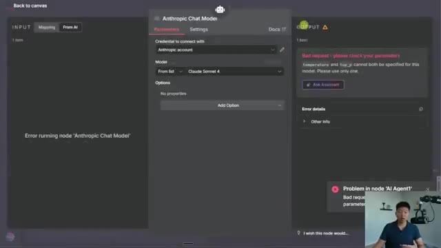
*⏱️ 00:07:25 — Gros plan sur le panneau de configuration d'un nœud Anthropic Chat Model dans n8n, affichant une erreur liée aux paramètres de température et de top_p.*

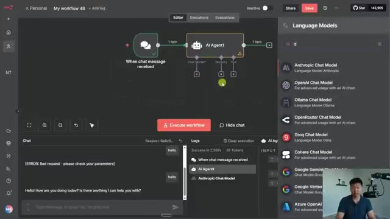
*⏱️ 00:07:33 — Vue d'ensemble d'un workflow n8n montrant un Agent IA relié à un nœud de chat et une liste de modèles de langage sur le panneau latéral droit.*

---

### ⏱️ `[00:07:50 - 00:08:24]` | Segment #18

**🔊 Audio (Transcription Intégrale Mot pour Mot en Français) :**
> et vous créerez une nouvelle clé. Et ensuite vous la copierez, vous la mettrez ici et après vous serez prêts. Et maintenant nous pouvons passer à Sonnet 4.5. Et si je dis bonjour, vous pouvez voir que cela va réellement fonctionner via OpenRouter. Et maintenant nous sommes bons avec Sonnet 4.5. Et je recommanderais en fait d'utiliser OpenRouter de toute façon, parce que vous pouvez suivre toute votre utilisation à travers tous vos différents modèles de chat et vous pouvez simplement garder vos informations de facturation au même endroit. Donc j'aime utiliser OpenRouter. Donc bref, passons à notre première expérience, qui concerne la création de contenu. Donc ce qui se passe ici, c'est que nous avons un agent IA et il n'a pas de système

**👁️ Analyse Visuelle d'Écran (gemini-3.5-flash-lite) :**
**Interface & Outils** : n8n (outil d'automatisation de workflows) et interface web OpenRouter.

**Contenu textuel & Code** : Workflow d'agent IA avec nœud OpenRouter Chat Model, logs d'exécution réussie et graphiques d'activité OpenRouter montrant des appels API récents.

**Action / Démonstration** : Test d'un agent IA configuré via OpenRouter avec une saisie dans le chat ("hello") et vérification des statistiques d'utilisation.

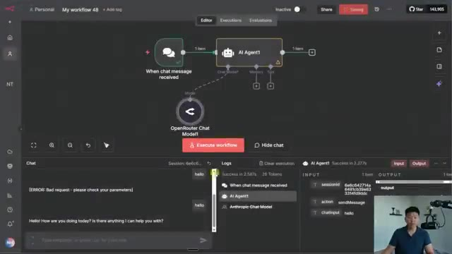
*⏱️ 00:07:59 — Interface d'un outil d'automatisation de type n8n montrant un workflow avec un agent IA et une discussion (chat) de test affichant une réponse réussie du modèle.*

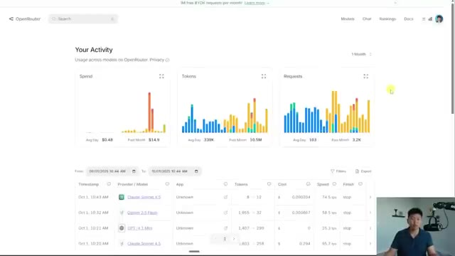
*⏱️ 00:08:16 — Tableau de bord OpenRouter affichant l'activité d'utilisation (Spend, Tokens, Requests) et l'historique des requêtes avec Claude Sonnet 4.5.*

---

### ⏱️ `[00:08:24 - 00:08:57]` | Segment #19

**🔊 Audio (Transcription Intégrale Mot pour Mot en Français) :**
> aucun signal du tout. Donc la seule chose qu'il reçoit, c'est cette même entrée, qui demande simplement de créer un e-mail stylisé en HTML, qui doit ressembler à un rapport professionnel sur les effets d'un sommeil de mauvaise qualité ou d'un manque total de sommeil. Et pour ce premier exemple, nous allons l'essayer avec GPT 4.1. Nous venons donc de recevoir le résultat. Voyons ce que ça donne. Très bien. Nous y voilà, l'impact du manque de sommeil. Gardez à l'esprit que je ne lui ai donné aucun signal système du tout. Nous avons donc les effets clés. Nous avons une petite citation ici, et ensuite nous avons des conseils pour mieux dormir. Et vous pouvez voir que c'est assez concis, mais pas trop mal. Maintenant, nous allons continuer et le relancer. Cette fois-ci

**👁️ Analyse Visuelle d'Écran (gemini-3.5-flash-lite) :**
**Interface & Outils** : n8n et Gmail

**Contenu textuel & Code** : Workflow n8n pour la génération d'e-mails par IA, et rapport HTML sur le sommeil dans Gmail.

**Action / Démonstration** : Exécution du workflow n8n qui envoie un e-mail stylisé généré par l'IA sur le sommeil.

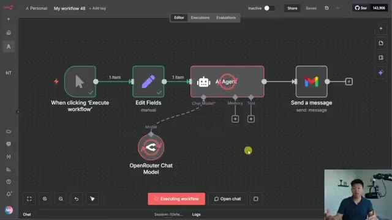
*⏱️ 00:08:32 — Interface n8n montrant un workflow en cours d'exécution avec un nœud déclencheur, des champs d'édition, un agent IA connecté à un modèle OpenRouter et une action Gmail.*

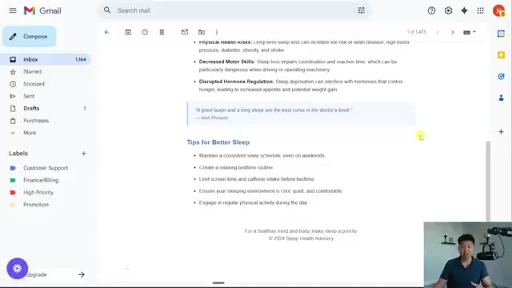
*⏱️ 00:08:49 — Boîte de réception Gmail affichant un e-mail stylisé en HTML généré automatiquement contenant un rapport sur les effets du manque de sommeil et des conseils.*

---

### ⏱️ `[00:08:57 - 00:09:32]` | Segment #20

**🔊 Audio (Transcription Intégrale Mot pour Mot en Français) :**
> nous utilisons Sonnet 4.5. Gardez à l'esprit, aucun system prompt et exactement la même entrée. Donc je ferai le point avec vous les gars quand nous aurons récupéré ça. Très bien. Voici donc ce que nous venons d'obtenir pour Sonnet 4.5. Vous pouvez voir que c'est beaucoup plus coloré avec le HTML, nous avons les effets de la privation de sommeil, nous avons une citation sur le fait que le sommeil n'est pas un luxe, nous avons sept à neuf heures recommandées, 35 pour cent des adultes n'en dorment pas assez, cela aborde ensuite certaines conséquences sur la santé au niveau de votre système cardiovasculaire, de la prise de poids, d'une fonction immunitaire affaiblie, des effets mentaux et cognitifs, nous avons une petite remarque importante ici et donc le point est de voir à quel point celui-ci est détaillé et à quel point il est réellement bien formaté, nous avons des recommandations

**👁️ Analyse Visuelle d'Écran (gemini-3.5-flash-lite) :**
**Interface & Outils** : Interface web de messagerie (Gmail) affichant un contenu HTML rendu.

**Contenu textuel & Code** : Document HTML stylisé sur "The Effects of Sleep Deprivation" généré par Sonnet 4.5.

**Action / Démonstration** : Défilement vertical du rapport HTML reçu dans un e-mail de test.

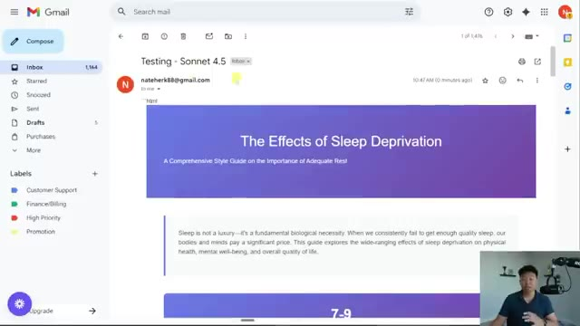
*⏱️ 00:09:05 — Vue dans Gmail de l'e-mail intitulé "Testing - Sonnet 4.5" affichant l'en-tête stylisé d'un rapport HTML sur les effets du manque de sommeil.*

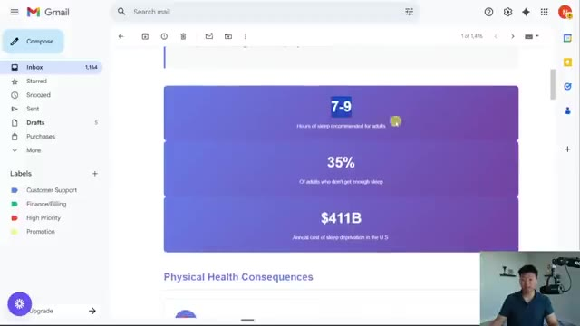
*⏱️ 00:09:14 — Suite du défilement de l'e-mail dans Gmail montrant des blocs de statistiques colorés (7-9 heures, 35%, 411 milliards de dollars).*

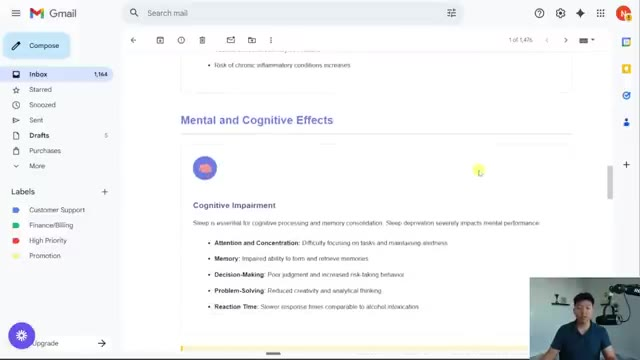
*⏱️ 00:09:23 — Suite du défilement de l'e-mail dans Gmail montrant la section sur les effets mentaux et cognitifs avec des listes à puces.*

---

### ⏱️ `[00:09:32 - 00:10:04]` | Segment #21

**🔊 Audio (Transcription Intégrale Mot pour Mot en Français) :**
> pour un meilleur sommeil et ce qui est génial avec ça, c'est que si vous vous souvenez, cet agent n'a aucune consigne système et il n'a aucun outil. Il a donc été capable de tirer tout cela uniquement du modèle de base lui-même. Et nous allons en lancer un dernier avec ce qui est probablement à ce stade le plus grand concurrent de Sonnet, qui est GPT-5. Je vous recontacterai donc quand nous aurons reçu cet e-mail et nous verrons à quel point nous l'aimons par rapport à Sonnet 4.5. Très bien, voici l'exemple pour GPT-5, les effets du manque de sommeil. Nous avons les points clés. Nous avons ce qui se passe si vous ne dormez pas assez, cognitif, humeur et mental, métabolique et hormonal, cardiovasculaire,

**👁️ Analyse Visuelle d'Écran (gemini-3.5-flash-lite) :**
**Interface & Outils** : n8n et Gmail

**Contenu textuel & Code** : Workflow d'automatisation n8n et un e-mail informatif sur les effets du manque de sommeil envoyé via l'agent IA.

**Action / Démonstration** : Présentation du workflow d'automatisation avec n8n et visualisation du résultat généré reçu dans Gmail.

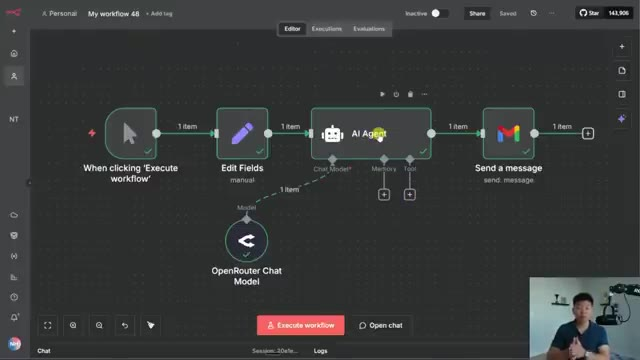
*⏱️ 00:09:40 — Workflow n8n montrant un déclencheur, des champs d'édition, un nœud d'agent IA connecté à un modèle OpenRouter et une action d'envoi de message.*

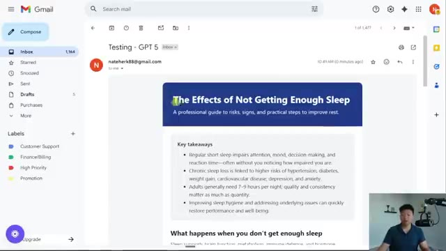
*⏱️ 00:09:56 — Interface de Gmail affichant un e-mail reçu intitulé 'The Effects of Not Getting Enough Sleep' avec un guide professionnel.*

---

### ⏱️ `[00:10:05 - 00:10:27]` | Segment #22

**🔊 Audio (Transcription Intégrale Mot pour Mot en Français) :**
> effets à court terme, risques à long terme. Il aborde également certains signes indiquant que vous manquez peut-être de sommeil. Il aborde aussi le fait de dormir sept à neuf heures par nuit, ce qui est suffisant. Nous avons quelques mesures pratiques pour améliorer votre sommeil et savoir quand demander de l'aide professionnelle. Je dirais donc que c'est assez similaire à celui d'Anthropic. Celui-ci inclut effectivement quelques sources en bas de page, ce qui est plutôt sympa. Et il a vraiment l'air, à mon avis, un peu plus professionnel, comme un rapport.

**👁️ Analyse Visuelle d'Écran (gemini-3.5-flash-lite) :**
**Interface & Outils** : Navigateur web (Gmail)

**Contenu textuel & Code** : Texte sur le sommeil (besoins en sommeil de 7 à 9 heures, étapes pratiques pour l'améliorer) et interface de messagerie Gmail.

**Action / Démonstration** : Consultation d'un document informatif concernant la quantité de sommeil nécessaire et les conseils pour l'améliorer.

*⏱️ 00:10:10 — Une capture d'écran montrant une interface de messagerie (Gmail) avec un document ouvert affichant des informations sur le sommeil, telles que « How much sleep is 'enough'? » et des étapes pratiques pour améliorer le sommeil. Le présentateur apparaît dans un petit encadré vidéo en bas à droite.*

---

### ⏱️ `[00:10:27 - 00:11:00]` | Segment #23

**🔊 Audio (Transcription Intégrale Mot pour Mot en Français) :**
> Encore une fois, c'était Sonnet 4.5. C'était donc coloré. C'est toujours impressionnant. Mais en fait, je pense que je préférerais probablement ChatGPT 5 dans ce cas. D'accord. Donc pour l'instant dans le tableau de score mental, j'ai GPT qui mène pour l'instant, mais voyons ce qui se passe sur le prochain, qui va être l'évaluation de la fenêtre de contexte. Nous allons donc réellement utiliser une fonction d'évaluation de N8N, et nous avons des questions prêtes à être posées. Et ce que nous avons dans le prompt système de cet agent, c'est littéralement juste que vous êtes un agent utile. Et ensuite, nous avons inséré un PDF entier. Donc c'était comme

**👁️ Analyse Visuelle d'Écran (gemini-3.5-flash-lite) :**
**Interface & Outils** : Gmail, interface de workflow RAG (n8n ou similaire)

**Contenu textuel & Code** : Texte d'un e-mail sur les risques de santé liés au sommeil / Diagramme de workflow de test RAG avec blocs "RAG Eval", "Evaluation", et modèles OpenRouter Chat.

**Action / Démonstration** : Navigation et présentation visuelle d'un workflow de test et d'évaluation RAG.

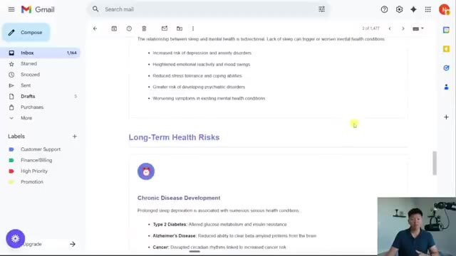
*⏱️ 00:10:35 — Interface Gmail affichant un document ou un e-mail détaillé sur la santé mentale et le sommeil, avec le présentateur en médaillon dans le coin inférieur droit.*

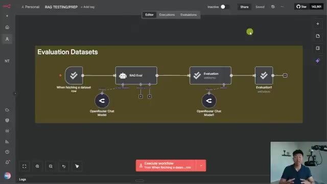
*⏱️ 00:10:43 — Interface d'un outil de workflow (type n8n) nommé "RAG TESTING/PREP", montrant un diagramme de processus d'évaluation de RAG avec différents nœuds connectés.*

---

### ⏱️ `[00:11:00 - 00:11:37]` | Segment #24

**🔊 Audio (Transcription Intégrale Mot pour Mot en Français) :**
> Le rapport 10-K d'Apple. Et voici le document réel que nous avons extrait. Il s'agit donc d'un PDF de 121 pages contenant des tonnes et des tonnes d'informations. Et lorsque nous exécutons ceci, vous verrez que ce PDF entier fait un peu moins de cent mille tokens. Il est donc largement dans les limites de Sonnet 4.5. Mais de toute façon, ce que nous allons faire, c'est commencer ici avec GPT-5. Je vais aller dans l'onglet des évaluations et je vais simplement lancer ce test et nous obtiendrons un score de correction moyen et je vous dirai aussi combien coûte chacune de ces exécutions. Je reviendrai donc vers vous une fois que cette exécution de GPT-5 sera terminée. Très bien, donc GPT-5 vient de

**👁️ Analyse Visuelle d'Écran (gemini-3.5-flash-lite) :**
**Interface & Outils** : Lecteur PDF / Navigateur web et interface de workflow de type n8n.

**Contenu textuel & Code** : Document PDF du rapport 10-K d'Apple et paramètres de configuration pour OpenRouter Chat Model.

**Action / Démonstration** : Présentation du document PDF source et configuration des paramètres d'un modèle d'IA dans un workflow.

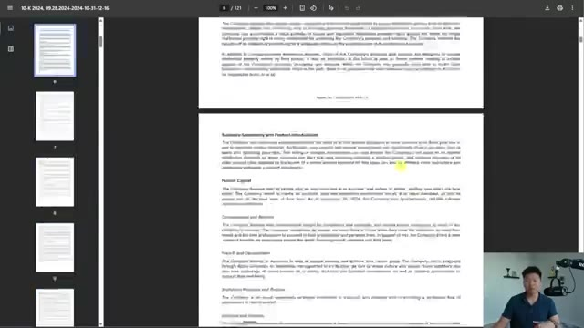
*⏱️ 00:11:09 — Visualisation d'un document PDF de 121 pages affiché à l'écran, avec le présentateur en bas à droite.*

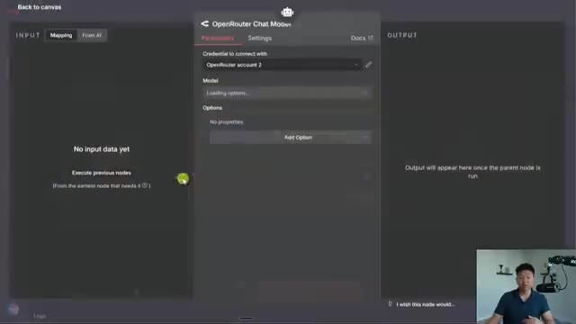
*⏱️ 00:11:18 — Interface de configuration d'un nœud d'automatisation (OpenRouter Chat Model) avec des sections INPUT, Paramètres et OUTPUT.*

---

### ⏱️ `[00:11:37 - 00:12:11]` | Segment #25

**🔊 Audio (Transcription Intégrale Mot pour Mot en Français) :**
> terminé et vous pouvez voir qu'il a obtenu un score de correction de 4,2. Je vais donc rapidement changer ce modèle de chat pour Sonnet 4,5 et nous allons le relancer pour voir s'il va battre 4,2. Je vais donc lancer ce test et nous verrons bien. Et en fait, je viens de remarquer quelque chose de vraiment intéressant. Nous avons donc la comparaison des modèles entre GPT-5 et Claude Sonnet 4,5 ici même sur OpenRouter. Et vous pouvez voir tout d'abord que GPT-5 est moins cher. Donc environ moitié moins cher sur les tokens d'entrée et un peu moins cher sur les tokens de sortie également. Mais ce qui est intéressant ici, c'est que via OpenRouter, il semble que nous obtenions réellement un contexte

**👁️ Analyse Visuelle d'Écran (gemini-3.5-flash-lite) :**
**Interface & Outils** : Interface de workflow (n8n ou similaire) et plateforme OpenRouter.

**Contenu textuel & Code** : Liste des modèles Anthropic (claude-3.5-sonnet, claude-3.7-sonnet, claude-sonnet-4.5) et tableau comparatif de spécifications techniques.

**Action / Démonstration** : Sélection du modèle Sonnet 4.5 dans le menu déroulant de configuration du nœud d'automatisation.

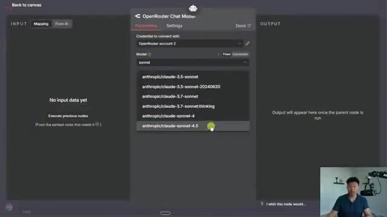
*⏱️ 00:11:45 — Configuration d'un nœud de workflow avec le menu déroulant OpenRouter Chat Model affichant la sélection du modèle Anthropic Claude Sonnet 4.5.*

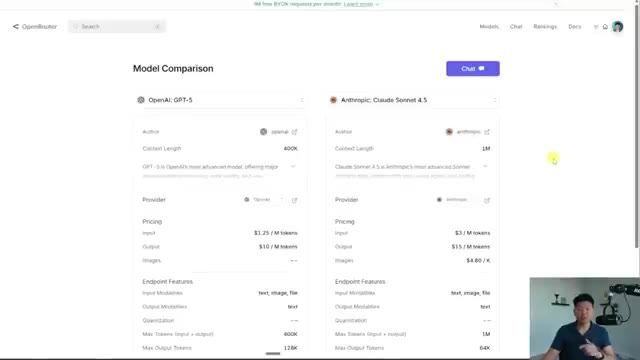
*⏱️ 00:11:54 — Interface OpenRouter montrant une page de comparaison de modèles entre OpenAI GPT-5 et Anthropic Claude Sonnet 4.5.*

---

### ⏱️ `[00:12:11 - 00:12:46]` | Segment #26

**🔊 Audio (Transcription Intégrale Mot pour Mot en Français) :**
> fenêtre d'un million. Et donc je pense que si vous étiez passé par la console d'Anthropic, vous auriez obtenu 200k, mais je suppose qu'on a accès à la version bêta ou entreprise de Sonnet 4.5 via Open Router, donc c'est un énorme plus. Mais en raison de la différence de prix, si Anthropic n'obtient pas un meilleur score sur cette évaluation spécifique que pour ce cas d'usage précis, alors j'opterais pour GPT-5. Mais bien sûr, c'est pour cela que les évaluations sont là, car selon le cas d'usage, les différents modèles vont avoir des performances différentes. Très bien, donc Sonnet 4.5 vient de terminer et vous pouvez voir qu'il a tout juste battu GPT-5 avec un score de exactitude de 4,3, et c'est sur cinq. Maintenant, une chose que je voulais dire, c'est que je

**👁️ Analyse Visuelle d'Écran (gemini-3.5-flash-lite) :**
**Interface & Outils** : OpenRouter et interface de test RAG web

**Contenu textuel & Code** : Comparaison de contexte (1M tokens pour Sonnet 4.5) et métriques d'exécution de tests (tokens, temps d'exécution, score de correction)

**Action / Démonstration** : Navigation et présentation comparative des modèles d'IA et de leurs coûts/capacités contextuelles

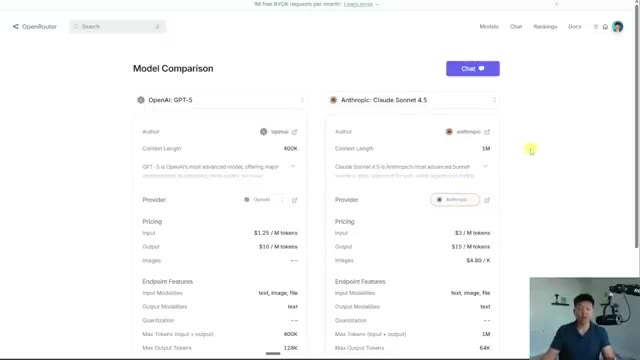
*⏱️ 00:12:19 — Comparatif de modèles sur la plateforme OpenRouter montrant OpenAI GPT-5 et Anthropic Claude Sonnet 4.5 avec leurs caractéristiques et tarifs.*

*⏱️ 00:12:37 — Tableau de bord d'évaluation et de tests RAG (RAG TESTING/PREP) affichant les graphiques de performances et l'historique des exécutions.*

---

### ⏱️ `[00:12:46 - 00:13:20]` | Segment #27

**🔊 Audio (Transcription Intégrale Mot pour Mot en Français) :**
> n'a exécuté que 10 cas d'utilisation, ce qui est un ensemble de données beaucoup trop petit pour savoir vraiment si un modèle est meilleur ou non. Mais je voulais juste vous montrer rapidement comment je commencerais à envisager de comparer objectivement deux modèles différents. Maintenant, une chose à garder à l'esprit ici, c'est le prix. Donc si ces choses avaient exactement le même prix, je préférerais probablement Sonnet 4.5 dans ce cas d'utilisation. Mais comme nous le savons, GPT est un peu moins cher, et si nous allons dans mon activité ici sur Open Router, vous pouvez voir que chacune de ces exécutions prenait environ 96 000 jetons pour Sonnet 4.5, et cela revient à environ 30 centimes. Et quand nous regardons l'évaluation précédente, cela prenait environ 90 000 jetons

**👁️ Analyse Visuelle d'Écran (gemini-3.5-flash-lite) :**
**Interface & Outils** : Application web d'évaluation RAG et tableau de bord OpenRouter.

**Contenu textuel & Code** : Tableaux de données, horodatages, métriques de performance, tokens, coûts, et scores de correction des différents modèles de langage.

**Action / Démonstration** : Navigation et présentation comparative des résultats d'exécutions et des métriques d'utilisation des modèles IA.

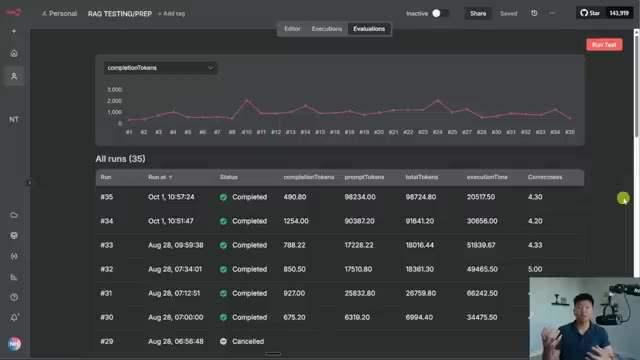
*⏱️ 00:12:55 — Interface web montrant les résultats d'évaluations de tests RAG avec un graphique de performance et un tableau détaillé des différentes exécutions (runs).*

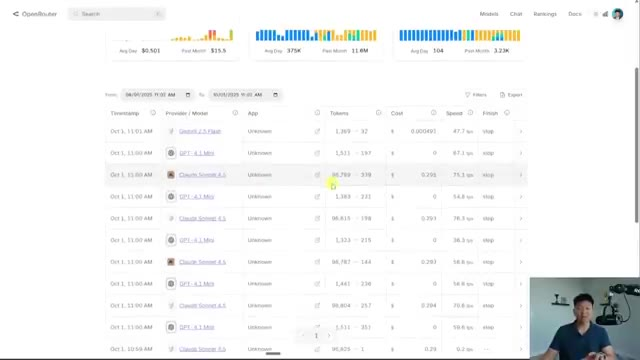
*⏱️ 00:13:11 — Tableau de bord OpenRouter affichant l'historique des requêtes avec les modèles utilisés (Gemini, GPT-4, Claude Sonnet), les tokens, les coûts et la vitesse.*

---

### ⏱️ `[00:13:20 - 00:13:54]` | Segment #28

**🔊 Audio (Transcription Intégrale Mot pour Mot en Français) :**
> pour GPT-5, qui arrive ici à zéro, mais quand on fait le calcul, c'est environ 10 à 12 cents. Donc à peu près moitié moins cher. Et donc la question, bien sûr, est de savoir si ça vaut le coup de payer moitié moins pour des résultats similaires. Ce que je dirais, c'est que vous voulez probablement exécuter plus que seulement 10 ensembles d'évaluation. vous voulez probablement en exécuter près de 100, peut-être même 200. Et ensuite, vous avez beaucoup plus de données parmi lesquelles choisir. Donc je suis en fait revenu très vite pendant que j'étais en train de monter parce que je voulais juste tester quelques modèles de plus. Et vous pouvez voir que c'est vraiment intéressant. En général, ils obtiennent des scores assez élevés. Celui-ci était Sonnet 4. Celui-ci était Gemini Flash, qui est vraiment bon pour trouver l'aiguille dans la

**👁️ Analyse Visuelle d'Écran (gemini-3.5-flash-lite) :**
**Interface & Outils** : Interface web de test et d'évaluation RAG

**Contenu textuel & Code** : Graphique montrant l'évolution des tokens de complétion (#1 à #36) et tableau listant les exécutions (Run #35 à #29) avec leur statut (Completed, Cancelled), les tokens de complétion/prompt/totaux, le temps d'exécution et le score de correction.

**Action / Démonstration** : Analyse et affichage des résultats des différents tests d'exécution de modèles d'IA sur le tableau de bord.

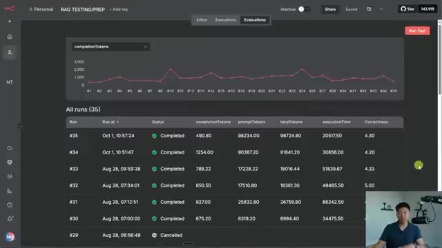
*⏱️ 00:13:28 — Tableau de bord d'évaluation de tests RAG affichant un graphique de tokens et un tableau des exécutions avec les métriques associées.*

---

### ⏱️ `[00:13:54 - 00:14:26]` | Segment #29

**🔊 Audio (Transcription Intégrale Mot pour Mot en Français) :**
> ...un test de la botte de foin ou le fait de parcourir des tonnes de contexte et d'en extraire les bonnes informations. Ici, c'était GPT-4o. Là, c'était Sonnet 3.5. Et ici, c'était DeepSeek R1. L'idée étant que tous ces modèles ont un nombre de tokens différent, un temps d'exécution différent et tout ce genre de choses. Il faut donc vraiment soumettre plus que seulement 10 questions au jeu de données. Mais tout l'enjeu est de déterminer quel modèle spécifique de quelle famille fondamentale spécifique est optimal pour ce cas d'usage précis. Quoi qu'il en soit, je me suis dit que vous trouveriez ça intéressant. Revenons à la vidéo. Mais bref, j'espère que cela vous a été utile et vous montre peut-être comment vous pourriez commencer à réfléchir au choix entre

**👁️ Analyse Visuelle d'Écran (gemini-3.5-flash-lite) :**
**Interface & Outils** : Application web de test RAG (interface de type tableau de bord d'évaluation de modèles IA).

**Contenu textuel & Code** : Tableau listant 40 exécutions (runs) avec des colonnes : Run, Run at, Status (Completed), completionTokens, promptTokens, totalTokens, executionTime, et Correctness. Graphique de tendance en haut.

**Action / Démonstration** : Le présentateur présente et commente les résultats comparatifs des différents modèles d'IA sur le test de RAG.

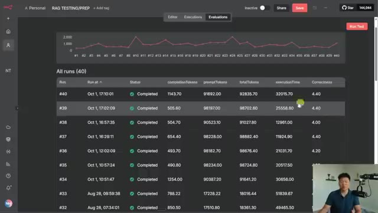
*⏱️ 00:14:02 — Tableau de bord d'évaluations de tests RAG affichant les résultats de différents runs avec les métriques de tokens, temps d'exécution et scores de correction.*

---

### ⏱️ `[00:14:26 - 00:15:01]` | Segment #30

**🔊 Audio (Transcription Intégrale Mot pour Mot en Français) :**
> différents modèles. Donc sur ce, passons à la dernière expérience, qui consiste à faire un peu d'appel d'outils avec nos agents dans n8n. D'accord, pour le dernier exemple, ce que nous allons faire, c'est que nous avons Sonnet 3.5, comme vous pouvez le voir, connecté à une tonne de ces différents outils. Donc des choses basiques comme l'envoi d'e-mails, la gestion d'événements de calendrier et la recherche sur le Web, des choses comme ça. Donc ce que je teste ici, c'est à quelle vitesse un débutant peut arriver dans n8n et connecter des outils à un agent, et nous n'avons même pas de prompt système ici. Tout ce que nous faisons, c'est lui donner l'heure et la date d'aujourd'hui. Commençons donc par un exemple rapide. Je vais dire : utilise ta base de données de contacts pour obtenir l'e-mail de Michael Scott.

**👁️ Analyse Visuelle d'Écran (gemini-3.5-flash-lite) :**
**Interface & Outils** : n8n (éditeur de workflow d'automatisation)

**Contenu textuel & Code** : Un nœud "Sonnet 4.5 Agent" connecté à de multiples sous-nœuds d'outils (Send Email, Email Reply, Update Event, Create Event, Search in Tavily, Get Contacts, etc.)

**Action / Démonstration** : Présentation du workflow d'appel d'outils avec l'agent IA relié à diverses applications.

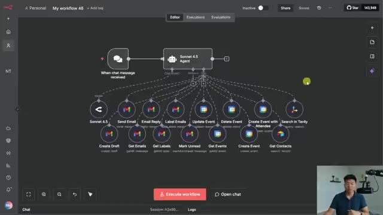
*⏱️ 00:14:35 — Capture d'écran montrant un workflow n8n avec un agent IA central connecté à de nombreux outils (Gmail, Google Calendar, recherche Tavily).*

---

### ⏱️ `[00:15:01 - 00:15:35]` | Segment #31

**🔊 Audio (Transcription Intégrale Mot pour Mot en Français) :**
> et lui envoyer un e-mail pour lui dire que je vais avoir 20 minutes de retard à la réunion d'aujourd'hui. Donc, nous allons l'envoyer. Nous allons masquer le chat et nous allons voir ce qu'il essaie de faire ici. D'accord. Intéressant. Nous avons donc un problème avec la façon dont il essaie d'analyser les arguments de l'outil pour le modèle de chat. Je me demande donc si c'était un problème lié aux outils plutôt qu'à l'appel de certains éléments tels que les sous-flux de travail. Je vais donc réessayer dans ce flux de travail où nous avons un assistant ultime avec des sous-agents plutôt que de simples outils. Je dis donc à l'agent de faire des recherches sur les agents vocaux, puis de les envoyer à Michael Scott. Et vous pouvez voir ce

**👁️ Analyse Visuelle d'Écran (gemini-3.5-flash-lite) :**
**Interface & Outils** : n8n (éditeur de workflow d'automatisation)

**Contenu textuel & Code** : Un nœud d'agent "Sonnet 4.5 Agent" connecté à diverses actions (Send Email, Get Emails, Update Event, Create Event, etc.) et une webcam du présentateur en bas à droite.

**Action / Démonstration** : Le workflow est en cours d'exécution avec un bouton rouge "Executing workflow" en bas de l'écran.

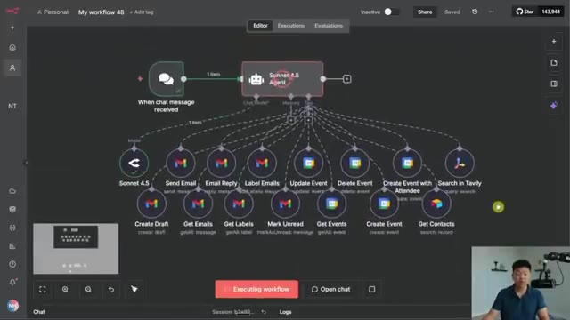
*⏱️ 00:15:10 — Interface d'un workflow d'automatisation montrant un agent relié à de multiples nœuds d'outils (Gmail, Calendar, etc.).*

---

### ⏱️ `[00:15:35 - 00:15:56]` | Segment #32

**🔊 Audio (Transcription Intégrale Mot pour Mot en Français) :**
> ce qui se passe ici, c'est qu'il utilise Perplexity. Il appelle également l'agent de contact. Et maintenant, nous allons voir s'il est capable de transmettre ces informations à l'agent de messagerie et d'envoyer cet e-mail pour nous. Jusqu'ici, tout va bien. Vous pouvez voir qu'il a également été capable d'appeler l'agent de messagerie. D'accord, vous pouvez donc voir qu'il a effectivement terminé et qu'il a dit qu'il avait fait tout cela pour nous. Allons jeter un coup d'œil à l'e-mail. Très bien, j'ai donc pu l'envoyer à la bonne adresse e-mail de la part de Michael Scott.

**👁️ Analyse Visuelle d'Écran (gemini-3.5-flash-lite) :**
**Interface & Outils** : Interface web de workflow / plateforme d'automatisation d'agents IA (style n8n).

**Contenu textuel & Code** : Nœuds de workflow : "When chat message received", "Ultimate Assistant", reliés à différents modules (OpenRouter Chat Model, Simple Memory, Email Agent, Calendar Agent, Contact Agent, Content Creator Agent, Tavily, Perplexity, Calculator).

**Action / Démonstration** : Visualisation et configuration des connexions entre l'assistant principal et les différents agents ou outils d'automatisation.

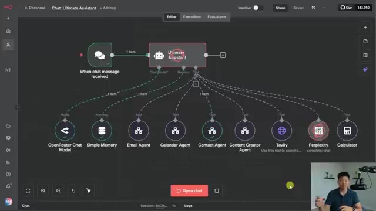
*⏱️ 00:15:40 — Vue d'ensemble d'un diagramme de workflow d'agent IA dans une interface de type n8n, montrant l'assistant principal connecté à plusieurs outils spécialisés comme Email Agent, Calendar Agent, Contact Agent, Tavily et Perplexity.*

---

### ⏱️ `[00:15:56 - 00:16:20]` | Segment #33

**🔊 Audio (Transcription Intégrale Mot pour Mot en Français) :**
> Nous avons les agents vocaux IA qui sont des systèmes logiciels intelligents qui comprennent, interprètent et répondent à la parole humaine en temps réel, comment ils fonctionnent. Nous avons le NLP. Nous avons le TTS. Nous avons les applications actuelles, les avantages et les derniers développements, puis un mot de la fin de Nate. Donc, comme vous pouvez le voir, il est plus que capable de gérer des choses comme ça. Le problème ici était simplement qu'il essayait d'utiliser des outils directement plutôt que des sous-flux de travail pour une raison quelconque.

**👁️ Analyse Visuelle d'Écran (gemini-3.5-flash-lite) :**
**Interface & Outils** : Interface web de workflow / plateforme d'agents IA (Langflow/Flowise)

**Contenu textuel & Code** : Message d'erreur : "Problem in node 'Sonnet 4.5 Agent' - Failed to parse tool arguments from chat model response... SyntaxError: Unexpected end of JSON input"

**Action / Démonstration** : Affichage d'un workflow d'agent IA complexe avec des intégrations Gmail et un journal d'erreurs de parsing de modèle de langage.

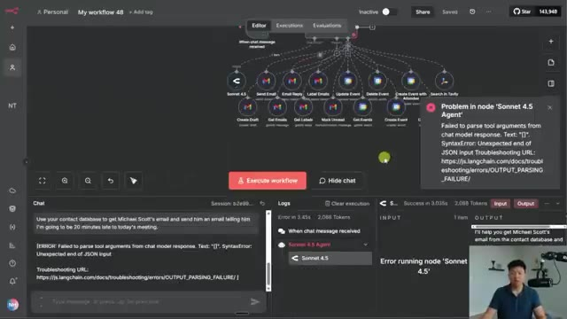
*⏱️ 00:16:14 — Interface graphique d'un outil de workflow d'IA (similaire à Flowise ou Langflow) affichant un nœud 'Sonnet 4.5 Agent' avec une erreur de parsing JSON.*

---

### ⏱️ `[00:16:21 - 00:16:45]` | Segment #34

**🔊 Audio (Transcription Intégrale Mot pour Mot en Français) :**
> Et honnêtement, je ne sais pas exactement pourquoi cela se produit. et ici, vous pouvez voir que nous utilisons le Sonnet 4.5 de Claude. Vous avez également vu qu'il a appelé Perplexity, et il n'y a pas eu de problème là. Et les outils que nous utilisons au sein de ces agents ici bas sont exactement les mêmes outils que nous avons juste ici. Et donc, si nous avons juste cet agent Sonnet 4.5 de base avec un seul outil pour envoyer un e-mail, et que je dis : "veuillez envoyer un e-mail à natearobaseexample.com pour demander ce qui se passe", et que nous envoyons cela.

**👁️ Analyse Visuelle d'Écran (gemini-3.5-flash-lite) :**
**Interface & Outils** : Interface web de construction de workflows d'agents IA (type n8n ou plateforme similaire de gestion d'agents).

**Contenu textuel & Code** : Diagramme de nœuds représentant le flux de données : "When chat message received" -> "Ultimate Assistant" -> connexions multiples vers divers outils et services (OpenRouter Chat Model, Simple Memory, Email Agent, Calendar Agent, Contact Agent, Content Creator Agent, Tavily, Perplexity, Calculator).

**Action / Démonstration** : Visualisation et explication de l'architecture du workflow et des outils connectés aux agents par le présentateur.

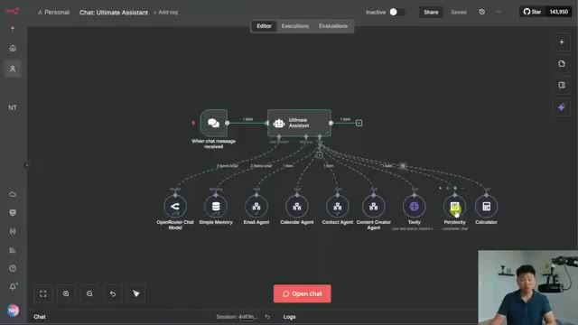
*⏱️ 00:16:27 — Interface de workflow montrant un agent principal "Ultimate Assistant" connecté à plusieurs outils et sous-agents, dont OpenRouter, Simple Memory, des agents d'e-mail, calendrier, contacts, créateur de contenu, Tavily, Perplexity et Calculator.*

---

### ⏱️ `[00:16:46 - 00:17:13]` | Segment #35

**🔊 Audio (Transcription Intégrale Mot pour Mot en Français) :**
> Est-ce que ça va être capable de faire ça ou pas ? Peut-être que c'était juste submergé. D'accord, donc on dirait que c'était peut-être juste submergé par tous les outils auxquels il avait accès. Et vous pouvez voir qu'on a bien reçu cet e-mail à nate@example.com qui demandait ce qu'il y avait. D'accord, essayons un autre. Je viens juste d'ajouter deux outils de plus et je vais continuer et dire, s'il vous plaît faites des recherches sur la différence entre les chiens et les chats et envoyez ça sous forme d'e-mail à nate@example.com et créez aussi un événement de calendrier pour le déjeuner aujourd'hui à 14h00 avec bob@example.com.

**👁️ Analyse Visuelle d'Écran (gemini-3.5-flash-lite) :**
**Interface & Outils** : Gmail, plateforme de workflow n8n (avec intégration LangChain).

**Contenu textuel & Code** : - Image 1 : E-mail envoyé à nateherk88@gmail.com.
- Image 2 : Logs d'exécution montrant l'action "sendMessage" et le prompt utilisateur "Please send an email to nate@example.com asking what's up".

**Action / Démonstration** : Validation du succès de l'automatisation : l'agent IA a interprété le prompt et a exécuté avec succès l'envoi de l'e-mail via l'outil connecté dans n8n.

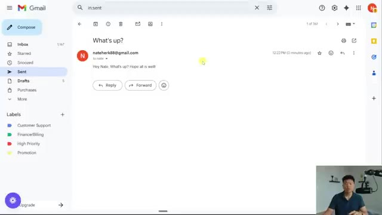
*⏱️ 00:16:53 — Vue d'une interface Gmail affichant un e-mail envoyé avec l'objet "What's up?" et le contenu "Hey Nate, What's up? Hope all is well".*

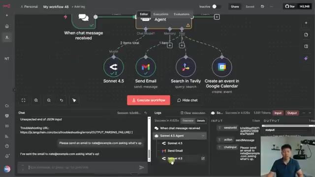
*⏱️ 00:17:00 — Interface de la plateforme de workflow n8n montrant un agent IA connecté à divers outils (Sonnet 4.5, Gmail, Tavily, Google Calendar) avec une fenêtre de log affichant l'exécution réussie de l'envoi d'e-mail.*

---

### ⏱️ `[00:17:13 - 00:17:35]` | Segment #36

**🔊 Audio (Transcription Intégrale Mot pour Mot en Français) :**
> Très bien, voyons s'il peut gérer ces requêtes avec trois outils. Il n'y a pas de prompt système ici à part la date et l'heure. Il vient juste de créer l'événement dans le calendrier. Il a juste cherché joyeusement et il semble qu'il n'aura aucun problème à renvoyer cette recherche vers l'outil de messagerie. Et il devrait être capable d'envoyer cet e-mail. D'accord, super. Donc tout est terminé. Si je vais dans mon calendrier vite fait, nous avons déjeuner avec Bob et il y a bob@example.com.

**👁️ Analyse Visuelle d'Écran (gemini-3.5-flash-lite) :**
**Interface & Outils** : n8n (interface web de gestion de workflows d'automatisation)

**Contenu textuel & Code** : Workflow nommé 'My workflow 48' avec un nœud déclencheur 'When chat message received', un nœud 'Sonnet 4.5 Agent' et trois nœuds d'outils connectés (Sonnet 4.5, Send Email, Search in Tavily, Create an event in Google Calendar).

**Action / Démonstration** : Le workflow est en cours d'exécution ('Executing workflow') et l'agent traite les requêtes en utilisant les différents outils connectés.

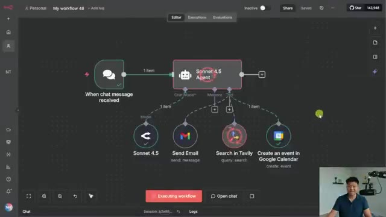
*⏱️ 00:17:19 — Capture d'écran montrant l'interface n8n avec un workflow d'agent IA utilisant un modèle Sonnet 4.5 connecté à différents outils (Send Email, Search in Tavily, Google Calendar).*

---

### ⏱️ `[00:17:35 - 00:17:54]` | Segment #37

**🔊 Audio (Transcription Intégrale Mot pour Mot en Français) :**
> Nous avons aussi dans mon e-mail deux nate at example.com, des recherches sur la différence entre les chats et les chiens. Et c'est formaté assez bizarrement à cause de la façon dont l'outil a été configuré ici. Comme vous pouvez le voir, il a juste été configuré pour envoyer du HTML, pas du texte. C'est donc arrivé bizarrement. Mais le fait est qu'il peut appeler des outils et qu'il n'a pas de problèmes ici, comme vous pouvez le voir.

**👁️ Analyse Visuelle d'Écran (gemini-3.5-flash-lite) :**
**Interface & Outils** : Interface web de messagerie (Gmail) et éditeur de workflow visuel d'automatisation.

**Contenu textuel & Code** : E-mail reçu avec du contenu sur les différences entre chats et chiens ; diagramme de workflow avec un nœud "Sonnet 4.5 Agent" connecté à plusieurs services.

**Action / Démonstration** : Présentation de l'e-mail généré par l'outil et explication du formatage lié à l'envoi en HTML.

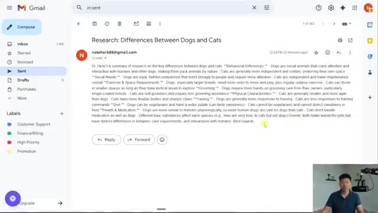
*⏱️ 00:17:40 — Capture d'écran de Gmail montrant un e-mail reçu avec pour sujet la recherche sur les différences entre les chiens et les chats, affichant un texte non formaté avec des balises HTML.*

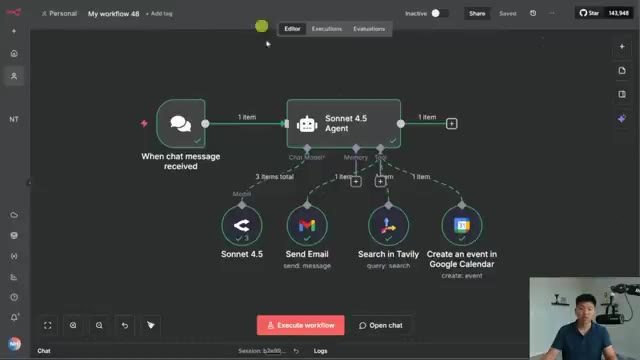
*⏱️ 00:17:44 — Interface de workflow montrant un agent IA relié à différents outils comme Send Email, Search in Tavily et Google Calendar.*

---

### ⏱️ `[00:17:54 - 00:18:25]` | Segment #38

**🔊 Audio (Transcription Intégrale Mot pour Mot en Français) :**
> Je pense que pour une raison quelconque, je l'ai simplement submergé avec trop d'outils et ce n'est même pas un exemple réaliste de ce que vous voudriez faire avec autant d'outils, car cela a fonctionné parfaitement ici lorsque nous avions l'assistant ultime où nous avions tous ces outils regroupés en agents spécialisés et cela a fonctionné beaucoup mieux. Cela conclut donc les expériences que nous avions pour aujourd'hui. En fin de compte, lorsqu'il s'agit de choisir un modèle de chat, ce que je fais habituellement, c'est de m'en tenir à quelque chose pour commencer, comme un GPT 4.0 ou un 5. Et puis à partir de là, je me dis, bon, en fonction de ce cas d'utilisation en ce moment, quel modèle est-ce que je pense qui pourrait être meilleur ? Et puis je lance des évaluations pour voir s'il est meilleur ou non.

**👁️ Analyse Visuelle d'Écran (gemini-3.5-flash-lite) :**
**Interface & Outils** : Interface web de conception de workflows / diagramme d'agents IA (type n8n ou similaire).

**Contenu textuel & Code** : Schéma d'automatisation nommé 'Chat: Ultimate Assistant' montrant un nœud principal 'Ultimate Assistant' recevant des messages de chat et connecté à plusieurs outils spécialisés (Tavily, Perplexity, Calculator, etc.).

**Action / Démonstration** : Visualisation et explication du workflow de l'assistant ultime regroupant de nombreux outils et sous-agents.

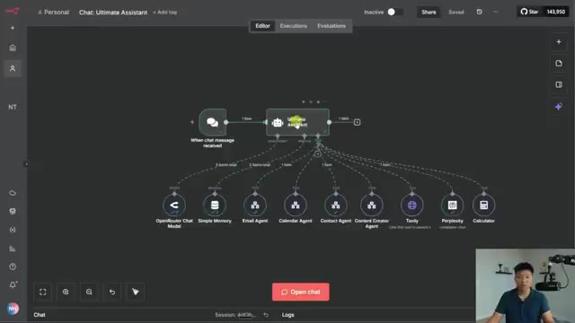
*⏱️ 00:18:02 — Capture d'écran montrant l'interface d'un outil de workflow d'automatisation avec un agent central connecté à de multiples outils (OpenRouter, mémoire, agents email, calendrier, contacts, etc.).*

---

### ⏱️ `[00:18:25 - 00:19:02]` | Segment #39

**🔊 Audio (Transcription Intégrale Mot pour Mot en Français) :**
> Plus vous jouez avec des agents, plus vous commencerez à comprendre lesquels vous aimez utiliser pour certains scénarios. Il est donc difficile de dire que, vous savez, Sonnet 4.5 est le nouveau roi des LLM, car chaque LLM est meilleur dans des domaines différents. Mais la bonne nouvelle, c'est que si vous voulez faire partie d'une communauté où vous pouvez constamment avoir des conversations comme celle-ci et entendre ce que les autres utilisent pour différents cas d'utilisation, alors consultez définitivement ma communauté Plus. Le lien se trouve dans la description. Nous avons une super communauté de plus de 2 500 membres qui construisent avec NNN chaque jour et bâtissent des entreprises avec NNN. Nous avons également une section de cours avec trois formations pour l'instant. Nous avons Agent Zéro, qui sont les bases pour les débutants. Nous avons 10 heures à 10 secondes où nous plongeons dans NNN. Et enfin, nous avons One Person AI Agency, qui est

**👁️ Analyse Visuelle d'Écran (gemini-3.5-flash-lite) :**
**Interface & Outils** : n8n (éditeur de workflow) et plateforme web communautaire (AI Automation Society Plus)

**Contenu textuel & Code** : Diagramme d'automatisation d'agent IA avec divers sous-agents et connecteurs d'outils, et interface de cours en ligne.

**Action / Démonstration** : Présentation de la structure d'un agent IA multi-outils dans n8n et des ressources de formation de la communauté.

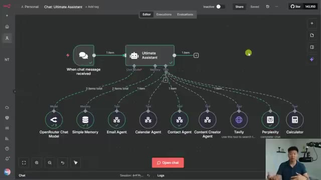
*⏱️ 00:18:34 — Capture d'écran montrant un workflow n8n complexe centré sur un agent 'Ultimate Assistant' connecté à de nombreux outils (OpenRouter, mémoire, agents email/calendrier/contact, Tavily, calculatrice).*

*⏱️ 00:18:53 — Capture d'écran montrant l'interface d'une plateforme de formation en ligne (AI Automation Society Plus) avec des modules de cours classés par cartes.*

---

### ⏱️ `[00:19:02 - 00:19:20]` | Segment #40

**🔊 Audio (Transcription Intégrale Mot pour Mot en Français) :**
> Notre nouveau cours pour les membres annuels, où nous parlons de poser les bases d'une entreprise d'automatisation de l'IA évolutive. J'adorerais donc vous voir dans ces appels et dans cette communauté, mais c'est tout pour cette vidéo. Si vous avez aimé ou si vous avez appris quelque chose de nouveau, n'hésitez pas à mettre un pouce bleu. Ça m'aide vraiment énormément. Et comme toujours, je vous remercie d'être arrivés jusqu'à la fin de la vidéo. Je vous vois dans la prochaine. Merci à tous.

**👁️ Analyse Visuelle d'Écran (gemini-3.5-flash-lite) :**
**Interface & Outils** : Interface web n8n (éditeur de workflow graphique)

**Contenu textuel & Code** : Workflow "Ultimate Assistant" connectant des agents (Email, Calendar, Content Creator), des modèles (OpenRouter) et des outils de recherche (Tavily, Perplexity, Calculator).

**Action / Démonstration** : Visualisation et présentation de l'architecture d'un assistant IA multi-agents et de ses intégrations.

*⏱️ 00:19:15 — Schéma d'un workflow d'agent conversationnel intelligent connecté à plusieurs outils et modèles de langage.*

---

