# 🎬 How I'd Make Money with AI in 2026 (if I had to Start Over)

> **Chaîne** : [Nate Herk | AI Automation](https://www.youtube.com/@nateherk/featured)  
> **Lien YouTube** : [https://www.youtube.com/watch?v=Q46OLxFshAQ](https://www.youtube.com/watch?v=Q46OLxFshAQ)  
> **Date de publication** : 20251003  
> **Durée** : 00:23:59  
> **Identifiant vidéo** : `Q46OLxFshAQ`  
> **Transcription & Analyse** : `whisper-v3-large-turbo+gemini-3.5-flash-lite`  

---

## 📌 Synthèse Exécutive & Outils

### 💡 Résumé

Cette vidéo immersive de Nate Herk propose une feuille de route pragmatique et structurée pour générer des revenus significatifs grâce à l'automatisation par l'IA en partant de zéro. S'appuyant sur son parcours d'entrepreneur à succès, l'auteur démontre qu'il n'est pas nécessaire de maîtriser la programmation complexe ou les architectures de bases de données avancées dès le premier jour. La stratégie repose sur une approche progressive : démarrer par le freelancing ciblé via des modules d'automatisation préconstruits pour enchaîner rapidement les contrats, avant d'évoluer vers des prestations de conseil à forte valeur ajoutée et des missions sur mesure facturées à fort impact financier.

L'intervention met en lumière des cas d'usage concrets, à l'instar du parcours d'un membre de sa communauté ayant automatisé la rédaction de newsletters pour des clients. En identifiant précisément les points de friction opérationnels — comme le temps de recherche et de rédaction récurrent — et en traduisant ces gains en économies de main-d'œuvre quantifiables, le prestataire se positionne non pas comme un simple technicien, mais comme un partenaire stratégique. L'analyse démontre que la clé réside dans la maîtrise rigoureuse d'un cas d'usage à la fois, le déploiement de démonstrations vidéo percutantes de 60 secondes, et la capitalisation sur des études de cas mesurables.

Enfin, la vidéo structure cette trajectoire entrepreneuriale à l'aide de cadres méthodologiques précis, tels que le cadre *BUILD* pour le freelancing par modules et le cadre *SCAN* pour le conseil en IA. Ces outils permettent d'évaluer méthodiquement le potentiel de chaque mission, d'analyser les goulets d'étranglement des entreprises et d'aligner l'offre de services sur un retour sur investissement (ROI) incontestable. L'objectif ultime est de transformer l'automatisation en une machine à générer des flux financiers prévisibles, évoluant rapidement de quelques milliers de dollars mensuels à des contrats de conseil d'envergure.

### 🛠️ Outils, Modèles & Logiciels Présentés

* **n8n** : Plateforme d'automatisation de flux de travail (workflows) utilisée pour connecter des applications, exécuter des agents IA et industrialiser des processus métiers sans repartir de zéro.
* **Modèles préconstruits n8n** : Flux de travail clés en main mis à disposition par la communauté (réceptionniste IA, agent de support, rédacteur de newsletter fantôme) permettant d'accélérer le déploiement technique.
* **Agents IA de rédaction et de recherche** : Systèmes automatisés configurés pour effectuer de la veille, structurer des brouillons et adapter le ton éditorial à la voix spécifique de la marque d'un client.

### 🔑 Points Clés & Enseignements Stratégiques

* **Privilégier la répétition aux résultats immédiats** : Maîtriser un seul bloc fonctionnel à la fois permet de structurer sa pensée entrepreneuriale et de comprendre précisément comment apporter de la valeur concrète avant de chercher à tout automatiser.
* **L'approche modulaire « Lego »** : Assembler des briques technologiques préexistantes évite de réinventer la roue et permet d'itérer rapidement pour livrer des solutions fonctionnelles en un temps record.
* **Le cadre BUILD pour le freelancing** : Une méthodologie en cinq étapes (*Bloc par bloc*, *Comprendre le cas d'usage*, *Installer et imiter*, *Décrocher le premier client*, *Documenter et dupliquer*) conçue pour sécuriser les premiers contrats.
* **La puissance des démos de 60 secondes** : Présenter une démonstration vidéo ultra-courte et ciblée du système en action constitue l'argument de vente le plus percutant pour convaincre instantanément un prospect.
* **Vendre des résultats, pas des outils** : Le client ne paie pas pour un modèle technique ou un flux de travail abstrait, mais pour les heures de travail économisées, la réduction des erreurs et l'impact direct sur sa productivité.
* **Évaluation de l'étape de freelancing** : Vitesse de monétisation élevée (8/10), barrière technique modérée pour les débutants grâce aux modèles (6/10), mais potentiel de revenus limité au milieu ou à la fin des quatre chiffres mensuels sans évolution stratégique (3/10).
* **La transition vers le conseil en IA** : Face au manque de clarté des entreprises sur leurs propres besoins d'automatisation, le consultant intervient pour auditer, concevoir des feuilles de route globales et structurer des architectures sur mesure.
* **Le cadre SCAN pour le conseil stratégique** : Une approche rigoureuse articulée autour de l'*Étude de l'entreprise*, du *Calcul de l'opportunité* en chiffres clairs, de la *Conception de la solution* et de la *Narration des résultats*.
* **La quantification financière du ROI** : Traduire les inefficacités opérationnelles en montants financiers précis (ex: réduire un coût de main-d'œuvre de 200 000 $ de 70 %) transforme la prestation d'IA d'un centre de coût en un investissement hautement rentable.
* **L'effet multiplicateur des études de cas** : Documenter rigoureusement les métriques avant/après (temps gagné, revenus générés) fournit du contenu à forte valeur ajoutée pour alimenter les plateformes sociales (LinkedIn, YouTube, X) et attirer de nouveaux clients de premier plan.

---

## ⏱️ Chronologie & Transcription Complète Audio & Visuelle (Mot pour Mot)

### ⏱️ `[00:00:00 - 00:00:21]` | Segment #01

**🔊 Audio (Transcription Intégrale Mot pour Mot en Français) :**
> Je vais gagner plus d'un million de dollars grâce à l'IA cette année, et j'ai seulement 23 ans. Quand j'ai commencé, je louais un appartement minable, et maintenant je vous parle depuis chez moi à Chicago, après avoir passé plusieurs jours avec des entrepreneurs à neuf chiffres comme Alex Ramosi et avoir pris la parole dans des conférences partout aux États-Unis. Mais disons que je devais recommencer à zéro, sans chaîne YouTube, sans argent, et disons même que j'oubliais tout ce que je sais sur l'automatisation par l'IA.

**👁️ Analyse Visuelle d'Écran (gemini-3.5-flash-lite) :**
**Interface & Outils** : AUCUNE

**Contenu textuel & Code** : AUCUNE

**Action / Démonstration** : AUCUNE

---

### ⏱️ `[00:00:21 - 00:00:57]` | Segment #02

**🔊 Audio (Transcription Intégrale Mot pour Mot en Français) :**
> Dans cette vidéo, je vais vous donner un plan avec les étapes exactes que j'ai suivies. Mais contrairement à toutes les autres vidéos sur ce sujet, je vais vous donner de vraies étapes que vous pouvez franchir dès aujourd'hui pour gagner vos premiers milliers de dollars et aller jusqu'à votre premier million grâce à l'IA. Je vais également vous fournir un tableau de bord pour chaque étape du processus qui vous montre combien de temps cela prend, l'expertise que cela requiert et le potentiel de revenus. Je vous donnerai même des actions concrètes pour chaque étape afin que vous sachiez exactement quoi faire ensuite. Je veux faire de ceci la vidéo la plus pratique que vous ayez jamais vue sur l'argent gagné avec l'IA par quelqu'un qui est réellement sur le terrain tous les jours. Voici la bonne nouvelle. Vous n'avez pas besoin de tout savoir sur l'automatisation pour commencer. Vous n'avez pas besoin d'écrire du code ou de comprendre le moindre petit détail d'intégration dans n8n ou de maîtriser des bases de données compliquées.

**👁️ Analyse Visuelle d'Écran (gemini-3.5-flash-lite) :**
**Interface & Outils** : Navigateur web / Chaîne YouTube (Nate Herk | AI Automation)

**Contenu textuel & Code** : Pages web de présentation et interface de chaîne YouTube montrant des vidéos sur l'automatisation IA.

**Action / Démonstration** : Présentation visuelle de la chaîne et des réalisations du créateur à l'écran.

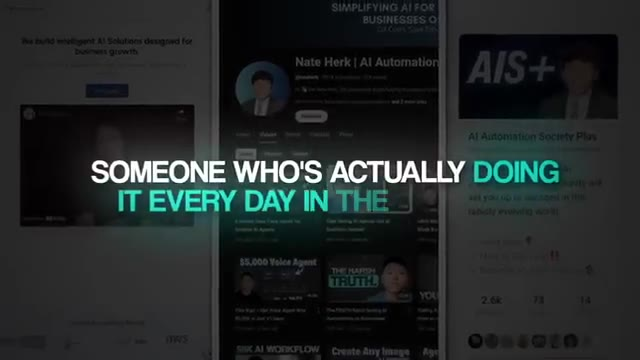
*⏱️ 00:00:48 — Capture d'écran composite montrant des interfaces web et une chaîne YouTube avec du texte superposé.*

---

### ⏱️ `[00:00:57 - 00:01:31]` | Segment #03

**🔊 Audio (Transcription Intégrale Mot pour Mot en Français) :**
> immédiatement. Donc, l'étape numéro un, c'est le freelancing avec des modules d'IA. Au lieu de tout construire à partir de zéro, vous pouvez utiliser des modèles NNN. Ce sont des flux de travail préconstruits que d'autres personnes ont déjà créés et partagés avec la communauté afin que vous puissiez les réutiliser. Tout ce que vous avez à faire, c'est de les importer, de connecter les comptes du client et d'ajuster quelques détails. Ils sont comme des briques de Lego. Au début, vous ne savez peut-être utiliser qu'un seul bloc, disons une réceptionniste IA. Plus tard, vous en ajoutez d'autres, un bot de demande d'avis, un agent de support, un rédacteur fantôme pour infolettre. Chaque nouveau bloc que vous apprenez vous donne une autre offre que vous pouvez vendre. Et lorsque vous avez connecté suffisamment de blocs, vous pouvez les assembler pour former des systèmes plus grands. C'est un énorme raccourci. Plutôt que de réinventer la roue,

**👁️ Analyse Visuelle d'Écran (gemini-3.5-flash-lite) :**
**Interface & Outils** : n8n (éditeur de workflows) et interface graphique d'illustration d'agents IA

**Contenu textuel & Code** : Diagramme de flux d'automatisation n8n et icônes représentant différents agents d'intelligence artificielle.

**Action / Démonstration** : Présentation visuelle des modules préconstruits et des flux de travail automatisés d'intelligence artificielle.

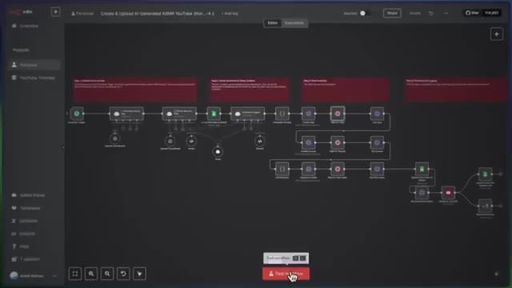
*⏱️ 00:01:06 — Capture montrant l'interface graphique du logiciel n8n avec un flux de travail complet et complexe pour la création de vidéos ASMR.*

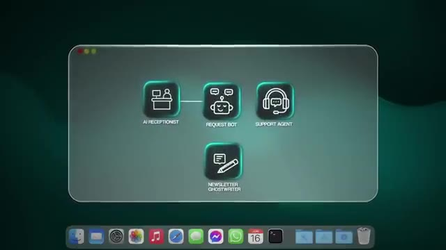
*⏱️ 00:01:22 — Illustration sous forme d'interface affichant différents modules d'agents IA (AI Receptionist, Request Bot, Support Agent, Newsletter Ghostwriter).*

---

### ⏱️ `[00:01:31 - 00:01:56]` | Segment #04

**🔊 Audio (Transcription Intégrale Mot pour Mot en Français) :**
> tu prends ce qui fonctionne déjà, tu le connectes, et tu obtiens des résultats rapidement. La clé n'est pas de tout vendre à tout le monde. C'est de maîtriser un bloc à la fois, de prouver que tu sais comment cela fonctionne, et de prouver que cela apporte de la valeur à un client. Et ensuite, de ne le vendre qu'aux clients qui ont besoin de ce résultat spécifique. C'est ainsi que tu construis la confiance et la crédibilité sans te sentir submergé. C'est là que je pense que tu devrais commencer à prioriser les répétitions plutôt que les résultats, parce que cela va vraiment t'aider à commencer à penser comme un chef d'entreprise et à voir comment tu peux leur apporter de la valeur. Le cadre BUILD.

**👁️ Analyse Visuelle d'Écran (gemini-3.5-flash-lite) :**
**Interface & Outils** : Graphisme d'illustration de workflow (motion design minimaliste).

**Contenu textuel & Code** : Icônes de modules d'automatisation (AI Receptionist, Support Agent, Newsletter Ghostwriter) reliées à l'utilisateur.

**Action / Démonstration** : Présentation visuelle conceptuelle de la connexion d'un bloc d'automatisation à la fois.

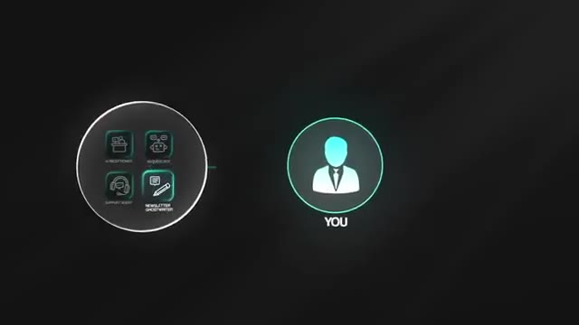
*⏱️ 00:01:37 — Schéma graphique animé illustrant la connexion entre l'utilisateur ("YOU") et un bloc contenant différents modules d'automatisation IA.*

---

### ⏱️ `[00:01:56 - 00:02:14]` | Segment #05

**🔊 Audio (Transcription Intégrale Mot pour Mot en Français) :**
> Le B signifie bloc par bloc. Commencez par un seul modèle N&M. N'essayez pas de tout maîtriser en même temps. Choisissez-en un seul. Le U signifie comprendre le cas d'usage. Demandez-vous : quel type d'entreprises ce modèle aiderait-il le plus ? Par exemple, un modèle de réceptionniste IA pourrait aider les dentistes, les chauffagistes et climatiseurs, et les spas médicaux. Un agent de support par email pourrait aider les boutiques e-commerce et les prestataires de services.

**👁️ Analyse Visuelle d'Écran (gemini-3.5-flash-lite) :**
**Interface & Outils** : Interface de workflow d'automatisation (type n8n ou similaire).

**Contenu textuel & Code** : Blocs fonctionnels : WhatsApp Trigger, AI Agent, Postgres Chat Memory, OpenAI Chat Model, Supabase Vector Store.

**Action / Démonstration** : Présentation visuelle de la structure d'un agent IA connecté à des services de messagerie et de base de données vectorielle.

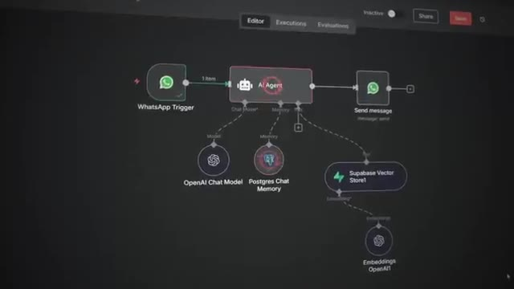
*⏱️ 00:02:00 — Capture montrant un diagramme de workflow ou de blocs d'automatisation avec des éléments interconnectés comme WhatsApp Trigger et AI Agent.*

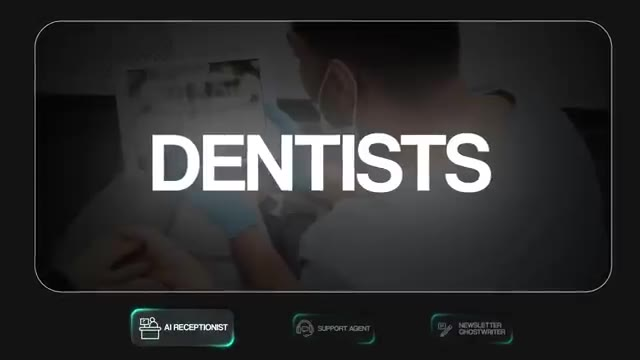
*⏱️ 00:02:09 — Illustration du cas d'usage avec le texte "DENTISTS" superposé sur un arrière-plan montrant un dentiste au travail.*

---

### ⏱️ `[00:02:14 - 00:02:36]` | Segment #06

**🔊 Audio (Transcription Intégrale Mot pour Mot en Français) :**
> Un agent rédacteur de newsletters fantôme pourrait aider les coachs et les fondateurs de SaaS. Le I signifie installer et imiter. Importez le modèle dans N&M. Exécutez-le avec des données de test jusqu'à ce que vous compreniez chaque étape qui le compose. Parce que comme je l'ai dit, vous ne pourrez pas prendre un modèle et aller le vendre à une entreprise. Vous pourrez prendre un modèle, le personnaliser un petit peu, et ensuite le vendre à une entreprise. Ensuite, construisez une simple démo de 60 secondes où vous montrez comment cela fonctionne et la valeur que cela ajoute.

**👁️ Analyse Visuelle d'Écran (gemini-3.5-flash-lite) :**
**Interface & Outils** : Aucune interface logicielle ou de développement affichée.

**Contenu textuel & Code** : Texte à l'écran : "FRAMEWORK - I - INSTALL AND IMITATE".

**Action / Démonstration** : Le présentateur explique le concept d'installation et d'imitation d'un modèle d'agent IA.

---

### ⏱️ `[00:02:36 - 00:02:54]` | Segment #07

**🔊 Audio (Transcription Intégrale Mot pour Mot en Français) :**
> Et ensuite, le L correspond à décrocher le premier client. Contactez des entreprises qui ont clairement besoin de cette automatisation. Votre argumentaire peut ressembler à ceci : hé, j'ai construit un flux de travail qui résout tel problème. J'ai une démo de 60 secondes montrant comment ce système fonctionne. Voulez-vous que je l'installe pour vous ? Le D correspond à documenter et dupliquer. Une fois que c'est en ligne, mesurez les résultats avant et après. Des choses comme le temps gagné, les erreurs réduites et les revenus générés.

**👁️ Analyse Visuelle d'Écran (gemini-3.5-flash-lite) :**
**Interface & Outils** : Application de messagerie (iMessage sur tablette).

**Contenu textuel & Code** : "Hey, I built a workflow that solves X Pain point. I've got a 60sec demo showing how the system works."

**Action / Démonstration** : Affichage à l'écran d'un exemple de message de prospection pour décrocher un client.

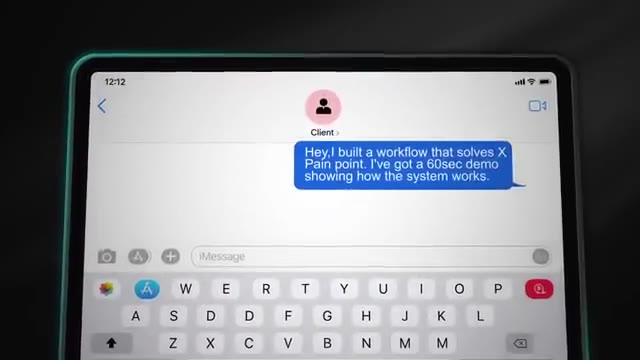
*⏱️ 00:02:45 — Une vue en gros plan d'une tablette affichant une application de messagerie (iMessage) avec un message type adressé à un client.*

---

### ⏱️ `[00:02:54 - 00:03:16]` | Segment #08

**🔊 Audio (Transcription Intégrale Mot pour Mot en Français) :**
> Cela devient une étude de cas pour de futurs clients. Ensuite, vous pouvez passer au suivant modèle et répéter. Et pour vous montrer cela en action, laissez-moi vous raconter une rapide histoire de l'intérieur de ma communauté. L'un de nos membres, Jerome, ne se considérait pas du tout comme un expert en NNN, mais il a vu l'un de mes modèles gratuits pour un agent de rédaction de newsletter. Le flux de travail était super simple. Chaque matin, il faisait des recherches sur un sujet spécifique, rédigeait un brouillon de newsletter dans le ton de la voix du client, et la livrait prête à être envoyée à leur audience.

**👁️ Analyse Visuelle d'Écran (gemini-3.5-flash-lite) :**
**Interface & Outils** : Interface de communauté en ligne, schéma de workflow graphique

**Contenu textuel & Code** : Profil utilisateur de Jerome avec description de son activité d'automatisation IA, schéma "The Workflow Process"

**Action / Démonstration** : Présentation d'un membre de la communauté et explication du processus de workflow des automatisations IA

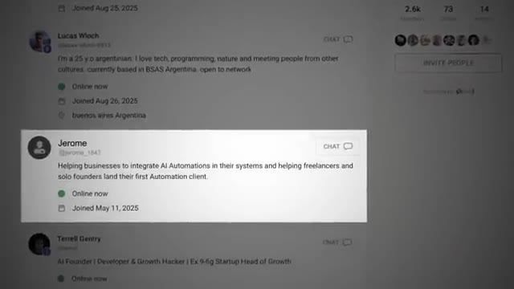
*⏱️ 00:03:05 — Capture d'écran d'une interface de communauté en ligne montrant le profil d'un membre nommé Jerome.*

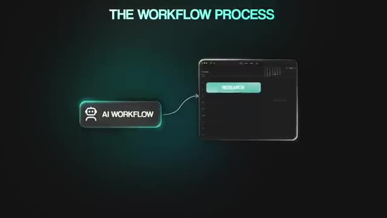
*⏱️ 00:03:10 — Schéma représentant le processus de workflow avec un bloc 'AI Workflow' relié à une interface de recherche.*

---

### ⏱️ `[00:03:16 - 00:03:36]` | Segment #09

**🔊 Audio (Transcription Intégrale Mot pour Mot en Français) :**
> Ce qu'a fait Jérôme, c'est qu'il a pris ce flux de travail et l'a exécuté pour pouvoir très bien le comprendre. Et puis, plus important encore, il a compris la douleur que ressentent les entreprises lorsqu'il s'agit de produire des bulletins d'information réguliers. Nous avons donc légèrement ajusté les instructions système et la configuration de la recherche afin que l'ensemble du bulletin d'information soit adapté à l'industrie du client et corresponde à sa voix de marque. Ce petit ajustement a suffi pour le rendre précieux pour ce client spécifique.

**👁️ Analyse Visuelle d'Écran (gemini-3.5-flash-lite) :**
**Interface & Outils** : Aucune interface visible.

**Contenu textuel & Code** : Aucun contenu textuel ou graphique visible.

**Action / Démonstration** : Aucune action en cours.

---

### ⏱️ `[00:03:36 - 00:03:57]` | Segment #10

**🔊 Audio (Transcription Intégrale Mot pour Mot en Français) :**
> Et il a su se rendre précieux parce qu'il n'a pas seulement présenté le flux de travail. Il a montré les chiffres. Il a calculé le temps que leur équipe passait sur la recherche et la rédaction. S'ils y passaient environ une heure chaque jour et qu'il parvenait à automatiser 90 % de ce processus, il venait de leur rendre environ cinq heures par semaine ou 20 heures par mois. Sur toute une année, cela représente potentiellement des dizaines de milliers de dollars d'économies sur les coûts de main-d'œuvre et un temps de concentration libéré.

**👁️ Analyse Visuelle d'Écran (gemini-3.5-flash-lite) :**
**Interface & Outils** : AUCUNE

**Contenu textuel & Code** : Texte incrusté à l'écran : "1 HOUR / PER DAY" et "90%".

**Action / Démonstration** : Le présentateur explique les calculs de temps et d'automatisation des tâches.

---

### ⏱️ `[00:03:57 - 00:04:15]` | Segment #11

**🔊 Audio (Transcription Intégrale Mot pour Mot en Français) :**
> C'est pourquoi le client était heureux de payer. Non pas parce que Jerome avait un modèle, mais pour le résultat que ce modèle a apporté. Voici donc votre application pratique. N'essayez pas de tout maîtriser en même temps. Choisissez un modèle, apprenez-le en profondeur, comprenez comment le personnaliser et vendez ce résultat. Créez une vidéo de démonstration qui rend le bénéfice évident. Présentez-le à une poignée d'entreprises qui ont exactement besoin de cette solution.

**👁️ Analyse Visuelle d'Écran (gemini-3.5-flash-lite) :**
**Interface & Outils** : n8n (éditeur de workflow d'automatisation)

**Contenu textuel & Code** : Nœuds de workflow n8n incluant 'AI Agent', 'OpenRouter Chat Model', et le panneau latéral 'Output Parsers'.

**Action / Démonstration** : Visualisation d'un workflow d'agent IA montrant comment configurer les connexions entre le modèle de chat et l'agent principal.

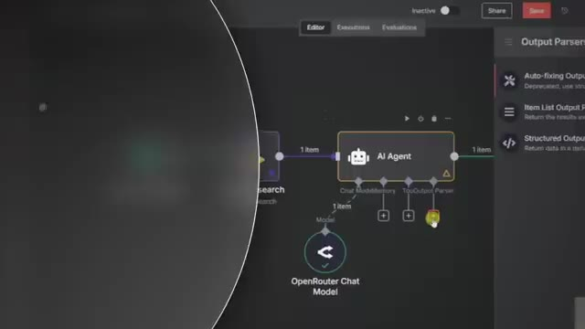
*⏱️ 00:04:06 — Interface n8n montrant un workflow d'automatisation avec un nœud 'AI Agent' connecté à un modèle 'OpenRouter Chat Model'.*

---

### ⏱️ `[00:04:15 - 00:04:49]` | Segment #12

**🔊 Audio (Transcription Intégrale Mot pour Mot en Français) :**
> Au fur et à mesure que vous concluez des contrats, accumulez d'autres modèles dans votre boîte à outils et élargissez progressivement vos offres. Voici maintenant un rappel de la réalité et des notes pour cette méthode. La rapidité pour gagner de l'argent va être de 8 sur 10, car vous pouvez conclure votre premier contrat en quelques jours si vous choisissez un cas d'usage clair et que vous présentez une démonstration rapide. C'est probablement l'un des moyens les plus rapides d'être payé tout en apprenant. Facilité pour les débutants, 6 sur 10. Les modèles abaissent la barrière technique, mais vous devez tout de même comprendre comment les configurer et, plus important encore, comment formuler la valeur commerciale. Et enfin, le potentiel de revenus, 3 sur 10. Le travail en freelance avec des modules est un excellent moyen de débuter et d'établir sa crédibilité, mais les revenus se limitent généralement au milieu ou à la fin des quatre chiffres par mois, à moins d'évoluer vers le conseil.

**👁️ Analyse Visuelle d'Écran (gemini-3.5-flash-lite) :**
**Interface & Outils** : Graphique de présentation animé (Score Card).

**Contenu textuel & Code** : Texte et scores d'évaluation des méthodes d'automatisation.

**Action / Démonstration** : Présentation des notes et critères d'évaluation de la méthode.

---

### ⏱️ `[00:04:49 - 00:05:15]` | Segment #13

**🔊 Audio (Transcription Intégrale Mot pour Mot en Français) :**
> ou des contrats de maintenance. Parce qu'une fois que vous avez livré quelques produits en tantner qu'indépendant, quelque chose d'important devient évident. La plupart des entreprises ne savent même pas ce qu'elles devraient automatiser. Elles savent que l'IA change tout, mais elles ne savent pas par où commencer, ce qui est possible et ce qui permet réellement d'économiser de l'argent. Et c'est là que vous passez à l'étape suivante : le conseil en IA. En tant que consultant, vous ne proposez plus seulement une seule automatisation, un seul modèle. Vous offrez de la clarté. Vous auditez l'entreprise, trouvez les plus grandes opportunités et concevez une feuille de route sur la façon dont l'IA peut transformer leurs opérations.

**👁️ Analyse Visuelle d'Écran (gemini-3.5-flash-lite) :**
**Interface & Outils** : Présentation graphique sous forme de cartes d'étapes (Stage 1 à 4).

**Contenu textuel & Code** : Texte affiché sur les cartes : "STAGE 1 FREELANCING WITH AI MODULE", "STAGE 2 CONSULTING WITH AI", "STAGE 3 SCALING INTO AN AI..." et "STAGE 4 TEACHING AI AUTOMATION".

**Action / Démonstration** : Présentation visuelle des différentes étapes de développement de l'activité d'automatisation IA.

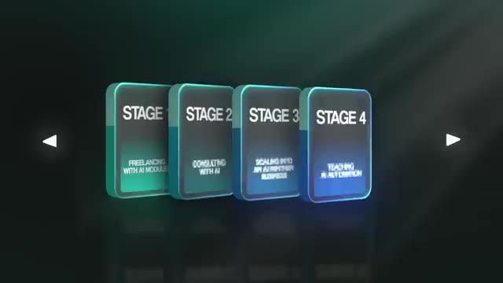
*⏱️ 00:05:02 — Graphique animé montrant 4 étapes (Stage 1 à Stage 4) liées au freelancing et à l'automatisation par IA.*

---

### ⏱️ `[00:05:15 - 00:05:37]` | Segment #14

**🔊 Audio (Transcription Intégrale Mot pour Mot en Français) :**
> Parfois, vous utiliserez encore des modules provenant de modèles pour mettre en œuvre des victoires rapides et instaurer la confiance. Chez True Horizon, nous avons une bibliothèque de modèles que nous raccordons simplement pour réduire notre temps de développement. Mais souvent, vous devrez créer des workflows à partir de zéro, des constructions sur mesure qui correspondent aux processus exacts et à la pile technologique de l'entreprise. C'est pourquoi cette étape exige beaucoup plus de connaissances que le travail en freelance. Vous devez comprendre une grande variété d'automatisations, savoir comment mesurer les économies de coûts et comment évaluer des projets complexes.

**👁️ Analyse Visuelle d'Écran (gemini-3.5-flash-lite) :**
**Interface & Outils** : Page web d'entreprise et interface de workflow d'automatisation (n8n)

**Contenu textuel & Code** : Diagramme de pipeline d'automatisation avec des modules connectés (Schedule Trigger, Set Topic, Search, Planning Agent, Split Out, Research, Section Writer, Structured Output Parser, GPT-5-mini)

**Action / Démonstration** : Présentation visuelle et explication des modules et pipelines d'automatisation utilisés pour le développement de projets IA

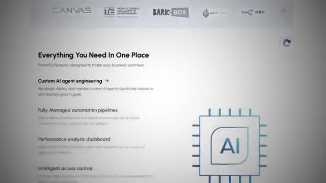
*⏱️ 00:05:20 — Page web de l'entreprise True Horizon présentant les fonctionnalités de services et d'ingénierie d'agents IA.*

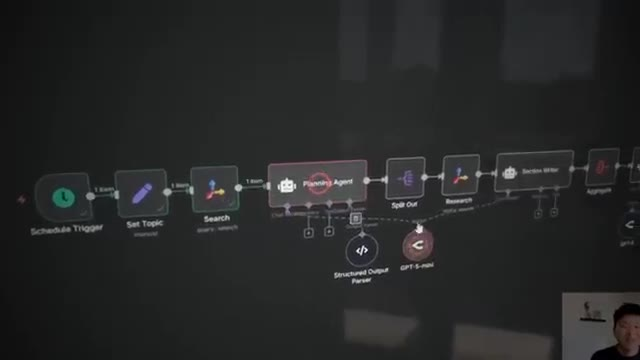
*⏱️ 00:05:26 — Éditeur de workflow d'automatisation (type n8n) illustrant une chaîne de modules d'IA comprenant un agent de planification.*

---

### ⏱️ `[00:05:37 - 00:05:58]` | Segment #15

**🔊 Audio (Transcription Intégrale Mot pour Mot en Français) :**
> L'avantage ici, c'est que ça peut rapporter beaucoup plus. Parce que vous pourriez être capable de facturer quelque chose comme 5 000 $ rien que pour l'audit d'entreprise en IA, et ensuite de gagner 20 000 $ de plus, voire jusqu'à 100 000 $, en mettant en œuvre tout ce plan et ce système. Donc pour cette étape, nous utilisons le cadre SCAN. Le S signifie étudier l'entreprise. Menez des appels de découverte avec des cadres. Posez des questions sur les goulets d'étranglement, les tâches récurrentes, les coûts de personnel et les plaintes des clients.

**👁️ Analyse Visuelle d'Écran (gemini-3.5-flash-lite) :**
**Interface & Outils** : n8n (outil d'automatisation de workflows)

**Contenu textuel & Code** : Nœud de workflow n8n (Download file, WhatsApp Trigger, AI Agent, OpenAI Chat Model) avec superpositions de texte financier ($5,000 AUDIT, $100,000 IMPLEMENTATION).

**Action / Démonstration** : Visualisation d'un workflow d'automatisation IA dans n8n illustrant la tarification des services.

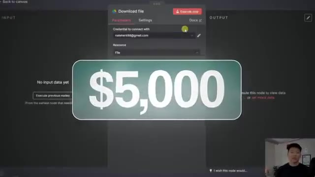
*⏱️ 00:05:42 — Interface n8n montrant un nœud de téléchargement de fichier avec le texte '$5,000' superposé.*

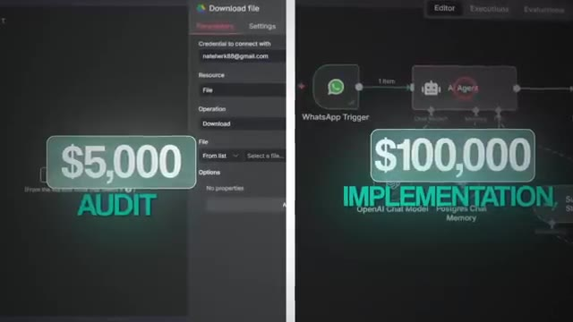
*⏱️ 00:05:48 — Écran divisé montrant à gauche un audit n8n à 5 000 $ et à droite une implémentation de workflow à 100 000 $.*

---

### ⏱️ `[00:05:58 - 00:06:16]` | Segment #16

**🔊 Audio (Transcription Intégrale Mot pour Mot en Français) :**
> Rassemblez autant de détails que possible sur le temps et l'argent actuellement dépensés manuellement. Le C représente le calcul de l'opportunité. Traduisez ces inefficacités en chiffres qu'un chef d'entreprise peut réellement comprendre. Donc, si un processus coûte 200 000 dollars par an en main-d'œuvre, qu'une IA peut le réduire de 70 %, cela représente une opportunité d'économie de 140 000 dollars.

**👁️ Analyse Visuelle d'Écran (gemini-3.5-flash-lite) :**
**Interface & Outils** : Aucune interface logicielle ou de programmation affichée (simple vidéo de présentation).

**Contenu textuel & Code** : Aucun code source, terminal ou prompt visible à l'écran, uniquement du texte d'habillage vidéo.

**Action / Démonstration** : Aucune action technique ou manipulation n'est effectuée à l'écran.

---

### ⏱️ `[00:06:16 - 00:06:36]` | Segment #17

**🔊 Audio (Transcription Intégrale Mot pour Mot en Français) :**
> Montrez ceci en noir et blanc pour que les clients puissent clairement voir le retour sur investissement. De cette façon, cela ne devient pas un coût de travailler avec vous, cela devient un investissement avec un rendement mesurable. Le A correspond à concevoir la solution. Concevez une feuille de route. Certains flux de travail seront prêts à l'emploi à partir de modèles existants. D'autres devront être construits à partir de zéro. À ce stade, vous ne livrez pas seulement un outil, vous concevez un système qui touche plusieurs départements.

**👁️ Analyse Visuelle d'Écran (gemini-3.5-flash-lite) :**
**Interface & Outils** : Aucune interface logicielle, éditeur de code ou outil d'automatisation n'est affiché.

**Contenu textuel & Code** : Aucun code, commande ou prompt visible.

**Action / Démonstration** : Le présentateur s'adresse à l'audience en parlant de la notion de coût et de retour sur investissement.

---

### ⏱️ `[00:06:36 - 00:07:10]` | Segment #18

**🔊 Audio (Transcription Intégrale Mot pour Mot en Français) :**
> Enfin, le N signifie narrer les résultats. Contrairement à l'étape du freelance, où vos études de cas prouvent que vous savez construire, les études de cas en conseil prouvent que vous pouvez générer un retour sur investissement à l'échelle de l'entreprise et que vous êtes un expert pour identifier les opportunités qui nécessitent une automatisation. Ensuite, vous prenez ces études de cas, vous les mettez sur votre site web, vous les partagez sur LinkedIn, Twitter ou YouTube, et c'est ainsi que vous pouvez commencer à attirer de nouveaux clients en conseil. Les algorithmes d'aujourd'hui sont hyper avancés. Si vous publiez quelque chose, il trouvera des personnes qui trouveront cela intéressant. L'un de mes premiers vrais projets de conseil a eu lieu à l'époque où je travaillais complètement en solo. Au lieu d'essayer de jongler avec plusieurs clients, je me suis dit que je voulais peut-être aller vraiment en profondeur avec un seul et fournir autant

**👁️ Analyse Visuelle d'Écran (gemini-3.5-flash-lite) :**
**Interface & Outils** : Navigateur web affichant YouTube

**Contenu textuel & Code** : Page de profil de la chaîne YouTube Nate Herk | AI Automation avec 381K abonnés et la bannière "Simplifying AI for Beginners & Business Owners".

**Action / Démonstration** : Navigation ou affichage de la chaîne YouTube du créateur pour illustrer sa marque et son positionnement.

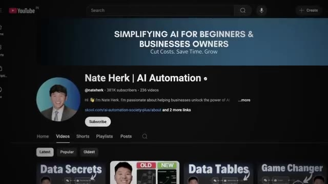
*⏱️ 00:06:53 — Capture d'écran de la page d'accueil de la chaîne YouTube "Nate Herk | AI Automation" montrant sa bannière, son avatar et ses vidéos.*

---

### ⏱️ `[00:07:10 - 00:07:46]` | Segment #19

**🔊 Audio (Transcription Intégrale Mot pour Mot en Français) :**
> autant de valeur que possible. L'idée était simple. Si je pouvais devenir un partenaire de confiance pour une seule entreprise, je bâtirais plus de confiance, j'obterais des recommandations et je créerais une relation à long terme. Le client était donc venu à l'origine en voulant un assistant personnel. Mais après quatre appels de découverte, nous avons passé en revue sa journée et celle de son équipe, et nous avons trouvé quelque chose à bien plus fort effet de levier, qui était le support client. Les tickets arrivaient sept jours sur sept, mais les employés n'y répondaient que pendant les jours de semaine. Cela signifiait des réponses potentiellement lentes, des clients frustrés et des employés coincés à faire un travail qu'ils n'aimaient pas. Donc, au lieu de commencer par un assistant personnel, nous avons décidé de créer un flux de travail pour le support client. Et en réalité, la partie la plus difficile du système était d'intégrer toutes les informations de la base de connaissances dans quelque chose que l'agent pourrait ensuite utiliser afin de répondre avec précision

**👁️ Analyse Visuelle d'Écran (gemini-3.5-flash-lite) :**
**Interface & Outils** : n8n (éditeur de workflow) et interface Telegram

**Contenu textuel & Code** : Diagramme de flux de données et d'automatisation incluant des déclencheurs Telegram, des modèles de LLM OpenAI et des outils de gestion de calendrier/emails.

**Action / Démonstration** : Visualisation d'un workflow d'automatisation IA complexe pour un assistant personnel.

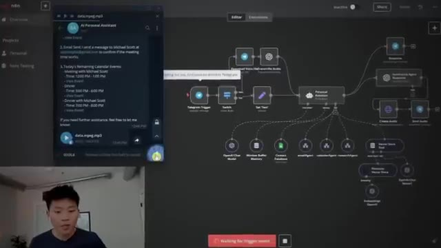
*⏱️ 00:07:19 — Capture montrant l'interface n8n avec un workflow d'assistant personnel IA et une fenêtre Telegram en superposition.*

---

### ⏱️ `[00:07:46 - 00:08:08]` | Segment #20

**🔊 Audio (Transcription Intégrale Mot pour Mot en Français) :**
> répondre aux clients. Mais l'équipe a instantanément récupéré plus de 10 heures par semaine. Les clients ont commencé à obtenir des réponses 24 heures sur 24 et l'entreprise disposait d'une base sur laquelle elle pouvait évoluer. C'est donc exactement de cela qu'il s'agit en matière de conseil. Vous ne construisez pas seulement ce que le client demande, vous plongez dans leurs opérations, vous trouvez les véritables goulets d'étranglement et vous concevez la solution qui génère le plus grand retour sur investissement. Parce qu'il y a tous ces avantages tangibles comme le temps gagné et les heures économisées, mais il y a aussi des avantages intangibles, comme la qualité de vie de vos employés.

**👁️ Analyse Visuelle d'Écran (gemini-3.5-flash-lite) :**
**Interface & Outils** : Graphique animé explicatif / Présentation vidéo

**Contenu textuel & Code** : Texte 'Accurately Respond' et icônes représentant l'automatisation et l'équipe humaine.

**Action / Démonstration** : Animation visuelle illustrant les bénéfices de l'automatisation du support client sur le temps de l'équipe.

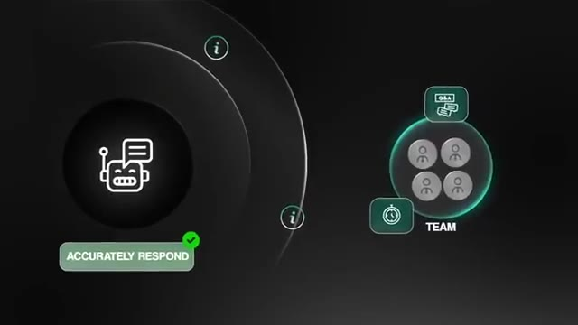
*⏱️ 00:07:51 — Un graphique animé illustrant l'automatisation du support client avec une icône de robot et la mention 'Accurately Respond' face à une équipe humaine.*

---

### ⏱️ `[00:08:09 - 00:08:41]` | Segment #21

**🔊 Audio (Transcription Intégrale Mot pour Mot en Français) :**
> Voici comment vous pouvez appliquer cela à votre propre entreprise de conseil dès aujourd'hui. Utilisez vos études de cas de freelance comme ticket d'entrée dans le conseil. Une fois que vous faites du conseil, créez de nouvelles études de cas qui démontrent un retour sur investissement mesurable grâce aux audits et aux mises en œuvre. Transformez-les en contenus, publications courtes, articles, analyses détaillées, vidéos, n'importe quoi qui vous positionne en tant qu'expert valant dizaines de milliers de dollars par mission. Élargissez votre éventail technique afin de pouvoir concevoir en toute confiance des flux de travail personnalisés lorsque les modèles ne suffisent pas. Et ensuite, vous pouvez potentiellement facturer sur deux tableaux : l'un pour l'audit et l'autre pour la mise en œuvre. Assurez-vous simplement de fixer vos prix en fonction de la valeur afin que ce soit une évidence pour le client. Voici donc le bilan de réalité et le tableau de bord. Vitesse

**👁️ Analyse Visuelle d'Écran (gemini-3.5-flash-lite) :**
**Interface & Outils** : Outil d'automatisation de workflows visuels (type n8n ou équivalent).

**Contenu textuel & Code** : Nœuds de workflow "Calendar Agent", "Execute Workflow Trigger", et configuration de requêtes HTTP avec paramètres d'authentification.
[DESC_IMAGE_3] Suppression de la vue présentateur conformément aux directives.

**Action / Démonstration** : Configuration et visualisation d'un agent d'automatisation de calendrier et de requêtes d'API.

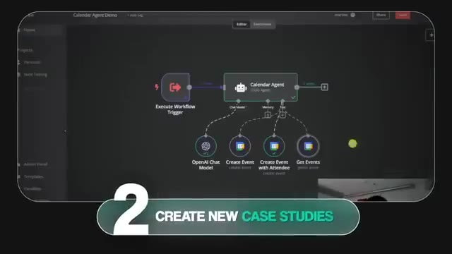
*⏱️ 00:08:17 — Interface d'un diagramme de workflow montrant un "Calendar Agent" connecté à plusieurs modules (OpenAI Chat Model, Create Event, Get Events).*

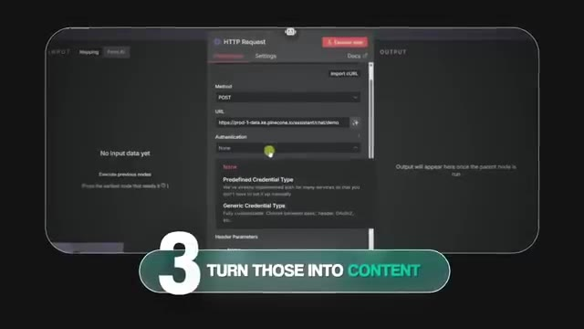
*⏱️ 00:08:25 — Panneau de configuration de requête HTTP (HTTP Request) dans un outil d'automatisation avec des paramètres de méthode POST et d'URL.*

---

### ⏱️ `[00:08:41 - 00:09:16]` | Segment #22

**🔊 Audio (Transcription Intégrale Mot pour Mot en Français) :**
> à l'argent, nous sommes à 6 sur 10. Les contrats peuvent prendre plus de temps. Il faut progresser pour atteindre ce stade, mais les mandats d'audit peuvent se conclure rapidement lorsque l'on a des preuves. La simplicité pour les débutants est de 4 sur 10. Cela demande à la fois des compétences techniques et une crédibilité en tant que consultant. Potentiel de revenus, 6 sur 10. Une poignée d'études de cas de conseil solides peut permettre de décrocher des projets à six chiffres et de vous préparer à atteindre les sept chiffres par an. Encore une fois, je tenais à insister lourdement là-dessus. Vos premières études de cas doivent venir du freelancing, mais le conseil est le domaine où vous commencez à produire le genre de résultats qui font que les dirigeants font la queue pour travailler avec vous. Et plus vous partagez cela sous forme de contenu, plus les clients viennent à vous au lieu que ce soit vous qui les couriez après. Mais à un moment donné, ce qui se passe, c'est que vous atteindrez la limite de

**👁️ Analyse Visuelle d'Écran (gemini-3.5-flash-lite) :**
**Interface & Outils** : Graphique de score animé (score card).

**Contenu textuel & Code** : Texte et scores d'évaluation ("Speed to money: 6/10", "Ease for beginners: 4/10").

**Action / Démonstration** : Affichage des notes d'évaluation du modèle d'affaires.

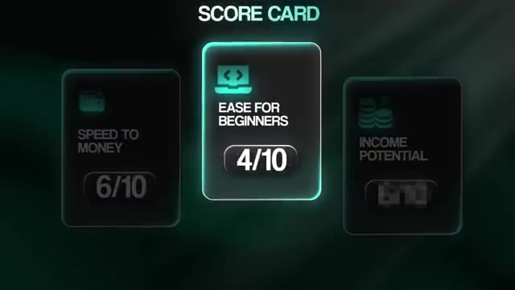
*⏱️ 00:08:50 — Score card affichant "Ease for beginners 4/10" et "Speed to money 6/10".*

---

### ⏱️ `[00:09:16 - 00:09:49]` | Segment #23

**🔊 Audio (Transcription Intégrale Mot pour Mot en Français) :**
> ce que vous pouvez faire seul. Vous ne pouvez prendre qu'un nombre limité d'appels, concevoir un nombre limité de systèmes et construire vous-même un nombre limité d'automatisations. Si vous voulez aller au-delà de ce point, la réponse est de transformer votre entreprise de conseil en une véritable agence d'automatisation par IA. L'étape trois ici est donc de passer à une entreprise partenaire en IA. Contrairement au freelancing ou au conseil en solo, le modèle partenaire consiste à bâtir une équipe autour de vous. C'est plus communément appelé et connu sous le nom d'agence d'automatisation par IA. Cependant, chez True Horizon AI, nous nous appelons un partenaire en IA parce que nous pensons en termes de partenariats à long terme plutôt qu'en projets ponctuels. Et c'est exactement ce que la majorité des clients recherchent également.

**👁️ Analyse Visuelle d'Écran (gemini-3.5-flash-lite) :**
**Interface & Outils** : Page web de présentation d'une agence

**Contenu textuel & Code** : Texte 'AI AUTOMATION AGENCY' et 'Trusted by Leading Brands' avec divers logos de partenaires.

**Action / Démonstration** : Affichage du titre principal illustrant le concept d'agence d'automatisation par l'IA.

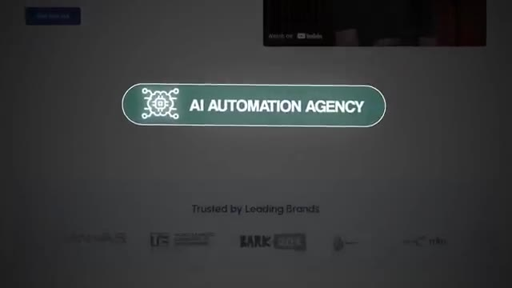
*⏱️ 00:09:40 — Capture d'écran montrant le logo et le titre 'AI AUTOMATION AGENCY' au centre d'une interface web.*

---

### ⏱️ `[00:09:49 - 00:10:22]` | Segment #24

**🔊 Audio (Transcription Intégrale Mot pour Mot en Français) :**
> Vous commencez par faire appel à des développeurs pour gérer les réalisations techniques. Cela vous libère pour vous concentrer davantage sur les audits, le conseil et la stratégie de haut niveau. À mesure que votre demande augmente, vous ajoutez des commerciaux ou des preneurs de rendez-vous qui peuvent alimenter votre carnet de prospects. De cette façon, vous ne passez pas des heures chaque jour à faire de la prospection, vous concluez des contrats, réalisez des audits et vous positionnez en tant qu'expert. Il est cependant important que vous soyez passé par le freelancing et le conseil afin de comprendre exactement ce qu'il faut pour réussir dans ces rôles pour pouvoir ensuite embaucher pour ces rôles. Ce modèle fonctionne parce qu'il vous permet pour ainsi dire de démultiplier votre temps. Au lieu d'être bloqué dans la livraison, vous déplacez votre attention vers l'autorité de la marque et les relations clients pendant que votre équipe exécute les réalisations.

**👁️ Analyse Visuelle d'Écran (gemini-3.5-flash-lite) :**
**Interface & Outils** : Aucune interface logicielle technique ou de développement visible.

**Contenu textuel & Code** : Aucun code, terminal ou prompt affiché.

**Action / Démonstration** : Aucune action technique ou manipulation de démonstration.

---

### ⏱️ `[00:10:22 - 00:10:41]` | Segment #25

**🔊 Audio (Transcription Intégrale Mot pour Mot en Français) :**
> Et si vous le faites bien, le potentiel est énorme. Une agence bâtie sur des bases de conseil peut facilement dépasser le million de dollars de chiffre d'affaires annuel. Développez-la davantage avec plus de développeurs et une équipe commerciale, et vous pouvez atteindre 10 millions de dollars par an ou plus. Et voici un point de vue à garder en esprit : de grands cabinets comme McKinsey, BCG, Accenture facturent des centaines de milliers de dollars rien que pour une consultation ou un audit en IA.

**👁️ Analyse Visuelle d'Écran (gemini-3.5-flash-lite) :**
**Interface & Outils** : AUCUNE

**Contenu textuel & Code** : AUCUNE

**Action / Démonstration** : AUCUNE

---

### ⏱️ `[00:10:42 - 00:11:06]` | Segment #26

**🔊 Audio (Transcription Intégrale Mot pour Mot en Français) :**
> Cela n'inclut même pas encore la mise en œuvre pratique. Accenture à elle seule a engrangé plus de 600 millions de dollars de revenus de conseil en IA en un seul trimestre, et plus de 2,6 milliards de dollars en un semestre. Or, la plupart des entreprises qui ne font pas partie du Fortune 500 ne peuvent pas se le permettre. C'est donc là une immense opportunité pour vous. Si vous pouvez entrer dans une entreprise de taille moyenne, diagnostiquer les inefficacités, concevoir la feuille de route, et puis aussi réellement construire les automatisations, vous pouvez facturer une fraction de ce que font les grands cabinets tout en offrant bien plus de valeur.

**👁️ Analyse Visuelle d'Écran (gemini-3.5-flash-lite) :**
**Interface & Outils** : AUCUNE

**Contenu textuel & Code** : Texte sur l'article d'Accenture mentionnant les 600 millions de dollars de revenus.

**Action / Démonstration** : AUCUNE

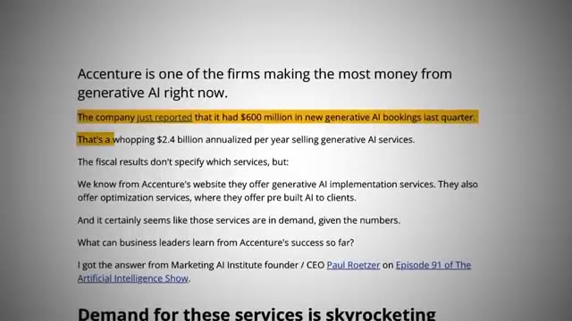
*⏱️ 00:10:48 — Capture d'écran montrant un article de texte sur les revenus d'Accenture liés à l'IA générative.*

---

### ⏱️ `[00:11:07 - 00:11:25]` | Segment #27

**🔊 Audio (Transcription Intégrale Mot pour Mot en Français) :**
> C'est le marché que la plupart des gens négligent, et il est grand ouvert en ce moment. Donc bien sûr, nous avons un autre cadre pratique pour vous les gars. Celui-ci est le cadre GROW. Le G signifie Obtenir des développeurs. Embauchez un ou deux développeurs qui peuvent livrer des builds de manière fiable. Commencez par déléguer le travail technique le plus chronophage afin de pouvoir rester en contact avec les clients, gérer la relation et garder les clients heureux.

**👁️ Analyse Visuelle d'Écran (gemini-3.5-flash-lite) :**
**Interface & Outils** : Graphismes vidéo animés d'illustration de framework

**Contenu textuel & Code** : Texte "FRAMEWORK", "G - GET DEVELOPERS" et icône animée "DEVELOPER"

**Action / Démonstration** : Animation visuelle illustrant la première étape du cadre GROW concernant le recrutement de développeurs.

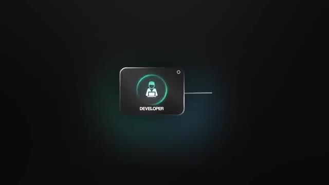
*⏱️ 00:11:21 — Animation graphique sur fond sombre représentant une icône de développeur avec le mot "DEVELOPER".*

---

### ⏱️ `[00:11:26 - 00:11:45]` | Segment #28

**🔊 Audio (Transcription Intégrale Mot pour Mot en Français) :**
> Le R signifie conserver l'autorité. Maintenez votre position de stratège et de leader d'opinion. Vous dirigez toujours les audits, calculez le retour sur investissement et guidez la conception des systèmes. Les développeurs exécutent votre vision. Le O est pour intégrer les ventes. Une fois que votre livraison est stable, faites appel à des représentants commerciaux ou à des preneurs de rendez-vous. Leur travail consiste à réserver des appels et à maintenir votre carnet de commandes rempli afin que vous puissiez vous concentrer sur la conclusion de plus gros contrats et la direction de votre équipe.

**👁️ Analyse Visuelle d'Écran (gemini-3.5-flash-lite) :**
**Interface & Outils** : Aucun éditeur de code ou outil technique actif n'est affiché.

**Contenu textuel & Code** : Texte graphique du framework GROW (G, R, O, W).

**Action / Démonstration** : Le présentateur explique les étapes de son framework en gros plan.

---

### ⏱️ `[00:11:45 - 00:12:06]` | Segment #29

**🔊 Audio (Transcription Intégrale Mot pour Mot en Français) :**
> Et le W, c'est gagner avec la marque. À ce stade, votre marque personnelle est votre plus grand atout. Partagez vos études de cas, votre contenu et votre leadership d'opinion à grande échelle. Vous n'êtes plus seulement le gars de l'automatisation. Vous êtes un nom de confiance dans l'automatisation de l'IA pour votre niche. Donc, quand j'ai commencé le conseil en solo, j'ai atteint ce plafond rapidement où j'avais besoin d'embaucher plus de monde. Je signais des contrats, mais entre les appels de découverte, la construction, la livraison, j'étais complètement saturé.

**👁️ Analyse Visuelle d'Écran (gemini-3.5-flash-lite) :**
**Interface & Outils** : Aucune interface technique ou de développement visible.

**Contenu textuel & Code** : Aucun code, terminal ou prompt visible.

**Action / Démonstration** : Aucune action technique ou démonstration de code effectuée.

---

### ⏱️ `[00:12:06 - 00:12:25]` | Segment #30

**🔊 Audio (Transcription Intégrale Mot pour Mot en Français) :**
> C'est à ce moment-là que j'ai réalisé que si je voulais grandir, c'était une question d'embaucher plus de personnes pour m'aider. C'est là que je me suis associé avec mes cofondateurs chez True Horizon, Millen et Tyler, et cela a été le début de notre entreprise ensemble. Une fois que nous avons eu une équipe, tout a changé. Nous avons pu faire monter en puissance les développeurs, commencer à intégrer davantage de rôles comme des commerciaux et des chefs de projet, et nous pouvions simplement avancer beaucoup plus rapidement sur la livraison. Et nous avons beaucoup plus appris tout au long de ce processus.

**👁️ Analyse Visuelle d'Écran (gemini-3.5-flash-lite) :**
**Interface & Outils** : Navigateur web affichant le site internet de True Horizon AI.

**Contenu textuel & Code** : Photographies de profil, noms, rôles (Co-Founder & CEO, Co-Founder & CTO, VP of Engineering, etc.) et icônes LinkedIn des membres de l'équipe.

**Action / Démonstration** : Défilement vertical de la page 'About' du site web pour présenter visuellement l'équipe de True Horizon.

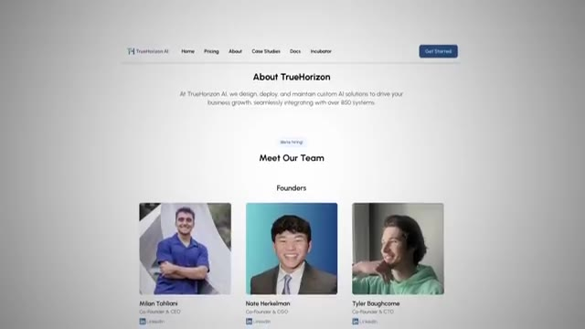
*⏱️ 00:12:11 — Capture d'écran d'un site web montrant la section 'Meet Our Team' avec les profils des trois cofondateurs de True Horizon.*

*⏱️ 00:12:16 — Défilement vers le bas de la page web montrant les membres additionnels de l'équipe élargie de True Horizon.*

*⏱️ 00:12:20 — Vue complète de la page web de l'équipe affichant tous les collaborateurs et employés de l'entreprise.*

---

### ⏱️ `[00:12:25 - 00:12:47]` | Segment #31

**🔊 Audio (Transcription Intégrale Mot pour Mot en Français) :**
> La taille des contrats que nous pouvions conclure a grossi de plus en plus à mesure que nous avions plus de capacité et aussi plus d'expertise. Au début, cela ressemblait, vous savez, à des projets à 4 000 dollars, à 6 000 dollars, peut-être un projet à 12 000 dollars. Et maintenant, nous signons des contrats d'une valeur de centaines de milliers de dollars parce que les entreprises nous voient désormais comme un partenaire à long terme plutôt que simplement comme une autre agence de développement en IA. Ma recommandation serait donc, avant de franchir le pas d'embaucher des gens, de vous assurer de bâtir des fondations solides.

**👁️ Analyse Visuelle d'Écran (gemini-3.5-flash-lite) :**
**Interface & Outils** : Aucune interface logicielle ou démonstration technique n'est affichée.

**Contenu textuel & Code** : Aucun contenu technique (code, diagramme ou données) n'est visible.

**Action / Démonstration** : Aucune action technique ou manipulation n'est effectuée à l'écran.

---

### ⏱️ `[00:12:47 - 00:13:12]` | Segment #32

**🔊 Audio (Transcription Intégrale Mot pour Mot en Français) :**
> Voici une petite liste de contrôle rapide pour savoir quand vous êtes prêt à commencer à évoluer vers une agence ou une entreprise partenaire en IA. Vous avez des clients en conseil réguliers et vous pouvez conclure des projets de manière fiable. Vous avez créé des études de cas qui prouvent le retour sur investissement et attirent des prospects entrants. Vous avez plus de travail que vous ne pouvez en gérer seul et vous avez besoin d'aide pour la livraison. Vous avez construit une marque personnelle assez forte pour attirer des opportunités de manière cohérente. Une fois ces éléments en place, la prochaine étape logique est d'embaucher des développeurs pour la livraison, d'intégrer des ventes pour le support, afin de pouvoir vous concentrer sur ce qui fait vraiment grandir l'entreprise.

**👁️ Analyse Visuelle d'Écran (gemini-3.5-flash-lite) :**
**Interface & Outils** : Présentation graphique textuelle (diapositive animée) et plan fixe du présentateur.

**Contenu textuel & Code** : Texte de la checklist : '1. You have consistent consulting clients...', '2. You've built case studies...', '3. You have more work than...'.

**Action / Démonstration** : Affichage progressif d'une liste de contrôle animée et intervention face caméra du présentateur.

---

### ⏱️ `[00:13:13 - 00:13:32]` | Segment #33

**🔊 Audio (Transcription Intégrale Mot pour Mot en Français) :**
> Conseil, relations et autorité de marque. Donc, le bilan et la grille d'évaluation pour cette étape sont la rapidité d'obtention d'argent, 5 sur 10. Le recrutement prend du temps, mais l'augmentation de la capacité peut rapidement faire grimper les revenus. La facilité pour les débutants est de 2 sur 10. Vous ne devriez commencer ici qu'après avoir maîtrisé le conseil, car à mesure que vous recrutez des gens et que vous élargissez votre équipe, vous ajoutez beaucoup d'éléments mobiles.

**👁️ Analyse Visuelle d'Écran (gemini-3.5-flash-lite) :**
**Interface & Outils** : Interface graphique de présentation vidéo (graphique de score).

**Contenu textuel & Code** : Texte "SCORE CARD", "SPEED TO MONEY", "EASE FOR BEGINNERS", et les notes "5/10" et "2/10".

**Action / Démonstration** : Affichage graphique des critères d'évaluation de la stratégie présentée.

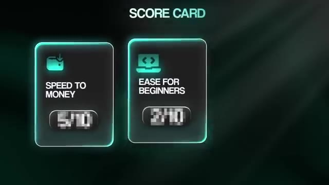
*⏱️ 00:13:17 — Une carte de score ("SCORE CARD") affichant deux métriques : "SPEED TO MONEY" notée 5/10 et "EASE FOR BEGINNERS" notée 2/10.*

---

### ⏱️ `[00:13:32 - 00:13:55]` | Segment #34

**🔊 Audio (Transcription Intégrale Mot pour Mot en Français) :**
> Le potentiel de revenus est de 8 sur 10, parce que si vous faites cela correctement, vous pouvez atteindre des millions de dollars par an. Rappelez-vous simplement que ce modèle n'est pas votre première étape. Ne courez pas avant de savoir marcher. Bien sûr, il y a un piège quand vous passez à l'échelle supérieure avec une agence : les dépenses. Les développeurs, les commerciaux, peut-être même les coûts publicitaires, tout cela commence à s'accumuler. Donc, même si une agence générant un million de dollars par an peut sembler impressionnante, une fois que vous payez les salaires et les frais généraux, vous n'en gardez peut-être que la moitié en bénéfices.

**👁️ Analyse Visuelle d'Écran (gemini-3.5-flash-lite) :**
**Interface & Outils** : Aucune interface logicielle ou outil technique n'est affiché.

**Contenu textuel & Code** : Texte informatif et graphique sur le potentiel financier des modèles d'agence IA.

**Action / Démonstration** : Présentation orale du concept par le créateur.

---

### ⏱️ `[00:13:55 - 00:14:14]` | Segment #35

**🔊 Audio (Transcription Intégrale Mot pour Mot en Français) :**
> C'est encore un chiffre formidable, mais voici la partie qui pourrait vous choquer. Je gagne en réalité la plus grande partie de mon argent d'une manière complètement différente. Et c'est en enseignant l'automatisation par l'IA. C'est donc exactement de cela dont il est question à l'étape quatre. À l'heure actuelle, je gagne plus de 150 000 dollars par mois de bénéfice net en enseignant l'automatisation par l'IA. Pas de masse salariale, pas de grosses dépenses, juste moi qui partage ce que je sais, ce qui est exactement la raison pour laquelle vous m'écoutez en ce moment même.

**👁️ Analyse Visuelle d'Écran (gemini-3.5-flash-lite) :**
**Interface & Outils** : Logiciel de présentation graphique / Montage vidéo.

**Contenu textuel & Code** : Texte affiché : "STAGE 1 : FREELANCING WITH AI MODULES", "STAGE 2 : CONSULTING WITH AI", "STAGE 3 : SCALING INTO AN AI PARTNER BUSINESS", "STAGE 4 : TEACHING AI AUTOMATION".

**Action / Démonstration** : Transition visuelle illustrant la progression stratégique du business vers l'enseignement de l'automatisation par l'IA.

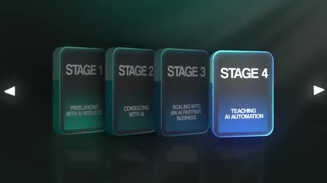
*⏱️ 00:14:05 — Graphique animé présentant 4 étapes (Stages) du business, mettant en surbrillance l'étape 4 : "Teaching AI Automation".*

---

### ⏱️ `[00:14:14 - 00:14:33]` | Segment #36

**🔊 Audio (Transcription Intégrale Mot pour Mot en Français) :**
> Je crée des vidéos YouTube où je présente des automatisations vraiment uniques et cool que j'ai construites. Ce ne peuvent pas être juste des workflows génériques. Il faut savoir ce que l'on fait parce qu'on ne peut pas cacher si l'automation ne fonctionne pas ou n'est pas impressionnante. Et ce que j'ai commencé à faire dès le début, c'était simplement de donner mes modèles gratuitement. À la fin de la vidéo, je disais, hé, si vous voulez ceci, si vous voulez jouer avec pour mieux l'apprendre, vous pouvez l'obtenir gratuitement dans ma communauté School.

**👁️ Analyse Visuelle d'Écran (gemini-3.5-flash-lite) :**
**Interface & Outils** : n8n (outil d'automatisation de workflows).

**Contenu textuel & Code** : Nœuds de workflow : Webhook, Edit Fields, AI Agent, HTTP Request, OpenAI Chat Model, Gmail, Executive summary, Split Out departments, Loop Over departments, HTML.

**Action / Démonstration** : Visualisation et configuration de l'architecture d'un agent IA automatisé au sein de l'éditeur de workflow n8n.

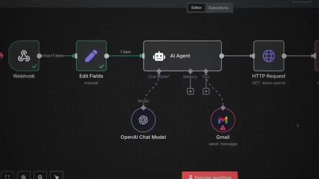
*⏱️ 00:14:19 — Interface de conception de workflow dans n8n, montrant un nœud "AI Agent" connecté à un modèle OpenAI et à une intégration Gmail.*

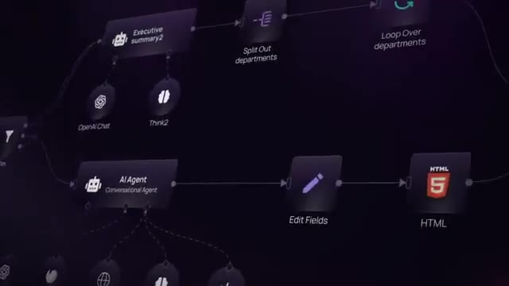
*⏱️ 00:14:24 — Vue zoomée sur un workflow n8n complexe traitant des résumés exécutifs et du contenu HTML avec des boucles sur les départements.*

---

### ⏱️ `[00:14:33 - 00:14:52]` | Segment #37

**🔊 Audio (Transcription Intégrale Mot pour Mot en Français) :**
> Donc, je fournis toute cette valeur dans mon groupe gratuit. Et ensuite, je fais la promotion de ma communauté payante, qui est actuellement à 89 dollars par mois, et qui va bientôt augmenter. Dans les communautés, non seulement les membres obtiennent des modèles, des vidéos et des appels en direct avec moi, mais ils obtiennent aussi du support technique parce qu'ils essaient tous de comprendre les étapes précédentes dont nous venons de parler et de commencer à livrer des automatisations d'IA à leurs clients. Mais bref, c'est tout le tunnel de vente.

**👁️ Analyse Visuelle d'Écran (gemini-3.5-flash-lite) :**
**Interface & Outils** : Navigateur web affichant une plateforme de communauté en ligne et un lecteur vidéo.

**Contenu textuel & Code** : Textes promotionnels de la communauté et étapes de formation professionnelle en automatisation IA.
[DESC_IMAGE_1] Navigation et présentation de l'interface de cours et de communauté payante.

**Action / Démonstration** : Explications face caméra et démonstration conceptuelle.

---

### ⏱️ `[00:14:52 - 00:15:13]` | Segment #38

**🔊 Audio (Transcription Intégrale Mot pour Mot en Français) :**
> Vidéos, groupe School gratuit, groupe payant, presque tout cela est du pur bénéfice. Le cadre ici est donc le cadre « share » (partager). S correspond à « show » (montrer). Démontrez des automatisations qui sont véritablement uniques et précieuses. L'enseignement ne fonctionne que si les gens disent : « Wow, je ne savais pas qu'on pouvait faire ça » ou « Wow, ça m'aide vraiment ». H correspond à « hook » (accrocher). Invitez vos spectateurs à obtenir gratuitement une ressource de votre part. Cet apport de valeur gratuit renforce la confiance et vous aide à commencer à bâtir une communauté.

**👁️ Analyse Visuelle d'Écran (gemini-3.5-flash-lite) :**
**Interface & Outils** : n8n / Navigateur Web YouTube

**Contenu textuel & Code** : Diagramme de workflow n8n montrant des agents IA (Google Drive Agent, Creative Agent, Posting Agent) et un titre de vidéo YouTube "3 Hidden Data Table Hacks for Smarter AI Agents"

**Action / Démonstration** : Présentation d'un workflow d'automatisation complexe avec n8n intégré à l'écran.

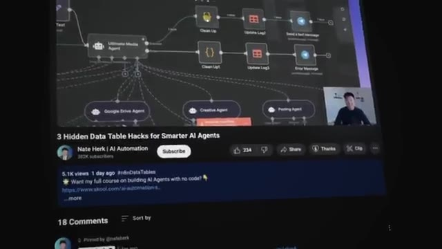
*⏱️ 00:15:03 — Un écran montrant un diagramme de workflow d'automatisation n8n avec plusieurs nœuds d'agents IA, et la chaîne YouTube du présentateur en dessous.*

---

### ⏱️ `[00:15:13 - 00:15:34]` | Segment #39

**🔊 Audio (Transcription Intégrale Mot pour Mot en Français) :**
> Le A correspond à attirer. Dans le groupe gratuit, offrez de la valeur de manière constante. Cela renforce la confiance et prépare les gens pour l'étape suivante. Le R correspond à recommander. Présentez la communauté payante comme la suite logique pour ceux qui veulent un accès plus approfondi, des modèles avancés et des appels en direct. Et enfin, le E correspond à étendre. Continuez à produire des vidéos et des modèles. Chaque nouvelle automatisation que vous créez devient du contenu qui fait croître votre audience et vos revenus récurrents.

**👁️ Analyse Visuelle d'Écran (gemini-3.5-flash-lite) :**
**Interface & Outils** : AUCUNE

**Contenu textuel & Code** : AUCUNE

**Action / Démonstration** : AUCUNE

---

### ⏱️ `[00:15:34 - 00:15:52]` | Segment #40

**🔊 Audio (Transcription Intégrale Mot pour Mot en Français) :**
> Et ce qui est formidable avec ça, c'est que si vous avez suivi les étapes précédentes où vous partagiez vos études de cas en ligne, vous avez peut-être déjà commencé à vous bâtir une petite communauté et de la confiance, ce qui est exactement la raison pour laquelle j'ai lancé ma chaîne YouTube. Ce n'était pas parce que je pensais qu'elle deviendrait mon travail à plein temps ou une entreprise en soi. Honnêtement, je voulais simplement trouver un moyen de mieux m'apprendre à moi-même et aussi de me constituer une sorte de portfolio numérique.

**👁️ Analyse Visuelle d'Écran (gemini-3.5-flash-lite) :**
**Interface & Outils** : YouTube (Interface web)

**Contenu textuel & Code** : Page de profil de la chaîne YouTube "Nate Herk | AI Automation" avec bannière et vidéos récentes.
[DESC_IMAGE_3] Présentation face caméra.

**Action / Démonstration** : Explications face caméra et démonstration conceptuelle.

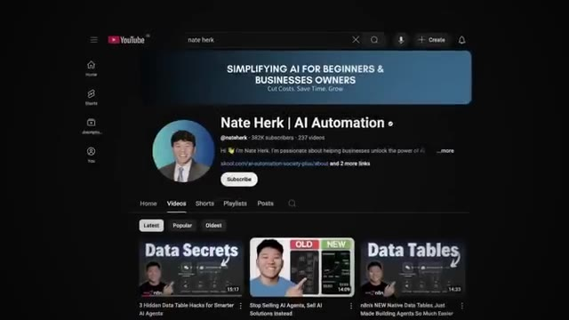
*⏱️ 00:15:43 — Capture d'écran de la chaîne YouTube "Nate Herk | AI Automation" illustrant la discussion sur le lancement de la chaîne.*

---

### ⏱️ `[00:15:53 - 00:16:24]` | Segment #41

**🔊 Audio (Transcription Intégrale Mot pour Mot en Français) :**
> Donc ensuite, quand j'ai commencé à contacter des clients, je pouvais dire, hé, allez voir ma chaîne YouTube si vous voulez voir d'autres trucs sur lesquels j'ai travaillé. Certaines personnes ont voulu travailler avec moi. D'certaines personnes m'ont ensuite contacté en voulant que je construise des automatisations personnalisées. Et certaines personnes me contactaient juste pour les modèles dans mes vidéos, ce qui est exactement la raison pour laquelle j'ai lancé la communauté School gratuite juste comme un endroit pour publier tous les modèles et commencer à bâtir une communauté. Et ensuite, quand j'avais cette communauté gratuite qui grandissait déjà, j'avais des personnes qui me contactaient pour un support technique plus poussé ou un mentorat plus approfondi. Et c'est là que j'ai décidé de lancer la communauté payante. Donc maintenant, j'ai un modèle très simple. Dans mes vidéos, je dis, hé, si vous voulez que mon entreprise travaille avec vous, alors allez ici. Si vous voulez le modèle gratuit, allez ici.

**👁️ Analyse Visuelle d'Écran (gemini-3.5-flash-lite) :**
**Interface & Outils** : Interface web de la plateforme communautaire AI Automation Society.

**Contenu textuel & Code** : Publications du forum communautaire, messages d'utilisateurs sur les templates et workflows n8n.

**Action / Démonstration** : Navigation et affichage de la communauté en ligne pour illustrer l'audience et l'engagement.

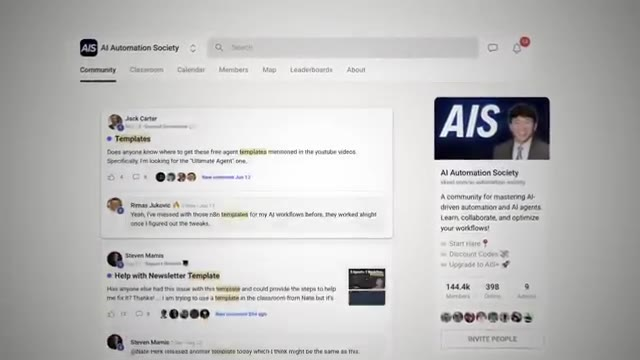
*⏱️ 00:16:08 — Interface web de la communauté "AI Automation Society" montrant les discussions et publications des membres.*

---

### ⏱️ `[00:16:24 - 00:16:43]` | Segment #42

**🔊 Audio (Transcription Intégrale Mot pour Mot en Français) :**
> Et si vous voulez un soutien plus approfondi avec d'autres créateurs, alors allez ici. Et je sais que c'est une tonne d'informations que je viens de vous balancer. Je mets donc toute cette vidéo dans un pack de ressources que vous pouvez tous aller récupérer tout à fait gratuitement dans ma communauté FreeSchool. Le lien pour cela est dans la description. Passons à l'application pratique de cette étape. L'enseignement est l'étape la plus avancée du parcours. C'est parce qu'on ne peut pas se cacher si on ne sait pas ce qu'on fait.

**👁️ Analyse Visuelle d'Écran (gemini-3.5-flash-lite) :**
**Interface & Outils** : AUCUNE

**Contenu textuel & Code** : AUCUN

**Action / Démonstration** : AUCUNE

---

### ⏱️ `[00:16:44 - 00:17:09]` | Segment #43

**🔊 Audio (Transcription Intégrale Mot pour Mot en Français) :**
> Vos automatisations doivent être percutantes, originales et éprouvées sur le terrain. La bonne nouvelle, c'est que tout ce que vous avez fait jusqu'à présent vous prépare à ce moment. Le freelancing vous a appris à créer des modules et à trouver des clients. Le conseil vous a appris à identifier les problèmes d'entreprise et à communiquer le retour sur investissement. Et la création d'une entreprise partenaire en IA vous a appris à bâtir votre autorité et à gérer la demande. Ainsi, lorsque vous arrivez à cette étape de l'enseignement, vous avez déjà acquis les compétences, les études de cas, peut-être même une petite communauté, et la confiance nécessaire pour partager vos savoirs publiquement et être rémunéré pour cela.

**👁️ Analyse Visuelle d'Écran (gemini-3.5-flash-lite) :**
**Interface & Outils** : Interface graphique de présentation (infographie) et interface d'application ou de workflow.

**Contenu textuel & Code** : Texte des étapes : Stage 1 (Freelancing with AI Modules), Stage 2 (Consulting with AI), Stage 3, Stage 4, ainsi que des infobulles explicatives.

**Action / Démonstration** : Présentation visuelle et structurée des étapes clés pour réussir dans l'automatisation par l'IA.

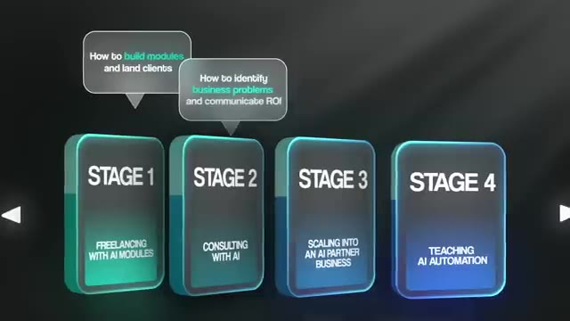
*⏱️ 00:16:56 — Infographie en 4 étapes représentant l'évolution professionnelle avec l'IA (Stage 1 à 4).*

*⏱️ 00:17:02 — Capture d'une interface logicielle ou d'un tableau de bord affichée au centre de l'écran.*

---

### ⏱️ `[00:17:09 - 00:17:27]` | Segment #44

**🔊 Audio (Transcription Intégrale Mot pour Mot en Français) :**
> Et vous pensez peut-être que ça a l'air difficile parce que vous n'avez pas une immense audience et que ça va être dur de grandir. Mais une chose que j'ai remarquée dans mes communautés en fait et dans d'autres communautés plus larges en ligne, c'est que parfois les gens ont vraiment envie de l'ambiance plus intime d'une communauté. Exactement pourquoi certaines personnes aiment vivre dans une petite ville plutôt que dans une grande ville. Il y a donc toujours une opportunité pour vous de bâtir une communauté tant que les gens vous font confiance ainsi qu'à votre voix.

**👁️ Analyse Visuelle d'Écran (gemini-3.5-flash-lite) :**
**Interface & Outils** : Aucune interface logicielle ni outil de développement visible.

**Contenu textuel & Code** : Aucun code, terminal ou donnée affiché.

**Action / Démonstration** : Aucune action technique ou manipulation en cours.

---

### ⏱️ `[00:17:28 - 00:17:47]` | Segment #45

**🔊 Audio (Transcription Intégrale Mot pour Mot en Français) :**
> Et bien sûr, il doit y avoir une sorte de fossé de connaissances entre les personnes que vous attirer et vous. Vous n'avez pas besoin d'être un expert complet. Il y a beaucoup de gens qui en savent plus sur NNN et l'IA que moi, mais j'en sais plus que les personnes qui sont susceptibles de rejoindre ma communauté. Bref, le retour à la réalité et le tableau de bord ici, vitesse pour gagner de l'argent, 4 sur 10. Se bâtir une audience prend du temps, mais une fois que vous en avez une, les conversions sont relativement rapides.

**👁️ Analyse Visuelle d'Écran (gemini-3.5-flash-lite) :**
**Interface & Outils** : Graphique de type tableau de bord ou infographie animée.

**Contenu textuel & Code** : Texte et scores : "SPEED TO MONEY: 4/10", "EASE FOR BEGINNERS", "INCOME POTENTIAL".

**Action / Démonstration** : Affichage d'une carte de score graphique pour évaluer un modèle ou une opportunité.

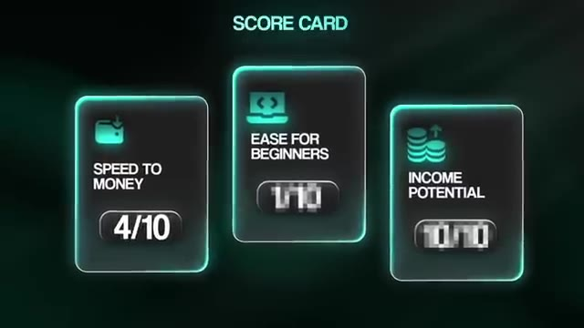
*⏱️ 00:17:42 — Un graphique animé "SCORE CARD" affichant trois critères : "SPEED TO MONEY" (4/10), "EASE FOR BEGINNERS" et "INCOME POTENTIAL" avec des scores floutés.*

---

### ⏱️ `[00:17:47 - 00:18:12]` | Segment #46

**🔊 Audio (Transcription Intégrale Mot pour Mot en Français) :**
> Et comme je le disais tout à l'heure, les algorithmes des réseaux sociaux n'ont jamais été aussi avancés qu'ils le sont aujourd'hui. Donc si vous apportez réellement de la valeur, elle sera mise en avant devant des personnes qui recherchent ce type de valeur. Vous devez simplement être cohérent avec votre contenu. La facette « facilité pour les débutants » est de 1 sur 10. C'est probablement l'étape la plus difficile. Il n'y a pas de raccourci. Vous devez être compétent et confiant dans votre enseignement. Et ensuite, pour le potentiel de revenus, nous lui attribuons un 10 sur 10 parce que l'enseignement peut évoluer à l'infini avec des abonnements récurrente, des cours, du contenu, des parrainages, etc.

**👁️ Analyse Visuelle d'Écran (gemini-3.5-flash-lite) :**
**Interface & Outils** : Interface web de workflow d'automatisation et infographie graphique.

**Contenu textuel & Code** : Diagramme d'intégration, instructions textuelles et score card avec notes d'évaluation.
[DESC_IMAGE_3] Présentation d'une carte de score évaluant les aspects financiers et techniques d'un projet d'automatisation.

**Action / Démonstration** : Explications face caméra et démonstration conceptuelle.

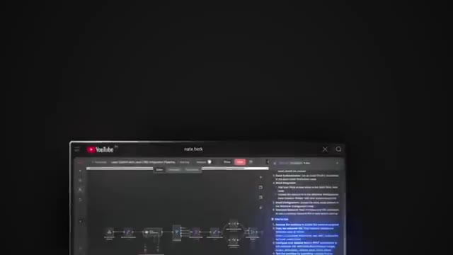
*⏱️ 00:17:53 — Un écran affichant un diagramme de workflow Make ou n8n avec un panneau d'instructions textuelles à droite.*

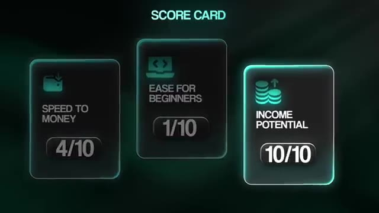
*⏱️ 00:18:06 — Une infographie "SCORE CARD" montrant trois métriques : Speed to Money (4/10), Ease for Beginners (1/10) et Income Potential (10/10).*

---

### ⏱️ `[00:18:12 - 00:18:32]` | Segment #47

**🔊 Audio (Transcription Intégrale Mot pour Mot en Français) :**
> Et encore une fois, enseigner l'automatisation par l'IA est l'objectif final. C'est là que l'autorité, la preuve et la maîtrise technique convergent. Si vous suivez le processus, de freelance à consultant puis à agence, vous serez prêt à vous lancer dans l'enseignement et à vous bâtir une audience qui pourra subvenir à vos besoins à vie. Prenons donc une seconde pour respirer et récapituler. Si vous voulez gagner de l'argent réel avec l'automatisation par l'IA, vous n'avez pas besoin de vous lancer directement dans une agence dès le premier jour.

**👁️ Analyse Visuelle d'Écran (gemini-3.5-flash-lite) :**
**Interface & Outils** : Graphique 3D de présentation

**Contenu textuel & Code** : Texte affichant "Stage 1", "Stage 2" et "Stage 3" représentant le parcours d'évolution professionnelle.

**Action / Démonstration** : Animation visuelle présentant les différentes étapes du processus d'automatisation et de développement d'entreprise.

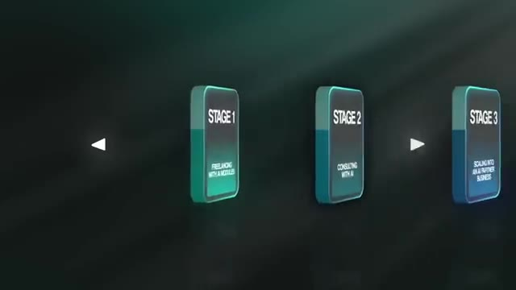
*⏱️ 00:18:27 — Un graphique animé en 3D montrant les trois étapes clés : Stage 1 (Freelancing), Stage 2 (Consulting) et Stage 3 (Scaling).*

---

### ⏱️ `[00:18:32 - 00:18:55]` | Segment #48

**🔊 Audio (Transcription Intégrale Mot pour Mot en Français) :**
> Il y a une progression naturelle, un escalier que vous pouvez gravir une marche à la fois. Et voici la feuille de route complète encore une fois. Freelance. Commencez petit, utilisez des modèles comme des blocs de Lego, et décrochez vos premiers projets de 500 $ à 2 000 $. Développez votre confiance, vos études de cas et vos preuves. Consultant. Passez à la stratégie. Auditez des entreprises. Identifiez le retour sur investissement et concevez des flux de travail personnalisés. Facturez l'audit, puis facturez la mise en œuvre et commencez à bâtir votre crédibilité grâce à des études de cas et du contenu.

**👁️ Analyse Visuelle d'Écran (gemini-3.5-flash-lite) :**
**Interface & Outils** : Interface web de conception de workflows (type n8n ou outil similaire hébergé sur Railway).

**Contenu textuel & Code** : Nœuds de workflow visibles incluant 'Webhook' et 'On form submission'.

**Action / Démonstration** : Affichage et conception de flux de travail personnalisés pour l'automatisation.

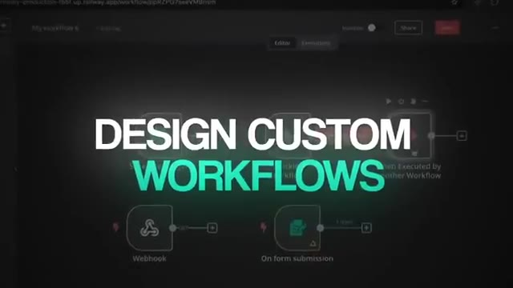
*⏱️ 00:18:50 — Une interface de création de flux de travail (workflow) avec des nœuds connectés comme Webhook et On form submission.*

---

### ⏱️ `[00:18:56 - 00:19:17]` | Segment #49

**🔊 Audio (Transcription Intégrale Mot pour Mot en Français) :**
> Agence. Développez votre activité de conseil en embauchant des développeurs et du support commercial. Concentrez-vous sur les audits, les relations et la construction de votre marque. Avec la bonne équipe sous vos ordres, vous pouvez dépasser le million de dollars par an. Et enfin, soyez un professeur. Partagez vos connaissances publiquement via YouTube, des communautés gratuites, LinkedIn, des abonnements payants. Enseignez des automatisations uniques et impressionnantes qui prouvent votre autorité. C'est l'action au plus fort effet de levier avec le potentiel de revenus récurrents illimités.

**👁️ Analyse Visuelle d'Écran (gemini-3.5-flash-lite) :**
**Interface & Outils** : Interface graphique de type éditeur de flux ou d'automatisation (workflow).

**Contenu textuel & Code** : Nœuds de workflow visibles incluant Text/Image Input, Telegram Trigger, Switch, Download File, Upload File, Set Text, Photoshop Agent, AI Image Gen et File Handling.

**Action / Démonstration** : Affichage et explication d'un workflow d'automatisation complexe combinant des outils d'IA et de messagerie.

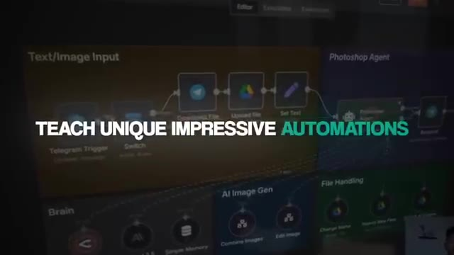
*⏱️ 00:19:12 — Capture d'écran d'un diagramme de workflow interactif avec des nœuds connectés pour des automatisations (Telegram, Google Drive, Photoshop Agent) et le texte 'TEACH UNIQUE IMPRESSIVE AUTOMATIONS'.*

---

### ⏱️ `[00:19:17 - 00:19:36]` | Segment #50

**🔊 Audio (Transcription Intégrale Mot pour Mot en Français) :**
> Donc, pour voir les choses en grand. Le parcours ne consiste pas à choisir un seul modèle et à ignorer le reste. Il s'agit d'accumuler les compétences dans le bon ordre. Le freelancing vous apporte la preuve. Le conseil vous apporte la crédibilité. L'agence vous apporte l'échelle. Et l'enseignement vous apporte la liberté. Chaque étape vous prépare à la suivante. C'est pourquoi essayer de commencer par une agence est un piège. Parce qu'encore une fois, vous essayez de courir avant de savoir marcher. Mais si vous suivez la feuille de route, chaque étape semble naturelle.

**👁️ Analyse Visuelle d'Écran (gemini-3.5-flash-lite) :**
**Interface & Outils** : Graphique de présentation animé (slides graphiques) et plan fixe du présentateur.

**Contenu textuel & Code** : Texte affiché sur les graphiques : Stage 1 (Freelancing with AI modules), Stage 2 (Consulting with AI), Stage 3 (Scaling into an AI partner business), Stage 4 (Teaching AI automation).

**Action / Démonstration** : Présentation des étapes de croissance professionnelle par le créateur.

---

### ⏱️ `[00:19:36 - 00:19:58]` | Segment #51

**🔊 Audio (Transcription Intégrale Mot pour Mot en Français) :**
> Et vos revenus progressent de manière exponentielle à mesure que vous grimpez. Ces étapes sont à peu près exactement celles que j'ai suivies. Maintenant, j'ai la certitude absolue que vous pourriez prendre tout ce que nous venons de voir aujourd'hui par vous-même et obtenir des résultats que vous pensiez auparavant impossibles. Et si c'était votre seule option, ce serait une voie digne d'être suivie. Mais et s'il y avait une autre option ? Vous voyez, à partir d'ici, vous avez deux choix. Le premier choix est de le faire seul. Vous pouvez assembler des tutoriels YouTube, regarder des fils de discussion Reddit, et essayer de rétroconcevoir ce qui fonctionne.

**👁️ Analyse Visuelle d'Écran (gemini-3.5-flash-lite) :**
**Interface & Outils** : AUCUNE

**Contenu textuel & Code** : Texte affiché dans les encarts graphiques ('01 DISCOVER ON YOUR OWN', '02').

**Action / Démonstration** : Présentation orale des étapes et affichage de graphiques de transition à l'écran.

---

### ⏱️ `[00:19:59 - 00:20:20]` | Segment #52

**🔊 Audio (Transcription Intégrale Mot pour Mot en Français) :**
> Vous pouvez passer des mois d'essais et d'erreurs, rester bloqué sur un seul problème technique pendant des jours, et vous demander si vous apprenez même les bonnes choses. Et s'il y avait une autre façon de faire ? Et si je pouvais jouer un rôle actif dans votre réussite, en vous enseignant et en répondant à vos questions ? Et si vous aviez toute mon équipe de développeurs pour vous aider lorsque vous étiez bloqué ? Comment cela changerait-il les choses pour vous ? Pensez-vous que dans cette situation, je peux vous donner les moyens, grâce aux ressources dont je dispose, de mettre toutes les chances de votre côté et de rendre votre réussite beaucoup plus probable ?

**👁️ Analyse Visuelle d'Écran (gemini-3.5-flash-lite) :**
**Interface & Outils** : AUCUNE

**Contenu textuel & Code** : Texte comparatif sur l'apprentissage autonome face au guidage.

**Action / Démonstration** : Présentation de concepts par l'animateur et affichage graphique.

---

### ⏱️ `[00:20:20 - 00:20:41]` | Segment #53

**🔊 Audio (Transcription Intégrale Mot pour Mot en Français) :**
> Soyons donc clairs. Je ne vous garantis pas que vous allez gagner le moindre argent. Cela dépend évidemment de votre éthique de travail. Ce que je vous garantis, c'est que je peux rendre ce chemin plus facile et plus rapide pour vous, car j'ai déjà parcouru ce chemin moi-même. Alors voici le problème. Tout ce que je vous ai montré jusqu'à présent, tout cela s'assemble. Et j'ai regroupé tout ce que j'ai appris en un seul endroit. Ça s'appelle AI Automation Society Plus. Mais avant de vous dire ce qu'il y a à l'intérieur, je veux juste être clair, ce n'est pas juste un autre cours.

**👁️ Analyse Visuelle d'Écran (gemini-3.5-flash-lite) :**
**Interface & Outils** : Interface web d'une communauté en ligne (type Skool).

**Contenu textuel & Code** : Publications de membres : 'Step Outside of the AI Bubble and Become a Problem Solver', 'Let's split a 50k commission', 'Not working: Code 30NATEHERK for Apify'.

**Action / Démonstration** : Navigation ou affichage d'une page de forum/communauté illustrant les retours et discussions des membres.

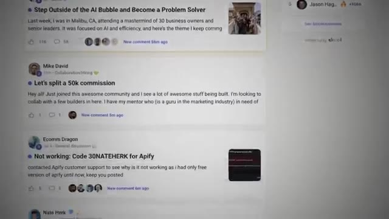
*⏱️ 00:20:36 — Capture d'écran d'une plateforme communautaire (semblable à Skool) montrant des fils de discussion et publications d'utilisateurs.*

---

### ⏱️ `[00:20:41 - 00:21:02]` | Segment #54

**🔊 Audio (Transcription Intégrale Mot pour Mot en Français) :**
> C'est un écosystème complet. C'est conçu dans un seul but, vous donner les compétences exactes qui équivalent à de l'argent dans l'économie de l'IA. D'abord, la base. Nous appelons cela Agent Zéro. Je pars de zéro, comment appréhender l'IA, comment installer les outils et comment créer vos premières automatisations à partir d'une page blanche. Ensuite, nous avons la stratégie, un cours intitulé 10 heures en 10 secondes. Parce que créer une automatisation est une chose, mais savoir quoi automatiser, c'est tout.

**👁️ Analyse Visuelle d'Écran (gemini-3.5-flash-lite) :**
**Interface & Outils** : Interface web de la plateforme de formation 'AI Automation Society Plus' (type Skool ou plateforme communautaire similaire).

**Contenu textuel & Code** : Titres de modules de cours et vignettes pédagogiques ("Start Here", "Agent Zero", "10 Hours to 10 Seconds", "n8n Templates", "Step-by-Step Builds").

**Action / Démonstration** : Navigation et présentation des différents modules de formation de la plateforme communautaire par le présentateur.

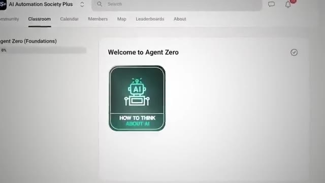
*⏱️ 00:20:52 — Interface de la plateforme 'AI Automation Society Plus' affichant le module de cours 'Agent Zero' avec la leçon 'Welcome to Agent Zero' et 'How to Think About AI'.*

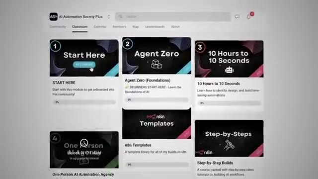
*⏱️ 00:20:57 — Vue d'ensemble des différents modules de la plateforme 'AI Automation Society Plus' incluant 'Start Here', 'Agent Zero (Foundations)', '10 Hours to 10 Seconds', 'n8n Templates', et 'Step-by-Step Builds'.*

---

### ⏱️ `[00:21:02 - 00:21:23]` | Segment #55

**🔊 Audio (Transcription Intégrale Mot pour Mot en Français) :**
> Je vais vous montrer comment entrer dans n'importe quelle entreprise, trouver le processus qui gaspille 10 heures par semaine et le réduire à 10 minutes. C'est ainsi que vous justifiez de facturer 10 000 dollars ou plus, parce que vous vendez un retour sur investissement, et pas seulement la technologie. Ensuite, le terrain d'entraînement. Nous organisons fréquemment des hackathons et des défis de création. Toute la communauté se concentre sur un seul type d'automatisation. Vous construisez aux côtés d'autres, soumettez votre projet, et le gagnant remporte un prix en argent.

**👁️ Analyse Visuelle d'Écran (gemini-3.5-flash-lite) :**
**Interface & Outils** : Interface web de plateforme communautaire en ligne (type Skool ou forum).

**Contenu textuel & Code** : Texte d'annonce de hackathon intitulé "LAST DAY: Our September Hackathon ($6000 in Prizes)".

**Action / Démonstration** : Navigation ou affichage d'une publication de la communauté sur le web.

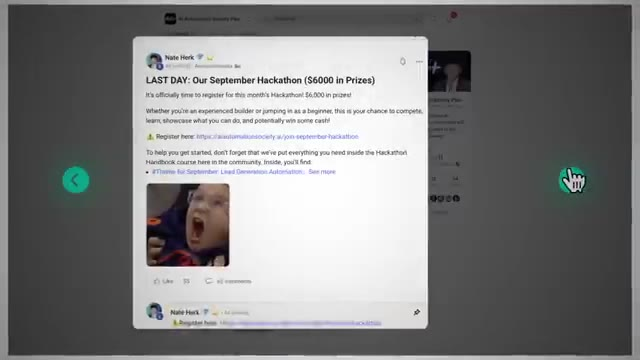
*⏱️ 00:21:18 — Capture d'écran montrant une publication de communauté de Nate Herk annonçant un hackathon avec des prix en espèces.*

---

### ⏱️ `[00:21:23 - 00:21:41]` | Segment #56

**🔊 Audio (Transcription Intégrale Mot pour Mot en Français) :**
> Mais même si vous ne gagnez pas, vous repartez avec quelque chose de bien plus précieux, qui est une toute nouvelle automatisation de haut niveau pour votre portfolio. Et bien sûr, l'aspect communautaire. Des milliers de membres sont déjà à l'intérieur. C'est la communauté tech premium la plus populaire et la plus rapide à croître sur Skool. Les gens construisent, apprennent et gagnent de l'argent chaque jour. Puis enfin, nous avons les bonus pour les membres annuels.

**👁️ Analyse Visuelle d'Écran (gemini-3.5-flash-lite) :**
**Interface & Outils** : Plateforme de communauté en ligne (type Skool ou LMS)

**Contenu textuel & Code** : Liste des membres de la communauté avec leurs détails et statuts en ligne.

**Action / Démonstration** : Navigation ou affichage de la liste des membres de la communauté.

*⏱️ 00:21:32 — Une vue de la communauté en ligne montrant la liste des membres et leurs profils.*

---

### ⏱️ `[00:21:42 - 00:22:00]` | Segment #57

**🔊 Audio (Transcription Intégrale Mot pour Mot en Français) :**
> Si vous optez pour le forfait annuel, vous débloquez également l'agence d'automatisation IA d'une seule personne. À l'intérieur de ce guide se trouve tout mon système pour décrocher vos premiers clients et vous positionner véritablement dans l'esprit d'un chef d'entreprise comme un expert en IA. Je vous donne mes scripts d'appels de découverte, mes calculateurs de retour sur investissement et les modèles de propositions qui ont permis de conclure pour plus d'un million de dollars de contrats pour notre entreprise partenaire spécialisée dans l'IA.

**👁️ Analyse Visuelle d'Écran (gemini-3.5-flash-lite) :**
**Interface & Outils** : Interface web de cours en ligne / plateforme de formation.

**Contenu textuel & Code** : Texte affiché : 'ONE PERSON AGENCY', 'One person AI Automation agency', et éléments graphiques de l'interface.

**Action / Démonstration** : Navigation et présentation visuelle du contenu du module de formation sur l'agence d'automatisation.

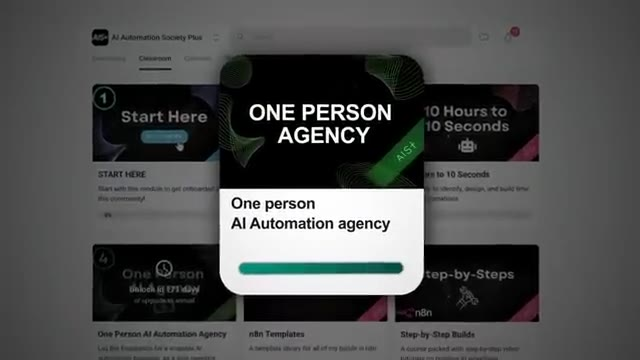
*⏱️ 00:21:46 — Capture d'écran montrant l'interface utilisateur de la plateforme de formation avec un encadré superposé intitulé 'ONE PERSON AGENCY' et 'One person AI Automation agency'.*

---

### ⏱️ `[00:22:00 - 00:22:19]` | Segment #58

**🔊 Audio (Transcription Intégrale Mot pour Mot en Français) :**
> Ce n'est pas de la théorie, c'est mon plan complet pour partenaire IA. Et vous obtiendrez également un tout nouveau cours sur la croissance de YouTube, un guide pratique que j'ai utilisé pour faire croître ma chaîne et mon groupe School à plus de 150 000 dollars par mois de profit net. Et ce ne sera pas générique. Je ne vous enseigne pas les bases de YouTube. Je parlerai spécifiquement de la façon de créer une chaîne YouTube d'automatisation par IA et de monétiser votre expertise.

**👁️ Analyse Visuelle d'Écran (gemini-3.5-flash-lite) :**
**Interface & Outils** : AUCUNE

**Contenu textuel & Code** : AUCUN

**Action / Démonstration** : AUCUNE

---

### ⏱️ `[00:22:19 - 00:22:54]` | Segment #59

**🔊 Audio (Transcription Intégrale Mot pour Mot en Français) :**
> Tout cela est inclus pour les membres annuels. Laissez-moi donc récapituler très rapidement. Vous obtenez Agent Zéro, Fondations. Vous obtenez 10 heures en 10 secondes, le cadre de conseil. Vous obtenez les hackathons mensuels, le terrain d'essai pour votre portfolio. Vous obtenez la communauté, le réseau de créateurs d'IA qui connaît la croissance la plus rapide en ligne. Et si vous optez pour l'abonnement annuel, vous obtenez l'agence d'automatisation IA pour une personne et le cours sur la croissance sur YouTube. Mais avant de voir le prix, il y a une chose que vous devez savoir. Le prix de cette communauté n'est pas fixe. Il augmente tous les quelques mois. Au fur et à mesure que nous ajoutons de la valeur, nous augmentons le prix pour les nouveaux membres. C'est la seule façon de récompenser nos premiers membres. Le prix que vous voyez lorsque vous cliquez sur le lien est le plus bas qu'il ne sera jamais. Et lorsque vous vous inscrivez aujourd'hui, vous bloquez ce tarif à vie. Alors, que faut-il pour obtenir

**👁️ Analyse Visuelle d'Écran (gemini-3.5-flash-lite) :**
**Interface & Outils** : Interface graphique de présentation sous forme de diapositives animées.

**Contenu textuel & Code** : Texte de récapitulatif des modules de formation et graphique d'évolution des prix.
[DESC_ACTION] Présentation visuelle des éléments inclus dans l'offre pour les membres.

**Action / Démonstration** : Explications face caméra et démonstration conceptuelle.

---

### ⏱️ `[00:22:54 - 00:23:13]` | Segment #60

**🔊 Audio (Transcription Intégrale Mot pour Mot en Français) :**
> l'accès à tout ce système de développement des compétences ? Le lien pour cela se trouve dans la description. Allez-y pour voir le tarif spécial que nous avons réservé pour vous. Lorsque vous arrivez sur cette page, vous verrez tout ce dont nous avons parlé et vous pourrez commencer immédiatement. Vous pouvez donc aller sur ce lien dès maintenant. Vous obtiendrez également une énorme réduction si vous vous abonnez à l'année. Donc non seulement je vous donne plus de ressources, mais je fais payer moins, pas plus. La raison pour laquelle ?

**👁️ Analyse Visuelle d'Écran (gemini-3.5-flash-lite) :**
**Interface & Outils** : AUCUNE

**Contenu textuel & Code** : AUCUNE

**Action / Démonstration** : AUCUNE

---

### ⏱️ `[00:23:13 - 00:23:43]` | Segment #61

**🔊 Audio (Transcription Intégrale Mot pour Mot en Français) :**
> Je veux récompenser les personnes qui sont prêtes à s'engager sur le long terme pour leur réussite. Parce que c'est ce qu'il faut. Selon le moment où vous regardez ceci, je suis également en train de déployer du contenu avancé sur la façon de passer de la création d'automatisations à la création de logiciels personnalisés. Vous apprendrez toutes les compétences techniques nécessaires pour créer des applications Web auxquelles les gens peuvent se connecter. Cela enregistre des informations et vous pouvez facturer des frais continus pour y accéder. Demain, vous allez soit fouiller sur YouTube pour essayer de tout comprendre, soit vous serez suivi par des systèmes et vous parlerez avec moi directement au sein de la communauté où je pourrai vous guider, d'un débutant total à la vente de services d'automatisation, jusqu'à créer éventuellement votre propre chaîne YouTube et votre propre communauté.

**👁️ Analyse Visuelle d'Écran (gemini-3.5-flash-lite) :**
**Interface & Outils** : Interface web de plateforme communautaire / LMS (Skool).

**Contenu textuel & Code** : Modules de formation, publications d'annonces de la communauté et classement des membres (Leaderboard).

**Action / Démonstration** : Navigation et présentation visuelle de la structure de la communauté d'apprentissage en ligne.

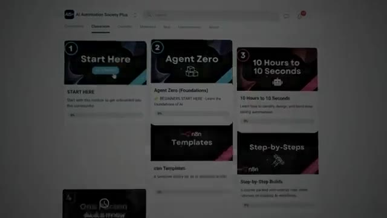
*⏱️ 00:23:21 — Capture d'écran de l'interface d'une plateforme de cours en ligne montrant différents modules (Start Here, Agent Zero, 10 Hours to 10 Seconds).*

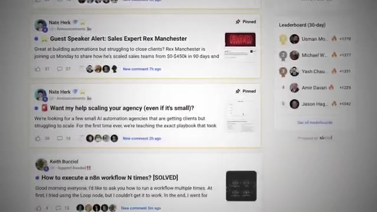
*⏱️ 00:23:36 — Capture d'écran d'un forum communautaire affichant des publications épinglées et un classement (Leaderboard) sur le côté droit.*

---

### ⏱️ `[00:23:43 - 00:23:58]` | Segment #62

**🔊 Audio (Transcription Intégrale Mot pour Mot en Français) :**
> Vous ne faites donc pas seulement le choix d'acheter un abonnement. Vous faites un choix concernant ce que sera votre avenir. Dans un an, votre avenir sera différent selon la décision que vous prenez dès maintenant. J'espère donc que c'est un choix évident. Cliquez sur le lien dans la description pour en savoir plus et je vous remercie de m'avoir écouté aujourd'hui. Je vous retrouve à l'intérieur. Merci à tous.

**👁️ Analyse Visuelle d'Écran (gemini-3.5-flash-lite) :**
**Interface & Outils** : Aucune interface logicielle visible.

**Contenu textuel & Code** : Aucun contenu textuel ou technique affiché.

**Action / Démonstration** : Le présentateur s'adresse directement au spectateur.

---

