# 🎬 I Tested OpenAI's AgentKit Against n8n: What You Need to Know

> **Chaîne** : [Nate Herk | AI Automation](https://www.youtube.com/@nateherk/featured)  
> **Lien YouTube** : [https://www.youtube.com/watch?v=XeIx4S6YvGo](https://www.youtube.com/watch?v=XeIx4S6YvGo)  
> **Date de publication** : 20251007  
> **Durée** : 00:21:21  
> **Identifiant vidéo** : `XeIx4S6YvGo`  
> **Transcription & Analyse** : `whisper-v3-large-turbo+gemini-3.5-flash-lite`  

---

## 📌 Synthèse Exécutive & Outils

### 💡 Résumé

La vidéo de la chaîne Nate Herk | AI Automation explore l'une des questions les plus brûlantes du moment dans l'écosystème de l'automatisation : l'AgentKit d'OpenAI va-t-il remplacer des plateformes établies comme n8n ? En analysant concrètement les deux solutions à travers une méthodologie comparative rigoureuse (facilité d'utilisation, déclencheurs, outils d'agents, support de modèle, composants d'interface et capacités de déploiement), l'analyse démontre que le narratif d'une concurrence directe est infondé. OpenAI ne cherche pas à concurrencer les moteurs d'automatisation d'entreprise, mais plutôt à proposer un outil conversationnel intuitif et rapide, comparable à "Canva pour les agents", taillé sur mesure pour son propre écosystème.

La démonstration pratique met en lumière la fluidité déconcertante d'AgentKit pour concevoir un agent en quelques clics (gestion des modèles, intégration native de la recherche web sans configuration de clés API complexes, interface visuelle low-code épurée). Néanmoins, ses limites structurelles apparaissent rapidement face à un outil chevronné comme n8n : l'absence de déclencheurs natifs variés (pas de déclencheurs basés sur des événements d'applications tierces comme Gmail ou Slack sans passer par des SDK complexes ou des appels API) cantonne AgentKit à un rôle principalement conversationnel et synchrone, là où n8n brille par sa polyvalence asynchrone et ses plus de 500 intégrations natives.

Au terme de cette évaluation comparative (illustrée par un score de 8/10 pour AgentKit et 6/10 pour n8n sur le seul critère de la facilité d'utilisation), la conclusion stratégique s'impose : les deux outils ne jouent pas dans la même cour. AgentKit démocratise la création rapide d'agents pour les équipes et les consommateurs intégrés à OpenAI, tandis que n8n reste la référence absolue et incontournable pour les développeurs et les entreprises exigeant des flux de travail autonomes, ultra-personnalisés et interconnectés à l'ensemble du système d'information.

### 🛠️ Outils, Modèles & Logiciels Présentés

* **AgentKit d'OpenAI** : Solution visuelle low-code de création d'agents lancée par OpenAI, pensée comme un outil simple de type « glisser-déposer » pour concevoir rapidement des flux conversationnels.
* **n8n** : Plateforme d'automatisation open-source puissante et orientée développeurs, offrant plus de 500 intégrations natives et une flexibilité totale pour concevoir des systèmes d'IA autonomes et complexes.
* **Make** : Plateforme d'automatisation de flux de travail sans code, mentionnée comme référence concurrente sur le marché de l'intégration logicielle.
* **Zapier** : Pionnier des outils d'automatisation et de connectivité cloud, utilisé comme étalon de comparaison pour la croissance des parts de marché.
* **Google Opal** : Outil à interface visuelle lancé par Google, évoqué pour illustrer la tendance des géants de la tech à proposer des constructeurs simplifiés sans menacer la suprémunissement des moteurs d'automatisation avancés.
* **True Horizon** : Agence de conseil et d'implémentation de solutions d'IA personnalisées pour les entreprises et structures de type *enterprise*, spécialisée dans l'utilisation de n8n.

### 🔑 Points Clés & Enseignements Stratégiques

* **Faux débat sur la concurrence** : AgentKit n'a pas été conçu pour tuer n8n ou concurrencer les plateformes d'automatisation d'entreprise, mais pour répondre aux besoins des utilisateurs et équipes ancrés dans l'écosystème OpenAI.
* **Philosophie d'usage distincte** : AgentKit privilégie la vitesse et la simplicité pour des cas d'usage conversationnels, tandis que n8n a été bâti pour les développeurs afin de tout automatiser de manière robuste et hautement personnalisée.
* **Barrière à l'entrée abaissée** : Grâce à une interface visuelle extrêmement épurée, un débutant complet peut concevoir et tester un agent opérationnel (avec recherche web intégrée) en quelques secondes sans aucune compétence en programmation.
* **Affranchissement des configurations techniques** : Contrairement aux environnements traditionnels où l'utilisateur doit collecter des clés API pour chaque outil (recherche, modèles de chat), AgentKit intègre nativement ces briques de base.
* **Limitation structurelle des déclencheurs** : AgentKit souffre d'un manque crucial de déclencheurs événementiels natifs (pas de support direct pour des applications tierces comme Gmail ou Slack sans passer par des SDK TypeScript/Python ou des requêtes HTTP).
* **Supériorité asynchrone de n8n** : n8n brille par sa capacité à s'interfacer avec une multitude de déclencheurs (webhooks, événements CRM, plateformes de messagerie, outils bureautiques), permettant une véritable automatisation sans intervention humaine.
* **Séparation conceptuelle des agents** : Il existe une distinction fondamentale entre un agent conversationnel (qui cherche des informations et répond aux questions de l'utilisateur) et un agent d'outils entièrement autonome capable d'agir en arrière-plan.
* **Poids de l'écosystème d'intégration** : Avec plus de 500 connecteurs natifs, n8n demeure l'outil incontournable pour interconnecter des bases de données hétérogènes et des logiciels d'entreprise tiers.
* **Retour d'expérience terrain** : L'utilisation quotidienne de n8n auprès de plus de 150 000 apprenants et d'entreprises clientes (via l'agence True Horizon) prouve sa robustesse pour industrialiser des solutions d'IA à grande échelle.
* **Complémentarité plutôt que substitution** : Plutôt qu'une opposition frontale, les ingénieurs en IA ont tout intérêt à combiner l'agilité de prototypage des outils natifs des LLM (comme AgentKit) avec la puissance d'orchestration globale de moteurs comme n8n.

---

## ⏱️ Chronologie & Transcription Complète Audio & Visuelle (Mot pour Mot)

### ⏱️ `[00:00:00 - 00:00:20]` | Segment #01

**🔊 Audio (Transcription Intégrale Mot pour Mot en Français) :**
> OpenAI vient de tuer NNN, ou l'ont-ils vraiment fait ? Parce qu'ils viennent de lancer leur Agent Kit, nous voyons peut-être ce narratif circuler en ce moment en ligne, mais aujourd'hui je suis là pour comparer réellement Agent Kit et NNN et parler de l'avenir de ces deux constructeurs d'agents. Comme toujours, nous ne allons pas seulement en parler, je vais comparer ces deux plateformes à travers différentes catégories afin de mettre en valeur les forces et les faiblesses de chaque plateforme.

**👁️ Analyse Visuelle d'Écran (gemini-3.5-flash-lite) :**
**Interface & Outils** : Tableau de bord graphique comparatif / diapositive de présentation

**Contenu textuel & Code** : Scores comparatifs entre OpenAI AgentKit (en bleu) et n8n (en rouge) sur des critères tels que Ease of Use, Triggers, Agent Tools, Model Support, etc.

**Action / Démonstration** : Présentation comparative des performances et fonctionnalités d'OpenAI AgentKit face à n8n.

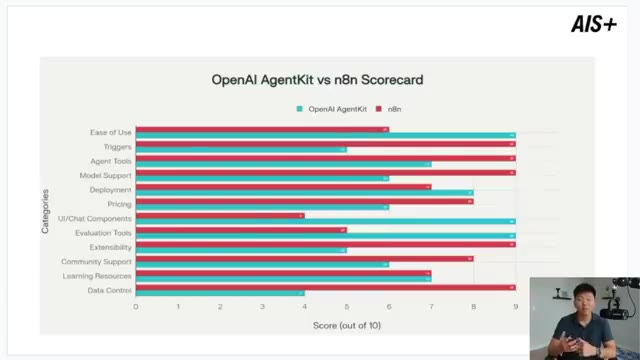
*⏱️ 00:00:15 — Graphique en barres comparatif intitulé 'OpenAI AgentKit vs n8n Scorecard' évaluant différents critères de 0 à 10.*

---

### ⏱️ `[00:00:20 - 00:00:40]` | Segment #02

**🔊 Audio (Transcription Intégrale Mot pour Mot en Français) :**
> Pour commencer avec un bref aperçu de chacun de ces outils, nous avons Agent Kit, qui vient de sortir le 6 octobre 2025. C'est le créateur d'agents d'OpenAI qui ressemble à ceci. C'est très, très simple à utiliser, et c'est une interface visuelle low-code très axée sur le glisser-déposer. Voici une citation de Sam Altman disant : Le créateur d'agents, c'est comme Canva pour créer des agents. C'est un moyen visuel rapide de concevoir la logique, les étapes, les idées.

**👁️ Analyse Visuelle d'Écran (gemini-3.5-flash-lite) :**
**Interface & Outils** : Présentation vidéo avec capture d'interface visuelle de type low-code (AgentKit d'OpenAI)

**Contenu textuel & Code** : Texte descriptif, date de sortie, citation de Sam Altman et schéma de workflow d'agents conversationnels.

**Action / Démonstration** : Présentation visuelle et explication des fonctionnalités d'AgentKit par le présentateur.

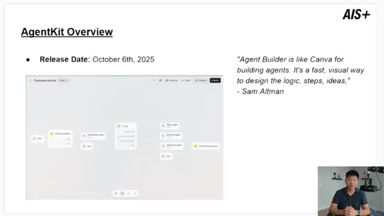
*⏱️ 00:00:25 — Une diapositive de présentation montrant un aperçu de 'AgentKit' avec sa date de sortie (October 6th, 2025), une capture de l'interface visuelle low-code d'OpenAI, et une citation de Sam Altman comparant l'Agent Builder à Canva.*

---

### ⏱️ `[00:00:40 - 00:01:03]` | Segment #03

**🔊 Audio (Transcription Intégrale Mot pour Mot en Français) :**
> Je suppose que vous savez déjà ce qu'est NNN, mais si ce n'est pas le cas, il a été publié le 8 octobre 2019, soit il y a environ six ans. Mais au cours de la dernière année, il a vraiment commencé à décoller. Comme vous pouvez le voir sur ce graphique Google Trends ici, NNN est en bleu, et ensuite nous avons d'autres plateformes d'automatisation de l'IA comme Make et Zapier en dessous, et vous pouvez voir qu'il a connu une croissance fulgurante en les dépassant. Vous pouvez intégrer l'IA à vos propres données, et il y a plus de 500 intégrations, ce qui le rend vraiment facile à connecter à vos outils.

**👁️ Analyse Visuelle d'Écran (gemini-3.5-flash-lite) :**
**Interface & Outils** : Navigateur web affichant Google Trends et une présentation de l'outil n8n.

**Contenu textuel & Code** : Graphique "Interest over time" de Google Trends, diagramme de workflow n8n (AI Agent, OpenAI Chat Model, Simple Memory, Slack).

**Action / Démonstration** : Le présentateur explique la croissance de n8n à l'aide d'un graphique Google Trends et montre l'architecture d'un agent IA.

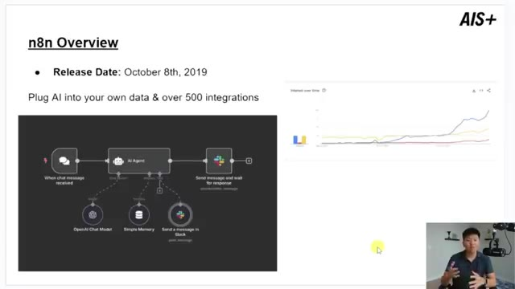
*⏱️ 00:00:46 — Vue d'ensemble de n8n avec un aperçu du workflow IA, la date de sortie du 8 octobre 2019 et un graphique Google Trends à droite montrant la popularité croissante.*

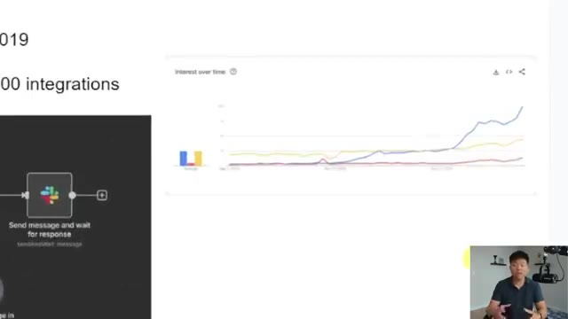
*⏱️ 00:00:52 — Zoom sur le graphique Google Trends illustrant l'évolution de l'intérêt pour n8n au fil du temps (en bleu) avec la vidéo du présentateur en bas à droite.*

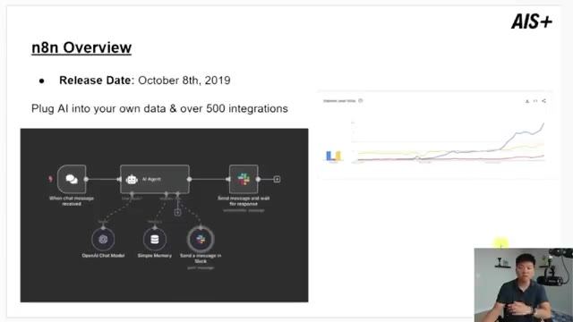
*⏱️ 00:00:57 — Vue générale similaire montrant les fonctionnalités de n8n avec un aperçu du graphique d'intérêt Google Trends et le présentateur en médaillon.*

---

### ⏱️ `[00:01:04 - 00:01:25]` | Segment #04

**🔊 Audio (Transcription Intégrale Mot pour Mot en Français) :**
> Et voilà à quoi ressemble NNN. Donc, comme je le disais, aujourd'hui nous allons comparer AgentKit avec NNN à travers différentes catégories pour répondre à la question : est-ce qu'AgentKit va tuer NNN ? Et en bref, ma réponse est non. Quand nous avons commencé à entendre des rumeurs sur sa sortie, tout le monde s'est immédiatement dit que ça allait tuer NNN. Je ne pense pas du tout que ce sera le cas. Et je tiens aussi à être très clair sur le fait que je ne pense pas que l'objectif d'OpenAI était de concurrencer NNN.

**👁️ Analyse Visuelle d'Écran (gemini-3.5-flash-lite) :**
**Interface & Outils** : Graphique de notation comparatif affiché à l'écran.

**Contenu textuel & Code** : Tableau comparatif notant OpenAI AgentKit et n8n sur des critères tels que la facilité d'utilisation, les déclencheurs, les outils d'agents, etc., avec la question "Is AgentKit going to kill n8n? - no".

**Action / Démonstration** : Présentation comparative des scores entre les deux outils d'automatisation.

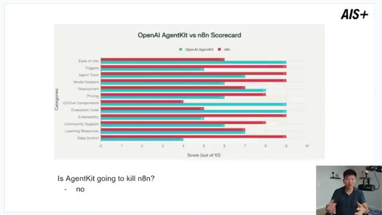
*⏱️ 00:01:09 — Un graphique comparatif en barres intitulé "OpenAI AgentKit vs n8n Scorecard" évaluant différentes catégories, avec le présentateur en médaillon dans le coin inférieur droit.*

---

### ⏱️ `[00:01:25 - 00:01:44]` | Segment #05

**🔊 Audio (Transcription Intégrale Mot pour Mot en Français) :**
> Je pense qu'AgentKit est conçu pour les équipes et les consommateurs qui sont réellement intégrés dans l'environnement d'OpenAI. Et ils ne cherchent pas à créer des automatisations d'IA et des systèmes autonomes hyper, hyper personnalisés et robustes. Ils cherchent à créer des flux de travail vraiment rapides et faciles qui vont leur faire gagner du temps et peut-être même des agents conversationnels en interne pour leur équipe.

**👁️ Analyse Visuelle d'Écran (gemini-3.5-flash-lite) :**
**Interface & Outils** : Graphique comparatif / Tableau de bord analytique

**Contenu textuel & Code** : Barres comparatives notant de 0 à 10 des critères comme "Ease of Use", "Triggers", "Agent Tools", "Deployment", "Pricing", "Extensibility", etc., entre OpenAI AgentKit (en bleu) et n8n (en rouge).

**Action / Démonstration** : Présentation d'un tableau comparatif et d'une analyse graphique pour évaluer les performances relatives d'AgentKit et n8n.

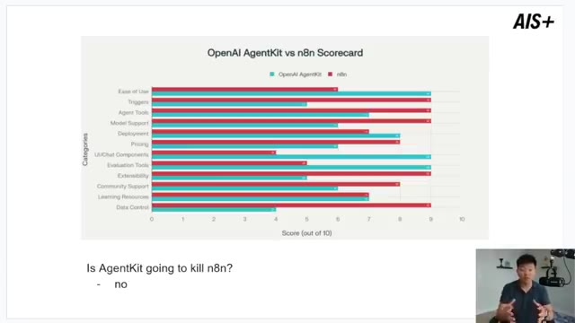
*⏱️ 00:01:30 — Un graphique comparatif en barres intitulé "OpenAI AgentKit vs n8n Scorecard" évaluant différentes catégories, avec en bas le texte "Is AgentKit going to kill n8n? - no", et le présentateur visible en médaillon dans le coin inférieur droit.*

---

### ⏱️ `[00:01:44 - 00:02:19]` | Segment #06

**🔊 Audio (Transcription Intégrale Mot pour Mot en Français) :**
> Maintenant, N8N, bien sûr, a été conçu pour être absolument tout. C'est super puissant. Ça a honnêtement été construit pour les développeurs. C'est un peu plus technique. Mais à cause de ça, vous avez la capacité de vraiment tout faire. Genre, quand on a vu Google lancer leur outil Opal, qui était comme une interface visuelle très similaire, les gens ont dit, oh, est-ce que ça va tuer N8N ? Non. Très rapidement, pourquoi devriez-vous faire confiance à mon avis là-dessus ? Je dirige une communauté d'automatisation par IA où j'enseigne à plus de 150 000 personnes comment créer des solutions d'IA à implémenter dans les entreprises. Et tout cela est fait avec N8N. Notre entreprise d'IA, True Horizon, conseille et implémente des solutions d'IA personnalisées. Et à peu près tout cela, c'est N8N. Et nous travaillons également avec des entreprises de type enterprise. Donc les catégories que nous allons examiner aujourd'hui sont

**👁️ Analyse Visuelle d'Écran (gemini-3.5-flash-lite) :**
**Interface & Outils** : Tableau comparatif / Graphique de scores (Scorecard).

**Contenu textuel & Code** : Graphique en barres comparant OpenAI AgentKit et n8n sur une échelle de 0 à 10, avec la question 'Is AgentKit going to kill n8n? - no' affichée en bas.

**Action / Démonstration** : Présentation d'une analyse comparative entre les outils d'automatisation et d'IA.

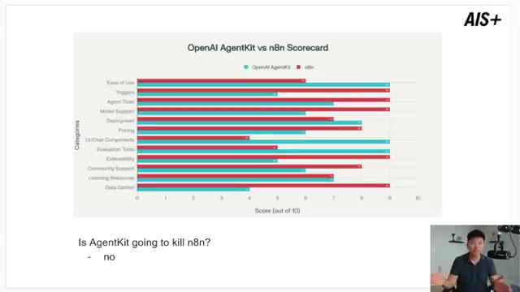
*⏱️ 00:01:53 — Un graphique comparatif intitulé 'OpenAI AgentKit vs n8n Scorecard' évaluant différents critères (Ease of Use, Triggers, Agent Tools, etc.) sous forme de barres horizontales.*

---

### ⏱️ `[00:02:19 - 00:02:42]` | Segment #07

**🔊 Audio (Transcription Intégrale Mot pour Mot en Français) :**
> facilité d'utilisation, déclencheurs, outils d'agents, support de modèle, composants de chat de l'interface utilisateur, et déploiement et contrôle. Donc en commençant par la première catégorie, nous avons la facilité d'utilisation. Donc si je suis comme un parfait débutant et que je veux tester AgentKit, qui est le constructeur d'agents d'OpenAI, je viendrais ici et je chercherais le constructeur d'agents d'OpenAI. Je pourrais regarder les notes de version ou je pourrais aller ici sur la plateforme OpenAI, cliquer sur le constructeur d'agents, et ensuite je pourrais ouvrir mon constructeur d'agents ici même.

**👁️ Analyse Visuelle d'Écran (gemini-3.5-flash-lite) :**
**Interface & Outils** : Navigateur web (Google Search) et présentation vidéo.

**Contenu textuel & Code** : Texte de recherche Google "openai agent builder" et liens vers les actualités d'AgentKit d'OpenAI.

**Action / Démonstration** : Recherche sur le web d'outils de création d'agents OpenAI pour illustrer la facilité d'utilisation.

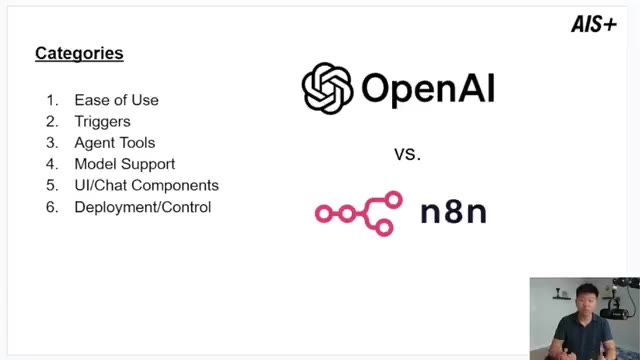
*⏱️ 00:02:25 — Diapositive listant les six catégories de comparaison (Ease of Use, Triggers, Agent Tools, Model Support, UI/Chat Components, Deployment/Control) et les logos OpenAI vs n8n.*

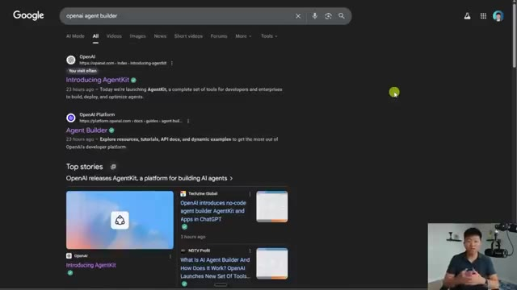
*⏱️ 00:02:31 — Navigateur affichant les résultats de recherche Google pour "openai agent builder" avec des liens vers "Introducing AgentKit".*

---

### ⏱️ `[00:02:42 - 00:03:18]` | Segment #08

**🔊 Audio (Transcription Intégrale Mot pour Mot en Français) :**
> C'est pratiquement accessible à tout le monde. Il suffit d'avoir un compte d'API OpenAI. Vous pouvez voir ici que nous avons la possibilité de créer un flux de travail. Et ce qui est essentiel ici à mon sens, c'est qu'il est écrit de créer un agent conversationnel. Maintenant, un agent conversationnel ou un agent de discussion est à mon sens très différent d'un agent d'outils entièrement autonome. Parce que l'agent conversationnel va chercher des informations pour vous, vous aider à obtenir des réponses à vos questions, mais pas tellement agir en votre nom de manière autonome. Donc, de toute façon, nous avons des modèles ici en bas que nous pourrions examiner, mais je vais simplement créer un nouveau flux afin de nous familiariser avec cet environnement. Ce que vous remarquerez ici, c'est que nous avons un début et je ne peux en fait pas supprimer ce début car chaque flux de travail a besoin d'un déclencheur.

**👁️ Analyse Visuelle d'Écran (gemini-3.5-flash-lite) :**
**Interface & Outils** : Interface web d'OpenAI (Agent Builder)

**Contenu textuel & Code** : Titre 'Agent Builder', section 'Create a workflow' avec un bouton '+ Create' et des modèles de templates ('Data enrichment', 'Planning helper', 'Customer service', etc.).

**Action / Démonstration** : Présentation de l'interface de création d'agents conversationnels et de flux de travail personnalisés.

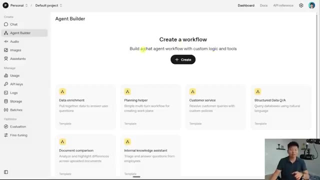
*⏱️ 00:02:51 — Interface web d'OpenAI montrant l'Agent Builder avec l'option de création de flux de travail et des modèles d'agents prédéfinis.*

---

### ⏱️ `[00:03:18 - 00:03:44]` | Segment #09

**🔊 Audio (Transcription Intégrale Mot pour Mot en Français) :**
> Vous pouvez voir qu'une fois que vous avez le départ, vous devez faire glisser le cercle pour dire, où est-ce que cela va ensuite ? Tout comme dans NNN où vous connectez vos nœuds ensemble. Et nous avons un agent IA juste ici, que nous pouvons nommer. Nous pouvons lui donner des instructions. Nous pouvons inclure l'historique du chat. Nous pouvons choisir le modèle, le raisonnement. Nous pouvons lui donner des outils. Et nous avons une section de format de sortie où nous pouvons faire du texte, du JSON ou un widget, dont nous parlerons un peu plus tard. Mais ce que je remarque immédiatement au premier coup d'œil, c'est que toute cette interface est beaucoup moins intimidante que NNN.

**👁️ Analyse Visuelle d'Écran (gemini-3.5-flash-lite) :**
**Interface & Outils** : Interface web de construction de workflow d'agents IA (type constructeur visuel de type n8n ou OpenAI Agents).

**Contenu textuel & Code** : Nœuds 'Start' et 'My agent' connectés sur le canevas ; panneau de configuration à droite avec les champs 'Name', 'Instructions' (You are a helpful assistant), 'Model' (gpt-4), et des options de configuration (Tools, Output format).

**Action / Démonstration** : Connexion du nœud de départ vers le nœud de l'agent IA et configuration des instructions et paramètres de l'agent.

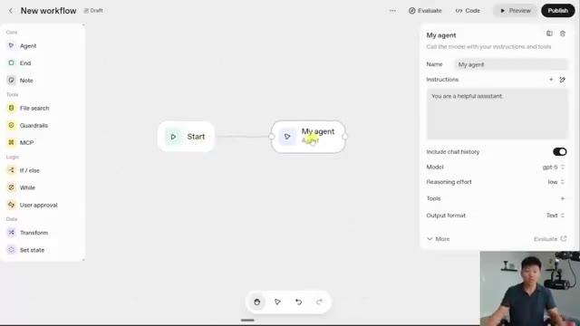
*⏱️ 00:03:24 — Interface de création de workflow montrant un nœud 'Start' relié à un nœud 'My agent', avec un panneau latéral de configuration pour l'agent IA.*

---

### ⏱️ `[00:03:44 - 00:04:02]` | Segment #10

**🔊 Audio (Transcription Intégrale Mot pour Mot en Français) :**
> Je peux facilement choisir mon modèle, lui donner des instructions, et je peux aussi sur le côté gauche voir tout ce qui est à ma disposition, c'est-à-dire un agent, je peux y mettre fin, je peux faire une recherche de fichiers, je peux faire des garde-fous, des serveurs MCP. Je n'ai que cinq opérations de logique et de données parmi lesquelles choisir : si sinon, tant que, approbation humaine, transformer, ou définir l'état.

**👁️ Analyse Visuelle d'Écran (gemini-3.5-flash-lite) :**
**Interface & Outils** : Interface web de workflow Builder (type OpenAI Playground ou équivalent).

**Contenu textuel & Code** : Blocs de workflow "Start" et "My agent", panneau latéral gauche listant les outils (Agent, End, Note, File search, Guardrails, MCP, If/else, While, User approval, Transform).

**Action / Démonstration** : Présentation des composants disponibles pour configurer et automatiser un agent IA dans un workflow visuel.

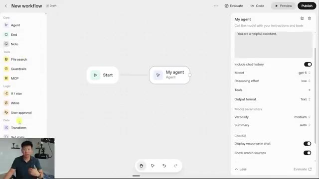
*⏱️ 00:03:48 — Interface de création de workflow d'agents IA montrant les outils disponibles sur le panneau de gauche et les paramètres du modèle sur le panneau de droite.*

---

### ⏱️ `[00:04:02 - 00:04:35]` | Segment #11

**🔊 Audio (Transcription Intégrale Mot pour Mot en Français) :**
> Et c'est beaucoup moins intimidant pour moi, en tant que débutant complet sans aucune formation en programmation, de m'y mettre par rapport au moment où je me lance dans quelque chose comme NNN, où je crée un nouveau flux de travail, et ensuite, quand j'ouvre cette première étape, j'ai des tonnes de choses différentes ici. Disons que je veux intégrer un agent IA et je peux cliquer sur cet agent juste ici. J'ai cette saisie où je regarde cette variable. J'ai toutes ces options en bas à choisir et je ne sais peut-être pas exactement ce qu'elles signifient. Vous pouvez aussi voir que j'ai déjà une erreur parce que je n'ai pas connecté de modèle de chat. J'ai aussi l'option d'ajouter de la mémoire et tous ces différents outils et cela, au départ, va juste être beaucoup plus intimidant que de sauter dans le constructeur d'agents par OpenAI.

**👁️ Analyse Visuelle d'Écran (gemini-3.5-flash-lite) :**
**Interface & Outils** : Interface web d'un éditeur de code (type VS Code Web ou plateforme cloud).

**Contenu textuel & Code** : Écran de chargement avec un cercle de progression et le texte "Loading".

**Action / Démonstration** : Chargement en cours de l'interface de développement.

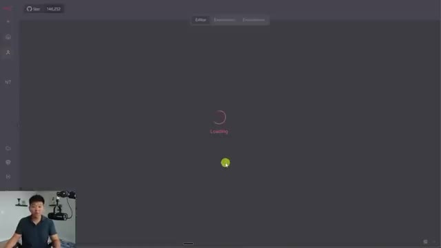
*⏱️ 00:04:11 — Capture d'écran montrant l'interface d'un éditeur de code en cours de chargement ("Loading") avec le présentateur visible en incrustation vidéo en bas à gauche.*

---

### ⏱️ `[00:04:36 - 00:05:10]` | Segment #12

**🔊 Audio (Transcription Intégrale Mot pour Mot en Français) :**
> L'une des premières choses que je voulais faire quand j'ai construit mon tout premier agent, c'est que je voulais le connecter à Internet pour qu'il puisse chercher des choses pour moi. Et avec le créateur d'agents d'OpenAI, tout ce que j'ai à faire est de cliquer sur ce plus pour l'outil, et je peux simplement faire une recherche sur le web. Et ça va fondamentalement chercher de la manière dont vous pouvez faire une recherche sur le web quand vous êtes dans ChatGPT. Vous pouvez également spécifier de ne chercher qu'à travers certains sites web, et vous pouvez également faire des recherches basées sur la localisation. Donc juste comme ça, j'ai déjà un agent IA qui peut chercher sur le web, et je peux aussi connecter un modèle de chat juste ici sans jamais avoir à aller chercher de clé API. Mais dans tous les cas, si nous voulions chercher sur le web, nous devrions lui donner un outil, nous devons choisir parmi toutes ces centaines d'outils différents. Nous pourrions même avoir besoin de configurer

**👁️ Analyse Visuelle d'Écran (gemini-3.5-flash-lite) :**
**Interface & Outils** : Interface web de création de flux de travail d'agents (OpenAI Agents/Workflows Builder).

**Contenu textuel & Code** : Paramètres de configuration d'agent (modèle gpt-5, effort de raisonnement, tool Web Search).

**Action / Démonstration** : Ajout et configuration d'un outil de recherche web (Web Search) pour connecter l'agent à Internet.

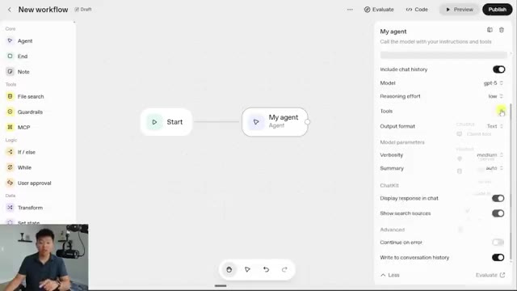
*⏱️ 00:04:44 — Interface de création d'agent workflow montrant le panneau de configuration latéral droit avec le modèle gpt-5 et les options de configuration.*

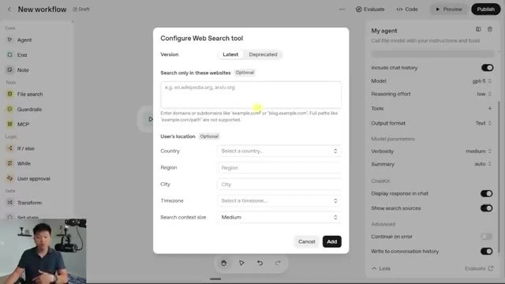
*⏱️ 00:04:53 — Fenêtre modale "Configure Web Search tool" affichant les options de configuration de recherche web (domaines, localisation, fuseau horaire).*

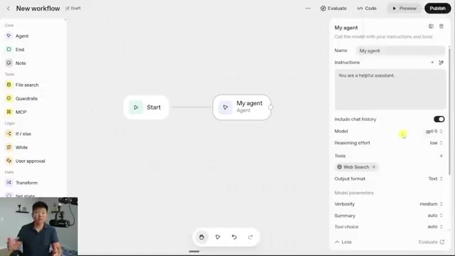
*⏱️ 00:05:02 — Panneau de configuration d'agent mis à jour montrant l'outil "Web Search" ajouté avec succès sous la section des outils.*

---

### ⏱️ `[00:05:10 - 00:05:46]` | Segment #13

**🔊 Audio (Transcription Intégrale Mot pour Mot en Français) :**
> notre propre requête HTTP personnalisée. Et nous devrions aussi aller chercher une clé API à la fois pour la recherche web et aussi pour le modèle de chat, ce qui est juste beaucoup plus intimidant et élève définitivement un peu plus la barrière à l'entrée par rapport au constructeur d'agents. Donc si je devais penser au temps qu'il faudrait à un débutant complet pour construire un système d'automatisation dans le constructeur d'agents OpenAI, ou exactement le même système dans n8n, il le ferait beaucoup plus rapidement et se sentirait beaucoup moins submergé dans le constructeur d'agents, sans aucun doute, c'est pourquoi pour cette première catégorie, AgentKit obtient un 8 sur 10, n8n obtient un 6 sur 10, et c'est notre nouveau total pour les scores en ce moment. Quoi qu'il en soit, passons à la catégorie suivante, qui est les déclencheurs. Donc rappelez-vous plus tôt quand nous regardions cette section de flux de travail et

**👁️ Analyse Visuelle d'Écran (gemini-3.5-flash-lite) :**
**Interface & Outils** : n8n, outil de construction d'agents, diapositives de présentation

**Contenu textuel & Code** : Workflow n8n, nœud AI Agent, notes comparatives sur la facilité d'utilisation (AgentKit vs n8n)

**Action / Démonstration** : Comparaison des plateformes d'automatisation et de construction d'agents IA

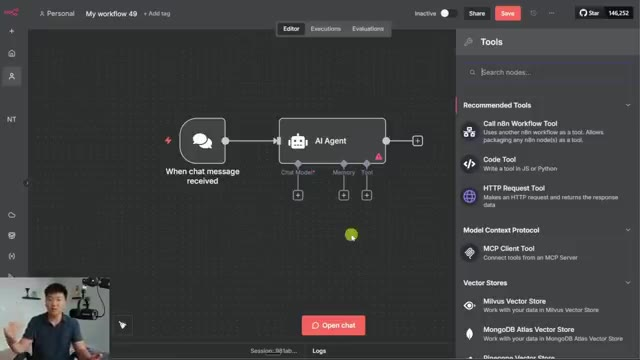
*⏱️ 00:05:19 — Interface n8n montrant un workflow avec un nœud 'AI Agent' connecté à des options de configuration de modèle et d'outils.*

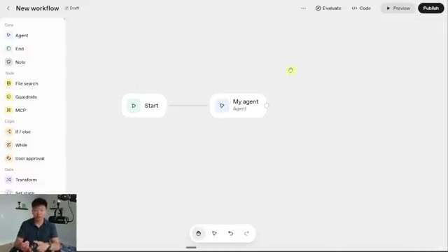
*⏱️ 00:05:28 — Interface d'un constructeur d'agents affichant un workflow simple avec un nœud de départ et un agent nommé 'My agent'.*

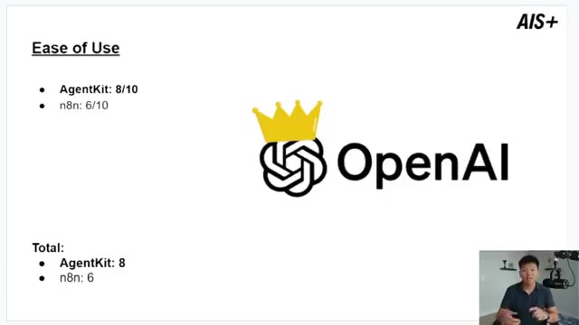
*⏱️ 00:05:37 — Diapositive de présentation comparant la facilité d'utilisation entre AgentKit (8/10) et n8n (6/10) avec le logo OpenAI coiffé d'une couronne.*

---

### ⏱️ `[00:05:46 - 00:06:19]` | Segment #14

**🔊 Audio (Transcription Intégrale Mot pour Mot en Français) :**
> il est dit de construire un agent de discussion ? Maintenant, quand nous regardons les déclencheurs, vous pouvez un peu voir pourquoi je suis attiré par cela. Ou pas attiré par cela, fixé sur cela. Parce que lorsque vous avez votre agent IA et que vous avez juste cette option de démarrage, il n'y a pas d'autres déclencheurs disponibles, comme vous pouvez le voir. Ce qui signifie que si nous voulons communiquer avec cet agent, la seule façon dont nous pouvons réellement le déclencher est en lui parlant, comme vous pouvez le voir ici dans cet aperçu. Donc, si je veux tester mon flux de travail, je peux discuter avec lui ici même et je peux dire de rechercher sur le web pour NNN. Nous pouvons voir visuellement que l'agent utilise actuellement sa fonction de recherche web et qu'il utilise son raisonnement pour rechercher sur le web pour NNN.

**👁️ Analyse Visuelle d'Écran (gemini-3.5-flash-lite) :**
**Interface & Outils** : Interface web de création de workflows d'agents IA (éditeur visuel de type no-code/low-code).

**Contenu textuel & Code** : Nœuds de workflow 'Start' et 'My agent', outils de la barre latérale (Agent, End, Note, File search, Guardrails, MCP, If/else, While, User approval, Transform, Set state).

**Action / Démonstration** : Le présentateur montre la construction d'un agent de discussion et lance l'option de prévisualisation avec le panneau de chat latéral.

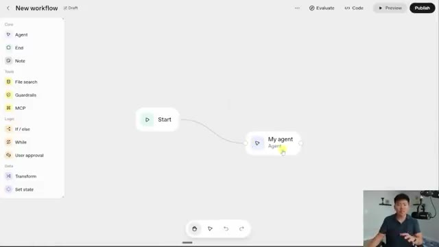
*⏱️ 00:05:54 — Vue d'un éditeur de workflow montrant un nœud 'Start' relié à un nœud 'My agent' avec une barre latérale d'outils et de logique.*

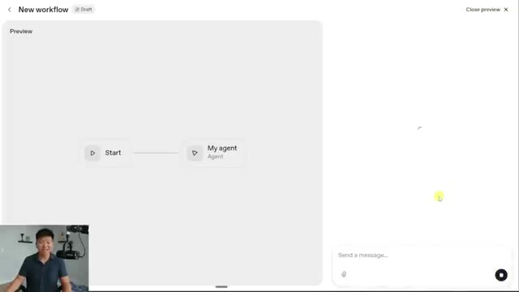
*⏱️ 00:06:11 — Interface de prévisualisation du workflow avec le diagramme à gauche et une fenêtre de chat de test ('Send a message...') à droite.*

---

### ⏱️ `[00:06:19 - 00:06:52]` | Segment #15

**🔊 Audio (Transcription Intégrale Mot pour Mot en Français) :**
> Et c'est vraiment génial parce qu'on a lancé un agent web en quelques secondes. Mais le problème ici, c'est que je ne vois pas vraiment le moyen d'avoir des événements basés sur le web ou des déclencheurs planifiés. Même si on remonte ici pour publier notre agent IA, disons qu'on va appeler ça un agent web de test ou "text", je suppose. Et quand on publie ceci, ça a dit juste là que ça pouvait être utilisé dans des appels API. Je ne sais pas si vous avez capté ça, mais ce qu'on peut faire, c'est soit l'intégrer en tant que kit de chat, dont je parlerai un peu plus tard, soit on pourrait déclencher cet agent à partir du SDK d'un agent. Et ça nous donne le TypeScript ou le Python. Donc ce que ça me dit, c'est qu'techniquement, vous devriez être capable de déclencher ceci

**👁️ Analyse Visuelle d'Écran (gemini-3.5-flash-lite) :**
**Interface & Outils** : Interface web de création de workflows d'agents IA avec un panneau latéral d'outils et une fenêtre modale de publication.

**Contenu textuel & Code** : Diagramme de flux avec blocs 'Start' et 'My agent', options 'Core', 'Tools', 'Logic', 'Data' dans la barre latérale.

**Action / Démonstration** : Navigation dans l'interface de conception de workflow et clic sur le bouton de publication de l'agent.

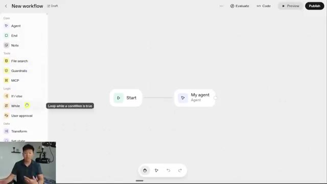
*⏱️ 00:06:27 — Interface de création de workflow montrant un diagramme avec un nœud 'Start' relié à un nœud 'My agent', et une barre latérale avec des outils de logique et de données.*

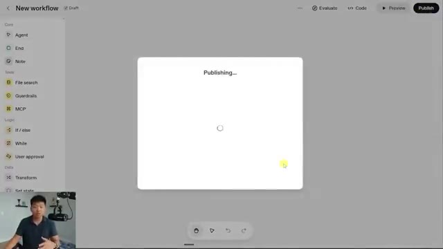
*⏱️ 00:06:35 — Pop-up de publication affichant un message 'Publishing...' avec une icône de chargement circulaire lors de la publication du workflow.*

---

### ⏱️ `[00:06:52 - 00:07:13]` | Segment #16

**🔊 Audio (Transcription Intégrale Mot pour Mot en Français) :**
> agent à partir d'une requête HTTP ou d'une action dans une application, mais ce n'est pas hyper intuitif ni facile. Ce serait vraiment bien si OpenAI proposait des déclencheurs programmés ou des événements d'applications, des trucs comme ça. Par exemple, si vous vouliez créer un agent OpenAI pour répondre à vos e-mails, ce ne serait pas aussi simple que sur Make ou Zapier, car il n'y a pas de déclencheur Gmail du genre « nouveau message reçu ».

**👁️ Analyse Visuelle d'Écran (gemini-3.5-flash-lite) :**
**Interface & Outils** : Interface web de création d'agents (type OpenAI Agents / constructeur de workflow visuel).

**Contenu textuel & Code** : Blocs de workflow nommés 'Start' et 'My agent' avec des outils et de la logique dans le panneau latéral (File search, Guardrails, MCP, If/else, While, etc.).

**Action / Démonstration** : Visualisation du canvas de création d'agent montrant la structure séquentielle d'un agent web.

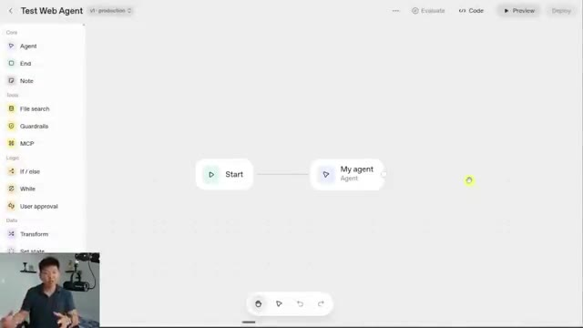
*⏱️ 00:06:57 — Interface de conception d'un agent web avec un workflow simple comprenant un nœud 'Start' relié à un nœud 'My agent'.*

---

### ⏱️ `[00:07:13 - 00:07:34]` | Segment #17

**🔊 Audio (Transcription Intégrale Mot pour Mot en Français) :**
> Alors qu'avec NNN vous voulez examiner vos déclencheurs, nous pourrions aller sur Gmail juste ici et ensuite nous pourrions voir que notre déclencheur est sur nouveau message reçu. Nous pourrions donc facilement faire en sorte que cet agent se déclenche chaque fois que nous recevons un nouveau Gmail. Nous avons également huit déclencheurs dans Slack. Donc sur n'importe quel événement, sur mention de bot, sur fichier partagé, sur nouvel utilisateur, sur réaction ajoutée, il y a tellement de déclencheurs qui sont déjà intégrés de manière native dans NNN.

**👁️ Analyse Visuelle d'Écran (gemini-3.5-flash-lite) :**
**Interface & Outils** : n8n (interface web d'automatisation de workflows)

**Contenu textuel & Code** : Workflow contenant un nœud 'When chat message received' connecté à un nœud 'AI Agent', et le panneau latéral affichant les actions et déclencheurs disponibles pour Gmail.

**Action / Démonstration** : Navigation et configuration des nœuds et des déclencheurs de l'agent IA dans n8n.

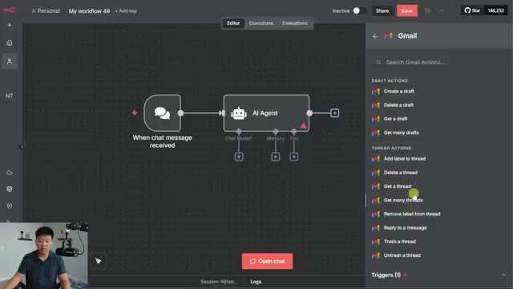
*⏱️ 00:07:19 — Interface de l'outil d'automatisation n8n montrant un workflow avec un déclencheur de chat et un nœud 'AI Agent', avec le panneau latéral des actions Gmail ouvert à droite.*

---

### ⏱️ `[00:07:35 - 00:07:54]` | Segment #18

**🔊 Audio (Transcription Intégrale Mot pour Mot en Français) :**
> Nous pourrions, bien sûr, avoir un webhook pour que notre CRM puisse envoyer des données. Nous pourrions avoir Google Drive. Nous pourrions avoir Twilio. Nous pouvons avoir à peu près n'importe quoi. Et à mon sens, les systèmes qui sont les plus précieux lorsqu'il s'agit d'automatisation ou d'automatisation par IA sont ceux que l'humain n'a pas besoin de déclencher manuellement. Donc, très rapidement, un exemple : beaucoup d'entreprises nous contactent et veulent intégrer cet assistant personnel que j'ai fait construire.

**👁️ Analyse Visuelle d'Écran (gemini-3.5-flash-lite) :**
**Interface & Outils** : Interface web n8n (éditeur de workflow d'automatisation)

**Contenu textuel & Code** : Nœuds de déclenchement : Google Drive Trigger, Webhook, Twilio Trigger, Slack, When chat message received, Gmail Trigger connectés à un bloc central "AI Agent".

**Action / Démonstration** : Présentation visuelle d'un workflow d'automatisation intégrant différents déclenchements (Google Drive, Webhook, Twilio) reliés à un agent IA.

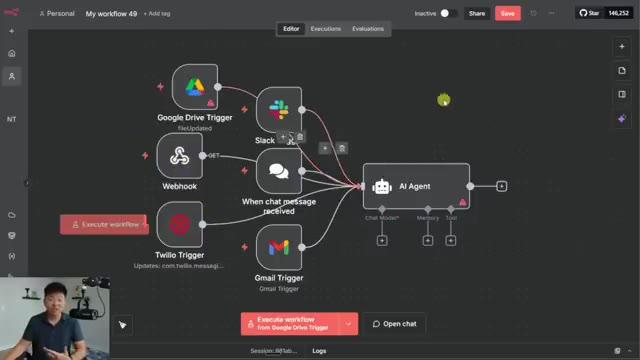
*⏱️ 00:07:40 — Un éditeur de workflow (n8n) affichant plusieurs nœuds de déclenchement connectés à un agent IA central, avec une miniature vidéo du présentateur en bas à gauche.*

---

### ⏱️ `[00:07:54 - 00:08:18]` | Segment #19

**🔊 Audio (Transcription Intégrale Mot pour Mot en Français) :**
> Cependant, lorsque nous essayons réellement de communiquer ce qui serait la meilleure victoire rapide pour leur montrer un retour sur investissement très rapidement, je ne recommanderais jamais un assistant personnel. Ce que je recommanderais, c'est quelque chose qui nourrit les prospects ou répond aux prospects plus rapidement et ce genre de choses. Parce que ce type de systèmes aide à faire croître l'entreprise. Et à mesure que l'entreprise grandit, ces systèmes seront de plus en plus utilisés. Le débit du système augmente donc à mesure que l'entreprise se développe, ce qui représente simplement un retour sur investissement évolutif et cumulatif du système.

**👁️ Analyse Visuelle d'Écran (gemini-3.5-flash-lite) :**
**Interface & Outils** : Interface web d'automatisation ou de conception d'agents IA (type Flowise ou similaire).

**Contenu textuel & Code** : Blocs fonctionnels incluant Telegram Trigger, Transcribe Audio, Parent Agent, OpenRouter, Tavily, et des sous-workflows (Email Agent, Calendar Agent, etc.).

**Action / Démonstration** : Visualisation et explication de la structure d'un assistant personnel automatisé.

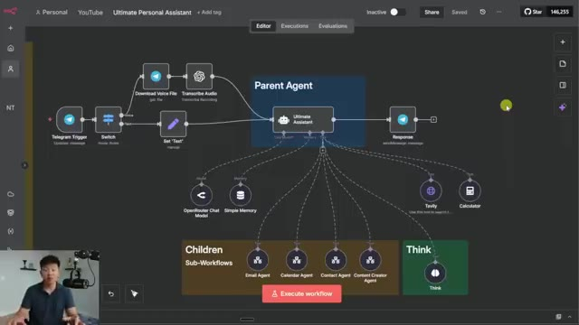
*⏱️ 00:08:00 — Un diagramme de workflow complexe représentant un assistant personnel intelligent interconnecté avec divers outils et sous-agents.*

---

### ⏱️ `[00:08:18 - 00:08:38]` | Segment #20

**🔊 Audio (Transcription Intégrale Mot pour Mot en Français) :**
> Et ce n'est pas exactement la même chose avec quelque chose comme un assistant personnel, car à mesure que l'entreprise grandit, cela ne signifie pas nécessairement que vous allez utiliser le système davantage. Donc, en un mot, les automatisations les plus puissantes à mon sens sont celles qui s'exécutent en arrière-plan alors que vous ne savez même pas qu'elles s'exécutent. Et parce que dans le créateur d'agents d'OpenAI, nous sommes en quelque sorte limités quant à nos déclencheurs et à la possibilité de planifier ou de faire en sorte que des choses se déclenchent en arrière-plan.

**👁️ Analyse Visuelle d'Écran (gemini-3.5-flash-lite) :**
**Interface & Outils** : Interface graphique de plateforme d'automatisation et de construction d'agents IA (type éditeur de workflows visuels).

**Contenu textuel & Code** : Blocs fonctionnels interconnectés pour un assistant personnel : déclencheur Telegram, traitement audio, agent parent, sous-agents (e-mail, calendrier, contacts) et outils de recherche.

**Action / Démonstration** : Présentation visuelle de l'architecture d'un assistant personnel intelligent et de ses composants connectés.

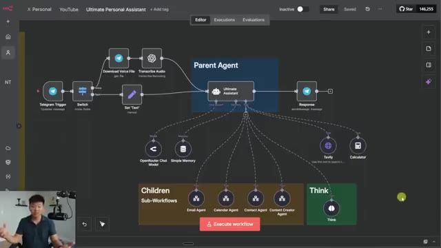
*⏱️ 00:08:23 — Un diagramme de workflow complexe représentant un assistant personnel IA (Ultimate Personal Assistant) avec des déclencheurs Telegram, des sous-agents et divers outils connectés.*

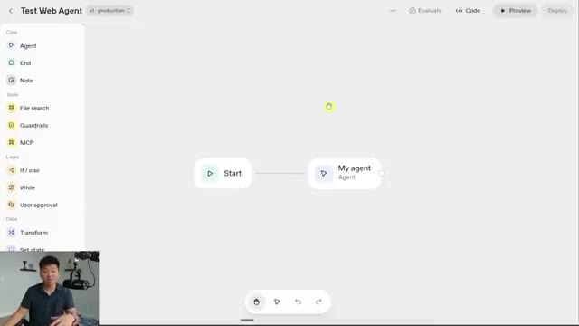
*⏱️ 00:08:33 — Une interface de conception de workflow d'agent web minimaliste montrant un nœud 'Start' relié à un nœud 'My agent'.*

---

### ⏱️ `[00:08:39 - 00:09:02]` | Segment #21

**🔊 Audio (Transcription Intégrale Mot pour Mot en Français) :**
> C'est pourquoi je pense que N&N l'emporte haut la main ici. Obtenant un 10 sur 10 et Agent Kit obtenant un 5 sur 10, ce qui donne notre nouveau score : Agent Kit 13 et N&N 16. Très bien, passons aux outils d'agents, ce qui est vraiment, vraiment important parce que c'est ce qui donne à nos agents la capacité d'agir réellement en notre nom. Nous sommes donc de retour dans notre flux de création d'agents OpenAI où nous avons déjà donné à notre agent l'outil de recherche web, ce qui a été super facile, sans clé API, vraiment rapide.

**👁️ Analyse Visuelle d'Écran (gemini-3.5-flash-lite) :**
**Interface & Outils** : Présentation vidéo et interface web de construction de workflows / agents IA.
[DESC_IMAGE_1] Scores comparatifs entre AgentKit (13) et n8n (16) pour les déclencheurs (Triggers).
[DESC_IMAGE_2] Espace de travail visuel avec un nœud "Start" relié à un nœud "My agent" et une barre latérale d'options.

**Contenu textuel & Code** : Explications orales et mise en contexte méthodologique.

**Action / Démonstration** : Le présentateur affiche les scores comparatifs des deux outils de workflow, puis présente l'interface de configuration des agents.

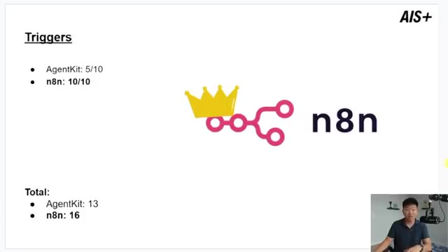
*⏱️ 00:08:44 — Diapositive de présentation montrant le score pour la catégorie "Triggers" (AgentKit : 5/10, n8n : 10/10) ainsi que le score total mis à jour (AgentKit : 13, n8n : 16), avec le logo n8n surmonté d'une couronne et la webcam du présentateur en bas à droite.*

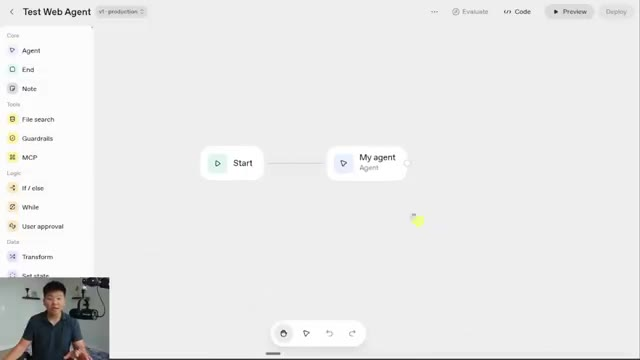
*⏱️ 00:08:56 — Interface d'une application de création de workflows avec des nœuds "Start" et "My agent" connectés sur l'espace de travail, et le panneau latéral affichant divers outils et composants (Agent, End, Note, File search, Guardrails, MCP, etc.).*

---

### ⏱️ `[00:09:02 - 00:09:22]` | Segment #22

**🔊 Audio (Transcription Intégrale Mot pour Mot en Français) :**
> J'adore. Mais maintenant, quand nous allons pour ajouter d'autres outils, vous pouvez voir que nous n'avons que quelques options. Nous avons un outil client, qui est la capacité d'envoyer des données à notre widget de chat kit, ce qui, je dois le dire, est très cool. Nous pouvons faire des serveurs MCP. C'est donc bien parce que vous pouvez vous connecter vraiment facilement à Gmail, Google Agenda, Drive, Outlook. Vous pouvez voir ces autres intégrations juste ici, mais il n'y en a pas des tonnes ici et elles doivent toutes être des serveurs MCP.

**👁️ Analyse Visuelle d'Écran (gemini-3.5-flash-lite) :**
**Interface & Outils** : Interface web de construction d'agents IA (type workflow visuel).

**Contenu textuel & Code** : Menus d'options d'outils et liste des serveurs MCP disponibles (Gmail, Google Drive, Outlook, etc.).

**Action / Démonstration** : Navigation dans les menus de configuration des outils et sélection d'un serveur MCP.

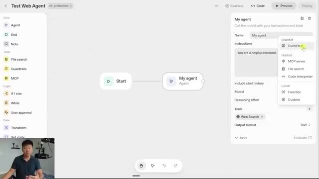
*⏱️ 00:09:07 — Interface de conception d'agent montrant un menu déroulant des options d'outils disponibles (Client tool, MCP server, File search, etc.).*

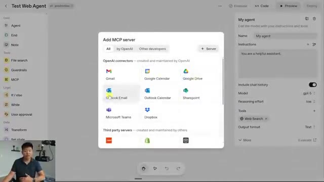
*⏱️ 00:09:17 — Fenêtre modale "Add MCP server" affichant divers connecteurs OpenAI et d'autres développeurs (Gmail, Google Calendar, Outlook, etc.).*

---

### ⏱️ `[00:09:23 - 00:09:44]` | Segment #23

**🔊 Audio (Transcription Intégrale Mot pour Mot en Français) :**
> Vous pourriez aussi vous connecter à un autre serveur MCP, ce qui est génial car il y en a des tonnes dans Zapier. Vous pouvez même vous connecter à votre propre flux de travail personnalisé NNN. Et il y a aussi beaucoup d'autres serveurs MCP auxquels vous pourriez vous connecter. Et ce n'est pas aussi puissant que le nombre d'APIs qui existent et le nombre auquel vous pouvez vous connecter avec une requête HTTP standard. Et dans NNN, quand vous venez ici pour connecter des outils, vous pouvez tout d'abord, également faire appel à un flux de travail NNN, ce qui est super puissant.

**👁️ Analyse Visuelle d'Écran (gemini-3.5-flash-lite) :**
**Interface & Outils** : Interface web d'agent conversationnel et plateforme d'automatisation de workflows n8n.

**Contenu textuel & Code** : URL de configuration de serveur MCP, paramètres d'agent IA, et nœuds de déclencheurs connectés à un AI Agent.
[DESC_IMAGE_3] Configuration d'une connexion MCP et visualisation d'un diagramme de flux d'automatisation avec plusieurs déclencheurs.

**Action / Démonstration** : Explications face caméra et démonstration conceptuelle.

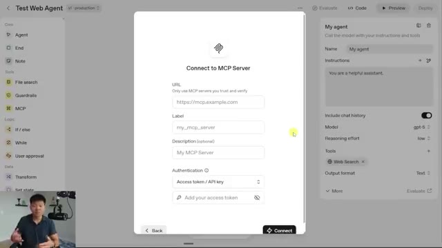
*⏱️ 00:09:28 — Interface de création d'agent web affichant une fenêtre modale de configuration pour se connecter à un serveur MCP (URL, label, description et authentification).*

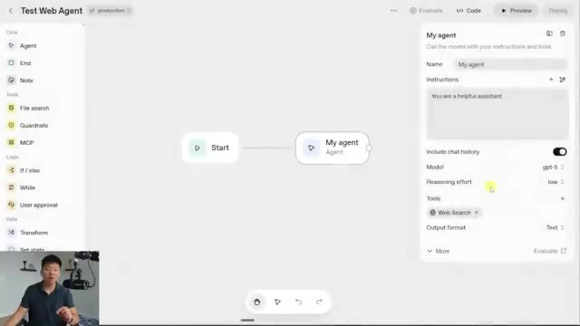
*⏱️ 00:09:33 — Éditeur de workflow montrant un nœud 'Start' relié à un nœud 'My agent' avec les options de configuration de l'agent dans le panneau latéral droit.*

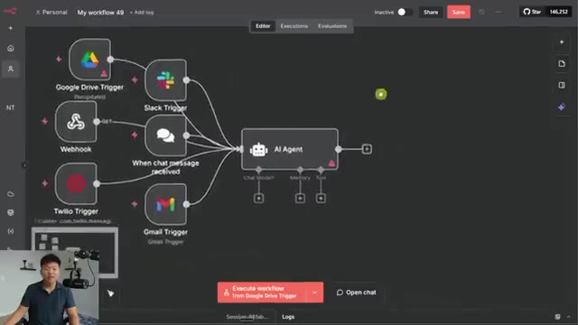
*⏱️ 00:09:38 — Interface de workflow d'automatisation n8n affichant plusieurs déclencheurs (Google Drive, Slack, Webhook, Twilio, Gmail) connectés à un agent IA central.*

---

### ⏱️ `[00:09:44 - 00:10:05]` | Segment #24

**🔊 Audio (Transcription Intégrale Mot pour Mot en Français) :**
> Et puis bien sûr, vous avez toutes ces intégrations natives, ce qui fait qu'il y en a littéralement des centaines et des centaines. Je pense qu'ils ont plus de 500 intégrations natives. Donc, presque n'importe quel outil auquel vous pourriez penser, vous pouvez vous y connecter avec vos agents IA ici. Et si NNN n'a pas d'intégration native, vous pouvez utiliser cet outil de requête HTTP, qui est l'outil le plus dynamique et le plus puissant au monde, car vous pouvez littéralement parler à n'importe quel service qui possède une documentation d'API.

**👁️ Analyse Visuelle d'Écran (gemini-3.5-flash-lite) :**
**Interface & Outils** : Application web d'automatisation de workflows de type n8n.

**Contenu textuel & Code** : Diagramme de flux de données reliant plusieurs sources et déclencheurs (triggers) à un nœud central d'agent IA, ainsi que des options de configuration de requête HTTP.

**Action / Démonstration** : Navigation et sélection d'outils d'intégration natifs dans le panneau latéral pour les connecter à l'agent IA du workflow.

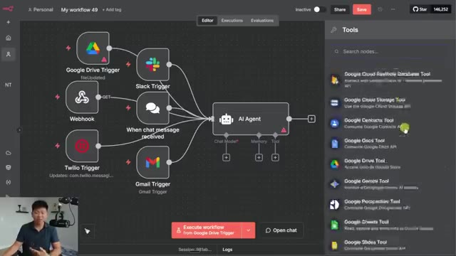
*⏱️ 00:09:49 — Interface d'un outil d'automatisation montrant un workflow avec des déclencheurs (Google Drive, Webhook, Twilio, Slack, Gmail) connectés à un agent IA central, avec un panneau latéral affichant une liste de plus de 500 outils d'intégration.*

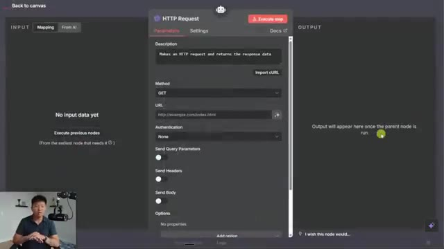
*⏱️ 00:09:59 — Panneau de configuration détaillée d'un nœud HTTP Request dans l'interface d'automatisation, avec les paramètres de méthode (GET), d'URL et d'authentification.*

---

### ⏱️ `[00:10:05 - 00:10:38]` | Segment #25

**🔊 Audio (Transcription Intégrale Mot pour Mot en Français) :**
> Et comme je l'ai mentionné avec la possibilité d'appeler des sous-flux de travail, vous pouvez voir ici avec l'assistant personnel ultime, par exemple, qu'il a un agent de messagerie. Et si j'ouvre ce flux de travail de l'agent de messagerie, ce que nous voyons est un agent IA complètement séparé que j'ai construit dans NNN. Et cet agent en soi a des tonnes d'autres outils qu'il peut utiliser ici. Vous pouvez donc construire des systèmes d'agents d'orchestration vraiment, vraiment puissants dans NNN. Et tous ceux-ci sont super modulaires et réutilisables parce que maintenant, si j'ai jamais besoin d'un agent de messagerie, je peux simplement le connecter à celui-ci. Même si cet agent est connecté à genre une centaine, ça n'a pas d'importance. Et oui, j'ai bien dit que vous pouvez connecter un agent OpenAI à

**👁️ Analyse Visuelle d'Écran (gemini-3.5-flash-lite) :**
**Interface & Outils** : Aucune interface logicielle ou diagramme de flux de travail n'est visible.

**Contenu textuel & Code** : Aucun contenu textuel, code ou donnée n'est affiché.

**Action / Démonstration** : Le présentateur est en train de basculer vers une autre vue ou d'ouvrir un élément non encore affiché.

---

### ⏱️ `[00:10:38 - 00:11:14]` | Segment #26

**🔊 Audio (Transcription Intégrale Mot pour Mot en Français) :**
> un agent NNN, ce qui fonctionne, mais vous auriez besoin d'utiliser ceci, qui est le déclencheur de serveur MCP juste ici, et vous seriez capable de brancher ce serveur MCP à un tas d'outils différents. Vous avez donc la possibilité de parler à des agents personnalisés et des trucs dans ces flux de travail en bas. C'est juste que ce n'est pas aussi puissant que l'option de sous-flux de travail en tant qu'outil. Donc pour les outils d'agents, AgentKit va obtenir encore une fois un 5, NNN va obtenir un 10, et notre nouveau total est AgentKit 18, NNN 26. Passons donc à la catégorie suivante, qui est le support des modèles. Celle-ci est donc assez simple et facile parce que dans OpenAI, bien sûr, vous n'avez accès qu'aux modèles OpenAI. Et ce n'est vraiment pas un énorme

**👁️ Analyse Visuelle d'Écran (gemini-3.5-flash-lite) :**
**Interface & Outils** : n8n (éditeur de workflow visuel).

**Contenu textuel & Code** : Nœuds affichés : "Slack Trigger", "When chat message received", "AI Agent", "MCP Server Trigger". Bouton d'action "Execute workflow from MCP Server Trigger".

**Action / Démonstration** : Le présentateur illustre la configuration d'un agent IA dans n8n en intégrant un serveur MCP pour étendre ses capacités d'interaction avec des outils tiers.

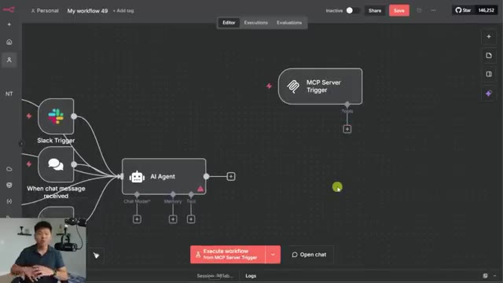
*⏱️ 00:10:47 — Une interface de workflow n8n montrant un nœud "AI Agent" connecté à divers déclencheurs (Slack, Chat) et un nouveau nœud "MCP Server Trigger" en cours d'intégration.*

---

### ⏱️ `[00:11:14 - 00:11:49]` | Segment #27

**🔊 Audio (Transcription Intégrale Mot pour Mot en Français) :**
> problème. Comme vous pouvez le voir, nous avons des tonnes et des tonnes de modèles. Vous en avez des lourds, des rapides, des modèles de raisonnement. Ce n'est vraiment pas si grave que ça. Et vous pouvez également y modifier très rapidement l'effort de raisonnement. Vous pouvez modifier la verbosité, le résumé, le choix des outils, tout ce genre de choses. Et encore une fois, comme tout est intégré dans votre environnement OpenAI, vous avez déjà tout ici. Vous pouvez également activer ou désactiver facilement si vous souhaitez que l'historique du chat soit inclus ou non. Mais dans NNN, ce que vous pouvez faire, c'est choisir votre propre modèle de chat. Donc Anthropic, Azure, Bedrock, Cohere, n'importe lequel de ceux-là, ou vous pouvez aussi tout simplement aller sur Open Router. Et maintenant, vous pouvez choisir à peu près n'importe quel des centaines de modèles qui se trouvent sur Open Router. Vous avez donc beaucoup plus de liberté ici. Et

**👁️ Analyse Visuelle d'Écran (gemini-3.5-flash-lite) :**
**Interface & Outils** : Interface web de construction de workflow et d'agents IA (type n8n ou plateforme similaire).

**Contenu textuel & Code** : Paramètres de modèles d'IA, sélections de modèles (GPT-5, Groq, Mistral, Ollama), options de configuration de l'effort de raisonnement et de verbosité.

**Action / Démonstration** : Navigation et configuration des paramètres de modèles de langage au sein d'un workflow d'agent conversationnel.

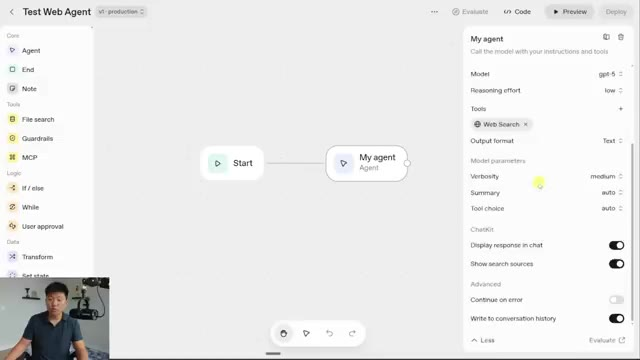
*⏱️ 00:11:23 — Interface d'un constructeur d'agent IA montrant un diagramme de flux avec des nœuds 'Start' et 'My agent', ainsi qu'un panneau latéral affichant les paramètres du modèle (sélection du modèle, effort de raisonnement, verbosité).*

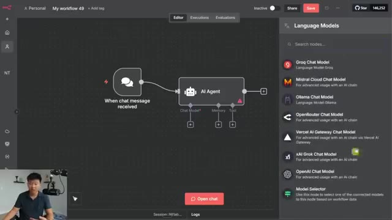
*⏱️ 00:11:40 — Interface de workflow d'automatisation (type n8n) avec un nœud 'AI Agent' connecté à un déclencheur de chat, et un panneau latéral listant divers modèles de langage (Groq, Mistral, Ollama, OpenRouter, etc.).*

---

### ⏱️ `[00:11:49 - 00:12:14]` | Segment #28

**🔊 Audio (Transcription Intégrale Mot pour Mot en Français) :**
> franchement, je pense que c'est très important parce que je n'utilise pas toujours seulement les modèles d'OpenAI. Je le fais beaucoup de fois, mais pour certains cas d'utilisation, je veux vraiment utiliser un Google ou je veux vraiment utiliser Anthropic. Et quand vous choisissez n'importe lequel de ces modèles, vous avez toujours la possibilité de modifier des choses comme votre top P, votre fréquence, votre température d'échantillonnage, tout ce genre de choses aussi dans NNN, c'est pourquoi NNN obtient un 10 sur 10 parce que vous pouvez aussi utiliser des modèles locaux puisque vous pouvez héberger NNN localement.

**👁️ Analyse Visuelle d'Écran (gemini-3.5-flash-lite) :**
**Interface & Outils** : Interface web de création de workflow (type n8n ou plateforme similaire d'automatisation d'IA).

**Contenu textuel & Code** : Un diagramme de flux avec trois nœuds principaux : « When chat message received », « AI Agent » et « OpenRouter Chat Model » reliés entre eux.

**Action / Démonstration** : Visualisation et configuration d'un agent IA utilisant OpenRouter pour intégrer différents modèles de langage dans le workflow.

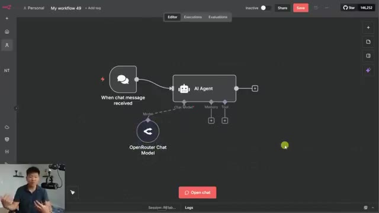
*⏱️ 00:11:55 — Capture d'écran montrant l'interface d'un outil de workflow avec un nœud « AI Agent » connecté à un module « OpenRouter Chat Model ».*

---

### ⏱️ `[00:12:14 - 00:12:37]` | Segment #29

**🔊 Audio (Transcription Intégrale Mot pour Mot en Français) :**
> Et AgentKit va obtenir un 6 sur 10 ici, ce qui porte notre nouveau total à AgentKit 24, NNN 36. Maintenant, celui-ci est vraiment intéressant. Nous passons aux composants de chat UI. Donc, plus tôt dans cette vidéo, j'ai fait allusion à quelques reprises à quelque chose appelé ChatKit, qui est comme l'outil intégré d'AgentKit pour vous aider à créer des sortes de widgets pour sites web et à intégrer vos agents OpenAI très facilement et très proprement sur votre propre site web.

**👁️ Analyse Visuelle d'Écran (gemini-3.5-flash-lite) :**
**Interface & Outils** : Présentation visuelle (diapositive de score)

**Contenu textuel & Code** : Texte : "Model Support", "AgentKit: 6/10", "n8n: 10/10", "Total:", "AgentKit: 24", "n8n: 36". Logo n8n avec une couronne.

**Action / Démonstration** : Présentation des scores comparatifs entre AgentKit et n8n suite à l'évaluation du support des modèles.

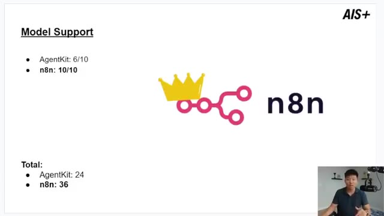
*⏱️ 00:12:20 — Diapositive de présentation montrant le score de support des modèles pour AgentKit (6/10) et n8n (10/10), ainsi que le score total mis à jour (AgentKit: 24, n8n: 36), avec le logo n8n surmonté d'une couronne et la vidéo du présentateur en bas à droite.*

---

### ⏱️ `[00:12:37 - 00:13:00]` | Segment #30

**🔊 Audio (Transcription Intégrale Mot pour Mot en Français) :**
> Les utilisateurs peuvent ajouter des interfaces de chat élégantes et aux couleurs de leur marque à leurs applications sans code supplémentaire. Tout a l'air soigné et fonctionne directement avec les agents OpenAI. Et c'est en fait une très grande valeur ajoutée pour le kit d'agent d'OpenAI. Et d'un autre côté, il se concentre beaucoup plus sur les workflows backend. Il n'a donc aucun moyen élégant ou facile d'intégrer des interfaces de chat par défaut. Vous auriez généralement besoin d'intégrer votre agent dans une sorte de front-end si vous voulez qu'il ait vraiment une belle apparence.

**👁️ Analyse Visuelle d'Écran (gemini-3.5-flash-lite) :**
**Interface & Outils** : Logiciel de présentation / Slide de cours

**Contenu textuel & Code** : Texte en anglais décrivant les avantages de ChatKit avec des composants d'interface intégrés, la comparaison avec n8n et un résumé des points clés, avec une petite incrustation vidéo du présentateur en bas à droite.

**Action / Démonstration** : Présentation des fonctionnalités de chat et comparaison des outils par le présentateur.

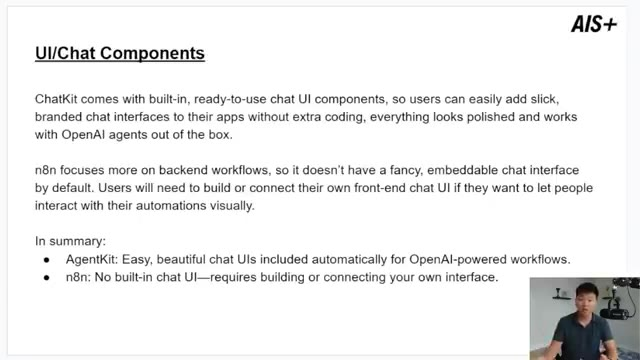
*⏱️ 00:12:43 — Diapositive de présentation textuelle comparant les composants d'interface utilisateur (UI/Chat Components) entre AgentKit et n8n.*

---

### ⏱️ `[00:13:01 - 00:13:23]` | Segment #31

**🔊 Audio (Transcription Intégrale Mot pour Mot en Français) :**
> Voici un exemple rapide de tous les différents widgets que vous pourriez créer. Et vous pourriez faire en sorte que vos agents OpenAI alimentent ces différents widgets. Et c'est là que cette chose de sortie entre en jeu. Si je changeais cela en widget, nous pourrions fondamentalement configurer le type de widget que nous voulons et les petits éléments que nos agents pourraient modifier en fonction de leur sortie dans ce widget. Et donc, lorsque je clique sur créer un widget ici, vous pouvez voir que nous pourrions soit décrire et commencer à maquetter ce à quoi nous voulons qu'il ressemble.

**👁️ Analyse Visuelle d'Écran (gemini-3.5-flash-lite) :**
**Interface & Outils** : Interface web de construction d'agents et de widgets (type OpenAI Playground / Widget Studio).

**Contenu textuel & Code** : Exemples de widgets UI, interface de chat ChatKit, modale 'Add widget' avec options 'Create' et 'Upload', et configuration d'agent (nom, instructions, modèle gpt-5, format de sortie widget).

**Action / Démonstration** : Présentation des différents types de widgets créables et configuration du format de sortie de l'agent sur un widget.

*⏱️ 00:13:06 — Vue d'ensemble montrant des exemples de composants UI et de chat (ChatKit), avec une interface de widgets à gauche, un exemple de chat à droite, et un témoignage de HubSpot en bas.*

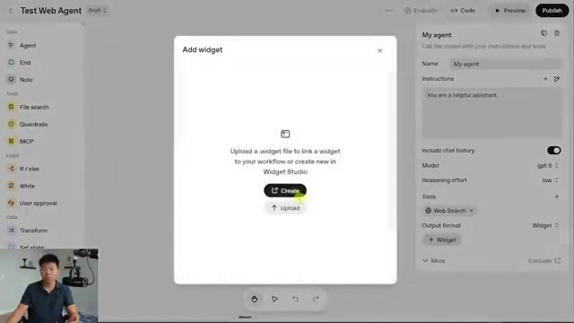
*⏱️ 00:13:12 — Interface de configuration d'un agent web avec une modale 'Add widget' au centre permettant de créer ou téléverser un fichier .widget.*

---

### ⏱️ `[00:13:23 - 00:13:42]` | Segment #32

**🔊 Audio (Transcription Intégrale Mot pour Mot en Français) :**
> Vous pouvez aller dans la galerie et voir ce sont des types de widgets et c'est avec quoi vous pouvez faire interagir et changer votre agent. Et c'est pourquoi je pense que c'est vraiment cool pour leur interface front-end. Mais avec NNN, vous avez l'option avec le déclencheur de message de chat d'ouvrir une interface de chat et de l'intégrer. Mais ça ressemble juste à ça. C'est vraiment difficile à personnaliser et ça n'a tout simplement pas l'air super. Alors voici une citation sympa de HubSpot.

**👁️ Analyse Visuelle d'Écran (gemini-3.5-flash-lite) :**
**Interface & Outils** : Interface web Widget Builder / ChatKit / Navigateur web

**Contenu textuel & Code** : Galerie de widgets d'interface utilisateur, aperçu d'une interface de chat interactive et citation textuelle de HubSpot sur les avantages de ChatKit.

**Action / Démonstration** : Navigation et présentation visuelle de la galerie de widgets et des composants d'interface de chat pour les agents conversationnels.

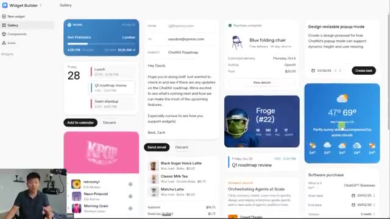
*⏱️ 00:13:28 — Vue d'ensemble du constructeur de widgets (Widget Builder) avec une galerie de composants interactifs variés (météo, calendrier, e-mails, commandes).*

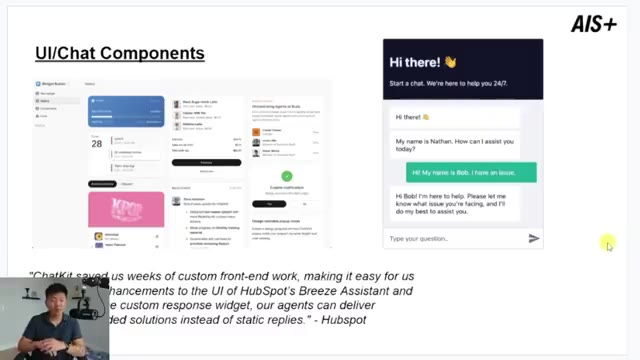
*⏱️ 00:13:33 — Présentation des composants UI/Chat avec une interface de chat interactive à droite et un témoignage client textuel en bas.*

---

### ⏱️ `[00:13:42 - 00:14:03]` | Segment #33

**🔊 Audio (Transcription Intégrale Mot pour Mot en Français) :**
> ChatKit nous a évité des semaines de travail de développement frontal personnalisé, nous permettant de prototyper facilement des améliorations de l'interface utilisateur de l'Assistant Breeze et des agents de HubSpot. Grâce au widget de réponse personnalisé, notre agent peut proposer des solutions guidées et interactives au lieu de réponses statiques. C'est donc vraiment super. C'est pourquoi AgentKit va obtenir un neuf sur dix et NNN va obtenir un cinq sur dix, ce qui porte le total à AgentKit 33, NNN 41.

**👁️ Analyse Visuelle d'Écran (gemini-3.5-flash-lite) :**
**Interface & Outils** : Présentation vidéo avec diapositives graphiques et incrustation du présentateur.

**Contenu textuel & Code** : Texte sur ChatKit et ses avantages pour le développement frontal de l'Assistant Breeze de HubSpot, ainsi que des notes d'évaluation.

**Action / Démonstration** : Le présentateur commente les avantages de ChatKit pour le prototypage et l'intégration d'interfaces conversationnelles.

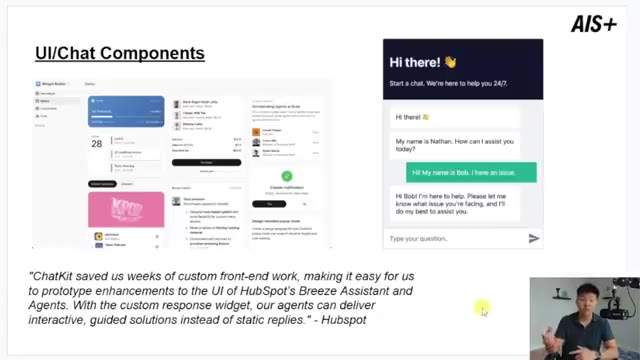
*⏱️ 00:13:47 — Diapositive présentant les composants UI/Chat avec des exemples visuels de widgets de chat et une citation de HubSpot concernant ChatKit.*

---

### ⏱️ `[00:14:03 - 00:14:24]` | Segment #34

**🔊 Audio (Transcription Intégrale Mot pour Mot en Français) :**
> En espérant que j'ai bien fait tous ces calculs. Dites-le-moi si ce n'est pas le cas. Et maintenant, pour parler de notre dernière section, nous avons le déploiement et le contrôle, ce qui est évidemment très important, surtout si vous voulez faire cela pour votre propre entreprise ou aider d'autres entreprises à mettre en œuvre des automatisations par IA. L'une des principales raisons, selon moi, pour lesquelles NIDM a explosé, en plus d'être facile à utiliser et visuel, c'est parce qu'il était open source.

**👁️ Analyse Visuelle d'Écran (gemini-3.5-flash-lite) :**
**Interface & Outils** : Présentation de diapositives textuelles (type PowerPoint ou document de synthèse).

**Contenu textuel & Code** : Texte comparatif sur le déploiement : AgentKit (géré dans le cloud OpenAI, simple mais moins flexible) versus n8n (déployable partout, contrôle total, auto-hébergement).

**Action / Démonstration** : Le présentateur introduit la section sur le déploiement et le contrôle des agents IA.

---

### ⏱️ `[00:14:25 - 00:14:45]` | Segment #35

**🔊 Audio (Transcription Intégrale Mot pour Mot en Français) :**
> Je pense qu'ils préfèrent en fait utiliser le terme de code disponible ou quelque chose comme ça. Mais ce qui signifie que vous pouvez l'héberger dans le cloud, vous pouvez l'héberger sur votre propre serveur privé, vous pouvez l'héberger localement sur votre propre ordinateur, et vous pouvez avoir un contrôle total sur toutes les données, surtout si vous hébergez également votre LLM localement, vous savez où tout va. AgentKit, en revanche, est déployé et géré entièrement dans le cloud d'OpenAI.

**👁️ Analyse Visuelle d'Écran (gemini-3.5-flash-lite) :**
**Interface & Outils** : Logiciel de présentation / Diapositive texte

**Contenu textuel & Code** : Texte comparatif sur le déploiement cloud (AgentKit) vs auto-hébergement partout (n8n).

**Action / Démonstration** : Le présentateur explique les différences de flexibilité et de contrôle des données entre les deux solutions.

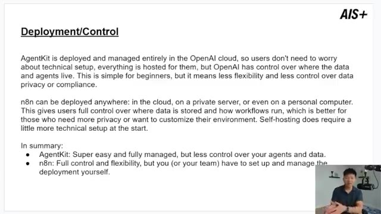
*⏱️ 00:14:30 — Une diapositive de présentation comparant les options de déploiement et de contrôle entre AgentKit et n8n.*

---

### ⏱️ `[00:14:45 - 00:15:04]` | Segment #36

**🔊 Audio (Transcription Intégrale Mot pour Mot en Français) :**
> Donc les utilisateurs n'ont pas à se soucier de la configuration technique, ce qui est une bonne chose. Tout est hébergé pour eux. Mais d'autre part, OpenAI a un contrôle total sur l'endroit où résident les données et les agents. Et encore une fois, si votre entreprise et vos flux de travail sont déjà complètement intégrés dans l'environnement d'OpenAI, alors ce n'est probablement pas un problème majeur pour vous. Et vous pourriez facilement créer quelques automatisations vraiment utiles avec l'AgentKit d'OpenAI.

**👁️ Analyse Visuelle d'Écran (gemini-3.5-flash-lite) :**
**Interface & Outils** : Présentation de diapositives textuelles (Slide deck)

**Contenu textuel & Code** : Texte comparatif sur le déploiement et le contrôle : AgentKit (hébergé par OpenAI, facile mais moins de contrôle) versus n8n (déployé partout, hébergement autonome, contrôle total).

**Action / Démonstration** : Le présentateur explique et commente les points clés affichés sur la diapositive concernant le déploiement et le contrôle des données.

*⏱️ 00:14:50 — Une diapositive de présentation intitulée "Deployment/Control" comparant AgentKit et n8n en matière de gestion, de cloud, de contrôle des données et de configuration, avec le présentateur visible en médaillon dans le coin inférieur droit.*

---

### ⏱️ `[00:15:04 - 00:15:31]` | Segment #37

**🔊 Audio (Transcription Intégrale Mot pour Mot en Français) :**
> Mais de bout en bout, encore une fois, vous pouvez avoir un contrôle total, bien que parfois cela demande un peu plus de configuration technique ou d'expertise au début. Donc pour le déploiement et le contrôle, AgentKit obtient un 7 sur 10, n8n obtient un 10 sur 10, ce qui porte le total à un score final de 40 pour AgentKit et 51 pour n8n, ce qui signifie que n8n est notre vainqueur aujourd'hui. Mais encore une fois, c'est très relatif. Si j'abordais cela du point de vue d'un autre type d'utilisateur, peut-être moins du point de vue d'un développeur, j'apprécierais probablement davantage AgentKit.

**👁️ Analyse Visuelle d'Écran (gemini-3.5-flash-lite) :**
**Interface & Outils** : Présentation textuelle (diapositive avec incrustation vidéo du présentateur en bas à droite).

**Contenu textuel & Code** : Texte comparatif sur le déploiement : AgentKit (géré dans le cloud OpenAI, simple mais moins de flexibilité) versus n8n (déployé n'importe où, cloud, serveur privé ou PC personnel, offrant un contrôle total mais nécessitant une configuration technique).

**Action / Démonstration** : Le présentateur explique et compare les options de déploiement et de contrôle entre AgentKit et n8n.

*⏱️ 00:15:11 — Une diapositive de présentation détaillant les critères de déploiement et de contrôle pour AgentKit et n8n.*

---

### ⏱️ `[00:15:31 - 00:16:03]` | Segment #38

**🔊 Audio (Transcription Intégrale Mot pour Mot en Français) :**
> Donc de toute façon, il y a quelques autres choses diverses que je voulais aborder rapidement concernant les deux plateformes. Comme les tarifs, les outils d'évaluation et le support communautaire. Ce n'est toujours pas un produit fini de la part d'AgentKit, et ils sont capables de faire énormément de choses cool ici. Donc leurs tarifs ne sont pas totalement finalisés. Pour l'instant, vous pouvez simplement y accéder gratuitement, mais je crois que vous devrez payer pour l'utilisation des modèles de chat IA. AgentKit a aussi vraiment des outils d'évaluation sympas, mais il y a aussi certains aspects de l'évaluation que je n'aime pas trop. Laissez-moi donc vous montrer ce que je veux dire par là rapidement. Ok, donc c'est l'un des modèles d'OpenAI, et ce que je veux faire rapidement, c'est juste le prévisualiser et faire une conversation rapide.

**👁️ Analyse Visuelle d'Écran (gemini-3.5-flash-lite) :**
**Interface & Outils** : Logiciel de présentation / Diapositive textuelle

**Contenu textuel & Code** : Texte comparatif sur les aspects Pricing, Evaluation Tools et Community Support entre AgentKit et n8n.

**Action / Démonstration** : Présentation des points divers de comparaison par le présentateur.

*⏱️ 00:15:39 — Une diapositive de présentation intitulée "Miscellaneous" listant des comparaisons entre les deux plateformes sur le prix, les outils d'évaluation et le support communautaire, avec la vidéo du présentateur en bas à droite.*

---

### ⏱️ `[00:16:03 - 00:16:23]` | Segment #39

**🔊 Audio (Transcription Intégrale Mot pour Mot en Français) :**
> Donc, tout d'abord, je dis bonjour. Vous pouvez voir ce qui se passe ici. L'agent de tri va déterminer ce qu'il faut générer. Et ensuite, il me renvoie en quelque sorte des informations. Et il dit : « Pour commencer, pourriez-vous partager les éléments suivants ? » Vous pouvez voir que j'ai répondu à cela. Vous pouvez voir que nous avons vu le chemin que ce workflow a emprunté. Et maintenant, l'agent d'aide au lancement est essentiellement en train de nous créer un guide sur la façon de lancer ceci.

**👁️ Analyse Visuelle d'Écran (gemini-3.5-flash-lite) :**
**Interface & Outils** : Interface web de création de workflow (type constructeur d'agents IA)

**Contenu textuel & Code** : Schéma de workflow avec les blocs "Start", "Triage", "Condition", "Launch helper" et "Get data", ainsi que le panneau de discussion à droite.

**Action / Démonstration** : L'utilisateur survole ou interagit avec le bloc d'agent de tri ("Triage") dans le workflow.

*⏱️ 00:16:08 — Interface de conception de workflow montrant un agent de tri (Triage), une condition et un bloc Get data, avec un panneau de prévisualisation à droite.*

---

### ⏱️ `[00:16:23 - 00:16:56]` | Segment #40

**🔊 Audio (Transcription Intégrale Mot pour Mot en Français) :**
> Donc peu importe le résultat, ce que je n'aime pas ici, c'est que je ne peux pas voir comment les données ont circulé à travers chacune de ces étapes. Donc si je ferme cet aperçu et que je clique sur, vous savez, nous voulons voir ce qui s'est passé dans cette condition, c'est plutôt difficile de voir quelles données viennent de passer. Et si je clique sur évaluer, c'est là qu'on peut réellement en quelque sorte, vous savez, voir ces journaux, mais c'est un peu déroutant. Genre, vous pouvez voir le timing de chacune de ces étapes. Vous pouvez voir ce qui s'est passé. Si je clique sur cet agent de triage, nous pouvons voir qu'il a utilisé GPT-5. Nous pouvons voir les invites système. Nous pouvons voir l'entrée juste ici, et nous pouvons voir le raisonnement et les actions, mais c'est juste beaucoup plus difficile de voir les données circuler.

**👁️ Analyse Visuelle d'Écran (gemini-3.5-flash-lite) :**
**Interface & Outils** : Interface web de création et d'évaluation de workflows d'agents IA (type plateforme No-Code/Low-Code d'automatisation).

**Contenu textuel & Code** : Diagramme de flux avec blocs logiques (Start, Triage, Condition, Launch helper, Get data) et tableau de traces d'exécution avec requêtes API (POST /v1/responses).

**Action / Démonstration** : Navigation et explication du fonctionnement des conditions et du suivi des flux de données dans le workflow d'automatisation.

*⏱️ 00:16:31 — Interface de conception d'un workflow IA montrant les nœuds Start, Triage Agent, Condition, Launch helper et Get data, avec le présentateur en médaillon vidéo en bas à droite.*

*⏱️ 00:16:40 — Interface d'évaluation des traces du workflow affichant l'historique des exécutions par nœud avec les temps de réponse en millisecondes.*

---

### ⏱️ `[00:16:56 - 00:17:23]` | Segment #41

**🔊 Audio (Transcription Intégrale Mot pour Mot en Français) :**
> à travers les nœuds de la manière dont NNN rend les choses beaucoup plus faciles à faire. Parce que dans NNN, avec ce flux de travail, vous pouvez voir que tout est vert. Vous pouvez voir combien d'éléments circulent. Lorsque vous cliquez sur un nœud, vous pouvez voir l'entrée sur la gauche. Vous pouvez voir la configuration au milieu et vous pouvez voir la sortie sur la droite. Il est donc très facile de suivre la trace des données et de comprendre exactement où quelque chose a mal tourné et ce que vous devez changer. Mais à mon avis, dans cet environnement OpenAI Agent Kit, il m'est tout simplement difficile de comprendre ce qui entre et ce qui sort.

**👁️ Analyse Visuelle d'Écran (gemini-3.5-flash-lite) :**
**Interface & Outils** : Interface n8n (éditeur de workflows d'automatisation).

**Contenu textuel & Code** : Configuration de nœuds d'automatisation, paramètres Google Drive, JSON d'entrée/sortie avec identifiants de fichiers et prompts vidéo.

**Action / Démonstration** : Le présentateur explique comment visualiser et configurer les nœuds, afficher les données d'entrée et de sortie ainsi que le statut d'exécution du flux.

*⏱️ 00:17:03 — Vue d'ensemble d'un flux de travail n8n montrant différentes étapes connectées (Trigger, Download, Generate Video).*

*⏱️ 00:17:09 — Détail des paramètres d'un nœud Google Drive ("Share file") avec l'affichage de l'entrée (INPUT) à gauche et de la sortie (OUTPUT) à droite.*

---

### ⏱️ `[00:17:23 - 00:17:59]` | Segment #42

**🔊 Audio (Transcription Intégrale Mot pour Mot en Français) :**
> parce que vous pouvez voir ici que nous avons une variable qui est entrée sortie souligné analysé bla bla bla mais je ne sais pas exactement d'où vient cette variable je devrais venir ici et je devrais essayer de comprendre d'accord le format de sortie nous avons du json nous avons ce schéma de réponse et est-ce que c'est là qu'il sort l'information donc de toute façon sans essayer d'entrer trop dans les détails techniques ici mais j'aime vraiment de bout en bout comment vous pouvez voir les sorties des nœuds vous pouvez voir le flux de données vous pouvez voir la configuration d'entrée et la sortie et vous pouvez aussi cliquer sur les exécutions et vous pouvez aller voir toutes les différentes exécutions très clairement ce qui s'est passé dans une interface beaucoup plus visuelle que d'aller dans le constructeur d'agents, de regarder les évaluations et de regarder tous les journaux

**👁️ Analyse Visuelle d'Écran (gemini-3.5-flash-lite) :**
**Interface & Outils** : Interface web de construction de workflows d'agents IA (éditeur visuel par nœuds).

**Contenu textuel & Code** : Paramètres de configuration d'agent IA, blocs de condition avec variables d'entrée/sortie (`input.output_parsed...`), et format de sortie JSON.

**Action / Démonstration** : Navigation et explication des variables et du schéma de sortie dans l'éditeur de workflow.

*⏱️ 00:17:32 — Interface de création de workflow affichant un diagramme avec des blocs 'Start', 'Triage' et 'Condition', ainsi que le panneau de configuration du modèle à droite montrant les formats de sortie et schémas JSON.*

---

### ⏱️ `[00:17:59 - 00:18:32]` | Segment #43

**🔊 Audio (Transcription Intégrale Mot pour Mot en Français) :**
> et de devoir en quelque sorte regarder à travers comme ça. C'est juste un peu plus déroutant, ce qui me surprend parce que c'est tellement plus facile à utiliser si j'étais un parfait débutant. Mais ils ont aussi vraiment de superbes capacités d'évaluation avec des ensembles de données, de la notation de traces et de l'optimisation de prompts. Comme vous pouvez le voir ici, il y a différentes manières de noter vos exécutions et ensuite de passer des prompts pour voir s'ils réussissent ou échouent. Vous pouvez optimiser vos prompts. Et bien sûr, vous pouvez noter les traces. La dernière chose que je voulais aborder ici, c'est le support communautaire. OpenAI vient évidemment de sortir leur kit d'agents hier. Et nous savons tous de quoi cette entreprise est capable. C'est juste

**👁️ Analyse Visuelle d'Écran (gemini-3.5-flash-lite) :**
**Interface & Outils** : Navigateur web présentant une interface de plateforme d'évaluation et une page de documentation comparative.

**Contenu textuel & Code** : Tableaux de données d'évaluation (Rating, Tone, Feedback, Accuracy) et texte de comparaison entre AgentKit et n8n.

**Action / Démonstration** : Présentation des capacités d'évaluation d'agents et comparaison des outils d'automatisation.

*⏱️ 00:18:15 — Interface de tableau de bord d'évaluation avec des ensembles de données, des notes et des indicateurs de réussite (Pass/Fail).*

*⏱️ 00:18:23 — Document textuel comparatif listant les points Pricing, Evaluation Tools et Community Support entre AgentKit et n8n.*

---

### ⏱️ `[00:18:32 - 00:19:04]` | Segment #44

**🔊 Audio (Transcription Intégrale Mot pour Mot en Français) :**
> vraiment super ce sur quoi ils travaillent. Donc j'imagine qu'on va voir AgentKit continuer à évoluer et évoluer. Mais comme N8N existe depuis six ans et a explosé ces derniers temps, il y a tellement de contenu. Il y a tellement de cours. Il y a tellement de modèles gratuits, genre plus de 5 000 modèles, alors qu'avec AgentKit d'OpenAI, vous êtes un peu plus livré à vous-même pour l'instant. Bref, globalement, on a AgentKit à 40, on a N8N à 51, et je voulais parler rapidement du moment où vous choisiriez chacun de ces outils. Donc je choisirais OpenAI AgentKit si je voulais privilégier un déploiement rapide avec un minimum de complexité technique, si je voulais un utilisateur de chat soigné

**👁️ Analyse Visuelle d'Écran (gemini-3.5-flash-lite) :**
**Interface & Outils** : Logiciel de présentation de diapositive avec incrustation vidéo.

**Contenu textuel & Code** : Texte comparatif sur AgentKit et n8n : Pricing, Evaluation Tools, Community Support.

**Action / Démonstration** : Le présentateur commente les points de comparaison entre AgentKit et n8n.

*⏱️ 00:18:40 — Une diapositive de présentation résumant les critères 'Miscellaneous' (tarification, outils d'évaluation, support communautaire) comparant AgentKit et n8n, avec la vidéo du présentateur en bas à droite.*

---

### ⏱️ `[00:19:04 - 00:19:39]` | Segment #45

**🔊 Audio (Transcription Intégrale Mot pour Mot en Français) :**
> interface ou certains widgets qui pourraient être dynamiques, si je cherche à faire une évaluation et des tests d'agents complets vraiment rapides et faciles, et bien sûr, si j'ai déjà tout ce que je sais sur mon entreprise dans l'écosystème d'OpenAI, cela va rendre vraiment facile la connexion de ces flux de travail personnalisés. Maintenant, NNN, ils visaient vraiment plus les développeurs. La flexibilidad across multiple AI providers, la flexibilité à travers de multiples fournisseurs d'IA, l'automatisation de flux de travail complexes au-delà du simple chat, le contrôle des coûts grâce à l'auto-hébergement, un contrôle complet des données et de l'infrastructure. Vous avez évidemment la capacité de vous connecter à littéralement n'importe quoi, de déclencher vos flux de travail par littéralement n'importe quoi, et de faire tout type de manipulation ou de transformation de données dont vous avez besoin. Mais faire cette vidéo était vraiment amusant pour

**👁️ Analyse Visuelle d'Écran (gemini-3.5-flash-lite) :**
**Interface & Outils** : Présentation diapositive (Slide Deck)

**Contenu textuel & Code** : Texte comparatif listant les scores et les avantages de choisir AgentKit ou n8n selon les priorités.

**Action / Démonstration** : Présentation et explication de la comparaison finale entre les deux solutions d'automatisation et d'IA.

*⏱️ 00:19:13 — Une diapositive de présentation affichant un tableau comparatif entre OpenAI AgentKit et n8n, avec un score total (AgentKit : 40, n8n : 51) et des critères de choix pour chacun.*

---

### ⏱️ `[00:19:39 - 00:19:59]` | Segment #46

**🔊 Audio (Transcription Intégrale Mot pour Mot en Français) :**
> moi parce que je pense que beaucoup de gens ont tendance à se bloquer sur les outils. Vous savez, qu'est-ce qui va sortir ? Qu'est-ce qui va être pertinent ? Qu'est-ce que je dois apprendre ? Est-ce que je prends un énorme risque ou un pari ? La réponse est non. Tant que vous l'abordez avec l'état d'esprit suivant : je veux apprendre quand l'IA a de la valeur, quand elle n'en a pas, comment gagner du temps, et comment résoudre un problème fondamental qui se pose réellement à l'entreprise.

**👁️ Analyse Visuelle d'Écran (gemini-3.5-flash-lite) :**
**Interface & Outils** : Logiciel de présentation / Diapositive comparative

**Contenu textuel & Code** : Texte comparatif listant les avantages d'OpenAI AgentKit (déploiement rapide, interfaces de chat, écosystème OpenAI) face à ceux de n8n (flexibilité multi-fournisseurs, workflows complexes, auto-hébergement, contrôle des données).

**Action / Démonstration** : Affichage d'un tableau comparatif pour guider le choix entre les deux outils d'IA et d'automatisation.

*⏱️ 00:19:44 — Une diapositive de présentation comparant OpenAI AgentKit et n8n avec les critères de choix pour chaque outil, incluant les scores totaux (AgentKit: 40, n8n: 51).*

---

### ⏱️ `[00:20:00 - 00:20:25]` | Segment #47

**🔊 Audio (Transcription Intégrale Mot pour Mot en Français) :**
> Parce que si vous essayez de travailler avec des entreprises, elles ne vont probablement pas vous choisir en raison de votre outil spécifique. Elles vont vous choisir parce que vous savez comment leur apporter des résultats qui leur font économiser de l'argent, leur font gagner du temps et augmentent leur concentration. Donc, très rapidement, l'état d'esprit devrait être d'être agnostique face aux outils, de résoudre le problème à sa racine, peu importe vraiment comment vous y arrivez. Donc, je m'excuse pour ce long discours, mais j'espère que vous comprenez d'où je viens. C'est le genre de choses dont j'aime parler dans ce domaine, car il y a beaucoup de battage médiatique.

**👁️ Analyse Visuelle d'Écran (gemini-3.5-flash-lite) :**
**Interface & Outils** : Diapositive de présentation textuelle.

**Contenu textuel & Code** : Texte comparatif avec "Total: AgentKit: 40, n8n: 51", et les listes de critères pour choisir l'un ou l'autre.

**Action / Démonstration** : Le présentateur commente le récapitulatif comparatif entre les deux solutions d'automatisation.

*⏱️ 00:20:06 — Un diaporama comparatif montrant les scores et critères de choix entre OpenAI AgentKit et n8n, avec la webcam du présentateur en bas à droite.*

---

### ⏱️ `[00:20:25 - 00:20:44]` | Segment #48

**🔊 Audio (Transcription Intégrale Mot pour Mot en Français) :**
> Et si vous cherchez à vous connecter avec une tonne d'autres personnes qui aiment parler de ce genre de choses également, alors allez absolument jeter un œil à ma communauté plus. Le lien pour cela est dans la description. Nous venons d'atteindre 3 000 membres, ce qui est super excitant, mais elle regorge de personnes qui construisent avec N&N tous les jours ou différentes plateformes. C'est une communauté pleine de résolveurs de problèmes d'IA. Des tonnes de personnes ici construisent des entreprises avec l'IA ou utilisent l'IA pour aider leurs propres entreprises.

**👁️ Analyse Visuelle d'Écran (gemini-3.5-flash-lite) :**
**Interface & Outils** : Interface web de la communauté Skool / plateforme communautaire personnalisée (AI Automation Society Plus).

**Contenu textuel & Code** : Publications épinglées des membres (Nate Herk, Yash Chauhan), onglets de navigation (Community, Classroom, Calendar, Members, Map, Leaderboards, About) et statistiques affichant 3k membres.

**Action / Démonstration** : Présentation visuelle de la communauté en ligne mentionnée dans le discours audio.

*⏱️ 00:20:30 — Capture d'écran montrant l'interface de la communauté en ligne "AI Automation Society Plus" (AIS+) avec les fils de discussion et le compteur de membres à 3k.*

---

### ⏱️ `[00:20:45 - 00:21:04]` | Segment #49

**🔊 Audio (Transcription Intégrale Mot pour Mot en Français) :**
> C'est un domaine vraiment passionnant. Et nous avons également trois formations complètes en ce moment : Agent Zéro, qui pose les bases de l'automatisation par l'IA pour les débutants. Nous avons « De 10 heures à 10 secondes », où nous plongeons dans N8N et apprenons à identifier comment gagner du temps grâce aux automatisations. Et enfin, nous avons une nouvelle formation pour nos membres annuels appelée « Agence d'automatisation par l'IA à personne seule », où nous posons les bases pour bâtir une entreprise d'automatisation par l'IA évolutive.

**👁️ Analyse Visuelle d'Écran (gemini-3.5-flash-lite) :**
**Interface & Outils** : Plateforme web de communauté (type Skool ou similaire), affichant les modules de formation « Start Here », « Agent Zero », « 10 Hours to 10 Seconds », « One Person AI Agency », « n8n Templates » et « Step-by-Step Builds ».

**Contenu textuel & Code** : Titres et descriptions des cours de la plateforme avec une vue en grille des modules.

**Action / Démonstration** : Navigation et présentation des différentes formations proposées dans la communauté.

*⏱️ 00:20:50 — Capture d'écran de l'interface de la plateforme « AI Automation Society Plus » montrant l'onglet des cours (« Classroom ») avec les différentes formations disponibles.*

---

### ⏱️ `[00:21:05 - 00:21:21]` | Segment #50

**🔊 Audio (Transcription Intégrale Mot pour Mot en Français) :**
> J'anime aussi un appel en direct par semaine ici, ce qui a été vraiment amusant ces derniers temps. J'ai eu beaucoup de questions sympas et de discussions intéressantes. J'aimerais donc beaucoup vous voir dans cette communauté, mais c'est tout pour la vidéo d'aujourd'hui. Si vous l'avez appréciée, si vous avez appris quelque chose de nouveau, veuillez mettre un pouce bleu. Ça m'aide vraiment énormément. Et comme toujours, je vous remercie d'être arrivés jusqu'à la fin de la vidéo. Je vous vois dans la prochaine. Merci tout le monde.

**👁️ Analyse Visuelle d'Écran (gemini-3.5-flash-lite) :**
**Interface & Outils** : Navigateur web (interface de communauté en ligne) et diapositive graphique.

**Contenu textuel & Code** : Publications de la communauté, messages épinglés, et logos OpenAI et n8n.

**Action / Démonstration** : Navigation et présentation de la communauté en ligne par l'animateur.

*⏱️ 00:21:09 — Capture d'écran montrant l'interface sombre de la communauté "AI Automation Society Plus" (AIS+) avec les fils de discussion et le profil du présentateur en bas à droite.*

---

