# 🎬 Build ANYTHING with Base44 and n8n AI Agents (beginner's guide)

> **Chaîne** : [Nate Herk | AI Automation](https://www.youtube.com/@nateherk/featured)  
> **Lien YouTube** : [https://www.youtube.com/watch?v=tFFKuq2t0rI](https://www.youtube.com/watch?v=tFFKuq2t0rI)  
> **Date de publication** : 20251010  
> **Durée** : 00:25:16  
> **Identifiant vidéo** : `tFFKuq2t0rI`  
> **Transcription & Analyse** : `whisper-v3-large-turbo+gemini-3.5-flash-lite`  

---

## 📌 Synthèse Exécutive & Outils

### 💡 Résumé

Cette vidéo de la chaîne Nate Herk | AI Automation explore l'art du « vibe coding » et de l'ingénierie rapide en combinant **Base44** (une plateforme d'application web sans code/faible code rachetée par Wix) et les agents IA de **n8n**. L'objectif principal de la démonstration est de concevoir en direct et de zéro un système d'aimant à prospects (« lead magnet ») ultra-professionnel destiné à un cabinet de conseil en IA (« AI Automation Society »). Le processus met en lumière la capacité à traduire des idées textuelles en interfaces web fonctionnelles, en exploitant des capacités multimodales et conversationnelles pour créer des formulaires de capture de données (nom, e-mail, description d'un problème métier).

Au-delà de la simple génération de code par invite textuelle, la vidéo démontre comment élever la qualité visuelle d'une application générée par IA en l'intégrant à des bibliothèques de composants externes comme **21st.dev**. En injectant des fragments de code ciblés pour des effets de survol de cartes et des animations d'arrière-plan, l'auteur parvient à s'affranchir du design stéréotypé typique des applications générées par l'intelligence artificielle. Le résultat final est une page de destination épurée et moderne, prête à être connectée à un agent n8n pour automatiser la génération et l'envoi de feuilles de route d'implémentation personnalisées par e-mail.

### 🛠️ Outils, Modèles & Logiciels Présentés

* **Base44** : Plateforme de développement d'applications web propulsée par l'IA et rachetée par Wix, permettant de lancer des interfaces graphiques complexes à partir de simples descriptions textuelles.
* **n8n** : Outil d'automatisation de flux de travail avancé permettant de concevoir des agents IA agissant comme le backend intelligent de l'application web.
* **OpenAI (Text2Image)** : Intégration native dans Base44 pour la génération d'images textuelles.
* **Monday.com** : Outil de gestion de projet intégré nativement dans certaines configurations de l'écosystème Base44.
* **Slack** : Solution de messagerie collaborative intégrée pour les notifications ou les flux de données.
* **Google Places** : API de géolocalisation et de données géographiques disponible en intégration native.
* **Resend** : Service de messagerie transactionnelle listé parmi les intégrations natives de la plateforme.
* **Eleven Labs** : Outil de synthèse vocale et d'IA audio pris en charge par l'écosystème.
* **Twilio** : Solution de communication cloud pour la gestion des SMS et des appels.
* **21st.dev** : Bibliothèque externe de composants UI et de snippets de code modernes permettant d'enrichir le design des interfaces (cartes interactives, animations).
* **Claude / Claude Code** : Assistant d'IA conversationnel et de codage mentionné pour la structuration de spécifications fonctionnelles (specs).

### 🔑 Points Clés & Enseignements Stratégiques

* **Synergie Front-End et Back-End** : Associer une interface utilisateur rapide à générer (Base44) avec un moteur d'automatisation puissant (n8n) permet de créer des architectures logicielles complexes sans passer par des cycles de développement traditionnels longs et coûteux.
* **Éviter l'effet « IA générique »** : Les applications créées uniquement par des instructions textuelles brutes présentent souvent un aspect stéréotypé (« vibes »). Il est crucial d'itérer sur le design ou d'injecter des composants sur mesure pour garantir un rendu professionnel.
* **Utilisation de composants tiers (21st.dev)** : L'intégration de fragments de code UI prêts à l'emploi (cartes dynamiques, effets de survol, animations d'arrière-plan) élève instantanément la crédibilité visuelle et ergonomique d'une application web générée par IA.
* **Approche itérative du développement** : Le codage par IA n'est jamais parfait du premier coup ; la réussite repose sur un processus d'allers-retours textuels constants (demander des corrections de bugs d'affichage, ajuster les espacements, fondre les éléments visuels).
* **Rôle des spécifications fonctionnelles (Specs)** : Pour des projets plus ambitieux, il est recommandé de faire rédiger un document de spécifications détaillé par un modèle comme Claude en amont, afin de structurer le prompt initial destiné à la plateforme de création d'applications.
* **Stratégie d'acquisition de clients (Lead Magnet)** : Mettre en place un système automatisé offrant une valeur gratuite (comme un audit ou une feuille de route d'implémentation de l'IA) renforce la crédibilité de la marque et maintient l'entreprise à l'esprit des prospects (« top of mind »).
* **Valorisation de l'automatisation sans code** : L'utilisation conjointe de Base44 et de n8n démocratise l'accès à des tunnels de conversion sophistiqués, habituellement réservés aux équipes d'ingénierie logicielle dotées de budgets importants.
* **Adaptabilité des intégrations** : Bien que des outils comme Base44 intègrent nativement divers services (OpenAI, Slack, Resend), le recours à des moteurs d'automatisation externes comme n8n s'avère indispensable pour concevoir des flux métier hautement personnalisés.

---

## ⏱️ Chronologie & Transcription Complète Audio & Visuelle (Mot pour Mot)

### ⏱️ `[00:00:00 - 00:00:31]` | Segment #01

**🔊 Audio (Transcription Intégrale Mot pour Mot en Français) :**
> Aujourd'hui, nous allons parler de la façon dont vous pouvez construire n'importe quoi avec Base44 et les agents IA de N8N. Si vous n'avez jamais entendu parler de Base44, cela vous permet de lancer des applications web vraiment superbes rien qu'avec vos mots. C'est donc presque comme si vous aviez simplement une conversation avec un ingénieur logiciel. Ils ont également quelques intégrations natives dedans, comme OpenAI Text2Image, Monday.com, Slack, Google Places, et quelques autres. Mais il manque certaines de ces intégrations et de ces flux de travail vraiment personnalisés que vous pouvez construire avec N8N. Donc, lorsque nous combinons Base44 avec N8N, nous sommes alors capables de faire en sorte que nos agents IA alimentent le backend de toute notre application web.

**👁️ Analyse Visuelle d'Écran (gemini-3.5-flash-lite) :**
**Interface & Outils** : Base44 (interface web) et schéma conceptuel d'architecture.

**Contenu textuel & Code** : Instructions textuelles pour l'IA, listes d'intégrations tierces et schéma de workflow interconnecté.

**Action / Démonstration** : Présentation des fonctionnalités de Base44 et démonstration visuelle de son intégration avec les agents n8n.

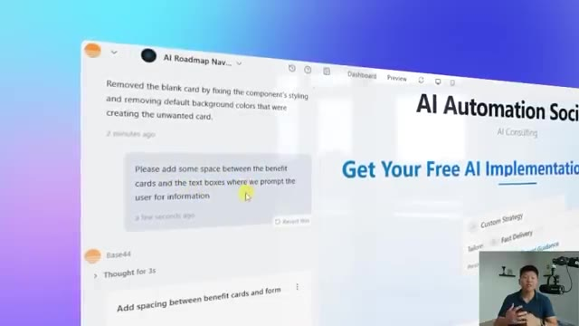
*⏱️ 00:00:08 — Interface d'une application web générée via Base44 avec un assistant IA affichant des instructions de modification textuelles.*

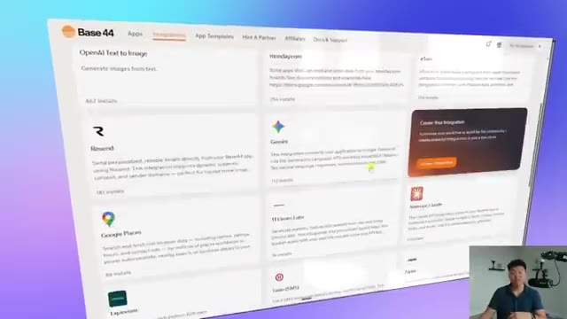
*⏱️ 00:00:15 — Galerie d'intégrations de la plateforme Base44 montrant divers services connectables (OpenAI, Gemini, Resend, etc.).*

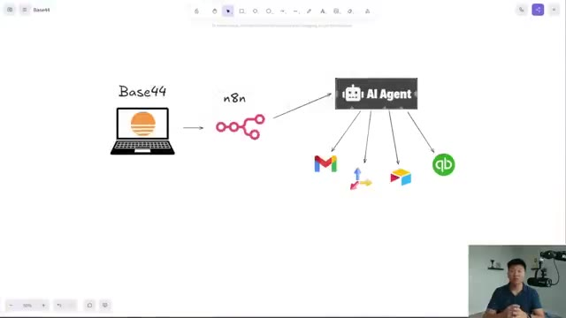
*⏱️ 00:00:23 — Schéma explicatif illustrant le flux entre Base44, n8n et un agent IA connecté à divers outils (Gmail, etc.).*

---

### ⏱️ `[00:00:31 - 00:00:49]` | Segment #02

**🔊 Audio (Transcription Intégrale Mot pour Mot en Français) :**
> Ça devient vraiment, vraiment puissant et les possibilités sont vraiment infinies. Donc, ce que nous allons faire aujourd'hui, c'est une création en direct d'un système d'aimant à prospects alimenté par l'IA. Si vous voulez vraiment suivre cette vidéo, je vais tout faire, comme je l'ai dit, en direct devant vous les gars. Et j'aurai tous les prompts et les ressources dont vous aurez besoin pour suivre dans ma communauté FreeSchool. Le lien pour cela se trouve dans la description.

**👁️ Analyse Visuelle d'Écran (gemini-3.5-flash-lite) :**
**Interface & Outils** : Tableau blanc ou outil de présentation schématique avec le présentateur incrusté en bas à droite.

**Contenu textuel & Code** : Schéma d'architecture avec les composants Base44, n8n, des maquettes de landing pages et un symbole de communication (email).

**Action / Démonstration** : Le présentateur introduit le sujet et explique le flux logique du système d'aimant à prospects alimenté par l'IA.

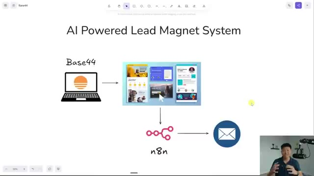
*⏱️ 00:00:36 — Schéma explicatif intitulé "AI Powered Lead Magnet System" montrant le flux entre Base44, des interfaces web et n8n menant à une icône de messagerie.*

---

### ⏱️ `[00:00:50 - 00:01:13]` | Segment #03

**🔊 Audio (Transcription Intégrale Mot pour Mot en Français) :**
> Mais de toute façon, ce que nous construisons aujourd'hui, c'est un système d'aimant à prospects. Et donc, disons que vous êtes un consultant en IA et que vous essayez d'obtenir des clients. Nous allons créer une interface avec Base44, et cette interface va permettre au client d'inscrire son nom, son email et de décrire un problème qu'il rencontre. L'idée ici est que vous allez pouvoir les capturer et offrir un peu de valeur gratuite. Donc dire : hé, allez sur ce site web, entrez vos informations, et ensuite je vous donnerai un rapport gratuit, un audit de mise en œuvre de l'IA gratuit.

**👁️ Analyse Visuelle d'Écran (gemini-3.5-flash-lite) :**
**Interface & Outils** : Outil de tableau blanc / diagramme en ligne et incrustation vidéo du présentateur en bas à droite.

**Contenu textuel & Code** : Schéma avec le texte "AI Powered Lead Magnet System", les logos de Base44, n8n et des icônes d'interface utilisateur et de messagerie.

**Action / Démonstration** : Le présentateur explique le fonctionnement global du système d'automatisation avec un schéma visuel.

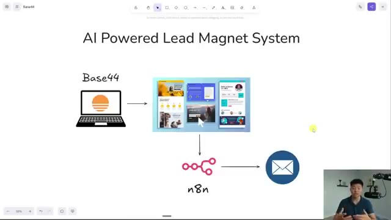
*⏱️ 00:00:55 — Schéma explicatif du système d'aimant à prospects (AI Powered Lead Magnet System) montrant le flux entre Base44, une interface web et n8n menant à l'envoi d'e-mails.*

---

### ⏱️ `[00:01:13 - 00:01:50]` | Segment #04

**🔊 Audio (Transcription Intégrale Mot pour Mot en Français) :**
> Et donc les données que le client saisit dans notre application Base44 vont être envoyées à un agent IA N&N qui va être formé sur la façon de mener une feuille de route pour la mise en œuvre de l'IA. Et ensuite, depuis N&N, elles seront envoyées directement dans la boîte de réception de ce client, et ça aura l'air vraiment très professionnel. Et puis en bas de cet e-mail, il sera écrit, Hé, si vous voulez en savoir plus, réservez un appel et parlons-en. C'est donc en fait un système que je mettrais en place pour moi-même si je n'avais pas beaucoup de trafic entrant venant de YouTube, mais ce serait un excellent moyen d'ajouter de la crédibilité à votre personne et de donner de la valeur gratuitement. Ainsi, même si un client ne décide pas initialement de travailler avec vous, il vous garde quand même à l'esprit comme étant une bonne personne. Quoi qu'il en soit, je ne veux pas perdre de temps. Alors, allons directement sur Base44 et commençons à construire.

**👁️ Analyse Visuelle d'Écran (gemini-3.5-flash-lite) :**
**Interface & Outils** : Tableau blanc ou présentation schématique avec des icônes représentant Base44, n8n et un service d'email.

**Contenu textuel & Code** : Texte "AI Powered Lead Magnet System" et diagramme de flux avec flèches reliant Base44, un encadré visuel, n8n et une icône d'enveloppe.

**Action / Démonstration** : Le présentateur explique l'architecture du système en montrant le parcours des données entre l'application et l'automatisation n8n.

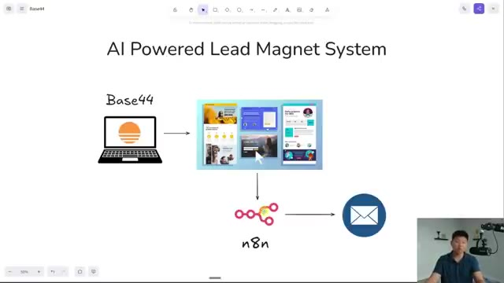
*⏱️ 00:01:22 — Schéma explicatif illustrant le flux de données du système : de l'application Base44 vers un agent IA/workflow n8n, puis vers la boîte mail du client.*

---

### ⏱️ `[00:01:50 - 00:02:22]` | Segment #05

**🔊 Audio (Transcription Intégrale Mot pour Mot en Français) :**
> notre interface. Très bien. Nous voici donc dans Base 44. Si vous voulez y jeter un coup d'œil, il y aura un lien dans la description que vous pourrez utiliser pour vous inscrire. Nous avons l'interface juste ici où il est écrit, qu'aimeriez-vous construire aujourd'hui ? Et tout ce que nous avons à faire, c'est de décrire l'application que nous voulons créer. Vous pouvez voir en haut, nous avons des modèles d'applications que vous pouvez choisir. Si vous voulez commencer avec l'un d'eux, juste pour trouver un peu d'inspiration puis le personnaliser davantage. Et Base44 a en fait été racheté récemment par Wix. Et Wix existe depuis longtemps et est connu pour sa capacité à lancer des pages de destination et des sites Web très facilement. Et si vous avez déjà fait du "vibe coding" avec certaines des autres applications qui existent et qui font quelque chose de similaire, vous remarquerez peut-être que parfois elles

**👁️ Analyse Visuelle d'Écran (gemini-3.5-flash-lite) :**
**Interface & Outils** : Application web Base 44

**Contenu textuel & Code** : Zone de texte « Describe the app you want to create... », catégories (CRM, Content Generation, Dev productivity...), et galerie de modèles d'applications.
[CONSULTATION] Navigation dans l'interface de la plateforme Base 44 et présentation de la page d'accueil et des modèles d'applications.

**Action / Démonstration** : Explications face caméra et démonstration conceptuelle.

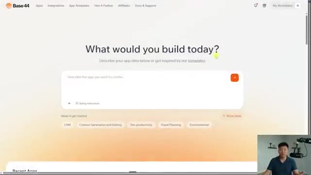
*⏱️ 00:01:58 — Page d'accueil de la plateforme Base 44 affichant la zone de saisie principale avec la question « What would you build today? » et des catégories suggérées.*

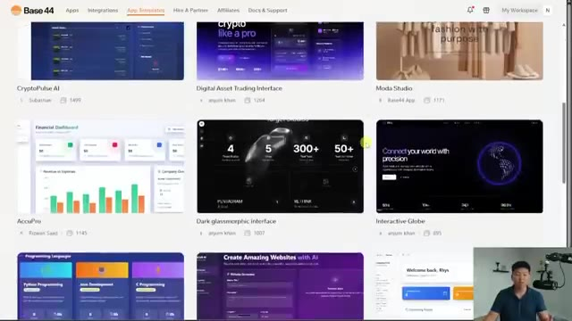
*⏱️ 00:02:06 — Grille de modèles d'applications de la communauté sur Base 44 montrant divers tableaux de bord et interfaces (CryptoPulse AI, Moda Studio, etc.).*

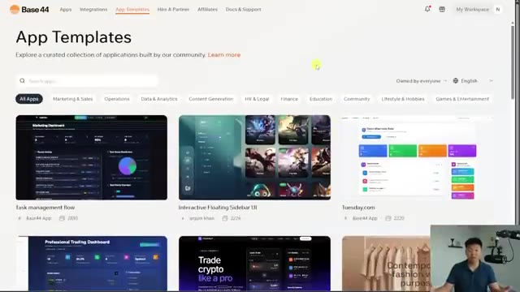
*⏱️ 00:02:14 — Vue d'ensemble de la section « App Templates » sur Base 44 avec des filtres de catégories et une collection de projets populaires.*

---

### ⏱️ `[00:02:22 - 00:02:46]` | Segment #06

**🔊 Audio (Transcription Intégrale Mot pour Mot en Français) :**
> ont l'air très marqués par les "vibes" ou on devine qu'ils ont été conçus avec l'IA. Donc ce que je vais faire aujourd'hui, c'est m'assurer que notre application n'ait pas l'air d'avoir été conçue avec des "vibes". Vous pouvez également voir que nous avons quelques intégrations ici. Nous avons donc des intégrations natives avec OpenAI, Text2Image, eToro, Gemini, Resend, Eleven Labs, Claude, Twilio. Donc comme je l'ai dit, il y a quelques intégrations natives au sein même de Base, mais là où réside vraiment la puissance, c'est quand nous le connectons à n8n et que nous pouvons réellement tout faire.

**👁️ Analyse Visuelle d'Écran (gemini-3.5-flash-lite) :**
**Interface & Outils** : Navigateur web affichant la plateforme Base 44 (App Templates et Integrations Catalog).

**Contenu textuel & Code** : Listes de modèles d'applications et de cartes d'intégrations (OpenAI, monday.com, Resend, Gemini, etc.).

**Action / Démonstration** : Navigation et présentation des fonctionnalités et des intégrations disponibles sur la plateforme Base 44.

*⏱️ 00:02:28 — Vue de la page 'App Templates' de la plateforme Base 44 montrant divers modèles d'applications communautaires.*

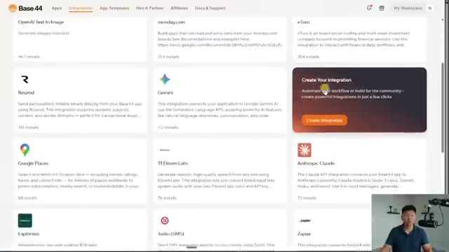
*⏱️ 00:02:34 — Défilement vers le bas de la page des intégrations de Base 44 affichant divers services et API disponibles.*

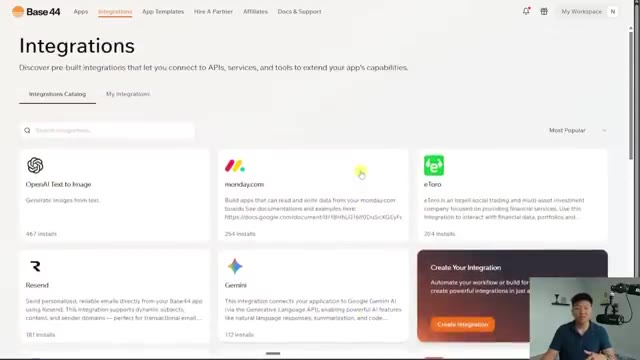
*⏱️ 00:02:40 — Vue principale de la section 'Integrations' sur Base 44 avec le catalogue des intégrations et la barre de recherche.*

---

### ⏱️ `[00:02:46 - 00:03:16]` | Segment #07

**🔊 Audio (Transcription Intégrale Mot pour Mot en Français) :**
> Vous voyez également que vous avez des instructions de style ici même. Donc, si vous vouliez choisir un style de type néo-brutalisme, ou néomorphisme, ou glassmorphism, vous pourriez simplement cliquer sur « ajouter des instructions de style ». Et maintenant, vous avez déjà ces spécifications ici pour que l'application web soit lancée avec ce type de style. Mais nous allons commencer et faire les choses de manière assez brute. Je ne vais pas utiliser de guide de style. Nous allons simplement décrire ce que nous voulons. Et ensuite, je vais vous montrer comment nous pouvons le personnaliser pour qu'il ait vraiment fière allure. Je vais donc simplement dire : j'ai besoin d'une page de destination d'apparence professionnelle pour mon entreprise de conseil en IA, AI Automation Society.

**👁️ Analyse Visuelle d'Écran (gemini-3.5-flash-lite) :**
**Interface & Outils** : Application web Base 44

**Contenu textuel & Code** : Options de design : Glassmorphism, Material Design, et champ de saisie de prompt

**Action / Démonstration** : Sélection d'un style visuel et application des instructions de design

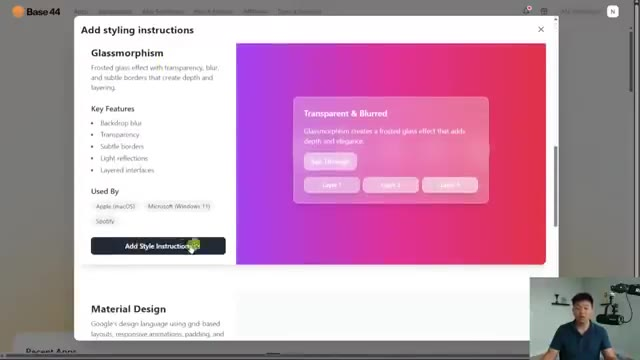
*⏱️ 00:02:54 — Interface de Base 44 affichant les instructions de style pour le Glassmorphism avec un bouton 'Add Style Instruction'.*

*⏱️ 00:03:01 — Page d'accueil de Base 44 avec la question 'What would you build today?' et une zone de saisie pour décrire une application.*

---

### ⏱️ `[00:03:16 - 00:03:49]` | Segment #08

**🔊 Audio (Transcription Intégrale Mot pour Mot en Français) :**
> Je veux que ce soit écrit tout en haut : AI Automation Society, AI Consulting, obtenez votre feuille de route gratuite pour l'implémentation de l'IA. Et ensuite, la section principale de cette page de destination sera l'endroit où ils rempliront certaines informations. Nous voudrons donc recueillir leur prénom et leur nom, leur adresse e-mail, puis une zone de texte plus grande pour saisir un processus commercial ou un problème qu'ils rencontrent. Et ils aimeraient savoir comment l'automatiser ou comment y intégrer l'IA. Et puis il y aura un bouton en bas qui dit obtenez votre guide gratuit d'implémentation de l'IA et ils cliqueront dessus pour soumettre leur

**👁️ Analyse Visuelle d'Écran (gemini-3.5-flash-lite) :**
**Interface & Outils** : Interface web de Base 44

**Contenu textuel & Code** : Texte affiché : "What would you build today?" et un champ de saisie "Describe the app you want to create..." avec des suggestions de catégories en bas.

**Action / Démonstration** : Visualisation de la page d'accueil de l'outil de création d'applications par IA Base 44.

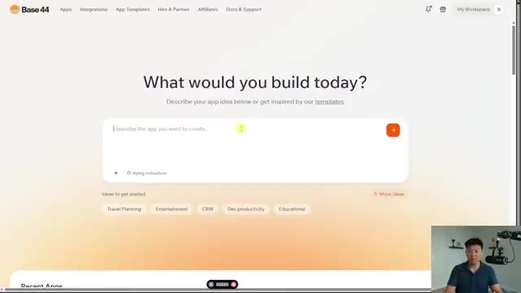
*⏱️ 00:03:24 — Capture d'écran montrant l'interface web de la plateforme Base 44 avec une barre de recherche centrale pour décrire une idée d'application.*

---

### ⏱️ `[00:03:49 - 00:04:15]` | Segment #09

**🔊 Audio (Transcription Intégrale Mot pour Mot en Français) :**
> information. Après qu'ils l'ont soumis, cela devrait simplement les amener sur une page différente qui dit que vos informations ont été reçues, attendez-vous à recevoir votre guide dans votre boîte de réception d'ici trois à cinq minutes. La principale couleur de notre marque est le bleu clair. D'accord, c'est donc mon très, très bref prompt que nous mettons ici. Une astuce que vous pourriez utiliser est de mettre d'abord ceci dans quelque chose comme Claude et de dire, hé, pouvez-vous m'aider à créer un document de spécifications fonctionnelles pour la création d'un site web, et ensuite il vous en donnerait un plus détaillé, mais je vais juste commencer avec celui-ci pour l'instant. Nous allons l'envoyer.

**👁️ Analyse Visuelle d'Écran (gemini-3.5-flash-lite) :**
**Interface & Outils** : Interface web Base 44

**Contenu textuel & Code** : Champ de saisie avec le texte indicatif « Describe the app you want to create... » et des suggestions de thèmes (Travel Planning, Entertainment, CRM, etc.).

**Action / Démonstration** : Le présentateur présente l'interface de génération d'application par IA et s'apprête à y saisir les instructions.

*⏱️ 00:03:56 — Interface web de la plateforme Base 44 affichant une barre de prompt centrale pour la création d'applications, avec une miniature vidéo du présentateur en bas à droite.*

---

### ⏱️ `[00:04:16 - 00:04:46]` | Segment #10

**🔊 Audio (Transcription Intégrale Mot pour Mot en Français) :**
> Et ce qui se passe maintenant, sur le côté droit, vous pouvez voir qu'il est en train de créer notre application. Et c'est donc ici que nous allons voir un aperçu de notre application web. Et sur le côté gauche, nous avons simplement un fil de discussion. Vous pouvez donc voir ici qu'il nous indique ce qu'il est en train de faire. Et c'est là que nous pouvons dialoguer et faire en sorte que notre site web se présente comme nous le souhaitons. Je vais donc revenir vers vous dans une petite seconde quand nous aurons obtenu notre première version du site. Très bien. Nous venons de récupérer notre première version. Nous avons AI Consulting Excellence, AI Automation Society, AI Consulting. Ça fait beaucoup d'IA. Obtenez votre feuille de route gratuite pour l'implémentation de l'IA. D'accord, c'est sympa.

**👁️ Analyse Visuelle d'Écran (gemini-3.5-flash-lite) :**
**Interface & Outils** : Interface web de génération d'application (Bolt.new ou outil similaire) avec incrustation vidéo du présentateur en bas à droite.

**Contenu textuel & Code** : Prompt détaillé demandant une page de capture pour une entreprise d'automatisation IA, avec des champs pour le nom, l'email, et une zone de texte pour les processus métier.

**Action / Démonstration** : L'outil d'IA est en cours de création et de génération de l'application demandée.

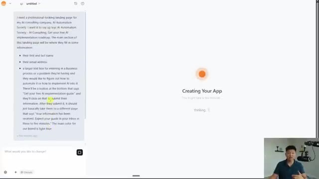
*⏱️ 00:04:23 — Interface d'un générateur d'application affichant un panneau de discussion à gauche avec le prompt de l'utilisateur, et un écran de chargement "Creating Your App" à droite.*

---

### ⏱️ `[00:04:46 - 00:05:06]` | Segment #11

**🔊 Audio (Transcription Intégrale Mot pour Mot en Français) :**
> Vous pouvez voir que l'arrière-plan est un peu comme un dégradé bleu clair et blanc presque. Nous avons une stratégie personnalisée, une livraison rapide, des conseils d'experts. Et puis ici, en bas, vous pouvez voir que nous avons commencez votre parcours en IA aujourd'hui. Prénom, nom, adresse e-mail, et ensuite décrivez le processus commercial. Nous avons également obtenez votre guide de mise en œuvre de l'IA gratuit. Cool. C'est donc un excellent point de départ.

**👁️ Analyse Visuelle d'Écran (gemini-3.5-flash-lite) :**
**Interface & Outils** : Interface web d'un constructeur d'application/site par IA avec panneau latéral d'historique des modifications (Bolt ou outil similaire) et aperçu en direct.

**Contenu textuel & Code** : Texte de la landing page ("AI Automation Society", "Get Your Free AI Implementation Roadmap", "Custom Strategy", "Fast Delivery", "Expert Guidance", "Start Your AI Journey Today") et historique des actions de l'agent dans le panneau de gauche.

**Action / Démonstration** : Navigation et visualisation de la page web générée montrant le rendu final avec un dégradé bleu clair et blanc.

*⏱️ 00:04:51 — Aperçu d'une page web de capture de leads générée pour "AI Automation Society" avec des sections sur la stratégie personnalisée, la livraison rapide et les conseils d'experts.*

---

### ⏱️ `[00:05:06 - 00:05:27]` | Segment #12

**🔊 Audio (Transcription Intégrale Mot pour Mot en Français) :**
> C'est vraiment sympa. C'est très propre, mais on voit clairement que ça a été codé au feeling avec de l'IA. Du coup, on veut modifier quelques-uns de ces éléments pour que ça ait l'air plus professionnel. Donc ce que je vais vous montrer, c'est ce site sympa appelé 21st.dev. Et il y a tout un tas d'éléments de sites web sympas dont on peut pratiquement juste copier le code et le mettre dans notre application sur Base44, et ça fera directement les modifications.

**👁️ Analyse Visuelle d'Écran (gemini-3.5-flash-lite) :**
**Interface & Outils** : Navigateur web, plateforme 21st.dev, application web de génération de landing page.

**Contenu textuel & Code** : Composants d'interface utilisateur (Glass Card, Shader Animation, Visualize Booking) et blocs marketing (Annonces, Appels à l'action, Fonctionnalités).

**Action / Démonstration** : Navigation sur le site 21st.dev pour découvrir des composants d'interface utilisateur professionnels à intégrer.

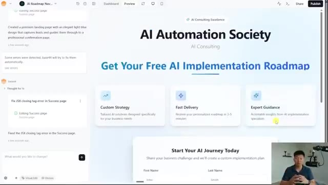
*⏱️ 00:05:11 — Interface web d'un constructeur de landing page montrant l'application "AI Roadmap" avec des options de modification par IA.*

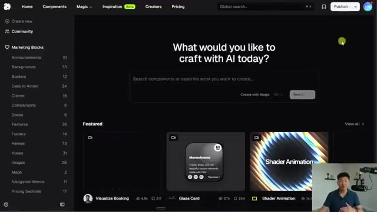
*⏱️ 00:05:17 — Page d'accueil du site 21st.dev présentant une interface sombre avec des composants d'interface utilisateur en vedette.*

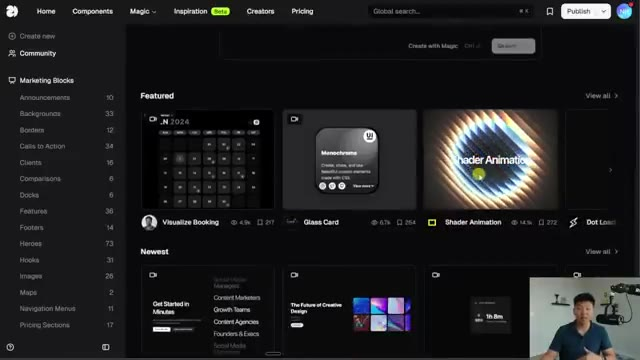
*⏱️ 00:05:22 — Vue détaillée de la galerie de composants UI sur 21st.dev montrant différentes catégories (Marketing Blocks, Featured, Newest).*

---

### ⏱️ `[00:05:28 - 00:06:02]` | Segment #13

**🔊 Audio (Transcription Intégrale Mot pour Mot en Français) :**
> Bon, alors voici une super trouvaille que j'ai faite. Nous avons ces cartes d'affichage où, lorsqu'on les survole, elles ressortent en quelque sorte. Et je me disais que cela rendrait vraiment super bien sous forme de ces trois cartes au lieu qu'elles soient étalées comme ça. Donc tout ce que je vais faire, c'est aller ici et cliquer sur « copier le prompt » en haut à droite. Vous pouvez voir que cela vous permet de choisir votre prompt pour Bolt, Claude, Code, Cursor, Lovable, Replit et v0. Donc nous allons simplement choisir Lovable pour l'instant et nous allons juste copier ce prompt. Maintenant, de retour dans Base44, je vais cliquer sur ce bouton en bas qui s'dit « édition visuelle » et je vais essentiellement sélectionner ces trois conteneurs div, donc ces trois cartes, et je vais simplement dire « applique cet effet au div sélectionné ».

**👁️ Analyse Visuelle d'Écran (gemini-3.5-flash-lite) :**
**Interface & Outils** : Interface web de développement / générateur d'application (type Bolt ou Lovable) avec panneau de prévisualisation et chat latéral.

**Contenu textuel & Code** : Page web "AI Automation Society" avec le titre "Get Your Free AI Implementation Roadmap" et trois cartes interactives de fonctionnalités.

**Action / Démonstration** : Navigation et présentation de la mise en page web avec les trois cartes d'affichage sur la landing page générée par IA.

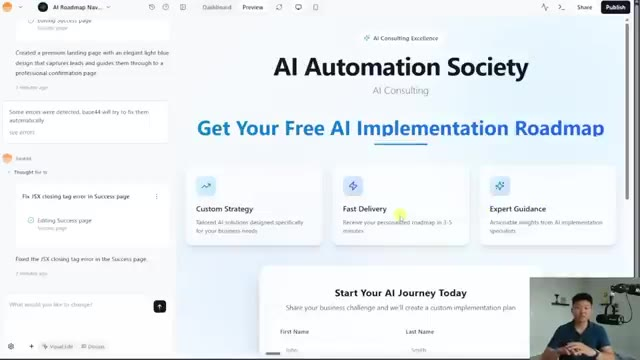
*⏱️ 00:05:36 — Aperçu d'une page web de landing page montrant trois cartes d'affichage interactives (Custom Strategy, Fast Delivery, Expert Guidance) avec un panneau de chat d'assistant IA à gauche.*

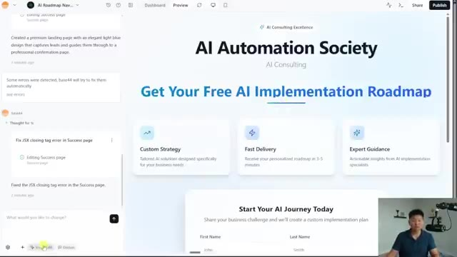
*⏱️ 00:05:53 — Aperçu similaire à l'image 1 montrant la landing page avec trois cartes d'affichage interactives et l'interface de développement web.*

---

### ⏱️ `[00:06:02 - 00:06:36]` | Segment #14

**🔊 Audio (Transcription Intégrale Mot pour Mot en Français) :**
> des trois cartes. D'accord. Donc vous pouvez voir que j'ai collé ce code provenant de 21st.dev et maintenant Base 44 va simplement réfléchir à la manière de le faire. Il va exécuter ce code. Et ensuite, nous devrions voir dans cette section d'aperçu que nous avons intégré cela. Je reviendrai donc vers vous lorsque ce sera fait. D'accord. Nous venons d'obtenir cette modification, mais vous pouvez voir qu'il y a comme une carte en double devant chacune d'elles. Je vais donc simplement lui demander de l'enlever. Et voilà. J'ai littéralement dit qu'il y a une carte vide bizarre devant les cartes de prestations. Veuillez supprimer cela. Et maintenant, nous avons ces trois-là qui apparaissent. Ça a l'air vraiment bien. Nous pourrions juste vouloir ajouter un peu d'espacement ici après

**👁️ Analyse Visuelle d'Écran (gemini-3.5-flash-lite) :**
**Interface & Outils** : Interface web de développement (Base 44 / environnement de code et aperçu) avec incrustation vidéo du présentateur en bas à droite.

**Contenu textuel & Code** : Panneau de chat IA affichant les étapes : 'Add stacked card effect to benefit cards', 'Editing display-cards component', et code source partiel.

**Action / Démonstration** : L'agent IA analyse et intègre le code source provenant de 21st.dev pour l'appliquer aux cartes de la page web.

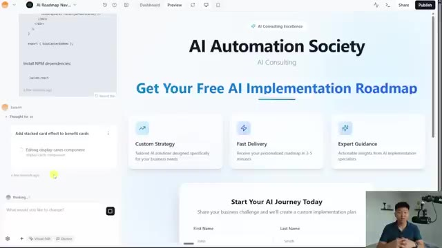
*⏱️ 00:06:10 — Interface de développement web montrant un panneau latéral avec le processus de réflexion de l'IA (Base 44) et un aperçu de la page web 'AI Automation Society' intégrant trois cartes de bénéfices.*

---

### ⏱️ `[00:06:36 - 00:07:11]` | Segment #15

**🔊 Audio (Transcription Intégrale Mot pour Mot en Français) :**
> ces cartes et avant que la zone de texte ne commence. Très bien, super. Donc je viens de dire, veuillez ajouter un peu d'espace entre les cartes de bénéfices et les zones de texte. Et vous pouvez voir que cela a ajouté de l'espace et que cela a quand même gardé cet effet. Donc ça a l'air vraiment bien. Donc ce que vous remarquerez, c'est que ce ne sera jamais parfait. Peu importe lequel de ces assistants de codage IA vous utilisez, ce ne sera jamais parfait. Vous devez juste comprendre comment travailler avec pour faire des allers-retours un petit peu. Et maintenant vous pouvez voir qu'en l'espace de deux minutes, j'ai cet effet sympa sur mon site web. Très bien. Donc maintenant j'ai trouvé cette petite animation qui peut aller derrière notre texte principal. Donc je vais juste copier ce prompt une fois de plus, et je vais aller dans Base 44. Et je veux probablement que cette animation soit en haut

**👁️ Analyse Visuelle d'Écran (gemini-3.5-flash-lite) :**
**Interface & Outils** : Interface web d'édition de page (type constructeur visuel propulsé par l'IA)

**Contenu textuel & Code** : Historique de chat avec le prompt 'Please add some space between the benefit cards and the text boxes...' et le panneau d'aperçu de landing page.

**Action / Démonstration** : Modification de l'espacement entre les cartes de bénéfices et le formulaire suite à une instruction textuelle dans l'agent IA.

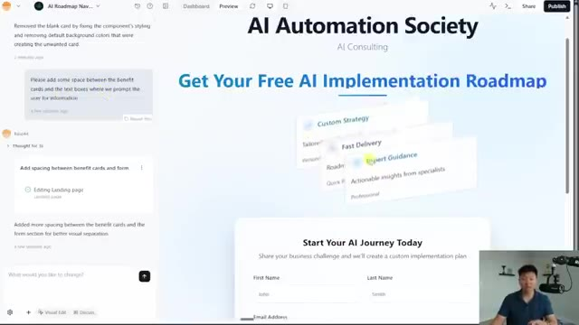
*⏱️ 00:06:45 — Interface web d'un constructeur de landing page avec un panneau de chat IA à gauche et l'aperçu de la page au centre, montrant les cartes de bénéfices et le formulaire.*

---

### ⏱️ `[00:07:11 - 00:07:44]` | Segment #16

**🔊 Audio (Transcription Intégrale Mot pour Mot en Français) :**
> près du sommet. Et généralement, ils appellent ça le texte principal. Donc ce que je vais faire, c'est simplement lui dire d'ajouter cet effet derrière le texte principal. D'accord. Donc, il applique ces accents en ce moment. Voyons voir ce que ça donne. D'accord, super. Donc c'est fait, et vous pouvez voir qu'maintenant on a cette petite chose en haut, même si je n'aime pas la façon dont ça s'arrête brusquement ici. Donc je vais lui demander de tout fondre à nouveau ensemble, et c'est probablement parce que j'ai spécifié le texte principal, mais une chose que vous remarquerez, c'est que les couleurs sont toujours cohérentes avec le reste de notre page. Très bien, voilà, ça a pratiquement fondu tout ça dans l'ensemble de l'arrière-plan, et je trouve que c'est beaucoup mieux que ce que

**👁️ Analyse Visuelle d'Écran (gemini-3.5-flash-lite) :**
**Interface & Outils** : Interface web d'un outil de développement assisté par IA avec prévisualisation.

**Contenu textuel & Code** : Prompt utilisateur : « Add geometric shape effect behind hero text » et étapes d'édition en cours.

**Action / Démonstration** : L'agent IA applique les modifications demandées sur les composants de la page d'atterrissage.

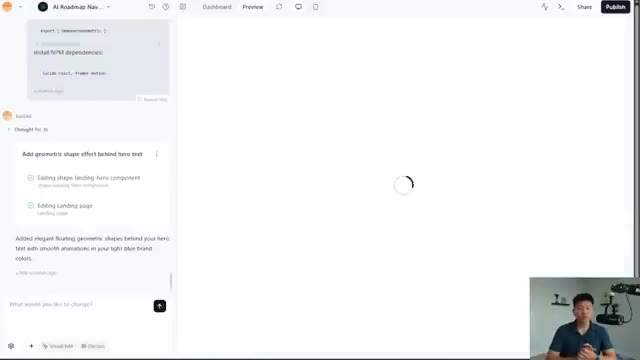
*⏱️ 00:07:19 — Interface d'une application web montrant un panneau latéral avec un prompt et des étapes d'édition, tandis que le panneau principal est en cours de chargement.*

---

### ⏱️ `[00:07:44 - 00:08:19]` | Segment #17

**🔊 Audio (Transcription Intégrale Mot pour Mot en Français) :**
> précédemment c'était nous avons notre effet ici nous avons notre arrière-plan qui, lorsque vous chargez essentiellement la page, c'est là qu'il a en quelque sorte cette animation où il tombe et flotte vers le bas donc je pense qu'on pourrait arguer que peut-être j'exagère un peu avec 21st.dev le fait est que je veux vous montrer à quelle vitesse vous pouvez créer ces pages de destination et ajouter des effets vraiment personnalisés pour que ça n'ait pas l'air d'être juste un site web créé par IA et bien sûr vous pouvez aussi faire des changements sans même utiliser le chat IA donc disons que vous vouliez changer la police de ce texte ici je pourrais le sélectionner et je pourrais simplement venir ici et choisir de changer la police ici même

**👁️ Analyse Visuelle d'Écran (gemini-3.5-flash-lite) :**
**Interface & Outils** : Interface web de génération de landing page avec panneau de discussion latéral et prévisualisation en temps réel.

**Contenu textuel & Code** : Texte du prompt dans le chat : 'Make that effect blend into the whole background. I don't like how the effect ends very abruptly.' et historique des modifications apportées aux composants de la page.

**Action / Démonstration** : Visualisation et démonstration du rendu de la landing page et de l'effet d'animation de l'arrière-plan.

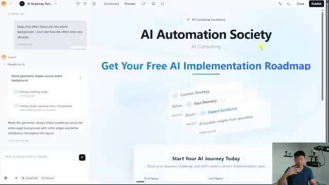
*⏱️ 00:07:53 — Capture d'écran montrant l'interface d'une application web de création de landing page avec un panneau de chat latéral à gauche et le rendu visuel de la page au centre, affichant le titre 'AI Automation Society' et des animations d'arrière-plan.*

---

### ⏱️ `[00:08:19 - 00:08:40]` | Segment #18

**🔊 Audio (Transcription Intégrale Mot pour Mot en Français) :**
> Nous avons toutes ces options différentes. Je pourrais le souligner si je le voulais, je pourrais le barrer, je pourrais aussi changer la couleur. Donc, au lieu de ce gris, je pourrais le mettre en blanc, mais ça a l'air horrible parce qu'ensuite on ne peut pas le voir. Mais bref, l'important, c'est que vous pouvez utiliser cette modification visuelle et vous pouvez sélectionner exactement ce que vous voulez changer. Très bien. Donc, la dernière chose que je vais ajouter, c'est ce petit truc de bordure où l'on peut voir que lorsque ma souris est près de la bordure, elle va en quelque sorte avoir cette petite lumière.

**👁️ Analyse Visuelle d'Écran (gemini-3.5-flash-lite) :**
**Interface & Outils** : Navigateur web (éditeur visuel de page et site de composants UI Aceternity UI)

**Contenu textuel & Code** : Panneau de configuration des couleurs de texte avec palettes et code React/TypeScript pour des composants d'interface.
[DESC_IMAGE_1] Modification des options de style et de couleur de texte dans l'éditeur visuel.

**Action / Démonstration** : Explications face caméra et démonstration conceptuelle.

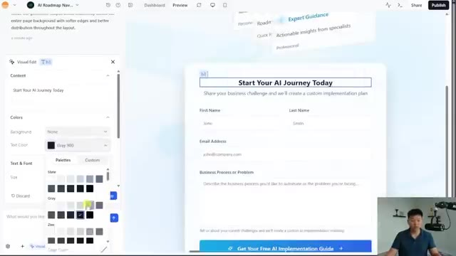
*⏱️ 00:08:24 — Interface d'édition de page web avec un panneau de personnalisation des couleurs de texte ouvert à gauche.*

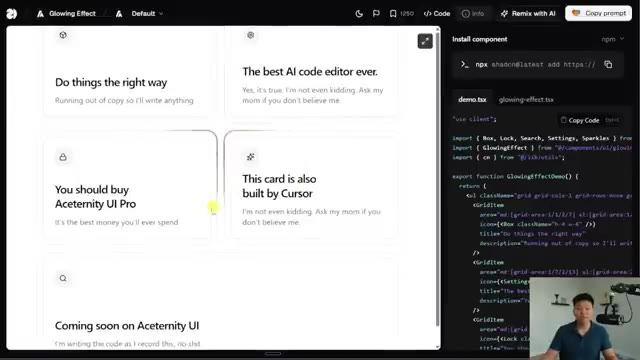
*⏱️ 00:08:35 — Interface d'un site de composants UI (Aceternity UI) affichant des cartes interactives et du code source à droite.*

---

### ⏱️ `[00:08:40 - 00:09:13]` | Segment #19

**🔊 Audio (Transcription Intégrale Mot pour Mot en Français) :**
> Ce que vous pouvez voir ici dans l'exemple, c'est arc-en-ciel. Et je suis curieux de voir si, en ajoutant une bordure autour de ce conteneur div ici, cela va le rendre arc-en-ciel ou si cela va le rendre bleu pour correspondre au thème de notre site actuel. J'ai donc cliqué sur édition visuelle. Je vais sélectionner ce conteneur et simplement dire d'ajouter cet effet au div sélectionné. D'accord, il vient donc d'apporter ces modifications. Voyons voir. Nous avons donc cet effet lumineux, mais il est vraiment très net. Je pense donc qu'il l'a pris un peu trop au pied de la lettre lorsque j'ai sélectionné ce conteneur. Très bien, parfait. Donc maintenant, vous pouvez voir que c'est une lueur bleue beaucoup plus douce, avec laquelle il a bien fait la couleur bleue, mais maintenant elle est réellement appliquée à la carte.

**👁️ Analyse Visuelle d'Écran (gemini-3.5-flash-lite) :**
**Interface & Outils** : Interface web d'application de création de pages et d'assistant IA.

**Contenu textuel & Code** : Interface utilisateur avec des blocs de formulaire ("Start Your AI Journey Today"), un panneau latéral de chat avec des instructions et des modifications de code en cours.

**Action / Démonstration** : Utilisation de l'outil d'édition visuelle et du panneau de discussion pour modifier l'apparence des composants de la page.

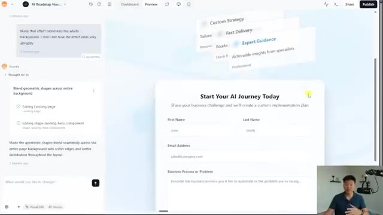
*⏱️ 00:08:49 — Interface web d'un constructeur de page avec un panneau de chat à gauche et un aperçu visuel interactif au centre montrant un formulaire et des éléments graphiques.*

---

### ⏱️ `[00:09:13 - 00:09:32]` | Segment #20

**🔊 Audio (Transcription Intégrale Mot pour Mot en Français) :**
> Et ce qui s'est passé, c'est que j'ai pratiquement dit d'appliquer l'effet, puis j'ai dit que c'était trop prononcé et ensuite c'est revenu et c'était trop léger. J'ai donc dit que maintenant je peux à peine le voir, et en plus ne souligne pas le fait que j'ai utilisé le mauvais effet ici, super embarrassant. Mais bref, tout cela a été monté en environ 10 minutes de travail et nous avons ajouté quelques animations et effets personnalisés plutôt sympas. Je ne dis pas que je suis un maître du design.

**👁️ Analyse Visuelle d'Écran (gemini-3.5-flash-lite) :**
**Interface & Outils** : Interface web de développement de landing page avec panneau d'assistant IA intégré.

**Contenu textuel & Code** : Texte de l'interface : "AI Automation Society - AI Consulting", "Get Your Free AI Implementation Roadmap", et instructions de l'agent "Soften glowing effect and apply to card border".

**Action / Démonstration** : L'utilisateur visualise le résultat de l'application des modifications d'effet lumineux sur la page web générée.

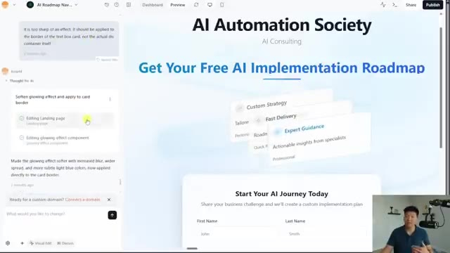
*⏱️ 00:09:18 — Aperçu d'une landing page "AI Automation Society" avec un panneau de chat d'assistant IA sur la gauche montrant les instructions de modification des effets lumineux.*

---

### ⏱️ `[00:09:32 - 00:09:50]` | Segment #21

**🔊 Audio (Transcription Intégrale Mot pour Mot en Français) :**
> Il y a beaucoup de choses ici que je voudrais changer. Mais encore une fois, le point, c'est que ça a été 10 minutes de travail. Disons maintenant que nous sommes un prospect et que nous remplissons ces informations, d'accord ? Nous avons le nom, nous avons l'adresse e-mail, et ensuite le problème. Et ce qu'ils vont faire, c'est qu'ils vont cliquer sur Obtenez votre guide gratuit d'implémentation de l'IA. Cela ouvre maintenant l'écran qui indique que vos informations ont été reçues. Attendez-vous à recevoir votre guide dans votre boîte de réception dans trois à cinq minutes.

**👁️ Analyse Visuelle d'Écran (gemini-3.5-flash-lite) :**
**Interface & Outils** : Interface web de génération d'application (type Bolt ou similaire) avec panneau latéral de chat IA.

**Contenu textuel & Code** : Formulaire web avec les champs 'First Name' (John), 'Last Name' (Smith), 'Email Address' (john@example.com) et un champ 'Business Process or Problem' décrivant un cas d'usage d'automatisation d'e-mails.

**Action / Démonstration** : Visualisation du formulaire généré par l'IA et rempli avec des données de test par le présentateur.

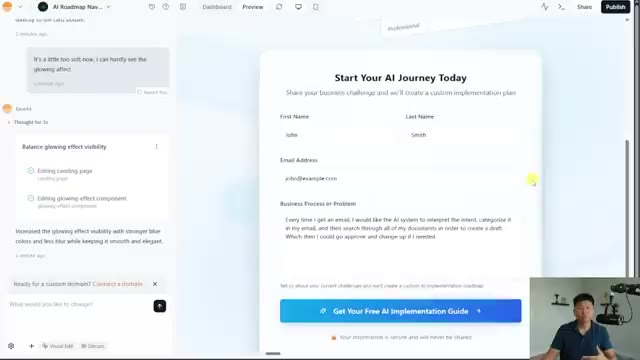
*⏱️ 00:09:36 — Interface web d'un constructeur d'application avec un formulaire de contact pré-rempli pour un prospect et un panneau latéral de l'assistant IA.*

---

### ⏱️ `[00:09:51 - 00:10:27]` | Segment #22

**🔊 Audio (Transcription Intégrale Mot pour Mot en Français) :**
> Il est écrit que nos spécialistes en IA vont examiner, nous allons créer une feuille de route personnalisée et vous la recevrez par e-mail. Et ensuite, vous pouvez également cliquer pour retourner à la page d'accueil. Mais le problème, c'est que lorsque nous avons simplement soumis ces informations, elles ne sont en fait aller nulle part. Nous devons donc donner à Base44 notre webhook n8n et ensuite notre flux de travail n8n peut réellement recevoir ces informations. Passons donc très rapidement à un nouveau flux de travail dans n8n. Vous pouvez voir que nous n'avons rien ici. Ce que nous allons faire, c'est ajouter un webhook, qui va démarrer le flux de travail. Un webhook est fondamentalement juste une oreille qui écoute toujours activement. Et donc chaque fois qu'un son arrive, il le saisit simplement et ensuite il peut faire quelque chose avec. Donc ce que nous avons

**👁️ Analyse Visuelle d'Écran (gemini-3.5-flash-lite) :**
**Interface & Outils** : Interface web de création d'application et tableau de bord d'automatisation n8n.

**Contenu textuel & Code** : Formulaire web de capture de leads et paramètres de configuration de webhook n8n (méthode GET, URL de test).

**Action / Démonstration** : Présentation de la soumission de données de formulaire connectée à un flux d'automatisation n8n.

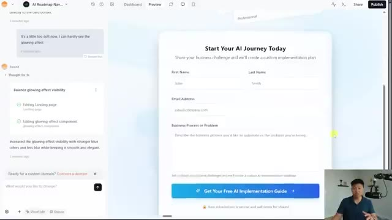
*⏱️ 00:10:00 — Aperçu d'une interface de génération d'application montrant un formulaire "Start Your AI Journey Today" avec les champs Nom, Prénom, Email et description de processus.*

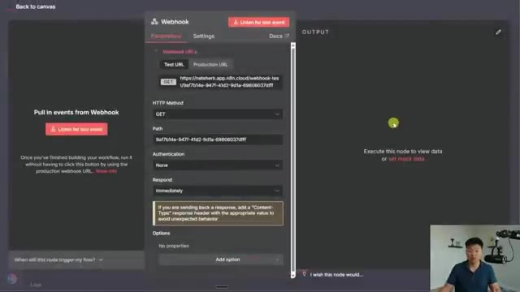
*⏱️ 00:10:18 — Interface de configuration d'un nœud Webhook dans l'outil d'automatisation n8n, affichant l'URL du webhook de test et les paramètres HTTP.*

---

### ⏱️ `[00:10:27 - 00:10:55]` | Segment #23

**🔊 Audio (Transcription Intégrale Mot pour Mot en Français) :**
> dans notre webhook, il y a une URL de test. Nous allons récupérer cette URL de test. Et en fait, avant de la récupérer, je vais simplement changer la méthode pour post. Je ne vais pas entrer dans les détails du pourquoi nous faisons cela pour l'instant. Essentiellement, c'est pour que Base 44 puisse publier ou envoyer des données à ce webhook. C'est donc une méthode post. Je vais cliquer dessus pour la copier. Et maintenant, de retour dans Base 44, j'ai juste besoin de dire que lorsqu'un utilisateur clique sur le bouton « Obtenez votre guide d'implémentation IA gratuit », envoyez les données à ce webhook sous forme de requête post.

**👁️ Analyse Visuelle d'Écran (gemini-3.5-flash-lite) :**
**Interface & Outils** : n8n (workflow automation), plateforme de développement web assistée par IA (Base 44)

**Contenu textuel & Code** : URL de webhook n8n, paramètres de configuration HTTP Method (POST), formulaire web avec champs First Name, Email Address et Business Process.

**Action / Démonstration** : Modification de la méthode HTTP du webhook à POST dans n8n et navigation vers l'interface de l'application générée.

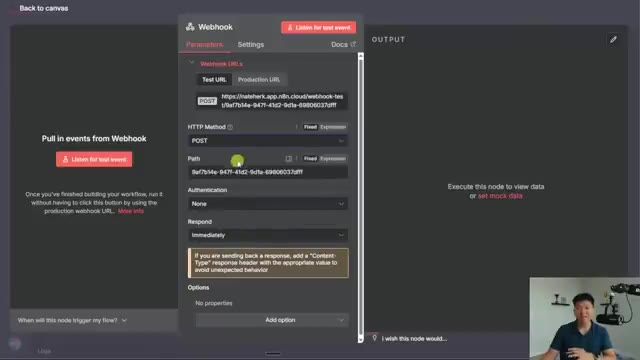
*⏱️ 00:10:34 — Configuration d'un nœud Webhook dans n8n montrant l'URL de test et le paramétrage de la méthode HTTP sur POST.*

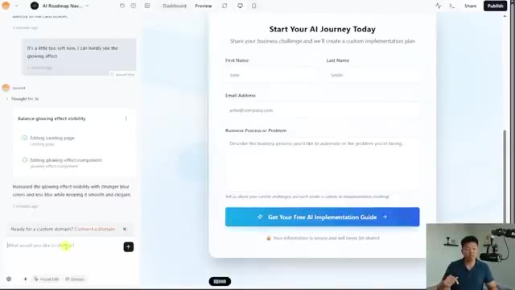
*⏱️ 00:10:48 — Interface d'un générateur d'application web (type Base 44) avec un formulaire d'inscription « Start Your AI Journey Today » et un panneau de chat IA à gauche.*

---

### ⏱️ `[00:10:55 - 00:11:18]` | Segment #24

**🔊 Audio (Transcription Intégrale Mot pour Mot en Français) :**
> Et donc maintenant, je vais coller mon webhook. Et ensuite, je vais ajouter une chose de plus. Envoyez les quatre champs suivants dans le corps de la requête POST : prénom, nom, adresse e-mail et prompt. D'accord, donc nous allons lancer ça. Et fondamentalement, ce que ça va faire, c'est que ça va modifier le code pour que, lorsque quelqu'un clique sur ce bouton, nous récupérions toutes ces données que l'utilisateur saisit dans notre flux de travail NNN.

**👁️ Analyse Visuelle d'Écran (gemini-3.5-flash-lite) :**
**Interface & Outils** : Interface web d'un constructeur de landing page assisté par IA.

**Contenu textuel & Code** : URL de webhook Make/n8n configurée pour recevoir une requête POST lors du clic sur le bouton d'action du formulaire.

**Action / Démonstration** : Configuration et collage de l'URL du webhook dans le panneau latéral pour lier le formulaire aux automatisations.

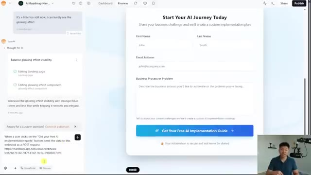
*⏱️ 00:11:01 — Aperçu d'une page de capture de formulaires avec les champs prénom, nom, e-mail et description d'un problème métier, ainsi qu'un panneau latéral de configuration de l'IA contenant l'URL d'un webhook en bas à gauche.*

---

### ⏱️ `[00:11:19 - 00:11:46]` | Segment #25

**🔊 Audio (Transcription Intégrale Mot pour Mot en Français) :**
> Et c'est là qu'on peut configurer un agent en arrière-plan pour créer ce guide d'implémentation de l'IA. D'accord, donc il prétend qu'il l'a fait. Je vais aller dans NNN et on va juste rapidement cliquer sur exécuter le flux de travail, ce qui signifie que ce webhook est maintenant à l'écoute. Quand vous en faites un flux de travail actif, il sera toujours à l'écoute. Mais pour l'instant, nous sommes juste en mode test. Je dois donc le mettre à l'écoute manuellement. Mais vous pouvez voir qu'il est écrit en attente de l'appel de l'URL de test. Donc si je retourne ici et que je clique sur ce bouton, cela devrait envoyer les données à NNN parce qu'on l'a configuré pour le faire.

**👁️ Analyse Visuelle d'Écran (gemini-3.5-flash-lite) :**
**Interface & Outils** : Interface de création d'application web et plateforme d'automatisation de workflows (n8n).

**Contenu textuel & Code** : Formulaire web de soumission ("Start Your AI Journey Today") et nœud webhook n8n en attente de test.

**Action / Démonstration** : Configuration et préparation du webhook n8n pour recevoir les données du formulaire web.

*⏱️ 00:11:26 — Aperçu d'une application web en cours de création avec un formulaire permettant de soumettre un projet pour générer un guide d'implémentation de l'IA.*

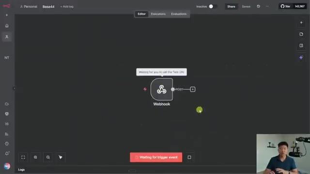
*⏱️ 00:11:32 — Interface du workflow n8n montrant un nœud Webhook en attente d'un événement déclencheur ("Waiting for trigger event").*

---

### ⏱️ `[00:11:47 - 00:12:19]` | Segment #26

**🔊 Audio (Transcription Intégrale Mot pour Mot en Français) :**
> Et si nous retournons dans n8n, nous pouvons voir maintenant que nous avons bien capturé ces données. C'est donc parfait. Nous savons que ça fonctionne. Et maintenant, nous pouvons voir que nous avons le prénom, le nom, l'e-mail, et nous avons le prompt, qui est ce que j'ai saisi. C'est donc le problème que l'utilisateur rencontre. Et c'est ce que nous devons utiliser pour lui donner sa feuille de route. Donc la suite, très rapidement, je vais épingler ces données pour ne pas avoir à continuer d'envoyer des données de Base44 à n8n. Nous pouvons simplement les manipuler ici. Et je vais créer deux agents IA distincts. Le premier va prendre ce prompt entrant, qui est très minimal, et va créer une feuille de route complète d'implémentation par IA. Et ensuite, le deuxième va styliser

**👁️ Analyse Visuelle d'Écran (gemini-3.5-flash-lite) :**
**Interface & Outils** : n8n (Interface de création de workflows automatisés)

**Contenu textuel & Code** : Données JSON affichant : first_name ("John"), last_name ("Smith"), email ("john@example.com"), et prompt.

**Action / Démonstration** : Vérification et analyse des données JSON reçues par le webhook dans n8n.

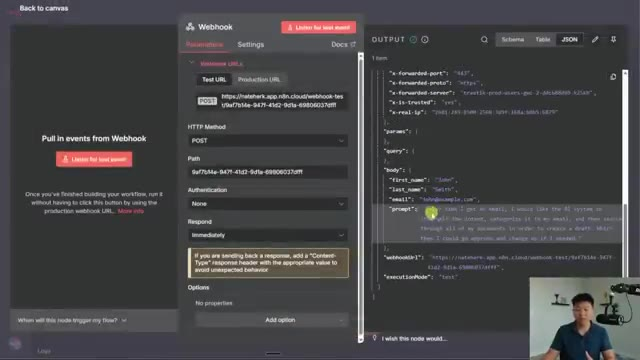
*⏱️ 00:11:55 — Vue rapprochée de l'interface n8n montrant les paramètres du nœud Webhook et le panneau de sortie JSON avec les données capturées (prénom, nom, e-mail et prompt).*

---

### ⏱️ `[00:12:19 - 00:12:55]` | Segment #27

**🔊 Audio (Transcription Intégrale Mot pour Mot en Français) :**
> le mettre en HTML et le leur envoyer par e-mail. Donc le premier que nous allons faire est un agent IA. Ça va être notre consultant IA. Nous devons lui donner accès à un cerveau, donc un modèle de chat. Je vais donc cliquer sur le bouton du modèle de chat, et je vais aller chercher un modèle de chat OpenRouter. Maintenant, si vous n'avez jamais utilisé OpenRouter auparavant, vous avez juste besoin d'aller sur OpenRouter.ai, de créer un compte. En haut à droite, vous irez dans les clés, puis vous créerez simplement une clé API. Cela vous donnera cette longue chaîne de chiffres et de lettres. Et tout ce que vous avez à faire est de créer de nouveaux identifiants et de les insérer là. Et maintenant, vous aurez accès à des tonnes et des tonnes de modèles de chat IA différents. Assurez-vous simplement d'avoir des informations de facturation dans votre compte OpenRouter. Et ce que je vais

**👁️ Analyse Visuelle d'Écran (gemini-3.5-flash-lite) :**
**Interface & Outils** : Interface de création de workflows d'IA et site web OpenRouter.

**Contenu textuel & Code** : Nœuds de workflow (Webhook, AI Agent) et interface OpenRouter avec modèles LLM et configuration de clé API.
[DEC_IMAGE_3] Configuration du modèle de chat pour l'agent IA via OpenRouter.

**Action / Démonstration** : Sélection et configuration d'un modèle de chat pour connecter l'agent IA à une source de LLM.

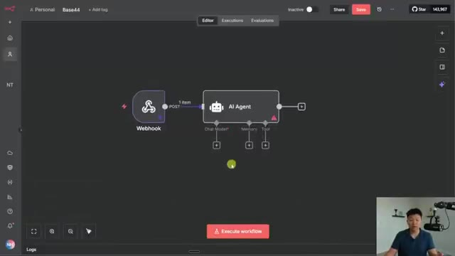
*⏱️ 00:12:28 — Vue d'ensemble du workflow sur la plateforme montrant un nœud Webhook relié à un agent IA (AI Agent) possédant des connecteurs pour le modèle de chat, la mémoire et les outils.*

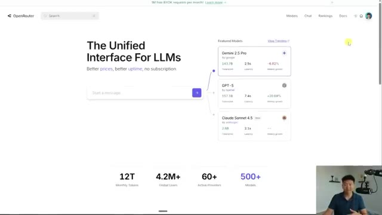
*⏱️ 00:12:37 — Interface de la plateforme OpenRouter affichant la présentation "The Unified Interface For LLMs" avec divers modèles en vedette comme Gemini 2.5 Pro et GPT-5.*

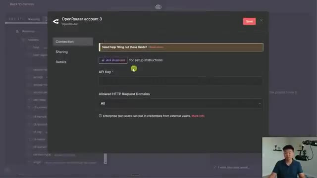
*⏱️ 00:12:46 — Fenêtre de configuration de compte OpenRouter (OpenRouter account 3) affichant les champs de configuration de connexion, notamment le champ pour la clé API.*

---

### ⏱️ `[00:12:55 - 00:13:28]` | Segment #28

**🔊 Audio (Transcription Intégrale Mot pour Mot en Français) :**
> pour notre consultant IA, c'est que je vais utiliser OpenAI o3 parce que c'est un modèle de raisonnement et ça va être bien pour nous d'avoir beaucoup de raisonnement qui traverse cet assistant IA. Je vais aussi l'ouvrir et nous allons configurer quelques éléments. Le premier, c'est que voulons-nous que l'agent lise ? Et ce que nous voulons qu'il lise, c'est dans le corps de la requête, nous voulons qu'il lise le prompt. C'est donc tout ce que l'utilisateur a tapé dans cette grande zone de texte juste ici. Nous avons donc pu glisser de la gauche vers la droite le prompt, et maintenant l'agent IA regarde ça. La prochaine chose que nous devons faire, c'est lui donner un prompt système, ce qui lui donne fondamentalement ses instructions. Et je vais simplement coller ceci

**👁️ Analyse Visuelle d'Écran (gemini-3.5-flash-lite) :**
**Interface & Outils** : Interface web de construction de workflows (type n8n ou plateforme similaire d'automatisation IA).

**Contenu textuel & Code** : Workflow composé d'un Webhook, d'un composant "AI Agent" et d'un bloc de modèle de raisonnement "o3".

**Action / Démonstration** : Configuration du workflow d'automatisation avec l'intégration du modèle de raisonnement o3 pour l'agent IA.

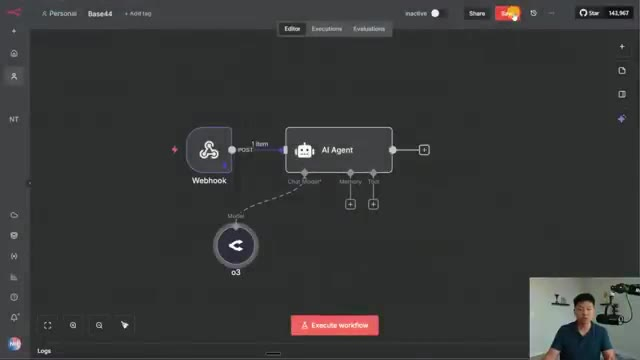
*⏱️ 00:13:03 — Interface d'un créateur de workflow montrant un nœud Webhook connecté à un nœud AI Agent, lui-même relié à un modèle o3.*

---

### ⏱️ `[00:13:28 - 00:13:58]` | Segment #29

**🔊 Audio (Transcription Intégrale Mot pour Mot en Français) :**
> prompt système, qui lui indique essentiellement qu'il est un consultant expert, comment réfléchir à ce qu'il doit faire, ce qu'il doit décomposer, les inefficacités, concevoir la feuille de route, formuler clairement le retour sur investissement, tout ce genre de choses. Et puis à la fin, il doit dire, conclure en disant, si vous souhaitez passer à l'étape suivante, réservez un appel de découverte avec moi ici. Et ensuite, il va réellement joindre ce lien d'appel de découverte dans l'e-mail complet. Et si vous voulez pouvoir copier ce prompt, il sera dans ma communauté School gratuite, comme je l'ai dit, avec toutes les autres ressources dont vous avez besoin pour suivre cette construction. Donc maintenant, ce que je vais faire, c'est que je vais aller cliquer sur exécuter l'étape, ce qui fait tourner l'agent.

**👁️ Analyse Visuelle d'Écran (gemini-3.5-flash-lite) :**
**Interface & Outils** : n8n (éditeur de workflow d'automatisation)

**Contenu textuel & Code** : Prompt système détaillé définissant le rôle d'un consultant expert en automatisation IA, incluant les responsabilités : comprendre le processus, identifier les inefficacités, concevoir une feuille de route, formuler clairement le ROI et fournir des résultats pratiques.

**Action / Démonstration** : Visualisation et configuration d'un prompt système d'agent IA au sein du panneau d'expression de n8n.

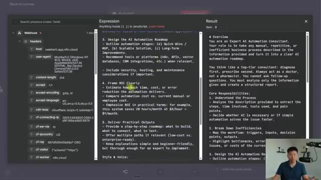
*⏱️ 00:13:36 — Interface d'un éditeur de workflow de type n8n affichant un panneau de configuration de nœud avec l'éditeur d'expression contenant un prompt système détaillé pour un consultant expert en automatisation IA.*

---

### ⏱️ `[00:13:58 - 00:14:17]` | Segment #30

**🔊 Audio (Transcription Intégrale Mot pour Mot en Français) :**
> Donc l'agent a maintenant lu la requête du webhook. Il utilise maintenant O3 et il va nous renvoyer quelques informations. Et ce sera un guide d'implémentation complet. Très bien. Donc ça vient juste de se terminer. Laissez-moi cliquer dessus et m'assurer que nous avons bien nos guides. Nous avons le diagnostic du problème et vous pouvez voir que c'est assez long et ça se termine par notre appel de découverte.

**👁️ Analyse Visuelle d'Écran (gemini-3.5-flash-lite) :**
**Interface & Outils** : n8n (éditeur de workflow d'automatisation IA)

**Contenu textuel & Code** : Nœuds de workflow connectés (Webhook, AI Agent, o3) et configuration des prompts du système.
[DESC_IMAGE_1 ACTION] Exécution en cours du workflow d'automatisation.
[DESC_IMAGE_2 ACTION] Visualisation et vérification des résultats générés par l'agent IA dans le panneau de sortie.

**Action / Démonstration** : Explications face caméra et démonstration conceptuelle.

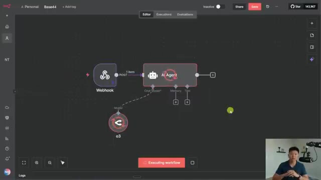
*⏱️ 00:14:03 — Vue d'ensemble du workflow sur n8n montrant un nœud Webhook connecté à un Agent IA et un modèle o3 en cours d'exécution.*

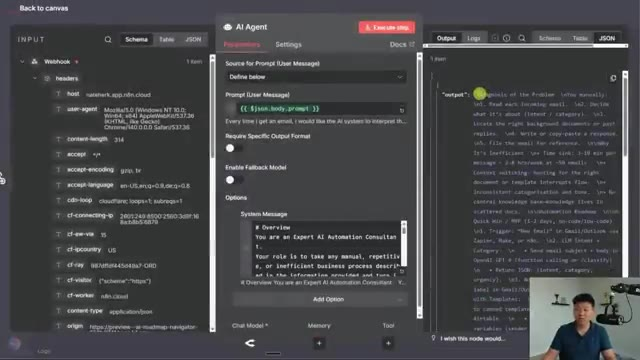
*⏱️ 00:14:13 — Interface détaillée de configuration du nœud 'AI Agent' avec les paramètres du prompt et le panneau de sortie affichant le résultat JSON.*

---

### ⏱️ `[00:14:17 - 00:14:53]` | Segment #31

**🔊 Audio (Transcription Intégrale Mot pour Mot en Français) :**
> Donc c'est parfait. Je vais épingler ces données pour que nous n'ayons pas à relancer cet agent. Et nous allons créer le suivant, qui va le mettre en forme en HTML. Donc encore une fois, nous allons ajouter un agent IA, nous allons lui faire lire le diagnostic. Je vais donc changer ceci pour « définir ci-dessous », et nous allons glisser la sortie du premier agent juste ici. C'est ce que l'agent styliste va lire. Je dois ensuite fournir à l'agent styliste un guide de style sur la façon d'écrire du HTML. Je vais donc le coller ici. Comme vous pouvez le voir, si vous voulez y accéder, ce sera dans ma communauté School gratuite avec toutes les autres ressources. Et ensuite, ce que je veux faire, c'est donner à cet agent un modèle de chat différent. Je vais donc utiliser une fois de plus OpenRouter,

**👁️ Analyse Visuelle d'Écran (gemini-3.5-flash-lite) :**
**Interface & Outils** : Interface n8n (outil d'automatisation de workflows low-code).

**Contenu textuel & Code** : Expression de données `{{ $json.output }}` dans le champ du prompt utilisateur de l'agent IA, ainsi que le texte du diagnostic du problème.

**Action / Démonstration** : Configuration des paramètres de l'agent IA pour qu'il lise les données du diagnostic et formate le résultat en HTML.

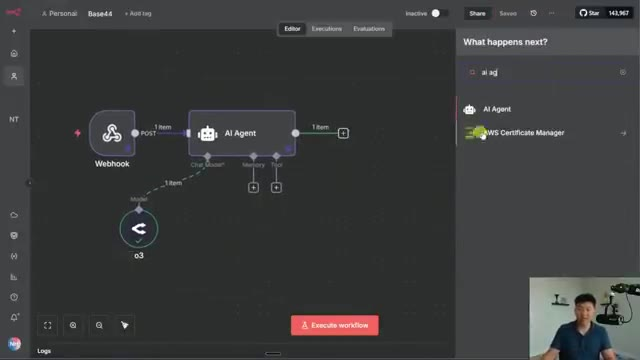
*⏱️ 00:14:26 — Vue d'ensemble du workflow sur n8n montrant un nœud Webhook relié à un nœud « AI Agent » connecté lui-même à un modèle « o3 ».*

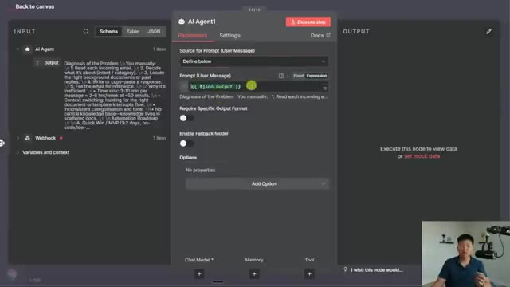
*⏱️ 00:14:35 — Panneau de configuration du nœud « AI Agent1 » dans n8n, affichant le champ de prompt utilisateur avec une expression JSON.*

---

### ⏱️ `[00:14:53 - 00:15:22]` | Segment #32

**🔊 Audio (Transcription Intégrale Mot pour Mot en Français) :**
> mais au lieu d'utiliser O3, je vais prendre un modèle Sonnet. Nous allons opter pour le nouveau modèle Sonnet 4.5 parce que j'aime vraiment la façon dont il écrit et il va être bon pour générer du HTML. Je vais donc cliquer sur lecture au-dessus de l'agent. Il va donc commencer à s'exécuter. Il examine actuellement la sortie de l'agent consultant et il va la transformer en style HTML pour nous. Et donc une autre chose que je voulais souligner, ce flux ne nous oblige à renvoyer aucune donnée à base 44. Si vous vouliez le faire, ce serait super simple.

**👁️ Analyse Visuelle d'Écran (gemini-3.5-flash-lite) :**
**Interface & Outils** : Interface graphique de création de workflows d'agents IA (type n8n ou plateforme similaire de construction de graphes d'IA).

**Contenu textuel & Code** : Paramètres de configuration du nœud OpenRouter Chat Model spécifiant le modèle "anthropic/claude-sonnet-4.5" et architecture de workflow en nœuds.

**Action / Démonstration** : Sélection et configuration du modèle Claude Sonnet 4.5 pour remplacer o3, puis lancement de l'exécution du workflow.

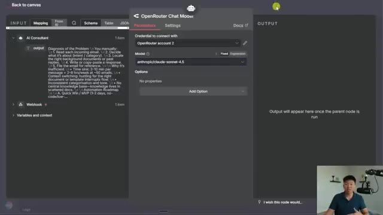
*⏱️ 00:15:00 — Configuration du modèle OpenRouter Chat Model avec sélection du modèle anthropic/claude-sonnet-4.5.*

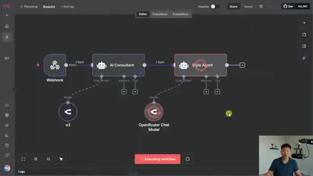
*⏱️ 00:15:07 — Vue globale du workflow avec les nœuds Webhook, AI Consultant (relié au modèle o3) et Style Agent (relié à OpenRouter Chat Model avec Sonnet 4.5) en cours d'exécution.*

---

### ⏱️ `[00:15:22 - 00:15:50]` | Segment #33

**🔊 Audio (Transcription Intégrale Mot pour Mot en Français) :**
> vous viendriez dans votre webhook, vous feriez essentiellement ici, c'est un peu grisé mais il est écrit répondre immédiatement, au lieu d'immédiatement vous changeriez pour dire répondre en utilisant le nœud webhook ou en utilisant le nœud répondre au webhook et cela signifie que nous pourrions faire en sorte que Base44 envoie des données à n8n, nous pourrions faire en sorte que Base44 attende que nous renvoyions quelque chose donc si nous voulions réellement que la personne obtienne son rapport ici même dans cette interface, nous pourrions le faire renvoyer et ensuite la personne pourrait simplement le consulter ici même, ce n'est pas ce que nous faisons dans l'exemple d'aujourd'hui mais si vous le vouliez ce serait super facile.

**👁️ Analyse Visuelle d'Écran (gemini-3.5-flash-lite) :**
**Interface & Outils** : n8n (workflow automation), constructeur de formulaires web.

**Contenu textuel & Code** : Paramètres de webhook, URL de test, données JSON de sortie, champs de formulaire (First Name, Last Name, Email Address, Business Process or Problem).

**Action / Démonstration** : Modification des paramètres de réponse du webhook dans n8n et visualisation de l'interface du formulaire web.

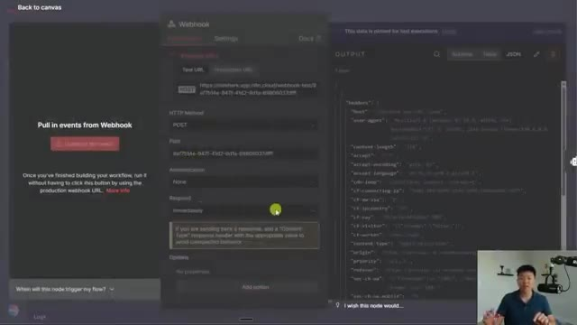
*⏱️ 00:15:29 — Interface n8n montrant la configuration d'un nœud Webhook avec l'option de réponse sur 'Immediately'.*

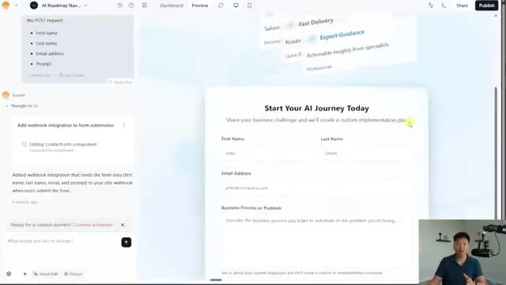
*⏱️ 00:15:43 — Interface de prévisualisation d'un constructeur de formulaire web montrant un formulaire 'Start Your AI Journey Today'.*

---

### ⏱️ `[00:15:50 - 00:16:14]` | Segment #34

**🔊 Audio (Transcription Intégrale Mot pour Mot en Français) :**
> Il vous suffirait de dire à base44 d'attendre la réponse de NNN et ensuite de l'afficher lorsqu'il la récupère. Mais de toute façon, l'agent de style est maintenant terminé. Je vais donc procéder rapidement épingler ces données pour ne pas les perdre. Et vous pouvez voir que nous avons, vous savez, un type de document HTML. Nous avons tout cela avec différentes couleurs, des marges intérieures, des marges extérieures et du texte. Ce que nous devons donc faire, c'est ajouter rapidement un nœud Gmail afin de pouvoir l'envoyer sous forme d'e-mail et voir à quoi cela ressemble en HTML.

**👁️ Analyse Visuelle d'Écran (gemini-3.5-flash-lite) :**
**Interface & Outils** : Application web de workflow d'IA Base44

**Contenu textuel & Code** : Code HTML brut généré au format JSON, paramètres du Style Agent et structure de workflow par nœuds.

**Action / Démonstration** : Navigation dans l'interface de Base44 pour inspecter les données de sortie et les configurations d'agents.

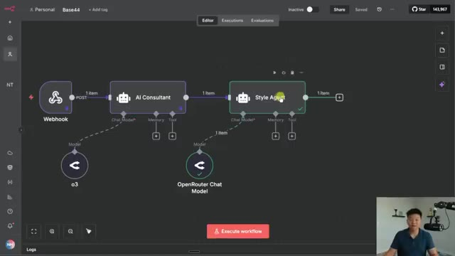
*⏱️ 00:15:56 — Vue globale du workflow d'automatisation sur Base44 montrant les nœuds Webhook, AI Consultant et Style Agent.*

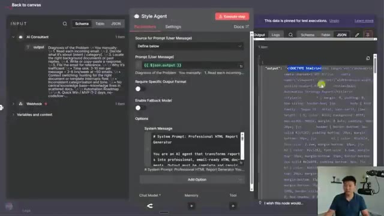
*⏱️ 00:16:02 — Gros plan sur la configuration et les données de sortie JSON du nœud 'Style Agent' générant du code HTML.*

*⏱️ 00:16:08 — Retour sur l'interface principale du workflow montrant le nœud Style Agent connecté et une miniature de prévisualisation.*

---

### ⏱️ `[00:16:14 - 00:16:36]` | Segment #35

**🔊 Audio (Transcription Intégrale Mot pour Mot en Français) :**
> Donc nous allons toujours envoyer les données à quiconque a entré ses informations. Donc nous pouvons récupérer l'e-mail du webhook et le placer juste là. Pour l'objet, j'ai simplement mis votre guide gratuit d'implémentation de l'IA par l'AI Automation Society. Nous laissons le type d'e-mail en HTML, et non en texte, parce que nous l'avons formaté en HTML. Et ensuite, pour le corps de l'e-mail, je vais simplement glisser la sortie de l'agent de style.

**👁️ Analyse Visuelle d'Écran (gemini-3.5-flash-lite) :**
**Interface & Outils** : n8n (plateforme d'automatisation de workflow).

**Contenu textuel & Code** : Configuration du nœud : "Credential" (TrueHorizon), "Operation" (Send), champ "To" (mappage de l'e-mail depuis le body du webhook), champ "Subject" ("Hello World!"), champ "Email Type" (HTML).

**Action / Démonstration** : L'utilisateur est en train de configurer les paramètres de sortie du nœud d'envoi d'e-mail en utilisant les variables dynamiques extraites du webhook (Mapping de données).

*⏱️ 00:16:20 — Interface du logiciel n8n montrant la configuration d'un nœud "Send a message" (Gmail/Email) où l'utilisateur mappe les données d'un webhook vers les champs de l'e-mail.*

---

### ⏱️ `[00:16:36 - 00:16:57]` | Segment #36

**🔊 Audio (Transcription Intégrale Mot pour Mot en Français) :**
> Et puis enfin, je veux juste modifier l'attribution « ajouter NNN », la désactiver, afin que le bas de l'e-mail ne dise pas que cela a été envoyé par NNN. Donc, maintenant que c'est rempli, je peux exécuter l'étape, et cela va envoyer cet e-mail au format HTML. Et allons jeter un œil pour voir ce que ça donne. D'accord, voilà. Nous avons donc votre guide gratuit d'implémentation de l'IA, le rapport de stratégie d'automatisation des e-mails, le système intelligent de traitement et de réponse aux e-mails.

**👁️ Analyse Visuelle d'Écran (gemini-3.5-flash-lite) :**
**Interface & Outils** : n8n (outil d'automatisation de workflow) et Gmail.

**Contenu textuel & Code** : - Image #1 : Paramètres du nœud n8n (To, Subject, Email Type: HTML, Message content).
- Image #2 : Contenu de l'e-mail reçu incluant "Problem Diagnosis" et "Inefficiency Analysis".

**Action / Démonstration** : - Image #1 : Désactivation de l'option d'attribution n8n avant l'exécution du nœud.
- Image #2 : Consultation de l'e-mail envoyé pour vérifier le formatage final après l'exécution.

*⏱️ 00:16:41 — Interface de configuration du nœud "Send a message" dans n8n, montrant les paramètres d'envoi d'e-mail avec l'option "Append n8n Attribution" désactivée (interrupteur blanc).*

*⏱️ 00:16:51 — Interface de Gmail affichant un e-mail envoyé, intitulé "Your Free AI Implementation Guide - AI Automation Society", avec le contenu du rapport visible.*

---

### ⏱️ `[00:16:57 - 00:17:18]` | Segment #37

**🔊 Audio (Transcription Intégrale Mot pour Mot en Français) :**
> Nous commençons par le diagnostic du problème. C'est un flux de travail très manuel avec cinq étapes répétitives : lire chaque e-mail, déterminer l'intention, localiser les documents de référence pertinents, rédiger ou copier-coller une réponse, et ensuite classer l'e-mail pour référence future. Cela analyse l'inefficacité. Il souligne donc un point sensible, qui est de trois à 10 minutes par message, ce qui pourrait équivaloir à deux à huit heures par semaine s'il y a 50 e-mails.

**👁️ Analyse Visuelle d'Écran (gemini-3.5-flash-lite) :**
**Interface & Outils** : Interface Web Gmail.

**Contenu textuel & Code** : Texte structuré listant les 5 étapes d'un workflow manuel (Lire, Déterminer l'intention, Localiser, Rédiger, Classer) et une section "Inefficiency Analysis" (Time drain, Context switching, Inconsistent quality, Knowledge fragmentation).

**Action / Démonstration** : Le présentateur illustre visuellement les points de douleur du flux de travail actuel qui justifient l'automatisation.

*⏱️ 00:17:02 — Capture d'écran montrant l'interface Gmail affichant un document intitulé "Email Automation Strategy Report" détaillant le diagnostic d'un flux de travail manuel.*

---

### ⏱️ `[00:17:18 - 00:17:53]` | Segment #38

**🔊 Audio (Transcription Intégrale Mot pour Mot en Français) :**
> beaucoup de changements de contexte, c'est 100 % vrai, une qualité inconstante et une fragmentation des connaissances. Nous passons ensuite à la feuille de route. Nous commençons donc par la phase A, qui est un gain rapide ou MVP en un à deux jours. Nous soulignons comment nous ferions cela en pratique. Nous commencerions donc par un déclencheur, nous aurions une classification d'intention par grand modèle de langage, nous aurions un étiquetage automatique, puis une rédaction basée sur des modèles. Et le résultat attendu serait de 60 à 70 % des e-mails traités instantanément, sans qu'aucune recherche de documents ne soit nécessaire. Ensuite, pour la phase B, nous passons à une solution de deux à quatre semaines. Nous avons maintenant une base de connaissances centrale avec tous les documents et tout ce dont nous avons besoin. Nous avons un processeur d'e-mails unifié. Nous avons une boucle de rétroaction

**👁️ Analyse Visuelle d'Écran (gemini-3.5-flash-lite) :**
**Interface & Outils** : Interface web Gmail affichant un document textuel structuré.

**Contenu textuel & Code** : Le document détaille la "Phase A: Quick Win / MVP (1-2 Days)" utilisant Zapier/Make/n8n (déclenchement via e-mail, classification par LLM, auto-étiquetage, rédaction par modèles) et la "Phase B: Scalable Solution (2-4 Weeks)" centrée sur une base de connaissances centralisée et vectorisée.

**Action / Démonstration** : Le présentateur illustre visuellement la stratégie de planification de l'automatisation en affichant les étapes clés du projet.

*⏱️ 00:17:27 — Une capture d'écran montrant le contenu d'un e-mail dans Gmail qui détaille une "Automation Roadmap" (Feuille de route d'automatisation) divisée en deux phases.*

---

### ⏱️ `[00:17:53 - 00:18:27]` | Segment #39

**🔊 Audio (Transcription Intégrale Mot pour Mot en Français) :**
> et un tableau de bord. Et ensuite, nous passons à la phase C, qui concerne l'amélioration à long terme. Nous avons l'hébergement de LLM privés, l'apprentissage continu, l'expansion multicanal, l'intégration CRM, et la couche de conformité. Et c'est vraiment génial. Ça continue ensuite pour parler du retour sur investissement. Nous avons donc le temps passé par jour. Nous avons le coût mensuel, comme vous pouvez le voir. Et ensuite, nous avons les économies mensuelles, qui peuvent aller jusqu'à 3 000 dollars. Nous avons les coûts d'infrastructure et nous avons le bénéfice net mensuel. Maintenant, un point important ici, prenez cela avec des pincettes, car notre agent consultant a généré ces données et l'agent consultant ne sait pas encore comment nous allons facturer ou quel sera le prix de notre solution. Donc cela, en quelque sorte

**👁️ Analyse Visuelle d'Écran (gemini-3.5-flash-lite) :**
**Interface & Outils** : Gmail (interface web affichant un document texte/tableur).

**Contenu textuel & Code** : Texte structuré : "Phase C: Long-Term Improvements", liste des points (Private LLM hosting, Continuous learning, Multi-channel expansion, CRM integration, Compliance layer) et tableau de données "Return on Investment Analysis" comparant l'état actuel, les gains rapides et les solutions évolutives.

**Action / Démonstration** : Le présentateur illustre ses propos en faisant défiler un document de synthèse stratégique pour montrer la feuille de route technique et les bénéfices financiers attendus de l'automatisation.

*⏱️ 00:18:01 — Une capture d'écran de l'interface Gmail affichant un document de planification stratégique détaillant la "Phase C : Améliorations à long terme" et une analyse du retour sur investissement (ROI).*

*⏱️ 00:18:10 — Une suite du document affiché dans Gmail, se concentrant sur les colonnes "Solution évolutive" du tableau de ROI et introduisant la section "Étapes de mise en œuvre".*

---

### ⏱️ `[00:18:27 - 00:19:00]` | Segment #40

**🔊 Audio (Transcription Intégrale Mot pour Mot en Français) :**
> de choses, ces chiffres sont un peu inventés. Pour vraiment faire une analyse de ROI, il faudrait demander plus d'informations sur le temps manuel que cela prend réellement. Mais avec le prompt très, très limité et minimal qui a déclenché tout ce flux, ce n'est pas si mal. Et cela montre comment nos agents pourraient présenter cela sous forme de tableau pour rendre ça vraiment facile à assimiler pour le client potentiel. Ça se termine tout en bas par des étapes de mise en œuvre. On a cinq étapes juste ici. Et puis nous avons l'appel à l'action pour réserver notre appel de découverte, ce qui nous amène au lien Calendly pour réserver un appel. Si jamais ça charge, le voilà, comme vous pouvez le voir. Donc on nous a donné un vraiment, vraiment tout petit

**👁️ Analyse Visuelle d'Écran (gemini-3.5-flash-lite) :**
**Interface & Outils** : Gmail / Navigateur web

**Contenu textuel & Code** : Tableau "Return on Investment Analysis" comparant l'état actuel, un "Quick Win" et une "Scalable Solution" avec des métriques de temps et de coûts.

**Action / Démonstration** : Le présentateur commente le tableau d'analyse du ROI et les chiffres présentés à l'écran.

*⏱️ 00:18:35 — Capture d'écran montrant un tableau d'analyse du retour sur investissement (ROI) affiché dans une interface web (Gmail), avec le présentateur en médaillon en bas à droite.*

---

### ⏱️ `[00:19:00 - 00:19:36]` | Segment #41

**🔊 Audio (Transcription Intégrale Mot pour Mot en Français) :**
> un peu d'informations sur une personne, et nous avons pu directement dans leur boîte de réception, leur donner beaucoup de valeur gratuite, et espérons-le les convaincre de réserver un appel complet. Donc maintenant que nous avons configuré ce flux de travail, ce que je vais faire, c'est détacher toutes ces données et cliquer sur enregistrer. Et maintenant, je vais activer ce flux de travail. Donc maintenant il est activé et il est indiqué que vous pouvez désormais passer des appels vers votre URL de production. Donc ce que nous devons faire, c'est retourner dans notre webhook et nous devons basculer cela sur production et récupérer cette URL de production. Maintenant, gardez à l'esprit qu'il va toujours par défaut, lorsque vous ouvrez ce nœud de webhook, il va toujours donner l'impression qu'il est en mode test, mais ne vous inquiétez pas pour ça. Alors

**👁️ Analyse Visuelle d'Écran (gemini-3.5-flash-lite) :**
**Interface & Outils** : n8n (outil d'automatisation de workflow).

**Contenu textuel & Code** : Nœuds de workflow : "Webhook", "AI Consultant", "Style Agent", "Send a message", et les modèles d'IA "o3" et "OpenRouter Chat Model". Message de confirmation d'activation : "Workflow activated - You can now make calls to your production webhook URL".

**Action / Démonstration** : Le présentateur active le workflow et valide le message de confirmation système dans l'interface n8n pour mettre en production l'automatisation.

*⏱️ 00:19:09 — Vue d'ensemble d'un flux de travail (workflow) dans l'interface de n8n, montrant des nœuds connectés : Webhook, AI Consultant, Style Agent et Gmail (Send a message), avec des modèles d'IA associés (o3 et OpenRouter).*

*⏱️ 00:19:18 — Fenêtre contextuelle (pop-up) système affichée après l'activation d'un workflow, indiquant que le flux est maintenant actif et que les exécutions peuvent être consultées dans la liste des exécutions.*

---

### ⏱️ `[00:19:36 - 00:20:09]` | Segment #42

**🔊 Audio (Transcription Intégrale Mot pour Mot en Français) :**
> tant que vous donnez à votre base frontale 44, tant que nous lui donnons cette URL de production, elle l'appellera et je vais vous montrer ce que je veux dire par là en ce moment tout est enregistré, je vais retourner sur notre site web et je vais dire veuillez mettre à jour le webhook vers ce webhook suivant tout le reste peut être identique donc j'espère qu'il comprend ce que je veux dire par là je vais envoyer ça et il devrait fondamentalement mettre à jour ce bouton pour aller vers cette nouvelle adresse de webhook plutôt que l'ancienne que nous lui avions donnée donc il dit qu'il a mis à jour le webhook vers le nouveau point de terminaison nous voyons que notre flux de travail est actif. Et ce que je vais faire maintenant c'est juste faire une autre requête et nous verrons si c'est

**👁️ Analyse Visuelle d'Écran (gemini-3.5-flash-lite) :**
**Interface & Outils** : n8n et interface de création de site web / application (Base44)

**Contenu textuel & Code** : Nœuds de workflow automatisés et formulaire web avec champs First Name, Last Name, Email Address et Business Process.

**Action / Démonstration** : Présentation du workflow n8n et retour sur le site web pour configurer et mettre à jour le webhook.

*⏱️ 00:19:44 — Interface n8n montrant un workflow de nœuds avec Webhook, AI Consultant, Style Agent et Send a message.*

*⏱️ 00:19:52 — Interface de développement web montrant un formulaire de contact et un panneau de chat d'assistant IA sur la gauche.*

---

### ⏱️ `[00:20:09 - 00:20:41]` | Segment #43

**🔊 Audio (Transcription Intégrale Mot pour Mot en Français) :**
> en train de le capturer ou non. D'accord. J'ai donc rempli quelques informations. Nous allons procéder à l'envoi. Nous pouvons voir que vos informations ont été reçues. Je vais aller dans notre workflow « anything » et je vais cliquer sur les exécutions et nous devrions voir, super. C'est en cours d'exécution. Ça va donc tourner pendant, je ne sais pas, peut-être une minute environ. Et une fois que ce sera terminé, nous verrons que c'est fait. Et ensuite, nous irons jeter un œil à notre e-mail que nous aurions dû recevoir à partir de cette page de destination. Aussi, une petite chose dont je me sentais obligé de m'assurer que vous aviez tous à l'esprit, si vous faites cela et que vous donnez votre lien à des personnes aléatoires, lorsqu'elles soumettent une demande sur

**👁️ Analyse Visuelle d'Écran (gemini-3.5-flash-lite) :**
**Interface & Outils** : n8n (plateforme d'automatisation de workflows).

**Contenu textuel & Code** : Diagramme de flux de données reliant un nœud "Webhook" à des agents IA ("AI Consultant" connecté au modèle o3, "Style Agent" connecté à OpenRouter) et se terminant par un nœud d'envoi de message.

**Action / Démonstration** : Le workflow est configuré et prêt pour l'exécution ; le bouton "Execute workflow" est visible en bas de l'écran.

*⏱️ 00:20:17 — Interface de la plateforme n8n affichant un workflow d'automatisation composé de plusieurs nœuds interconnectés (Webhook, AI Consultant, Style Agent, et Send a message).*

---

### ⏱️ `[00:20:41 - 00:21:16]` | Segment #44

**🔊 Audio (Transcription Intégrale Mot pour Mot en Français) :**
> votre site et votre webhook le capturent, cela va utiliser vos crédits API. Donc si quelqu'un décide de soumettre un millier de requêtes sur votre site web, ce serait vous qui paieriez pour ces un millier de requêtes lorsqu'il s'agit d'exécuter ces modèles d'IA dans N8N. Je voulais donc juste m'assurer que vous étiez tous au courant et c'est juste quelque chose à garder à l'esprit. Très bien, vous pouvez donc voir que cela vient de se terminer. Je voulais juste vous prouver rapidement que c'est bien celui que nous venons de soumettre. Comme vous pouvez le voir, cela vient de natenateherk@gmail.com, et c'était exactement ce que j'ai tapé dedans. Et l'e-mail a été envoyé, alors allons voir à quoi il ressemble. D'accord, nous avons donc reçu votre guide d'implémentation IA gratuit encore une fois, préparation de réunion

**👁️ Analyse Visuelle d'Écran (gemini-3.5-flash-lite) :**
**Interface & Outils** : n8n (outil d'automatisation de workflows avec IA)

**Contenu textuel & Code** : Nœuds de workflow : Webhook, AI Consultant, Style Agent, Send a message (Gmail) ; configurations de prompts et données JSON d'entrée/sortie.

**Action / Démonstration** : Présentation et explication du fonctionnement d'un workflow d'automatisation IA déclenché par un webhook.

*⏱️ 00:20:50 — Vue d'ensemble d'un workflow n8n montrant un déclencheur Webhook connecté à deux agents IA ('AI Consultant' et 'Style Agent') et un nœud Gmail, avec le présentateur visible en bas à droite.*

*⏱️ 00:21:07 — Interface détaillée d'un nœud d'agent IA dans n8n montrant les panneaux d'entrée JSON, les paramètres de prompt et le panneau de sortie avec le résultat formaté.*

---

### ⏱️ `[00:21:16 - 00:21:49]` | Segment #45

**🔊 Audio (Transcription Intégrale Mot pour Mot en Français) :**
> automatisation, proposition et feuille de route. Remarquez que le style HTML est cohérent avec le dernier, nous avons donc toujours ce format qui correspond fondamentalement à notre marque. Nous avons transformé 20 minutes de recherche manuelle en intelligence automatisée. Nous commençons à nouveau par diagnostiquer le problème. Donc 20 minutes par réunion manuellement. Nous extrayons les informations de LinkedIn et de Google. Nous fouillons dans le système CRM pour trouver l'historique des transactions et les opérations, et nous créons des points de discussion et formulons des questions pertinentes. L'impact sur le temps est de cinq réunions par jour. Cela représente près de deux heures perdues par jour, ce qui pourrait faire huit heures par semaine. Nous ensuite une fois de plus

**👁️ Analyse Visuelle d'Écran (gemini-3.5-flash-lite) :**
**Interface & Outils** : Gmail

**Contenu textuel & Code** : Texte d'une proposition avec des sections comme "Phase B: Scalable Solution" et des détails sur l'infrastructure et l'optimisation des coûts.

**Action / Démonstration** : Consultation de l'e-mail envoyé contenant la proposition et la feuille de route de l'automatisation.

*⏱️ 00:21:24 — Capture d'écran montrant l'interface de Gmail avec un e-mail ouvert contenant une proposition de projet et une feuille de route technique.*

---

### ⏱️ `[00:21:49 - 00:22:22]` | Segment #46

**🔊 Audio (Transcription Intégrale Mot pour Mot en Français) :**
> soulignez davantage la douleur. Pourquoi ce processus actuel est-il inefficace ? Et ensuite, nous passons à notre feuille de route d'automatisation en trois phases. Nous commençons par un MVP à gain rapide, qui consiste à ce que, une heure avant chaque réunion, nous recevions un message direct unique, qui est une fiche de préparation pour cette réunion. C'est un tableau vraiment sympa. Nous avons le composant, nous avons la technologie, et ensuite nous avons la fonction. Donc, cela détaille le déclencheur, l'enrichissement des données avec Apollo ou PeopleDataLabs, l'intégration CRM, le résumé par IA, le contenu d'actualités, et ensuite la livraison. Nous passons également à notre solution évolutable, encore une fois, qui prend une à deux semaines. Nous avons des éléments comme une tâche cron, la mise en cache des résultats, l'optimisation des coûts,

**👁️ Analyse Visuelle d'Écran (gemini-3.5-flash-lite) :**
**Interface & Outils** : Navigateur web affichant un document ou un e-mail Gmail contenant la feuille de route d'automatisation.

**Contenu textuel & Code** : Tableau détaillant les composants (Trigger, Data Enrichment, CRM Integration, AI Summary, News Context, Delivery) avec leurs technologies et fonctions associées.
[DESC_IMAGE_1] Le présentateur commente la feuille de route d'automatisation et explique le premier MVP à gain rapide.

**Action / Démonstration** : Explications face caméra et démonstration conceptuelle.

*⏱️ 00:21:58 — Un tableau intitulé 'Automation Roadmap' affichant les détails de la Phase A (Quick Win MVP) avec les composants, technologies et fonctions, présenté à l'écran tandis que le présentateur apparaît en bas à droite.*

---

### ⏱️ `[00:22:23 - 00:22:51]` | Segment #47

**🔊 Audio (Transcription Intégrale Mot pour Mot en Français) :**
> et un tableau de bord. Et ensuite, lorsque nous passons à nos améliorations à long terme, nous avons des choses comme notre assistant de réunion en temps réel, l'automatisation des suivis, la recherche dans la base de connaissances et une couche d'analytique. Et gardez à l'esprit, ce que vous feriez ici, c'est que vous inviteriez votre consultant en IA peut-être même à fouiller dans votre base de données afin qu'il en sache beaucoup sur vous, sur votre entreprise et sur la façon dont vous aimez faire des affaires, de sorte que vos guides d'implémentation réels soient plus précis et spécifiques pour vous. En bas, encore une fois, nous avons le retour sur investissement estimé. Nous pouvons voir que vous obtiendriez, vous savez, un retour sur investissement en trois jours.

**👁️ Analyse Visuelle d'Écran (gemini-3.5-flash-lite) :**
**Interface & Outils** : Interface web d'automatisation de workflow (nœuds graphiques)

**Contenu textuel & Code** : Nœuds de workflow connectés : Webhook, AI Consultant, Style Agent, et Send a message, avec des modèles LLM associés (o3, OpenRouter).

**Action / Démonstration** : Visualisation d'un workflow d'agents IA exécuté avec succès.

*⏱️ 00:22:37 — Interface d'un outil d'automatisation de workflow (type Make ou équivalent) montrant des nœuds reliés entre eux.*

---

### ⏱️ `[00:22:51 - 00:23:28]` | Segment #48

**🔊 Audio (Transcription Intégrale Mot pour Mot en Français) :**
> Vous feriez environ 2 500 $ par mois grâce à ce système, en retour sur investissement je veux dire, et vous économiseriez environ 36 heures par mois. Bien sûr, cela va lister quelques prochaines étapes et ensuite le bel appel à l'action ici, prêt à récupérer plus de huit heures par semaine et à ne plus jamais assister à une réunion non préparée tout en réservant un appel de découverte juste ici. C'est donc l'exemple de ce que nous avons. Et vous pouvez voir qu'au total, cela m'a pris peut-être 30 minutes, tout au plus. Pour créer une page de destination front-end comme celle-ci, qui a l'air très professionnelle. Cela a pris moins de 10 minutes. Et imaginez juste où je pourrais arriver si j'y passais une heure de plus. Et ensuite, nous avons construit une automatisation back-end qui n'utilise que deux agents,

**👁️ Analyse Visuelle d'Écran (gemini-3.5-flash-lite) :**
**Interface & Outils** : Gmail et interface web de développement / no-code

**Contenu textuel & Code** : Texte de proposition d'automatisation, étapes de mise en œuvre et formulaire de capture "Get Your Free AI Implementation Roadmap".

**Action / Démonstration** : Navigation dans l'e-mail de proposition et affichage de la page de capture de leads.

*⏱️ 00:23:00 — Vue d'une interface Gmail affichant les étapes suivantes de mise en œuvre et le calcul du retour sur investissement.*

*⏱️ 00:23:09 — Vue de l'interface Gmail montrant l'appel à l'action pour réserver un appel de découverte.*

*⏱️ 00:23:18 — Vue d'une interface web de constructeur de site (Bolt ou équivalent) montrant une page de capture pour une feuille de route d'IA.*

---

### ⏱️ `[00:23:28 - 00:23:47]` | Segment #49

**🔊 Audio (Transcription Intégrale Mot pour Mot en Français) :**
> l'un pour faire le conseil et l'autre pour faire le style. Et encore une fois, cela m'a pris moins de 10 minutes. Tout ce que vous auriez à faire, c'est donc de créer votre propre page de destination, puis de créer votre propre consultant en IA. Et ensuite, vous pouvez commencer à diffuser cela comme un aimant à prospects à valeur ajoutée. Et de retour dans Base 44, ce que vous voyez en bas à gauche est prêt pour un domaine personnalisé. Allez-y et connectez-en un.

**👁️ Analyse Visuelle d'Écran (gemini-3.5-flash-lite) :**
**Interface & Outils** : Interface de workflow d'automatisation et constructeur de page de destination web

**Contenu textuel & Code** : Nœuds de workflow (Webhook, AI Consultant, Style Agent, Send a message) et aperçu d'une landing page de conseil en IA

**Action / Démonstration** : Présentation du flux complet combinant un agent de conseil, un agent de style et une page de capture de leads

*⏱️ 00:23:33 — Un diagramme de workflow d'automatisation montrant un webhook déclenchant successivement un agent de conseil en IA (« AI Consultant » connecté au modèle o3) et un agent de style (« Style Agent » connecté à OpenRouter), avant d'envoyer un message.*

*⏱️ 00:23:42 — L'éditeur d'une page de destination intitulée « AI Automation Society » avec le titre « Get Your Free AI Implementation Roadmap » et un panneau latéral de configuration d'agent IA.*

---

### ⏱️ `[00:23:47 - 00:24:19]` | Segment #50

**🔊 Audio (Transcription Intégrale Mot pour Mot en Français) :**
> Donc, si je voulais en connecter un, tout ce que j'aurais à faire, c'est d'acheter un nouveau domaine ou de le connecter ici. Donc, n'importe quel domaine que vous possédez, vous pouvez faire en sorte qu'il héberge votre application web Base 44. Vous pouvez également voir des analyses. Vous pouvez avoir des utilisateurs. Vous pouvez ajouter de la sécurité. Vous avez des journaux, tout ce genre de choses que vous pouvez ajouter afin de pouvoir gérer l'intégralité de votre site web et, bien sûr, envoyer toutes vos données vers une automatisation backend comme n8n. Donc, la façon dont cela fonctionne, c'est par le biais de crédits, et vous pouvez voir que vous pouvez commencer pour 20 dollars par mois et vous pouvez obtenir cent crédits mensuels. Et juste pour référence, on vous facture un crédit chaque fois que vous lui envoyez essentiellement un message.

**👁️ Analyse Visuelle d'Écran (gemini-3.5-flash-lite) :**
**Interface & Outils** : Interface web de la plateforme Base 44

**Contenu textuel & Code** : Paramètres de domaine ("Domains", "Built-in domain", "Custom domains" avec les boutons "Connect your Domain" et "Buy Domain").

**Action / Démonstration** : Configuration et gestion des domaines personnalisés pour l'application web sur Base 44.

*⏱️ 00:23:55 — L'interface d'administration de Base 44 affichant les options de gestion des domaines (domaine intégré et domaines personnalisés).*

---

### ⏱️ `[00:24:19 - 00:24:38]` | Segment #51

**🔊 Audio (Transcription Intégrale Mot pour Mot en Français) :**
> Donc, plus vous êtes détaillé, mieux c'est. Mais vous pouvez voir que dans cette simple application web, j'ai probablement utilisé seulement 10 crédits. Il y a un lien dans la description si vous voulez essayer Base44 par vous-même. Alors allez-y et jetez-y un œil. Donc, si vous voulez créer un aimant à prospects comme celui-ci et que vous cherchez du soutien ou que vous cherchez à entrer en contact avec d'autres personnes qui font déjà quelque chose comme ça, alors consultez absolument ma communauté Plus.

**👁️ Analyse Visuelle d'Écran (gemini-3.5-flash-lite) :**
**Interface & Outils** : Application web Base44 et éditeur visuel de workflow d'automatisation.

**Contenu textuel & Code** : Blocs de workflow reliés par des flèches : Webhook, AI Consultant (connecté au modèle o3), Style Agent (connecté à OpenRouter Chat Model), et Send a message (Gmail).

**Action / Démonstration** : Présentation de l'interface de création d'applications et de workflows IA sur Base44.

*⏱️ 00:24:24 — Aperçu d'une application web générée intitulée "AI Automation Society" montrant une page de capture de leads avec panneau de code latéral.*

*⏱️ 00:24:33 — Interface de l'application Base44 affichant un workflow visuel d'automatisation avec des nœuds de webhook, d'agents IA (o3, OpenRouter) et d'envoi de message.*

---

### ⏱️ `[00:24:38 - 00:25:02]` | Segment #52

**🔊 Audio (Transcription Intégrale Mot pour Mot en Français) :**
> Le lien pour cela se trouve dans la description. Nous avons une super communauté de plus de 2 500 membres qui construisent avec n8n chaque jour. Beaucoup de ces personnes gèrent aussi des entreprises avec n8n chaque jour. Nous avons une section « salle de classe » avec trois cours complets. Agent Zéro, ce sont les bases de l'automatisation par IA pour les débutants. Nous avons dix heures de formation où nous plongeons dans n8n. Et ensuite, nous avons un nouveau cours pour les membres annuels appelé Agence IA d'une seule personne, où vous apprenez à poser les bases d'une entreprise d'automatisation par IA évolutive.

**👁️ Analyse Visuelle d'Écran (gemini-3.5-flash-lite) :**
**Interface & Outils** : Interface web de la communauté (plateforme de cours en ligne, type Skool ou similaire).

**Contenu textuel & Code** : Titres des cours et modules : « Start Here », « Agent Zero (Foundations) », « 10 Hours to 10 Seconds », « One Person AI Agency », « n8n Templates », « Step-by-Steps ».

**Action / Démonstration** : Navigation et présentation des différents modules de cours disponibles dans la salle de classe de la communauté.

*⏱️ 00:24:50 — Section « Classroom » de la plateforme montrant les différents modules de formation disponibles (« Start Here », « Agent Zero », etc.).*

*⏱️ 00:24:56 — Défilement vers le bas de la section « Classroom » montrant d'autres modules de cours et ressources de la communauté.*

---

### ⏱️ `[00:25:03 - 00:25:15]` | Segment #53

**🔊 Audio (Transcription Intégrale Mot pour Mot en Français) :**
> Donc j'aimerais beaucoup vous voir dans ces appels en direct dans la communauté, mais c'est tout pour la vidéo d'aujourd'hui. Si vous avez apprécié ou si vous avez appris quelque chose de nouveau, n'hésitez pas à mettre un pouce bleu. Ça m'aide vraiment énormément. Et comme toujours, je vous remercie d'être arrivés jusqu'à la fin de la vidéo. Je vous vois dans la prochaine. Merci beaucoup tout le monde.

**👁️ Analyse Visuelle d'Écran (gemini-3.5-flash-lite) :**
**Interface & Outils** : Interface Skool (Image 1), éditeur de page web / outil no-code (Image 2)

**Contenu textuel & Code** : Publications de communauté, fils de discussion et statistiques de membres (Image 1) ; aperçu de page web avec formulaire et composants d'interface (Image 2)

**Action / Démonstration** : Navigation dans la communauté et présentation des ressources du groupe (Image 1), affichage du site web et de l'outil de génération de roadmap (Image 2)

*⏱️ 00:25:06 — Capture montrant l'interface de la communauté Skool « AI Automation Society Plus » avec les publications épinglées et le présentateur en miniature vidéo en bas à droite.*

*⏱️ 00:25:09 — Capture montrant un outil de développement web ou un constructeur de landing page avec l'aperçu du site « AI Automation Society - Get Your Free AI Implementation Roadmap » et un panneau latéral de configuration.*

---

