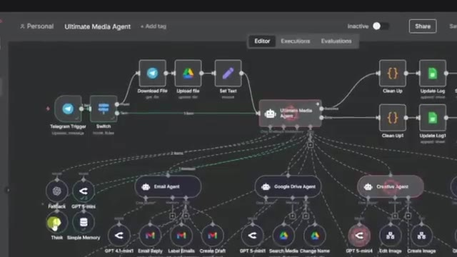
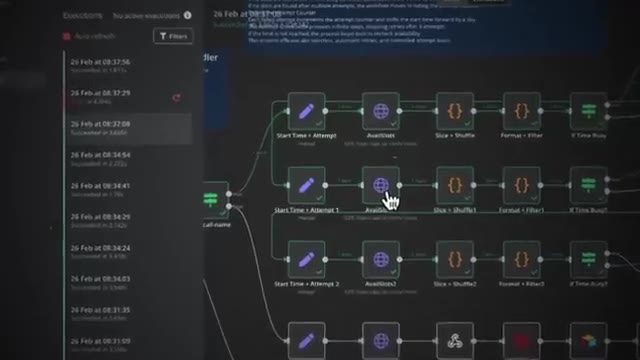
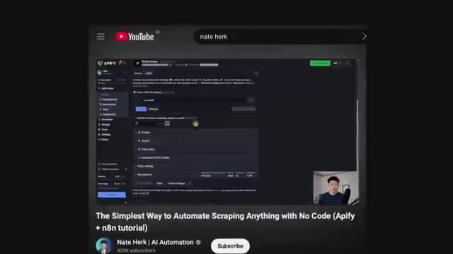
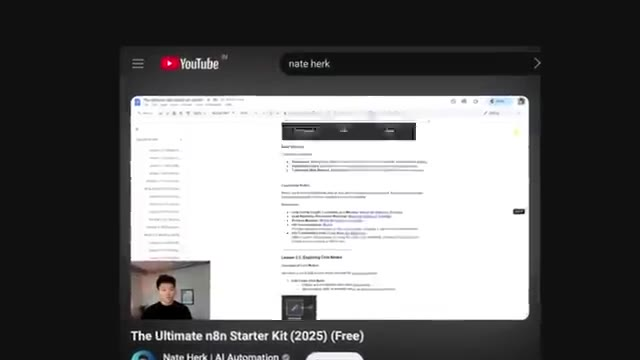
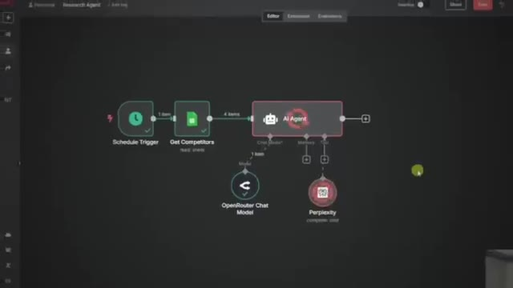
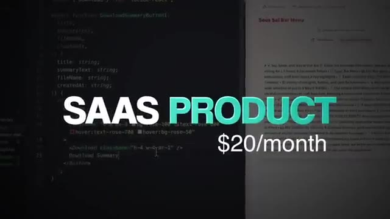
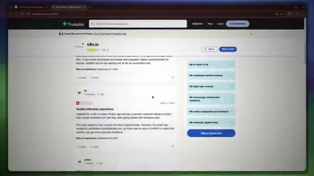
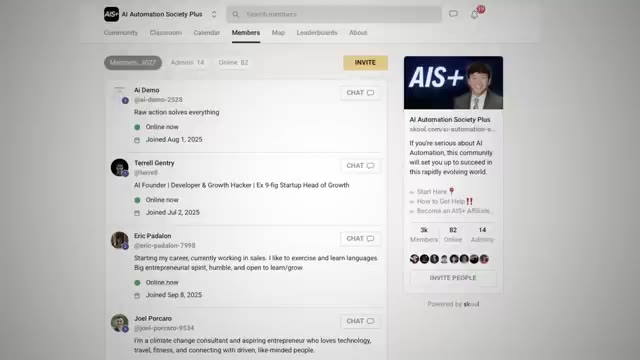
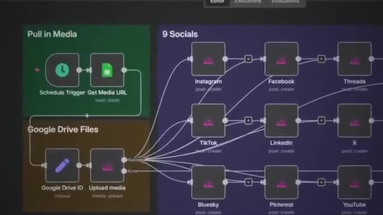
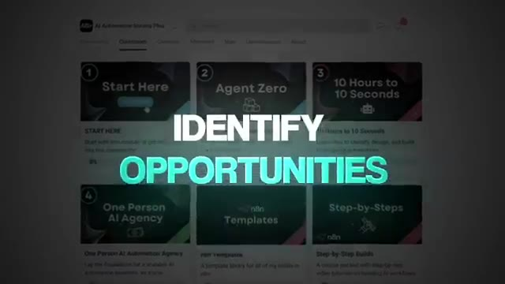

# 🎬 You’re Doing AI Automation Wrong (Here’s How to Fix It)

> **Chaîne** : [Nate Herk | AI Automation](https://www.youtube.com/@nateherk/featured)  
> **Lien YouTube** : [https://www.youtube.com/watch?v=ip8FEYOQob0](https://www.youtube.com/watch?v=ip8FEYOQob0)  
> **Date de publication** : 20251015  
> **Durée** : 00:11:19  
> **Identifiant vidéo** : `ip8FEYOQob0`  
> **Transcription & Analyse** : `whisper-v3-large-turbo+gemini-3.5-flash-lite`  

---

## 📌 Synthèse Exécutive & Outils

### 💡 Résumé

Dans cette vidéo incisive de la chaîne *Nate Herk | AI Automation*, l'expert en ingénierie IA et développement logiciel démontre pourquoi la grande majorité des développeurs, freelances et entreprises font fausse route en matière d'automatisation intelligente. S'appuyant sur son expérience personnelle – du statut de freelance débutant facturant des workflows à la tête d'une agence florissante (True Horizon) générant 2,5 millions de dollars de chiffre d'affaires annuel – il déconstruit le mythe de l'agent IA entièrement autonome qui remplacerait l'humain. Il prouve que la viabilité commerciale réside non pas dans la complexité technique, mais dans la recherche chirurgicale du levier opérationnel et la robustesse des systèmes.

L'analyse technique et stratégique de Nate Herk bouscule les idées reçues en exposant des méthodologies d'ingénierie pragmatiques. Plutôt que de rechercher une automatisation à 100 % génératrice de pannes et de goulots d'étranglement, la vidéo détaille le concept fondamental du « ratio d'or de l'IA » (60 % d'automatisation pure, 30 % d'assistance par l'IA nécessitant un jugement contextuel, et 10 % d'intervention humaine manuelle à haute valeur ajoutée). À travers des cas d'usage concrets dans la gestion des leads, la finance, le marketing et les opérations, l'intervenant démontre comment la simplicité architecturale l'emporte toujours sur les tours de Babel algorithmiques à dix agents interconnectés.

Enfin, la vidéo insiste sur l'importance cruciale de la spécialisation et de la maîtrise des processus métier par rapport à la simple frénésie des prompts et des outils à la mode. En adoptant une approche axée sur la profondeur (choisir un seul outil et un seul segment de marché) plutôt que sur la dispersion, les acteurs du secteur peuvent maximiser leur retour sur investissement et bâtir une autorité incontestable. Cette approche méthodique permet de transformer l'intelligence artificielle en un véritable levier de rentabilité et de croissance pérenne pour les entreprises.

### 🛠️ Outils, Modèles & Logiciels Présentés

* **True Horizon** : Agence spécialisée dans l'implémentation de systèmes d'IA opérationnels, scalée à 2,5 millions de dollars de chiffre d'affaires.
* **AutoGPT** : Outil emblématique de la première vague d'agents autonomes de 2022, cité comme contre-exemple en raison de sa fragilité structurelle en environnement réel.
* **n8n** : Outil d'automatisation de workflows de référence préconisé pour sa robustesse et sa fiabilité lors d'une utilisation approfondie.
* **Lovable** : Plateforme de développement et de prototypage rapide citée parmi les outils soumis à la surconsommation et au papillonnage des débutants.
* **Anthropic / Claude Code / Opus 5.5** : Technologies d'avant-garde mentionnées dans le contexte global de l'écosystème d'ingénierie logicielle et d'agents IA avancés.

### 🔑 Points Clés & Enseignements Stratégiques

* **Le paradigme du levier plutôt que de l'automatisation** : L'objectif de l'IA en entreprise n'est pas de remplacer totalement l'humain à travers des agents de bout en bout défaillants, mais de maximiser le levier opérationnel pour rendre les processus plus rapides, plus minces et plus rentables.
* **L'application du ratio d'or de l'IA (60/30/10)** : Structurer les workflows en automatisant 60 % des tâches répétitives sans IA, en déléguant 30 % des tâches contextuelles à l'IA avec validation, et en réservant 10 % à l'intervention humaine manuelle pour la touche finale.
* **Le piège de la dispersion technologique** : Papillonner d'un outil viral à un autre (comme le passage incessant entre différents logiciels d'automatisation ou frameworks d'agents) empêche l'acquisition d'une réelle expertise et nuit gravement à la capacité de résoudre des problèmes complexes.
* **La stratégie de la profondeur contre la superficialité** : Suivre le principe « aller un pouce de large et un mile de profondeur » en choisissant un outil unique et en le maîtrisant parfaitement pour bâtir une autorité reconnue sur le marché.
* **La spécialisation sectorielle (Niche Down)** : Cesser de s'adresser à tous types de clients (salles de sport, e-commerce, immobilier, dentistes) pour se concentrer sur un seul segment de marché, permettant ainsi de comprendre intimement les points de douleur spécifiques.
* **Le danger de la complexité architecturale** : Les systèmes d'IA surdimensionnés comportant de multiples agents interconnectés s'apparentent à une tour Jenga ; dans le monde réel, les entreprises recherchent la prédictibilité, la stabilité et la simplicité plutôt que la complexité tape-à-l'œil.
* **La supériorité des workflows « ennuyeux »** : Les automatisations les plus robustes, stables et génératrices de valeur à grande échelle sont souvent celles qui reposent sur des architectures simples, loin des démos spectaculaires mais fragiles.
* **Le processus prime sur les prompts** : Passer des jours à peaufiner des prompts ou à empiler des outils est une erreur de débutant ; le véritable défi consiste à analyser, comprendre et optimiser le processus métier sous-jacent que l'IA est censée bonifier.
* **L'atténuation des prises de décision superflues** : Réduire délibérément le nombre d'étapes décisionnelles gérées par l'IA dans un flux de travail pour garantir un comportement prévisible et éviter les dérives algorithmiques.
* **La communication de la valeur mesurable** : La valeur d'un système se mesure à son utilité concrète et au temps économisé (par exemple, automatiser 70 % d'un processus de 10 heures permet d'économiser 7 heures à chaque exécution), ce qui constitue un argument commercial imparable.

---

## ⏱️ Chronologie & Transcription Complète Audio & Visuelle (Mot pour Mot)

### ⏱️ `[00:00:00 - 00:00:24]` | Segment #01

**🔊 Audio (Transcription Intégrale Mot pour Mot en Français) :**
> If you want to make money with AI automation, whether that's selling services to businesses or implementing systems into your own, I'm going to show you exactly how. Because the truth is, if you're struggling to take advantage of the AI space, you're probably just approaching it with a suboptimal strategy. I know this because I've been on both sides. I've sold AI workflows for thousands as a beginner freelancer, and I've scaled my own agency, True Horizon, to $2.5 million this year by building AI systems that make the company run smoother.

**👁️ Analyse Visuelle d'Écran (gemini-3.5-flash-lite) :**
**Interface & Outils** : Présentation ou face-caméra explicatif sans interface logicielle partagée.

**Contenu textuel & Code** : Explications orales et mise en contexte méthodologique.

**Action / Démonstration** : Explications face caméra et démonstration conceptuelle.

---

### ⏱️ `[00:00:25 - 00:00:43]` | Segment #02

**🔊 Audio (Transcription Intégrale Mot pour Mot en Français) :**
> So in this video, I'll break down four non-obvious lessons. And these are the same lessons that all the people monetizing AI understand that you may not. So don't waste any time. Let's get right into the video. The first lesson is AI automation isn't actually about automation. It's about leverage. Now, that may sound just like a wording change, but it changes everything about how you approach the AI space.

**👁️ Analyse Visuelle d'Écran (gemini-3.5-flash-lite) :**
**Interface & Outils** : Présentation ou face-caméra explicatif sans interface logicielle partagée.

**Contenu textuel & Code** : Explications orales et mise en contexte méthodologique.

**Action / Démonstration** : Explications face caméra et démonstration conceptuelle.

---

### ⏱️ `[00:00:44 - 00:01:02]` | Segment #03

**🔊 Audio (Transcription Intégrale Mot pour Mot en Français) :**
> When people first heard the term AI automation, they thought it meant one thing. We're going to build agents and replace every human. And to be fair, that idea exploded back in 2022. Remember tools like AutoGPT? Everyone was hyping up these giant end-to-end agents that were supposed to do every step of your workflow for you. And on social media, it kind of looked that way.

**👁️ Analyse Visuelle d'Écran (gemini-3.5-flash-lite) :**
**Interface & Outils** : Présentation ou face-caméra explicatif sans interface logicielle partagée.

**Contenu textuel & Code** : Explications orales et mise en contexte méthodologique.

**Action / Démonstration** : Explications face caméra et démonstration conceptuelle.

---

### ⏱️ `[00:01:02 - 00:01:23]` | Segment #04

**🔊 Audio (Transcription Intégrale Mot pour Mot en Français) :**
> You'd see these demos of an AI agent booking meetings, sending emails, building websites, all with zero human input. But in the real world, those types of systems did not hold up. They broke, they bottlenecked, and half the time they created more problems than they solved. So, businesses learned pretty quickly, full automation is not the goal. And that was the turning point. The people who stuck around started to realize that AI automation was never really about automation, it's about leverage.

**👁️ Analyse Visuelle d'Écran (gemini-3.5-flash-lite) :**
**Interface & Outils** : Présentation ou face-caméra explicatif sans interface logicielle partagée.

**Contenu textuel & Code** : Explications orales et mise en contexte méthodologique.

**Action / Démonstration** : Explications face caméra et démonstration conceptuelle.

---

### ⏱️ `[00:01:23 - 00:01:45]` | Segment #05

**🔊 Audio (Transcription Intégrale Mot pour Mot en Français) :**
> And here's what I mean by leverage. Rather than focusing on just building for the sake of building, you need to learn and implement the golden AI ratio. So here's how that looks. Maybe you automate the first 60% of a process, the boring and repetitive stuff. Then you use AI to assist a human with the next 30%, things that need judgment or context. And the last 10%, you can leave that fully manual because sometimes a human just does it better.

**👁️ Analyse Visuelle d'Écran (gemini-3.5-flash-lite) :**
**Interface & Outils** : Présentation ou face-caméra explicatif sans interface logicielle partagée.

**Contenu textuel & Code** : Explications orales et mise en contexte méthodologique.

**Action / Démonstration** : Explications face caméra et démonstration conceptuelle.

---

### ⏱️ `[00:01:45 - 00:02:05]` | Segment #06

**🔊 Audio (Transcription Intégrale Mot pour Mot en Français) :**
> That mix is what actually makes businesses faster, leaner, and more profitable. So the real question isn't, how do I automate everything? It's where does AI give me the most leverage and what ratio of AI to human do I need to maximize that? Once again, this applies to you whether you're selling AI or just implementing it into your own business. So stop thinking about how to automate with AI and start thinking about how to leverage it.

**👁️ Analyse Visuelle d'Écran (gemini-3.5-flash-lite) :**
**Interface & Outils** : Présentation ou face-caméra explicatif sans interface logicielle partagée.

**Contenu textuel & Code** : Explications orales et mise en contexte méthodologique.

**Action / Démonstration** : Explications face caméra et démonstration conceptuelle.

---

### ⏱️ `[00:02:05 - 00:02:25]` | Segment #07

**🔊 Audio (Transcription Intégrale Mot pour Mot en Français) :**
> Your only job is to think about that ratio and applying it to every problem that you come across. So let's take something simple like following up with leads. If you're a business owner, you probably want the system to make your life easier. If you're someone selling AI services, this is exactly the kind of process that you would build for a client. So the first 60%, the boring, repetitive stuff like logging data into a CRM or scheduling calls, that's where you can fully automate.

**👁️ Analyse Visuelle d'Écran (gemini-3.5-flash-lite) :**
**Interface & Outils** : Présentation ou face-caméra explicatif sans interface logicielle partagée.

**Contenu textuel & Code** : Explications orales et mise en contexte méthodologique.

**Action / Démonstration** : Explications face caméra et démonstration conceptuelle.

---

### ⏱️ `[00:02:25 - 00:02:43]` | Segment #08

**🔊 Audio (Transcription Intégrale Mot pour Mot en Français) :**
> And you may not even need AI there. The next 30%, that's where you need a little bit more judgment, like writing personalized outreach messages. That's where you use AI to help out. Let the AI draft it, and then a human can tweak it and send it off. And then you can leave that last 10% as a human manual process, because when it comes to closing the deal or adding a personal touch, no AI is beating a real person.

**👁️ Analyse Visuelle d'Écran (gemini-3.5-flash-lite) :**
**Interface & Outils** : Présentation ou face-caméra explicatif sans interface logicielle partagée.

**Contenu textuel & Code** : Explications orales et mise en contexte méthodologique.

**Action / Démonstration** : Explications face caméra et démonstration conceptuelle.

---

### ⏱️ `[00:02:43 - 00:03:04]` | Segment #09

**🔊 Audio (Transcription Intégrale Mot pour Mot en Français) :**
> But once again, you could use the automation and the AI to help with other things in that process upfront, like research, and that's leverage. You'll notice that this applies everywhere. In finance, you might automate 60% of reporting, have AI generate draft summaries for the next 30%, and still need a human sign-off for the last 10. In marketing, you can automate scheduling posts, let AI draft copy or captions, and then keep the final creative touch human so it feels authentic.

**👁️ Analyse Visuelle d'Écran (gemini-3.5-flash-lite) :**
**Interface & Outils** : Présentation ou face-caméra explicatif sans interface logicielle partagée.

**Contenu textuel & Code** : Explications orales et mise en contexte méthodologique.

**Action / Démonstration** : Explications face caméra et démonstration conceptuelle.

---

### ⏱️ `[00:03:04 - 00:03:27]` | Segment #10

**🔊 Audio (Transcription Intégrale Mot pour Mot en Français) :**
> Even in operations, say onboarding new hires, AI can handle the paperwork, prep the training docs, and then leave the actual culture building to a human. The ratio is flexible, but the principle stays the same. Stop thinking about full automation and start thinking about where AI gives you the most leverage. Because once again, the most important part is communicating the value that a system adds. And if a system automates 70% of a 10-hour process, you're still saving 7 hours every single time that that process happens.

**👁️ Analyse Visuelle d'Écran (gemini-3.5-flash-lite) :**
**Interface & Outils** : Présentation ou face-caméra explicatif sans interface logicielle partagée.

**Contenu textuel & Code** : Explications orales et mise en contexte méthodologique.

**Action / Démonstration** : Explications face caméra et démonstration conceptuelle.

---

### ⏱️ `[00:03:28 - 00:03:46]` | Segment #11

**🔊 Audio (Transcription Intégrale Mot pour Mot en Français) :**
> That's huge value, and that's leverage. Alright, moving on to lesson number 2, which is that most people in AI fail because they're trying to do too much. When you're new, your instinct is to go wide. Learn every new shiny tool. Build every type of workflow. Say yes to every client. On the surface, that feels like the right move, because you think you're going to have more skills, more reach, and so, in turn, more chances to win.

**👁️ Analyse Visuelle d'Écran (gemini-3.5-flash-lite) :**
**Interface & Outils** : AUCUNE

**Contenu textuel & Code** : AUCUNE

**Action / Démonstration** : AUCUNE

---

### ⏱️ `[00:03:46 - 00:04:06]` | Segment #12

**🔊 Audio (Transcription Intégrale Mot pour Mot en Français) :**
> But the truth is, doing too much actually kills your leverage. Take tools, for example. Most people hop from one to the next. NNN one week, lovable the next. Then onto some new agent that's going viral that month. What happens is they end up knowing a little bit about tons of different things, but not enough to actually solve real problems. So for me, I went the opposite way. I picked up NNN early, and I stuck with it.

**👁️ Analyse Visuelle d'Écran (gemini-3.5-flash-lite) :**
**Interface & Outils** : Éditeur de workflows visuels d'automatisation IA (type n8n), tableaux de bord multi-outils et interfaces d'agents autonomes.

**Contenu textuel & Code** : Architecture de flux visuel comprenant un déclencheur Telegram (« Telegram Trigger »), un commutateur (« Switch »), un agent central (« Ultimate Media Agent »), des sous-agents spécialisés (« Email Agent », « Google Drive Agent », « Creative Agent »), ainsi que des nœuds de modèle IA (« GPT 4.1-mini ») et de stockage de mémoire.

**Action / Démonstration** : Présentation conceptuelle et démonstration visuelle d'architectures d'automatisation IA multi-agents complexes et imbriquées.

*⏱️ 00:03:56 — Vue détaillée d'un canvas de workflow d'automatisation complexe (style n8n) structuré autour de l'agent principal « Ultimate Media Agent » et de sous-agents connectés (Email Agent, Google Drive Agent, Creative Agent).*

*⏱️ 00:04:01 — Mosaïque montrant plusieurs fenêtres d'interfaces d'outils d'automatisation et d'agents IA avec le texte en surimpression rouge et blanc « NOT ENOUGH TO ACTUALLY ».*

---

### ⏱️ `[00:04:06 - 00:04:26]` | Segment #13

**🔊 Audio (Transcription Intégrale Mot pour Mot en Français) :**
> I wasn't chasing every new release. I was still paying attention to what was going on in the market, but I went deep with the tool that I chose. And that's what gave me an edge. Because I wasn't the guy who knows some AI tools. I became the NNN guy. That depth built authority, and that authority brought me more clients. I'm sure you've all heard the saying, you'd rather go an inch wide and a mile deep than a mile wide and an inch deep. What you're trying to find is diamonds.

**👁️ Analyse Visuelle d'Écran (gemini-3.5-flash-lite) :**
**Interface & Outils** : n8n

**Contenu textuel & Code** : Nœuds de traitement de données ("Start Time + Attempt", "AvailSlots", "Slice + Shuffle", "Format + Filter", "If Time Busy?") et liste des exécutions terminées avec succès dans le panneau de gauche.

**Action / Démonstration** : Visualisation et suivi d'un flux de travail d'automatisation de créneaux horodatés dans l'éditeur n8n.

*⏱️ 00:04:11 — Interface de la plateforme d'automatisation n8n affichant un workflow de nœuds interconnectés et un panneau latéral des exécutions récentes.*

---

### ⏱️ `[00:04:26 - 00:05:00]` | Segment #14

**🔊 Audio (Transcription Intégrale Mot pour Mot en Français) :**
> And then, once you're that deep, you can start to brawn it out and you'll find more and more. Rather than starting all the way up at the surface level where there's not going to be any diamonds anyways, no matter how wide you go. So anyways, all of that time that I saved in just learning one tool was spent learning about real business problems. Because you only need so much knowledge about building workflows, once you've got a good base, you can spend most of your time on the application of what you can build. So rather than focusing on learning a new tool every single week, I focused on learning about business owners and their specific problems. And because I was doing that, I was able to land clients while people with the same amount of experience kept hopping from tool to tool. And it's not just about tools. Distractions

**👁️ Analyse Visuelle d'Écran (gemini-3.5-flash-lite) :**
**Interface & Outils** : Terminal de commande (CLI) sur système d'exploitation Windows.

**Contenu textuel & Code** : Liste de fichiers et répertoires affichée dans l'interface de ligne de commande.

**Action / Démonstration** : Navigation ou exploration de fichiers dans un environnement de développement local.

*⏱️ 00:04:43 — Gros plan sur un écran d'ordinateur montrant une fenêtre de terminal (CLI) avec une liste de fichiers, illustrant une manipulation technique réelle.*

---

### ⏱️ `[00:05:00 - 00:05:26]` | Segment #15

**🔊 Audio (Transcription Intégrale Mot pour Mot en Français) :**
> in general is what causes people to fail when they're always hopping around. So the same thing happens with clients. Most beginners think if I work with anyone, that's way more people, that's a bigger market, so I'm going to make more money. But that actually spreads you too thin. One week, it's gyms, then it's e-com brands, then it's real estate, then it's dental clinics, where does it stop? You never build depth in one niche, so you stay a generalist. The people who win, they pick one lane, they solve one specific type of problem, and they double down on it, because now they know that exact pain point and problem and solution better than anyone else.

**👁️ Analyse Visuelle d'Écran (gemini-3.5-flash-lite) :**
**Interface & Outils** : Aucun éditeur de code, terminal, tableau de bord ou outil d'automatisation IA visible.

**Contenu textuel & Code** : Aucun code source, aucune commande terminal ni données techniques affichés à l'écran.

**Action / Démonstration** : Aucune démonstration technique ou manipulation d'agent IA ; le présentateur explique un concept business face caméra.

---

### ⏱️ `[00:05:26 - 00:06:02]` | Segment #16

**🔊 Audio (Transcription Intégrale Mot pour Mot en Français) :**
> Et puis il y a le marketing. Les gens pensent qu'ils doivent être sur toutes les plateformes, mais tout ce qu'ils font, c'est perdre leur temps et brûler de l'énergie. Le message est dilué, le contenu ressemble à du bruit, ceux qui s'imposent choisissent une seule plateforme, vont en profondeur, et ne s'expandent qu'une fois qu'ils ont bâti une vraie autorité. Ce sont ceux-là qui gagnent. Donc, la leçon à retenir ici est simple. Arrêtez d'essayer de tout faire, choisissez un outil, un type de client, une plateforme principale, et allez en profondeur. Parce qu'en IA, le levier vient de la profondeur, pas du fait d'en faire trop. Et c'est là aussi qu'on trouve des diamants, quand on creuse en profondeur. Très bien, passons à la troisième leçon, qui est que la complexité tue et la simplicité se développe à grande échelle. Je sais que c'est une formule un peu lourde, mais écoutez-moi bien. Quand les gens découvrent l'IA, ils adorent construire ces grands systèmes complexes. 10 agents différents, qui se parlent tous,

**👁️ Analyse Visuelle d'Écran (gemini-3.5-flash-lite) :**
**Interface & Outils** : Graphiques animés de type infographie en 3D.

**Contenu textuel & Code** : Texte à l'écran résumant les leçons de marketing et de stratégie d'entreprise.

**Action / Démonstration** : Animation visuelle présentant les points clés de la stratégie d'automatisation.

---

### ⏱️ `[00:06:02 - 00:06:38]` | Segment #17

**🔊 Audio (Transcription Intégrale Mot pour Mot en Français) :**
> 15 étapes dans ce workflow, toutes empilées ensemble comme une tour Jenga. Et oui, ça peut attirer l'attention et ça a l'air impressionnant. Vous pourriez publier une démo en ligne et les gens penseront que c'est avancé, mais voici le problème. Dans le monde réel, ces systèmes vont tomber en panne. Et lorsqu'une entreprise compte sur eux, elle ne veut pas de l'avancé, elle veut du fiable. Donc, lorsqu'ils vous paient pour une solution d'IA, ils se fichent du nombre de nœuds ou d'appels API qu'elle possède. Ils se soucient de savoir si cela fait gagner du temps, leur rapporte de l'argent et ne tombe pas en panne un jour sur deux. Et c'est là, je pense, que la plupart des gens se trompent. Ils pensent que créer quelque chose de cool est ce qui rend leur système précieux. Mais la valeur réside dans l'utilisabilité de l'outil, pas dans l'outil lui-même. Ce workflow ennuyeux et simple qui fait économiser à une entreprise 100 heures par mois vaudra toujours plus qu'un agent tape-à-l'œil qui a l'air cool mais qui a besoin d'être surveillé en permanence.

**👁️ Analyse Visuelle d'Écran (gemini-3.5-flash-lite) :**
**Interface & Outils** : Aucune interface logicielle montrée.

**Contenu textuel & Code** : Aucun contenu technique, code ou diagramme présent à l'écran.

**Action / Démonstration** : Le présentateur s'exprime devant la caméra ; aucune manipulation de workflow ou de système n'est effectuée visuellement.

---

### ⏱️ `[00:06:38 - 00:07:14]` | Segment #18

**🔊 Audio (Transcription Intégrale Mot pour Mot en Français) :**
> Pour moi, dès que je construis des systèmes maintenant, je commence par me demander : quelle est la version la plus simple possible de ceci qui donne quand même le résultat ? Cet état d'esprit rend non seulement les choses plus faciles à gérer, mais il rend aussi les systèmes beaucoup plus évolutifs. J'essaie également de supprimer autant de prises de décision et d'IA dans un flux de travail que possible. Et je sais exactement ce que vous pensez probablement en ce moment, mais la réponse est non. Les clients ne penseront pas que vous êtes trop basique ou ne choisiront pas quelqu'un qui dit que son systeme est meilleur parce qu'il y a plus d'étapes. Tout ce qu'ils veulent vraiment entendre, c'est la façon dont leur problème va être résolu. Et honnêtement, moi-même et certains autres créateurs de contenu sur l'automatisation par IA sommes probablement un peu à blâmer ici. Parce que si vous alliez sur nos chaînes et que vous regardiez les vidéos qui ont le plus de vues, je parie que ce sont les automatisations qui

**👁️ Analyse Visuelle d'Écran (gemini-3.5-flash-lite) :**
**Interface & Outils** : AUCUNE

**Contenu textuel & Code** : AUCUN

**Action / Démonstration** : AUCUNE

---

### ⏱️ `[00:07:14 - 00:07:34]` | Segment #19

**🔊 Audio (Transcription Intégrale Mot pour Mot en Français) :**
> sont vraiment tape-à-l'œil, très avancés ou super agentiques. Mais en réalité, le nombre de clients qui viennent nous voir et nous disent « Hé, j'ai vu une vidéo que tu as faite et j'adore ce système », ou les modèles que nous réutilisons en réalité à partir de mes vidéos YouTube pour les créer pour un client sont toujours ceux qui ont le moins de vues, ils sont plus robustes, et sont probablement ce que la majorité du monde considérerait comme ennuyeux. Mais dans l'automatisation, l'ennuyeux est magnifique, la prédictibilité est votre meilleure amie.

**👁️ Analyse Visuelle d'Écran (gemini-3.5-flash-lite) :**
**Interface & Outils** : YouTube, Apify, Notion (ou plateforme de cours en ligne)

**Contenu textuel & Code** : Interfaces de plateformes de scraping et de documentation / tutoriels n8n

**Action / Démonstration** : Présentation de tutoriels et de ressources de web scraping et d'automatisation n8n issus de la chaîne YouTube du créateur

*⏱️ 00:07:24 — Capture d'une vidéo YouTube montrant l'interface d'Apify (outil de scraping web) avec le titre « The Simplest Way to Automate Scraping Anything with No Code (Apify + n8n tutorial) ».*

*⏱️ 00:07:29 — Capture d'une vidéo YouTube montrant un document Notion ou un cours en ligne avec le titre « The Ultimate n8n Starter Kit (2025) (Free) ».*

---

### ⏱️ `[00:07:34 - 00:07:56]` | Segment #20

**🔊 Audio (Transcription Intégrale Mot pour Mot en Français) :**
> La leçon pratique à retenir ici, c'est d'arrêter de surdimensionner. Ne recherchez pas la complexité pour avoir l'air intelligent ou cool. Construisez des systèmes simples et stables qui créent une valeur évidente, car c'est pour cela que les entreprises paient réellement. Passons maintenant à la dernière leçon de la vidéo, qui est le processus plutôt que les prompts. La plupart des débutants se fixent sur la mauvaise chose. Ils passent des jours à ajuster des prompts, à empiler des outils et à créer des flux de travail géants qui ont l'air impressionnants mais ne résolvent pas vraiment les problèmes.

**👁️ Analyse Visuelle d'Écran (gemini-3.5-flash-lite) :**
**Interface & Outils** : Interface graphique de type n8n ou plateforme d'automatisation de workflows.

**Contenu textuel & Code** : Blocs de workflow nommés 'Schedule Trigger', 'Get Competitors', 'AI Agent', 'OpenRouter Chat Model' et 'Perplexity'.

**Action / Démonstration** : Affichage et explication d'un diagramme de workflow d'agent de recherche automatisé.

*⏱️ 00:07:50 — Un diagramme de workflow sur une interface d'automatisation montrant un déclencheur, des blocs de données et un agent IA connecté à des modèles externes.*

---

### ⏱️ `[00:07:56 - 00:08:28]` | Segment #21

**🔊 Audio (Transcription Intégrale Mot pour Mot en Français) :**
> Et la vérité est que les prompts et les outils sont faciles à changer. Le vrai défi et la vraie opportunité consistent à comprendre le processus qu'ils sont censés améliorer. Vous pourriez avoir le flux de travail le plus intelligent au monde, mais s'il est branché sur un processus défectueux, cela va simplement faire en sorte que ce processus se brise plus rapidement ou davantage. C'est comme un médecin essayant de prescrire un médicament sans comprendre comment fonctionne le système immunitaire du patient ou à quoi il est allergique. Un certain médicament peut très bien fonctionner pour une personne, mais il pourrait ne rien faire pour cette autre personne en particulier, ou même aggraver son état. L'IA fonctionne d'une manière similaire. Si vous ne comprenez pas réellement le processus commercial à sa base en premier, alors votre système sera mal aligné dès le premier jour. Il peut sembler formidable dans une démonstration, mais en production, il va

**👁️ Analyse Visuelle d'Écran (gemini-3.5-flash-lite) :**
**Interface & Outils** : Graphismes animés et illustration vidéo.

**Contenu textuel & Code** : Texte 'AI WORKFLOW' et 'IMMUNE SYSTEM' avec icônes associées.

**Action / Démonstration** : Illustration visuelle abstraite accompagnant le commentaire audio.

---

### ⏱️ `[00:08:28 - 00:09:04]` | Segment #22

**🔊 Audio (Transcription Intégrale Mot pour Mot en Français) :**
> se heurter à tous les détails confus du monde réel que vous n'aviez pas pris en compte au départ. Et voici un secret qui pourrait parfois nuire à mon travail, mais la plupart du temps, lorsque vous faites réellement l'effort de comprendre le problème fondamental auquel une entreprise est confrontée, vous n'avez peut-être même pas besoin d'une solution d'IA personnalisée. Vous avez peut-être simplement besoin d'un meilleur CRM, ou d'un CRM plus propre, ou d'un produit SaaS qui coûte 20 balles par mois. Vous n'avez pas toujours besoin de forcer l'IA ou un agent personnalisé dans tout. C'est pourquoi votre travail n'est pas de construire, mais d'étudier. Étudiez comment le processus fonctionne actuellement, quelles parties sont répétitives, quelles parties nécessitent du jugement, et où la touche humaine apporte réellement de la valeur. C'est alors, et seulement alors, que vous concevez une solution qui la complète. Par exemple, dans le support client, l'IA peut rédiger 80 %

**👁️ Analyse Visuelle d'Écran (gemini-3.5-flash-lite) :**
**Interface & Outils** : Éditeur de code (VS Code ou IDE similaire) et interface de traitement de texte.

**Contenu textuel & Code** : Code source en TypeScript/React et texte descriptif d'un produit SaaS.
[DESC_IMAGE_2] Affichage de code et de documentation pour illustrer la création d'un produit SaaS.

**Action / Démonstration** : Explications face caméra et démonstration conceptuelle.

*⏱️ 00:08:46 — Écran partagé montrant du code source à gauche et un document textuel à droite, avec le texte superposé "SAAS PRODUCT $20/month".*

---

### ⏱️ `[00:09:04 - 00:09:38]` | Segment #23

**🔊 Audio (Transcription Intégrale Mot pour Mot en Français) :**
> des réponses, mais l'humain doit toujours gérer les exceptions et l'empathie. En vente, l'intelligence artificielle peut automatiser les mises à jour du CRM, préparer les suivis, mais c'est toujours l'humain qui conclut. Vous voyez le schéma ici ? L'intelligence artificielle doit s'intégrer dans le processus, et non lutter contre lui. Un peu comme cette notion de levier dont nous avons parlé tout à l'heure. Et voici le deuxième enseignement majeur de cette leçon, qui est d'arrêter de courir après la perfection. Rien n'a besoin d'être ou ne sera parfait tout de suite. C'est pourquoi vous itérez, vous testez, vous faites des va-et-vient avec votre client. Vous ne savez pas ce que vous ne savez pas tant que quelque chose n'est pas en ligne et ne commence pas à être confronté à d'autres scénarios. C'est pourquoi nous avons ces termes POC, preuve de concept, ou MVP, produit minimum viable. Cela signifie que vous voulez lancer quelque chose, le faire fonctionner,

**👁️ Analyse Visuelle d'Écran (gemini-3.5-flash-lite) :**
**Interface & Outils** : Aucune interface logicielle ou technique affichée.

**Contenu textuel & Code** : Aucun code source, terminal ou prompt visible à l'écran.

**Action / Démonstration** : Aucune manipulation ou exécution technique démontrée dans ce segment.

---

### ⏱️ `[00:09:38 - 00:10:11]` | Segment #24

**🔊 Audio (Transcription Intégrale Mot pour Mot en Français) :**
> l'obtenir en ajoutant de la valeur, puis apprenez à l'améliorer. Parce qu'une fois qu'il est réellement dans le monde réel, c'est là que le véritable apprentissage commence. C'est à ce moment-là que les retours commencent à arriver, que les demandes de fonctionnalités affluent, et vous verrez enfin comment le système interagit avec son environnement. Donc, au lieu d'obséder sur chaque petit détail, surtout les mauvais, concentrez-vous sur la bonne première étape. Comprenez le processus, lancez quelque chose de petit, et itérez rapidement. Vous avez probablement entendu le dicton échouer rapidement. Et c'est vrai parce que lorsque vous échouez, vous apprenez. Et plus vite vous apprenez, plus vite vous construisez quelque chose de mieux. Donc la formule est simple. 20% de votre temps à construire, 80% de votre temps à comprendre. Parce que les prompts peuvent vous donner un résultat, mais le processus vous donne

**👁️ Analyse Visuelle d'Écran (gemini-3.5-flash-lite) :**
**Interface & Outils** : Navigateur web affichant Trustpilot

**Contenu textuel & Code** : Page de notation et d'avis d'utilisateurs sur n8n.io

**Action / Démonstration** : Navigation et affichage des avis clients sur une plateforme d'évaluation en ligne

*⏱️ 00:09:46 — Capture d'écran montrant le site web Trustpilot avec des avis sur n8n.io.*

---

### ⏱️ `[00:10:11 - 00:10:35]` | Segment #25

**🔊 Audio (Transcription Intégrale Mot pour Mot en Français) :**
> le levier. Et comme nous le savons dès la première leçon de la vidéo d'aujourd'hui, tout est question de levier. Faisons donc un récapitulatif rapide de ces quatre leçons. La première est que l'automatisation par l'IA ne concerne pas vraiment l'automatisation. Il s'agit de levier. La seconde était que la spécialisation dans un domaine vous apportera des résultats, et non le fait de jongler avec cinq outils différents. La troisième est que la simplicité est davantage appréciée par les clients que la complexité. Et la quatrième est que la compréhension des processus commerciaux importe plus que la solution d'IA elle-même. Je sais donc que c'était beaucoup d'informations qui vous ont été lancées.

**👁️ Analyse Visuelle d'Écran (gemini-3.5-flash-lite) :**
**Interface & Outils** : Graphismes animés 3D (aucun logiciel interactif ou outil de développement).

**Contenu textuel & Code** : Texte des leçons d'automatisation IA : #1 AI automation is about leverage, #2 Depth in one area will get you results, #3 Simplicity is more appreciated by clients than complexity, #4 Understanding business processes matters more than the AI solution itself.

**Action / Démonstration** : Animation de transition 3D faisant défiler les cartes des leçons à l'écran.

---

### ⏱️ `[00:10:35 - 00:10:58]` | Segment #26

**🔊 Audio (Transcription Intégrale Mot pour Mot en Français) :**
> Donc, j'ai compilé tout ce dont nous venons de parler aujourd'hui et les quatre leçons dans un guide de ressources complet. Vous pouvez y accéder tout à fait gratuitement. Tout ce que vous avez à faire, c'est de rejoindre ma communauté School gratuite, le lien pour cela se trouve dans la description et vous pourrez y accéder là-bas. Et si vous cherchez à entrer en contact avec plus de 2 500 personnes qui apprennent à devenir des résolveurs de problèmes en IA et qui lancent des entreprises autour de l'automatisation par l'IA, alors consultez définitivement ma communauté payante, AI Automation Society Plus. Le lien pour celle-ci se trouvera également dans la description.

**👁️ Analyse Visuelle d'Écran (gemini-3.5-flash-lite) :**
**Interface & Outils** : Skool, interface de workflow d'automatisation (type n8n)

**Contenu textuel & Code** : Liste des membres de la communauté Skool, et nœuds de workflow connectés pour la gestion de médias et la publication multi-plateforme.

**Action / Démonstration** : Présentation de la communauté Skool gratuite et démonstration d'un workflow d'automatisation de réseaux sociaux.

*⏱️ 00:10:47 — Capture d'écran de l'interface de la communauté Skool "AI Automation Society Plus" montrant la liste des membres.*

*⏱️ 00:10:52 — Schéma d'un workflow d'automatisation sur une interface type n8n montrant des blocs connectés pour publier sur de multiples réseaux sociaux (Instagram, Facebook, Threads, TikTok, LinkedIn, X, Bluesky, Pinterest, YouTube).*

---

### ⏱️ `[00:10:58 - 00:11:18]` | Segment #27

**🔊 Audio (Transcription Intégrale Mot pour Mot en Français) :**
> Nous avons une super communauté de membres là-dedans. Nous faisons un appel en direct par semaine et des cours complets qui vous préparent à identifier des opportunités d'automatisation, à construire ces automatisations, et ensuite à commencer à vendre ces automatisations. J'aimerais donc vraiment vous voir dans ces communautés, mais c'est tout pour aujourd'hui. Si vous avez aimé la vidéo ou si vous avez appris quelque chose de nouveau, n'hésitez pas à mettre un pouce bleu. Ça m'aide vraiment énormément. Et comme toujours, je vous remercie d'être arrivés jusqu'à la fin de la vidéo. Je vous vois dans la prochaine. Merci tout le monde.

**👁️ Analyse Visuelle d'Écran (gemini-3.5-flash-lite) :**
**Interface & Outils** : Plateforme de cours en ligne (style Skool ou LMS)

**Contenu textuel & Code** : Modules de formation : Start Here, Agent Zero, 10 Hours to 10 Seconds, One Person AI Agency, n8n Templates, Step-by-Steps.

**Action / Démonstration** : Présentation visuelle des différentes sections et cours de la communauté d'automatisation.

*⏱️ 00:11:03 — Capture d'écran montrant l'interface d'une plateforme de cours en ligne avec des modules sur l'automatisation par l'IA, agrémentée du texte superposé "IDENTIFY OPPORTUNITIES".*

---

