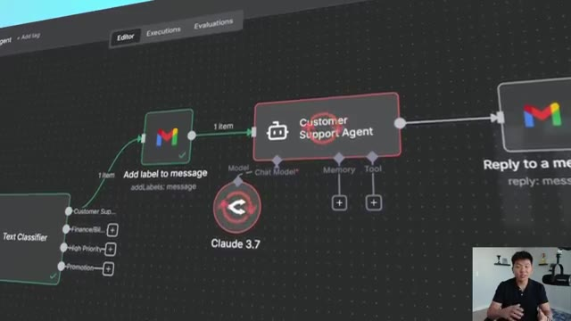
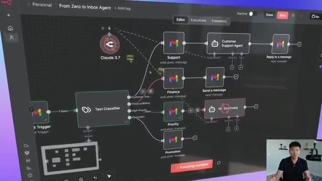
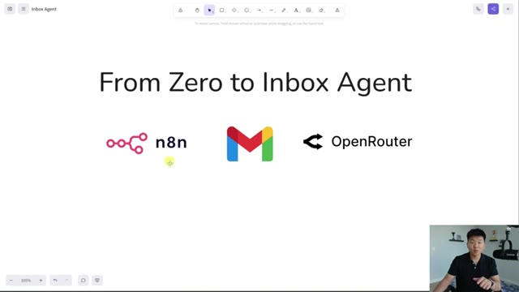
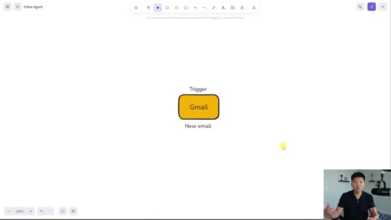
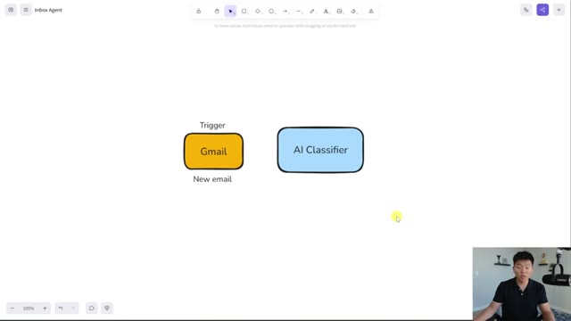
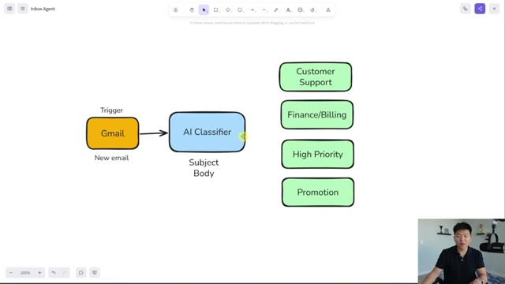
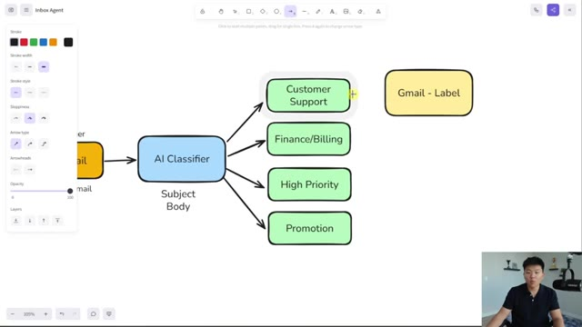
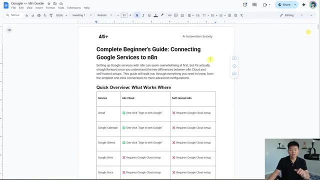
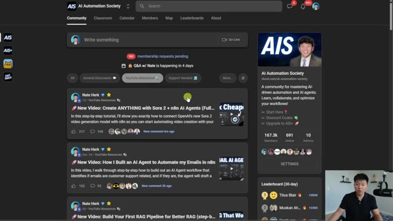

# 🎬 From Zero to Inbox Agent (Full Beginner's Course, No-Code)

> **Chaîne** : [Nate Herk | AI Automation](https://www.youtube.com/@nateherk/featured)  
> **Lien YouTube** : [https://www.youtube.com/watch?v=HN0oWxbF2bM](https://www.youtube.com/watch?v=HN0oWxbF2bM)  
> **Date de publication** : 20251029  
> **Durée** : 00:37:33  
> **Identifiant vidéo** : `HN0oWxbF2bM`  
> **Transcription & Analyse** : `whisper-v3-large-turbo+gemini-3.5-flash-lite`  

---

## 📌 Synthèse Exécutive & Outils

### 💡 Résumé
Dans cette vidéo intitulée **De zéro à l'agent de messagerie : Cours complet pour débutants sans code**, Nate Herk décortique les capacités pratiques d'automatisation et de développement propulsées par les modèles de pointe.

### 🛠️ Outils, Modèles & Logiciels Présentés
- **Opus 5.5 & Claude Code** : Modèles d'ingénierie et agents de codage autonome.

### 🔑 Points Clés & Enseignements Stratégiques
- Optimiser le niveau d'effort et le raisonnement des modèles IA pour des résultats industriels.
- Automatiser les cycles de création logicielle de bout en bout.

---

## ⏱️ Chronologie & Transcription Complète Audio & Visuelle (Mot pour Mot)

### ⏱️ `[00:00:00 - 00:00:24]` | Segment #01

**🔊 Audio (Transcription Intégrale Mot pour Mot en Français) :**
> By the end of this video, you'll have your own inbox agent that is classifying and labeling all of your incoming emails. We're going to build all of this together, step by step, with no code, so that you guys will understand how you can actually start to scale up this system to become a full inbox manager. So I don't want to waste any time. Let's get straight into the video. All right, so the first thing we're going to do is actually wireframe this out, just so we're all completely aligned on the way that this system is going to work before we actually hop into NNN and start building.

**👁️ Analyse Visuelle d'Écran (gemini-3.5-flash-lite) :**
**Interface & Outils** : n8n (outil d'automatisation de workflow).

**Contenu textuel & Code** : Workflow logique comprenant : "Mail Trigger", "Text Classifier", nœuds Gmail, nœuds d'agent IA ("Customer Support Agent", "Mr. Doomsday") et intégration de modèles (Claude 3.7).

**Action / Démonstration** : Démonstration visuelle de la structure logique d'un agent d'e-mail automatisé, de la classification à la réponse, au sein de l'éditeur n8n.

*⏱️ 00:00:06 — Zoom sur une partie du workflow dans n8n, montrant le classificateur de texte connectant des nœuds Gmail pour le marquage et un agent de support client utilisant Claude 3.7.*

*⏱️ 00:00:12 — Vue d'ensemble du workflow complet d'automatisation d'inbox sur n8n, illustrant le trigger Gmail, le classificateur de texte et plusieurs branches traitant les e-mails (Support, Finance, Priorité, Promotion).*

---

### ⏱️ `[00:00:24 - 00:00:44]` | Segment #02

**🔊 Audio (Transcription Intégrale Mot pour Mot en Français) :**
> So I'm going to take you from zero to having an inbox agent in this video, and we're going to use just three tools. N at N is where we're going to be building this actual system. You can get started on a 14-day free trial using the link in the description, and then after that, it's like 25 bucks a month. We're going to be using Gmail today specifically, but if you do have Outlook or a different email provider, you can follow along. It just might not be the exact same clicks at the exact same spots.

**👁️ Analyse Visuelle d'Écran (gemini-3.5-flash-lite) :**
**Interface & Outils** : Logiciel de tableau blanc numérique (type Excalidraw ou similaire).

**Contenu textuel & Code** : Texte "From Zero to Inbox Agent" et logos : n8n, Gmail, OpenRouter.

**Action / Démonstration** : Présentation visuelle de la pile technologique (stack) utilisée pour construire l'agent d'automatisation de la boîte de réception.

*⏱️ 00:00:29 — Une diapositive de présentation sur un tableau blanc numérique présentant le titre "From Zero to Inbox Agent" et les logos des trois outils utilisés : n8n, Gmail et OpenRouter.*

---

### ⏱️ `[00:00:45 - 00:01:20]` | Segment #03

**🔊 Audio (Transcription Intégrale Mot pour Mot en Français) :**
> And then we're going to be using a tool called Open Router, which is where we actually connect to different AI models. So like I said, we're going to be wireframing this out, which basically means a visual diagram of what this system is. And this is something that I strongly encourage you do before you build any sort of system. You have to have all of the steps of the process mapped out clearly before you actually start building. And this is something that I teach in my full course as well. If you want to check that out, the link will be in the description. Anyways, every single process starts with some sort of trigger. And our trigger for this workflow today is going to be a Gmail trigger. So you can see that we have Gmail, we're saying it's a trigger, and the trigger action is whenever we get a new email in our inbox. So that's going to kick off the rest of this workflow.

**👁️ Analyse Visuelle d'Écran (gemini-3.5-flash-lite) :**
**Interface & Outils** : Excalidraw (outil de dessin et de wireframing).

**Contenu textuel & Code** : Un rectangle jaune central contenant le texte "Gmail" avec l'étiquette "Trigger" au-dessus et "New email" en dessous.

**Action / Démonstration** : Le présentateur illustre le point de départ d'une automatisation ("wireframing") en utilisant un outil de diagramme pour définir le déclencheur du système.

*⏱️ 00:00:54 — Un schéma de workflow minimaliste affichant une étape de déclenchement (Trigger) avec une icône Gmail intitulée "New email".*

---

### ⏱️ `[00:01:21 - 00:01:55]` | Segment #04

**🔊 Audio (Transcription Intégrale Mot pour Mot en Français) :**
> So when that email comes in, it's going to have information. It's going to have stuff like who sent this email, what time was it, what's the subject, what's the body, and then some other metadata as well. And so we're going to feed this Gmail information into an AI classifier node. What we want the AI classifier node to do is it's going to look at the subject and the body. So I'm going to real quick just say basically the incoming information will be the subject of the email and the body of the email. And then it's going to basically read through that and understand what type of email is this. And so for the sake of today's video, we're going to do four generic

**👁️ Analyse Visuelle d'Écran (gemini-3.5-flash-lite) :**
**Interface & Outils** : Outil de diagramme ou de tableau blanc numérique (type Excalidraw).

**Contenu textuel & Code** : Diagramme de workflow simpliste montrant le flux de données : "Gmail (Trigger: New email)" vers "AI Classifier".

**Action / Démonstration** : Présentation visuelle de l'architecture du workflow d'automatisation avant la mise en œuvre technique.

*⏱️ 00:01:29 — Un schéma conceptuel sur une toile blanche présentant deux blocs connectés : un bloc orange "Gmail" (Trigger/New email) et un bloc bleu "AI Classifier".*

---

### ⏱️ `[00:01:55 - 00:02:15]` | Segment #05

**🔊 Audio (Transcription Intégrale Mot pour Mot en Français) :**
> categories, which are customer support, finance and billing, high priority, and promotion. So we're basically going to explain to this AI classifier how to interpret the emails as one of the four. And then it will shoot that email string down into one of these four categories. So then it's up to us to basically handle what goes on the rest of that flow. So let's start with just one example.

**👁️ Analyse Visuelle d'Écran (gemini-3.5-flash-lite) :**
**Interface & Outils** : Outil de création de diagrammes (type Excalidraw).

**Contenu textuel & Code** : Le schéma montre un déclencheur "Gmail" (nouveau mail) connecté à un module "AI Classifier" (analysant le sujet et le corps du mail), qui redirige ensuite vers quatre catégories : "Customer Support", "Finance/Billing", "High Priority" et "Promotion".

**Action / Démonstration** : Présentation visuelle de l'architecture logique du workflow d'automatisation des emails avant sa mise en œuvre technique.

*⏱️ 00:02:00 — Diagramme de flux illustrant le processus d'automatisation d'un agent de messagerie ("Inbox Agent") avec une étape de classification IA.*

---

### ⏱️ `[00:02:15 - 00:02:52]` | Segment #06

**🔊 Audio (Transcription Intégrale Mot pour Mot en Français) :**
> Let's say we get an email. The AI decides, okay, this is a customer support related email. So I'm going to send it up here down this first branch. So maybe we know if we get a customer support email, we want to go ahead and actually label it in Gmail as customer support and keep that in this specific inbox or that specific folder. Next, we may actually want an AI agent to go ahead and send off a draft or even just a reply to this person. So we can basically teach this AI agent how to respond to customer support related inquiries. And then we can have it do is shoot off a reply right back in Gmail itself to whoever sent that initial email that triggered that

**👁️ Analyse Visuelle d'Écran (gemini-3.5-flash-lite) :**
**Interface & Outils** : Excalidraw (outil de tableau blanc numérique).

**Contenu textuel & Code** : Diagramme de flux : [Email] -> [AI Classifier] -> branches (Customer Support, Finance/Billing, High Priority, Promotion). Un bloc isolé indique "Gmail - Label".

**Action / Démonstration** : Le présentateur manipule le schéma et sélectionne la boîte "Customer Support" pour illustrer le routage des emails.

*⏱️ 00:02:24 — Un schéma de workflow montrant un "AI Classifier" traitant des emails entrants pour les diriger vers différentes catégories, avec une mise en évidence sur le branchement "Customer Support".*

---

### ⏱️ `[00:02:52 - 00:03:27]` | Segment #07

**🔊 Audio (Transcription Intégrale Mot pour Mot en Français) :**
> workflow back over here. So for customer support, let's just say that's what we're doing. So the idea is based on what category of email comes in, you're in full control of what you want to happen. We probably want all of them to have some sort of label where it gets put in that category right away. But then from there, I don't know if we want an instant reply. I don't know if we want to just create a draft. I don't know if we even maybe just don't want to respond at all and just notify someone else about this inquiry. What do you want to happen? That's what you have to set up here. So when we get into NNN, I'm going to show a few different things that could happen after each path. But basically an email would come in, it would get classified. Let's say it gets classified

**👁️ Analyse Visuelle d'Écran (gemini-3.5-flash-lite) :**
**Interface & Outils** : Présentation ou face-caméra explicatif sans interface logicielle partagée.

**Contenu textuel & Code** : Explications orales et mise en contexte méthodologique.

**Action / Démonstration** : Explications face caméra et démonstration conceptuelle.

---

### ⏱️ `[00:03:27 - 00:03:58]` | Segment #08

**🔊 Audio (Transcription Intégrale Mot pour Mot en Français) :**
> as high priority. Then we would take the next steps only in that high priority branch. But if a promotional email comes in and gets classified as promotion, then maybe a different order of operations would happen down here. So now that we've seen a wireframe and we understand the system that we're building, let's actually hop over to NNN, open up a new workflow and go ahead and get started here. All right. So this is what our blank workflow looks like. And as you saw based on the wireframe, we know that we have to start this process with a Gmail trigger. So I'm going to click on add first step. I'm going to type in Gmail and click on this button right here.

**👁️ Analyse Visuelle d'Écran (gemini-3.5-flash-lite) :**
**Interface & Outils** : Présentation ou face-caméra explicatif sans interface logicielle partagée.

**Contenu textuel & Code** : Explications orales et mise en contexte méthodologique.

**Action / Démonstration** : Explications face caméra et démonstration conceptuelle.

---

### ⏱️ `[00:03:58 - 00:04:21]` | Segment #09

**🔊 Audio (Transcription Intégrale Mot pour Mot en Français) :**
> Automatically, this pops up with triggers. There's 26 different actions we can take, but it knows that there's nothing else on our workflow yet and it has to start with a trigger. So it prompts us to click on the on message received trigger. Now, the first thing that we have to do is actually sign into our Gmail account. So you would basically open this button right here and it would probably just say create new credential. You click on create new credential and just go ahead and sign in to the email that you wanna use for this inbox manager.

**👁️ Analyse Visuelle d'Écran (gemini-3.5-flash-lite) :**
**Interface & Outils** : Présentation ou face-caméra explicatif sans interface logicielle partagée.

**Contenu textuel & Code** : Explications orales et mise en contexte méthodologique.

**Action / Démonstration** : Explications face caméra et démonstration conceptuelle.

---

### ⏱️ `[00:04:21 - 00:04:44]` | Segment #10

**🔊 Audio (Transcription Intégrale Mot pour Mot en Français) :**
> And if you're self-hosting or locally hosting your NNN and it's not as simple as just signing in here, then I will also drop this full complete beginner's guide on NNN and setting it up with Google in my free school community. The link for that will be down in the description. When you get in there, it will look like this. You'll click on YouTube resources or search for the title of this video. And then when you find the post associated with this video, there'll be a file right here, which will be this Google guide.

**👁️ Analyse Visuelle d'Écran (gemini-3.5-flash-lite) :**
**Interface & Outils** : Google Docs (Image 1) ; Plateforme communautaire Skool (Image 2).

**Contenu textuel & Code** : Image 1 : Tableau comparatif détaillant les prérequis (connexion simple vs configuration Google Cloud) pour Gmail, Calendar, Sheets, Drive et Docs. Image 2 : Fil d'actualité de la communauté avec des titres de tutoriels vidéo sur n8n et les agents IA.

**Action / Démonstration** : Présentation visuelle du guide explicatif pour le self-hosting (Image 1) et navigation sur la plateforme de la communauté où le guide est hébergé (Image 2).

*⏱️ 00:04:27 — Un document Google Docs présentant un guide pour débutants sur la connexion des services Google à n8n, incluant un tableau comparatif entre "n8n Cloud" et "Self-Hosted n8n".*

*⏱️ 00:04:38 — L'interface de la communauté en ligne "AI Automation Society" (plateforme Skool), affichant un flux de publications, des ressources YouTube et des informations sur les membres.*

---

### ⏱️ `[00:04:44 - 00:05:20]` | Segment #11

**🔊 Audio (Transcription Intégrale Mot pour Mot en Français) :**
> And then you guys can hopefully use that to get set up. Anyways, once you get connected here, it should look like this. You basically can set up how often you want this to pull So every minute every hour every day, whatever We're just gonna leave it on every minute and then the event here is going to be a message received and then what we're gonna do is real quick I'm gonna shoot myself a sample email from a different one and we'll pull that in so we can just take a look at how that comes into NNN Okay, so I've got this Google sheet here with sample emails and we've also got definitions that we'll use later This will also be available So if you want to grab that so you can follow along with the video, or you could also go to chatGPT and just have it make up some, this will also be in my free school community along with

**👁️ Analyse Visuelle d'Écran (gemini-3.5-flash-lite) :**
**Interface & Outils** : Présentation ou face-caméra explicatif sans interface logicielle partagée.

**Contenu textuel & Code** : Explications orales et mise en contexte méthodologique.

**Action / Démonstration** : Explications face caméra et démonstration conceptuelle.

---

### ⏱️ `[00:05:20 - 00:05:53]` | Segment #12

**🔊 Audio (Transcription Intégrale Mot pour Mot en Français) :**
> this guide. So what I'm going to do is grab this customer support type of example. I'm going to grab the subject, which is issue logging into dashboard and throw that in as a subject. I'm going to grab this body and throw that in the email, and then I'm going to send it off. And now back in NNN, I'm going to hit fetch test event, which is going to check for the most recent message in this Gmail inbox. And you can see right here that we have the email that I just sent myself and the subject was issue logging into dashboard. Now, one thing you're going to notice real quick is we just have a snippet. The issue is this is just going to give you a short summary of the email

**👁️ Analyse Visuelle d'Écran (gemini-3.5-flash-lite) :**
**Interface & Outils** : Présentation ou face-caméra explicatif sans interface logicielle partagée.

**Contenu textuel & Code** : Explications orales et mise en contexte méthodologique.

**Action / Démonstration** : Explications face caméra et démonstration conceptuelle.

---

### ⏱️ `[00:05:53 - 00:06:26]` | Segment #13

**🔊 Audio (Transcription Intégrale Mot pour Mot en Français) :**
> body. And a lot of times it's going to be too long to actually fit here. And that's because we have this little toggle on, which says simplify. So I'm going to toggle that off, hit fetch test event once again. And now you can see we get way more information back about this email. And if this was a long email, we would have gotten the full text right here. So I'm going to leave this as simplify turned off. And now we have this data to play with. So what I'm going to do is hit this button in the top right called pin data. And this is basically just going to save our data so that if we refresh or something like that, we don't lose that and have to go pull it in again.

**👁️ Analyse Visuelle d'Écran (gemini-3.5-flash-lite) :**
**Interface & Outils** : Présentation ou face-caméra explicatif sans interface logicielle partagée.

**Contenu textuel & Code** : Explications orales et mise en contexte méthodologique.

**Action / Démonstration** : Explications face caméra et démonstration conceptuelle.

---

### ⏱️ `[00:06:26 - 00:06:48]` | Segment #14

**🔊 Audio (Transcription Intégrale Mot pour Mot en Français) :**
> We now just have this data sitting here that we can use. And like I said, we can test the rest of our workflow with it. Okay, cool. So now according to our wireframe, as you can see, the next step is we need to set up our AI classifier node to read the subject and body of that email and classify it in one of these four categories. So to do that, I'm gonna click on the plus right after the Gmail trigger, and I'm going to type text classifier, as you can see right here.

**👁️ Analyse Visuelle d'Écran (gemini-3.5-flash-lite) :**
**Interface & Outils** : Présentation ou face-caméra explicatif sans interface logicielle partagée.

**Contenu textuel & Code** : Explications orales et mise en contexte méthodologique.

**Action / Démonstration** : Explications face caméra et démonstration conceptuelle.

---

### ⏱️ `[00:06:48 - 00:07:13]` | Segment #15

**🔊 Audio (Transcription Intégrale Mot pour Mot en Français) :**
> So this is how NN nodes work. On the left-hand side over here, we have our input. So this is everything about this Gmail trigger. We can pull any of this information in to the middle and have it be classified or whatever we wanna do with it. The middle is the configuration, so we'll set up the node, and then the right will be the actual output data. So in the middle, the first thing that I'm going to do is you see there's a big box that says text to classify, which basically means what am I looking at?

**👁️ Analyse Visuelle d'Écran (gemini-3.5-flash-lite) :**
**Interface & Outils** : Présentation ou face-caméra explicatif sans interface logicielle partagée.

**Contenu textuel & Code** : Explications orales et mise en contexte méthodologique.

**Action / Démonstration** : Explications face caméra et démonstration conceptuelle.

---

### ⏱️ `[00:07:13 - 00:07:32]` | Segment #16

**🔊 Audio (Transcription Intégrale Mot pour Mot en Français) :**
> And so what I'm gonna do is real quick, change this to an expression, which means that we can use variables, and variables are basically just these things over here that could basically change, and you will see what I mean by that in a sec. I'm gonna click on this button to open it up full screen, And now I'm going to give this node what to look at. So we know we want it to look at the subject and we want it to look at the body.

**👁️ Analyse Visuelle d'Écran (gemini-3.5-flash-lite) :**
**Interface & Outils** : Présentation ou face-caméra explicatif sans interface logicielle partagée.

**Contenu textuel & Code** : Explications orales et mise en contexte méthodologique.

**Action / Démonstration** : Explications face caméra et démonstration conceptuelle.

---

### ⏱️ `[00:07:32 - 00:07:52]` | Segment #17

**🔊 Audio (Transcription Intégrale Mot pour Mot en Français) :**
> So I'm gonna just basically indicate to it that that's what it's about to receive. And then on this left-hand side, I just need to find the subject and the body. So if I keep scrolling down, I should eventually find out of all of this messy metadata right here is the subject. So this is what I mean by variables. The Gmail node every time will output a variable called subject.

**👁️ Analyse Visuelle d'Écran (gemini-3.5-flash-lite) :**
**Interface & Outils** : Présentation ou face-caméra explicatif sans interface logicielle partagée.

**Contenu textuel & Code** : Explications orales et mise en contexte méthodologique.

**Action / Démonstration** : Explications face caméra et démonstration conceptuelle.

---

### ⏱️ `[00:07:52 - 00:08:10]` | Segment #18

**🔊 Audio (Transcription Intégrale Mot pour Mot en Français) :**
> And that subject is a variable because it represents whatever actually is the real subject. So no matter what the subject is, as long as we have this variable here, the agent or the text classifier AI node will actually be able to read that. And then same thing for the body. This comes in a variable over here called text, and I'll just drag that in as well.

**👁️ Analyse Visuelle d'Écran (gemini-3.5-flash-lite) :**
**Interface & Outils** : Présentation ou face-caméra explicatif sans interface logicielle partagée.

**Contenu textuel & Code** : Explications orales et mise en contexte méthodologique.

**Action / Démonstration** : Explications face caméra et démonstration conceptuelle.

---

### ⏱️ `[00:08:10 - 00:08:30]` | Segment #19

**🔊 Audio (Transcription Intégrale Mot pour Mot en Français) :**
> And now, every time we get an email, this AI node will be looking at the subject and the body of the email. Okay, so we have that set up, but now we need to actually tell it the different categories to place the emails in. And so you can see there's a button here called add category. And I'm going to just go ahead real quick and add four because we know we're going to set up four different categories.

**👁️ Analyse Visuelle d'Écran (gemini-3.5-flash-lite) :**
**Interface & Outils** : Présentation ou face-caméra explicatif sans interface logicielle partagée.

**Contenu textuel & Code** : Explications orales et mise en contexte méthodologique.

**Action / Démonstration** : Explications face caméra et démonstration conceptuelle.

---

### ⏱️ `[00:08:31 - 00:08:52]` | Segment #20

**🔊 Audio (Transcription Intégrale Mot pour Mot en Français) :**
> But before this, as a prereq, what you want to do is go into your inbox in Gmail. You can see on this left-hand side, I already have four labels right there. And what you would do is just create a new label, name it whatever you want. You know, you can choose the color and then just make four of those if you want to follow along with this demo. So you can see I've got customer support, finance and billing, high priority and promotion.

**👁️ Analyse Visuelle d'Écran (gemini-3.5-flash-lite) :**
**Interface & Outils** : Présentation ou face-caméra explicatif sans interface logicielle partagée.

**Contenu textuel & Code** : Explications orales et mise en contexte méthodologique.

**Action / Démonstration** : Explications face caméra et démonstration conceptuelle.

---

### ⏱️ `[00:08:52 - 00:09:12]` | Segment #21

**🔊 Audio (Transcription Intégrale Mot pour Mot en Français) :**
> And so now what we need to do is give this AI node those exact same categories. So I'll start by writing customer support. Down here, I'll do finance slash billing. The third one, I will do high priority. And then for the fourth one, I'll go ahead and type in promotion.

**👁️ Analyse Visuelle d'Écran (gemini-3.5-flash-lite) :**
**Interface & Outils** : Présentation ou face-caméra explicatif sans interface logicielle partagée.

**Contenu textuel & Code** : Explications orales et mise en contexte méthodologique.

**Action / Démonstration** : Explications face caméra et démonstration conceptuelle.

---

### ⏱️ `[00:09:13 - 00:09:34]` | Segment #22

**🔊 Audio (Transcription Intégrale Mot pour Mot en Français) :**
> So now it knows, okay, these are the four categories. And what we need to do next is give each of these categories a description or a prompt. so the AI basically can read this and say, okay, which one does it fit in based on the description? And so I made this real simple for you guys. You can go to that Google Sheet that I gave you earlier, click on the definitions tab down here and just copy and paste in these definitions.

**👁️ Analyse Visuelle d'Écran (gemini-3.5-flash-lite) :**
**Interface & Outils** : Présentation ou face-caméra explicatif sans interface logicielle partagée.

**Contenu textuel & Code** : Explications orales et mise en contexte méthodologique.

**Action / Démonstration** : Explications face caméra et démonstration conceptuelle.

---

### ⏱️ `[00:09:35 - 00:10:10]` | Segment #23

**🔊 Audio (Transcription Intégrale Mot pour Mot en Français) :**
> So here's our customer support definition. I'll paste that in right there. I'm gonna go get the finance and billing description and I'm gonna paste that in right there. And I'm just gonna do the same for the bottom two. You guys don't have to see me do that. Now, what I will hit on is the fact that descriptions and prompts are very important and being as specific as you can while still being concise is really really important. So right here let's just read one of them for customer support I said emails requesting help troubleshooting or guidance for any product or service usually describes issues like login errors bugs or malfunctioning features and then I also gave

**👁️ Analyse Visuelle d'Écran (gemini-3.5-flash-lite) :**
**Interface & Outils** : Présentation ou face-caméra explicatif sans interface logicielle partagée.

**Contenu textuel & Code** : Explications orales et mise en contexte méthodologique.

**Action / Démonstration** : Explications face caméra et démonstration conceptuelle.

---

### ⏱️ `[00:10:10 - 00:10:46]` | Segment #24

**🔊 Audio (Transcription Intégrale Mot pour Mot en Français) :**
> it some common keywords like error issue problem help access support fix reset troubleshoot and And so what you would do is over time, if you realize, huh, my AI node is classifying things as customer support way too often, then you'd come in here and you'd make a change to this prompt. Or, huh, my AI node is missing a lot of customer support emails. I wonder why. Let me come into this prompt and make this a little bit more detailed and specific. And that's what you would want to monitor with all of these other categories as well. So anyways, this was a customer support email example. I'm going to go ahead and hit execute step. And what happens is we get an error.

**👁️ Analyse Visuelle d'Écran (gemini-3.5-flash-lite) :**
**Interface & Outils** : Présentation ou face-caméra explicatif sans interface logicielle partagée.

**Contenu textuel & Code** : Explications orales et mise en contexte méthodologique.

**Action / Démonstration** : Explications face caméra et démonstration conceptuelle.

---

### ⏱️ `[00:10:47 - 00:11:16]` | Segment #25

**🔊 Audio (Transcription Intégrale Mot pour Mot en Français) :**
> And the reason why is because we need to connect AI to this node and we currently haven't connected AI. So you're going to go to openrouter.ai, you're going to create an account. And then once you create an account, you need to do two things. The first thing is go up here to your credits and you need to add billing information. You do have to pay for AI, but if you add five bucks just to play around, that will last you a while. And then you just need to add more later. And And then once you add credits, you can go over here on the left hand side or back up here in the top right and click on keys.

**👁️ Analyse Visuelle d'Écran (gemini-3.5-flash-lite) :**
**Interface & Outils** : Présentation ou face-caméra explicatif sans interface logicielle partagée.

**Contenu textuel & Code** : Explications orales et mise en contexte méthodologique.

**Action / Démonstration** : Explications face caméra et démonstration conceptuelle.

---

### ⏱️ `[00:11:16 - 00:11:39]` | Segment #26

**🔊 Audio (Transcription Intégrale Mot pour Mot en Français) :**
> And this is an API key that you will use to access that billing information. So it's kind of like a password, which is why you shouldn't give other people your API key. So what I'm going to do is click on create API key. I'm going to name this one inbox demo, and I'm going to create. And now it gives me this long string of letters and numbers and a few dashes that I'm going to go ahead and copy.

**👁️ Analyse Visuelle d'Écran (gemini-3.5-flash-lite) :**
**Interface & Outils** : Présentation ou face-caméra explicatif sans interface logicielle partagée.

**Contenu textuel & Code** : Explications orales et mise en contexte méthodologique.

**Action / Démonstration** : Explications face caméra et démonstration conceptuelle.

---

### ⏱️ `[00:11:39 - 00:12:14]` | Segment #27

**🔊 Audio (Transcription Intégrale Mot pour Mot en Français) :**
> now when I go back and edit in, I need to add a chat model. So I'm going to click on this plus button. I'm going to type in open router, which is the platform we were just on. And then it will prompt you right here to create a new credential. And that's where you'll paste in that API key right here. So you can see, there you go. I just pasted in my API key. And this is the exact same long string of letters and numbers that I went ahead and grabbed over here in open router. And don't even think about trying to use this one. I'm going to delete it as soon as I finished recording this video. So anyways, I'm going to go ahead and hit save. And now you can see we got the green connection tested successfully. I would also get in the habit of naming these credentials so you

**👁️ Analyse Visuelle d'Écran (gemini-3.5-flash-lite) :**
**Interface & Outils** : Présentation ou face-caméra explicatif sans interface logicielle partagée.

**Contenu textuel & Code** : Explications orales et mise en contexte méthodologique.

**Action / Démonstration** : Explications face caméra et démonstration conceptuelle.

---

### ⏱️ `[00:12:14 - 00:12:38]` | Segment #28

**🔊 Audio (Transcription Intégrale Mot pour Mot en Français) :**
> know what they are. And now you are connected to Open Router and you have access to tons and tons of different chat models, which is why I like to use Open Router and keep all my billing information in one spot. So for the sake of today's demo, I'm just going to go with a 4.1 mini. It's got a good balance of cost and speed and power and everything. So not saying that this is the most optimized model for this use case or anything, but for the demo, let's just stick with that. Keep it simple.

**👁️ Analyse Visuelle d'Écran (gemini-3.5-flash-lite) :**
**Interface & Outils** : Présentation ou face-caméra explicatif sans interface logicielle partagée.

**Contenu textuel & Code** : Explications orales et mise en contexte méthodologique.

**Action / Démonstration** : Explications face caméra et démonstration conceptuelle.

---

### ⏱️ `[00:12:39 - 00:13:02]` | Segment #29

**🔊 Audio (Transcription Intégrale Mot pour Mot en Français) :**
> All right. Now, if I go back into the text classifier and I hit execute step, it's actually going to work. And AI just read this email and look what it did. It output it in the customer support branch. You can see we have one item and then finance, billing, high priority and promotion. We have no items. So you can see now it sent it down the right path, just like we talked about in our wireframe of having the AI send it down a particular path.

**👁️ Analyse Visuelle d'Écran (gemini-3.5-flash-lite) :**
**Interface & Outils** : Présentation ou face-caméra explicatif sans interface logicielle partagée.

**Contenu textuel & Code** : Explications orales et mise en contexte méthodologique.

**Action / Démonstration** : Explications face caméra et démonstration conceptuelle.

---

### ⏱️ `[00:13:03 - 00:13:22]` | Segment #30

**🔊 Audio (Transcription Intégrale Mot pour Mot en Français) :**
> All right, so now it's up to us to figure out what do we wanna do now that it has been labeled as customer support. And real quick, I'm just gonna click on this node and hit P, which is going to pin that data so if we accidentally lose it, we don't have to rerun AI and spend more money. So let's just say what we wanna do first is label this email in Gmail as customer support.

**👁️ Analyse Visuelle d'Écran (gemini-3.5-flash-lite) :**
**Interface & Outils** : Présentation ou face-caméra explicatif sans interface logicielle partagée.

**Contenu textuel & Code** : Explications orales et mise en contexte méthodologique.

**Action / Démonstration** : Explications face caméra et démonstration conceptuelle.

---

### ⏱️ `[00:13:23 - 00:13:52]` | Segment #31

**🔊 Audio (Transcription Intégrale Mot pour Mot en Français) :**
> So I'm gonna click on the plus. I'm gonna go ahead and type Gmail. And now we have a list of actions that we can take. I'm going to go ahead and look for label actions. create a label, delete a label, get many. No. We're going to look for message actions. And right here we have add label to message. So I'm going to click on that. Then you have to make sure you have the correct credential connected. So not my true horizon email. We're doing this demo email. You can see the resource is a message. The operation is add label. And then it's asking for a message ID.

**👁️ Analyse Visuelle d'Écran (gemini-3.5-flash-lite) :**
**Interface & Outils** : Présentation ou face-caméra explicatif sans interface logicielle partagée.

**Contenu textuel & Code** : Explications orales et mise en contexte méthodologique.

**Action / Démonstration** : Explications face caméra et démonstration conceptuelle.

---

### ⏱️ `[00:13:53 - 00:14:15]` | Segment #32

**🔊 Audio (Transcription Intégrale Mot pour Mot en Français) :**
> So all we need to do is grab the message ID of the email that triggered this workflow. So we can actually grab it right here. It's coming from the text classifier. But just to show you guys where that's actually coming from. I'm going to close out a text classifier. I'm going to open up the Gmail trigger. And right here, now you can see I have ID. This is the actual message ID of the one that triggered this workflow. And once again, this is a variable. So this will change every time.

**👁️ Analyse Visuelle d'Écran (gemini-3.5-flash-lite) :**
**Interface & Outils** : Présentation ou face-caméra explicatif sans interface logicielle partagée.

**Contenu textuel & Code** : Explications orales et mise en contexte méthodologique.

**Action / Démonstration** : Explications face caméra et démonstration conceptuelle.

---

### ⏱️ `[00:14:15 - 00:14:34]` | Segment #33

**🔊 Audio (Transcription Intégrale Mot pour Mot en Français) :**
> And now that we have that, I'm going to look at this label names or ID, and I need to choose which one I want, which we know is customer support. So I chose that. And now what I'm going to do is execute the step. But before I do that, I just wanted to show you guys the email in my inbox is right here, Nate Herkelman, issue logging into dashboard. Back in NNN, we're gonna hit execute step.

**👁️ Analyse Visuelle d'Écran (gemini-3.5-flash-lite) :**
**Interface & Outils** : Présentation ou face-caméra explicatif sans interface logicielle partagée.

**Contenu textuel & Code** : Explications orales et mise en contexte méthodologique.

**Action / Démonstration** : Explications face caméra et démonstration conceptuelle.

---

### ⏱️ `[00:14:34 - 00:14:59]` | Segment #34

**🔊 Audio (Transcription Intégrale Mot pour Mot en Français) :**
> We're gonna get a success message over here. And then if I go back into my inbox right here, we just saw that got labeled as customer support and it is now down here in the customer support label. Cool, once again, just gonna pin that so we can keep that operation saved. And now let's continue moving on down this customer support branch. Okay, so according to the wireframe, what we would do after we label is we'd have an AI agent that creates a response and then we'll have it send that response back.

**👁️ Analyse Visuelle d'Écran (gemini-3.5-flash-lite) :**
**Interface & Outils** : Présentation ou face-caméra explicatif sans interface logicielle partagée.

**Contenu textuel & Code** : Explications orales et mise en contexte méthodologique.

**Action / Démonstration** : Explications face caméra et démonstration conceptuelle.

---

### ⏱️ `[00:14:59 - 00:15:18]` | Segment #35

**🔊 Audio (Transcription Intégrale Mot pour Mot en Français) :**
> So what we're gonna do is we're gonna click on the plus. I'm gonna type in AI agent. And now we have an AI agent that we have to configure. So what we have to do first, just like we did in the text classifier node, is tell it what it's looking at. We're not looking at a connected chat trigger node because that doesn't exist. So what we're gonna do is change this to define below.

**👁️ Analyse Visuelle d'Écran (gemini-3.5-flash-lite) :**
**Interface & Outils** : Présentation ou face-caméra explicatif sans interface logicielle partagée.

**Contenu textuel & Code** : Explications orales et mise en contexte méthodologique.

**Action / Démonstration** : Explications face caméra et démonstration conceptuelle.

---

### ⏱️ `[00:15:18 - 00:15:38]` | Segment #36

**🔊 Audio (Transcription Intégrale Mot pour Mot en Français) :**
> And then I'm gonna do basically the exact same thing as we did earlier. I'm going to open this up. I'm going to say, here's the subject, Here's the body. And we're going to go back to the Gmail trigger. And we're going to drag in those exact same two variables so that the agent that's going to respond to this email actually has context of what the email is saying.

**👁️ Analyse Visuelle d'Écran (gemini-3.5-flash-lite) :**
**Interface & Outils** : Présentation ou face-caméra explicatif sans interface logicielle partagée.

**Contenu textuel & Code** : Explications orales et mise en contexte méthodologique.

**Action / Démonstration** : Explications face caméra et démonstration conceptuelle.

---

### ⏱️ `[00:15:39 - 00:16:02]` | Segment #37

**🔊 Audio (Transcription Intégrale Mot pour Mot en Français) :**
> So there we go. We got our subject and our email body in this agent. Now, next thing to do is we have to prompt this AI agent what to do. So it's looking at the subject and body, but it doesn't know. Does it have categories to push it into like earlier? What does it have to do? And so that type of information, stuff that is like instructions, or role or things like that, we put that down here in the system prompt.

**👁️ Analyse Visuelle d'Écran (gemini-3.5-flash-lite) :**
**Interface & Outils** : Présentation ou face-caméra explicatif sans interface logicielle partagée.

**Contenu textuel & Code** : Explications orales et mise en contexte méthodologique.

**Action / Démonstration** : Explications face caméra et démonstration conceptuelle.

---

### ⏱️ `[00:16:03 - 00:16:22]` | Segment #38

**🔊 Audio (Transcription Intégrale Mot pour Mot en Français) :**
> So I'd click on add option and I'd click on system message. You can see by default, it says you are a helpful assistant. We're gonna go ahead and get rid of that. And I'm gonna change this to an expression just so we can make this full screen. And so this is where you would put in any information like your customer support policies or how you would want an agent to respond to people if it was dealing with customer support related issues.

**👁️ Analyse Visuelle d'Écran (gemini-3.5-flash-lite) :**
**Interface & Outils** : Présentation ou face-caméra explicatif sans interface logicielle partagée.

**Contenu textuel & Code** : Explications orales et mise en contexte méthodologique.

**Action / Démonstration** : Explications face caméra et démonstration conceptuelle.

---

### ⏱️ `[00:16:22 - 00:16:55]` | Segment #39

**🔊 Audio (Transcription Intégrale Mot pour Mot en Français) :**
> But what I'm gonna do real quick is I'm gonna go to ChatGPT and I'm gonna whisper flow and say, can you please create me a concise system prompt in a markdown code window? This is for an expert customer support assistant for AI Automation Society. This agent's name is Nate's AI Assistant, so it will always sign off emails with Nate's AI Assistant. It's a friendly assistant that responds to users' queries with the correct information, and if it can't find the answer to something, it will tell the customer to reach out to nateherk88 at gmail.com. Okay, so I got that brief

**👁️ Analyse Visuelle d'Écran (gemini-3.5-flash-lite) :**
**Interface & Outils** : Présentation ou face-caméra explicatif sans interface logicielle partagée.

**Contenu textuel & Code** : Explications orales et mise en contexte méthodologique.

**Action / Démonstration** : Explications face caméra et démonstration conceptuelle.

---

### ⏱️ `[00:16:55 - 00:17:29]` | Segment #40

**🔊 Audio (Transcription Intégrale Mot pour Mot en Français) :**
> system prompts. Like I said, I'm just doing this quick for the sake of the example, but we have a bit of a role. You are Nate's AI assistant. You are a professional customer support representative for AI Automation Society. You always sign off every message as Nate's AI assistant, and then you've got some instructions right here. So like I said, you would customize this for your specific use case for whatever you want to happen down that branch. And now once again, before we test it, we have to give this agent a brain. So what I'm actually going to do is we know that we have open router down here connected to GPT 4.1 mini and I'll actually just name this GPT 4.1 mini just for

**👁️ Analyse Visuelle d'Écran (gemini-3.5-flash-lite) :**
**Interface & Outils** : Présentation ou face-caméra explicatif sans interface logicielle partagée.

**Contenu textuel & Code** : Explications orales et mise en contexte méthodologique.

**Action / Démonstration** : Explications face caméra et démonstration conceptuelle.

---

### ⏱️ `[00:17:29 - 00:18:03]` | Segment #41

**🔊 Audio (Transcription Intégrale Mot pour Mot en Français) :**
> organization and if I want to use the same chat model I could just take this and drag it into there but if I wanted to change it I could then of course connect my own separate open router and I could change the model. So let's actually just say for this case we want to use Claude 3.7 Sonnet sure and so now we have cloud 3.7 sonnet in the customer support agent but we're using 4.1 mini to classify our emails so what i'm going to do is hit this little play button above the agent to actually run it you can see right now it's using its brain it's reading that incoming email and

**👁️ Analyse Visuelle d'Écran (gemini-3.5-flash-lite) :**
**Interface & Outils** : Présentation ou face-caméra explicatif sans interface logicielle partagée.

**Contenu textuel & Code** : Explications orales et mise en contexte méthodologique.

**Action / Démonstration** : Explications face caméra et démonstration conceptuelle.

---

### ⏱️ `[00:18:03 - 00:18:25]` | Segment #42

**🔊 Audio (Transcription Intégrale Mot pour Mot en Français) :**
> it's going to create an output for us and if i go ahead and click in to read it it basically says i'm sorry to hear that you're experiencing login issues with your dashboard this is definitely frustrating, but we can help you sort this out. And then it lists off some options that could be causing the error. And then you also see the bottom, it says, if these steps don't resolve the issue, please email Nate directly at this email. And then it signs off Nate's AI assistant.

**👁️ Analyse Visuelle d'Écran (gemini-3.5-flash-lite) :**
**Interface & Outils** : Présentation ou face-caméra explicatif sans interface logicielle partagée.

**Contenu textuel & Code** : Explications orales et mise en contexte méthodologique.

**Action / Démonstration** : Explications face caméra et démonstration conceptuelle.

---

### ⏱️ `[00:18:26 - 00:18:58]` | Segment #43

**🔊 Audio (Transcription Intégrale Mot pour Mot en Français) :**
> So that's perfect for now. And now I'm just going to real quick pin this so we don't lose that data. And the last thing we have to do on this customer support branch is have it send back that email in the same thread to the email that kicked off this whole process. So I'm going to click on the plus right after the agent. I'm going to type in Gmail. We're going to do a message action, which is right here, reply to a message, not send. We're replying to one. So I'll click on reply. And then we have a few things to do. First of all, make sure that you're connected to the right account. Second of all, we need the message ID. So I'm actually just going to go all the way back to the Gmail trigger and

**👁️ Analyse Visuelle d'Écran (gemini-3.5-flash-lite) :**
**Interface & Outils** : Présentation ou face-caméra explicatif sans interface logicielle partagée.

**Contenu textuel & Code** : Explications orales et mise en contexte méthodologique.

**Action / Démonstration** : Explications face caméra et démonstration conceptuelle.

---

### ⏱️ `[00:18:58 - 00:19:33]` | Segment #44

**🔊 Audio (Transcription Intégrale Mot pour Mot en Français) :**
> grab the ID right there. Once again, email type can be HTML or text. I'm going to go ahead and switch this to text. And then we have the actual message itself, which we know is the output of the customer support agent that we just built together. So I'm going to drag this output into the message field. And then the last thing, which is a little extra tip, is I'm going to add an option that says append NNN attribution and turn that off. Because by default, this would send an email and then the bottom would say this was automatically sent by NNN. So I just want to turn that off. And now I'm going to go ahead and hit execute step. This is going to give us another success message over

**👁️ Analyse Visuelle d'Écran (gemini-3.5-flash-lite) :**
**Interface & Outils** : Présentation ou face-caméra explicatif sans interface logicielle partagée.

**Contenu textuel & Code** : Explications orales et mise en contexte méthodologique.

**Action / Démonstration** : Explications face caméra et démonstration conceptuelle.

---

### ⏱️ `[00:19:33 - 00:20:09]` | Segment #45

**🔊 Audio (Transcription Intégrale Mot pour Mot en Français) :**
> here. You can see it says sent. And I'm going to go into my email right here. This is the email that we had that was labeled as customer support. So I'm going to click on it. And now you can see we have a reply, which says, I'm sorry to hear you're experiencing login issues with your dashboard. This is definitely frustrating, but we can help you sort this out. Here is the actual email that it generated for us. And then we also see it signs off with Nate's AI assistant. Now I don't like that there's bold formatting right there, but we could once again, just go ahead and prompt it to change that. The reason why it did that is because in the prompt, you can see it explicitly does have bold like this. So I would literally just get rid of those bold things. And now it wouldn't

**👁️ Analyse Visuelle d'Écran (gemini-3.5-flash-lite) :**
**Interface & Outils** : Présentation ou face-caméra explicatif sans interface logicielle partagée.

**Contenu textuel & Code** : Explications orales et mise en contexte méthodologique.

**Action / Démonstration** : Explications face caméra et démonstration conceptuelle.

---

### ⏱️ `[00:20:09 - 00:20:45]` | Segment #46

**🔊 Audio (Transcription Intégrale Mot pour Mot en Français) :**
> sign off like that anymore. But anyways, what I'm going to do real quick is unpin all of this data. I'm going to go back into our sample emails right here, and I'm going to send one more customer support example. And we're going to run the whole flow in basically one fell swoop and make sure everything's working right. All right. So here's the moment of truth. I'm going to hit execute workflow. This pulls in an email. It's being classified. It got sent down the right branch, customer support. It got labeled. The customer support agent is now making that message and it got sent off like that. So now that took maybe 15 seconds and what normally would have taken you

**👁️ Analyse Visuelle d'Écran (gemini-3.5-flash-lite) :**
**Interface & Outils** : Présentation ou face-caméra explicatif sans interface logicielle partagée.

**Contenu textuel & Code** : Explications orales et mise en contexte méthodologique.

**Action / Démonstration** : Explications face caméra et démonstration conceptuelle.

---

### ⏱️ `[00:20:45 - 00:21:21]` | Segment #47

**🔊 Audio (Transcription Intégrale Mot pour Mot en Français) :**
> at least a few minutes to read the email, respond to it and classify it just basically happened instantly. So let's go back into the email. Let's see, this is the new one that we just got. Let's go ahead and refresh. We can see that it is now labeled as customer support and there's a reply. So I'll click on it and you can see we got, hello, I understand you're experiencing some issues on with your CRM integration, not syncing leads, blah, blah, blah. Here are some things you can try. And you can also reach out to Nate directly. And it also signed off. There we go with no more bold because we fixed that system prompt. So as you can see, we have now basically set up

**👁️ Analyse Visuelle d'Écran (gemini-3.5-flash-lite) :**
**Interface & Outils** : Présentation ou face-caméra explicatif sans interface logicielle partagée.

**Contenu textuel & Code** : Explications orales et mise en contexte méthodologique.

**Action / Démonstration** : Explications face caméra et démonstration conceptuelle.

---

### ⏱️ `[00:21:21 - 00:21:56]` | Segment #48

**🔊 Audio (Transcription Intégrale Mot pour Mot en Français) :**
> the customer support inquiries that may be coming in. And now all you would have to do is continue to make this prompt better and better so that the agent answers better. And if you needed to, you could even connect it to some sort of database that has more external knowledge. We're not going to dive into that in today's tutorial, but I've done plenty of stuff with RAG on my channel If you want to check out some other videos about RAG I'll actually include my full beginner's guide course right up there. I'll tag it right there So later if you want to come back and make these agents even smarter, you could go ahead and watch those RAG videos So the process is basically the exact same for all of these other branches now

**👁️ Analyse Visuelle d'Écran (gemini-3.5-flash-lite) :**
**Interface & Outils** : Présentation ou face-caméra explicatif sans interface logicielle partagée.

**Contenu textuel & Code** : Explications orales et mise en contexte méthodologique.

**Action / Démonstration** : Explications face caméra et démonstration conceptuelle.

---

### ⏱️ `[00:21:56 - 00:22:32]` | Segment #49

**🔊 Audio (Transcription Intégrale Mot pour Mot en Français) :**
> So we're not going to build out all of them fully But I will show you maybe a few different things that you could do for different branches Okay, so I just sent myself a new email This one is the subject incorrect charge on invoice. And of course, this came from the sample email database right here So what i'm gonna do is in this workflow i'm gonna hit execute We're pulling that email and hopefully this one gets classified as finance and billing which it did as you can see It says one item and so now we need to set up what comes next for the finance and billing flow So the first thing i'm going to do right away is just have it get labeled real quick Just going to pin this data so we don't have to Come back if we end up losing it and what we can actually do is just copy this node from up above

**👁️ Analyse Visuelle d'Écran (gemini-3.5-flash-lite) :**
**Interface & Outils** : Présentation ou face-caméra explicatif sans interface logicielle partagée.

**Contenu textuel & Code** : Explications orales et mise en contexte méthodologique.

**Action / Démonstration** : Explications face caméra et démonstration conceptuelle.

---

### ⏱️ `[00:22:32 - 00:22:51]` | Segment #50

**🔊 Audio (Transcription Intégrale Mot pour Mot en Français) :**
> because we know this node is adding an email and we know that the variable should already be set up correctly as well, as you can see. Now, all we'd have to do is just change the label. So instead of customer support, we want this one to go down, I spelled finance wrong, down the finance and billing label instead. So we can see in our inbox, there it is.

**👁️ Analyse Visuelle d'Écran (gemini-3.5-flash-lite) :**
**Interface & Outils** : Présentation ou face-caméra explicatif sans interface logicielle partagée.

**Contenu textuel & Code** : Explications orales et mise en contexte méthodologique.

**Action / Démonstration** : Explications face caméra et démonstration conceptuelle.

---

### ⏱️ `[00:22:52 - 00:23:10]` | Segment #51

**🔊 Audio (Transcription Intégrale Mot pour Mot en Français) :**
> I'm gonna go ahead and execute this step. And now in our inbox, this should change to finance and billing any second now. Maybe I just need to hit refresh. There we go, finance and billing. And we've got one new email down there. So maybe for finance and billing emails, we just want to notify the finance and billing team. And maybe we just want to give them a quick summary of what just came in and who sent it.

**👁️ Analyse Visuelle d'Écran (gemini-3.5-flash-lite) :**
**Interface & Outils** : Présentation ou face-caméra explicatif sans interface logicielle partagée.

**Contenu textuel & Code** : Explications orales et mise en contexte méthodologique.

**Action / Démonstration** : Explications face caméra et démonstration conceptuelle.

---

### ⏱️ `[00:23:11 - 00:23:35]` | Segment #52

**🔊 Audio (Transcription Intégrale Mot pour Mot en Français) :**
> So when I click on this next button to send some of a notification, this could be in Slack. This could be in ClickUp. This could be even on WhatsApp. This could be on Telegram, whatever we want. And I don't want to just add more tools into today's tutorial just to keep it simple. So we're just going to do a Gmail notification. But the point is, there's so many different integrations. So however you want to send or receive notifications, you can set up here.

**👁️ Analyse Visuelle d'Écran (gemini-3.5-flash-lite) :**
**Interface & Outils** : Présentation ou face-caméra explicatif sans interface logicielle partagée.

**Contenu textuel & Code** : Explications orales et mise en contexte méthodologique.

**Action / Démonstration** : Explications face caméra et démonstration conceptuelle.

---

### ⏱️ `[00:23:36 - 00:23:56]` | Segment #53

**🔊 Audio (Transcription Intégrale Mot pour Mot en Français) :**
> So what we're going to do in this one is send a message. And you may be wondering, we don't have any message to send because there's no agent making one. We're actually just going to save a few bucks here. Well, not really a few bucks. The AI models are a lot cheaper than you think. But we're going to save some AI processing power and basically custom make this message with variables instead of AI. So I'll show you guys what I mean by that.

**👁️ Analyse Visuelle d'Écran (gemini-3.5-flash-lite) :**
**Interface & Outils** : Présentation ou face-caméra explicatif sans interface logicielle partagée.

**Contenu textuel & Code** : Explications orales et mise en contexte méthodologique.

**Action / Démonstration** : Explications face caméra et démonstration conceptuelle.

---

### ⏱️ `[00:23:56 - 00:24:34]` | Segment #54

**🔊 Audio (Transcription Intégrale Mot pour Mot en Français) :**
> I'm gonna open up this configuration. You can see we have a to, a subject, email type, and a message. So for the to, what I would do is I would notify whoever's in charge of billing. So for the sake of the example, I'm just going to put billing at example.com. For the subject, I'm going to change this to an expression, and we can basically have a mix of variables and also things that we hard code in. So just like you saw earlier, for example, in here, we always hard coded in subject, but then the variable changes every time. So that's basically what we're doing in this node. So I'm going to say new billing email, and then I can basically just go ahead and put the person's name

**👁️ Analyse Visuelle d'Écran (gemini-3.5-flash-lite) :**
**Interface & Outils** : Présentation ou face-caméra explicatif sans interface logicielle partagée.

**Contenu textuel & Code** : Explications orales et mise en contexte méthodologique.

**Action / Démonstration** : Explications face caméra et démonstration conceptuelle.

---

### ⏱️ `[00:24:34 - 00:25:05]` | Segment #55

**🔊 Audio (Transcription Intégrale Mot pour Mot en Français) :**
> of who sent this email. So I'm going to go back to the Gmail trigger. I'm going to scroll down until we find the actual name of the person. So we have the address right here. We have the name. Okay. Here's the name of the person that sent the email. So I could go ahead and you can see it says from, and then there's an address and a name. So I'm going to drag this in. So it basically says new billing email from Nate Herkelman. And then the email type, I'm going to once again, change this to text. And then for the message, we're going to make this an expression and open this up full screen. And I'll show you guys what I want to put here as like a sample message.

**👁️ Analyse Visuelle d'Écran (gemini-3.5-flash-lite) :**
**Interface & Outils** : Présentation ou face-caméra explicatif sans interface logicielle partagée.

**Contenu textuel & Code** : Explications orales et mise en contexte méthodologique.

**Action / Démonstration** : Explications face caméra et démonstration conceptuelle.

---

### ⏱️ `[00:25:06 - 00:25:38]` | Segment #56

**🔊 Audio (Transcription Intégrale Mot pour Mot en Français) :**
> So I could start this off by just saying like, hey, billing team, an exclamation mark. And I could say, we received a new billing inquiry at, and I just want to put the time real quick. So the way that I could get to the current time is I could do two curly braces. you can see that some stuff pops up but I'm just interested in this one that says dollar sign now I'll click on that you can see we have a really ugly format right here and this is the current date and time though so what I'm gonna do is I'm gonna type dot format now what this does is it

**👁️ Analyse Visuelle d'Écran (gemini-3.5-flash-lite) :**
**Interface & Outils** : Présentation ou face-caméra explicatif sans interface logicielle partagée.

**Contenu textuel & Code** : Explications orales et mise en contexte méthodologique.

**Action / Démonstration** : Explications face caméra et démonstration conceptuelle.

---

### ⏱️ `[00:25:38 - 00:26:16]` | Segment #57

**🔊 Audio (Transcription Intégrale Mot pour Mot en Français) :**
> puts the date right there so 2025 uh October I almost said August October 23rd but I could format this even farther so I want the actual current time so I'm just gonna put a space I'm gonna do h h which gives us the two digit hour i'm going to put a colon i'm going to do m m which gives us the two digit minutes and then if i go ahead and put space a it basically says am or pm so now it's going to always come in with we received a new billing inquiry at today's date and here's the time i'm going to put a period and then two enters to go down again i'm going to say it is from and

**👁️ Analyse Visuelle d'Écran (gemini-3.5-flash-lite) :**
**Interface & Outils** : Présentation ou face-caméra explicatif sans interface logicielle partagée.

**Contenu textuel & Code** : Explications orales et mise en contexte méthodologique.

**Action / Démonstration** : Explications face caméra et démonstration conceptuelle.

---

### ⏱️ `[00:26:16 - 00:26:49]` | Segment #58

**🔊 Audio (Transcription Intégrale Mot pour Mot en Français) :**
> then we're going to once again go all the way back down here to grab the name of the person that sent it. So there we go. Just drag the name and I'm going to say you can email them at, and then I'm going to also just drag in the email address. And then just to give a little more context, we will just say, this is the subject of their email. And I'll put a colon. And then we just have to go back up to find the subject, which is right here. And so now whoever's in charge of billing, or maybe you send this, like whatever notification you send, they're getting what time it came in, who it's from, who to email, and what the subject is. So that the way they can see right away, if it's

**👁️ Analyse Visuelle d'Écran (gemini-3.5-flash-lite) :**
**Interface & Outils** : Présentation ou face-caméra explicatif sans interface logicielle partagée.

**Contenu textuel & Code** : Explications orales et mise en contexte méthodologique.

**Action / Démonstration** : Explications face caméra et démonstration conceptuelle.

---

### ⏱️ `[00:26:49 - 00:27:13]` | Segment #59

**🔊 Audio (Transcription Intégrale Mot pour Mot en Français) :**
> urgent, that they can just hop on it. And then maybe I'll just end with a friendly cheers, and then we're good to go. So if I go ahead and exit this and I execute this step, this is going to send that email. So we'll hop back into email and we'll refresh this real quick. And we'll now see that we sent this. Well, it's a fake email. So we see address not found, but we now get this email that has all of those variables filled in. And it's always going to have those filled in every time.

**👁️ Analyse Visuelle d'Écran (gemini-3.5-flash-lite) :**
**Interface & Outils** : Présentation ou face-caméra explicatif sans interface logicielle partagée.

**Contenu textuel & Code** : Explications orales et mise en contexte méthodologique.

**Action / Démonstration** : Explications face caméra et démonstration conceptuelle.

---

### ⏱️ `[00:27:13 - 00:27:33]` | Segment #60

**🔊 Audio (Transcription Intégrale Mot pour Mot en Français) :**
> and we didn't even have to use AI for that. Now notice, this is what it's gonna do if you don't turn off that append, edit, and attribution. So we would basically just go back into here, add option, append, edit, and attribution, and then turn that off. And now we would be good to go and we wouldn't get this little teeny message down there. Okay, so hopefully you guys are starting to understand the pattern here.

**👁️ Analyse Visuelle d'Écran (gemini-3.5-flash-lite) :**
**Interface & Outils** : Présentation ou face-caméra explicatif sans interface logicielle partagée.

**Contenu textuel & Code** : Explications orales et mise en contexte méthodologique.

**Action / Démonstration** : Explications face caméra et démonstration conceptuelle.

---

### ⏱️ `[00:27:33 - 00:28:06]` | Segment #61

**🔊 Audio (Transcription Intégrale Mot pour Mot en Français) :**
> So I'm gonna speed it up a little bit. Let's do high priority. I'm gonna copy the label thing once again because we already know this is set up the same. And I'm just gonna go into the label and instead of finance and billing, this one is going to be a high priority label. And while we're here, I'm also going to do that real quick. One more time down here for promotion. Everything should be set up already. We just need to change the label from high priority to promotion right there. And so now if I save this, we have all of our labeling done and we just have to configure what comes after these labels. And so I'm real quick going to go in here and I'm going to shoot myself an example, high priority message,

**👁️ Analyse Visuelle d'Écran (gemini-3.5-flash-lite) :**
**Interface & Outils** : Présentation ou face-caméra explicatif sans interface logicielle partagée.

**Contenu textuel & Code** : Explications orales et mise en contexte méthodologique.

**Action / Démonstration** : Explications face caméra et démonstration conceptuelle.

---

### ⏱️ `[00:28:06 - 00:28:43]` | Segment #62

**🔊 Audio (Transcription Intégrale Mot pour Mot en Français) :**
> and then I'll be right back. All right. I shot that message off. We're going to retest this workflow. It should classify it as high priority. And there we go. Boom. High priority. So the email was right there. If I hit refresh, we now have it marked as high priority. And what we're going to do this time is we're going to do something similar as up here, but instead of replying, we're going to have it send a draft instead. So I'm going to go into this system prompt that we made and just say, can you make me another one just like this? But this time, instead of Nate AI assistant, this will be called Mr. Doomsday. And it is not friendly. It's actually very rude. Okay. So we have you

**👁️ Analyse Visuelle d'Écran (gemini-3.5-flash-lite) :**
**Interface & Outils** : Présentation ou face-caméra explicatif sans interface logicielle partagée.

**Contenu textuel & Code** : Explications orales et mise en contexte méthodologique.

**Action / Démonstration** : Explications face caméra et démonstration conceptuelle.

---

### ⏱️ `[00:28:43 - 00:29:17]` | Segment #63

**🔊 Audio (Transcription Intégrale Mot pour Mot en Français) :**
> are Mr. Doomsday, an expert, but brutally honest and rude customer support rep. And one more change, Mr. Doomsday won't be handling customer support. He will actually be handling high priority emails. Okay. You know what? I don't even like this system prompt as much. Let's just copy this one because I think it might result in some funnier outputs. We will see. Anyways, I'm going to click on the plus after the label, we're going to add another AI agent. And we have to once again, say, what are you looking at? So we're going to click on define below. I'm going to change this to an expression. And we know that we want it to once again, look at the subject and look at the body.

**👁️ Analyse Visuelle d'Écran (gemini-3.5-flash-lite) :**
**Interface & Outils** : Présentation ou face-caméra explicatif sans interface logicielle partagée.

**Contenu textuel & Code** : Explications orales et mise en contexte méthodologique.

**Action / Démonstration** : Explications face caméra et démonstration conceptuelle.

---

### ⏱️ `[00:29:17 - 00:29:50]` | Segment #64

**🔊 Audio (Transcription Intégrale Mot pour Mot en Français) :**
> Where do we get these variables from? If you said Gmail trigger, you would be correct. You could also get it from text classifier, but sometimes it's easier just to look at the source. And so I'm going to go in here. We're going to scroll all the way down and find the subject, which is right here. And we're also going to find the text, which is right here. And now Mr. Doomsday will be looking at the right information. I have to open up the add option and click on system message. And I'm going to come in here and I'm going to paste in the system prompts, make it a full screen. And we're just going to remove the bold as we remember from last time. So it doesn't sign off with that bold

**👁️ Analyse Visuelle d'Écran (gemini-3.5-flash-lite) :**
**Interface & Outils** : Présentation ou face-caméra explicatif sans interface logicielle partagée.

**Contenu textuel & Code** : Explications orales et mise en contexte méthodologique.

**Action / Démonstration** : Explications face caméra et démonstration conceptuelle.

---

### ⏱️ `[00:29:50 - 00:30:24]` | Segment #65

**🔊 Audio (Transcription Intégrale Mot pour Mot en Français) :**
> stuff. And now I have to give it a brain. So I'm actually just going to bring this into the Claude 3.7 that we set up earlier so that both the customer support agent and Mr. Doomsday are going to be using the same chat model, which is completely fine. So I'm going to go ahead and hit play to run Mr. Doomsday. You can see it's using its brain and we'll see the type of email that we get back from him. Okay. So we got, oh, fantastic. Another urgent system outage that somehow warrants bothering me. Let me break this down for you. Genius. If the main production environment is down affecting all users, I obviously already know about it. Okay. So sarcastic. Yep. Signs off Mr.

**👁️ Analyse Visuelle d'Écran (gemini-3.5-flash-lite) :**
**Interface & Outils** : Présentation ou face-caméra explicatif sans interface logicielle partagée.

**Contenu textuel & Code** : Explications orales et mise en contexte méthodologique.

**Action / Démonstration** : Explications face caméra et démonstration conceptuelle.

---

### ⏱️ `[00:30:24 - 00:30:55]` | Segment #66

**🔊 Audio (Transcription Intégrale Mot pour Mot en Français) :**
> Doomsday, let's go ahead and send this back as a draft because we probably don't want that to go out to someone and we could go ahead and make some tweaks to it. So I'm going to click on the plus after Mr. Doomsday and we're going to go to Gmail and when I open this up you can see that we have a few things. We have reply to a message. We also down here later have draft actions where it says create a draft. I'm actually going to go ahead and click on create a draft because in here what we're able to do is add a thread ID. And then that basically lets us link it to a specific thread.

**👁️ Analyse Visuelle d'Écran (gemini-3.5-flash-lite) :**
**Interface & Outils** : Présentation ou face-caméra explicatif sans interface logicielle partagée.

**Contenu textuel & Code** : Explications orales et mise en contexte méthodologique.

**Action / Démonstration** : Explications face caméra et démonstration conceptuelle.

---

### ⏱️ `[00:30:56 - 00:31:32]` | Segment #67

**🔊 Audio (Transcription Intégrale Mot pour Mot en Français) :**
> So one thing you may notice is that right here, it says to reply to an existing thread, specify the exact subject title of that thread. And so we're not going to be doing a specific one, we're just going to reply to the one that came in. But it will be interesting because usually drafts don't have subjects, they just kind of, you know, keep going on. So we'll see what happens here. But anyways, I'm going to drag the output in as the message that it's sending. It's already set up as text. And then for the thread ID, I'm going to go back to the Gmail trigger and we're going to grab right here, the thread ID of that message. And then for the subject for now, I'm just going to put test to see if that even shows up or not. And I'm going to go ahead and shoot off

**👁️ Analyse Visuelle d'Écran (gemini-3.5-flash-lite) :**
**Interface & Outils** : Présentation ou face-caméra explicatif sans interface logicielle partagée.

**Contenu textuel & Code** : Explications orales et mise en contexte méthodologique.

**Action / Démonstration** : Explications face caméra et démonstration conceptuelle.

---

### ⏱️ `[00:31:32 - 00:31:51]` | Segment #68

**🔊 Audio (Transcription Intégrale Mot pour Mot en Français) :**
> this draft. We get this success message that says that it's a draft. And then if I go into the email, there is our high priority message. I hit refresh. We can now see we have a draft associated with it. And as you can see, we don't actually need the subject because if we were to send this off, it would reply right there, but it's not automatically filling in the recipient.

**👁️ Analyse Visuelle d'Écran (gemini-3.5-flash-lite) :**
**Interface & Outils** : Présentation ou face-caméra explicatif sans interface logicielle partagée.

**Contenu textuel & Code** : Explications orales et mise en contexte méthodologique.

**Action / Démonstration** : Explications face caméra et démonstration conceptuelle.

---

### ⏱️ `[00:31:52 - 00:32:29]` | Segment #69

**🔊 Audio (Transcription Intégrale Mot pour Mot en Français) :**
> So what we need to do is come back into the create a draft node, add another option. And then right here, it has a two email. So we'd click on the two email, go back into our Gmail trigger. We would come all the way back down to the actual person that sent this email, which is right here and drag that in as well. And we actually don't even have the option here to get rid of the append and it an attribution, which means that it just naturally won't come in. So I'm going to go ahead and delete this draft. We're going to go back out. I'm going to now refire this node. It just told us that it created a new draft. And if I go into here, hit refresh, we see another draft. And now it's

**👁️ Analyse Visuelle d'Écran (gemini-3.5-flash-lite) :**
**Interface & Outils** : Présentation ou face-caméra explicatif sans interface logicielle partagée.

**Contenu textuel & Code** : Explications orales et mise en contexte méthodologique.

**Action / Démonstration** : Explications face caméra et démonstration conceptuelle.

---

### ⏱️ `[00:32:29 - 00:32:56]` | Segment #70

**🔊 Audio (Transcription Intégrale Mot pour Mot en Français) :**
> actually being sent to this person. It has our body and I can go ahead and send it off. And that is why, as you can see, because it's a reply, it doesn't matter that we have a test in the subject. the subject won't actually show up unless you want it to reply to a specific existing thread. Then you would specify the subject right there. So we've done these three. We have a automatic message going out. We have a message notifying a different team. And then we have a draft going out.

**👁️ Analyse Visuelle d'Écran (gemini-3.5-flash-lite) :**
**Interface & Outils** : Présentation ou face-caméra explicatif sans interface logicielle partagée.

**Contenu textuel & Code** : Explications orales et mise en contexte méthodologique.

**Action / Démonstration** : Explications face caméra et démonstration conceptuelle.

---

### ⏱️ `[00:32:57 - 00:33:23]` | Segment #71

**🔊 Audio (Transcription Intégrale Mot pour Mot en Français) :**
> So for this last promotional one, all I want to do is I want to label it as promotion and then just mark it as unread because I really don't care that much. So that's what we're going to do here. Okay. So I just sent myself this promotional email, as you can see right here, new features, 25% off. We're going to execute the workflow. The text classifier should put this down the promotion path. There we go. I'm going to go back to the inbox, hit refresh. We got this labeled as promotion. So perfect. And now all I'm going to do is add a new Gmail node right after it.

**👁️ Analyse Visuelle d'Écran (gemini-3.5-flash-lite) :**
**Interface & Outils** : Présentation ou face-caméra explicatif sans interface logicielle partagée.

**Contenu textuel & Code** : Explications orales et mise en contexte méthodologique.

**Action / Démonstration** : Explications face caméra et démonstration conceptuelle.

---

### ⏱️ `[00:33:24 - 00:33:42]` | Segment #72

**🔊 Audio (Transcription Intégrale Mot pour Mot en Français) :**
> I'm going to go ahead to the message actions. And right here, it says mark a message as read. So I'm going to click on that. And all we have to do after we choose the right credential, of course, is give it the message ID, which is really, really simple. I'm just going to go back to the Gmail trigger to keep things consistent, drag in the message ID. And when I hit execute step, we get a success message.

**👁️ Analyse Visuelle d'Écran (gemini-3.5-flash-lite) :**
**Interface & Outils** : Présentation ou face-caméra explicatif sans interface logicielle partagée.

**Contenu textuel & Code** : Explications orales et mise en contexte méthodologique.

**Action / Démonstration** : Explications face caméra et démonstration conceptuelle.

---

### ⏱️ `[00:33:43 - 00:34:07]` | Segment #73

**🔊 Audio (Transcription Intégrale Mot pour Mot en Français) :**
> And when I come into my inbox and we go ahead and refresh this, now keep in mind, I haven't clicked on this message yet. Refresh, it just instantly goes as unread. So now we don't even have promotional stuff taking up any of our headspace. So if you guys just followed along with everything that I did, you now have your own inbox manager up and running and you're in full control and should understand how you can customize all of these different paths based on what you want to happen.

**👁️ Analyse Visuelle d'Écran (gemini-3.5-flash-lite) :**
**Interface & Outils** : Présentation ou face-caméra explicatif sans interface logicielle partagée.

**Contenu textuel & Code** : Explications orales et mise en contexte méthodologique.

**Action / Démonstration** : Explications face caméra et démonstration conceptuelle.

---

### ⏱️ `[00:34:08 - 00:34:29]` | Segment #74

**🔊 Audio (Transcription Intégrale Mot pour Mot en Français) :**
> Of course, you could have agents responding or drafting all of these, which is kind of what I have set up for my own inbox system. And it would just be a matter of coming into the prompts and making these a little bit better or giving them access to information or honestly, kind of a combination of the both. One more thing, as I'm editing this video, I realized that I forgot to mention is you need to come in here and make this workflow active.

**👁️ Analyse Visuelle d'Écran (gemini-3.5-flash-lite) :**
**Interface & Outils** : Présentation ou face-caméra explicatif sans interface logicielle partagée.

**Contenu textuel & Code** : Explications orales et mise en contexte méthodologique.

**Action / Démonstration** : Explications face caméra et démonstration conceptuelle.

---

### ⏱️ `[00:34:29 - 00:35:03]` | Segment #75

**🔊 Audio (Transcription Intégrale Mot pour Mot en Français) :**
> Once you activate this workflow, it will say your workflow will now regularly check Gmail for events and trigger executions for them. So what that means is if you were sitting here now and this workflow is active and you've got an email, you wouldn't visually see the green lines and the red circles and everything spinning in this interface. But it is actually going to be triggering in the background and all of those executions will show up when you click on executions right here. If you leave this as test mode, this Gmail trigger will not actually be pulling every minute the way that we have it set up. So you have to make sure every single trigger in NN,

**👁️ Analyse Visuelle d'Écran (gemini-3.5-flash-lite) :**
**Interface & Outils** : Présentation ou face-caméra explicatif sans interface logicielle partagée.

**Contenu textuel & Code** : Explications orales et mise en contexte méthodologique.

**Action / Démonstration** : Explications face caméra et démonstration conceptuelle.

---

### ⏱️ `[00:35:03 - 00:35:37]` | Segment #76

**🔊 Audio (Transcription Intégrale Mot pour Mot en Français) :**
> not just a Gmail one. It's only going to actually be constantly running while you sleep if your workflow is active. So make sure you turn it on if you're ready to start running the system. Now there's lots of ways that you can scale this up like I said and one of those ways that I would recommend doing would be having some sort of logger. So what I would do at the end of all of these flows is I would just have this data writing back to Google Sheets that just says what time an email came in, which path it went down, and like maybe what the reply was or what what the end result was. And the reason for that is then you can kind of just monitor like a Google

**👁️ Analyse Visuelle d'Écran (gemini-3.5-flash-lite) :**
**Interface & Outils** : Présentation ou face-caméra explicatif sans interface logicielle partagée.

**Contenu textuel & Code** : Explications orales et mise en contexte méthodologique.

**Action / Démonstration** : Explications face caméra et démonstration conceptuelle.

---

### ⏱️ `[00:35:37 - 00:36:12]` | Segment #77

**🔊 Audio (Transcription Intégrale Mot pour Mot en Français) :**
> sheet or an air table or wherever you want to log your actions. You can see everything that your agent's doing. And of course you could see that by going into the executions here and just looking at every time it's ran. But it'd be so much better to have a clean front end interface where you can identify patterns. You can see how much stuff is happening. And then you know if you need to come back into the system and make tweaks. You can figure out if you need to make tweaks here, if you need to make tweaks here, if you need to make tweaks here, or if you need to add certain elements in areas that you don't even have them yet. So like I said, I wanted this one to be super simple to follow along with, and we kept this one simple, but there's always ways to scale up. And I've got

**👁️ Analyse Visuelle d'Écran (gemini-3.5-flash-lite) :**
**Interface & Outils** : Présentation ou face-caméra explicatif sans interface logicielle partagée.

**Contenu textuel & Code** : Explications orales et mise en contexte méthodologique.

**Action / Démonstration** : Explications face caméra et démonstration conceptuelle.

---

### ⏱️ `[00:36:12 - 00:36:48]` | Segment #78

**🔊 Audio (Transcription Intégrale Mot pour Mot en Français) :**
> tons and tons of videos on my channel if you're interested. I'll also be attaching this exact template in the FreeSchool community with this Google guide, with all these sample emails, if you want to just look at my prompts or look at some stuff of how I set this thing up. And once again, if you're really still interested in making the system better, and you want to master NN automations, then definitely check out my plus community. The link for that is down in the description. We've got a great community of over 2,500 members who are building with NNN, learning with NNN every single day. And a lot of these people are actually starting to make a lot of money from their NNN skills. So we've got a full course in here. We have Agent Zero, which is the foundations for beginners for learning AI automation. We've got 10 hours to

**👁️ Analyse Visuelle d'Écran (gemini-3.5-flash-lite) :**
**Interface & Outils** : Présentation ou face-caméra explicatif sans interface logicielle partagée.

**Contenu textuel & Code** : Explications orales et mise en contexte méthodologique.

**Action / Démonstration** : Explications face caméra et démonstration conceptuelle.

---

### ⏱️ `[00:36:48 - 00:37:24]` | Segment #79

**🔊 Audio (Transcription Intégrale Mot pour Mot en Français) :**
> 10 seconds where you learn how to identify, design, and build time-saving automations. This is where we have the process mapping and the wire framing, like I kind of alluded to at the beginning of the video and then for our annual members or if you've been in the community for six months we've got one person AI automation agency where we basically dive into how do you actually start to make money from this kind of stuff and lay the groundwork for building a scalable business with AI automation. On top of that we have one live call per week where I answer all your guys' questions we get into some really fun discussions so I'd love to see you guys on those calls I'd love to see you in these communities but that is going to do it for today. If you enjoyed the video

**👁️ Analyse Visuelle d'Écran (gemini-3.5-flash-lite) :**
**Interface & Outils** : Présentation ou face-caméra explicatif sans interface logicielle partagée.

**Contenu textuel & Code** : Explications orales et mise en contexte méthodologique.

**Action / Démonstration** : Explications face caméra et démonstration conceptuelle.

---

### ⏱️ `[00:37:24 - 00:37:32]` | Segment #80

**🔊 Audio (Transcription Intégrale Mot pour Mot en Français) :**
> or you learned something new, please give it a like. It definitely helps me out a ton. And as always, I appreciate you guys making it to the end of the video. I will see you all in the next one. Thanks so much, everyone.

**👁️ Analyse Visuelle d'Écran (gemini-3.5-flash-lite) :**
**Interface & Outils** : Présentation ou face-caméra explicatif sans interface logicielle partagée.

**Contenu textuel & Code** : Explications orales et mise en contexte méthodologique.

**Action / Démonstration** : Explications face caméra et démonstration conceptuelle.

---

