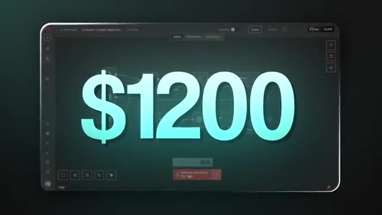
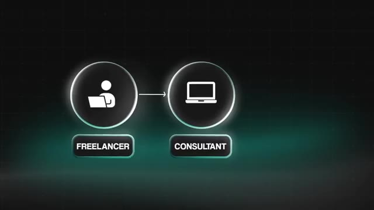
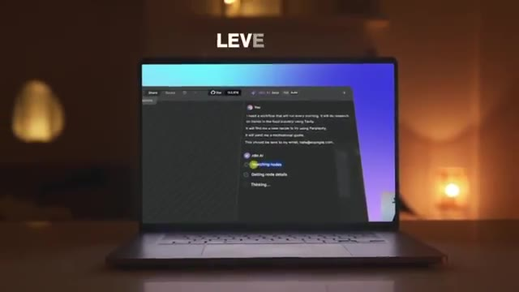
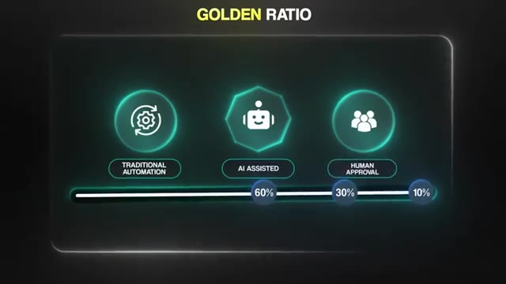
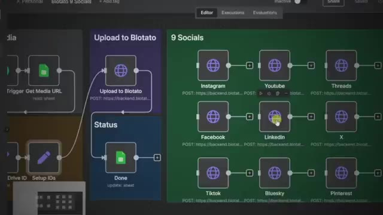
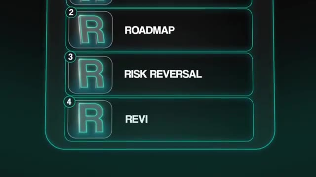
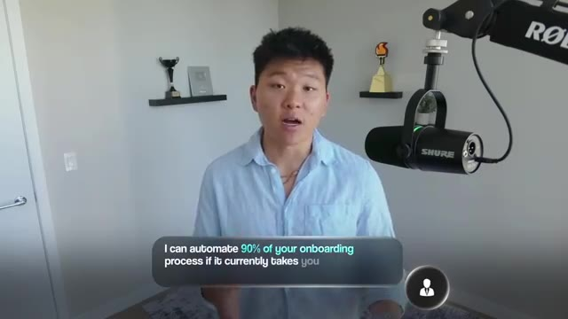

# 🎬 How to Sign Your First AI Automation Client (Without Starting an Agency)

> **Chaîne** : [Nate Herk | AI Automation](https://www.youtube.com/@nateherk/featured)  
> **Lien YouTube** : [https://www.youtube.com/watch?v=9dA1VB8V8oo](https://www.youtube.com/watch?v=9dA1VB8V8oo)  
> **Date de publication** : 20251117  
> **Durée** : 00:14:49  
> **Identifiant vidéo** : `9dA1VB8V8oo`  
> **Transcription & Analyse** : `whisper-v3-large-turbo+gemini-3.5-flash-lite`  

---

## 📌 Synthèse Exécutive & Outils

### 💡 Résumé
Dans cette vidéo intitulée **Comment décrocher votre premier client en automatisation IA (sans créer d'agence)**, Nate Herk décortique les capacités pratiques d'automatisation et de développement propulsées par les modèles de pointe.

### 🛠️ Outils, Modèles & Logiciels Présentés
- **Opus 5.5 & Claude Code** : Modèles d'ingénierie et agents de codage autonome.

### 🔑 Points Clés & Enseignements Stratégiques
- Optimiser le niveau d'effort et le raisonnement des modèles IA pour des résultats industriels.
- Automatiser les cycles de création logicielle de bout en bout.

---

## ⏱️ Chronologie & Transcription Complète Audio & Visuelle (Mot pour Mot)

### ⏱️ `[00:00:00 - 00:00:20]` | Segment #01

**🔊 Audio (Transcription Intégrale Mot pour Mot en Français) :**
> Most people who try to make money with AI start completely wrong. They think that they need to start an agency, hire developers, build a brand, when in reality, you can get your first paying AI automation client without any of that. When I started, I had no team and I had no clue what I was doing, but one simple workflow I built landed me my first $1,200 client. And once I realized why that worked, I understood that you don't need an agency at all.

**👁️ Analyse Visuelle d'Écran (gemini-3.5-flash-lite) :**
**Interface & Outils** : n8n (outil d'automatisation de workflows).

**Contenu textuel & Code** : Interface utilisateur de n8n montrant un workflow de nœuds connectés, avec le montant "$1200" affiché en surimpression.

**Action / Démonstration** : Aucune action technique n'est en cours ; il s'agit d'une illustration de résultat financier liée à l'utilisation de l'outil.

*⏱️ 00:00:15 — Aperçu de l'interface de l'outil d'automatisation n8n avec un workflow en arrière-plan et un texte promotionnel "$1200" au premier plan.*

---

### ⏱️ `[00:00:20 - 00:00:42]` | Segment #02

**🔊 Audio (Transcription Intégrale Mot pour Mot en Français) :**
> You just need to be able to solve one painful problem for one person. So in this video, I'll show you the exact step-by-step process to find, pitch, and sign your first AI automation client, even if you've never landed one before and without a big YouTube channel like mine. But real quick, before we dive into the step-by-step process, there are a few misconceptions that I need you to stop believing in. Because at the end of the day, these limiting beliefs are exactly what's holding you back, while so many others are succeeding.

**👁️ Analyse Visuelle d'Écran (gemini-3.5-flash-lite) :**
**Interface & Outils** : AUCUNE

**Contenu textuel & Code** : Texte affiché à l'écran : "A FEW MISCONCEPTIONS THAT I NEED YOU TO".

**Action / Démonstration** : Le présentateur s'adresse directement à l'audience en expliquant le déroulement de la vidéo.

---

### ⏱️ `[00:00:43 - 00:01:17]` | Segment #03

**🔊 Audio (Transcription Intégrale Mot pour Mot en Français) :**
> So myth number one is that you need an agency and a complex setup. You don't need some sort of giant outreach system or a lead list of 100,000 emails or a team of developers and salespeople. That's the number one mistake I'm seeing beginners making, is they think that they need to look like a full-blown business before they actually become valuable to a business. Myth number two is that you need a lot of money to start. You don't. The great thing about this business model being service-based is that it's one of the lowest cost businesses that you can start online today. All you really need is an N&N subscription to pay for some API credits and some dedicated time to learn, build, and get your first client, which is exactly what we're here to talk about today. Then myth number

**👁️ Analyse Visuelle d'Écran (gemini-3.5-flash-lite) :**
**Interface & Outils** : n8n (page de tarification).

**Contenu textuel & Code** : Tarifs des abonnements : Starter ($24/mois), Pro ($50/mois), Enterprise (Contact us).

**Action / Démonstration** : Aucune manipulation logicielle ou démonstration technique n'est présente dans ces images ; il s'agit d'illustrations conceptuelles et d'une page de tarification statique.

---

### ⏱️ `[00:01:17 - 00:01:37]` | Segment #04

**🔊 Audio (Transcription Intégrale Mot pour Mot en Français) :**
> three is that you need a big audience. You don't need a YouTube channel, a following, or a personal brand like mine. You just need to know how to find the right people, pitch the right offer. So today, I'm sure you guys had to do that. So really the takeaway here is just to not overcomplicate it, which most people do. A lot of people try to write the perfect cold copy, design fancy proposals, or even build massive AI agents to handle all of their personalized outreach.

**👁️ Analyse Visuelle d'Écran (gemini-3.5-flash-lite) :**
**Interface & Outils** : Présentation ou face-caméra explicatif sans interface logicielle partagée.

**Contenu textuel & Code** : Explications orales et mise en contexte méthodologique.

**Action / Démonstration** : Explications face caméra et démonstration conceptuelle.

---

### ⏱️ `[00:01:37 - 00:01:57]` | Segment #05

**🔊 Audio (Transcription Intégrale Mot pour Mot en Français) :**
> When in reality, none of that matters. What I'm gonna show you today is a much simpler way, and I actually want you to start doing it manually first. I've always said this. You don't start as an agency, you start as a freelancer, you evolve into a consultant, and only once you understand the full process, then you build that agency. And that's the exact path that I took. If you wanna dive deeper into that journey, then after this video, check out my monetizing AI automation playlist here on YouTube.

**👁️ Analyse Visuelle d'Écran (gemini-3.5-flash-lite) :**
**Interface & Outils** : Interface graphique de présentation animée (schéma de flux).

**Contenu textuel & Code** : Texte affiché : "FREELANCER" et "CONSULTANT" sous leurs icônes respectives.

**Action / Démonstration** : Visualisation de la transition logique dans le parcours de carrière décrite par le présentateur.

*⏱️ 00:01:47 — Schéma graphique illustrant la progression professionnelle : une icône de "Freelancer" reliée par une flèche à une icône de "Consultant".*

---

### ⏱️ `[00:01:57 - 00:02:16]` | Segment #06

**🔊 Audio (Transcription Intégrale Mot pour Mot en Français) :**
> I talk a lot about my journey. But to put this all in perspective, here's a quick analogy because you guys know I love analogies. If you wanted to sell food, would you immediately just open a restaurant? Of course not. You'd probably start at home. You'd cook for a few friends or family members, maybe even just do it for free to get some feedback. And then maybe you'd start a small food cart or a catering gig, something that lets you validate your idea, get paid and use that to build momentum.

**👁️ Analyse Visuelle d'Écran (gemini-3.5-flash-lite) :**
**Interface & Outils** : Présentation ou face-caméra explicatif sans interface logicielle partagée.

**Contenu textuel & Code** : Explications orales et mise en contexte méthodologique.

**Action / Démonstration** : Explications face caméra et démonstration conceptuelle.

---

### ⏱️ `[00:02:16 - 00:02:42]` | Segment #07

**🔊 Audio (Transcription Intégrale Mot pour Mot en Français) :**
> Only after that, would you open that big restaurant? It's the same thing here. Except of course, we're not selling food. We're actually selling outcomes. or selling leverage. We're not specifically selling AI. The word AI gets thrown around a lot. It brings a lot of hype, but it can also bring a lot of hesitation. Some business owners you're going to talk to might see AI as a risky experimental thing. But if you position what you're offering as a smart system that can automate lead follow-ups, streamline onboarding, eliminate repetitive reporting, that's something that every business understands immediately.

**👁️ Analyse Visuelle d'Écran (gemini-3.5-flash-lite) :**
**Interface & Outils** : n8n (automatisation de workflows IA)

**Contenu textuel & Code** : Prompt utilisateur : "I need a workflow that will run every morning. It will do research on trends in the food industry using Tavily. It will find me a new recipe to try using Perplexity. It will email me to my email, nate@example.com."

**Action / Démonstration** : Exécution d'un agent IA analysant et structurant les nœuds du workflow en réponse à une demande utilisateur.

*⏱️ 00:02:23 — Un ordinateur portable affichant une interface d'agent IA (n8n) avec un prompt utilisateur demandant la création d'un workflow automatisé pour la recherche de tendances alimentaires.*

---

### ⏱️ `[00:02:42 - 00:03:17]` | Segment #08

**🔊 Audio (Transcription Intégrale Mot pour Mot en Français) :**
> And most of the time you can build those kinds of systems using my golden ratio, which is 60% traditional automation, 30% AI assisted, and then that last 10% being human touch or human approval. And that's the balance where things actually work, because it's not about replacing people, it's about giving them leverage. So you don't need to lead with AI, but you can definitely use AI to make your automation smarter and faster, but lead with the outcome. And it's just all about building a good offer. But you can't make a good offer if you don't know who you're actually making that offer to. So this kind of starts by working backwards. The first step is to pick a niche that you either already understand or you can easily talk to. Maybe it's an industry you've worked in, one that you're interested in, or one that we already know a ton of people. If you're unsure,

**👁️ Analyse Visuelle d'Écran (gemini-3.5-flash-lite) :**
**Interface & Outils** : Outil d'automatisation de workflow (type n8n).

**Contenu textuel & Code** : Nœuds de workflow connectés pour la publication automatique vers Instagram, Youtube, Threads, Facebook, Linkedin, X, Tiktok, Bluesky et Pinterest, avec des endpoints API associés.

**Action / Démonstration** : Visualisation et édition du flux de travail automatisé pour la distribution de contenu.

*⏱️ 00:02:51 — Une infographie stylisée intitulée "GOLDEN RATIO" illustrant la répartition 60% automatisation traditionnelle, 30% assistance IA et 10% approbation humaine.*

*⏱️ 00:03:00 — Une capture d'écran d'un outil de workflow automatisé (type n8n) montrant un diagramme de publication multi-réseaux sociaux "9 Socials" connectant divers services.*

---

### ⏱️ `[00:03:17 - 00:03:37]` | Segment #09

**🔊 Audio (Transcription Intégrale Mot pour Mot en Français) :**
> look for time-wasting patterns, industries where people spend hours on DMs or scheduling, reporting, or repetitive admin work. Then you gotta go out and validate it. So you can use LinkedIn, Twitter, Instagram, Reddit. Find people talking about issues in this industry. If you've got friends or family in that space, that's even better because you can ask them and you can get primary research right there by learning how their day actually looks.

**👁️ Analyse Visuelle d'Écran (gemini-3.5-flash-lite) :**
**Interface & Outils** : Présentation ou face-caméra explicatif sans interface logicielle partagée.

**Contenu textuel & Code** : Explications orales et mise en contexte méthodologique.

**Action / Démonstration** : Explications face caméra et démonstration conceptuelle.

---

### ⏱️ `[00:03:37 - 00:03:57]` | Segment #10

**🔊 Audio (Transcription Intégrale Mot pour Mot en Français) :**
> Use my favorite framework, the LRP, listen, repeat, poke, to find out what tasks drain their time and what repetitive processes they face. And once you start hearing the same pains over and over, that's your signal. You can even use AI tools like Perplexity Deep Research or ChatGPT to speed up your research and brainstorm common bottlenecks in that niche. The goal, of course, is to walk away with a single clear sentence that defines who you help and what problem they have.

**👁️ Analyse Visuelle d'Écran (gemini-3.5-flash-lite) :**
**Interface & Outils** : Présentation ou face-caméra explicatif sans interface logicielle partagée.

**Contenu textuel & Code** : Explications orales et mise en contexte méthodologique.

**Action / Démonstration** : Explications face caméra et démonstration conceptuelle.

---

### ⏱️ `[00:03:57 - 00:04:17]` | Segment #11

**🔊 Audio (Transcription Intégrale Mot pour Mot en Français) :**
> Something like, I help personal trainers who spend hours each week on manual lead follow-ups and CRM updates. Because once you've got that clarity, everything else becomes 10 times easier. Your offer, your pricing, and your outreach. So, now that we know who we're selling to, it's time to build our offer. Like it says on the cover of $100 million offers right here, you want your offer to be so good that people would feel stupid saying no.

**👁️ Analyse Visuelle d'Écran (gemini-3.5-flash-lite) :**
**Interface & Outils** : Présentation ou face-caméra explicatif sans interface logicielle partagée.

**Contenu textuel & Code** : Explications orales et mise en contexte méthodologique.

**Action / Démonstration** : Explications face caméra et démonstration conceptuelle.

---

### ⏱️ `[00:04:17 - 00:04:38]` | Segment #12

**🔊 Audio (Transcription Intégrale Mot pour Mot en Français) :**
> The easiest way to think about this is with a simple framework I call the four R's. Result, roadmap, risk reversal, and review. The first R is results. What outcome are they getting? When it comes to AI automation, focus on one specific workflow you know you can confidently deliver. For example, I can automate 90% of your onboarding process. If it currently takes you five hours, I can bring that down to 30 minutes. Always lead with a clear time or cost-saving result.

**👁️ Analyse Visuelle d'Écran (gemini-3.5-flash-lite) :**
**Interface & Outils** : Graphique de présentation interne (overlay).

**Contenu textuel & Code** : Texte affiché : "I can automate 90% of your onboarding process if it currently takes you..." et le cadre des "4 R's" (Roadmap, Risk Reversal, Review).

**Action / Démonstration** : Présentation théorique d'un framework commercial et d'une promesse de service d'automatisation.

*⏱️ 00:04:22 — Une infographie présente les étapes 2, 3 et 4 du cadre "Four R's" : ROADMAP, RISK REVERSAL, et REVI.*

*⏱️ 00:04:33 — Une incrustation graphique en bas de l'écran affiche une proposition de valeur textuelle pour l'automatisation.*

---

### ⏱️ `[00:04:38 - 00:05:04]` | Segment #13

**🔊 Audio (Transcription Intégrale Mot pour Mot en Français) :**
> The second R is roadmap. This is how you'll deliver the outcome. The tool doesn't matter. It could be N&N, Make, Zapier, or even OpenAI's Agent Builder. But what matters is that you can explain how you'll get them from point A to B. Clarity builds trust. And once they show interest in the result that you led with, you then need to explain to them in order for the system to be as effective as possible, you would need to sit down with them for an hour, understand the process end to end, all the data sources, all the stakeholders involved, so that you can build it in a way that they can basically just set it and forget it.

**👁️ Analyse Visuelle d'Écran (gemini-3.5-flash-lite) :**
**Interface & Outils** : Présentation ou face-caméra explicatif sans interface logicielle partagée.

**Contenu textuel & Code** : Explications orales et mise en contexte méthodologique.

**Action / Démonstration** : Explications face caméra et démonstration conceptuelle.

---

### ⏱️ `[00:05:04 - 00:05:26]` | Segment #14

**🔊 Audio (Transcription Intégrale Mot pour Mot en Français) :**
> The third R is for risk reversal. Especially when you're just starting out, make your offer low risk. You can start with maybe a free bill in exchange for testimonial or offer a money back guarantee or maybe a pay only if you're satisfied model. This removes hesitation and helps you get your first few wins. And the final R is for review. This one is super, super important. As you start reaching out to people and pitching them, you're going to get objections and lots of questions.

**👁️ Analyse Visuelle d'Écran (gemini-3.5-flash-lite) :**
**Interface & Outils** : Présentation ou face-caméra explicatif sans interface logicielle partagée.

**Contenu textuel & Code** : Explications orales et mise en contexte méthodologique.

**Action / Démonstration** : Explications face caméra et démonstration conceptuelle.

---

### ⏱️ `[00:05:27 - 00:05:45]` | Segment #15

**🔊 Audio (Transcription Intégrale Mot pour Mot en Français) :**
> And that's gold. Write all of those down. These objections are clues showing you what's missing from your current offer. And we call these hidden costs. Once you know those hidden costs, you can work them right back into your pitch. That way you're handling those objections before the client even has them. Real quick example, over the past few months, I've had tons of people message me offering to help with short form content.

**👁️ Analyse Visuelle d'Écran (gemini-3.5-flash-lite) :**
**Interface & Outils** : Présentation ou face-caméra explicatif sans interface logicielle partagée.

**Contenu textuel & Code** : Explications orales et mise en contexte méthodologique.

**Action / Démonstration** : Explications face caméra et démonstration conceptuelle.

---

### ⏱️ `[00:05:45 - 00:06:04]` | Segment #16

**🔊 Audio (Transcription Intégrale Mot pour Mot en Français) :**
> I ignored most of them because it just didn't seem like a great use of my time. And it sounded like another thing that would take up headspace and cause me to context switch. But the person that I ended up hiring approached it differently. He said, hey, I'll take everything from your YouTube channel, chop it up into short form content. I'll post it for you and you won't have to do anything. He clearly learned from the past objections he had and highlighted some extra hidden costs that I didn't even think about.

**👁️ Analyse Visuelle d'Écran (gemini-3.5-flash-lite) :**
**Interface & Outils** : Présentation ou face-caméra explicatif sans interface logicielle partagée.

**Contenu textuel & Code** : Explications orales et mise en contexte méthodologique.

**Action / Démonstration** : Explications face caméra et démonstration conceptuelle.

---

### ⏱️ `[00:06:04 - 00:06:23]` | Segment #17

**🔊 Audio (Transcription Intégrale Mot pour Mot en Français) :**
> And because of that, it was an easy yes. And he's still working with me to this day. So as you follow this framework, just remember, refine through feedback. Each conversation makes your offer sharper and more valuable and harder to say no to. All right, so you've got your offer ready. Let's talk about how to actually start finding prospects, because this is where a lot of people, a lot of beginners get stuck. The truth is converting a cold audience is really hard.

**👁️ Analyse Visuelle d'Écran (gemini-3.5-flash-lite) :**
**Interface & Outils** : Présentation ou face-caméra explicatif sans interface logicielle partagée.

**Contenu textuel & Code** : Explications orales et mise en contexte méthodologique.

**Action / Démonstration** : Explications face caméra et démonstration conceptuelle.

---

### ⏱️ `[00:06:23 - 00:06:42]` | Segment #18

**🔊 Audio (Transcription Intégrale Mot pour Mot en Français) :**
> Cold outreach is just a numbers game. And when you're starting out, that can be discouraging. So instead, I'm a big believer in warm outreach, reaching out to people who already know you, follow you, or are even just one or two connections away. Most people probably think that they don't have a lot of people to reach out to. But trust me, you do. You've probably got hundreds, if not thousands, of warm contacts sitting right in front of you.

**👁️ Analyse Visuelle d'Écran (gemini-3.5-flash-lite) :**
**Interface & Outils** : Présentation ou face-caméra explicatif sans interface logicielle partagée.

**Contenu textuel & Code** : Explications orales et mise en contexte méthodologique.

**Action / Démonstration** : Explications face caméra et démonstration conceptuelle.

---

### ⏱️ `[00:06:42 - 00:07:01]` | Segment #19

**🔊 Audio (Transcription Intégrale Mot pour Mot en Français) :**
> So here is exactly what you should do. Here's where you look. Number one, your email list. Anyone that you've ever emailed or who's emailed you, export that from Gmail and drop it into a Google Sheet. Number two, your social media list. Everyone you follow, everyone who follows you, anyone you've ever DM'd. That's a massive pool of warm connections. And number three, your phone list. Old classmates, co-workers, family, friends, whoever's in your contacts.

**👁️ Analyse Visuelle d'Écran (gemini-3.5-flash-lite) :**
**Interface & Outils** : Présentation ou face-caméra explicatif sans interface logicielle partagée.

**Contenu textuel & Code** : Explications orales et mise en contexte méthodologique.

**Action / Démonstration** : Explications face caméra et démonstration conceptuelle.

---

### ⏱️ `[00:07:01 - 00:07:22]` | Segment #20

**🔊 Audio (Transcription Intégrale Mot pour Mot en Français) :**
> These are people who know your name and will at least read your message. So before you guys freak out, just stick with me for one second. I'm not telling you to go sell to your friends because I know that can be uncomfortable and you enter this weird space. Especially if you're new to business and the idea of outreach makes you cringe a little bit. This is not about pitching people that you know or trying to pressure anyone into buying from you. It's about starting natural human conversations with people who already know you and maybe even trust you.

**👁️ Analyse Visuelle d'Écran (gemini-3.5-flash-lite) :**
**Interface & Outils** : Présentation ou face-caméra explicatif sans interface logicielle partagée.

**Contenu textuel & Code** : Explications orales et mise en contexte méthodologique.

**Action / Démonstration** : Explications face caméra et démonstration conceptuelle.

---

### ⏱️ `[00:07:22 - 00:07:43]` | Segment #21

**🔊 Audio (Transcription Intégrale Mot pour Mot en Français) :**
> And you just basically use those conversations to open doors. So when you reach out, you want to personalize your message. Mention something real and specific. Hey, congrats on the new job. Just saw your move to Dubai. That's awesome. Just saw your post about your business. Super inspiring to me. You're showing them that you're a real person who actually cares, not someone copying and pasting a template or using an AI bot to reach out. Once that conversation starts, you naturally transition by being completely transparent.

**👁️ Analyse Visuelle d'Écran (gemini-3.5-flash-lite) :**
**Interface & Outils** : Présentation ou face-caméra explicatif sans interface logicielle partagée.

**Contenu textuel & Code** : Explications orales et mise en contexte méthodologique.

**Action / Démonstration** : Explications face caméra et démonstration conceptuelle.

---

### ⏱️ `[00:07:43 - 00:08:04]` | Segment #22

**🔊 Audio (Transcription Intégrale Mot pour Mot en Français) :**
> Transparency is your number one currency in this space. So that means don't try to sound like an expert or pretend that you have everything figured out if you don't. And that's probably where a lot of beginners feel fake because they, you know, battle imposter syndrome, which I still battle every single day. Instead, just be honest about where you're at. That makes you so human. You could say something like, hey, so the past couple months, I've been building these AI automations and I'm just like super passionate about it.

**👁️ Analyse Visuelle d'Écran (gemini-3.5-flash-lite) :**
**Interface & Outils** : Présentation ou face-caméra explicatif sans interface logicielle partagée.

**Contenu textuel & Code** : Explications orales et mise en contexte méthodologique.

**Action / Démonstration** : Explications face caméra et démonstration conceptuelle.

---

### ⏱️ `[00:08:04 - 00:08:22]` | Segment #23

**🔊 Audio (Transcription Intégrale Mot pour Mot en Français) :**
> I'm trying really hard. I want to start a business and I'm looking to just get some experience with helping people out with my AI systems. So do you know anyone who might be interested in AI or might benefit from just having a chat with me? That message is super simple. It's real. It's human. It's easy. And you're not lying to anybody or you're not selling anything. You're just sharing what you're working on and asking for advice or connections.

**👁️ Analyse Visuelle d'Écran (gemini-3.5-flash-lite) :**
**Interface & Outils** : Présentation ou face-caméra explicatif sans interface logicielle partagée.

**Contenu textuel & Code** : Explications orales et mise en contexte méthodologique.

**Action / Démonstration** : Explications face caméra et démonstration conceptuelle.

---

### ⏱️ `[00:08:23 - 00:08:41]` | Segment #24

**🔊 Audio (Transcription Intégrale Mot pour Mot en Français) :**
> And people generally like to help. Most of your friends or contacts are going to respect the fact that you're kind of putting yourself out there, taking action and building a business. And when you lean on honesty and curiosity, you'll be surprised how often someone says, oh, yeah, actually, I do know someone who was just talking about AI. Or maybe they might even have a friend who runs a marketing agency and is looking for some automation support.

**👁️ Analyse Visuelle d'Écran (gemini-3.5-flash-lite) :**
**Interface & Outils** : Présentation ou face-caméra explicatif sans interface logicielle partagée.

**Contenu textuel & Code** : Explications orales et mise en contexte méthodologique.

**Action / Démonstration** : Explications face caméra et démonstration conceptuelle.

---

### ⏱️ `[00:08:41 - 00:09:01]` | Segment #25

**🔊 Audio (Transcription Intégrale Mot pour Mot en Français) :**
> So in order to make this actionable for you guys, just start with one platform, whether that's email, social media or phone contacts and just start reaching out. You don't need a perfect script. You just need to start conversations and you need a goal. You need to set something like, I'm going to do 50 messages a day for two weeks and then review and assess. Just remember to keep the messages personal. The first few may feel awkward and that's fine, but then it's just going to become, you know, second nature.

**👁️ Analyse Visuelle d'Écran (gemini-3.5-flash-lite) :**
**Interface & Outils** : Présentation ou face-caméra explicatif sans interface logicielle partagée.

**Contenu textuel & Code** : Explications orales et mise en contexte méthodologique.

**Action / Démonstration** : Explications face caméra et démonstration conceptuelle.

---

### ⏱️ `[00:09:01 - 00:09:21]` | Segment #26

**🔊 Audio (Transcription Intégrale Mot pour Mot en Français) :**
> When someone responds with interest, warm them up using the ACA framework. Acknowledge something real about them, compliment it sincerely, and ask a question that naturally transitions into your offer. The idea is that all three of these, the acknowledgement, the compliment, and the ask should feel natural and they should connect to one another. Once again, you're not copying some sort of template script, which is why I don't think AI works very good for personalized outreach.

**👁️ Analyse Visuelle d'Écran (gemini-3.5-flash-lite) :**
**Interface & Outils** : Présentation ou face-caméra explicatif sans interface logicielle partagée.

**Contenu textuel & Code** : Explications orales et mise en contexte méthodologique.

**Action / Démonstration** : Explications face caméra et démonstration conceptuelle.

---

### ⏱️ `[00:09:21 - 00:09:56]` | Segment #27

**🔊 Audio (Transcription Intégrale Mot pour Mot en Français) :**
> You could say something like, that's awesome. You're growing your coaching business. It sounds like things are really picking up fast. I've actually been building systems that help coaches save time on lead follow-ups and client onboarding. I'm still learning, but if you ever want to chat or you know someone who's also curious about this kind of stuff, I'd love to help out. And if someone does say yes or connects you to someone else, that's your first real opportunity. Maybe you even decide to offer a free build or two just to get more experience and testimonials. And that's totally fine. Just don't overdo it. Meaning don't take on 10 free people at once. Just start with one or two and absolutely over deliver because those first few are so crucial and that's your golden ticket to building proof and confidence. And the cool part is the first client is going to

**👁️ Analyse Visuelle d'Écran (gemini-3.5-flash-lite) :**
**Interface & Outils** : Présentation ou face-caméra explicatif sans interface logicielle partagée.

**Contenu textuel & Code** : Explications orales et mise en contexte méthodologique.

**Action / Démonstration** : Explications face caméra et démonstration conceptuelle.

---

### ⏱️ `[00:09:56 - 00:10:30]` | Segment #28

**🔊 Audio (Transcription Intégrale Mot pour Mot en Français) :**
> be the toughest. But once you land that first one, everything from there starts to snowball. If you treat that person like they're your number one priority in the world, you over deliver, you communicate well, and you make them feel supported, they're going to talk about it. They'll give you a testimonial, they'll refer you to other people, and they might even say, hey, actually, I want you to keep working with me and I'll pay you this time. The first client isn't just a project. It's the foundation for everything that comes next. From that one relationship, you'll get social proof in the form of reviews, case studies, and referrals that bring in new warm leads for your list. And once you start getting those results, just make sure you document everything. Even if it's small, a screenshot, a quote, a before and after example, just post it

**👁️ Analyse Visuelle d'Écran (gemini-3.5-flash-lite) :**
**Interface & Outils** : Présentation ou face-caméra explicatif sans interface logicielle partagée.

**Contenu textuel & Code** : Explications orales et mise en contexte méthodologique.

**Action / Démonstration** : Explications face caméra et démonstration conceptuelle.

---

### ⏱️ `[00:10:30 - 00:10:51]` | Segment #29

**🔊 Audio (Transcription Intégrale Mot pour Mot en Français) :**
> somewhere. And I know people may feel weird about starting to post and looking like they're trying to become an influencer or whatnot, but this doesn't have to be from a personal LinkedIn or Instagram. You just want to build some sort of digital resume. So create a simple Instagram account or create a LinkedIn business page, something where people can quickly check to see what you've been working on. Because here's what happens. Everyone that you reach out to, even if they say, hey, not right now, I can't think of anyone, they're going to remember that.

**👁️ Analyse Visuelle d'Écran (gemini-3.5-flash-lite) :**
**Interface & Outils** : Présentation ou face-caméra explicatif sans interface logicielle partagée.

**Contenu textuel & Code** : Explications orales et mise en contexte méthodologique.

**Action / Démonstration** : Explications face caméra et démonstration conceptuelle.

---

### ⏱️ `[00:10:51 - 00:11:14]` | Segment #30

**🔊 Audio (Transcription Intégrale Mot pour Mot en Français) :**
> They'll see your progress, your consistency, and if you're posting your wins, they'll see that. And when the time comes, and trust me, it will come, whether that's a few months down the line or a few years down the line, they're going to know someone or meet someone who needs help with AI because that's just where the space is heading. And you'll probably be one of the first people that they think of. So just because someone says no today, that doesn't mean that it's over. Most of your future clients may be coming from the seeds that you're planting right now. So just stay consistent, stay visible, and keep being human.

**👁️ Analyse Visuelle d'Écran (gemini-3.5-flash-lite) :**
**Interface & Outils** : Présentation ou face-caméra explicatif sans interface logicielle partagée.

**Contenu textuel & Code** : Explications orales et mise en contexte méthodologique.

**Action / Démonstration** : Explications face caméra et démonstration conceptuelle.

---

### ⏱️ `[00:11:14 - 00:11:32]` | Segment #31

**🔊 Audio (Transcription Intégrale Mot pour Mot en Français) :**
> That's how you build long-term momentum. You wouldn't expect to go get a six-pack in a week or two, so don't expect for everything to blow up in your business in a week or two. It's all about consistency. So let's wrap that up. Build your list, pull together everyone you know from friends, followers, contacts, check your email inbox, your DMs, and your phone. You've got way more warm connections than you think. Pick one channel and go deep.

**👁️ Analyse Visuelle d'Écran (gemini-3.5-flash-lite) :**
**Interface & Outils** : Présentation ou face-caméra explicatif sans interface logicielle partagée.

**Contenu textuel & Code** : Explications orales et mise en contexte méthodologique.

**Action / Démonstration** : Explications face caméra et démonstration conceptuelle.

---

### ⏱️ `[00:11:32 - 00:11:50]` | Segment #32

**🔊 Audio (Transcription Intégrale Mot pour Mot en Français) :**
> If you're most active on Instagram, start there. If you're more of a LinkedIn person, start there. Don't spread yourself too thin. Focus on one platform and build momentum. Send a human opener. No cold scripts, no sales pitch. Just reach out like a real person. Mention something specific about them. Congratulate them or just check in. You have to set a goal. Something simple like, hey, 50 messages a day. Consistency compounds fast.

**👁️ Analyse Visuelle d'Écran (gemini-3.5-flash-lite) :**
**Interface & Outils** : Présentation ou face-caméra explicatif sans interface logicielle partagée.

**Contenu textuel & Code** : Explications orales et mise en contexte méthodologique.

**Action / Démonstration** : Explications face caméra et démonstration conceptuelle.

---

### ⏱️ `[00:11:51 - 00:12:10]` | Segment #33

**🔊 Audio (Transcription Intégrale Mot pour Mot en Français) :**
> Once people start responding, use the ACA framework. Acknowledge, compliment, and ask. You're not selling. You're building relationships. Be transparent that you're just starting out. You're trying to gain experience. People will respect that honesty and a lot of them will want to help you out. Once again, transparency is your biggest currency. Offer free work or case studies when it makes sense. You can do one or two projects for free in exchange for testimonials or feedback.

**👁️ Analyse Visuelle d'Écran (gemini-3.5-flash-lite) :**
**Interface & Outils** : Présentation ou face-caméra explicatif sans interface logicielle partagée.

**Contenu textuel & Code** : Explications orales et mise en contexte méthodologique.

**Action / Démonstration** : Explications face caméra et démonstration conceptuelle.

---

### ⏱️ `[00:12:10 - 00:12:32]` | Segment #34

**🔊 Audio (Transcription Intégrale Mot pour Mot en Français) :**
> but don't overload yourself. As you go, simplify your offer and keep refining it using the feedback and objections that you hear. Every rejection is a gift because it shows you what you need to improve. And if someone says no, just keep nurturing your network, stay in touch, send small updates, and post results publicly. Okay, so that's a lot of outreach stuff. Now, once you get someone interested enough to hop on a call with you, which is typically the goal of the outreach, your mindset shifts from outreach to discovery.

**👁️ Analyse Visuelle d'Écran (gemini-3.5-flash-lite) :**
**Interface & Outils** : Présentation ou face-caméra explicatif sans interface logicielle partagée.

**Contenu textuel & Code** : Explications orales et mise en contexte méthodologique.

**Action / Démonstration** : Explications face caméra et démonstration conceptuelle.

---

### ⏱️ `[00:12:32 - 00:12:51]` | Segment #35

**🔊 Audio (Transcription Intégrale Mot pour Mot en Français) :**
> So start with a 15 to 30 minute conversation where your only goal is to understand their process and pain points. Use the LRP framework. Listen, repeat, poke. Let them talk and you'll diagnose their problems before you prescribe any solutions. Then schedule a follow-up call where you come prepared with a simple proposal. Hey, you know, here's what we talked about last time. Here's your process that I kind of outlined.

**👁️ Analyse Visuelle d'Écran (gemini-3.5-flash-lite) :**
**Interface & Outils** : Présentation ou face-caméra explicatif sans interface logicielle partagée.

**Contenu textuel & Code** : Explications orales et mise en contexte méthodologique.

**Action / Démonstration** : Explications face caméra et démonstration conceptuelle.

---

### ⏱️ `[00:12:51 - 00:13:11]` | Segment #36

**🔊 Audio (Transcription Intégrale Mot pour Mot en Français) :**
> Here's exactly what I would propose to build for you to achieve the results that we discussed. Make it frictionless, make it clear and walk them through that lie. If you've done a good job listening and connecting the dots, you don't need sales tricks. You just need empathy and clarity. Business owners will happily pay if they understand the value. So one of your biggest responsibilities is being able to communicate that value clearly because it's not always super obvious to a business owner.

**👁️ Analyse Visuelle d'Écran (gemini-3.5-flash-lite) :**
**Interface & Outils** : Présentation ou face-caméra explicatif sans interface logicielle partagée.

**Contenu textuel & Code** : Explications orales et mise en contexte méthodologique.

**Action / Démonstration** : Explications face caméra et démonstration conceptuelle.

---

### ⏱️ `[00:13:12 - 00:13:31]` | Segment #37

**🔊 Audio (Transcription Intégrale Mot pour Mot en Français) :**
> And after that, your job is simple, just over-deliver. Deliver fast, communicate clearly, and show proof that it's working. Meaning you have to collect data upfront and then track things like hours saved, errors reduced, leads submitted, whatever it is, and show how your system is moving those numbers in the right direction. And then you grab your testimonial and you move on to the next project, whether that's with a new client or the same one.

**👁️ Analyse Visuelle d'Écran (gemini-3.5-flash-lite) :**
**Interface & Outils** : Présentation ou face-caméra explicatif sans interface logicielle partagée.

**Contenu textuel & Code** : Explications orales et mise en contexte méthodologique.

**Action / Démonstration** : Explications face caméra et démonstration conceptuelle.

---

### ⏱️ `[00:13:31 - 00:13:52]` | Segment #38

**🔊 Audio (Transcription Intégrale Mot pour Mot en Français) :**
> And that's exactly how you build leverage without starting an agency. It's the same way that I started. I didn't wanna make this video too complex, but once you really do start to think about how you can go about actually pricing and anchoring your solution with a certain price point, I've made tons of other videos on that. Like I said earlier, check out my monetizing AI automation playlist here on YouTube. Or if you wanna dive even deeper, I put together a full course inside my paid community called One Person AI Agency.

**👁️ Analyse Visuelle d'Écran (gemini-3.5-flash-lite) :**
**Interface & Outils** : YouTube (navigateur web)

**Contenu textuel & Code** : Liste de vidéos YouTube de la chaîne Nate Herk | AI Automation avec des titres comme "Monetizing AI Automation" et "You're Doing AI Automation Wrong".

**Action / Démonstration** : Affichage de la page de la chaîne YouTube du créateur pour illustrer ou conclure la vidéo.

---

### ⏱️ `[00:13:52 - 00:14:26]` | Segment #39

**🔊 Audio (Transcription Intégrale Mot pour Mot en Français) :**
> It's available to annual members or anyone who's been in that community for six months. So if you wanna check that out, I'll put a link down in the description. But at a high level, that's the roadmap. Start simple, solve one problem for one person, get results, document everything, and keep repeating that loop. Then you can decide whether you wanna stay solo as a high ticket freelancer or start to build a consulting business or if you want to become a real agency and start to bring on some partners, some salespeople and some developers because now you actually understand the full flow and all of the systems. So it makes the hiring and onboarding for your own business much easier. So I know that this was a lot of information that we just talked about today. So I threw all of this into a resource pack that you guys can go ahead and review later.

**👁️ Analyse Visuelle d'Écran (gemini-3.5-flash-lite) :**
**Interface & Outils** : Présentation ou face-caméra explicatif sans interface logicielle partagée.

**Contenu textuel & Code** : Explications orales et mise en contexte méthodologique.

**Action / Démonstration** : Explications face caméra et démonstration conceptuelle.

---

### ⏱️ `[00:14:26 - 00:14:49]` | Segment #40

**🔊 Audio (Transcription Intégrale Mot pour Mot en Français) :**
> It will be available for completely free inside my free school community. The link for that will be down in the description as well. And then if you want to access that one person agency course or you just want to connect with other people who are building AI automation businesses and definitely check out the plus community also linked down below. Anyways, that's going to do it for today. If you enjoyed the video or you learned something new, please give it a like. It definitely helps me out a ton. And as always, I appreciate you guys making it to the end of the video. I'll see you on the next one. Thanks so much, everyone.

**👁️ Analyse Visuelle d'Écran (gemini-3.5-flash-lite) :**
**Interface & Outils** : Présentation ou face-caméra explicatif sans interface logicielle partagée.

**Contenu textuel & Code** : Explications orales et mise en contexte méthodologique.

**Action / Démonstration** : Explications face caméra et démonstration conceptuelle.

---

