# 🎬 How to Use the NEW Nano Banana 2 in n8n (cheaper & no watermark)

> **Chaîne** : [Nate Herk | AI Automation](https://www.youtube.com/@nateherk/featured)  
> **Lien YouTube** : [https://www.youtube.com/watch?v=iUgAVUcv9r0](https://www.youtube.com/watch?v=iUgAVUcv9r0)  
> **Date de publication** : 20251121  
> **Durée** : 00:12:47  
> **Identifiant vidéo** : `iUgAVUcv9r0`  
> **Transcription & Analyse** : `whisper-v3-large-turbo+gemini-3.5-flash-lite`  

---

## 📌 Synthèse Exécutive & Outils

### 💡 Résumé
Dans cette vidéo intitulée **How to Use the NEW Nano Banana 2 in n8n (cheaper & no watermark)**, Nate Herk décortique les capacités pratiques d'automatisation et de développement propulsées par les modèles de pointe.

### 🛠️ Outils, Modèles & Logiciels Présentés
- **Opus 5.5 & Claude Code** : Modèles d'ingénierie et agents de codage autonome.

### 🔑 Points Clés & Enseignements Stratégiques
- Optimiser le niveau d'effort et le raisonnement des modèles IA pour des résultats industriels.
- Automatiser les cycles de création logicielle de bout en bout.

---

## ⏱️ Chronologie & Transcription Complète Audio & Visuelle (Mot pour Mot)

### ⏱️ `[00:00:00 - 00:00:19]` | Segment #01

**🔊 Audio (Transcription Intégrale Mot pour Mot en Français) :**
> Alright, so we got the workflow ready. I'm going to open up this form and I'm going to drop in an image of myself. And for the image prompt, I'm saying a hyper-realistic image of this man shaking hands with Adam Sandler. It's close up enough to see extreme detail, but we can still see both people in frame. So I'm going to go ahead and shoot this off and I'll check in with you guys when we get that image. I don't even know what to say.

**👁️ Analyse Visuelle d'Écran (gemini-3.5-flash-lite) :**
**Interface & Outils** : n8n (éditeur de workflow et interface de formulaire web)

**Contenu textuel & Code** : Champ "Image Prompt" avec le texte : "A hyper-realistic image of this man shaking hands with Adan" et sélection d'un fichier nommé "WIN_20250909_16_48_35_Pro.jpg".

**Action / Démonstration** : L'utilisateur configure le formulaire en saisissant le prompt et en téléchargeant l'image source pour le traitement par le workflow d'automatisation.

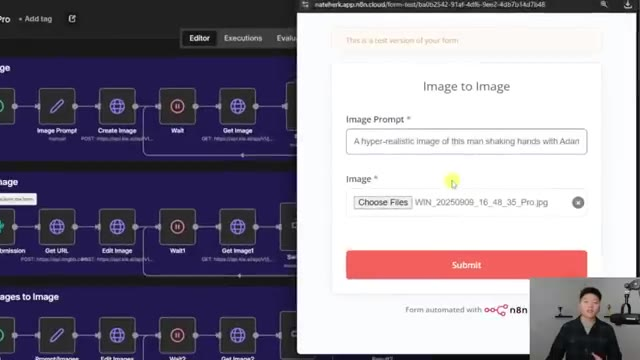
*⏱️ 00:00:05 — Une interface de formulaire n8n superposée à l'éditeur de workflow, affichant un champ de prompt textuel et un champ d'upload de fichier image.*

---

### ⏱️ `[00:00:19 - 00:00:41]` | Segment #02

**🔊 Audio (Transcription Intégrale Mot pour Mot en Français) :**
> This is ridiculously good. I really don't love the idea of zooming in close up on my face in front of the entire internet, but this is incredible. Look at the amount of detail that they put into this image. Anyways, let me show you guys how we do this with NNN and Nano Banana Pro. It's been a crazy week in the AI space and now we've got Nano Banana Pro to play with. Nano Banana by itself was already amazing, but the Pro version comes with so many upgrades.

**👁️ Analyse Visuelle d'Écran (gemini-3.5-flash-lite) :**
**Interface & Outils** : Interface de visualisation d'images (visionneuse média) et navigateur web (Google The Keyword).

**Contenu textuel & Code** : Texte de l'annonce : "Introducing Nano Banana Pro - Turn your visions into studio-quality designs with unprecedented control, improved text rendering and enhanced world knowledge."

**Action / Démonstration** : Le présentateur illustre la qualité du rendu des images générées par IA (zoom, détails), puis navigue sur le blog officiel pour présenter la source technologique.

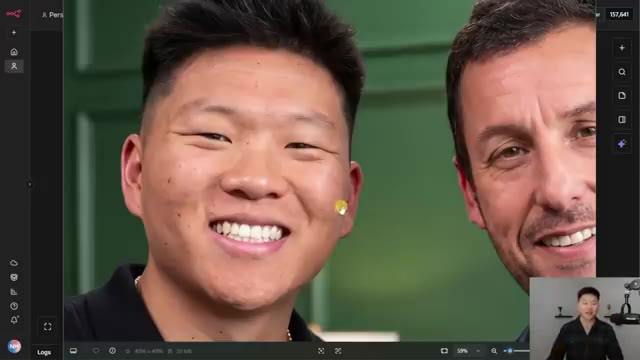
*⏱️ 00:00:25 — Gros plan sur une image générée montrant le présentateur aux côtés d'Adam Sandler, affichée dans une interface de visualisation de fichiers.*

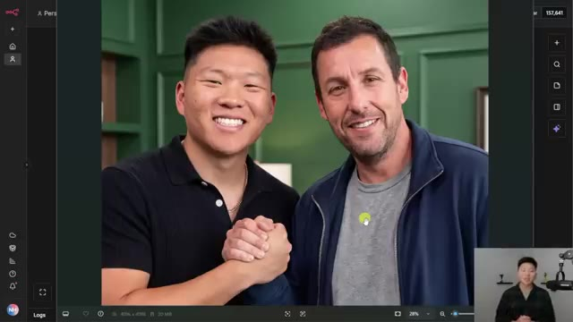
*⏱️ 00:00:30 — Vue d'ensemble de la même image générée, mettant en évidence la qualité du rendu avec une interaction (curseur visible sur le vêtement).*

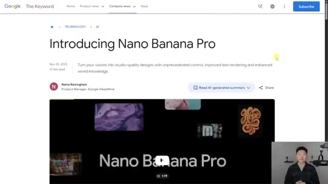
*⏱️ 00:00:36 — Page web officielle de Google "The Keyword" présentant l'annonce du modèle "Nano Banana Pro" avec un lecteur vidéo intégré.*

---

### ⏱️ `[00:00:41 - 00:01:04]` | Segment #03

**🔊 Audio (Transcription Intégrale Mot pour Mot en Français) :**
> Here's an example of an input image being turned into an infographic. Here's another infographic and you can also see that all of the words and letters are correct, which sometimes was an issue with Nano Banana. Here's a cool and really creative example of the word Berlin spelled out across multiple buildings. I also thought this one was pretty cool where it was able to just translate the English words into Korean. And one of my favorite parts about Nano Banana is the ability to combine tons of different images together.

**👁️ Analyse Visuelle d'Écran (gemini-3.5-flash-lite) :**
**Interface & Outils** : Navigateur web affichant le blog "The Keyword" de Google présentant les capacités de Nano Banana Pro.

**Contenu textuel & Code** : Prompts textuels sous chaque image décrivant les instructions de génération : création d'infographie, intégration typographique architecturale et traduction de texte sur produits.

**Action / Démonstration** : Démonstration des capacités de génération d'images, de rendu textuel précis et de compréhension multilingue par le modèle d'IA.

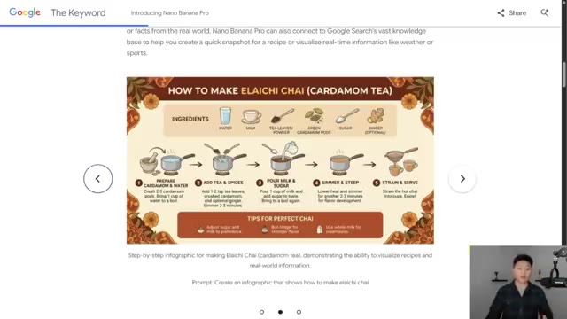
*⏱️ 00:00:47 — Infographie détaillée illustrant pas à pas la préparation d'un thé "Elaichi Chai".*

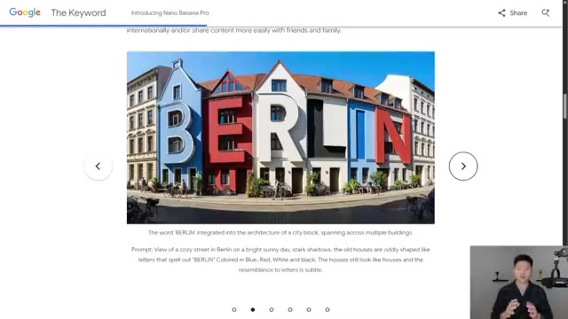
*⏱️ 00:00:53 — Image générée montrant le mot "BERLIN" intégré de manière créative dans l'architecture de façades de bâtiments.*

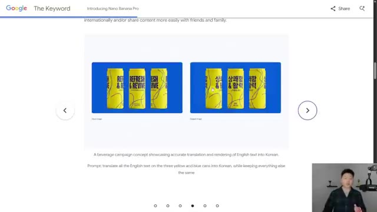
*⏱️ 00:00:58 — Comparaison visuelle de canettes de boisson montrant la traduction précise de texte anglais en coréen par l'IA.*

---

### ⏱️ `[00:01:04 - 00:01:23]` | Segment #04

**🔊 Audio (Transcription Intégrale Mot pour Mot en Français) :**
> In this example, you can see 14 different images of these little monsters were fed in, and then the image produced all of them sitting together in one environment. You can also do this with different people, with different types of clothing, with furniture. So all of these six images were fed in, and this is what we got in the end. Here's another quick example with these different elements. And then one final one, that one's pretty cool too.

**👁️ Analyse Visuelle d'Écran (gemini-3.5-flash-lite) :**
**Interface & Outils** : Navigateur web affichant le blog officiel "The Keyword" de Google.

**Contenu textuel & Code** : Texte descriptif des prompts utilisés par l'IA pour générer les images (ex: "A medium shot of the 14 fluffy characters...").

**Action / Démonstration** : Présentation visuelle du processus de composition d'images multiples via IA générative par Google.

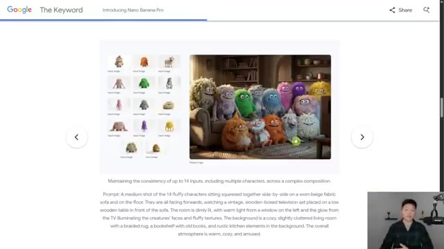
*⏱️ 00:01:09 — Capture d'écran du blog "The Keyword" de Google illustrant une démonstration de génération d'image avec 14 personnages "monstres" fusionnés dans une scène de salon.*

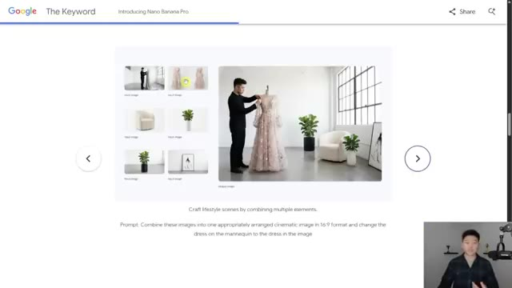
*⏱️ 00:01:13 — Capture d'écran du blog "The Keyword" de Google montrant une démonstration de composition de scène lifestyle en combinant des images d'un mannequin, d'une robe, d'une plante et de mobilier.*

---

### ⏱️ `[00:01:23 - 00:01:46]` | Segment #05

**🔊 Audio (Transcription Intégrale Mot pour Mot en Français) :**
> But anyways, what I'm going to be showing you guys today is how we can use Nano Banana Pro in N8N, so we can power our automations with better images. I'm going to be going over three different examples here. First, we've got text to image. Then we're going to be doing image to image. And then finally, we'll do multiple images to an image. And the way that we're going to be accessing Nano Banana Pro is through Key AI, which is kind of like an AI image and video generation model marketplace.

**👁️ Analyse Visuelle d'Écran (gemini-3.5-flash-lite) :**
**Interface & Outils** : n8n (éditeur de workflow low-code).

**Contenu textuel & Code** : Trois blocs de workflows : "Text to Image", "Image to Image" et "Multiple Images to Image", chacun composé de nœuds de déclenchement, de traitement HTTP (Get/Edit Image), de temporisation (Wait) et de logique conditionnelle (Switch).

**Action / Démonstration** : Présentation visuelle des architectures de workflow n8n configurées pour l'automatisation de génération d'images via API.

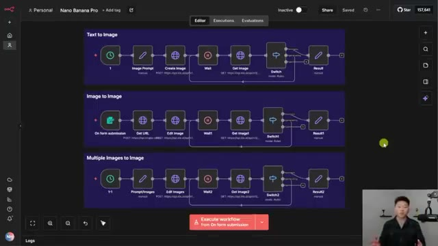
*⏱️ 00:01:29 — Interface n8n affichant trois workflows d'automatisation distincts pour la génération d'images avec Nano Banana Pro.*

---

### ⏱️ `[00:01:46 - 00:02:06]` | Segment #06

**🔊 Audio (Transcription Intégrale Mot pour Mot en Français) :**
> As you can see, we've got Sora 2, VO3.1, and right here we have Nano Banana Pro. It's also crazy because Nano Banana Pro through Key AI does two really cool things. It gives us no watermark, so we don't get the little Gemini logo in the bottom right of our images. And we can get our images in 4K for just 12 cents, which is about 20% cheaper than the official price.

**👁️ Analyse Visuelle d'Écran (gemini-3.5-flash-lite) :**
**Interface & Outils** : Plateforme web KIE AI (Dashboard de modèles et interface Playground).

**Contenu textuel & Code** : - Image #1 : Liste de modèles (Sora 2, Nano Banana Pro, Seedance 1.0, Hailuo 2.3, Veo 3.1).
- Image #2 : Prompt détaillé pour une génération de type "comic poster" et résultat visuel de "Nano Banana Pro" affiché dans la zone de prévisualisation.

**Action / Démonstration** : Navigation dans le catalogue de modèles (Image 1) suivie de la démonstration du playground et du résultat d'exécution d'un prompt pour Nano Banana Pro (Image 2).

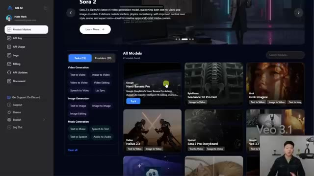
*⏱️ 00:01:51 — Interface "KIE AI" affichant le catalogue "All Models" avec une grille de modèles IA incluant Nano Banana Pro, Veo 3.1 et Sora 2.*

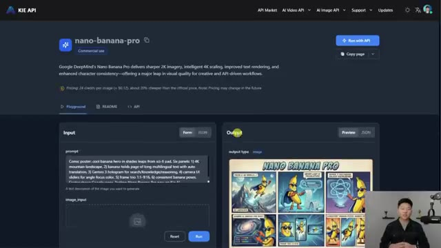
*⏱️ 00:01:56 — Page détaillée du modèle "nano-banana-pro" sur l'interface KIE AI, montrant la section "Input" avec un prompt et la section "Output" avec une image générée en style comic.*

---

### ⏱️ `[00:02:06 - 00:02:25]` | Segment #07

**🔊 Audio (Transcription Intégrale Mot pour Mot en Français) :**
> But you should note that pricing may change in the future, so right now if you can get it for 12 cents a key, then get here and take advantage of it. Anyways, the reason why we're here in Key AI is so that we can access Nano Banana Pro through our API calls in NNN. And so that's why we can look right here at the API documentation and create our tasks and basically make requests for images.

**👁️ Analyse Visuelle d'Écran (gemini-3.5-flash-lite) :**
**Interface & Outils** : KIE API (Interface web)

**Contenu textuel & Code** : Prompt utilisateur : "Comic poster: cool banana hero in shades leaps from sci-fi pad. Six panels: 1) 4K mountain landscape, 2) banana holds page..." et aperçu visuel d'une planche de BD.

**Action / Démonstration** : Présentation de l'interface de test (Playground) du modèle Nano Banana Pro pour générer des images via API.

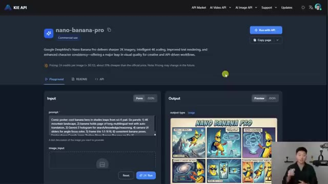
*⏱️ 00:02:11 — Interface web du modèle "nano-banana-pro" sur la plateforme KIE API, affichant la zone de saisie du prompt et les résultats générés.*

---

### ⏱️ `[00:02:25 - 00:02:59]` | Segment #08

**🔊 Audio (Transcription Intégrale Mot pour Mot en Français) :**
> Now if you just want to get a feel for it and play around with it a little bit You can test out prompts and images in the playground environment right here You can see here's a funny example where I dropped in an image of me an image of Scotty getting his green jacket And I said basically to put me in that environment and this is what we got And I mean once again a really good picture really good detail the hands even look decent The background looks good. This is just really impressive. That's enough wasting time Let's get into this first demo with a text to image flow So if you guys want to download this workflow so that you can just plug in your API key and just get going Then I will leave that for free in my free school community

**👁️ Analyse Visuelle d'Écran (gemini-3.5-flash-lite) :**
**Interface & Outils** : KIE API Playground, Interface de workflow visuel (type n8n).

**Contenu textuel & Code** : Nœuds de workflow : Prompt, Create Image, Wait, Get Image, Switch, Result.

**Action / Démonstration** : Démonstration de l'utilisation d'un playground IA et visualisation des nœuds logiques d'un workflow d'automatisation.

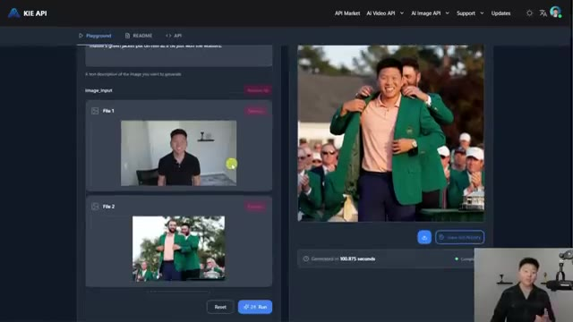
*⏱️ 00:02:33 — Interface "Playground" de KIE API montrant deux fichiers images en entrée et une image générée à droite montrant le présentateur recevant une veste verte.*

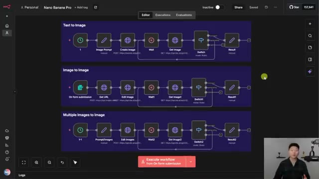
*⏱️ 00:02:50 — Interface de workflow visuel avec trois séquences d'automatisation : "Text to Image", "Image to Image", et "Multiple Images to Image".*

---

### ⏱️ `[00:02:59 - 00:03:34]` | Segment #09

**🔊 Audio (Transcription Intégrale Mot pour Mot en Français) :**
> The link for that will be down in the description And so when you guys get this workflow All you'll have to do is change a few of the prompts in these nodes, which I will show you guys right now So for our first example, the image prompt is in here And I said a hyper-realistic image of the Chicago skyline at sunset So I'm going to go ahead and run this first row And while this is running, I'll explain real quick how this all works So you can see that we're making two different API calls The first one that we're making is to actually create the image. So if I click into here You'll see that we're hitting the endpoint to create a task then we're putting in our api key So when you get this workflow, all you'll have to do is replace this string with your own api key

**👁️ Analyse Visuelle d'Écran (gemini-3.5-flash-lite) :**
**Interface & Outils** : Présentation ou face-caméra explicatif sans interface logicielle partagée.

**Contenu textuel & Code** : Explications orales et mise en contexte méthodologique.

**Action / Démonstration** : Explications face caméra et démonstration conceptuelle.

---

### ⏱️ `[00:03:34 - 00:04:07]` | Segment #10

**🔊 Audio (Transcription Intégrale Mot pour Mot en Français) :**
> And the way you can get your api key is you go to key.ai You make an account put in some billing information And then on this left hand side go to api key And then all you have to do is create a new one and then copy that value Like I said right into here instead of where mine is and then you can see we have an actual body request which is our image that we want. And so we want to use the model Nano Banana Pro. We put in our image prompts right here, as you can see, which comes through as a hyper-realistic image of the Chicago skyline at sunset. We have our aspect ratio, we have our resolution, and we have our output format. And so in case you're wondering where I got all of this information from, I got it

**👁️ Analyse Visuelle d'Écran (gemini-3.5-flash-lite) :**
**Interface & Outils** : Présentation ou face-caméra explicatif sans interface logicielle partagée.

**Contenu textuel & Code** : Explications orales et mise en contexte méthodologique.

**Action / Démonstration** : Explications face caméra et démonstration conceptuelle.

---

### ⏱️ `[00:04:07 - 00:04:27]` | Segment #11

**🔊 Audio (Transcription Intégrale Mot pour Mot en Français) :**
> from the API documentation of Nano Banana Pro right here, where you can see it gives us the endpoint. It gives us what we need to include. So we need to include the model, which is Nano Banana Pro. We need to include the input prompt, which is how we turn that text into an image. And then we have some other optional things like the image input, which I'll show you guys later when we do an image to image example. We have the aspect ratio.

**👁️ Analyse Visuelle d'Écran (gemini-3.5-flash-lite) :**
**Interface & Outils** : Documentation API web (KIE API).

**Contenu textuel & Code** : Paramètres d'API : "model" (valeur exemple : "nano-banana-pro"), "callbackUrl", et "input.prompt" (description textuelle de l'image).

**Action / Démonstration** : Revue des paramètres nécessaires pour structurer une requête API vers le modèle de génération d'image.

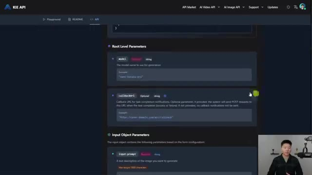
*⏱️ 00:04:12 — Capture d'écran de la documentation API de KIE montrant les paramètres requis pour la génération d'images, notamment "model" et "input.prompt".*

---

### ⏱️ `[00:04:27 - 00:04:48]` | Segment #12

**🔊 Audio (Transcription Intégrale Mot pour Mot en Français) :**
> So right now in this example, we're doing one to one, but you could also do two, three, three, two, 16, nine, nine, 16. And then we have our input resolution, which we can do 1K, 2K or 4K. And then of course, finally we have the output format. So that's the first API call that we make. And what happens after we do that first one is it comes back to us and it says, okay, cool, we got your request and here is your task ID.

**👁️ Analyse Visuelle d'Écran (gemini-3.5-flash-lite) :**
**Interface & Outils** : Présentation ou face-caméra explicatif sans interface logicielle partagée.

**Contenu textuel & Code** : Explications orales et mise en contexte méthodologique.

**Action / Démonstration** : Explications face caméra et démonstration conceptuelle.

---

### ⏱️ `[00:04:49 - 00:05:08]` | Segment #13

**🔊 Audio (Transcription Intégrale Mot pour Mot en Français) :**
> So the way that I like to think about this is when you go and you order food at some sort of restaurant and they give you a number, this is basically the number that they give you and they're telling you, okay, we're gonna work on your food. And so while they're working on our food or our image, what we have to do is wait. So I've got a wait note here, which is gonna wait for about five seconds. And then after it finishes waiting, we're gonna make another API call.

**👁️ Analyse Visuelle d'Écran (gemini-3.5-flash-lite) :**
**Interface & Outils** : n8n (plateforme d'automatisation de workflows).

**Contenu textuel & Code** : Configuration d'API (URL, méthode POST), JSON de réponse incluant taskId, paramètres de temporisation (Wait Amount 5.00 seconds).

**Action / Démonstration** : Exécution d'un nœud d'API pour lancer la création d'image, suivie d'une mise en attente (wait) du processus.

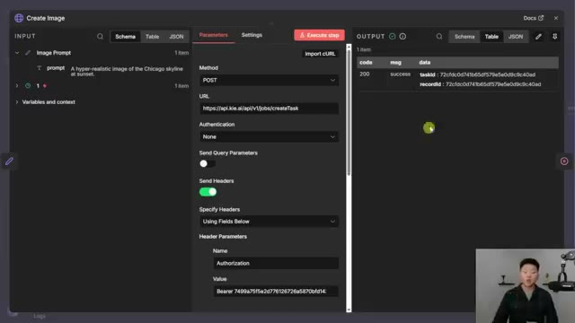
*⏱️ 00:04:54 — Interface détaillée d'une étape "Create Image" montrant la configuration d'une requête HTTP POST et la réception d'un taskId dans la sortie.*

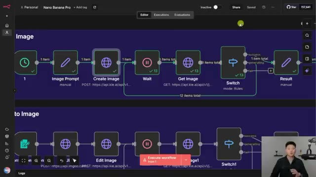
*⏱️ 00:04:59 — Vue d'ensemble du workflow d'automatisation montrant une séquence de nœuds : Image Prompt, Create Image, Wait, Get Image, Switch et Result.*

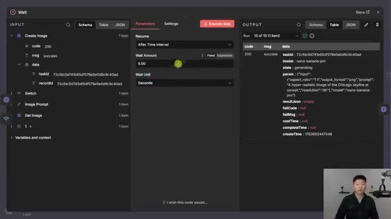
*⏱️ 00:05:03 — Configuration de l'étape "Wait" dans le workflow, réglée sur un intervalle de 5 secondes pour permettre à l'IA de générer l'image.*

---

### ⏱️ `[00:05:09 - 00:05:43]` | Segment #14

**🔊 Audio (Transcription Intégrale Mot pour Mot en Français) :**
> And this one is to get the image. It's going to check the status of our request or our food order. And so the way that I filled out all this information was I came into the API documentation for Nano Banana Pro And then I went to query task instead of create task And so i'm not diving super deep into the API stuff right now If you want to see a full breakdown i've got a really good video on that I'll tag that right up here if you want to check it out And the query task one is much simpler because all we have to do is we have the end point And then we have to give it that task id or the order number and then we give it our api key once again So in NNN, what that looks like is the task ID I was able to drag in from this left-hand

**👁️ Analyse Visuelle d'Écran (gemini-3.5-flash-lite) :**
**Interface & Outils** : Navigateur web (documentation API KIE).

**Contenu textuel & Code** : Documentation technique pour l'endpoint `/api/v1/jobs/createTask` (POST) et le menu latéral affichant l'endpoint `Query Task` (GET).

**Action / Démonstration** : Le présentateur explique la navigation entre les endpoints « Create Task » et « Query Task » pour gérer le cycle de vie d'une commande d'image.

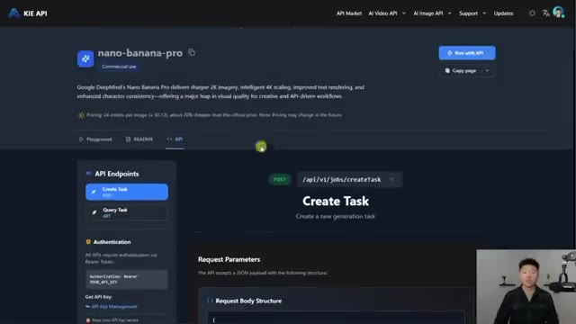
*⏱️ 00:05:17 — Interface de documentation de l'API « nano-banana-pro » sur le portail KIE API, affichant les endpoints disponibles.*

---

### ⏱️ `[00:05:43 - 00:06:20]` | Segment #15

**🔊 Audio (Transcription Intégrale Mot pour Mot en Français) :**
> node, and this is what the create image API call gave us. And then, of course, I'm giving it my API key down here. And so when we do this, you can see we have kind of this loop. This is called polling, which means every five seconds, we're basically going to keep checking in to see if it's done. And you can see here, it took 13 tries. And so what happens is we do this switch node, because when we check in on our order, they can basically tell us it worked, it's still generating, or it failed. And so we have three different paths for those three different scenarios. And what you can see is if it's still generating, it loops back, it waits five more seconds, it checks again. If it fails, the process just ends.

**👁️ Analyse Visuelle d'Écran (gemini-3.5-flash-lite) :**
**Interface & Outils** : Présentation ou face-caméra explicatif sans interface logicielle partagée.

**Contenu textuel & Code** : Explications orales et mise en contexte méthodologique.

**Action / Démonstration** : Explications face caméra et démonstration conceptuelle.

---

### ⏱️ `[00:06:20 - 00:06:46]` | Segment #16

**🔊 Audio (Transcription Intégrale Mot pour Mot en Français) :**
> And if it's successful, it moves on to the next step. So that guarantees that we just only move on if we were successful and if the image is done. And then when it's done, we move over here to the result and we get this final URL, which I'll go ahead and download real quick. And we have our beautiful image of the Chicago skyline at sunset. And this is actually crazy. I mean, look at the water, look at the cars, look at the lights, the sky, like this is actually really, really good.

**👁️ Analyse Visuelle d'Écran (gemini-3.5-flash-lite) :**
**Interface & Outils** : Présentation ou face-caméra explicatif sans interface logicielle partagée.

**Contenu textuel & Code** : Explications orales et mise en contexte méthodologique.

**Action / Démonstration** : Explications face caméra et démonstration conceptuelle.

---

### ⏱️ `[00:06:47 - 00:07:08]` | Segment #17

**🔊 Audio (Transcription Intégrale Mot pour Mot en Français) :**
> All right. So the good news is now that we understand this flow, the two flows beneath are pretty much the exact same thing. The only difference is instead of just sending over text in the body to make the request for the image, we're also sending over either one image or multiple images. So that's really the only difference here. Okay, so let's move on to the second example where we're getting an image and we're turning it into a different image.

**👁️ Analyse Visuelle d'Écran (gemini-3.5-flash-lite) :**
**Interface & Outils** : n8n (plateforme d'automatisation de workflow).

**Contenu textuel & Code** : Diagrammes de nœuds connectés comprenant des déclencheurs (triggers), des nœuds "Wait", "Get Image", "Switch" et "Result". Le flux montre des requêtes API (POST/GET) vers des services externes pour traiter des images.

**Action / Démonstration** : Le présentateur explique la similarité structurelle entre les trois workflows de traitement d'images automatisés affichés à l'écran.

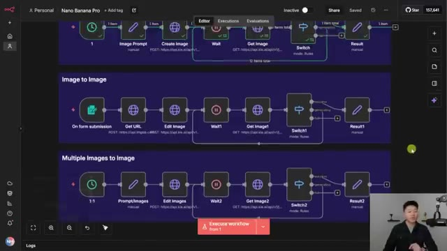
*⏱️ 00:06:52 — Interface n8n affichant trois workflows d'automatisation distincts : un workflow de génération d'image de base, un workflow "Image to Image" et un workflow "Multiple Images to Image".*

---

### ⏱️ `[00:07:08 - 00:07:35]` | Segment #18

**🔊 Audio (Transcription Intégrale Mot pour Mot en Français) :**
> So I'm going to open up the form and what I'm going to do is type in an image prompt and drop in an image file. Okay, so I dropped in an image of me holding my laptop and I said make this man sitting on a beach using a laptop. The image should be hyper-realistic. We should see all detail and keep in mind these prompts are not optimized or very good at all but with this little of a prompt you'll see how good the results are. So I'm going to shoot this off. We turn that image into a public URL because Nano Banana needs a URL to be public in order to use it and view it and change it.

**👁️ Analyse Visuelle d'Écran (gemini-3.5-flash-lite) :**
**Interface & Outils** : Présentation ou face-caméra explicatif sans interface logicielle partagée.

**Contenu textuel & Code** : Explications orales et mise en contexte méthodologique.

**Action / Démonstration** : Explications face caméra et démonstration conceptuelle.

---

### ⏱️ `[00:07:36 - 00:08:10]` | Segment #19

**🔊 Audio (Transcription Intégrale Mot pour Mot en Français) :**
> And then we're going to do the exact same thing where we're waiting. And actually what you can see happened here is this failed. And so that's why we have this as a switch with different paths. And actually I'm kind of glad that that happened. So I can show you guys how we can check our logs. So if you go back into key and then you go over here to the logs, you can see your different runs and if they were successful or if they failed. And what I've noticed is that right now, because Nano Banana is super new and probably tons of people are using it. Sometimes I get failures when I just kind of like shouldn't. And you can see the message here is just a 422 and it says unexpected error handling prediction. So I'm just going to run that exact same example with the same

**👁️ Analyse Visuelle d'Écran (gemini-3.5-flash-lite) :**
**Interface & Outils** : Présentation ou face-caméra explicatif sans interface logicielle partagée.

**Contenu textuel & Code** : Explications orales et mise en contexte méthodologique.

**Action / Démonstration** : Explications face caméra et démonstration conceptuelle.

---

### ⏱️ `[00:08:10 - 00:08:43]` | Segment #20

**🔊 Audio (Transcription Intégrale Mot pour Mot en Français) :**
> picture, the same prompt and run it again. And I'll show you guys that it goes through. All right. So that just finished up and you can see it's literally the exact same image. It's the one of me on the laptop. And what I dropped in as the prompt was the exact same prompt. So sometimes it's just going to fail and it's not even your fault. So just wanted to let you guys know that. But let's go ahead and take a look at this result and hopefully it's pretty good. All right, there we go. I would say that this is pretty solid. It even got my haircut in there. It's got the shirt and we can see that I've even got some sand on my hand. We've got a nice little reflection in the

**👁️ Analyse Visuelle d'Écran (gemini-3.5-flash-lite) :**
**Interface & Outils** : n8n (plateforme d'automatisation de workflows).

**Contenu textuel & Code** : Nœuds de workflow : "On form submission", "Get URL", "Edit Image", "Wait", "Get Image", "Switch", "Result". Paramètres de formulaire : "Image Prompt", "Form Title".

**Action / Démonstration** : Exécution d'un workflow d'automatisation d'image, incluant la soumission de formulaire, le traitement via API, et l'affichage du résultat généré ("Image to Image").

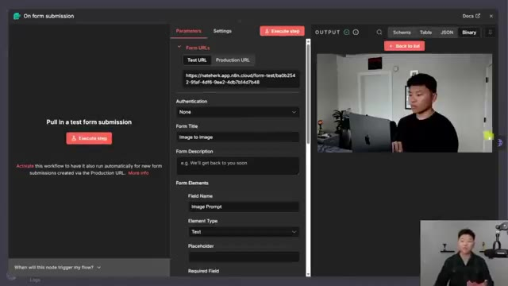
*⏱️ 00:08:18 — Interface de configuration du nœud "On form submission" dans n8n, affichant les paramètres de l'URL du formulaire et les champs de saisie.*

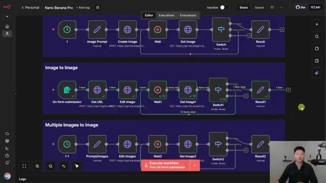
*⏱️ 00:08:27 — Vue d'ensemble de l'éditeur n8n montrant trois workflows distincts avec leurs nœuds respectifs (déclencheurs, traitements d'images, boucles de rappel et résultats).*

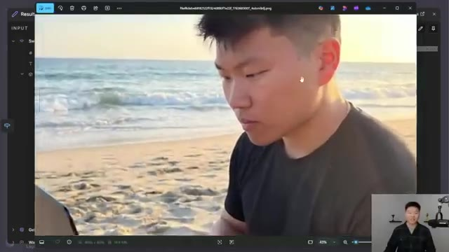
*⏱️ 00:08:35 — Visualisation du résultat final dans l'interface n8n, montrant une image générée représentant le présentateur travaillant sur un ordinateur sur une plage.*

---

### ⏱️ `[00:08:43 - 00:09:17]` | Segment #21

**🔊 Audio (Transcription Intégrale Mot pour Mot en Français) :**
> Apple logo too, which is a nice touch. But I mean, this stuff is pretty solid. And so really the only difference here, of course, is that we're sending over an image with the text prompt. So we get our image in the form as binary. We use this HTTP request to turn that binary into a publicly facing URL. As you can see right here, if I open this up, we get the laptop image. And then we pass this URL into key for NanoBanana to use. And we do that in the body request of this down here. And as you can see, we just have one extra little object in this JSON body, and that is called image underscore

**👁️ Analyse Visuelle d'Écran (gemini-3.5-flash-lite) :**
**Interface & Outils** : n8n (outil d'automatisation de workflow low-code).

**Contenu textuel & Code** : Diagrammes de flux, paramètres de nœuds HTTP Request (URL, méthode POST), données JSON en sortie (id, title, url_viewer, url), et logs d'exécution.

**Action / Démonstration** : Le présentateur démontre le flux de données d'une image binaire convertie via une requête HTTP en URL publique, tout en naviguant dans les nœuds du workflow pour expliquer la logique.

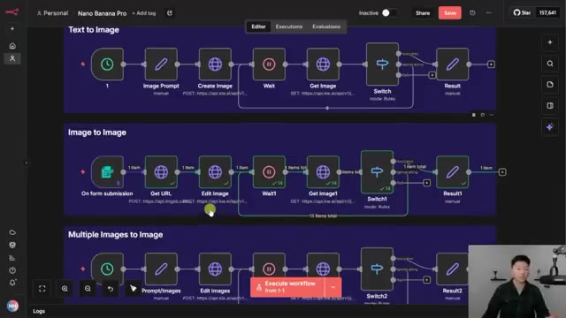
*⏱️ 00:08:52 — Vue globale de l'interface de l'outil d'automatisation n8n montrant trois flux de travail différents : Text to Image, Image to Image et Multiple Images to Image.*

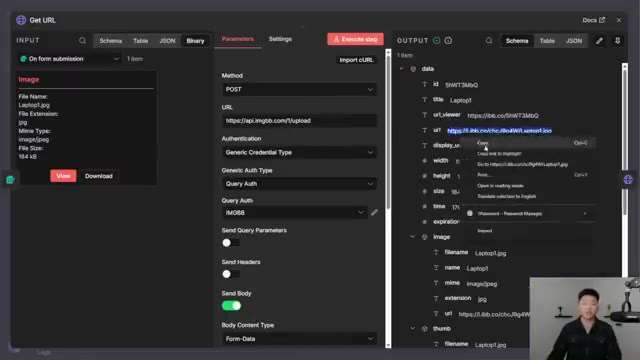
*⏱️ 00:09:00 — Interface détaillée du nœud "Get URL" dans n8n, affichant les paramètres de la requête HTTP POST vers l'API imgbb et les données de sortie JSON incluant l'URL de l'image.*

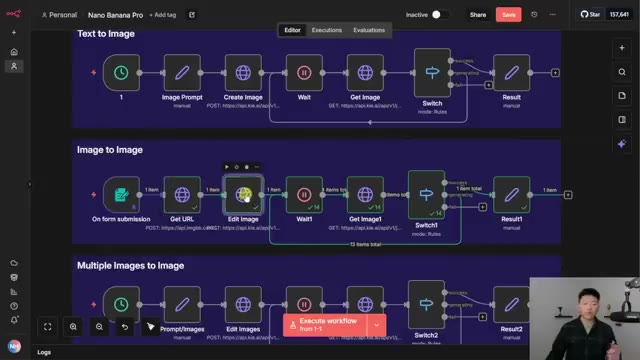
*⏱️ 00:09:08 — Même vue que l'image 1, montrant la sélection active du nœud "Edit Image" au sein du workflow "Image to Image" dans n8n, avec un bouton d'exécution visible en bas.*

---

### ⏱️ `[00:09:17 - 00:09:52]` | Segment #22

**🔊 Audio (Transcription Intégrale Mot pour Mot en Français) :**
> input. And then this is where we put the variable for our picture URL. And that obviously comes across over here. So now Nano Banana has a picture and it has our prompts and then it goes ahead and combines those to make the new image. All right so you guys remember how right here I told you we had to upload that binary picture to ImageBB in order to turn it into a publicly facing URL. Well I'm going to show you guys a different way that you can do it down here where you don't have to do that but you do have to make sure the image URLs are public. So you can come into this node and you can set a image prompt and then three different images and all of these are public facing URL

**👁️ Analyse Visuelle d'Écran (gemini-3.5-flash-lite) :**
**Interface & Outils** : n8n (outil d'automatisation de workflow).

**Contenu textuel & Code** : Code JSON structurant les paramètres d'appel de l'API (modèle, prompt, ratio d'aspect, URL d'entrée) et diagrammes de flux logique.

**Action / Démonstration** : Le présentateur explique comment les variables (URL de l'image et prompts) sont injectées dynamiquement dans le workflow pour générer de nouvelles images.

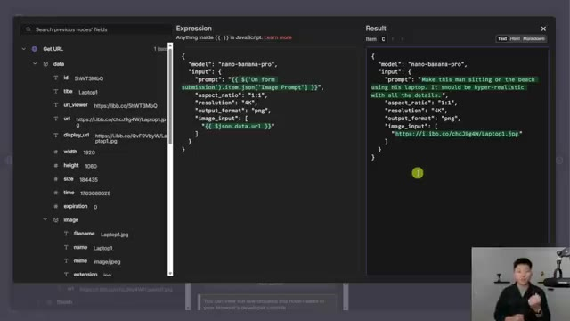
*⏱️ 00:09:26 — L'écran affiche une interface de configuration de nœud JSON dans n8n, montrant le mappage des variables pour un modèle d'IA nommé "nano-banana-pro", incluant le prompt utilisateur et l'URL de l'image source.*

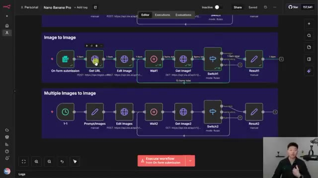
*⏱️ 00:09:34 — Vue d'ensemble d'un workflow n8n montrant deux processus automatisés distincts : "Image to Image" et "Multiple Images to Image", composés de différents nœuds (Get URL, Edit Image, Wait, etc.).*

---

### ⏱️ `[00:09:52 - 00:10:27]` | Segment #23

**🔊 Audio (Transcription Intégrale Mot pour Mot en Français) :**
> images of an Amazon product. So the first one we have is a Santa shirt. The second one we have is this whoop. And then the third one we have is this O'Walla water bottle. And what we have as a prompt is a hyper-realistic image of a man wearing the shirt provided in the image. He's hiking on a mountain and is holding the water bottle provided in the image. He's also wearing the watch provided in the image. So we're going to go ahead and run this one. And once again, it's the exact same flow where we send off the request. We wait, we pull, and then we constantly pull until we have our success message. And by the way, while this is running, if you guys noticed how dark this is,

**👁️ Analyse Visuelle d'Écran (gemini-3.5-flash-lite) :**
**Interface & Outils** : Présentation ou face-caméra explicatif sans interface logicielle partagée.

**Contenu textuel & Code** : Explications orales et mise en contexte méthodologique.

**Action / Démonstration** : Explications face caméra et démonstration conceptuelle.

---

### ⏱️ `[00:10:27 - 00:10:49]` | Segment #24

**🔊 Audio (Transcription Intégrale Mot pour Mot en Français) :**
> Aniden's recent update has like a new dark mode and it's darker than the original dark mode. And I made a post in my community about it and I started to get a little bit roasted for not liking the new dark mode. So just kind of thought that was funny. All right, so this one just finished up. And what you'll notice is because we did three images, it did take longer. So this one pulled 35 times rather than some of these were more like 13 or 15. But let's take a look at this final image.

**👁️ Analyse Visuelle d'Écran (gemini-3.5-flash-lite) :**
**Interface & Outils** : Présentation ou face-caméra explicatif sans interface logicielle partagée.

**Contenu textuel & Code** : Explications orales et mise en contexte méthodologique.

**Action / Démonstration** : Explications face caméra et démonstration conceptuelle.

---

### ⏱️ `[00:10:49 - 00:11:20]` | Segment #25

**🔊 Audio (Transcription Intégrale Mot pour Mot en Français) :**
> That's awesome. You can see we've got the awala text is almost perfect. We've got the Santa shirt We've got some sweat on the arm and the whoop down there And this is pretty much exactly what we were hoping to get the whole background looks super awesome as well But in this one as far as the differences in this node to this node There's only one and that is in the body request in our array of images that we're sending over We're just sending over three rather than one So anyways, I know that some of these were fun examples, but I hope you guys can see how fast this stuff is improving.

**👁️ Analyse Visuelle d'Écran (gemini-3.5-flash-lite) :**
**Interface & Outils** : Présentation ou face-caméra explicatif sans interface logicielle partagée.

**Contenu textuel & Code** : Explications orales et mise en contexte méthodologique.

**Action / Démonstration** : Explications face caméra et démonstration conceptuelle.

---

### ⏱️ `[00:11:20 - 00:11:40]` | Segment #26

**🔊 Audio (Transcription Intégrale Mot pour Mot en Français) :**
> And I'll be honest, it is a little bit scary. There are certain concerns when you don't have watermarks and when things look so real, you can't tell if they're fake or not. And I get that. But it's very exciting to also think about what opportunities this stuff actually brings. How much more can small businesses now do with content and ads if they don't have budgets to go rent out a whole studio and pay actors and things like that?

**👁️ Analyse Visuelle d'Écran (gemini-3.5-flash-lite) :**
**Interface & Outils** : Présentation ou face-caméra explicatif sans interface logicielle partagée.

**Contenu textuel & Code** : Explications orales et mise en contexte méthodologique.

**Action / Démonstration** : Explications face caméra et démonstration conceptuelle.

---

### ⏱️ `[00:11:40 - 00:12:01]` | Segment #27

**🔊 Audio (Transcription Intégrale Mot pour Mot en Français) :**
> And you can now literally place your products almost anywhere. and you can go get a professional headshot without going to a professional headshot studio. So I'm not trying to be oblivious to some of the risks and some of the fears, but I'm just trying to spread some excitement. So once again, download these workflows for free, just play around with the stuff and see how you can work it into your LinkedIn posts, your copy, your content, whatever it is.

**👁️ Analyse Visuelle d'Écran (gemini-3.5-flash-lite) :**
**Interface & Outils** : Présentation ou face-caméra explicatif sans interface logicielle partagée.

**Contenu textuel & Code** : Explications orales et mise en contexte méthodologique.

**Action / Démonstration** : Explications face caméra et démonstration conceptuelle.

---

### ⏱️ `[00:12:01 - 00:12:26]` | Segment #28

**🔊 Audio (Transcription Intégrale Mot pour Mot en Français) :**
> Use this stuff to save you time. If you wanna dive deeper into some of these use cases, then definitely check out my Plus community. We've got a great community of over 2,500 members who are building with N&M every day and building businesses with N&M every day. We've also got full courses in here. We've got Agent Zero for the beginners, Foundations of AI Automation. We've got 10 hours to 10 seconds where you learn how to identify, design, and build time-saving automations. For our premium members, we've got one-person AI agency and subs to sales.

**👁️ Analyse Visuelle d'Écran (gemini-3.5-flash-lite) :**
**Interface & Outils** : Présentation ou face-caméra explicatif sans interface logicielle partagée.

**Contenu textuel & Code** : Explications orales et mise en contexte méthodologique.

**Action / Démonstration** : Explications face caméra et démonstration conceptuelle.

---

### ⏱️ `[00:12:26 - 00:12:47]` | Segment #29

**🔊 Audio (Transcription Intégrale Mot pour Mot en Français) :**
> And then for everyone in the community, we've got tons of projects in here, which are kind of like live step-by-step projects and builds that you can follow along to. We also run one live call per week in the community. So I'd love to have you guys in those calls in the communities, but that's going to do it for today. So if you enjoyed the video or you learned something new, please give to like it definitely helps me out a ton and as always i appreciate you guys making it to the end of the video i'll see you on the next one

**👁️ Analyse Visuelle d'Écran (gemini-3.5-flash-lite) :**
**Interface & Outils** : Présentation ou face-caméra explicatif sans interface logicielle partagée.

**Contenu textuel & Code** : Explications orales et mise en contexte méthodologique.

**Action / Démonstration** : Explications face caméra et démonstration conceptuelle.

---

