# 🎬 Gemini's New File Search Just Leveled Up RAG Agents (10x Cheaper)

> **Chaîne** : [Nate Herk | AI Automation](https://www.youtube.com/@nateherk/featured)  
> **Lien YouTube** : [https://www.youtube.com/watch?v=irg-2IfAjpo](https://www.youtube.com/watch?v=irg-2IfAjpo)  
> **Date de publication** : 20251123  
> **Durée** : 00:18:45  
> **Identifiant vidéo** : `irg-2IfAjpo`  
> **Transcription & Analyse** : `whisper-v3-large-turbo+gemini-3.5-flash-lite`  

---

## 📌 Synthèse Exécutive & Outils

### 💡 Résumé
Dans cette vidéo intitulée **Gemini's New File Search Just Leveled Up RAG Agents (10x Cheaper)**, Nate Herk décortique les capacités pratiques d'automatisation et de développement propulsées par les modèles de pointe.

### 🛠️ Outils, Modèles & Logiciels Présentés
- **Opus 5.5 & Claude Code** : Modèles d'ingénierie et agents de codage autonome.

### 🔑 Points Clés & Enseignements Stratégiques
- Optimiser le niveau d'effort et le raisonnement des modèles IA pour des résultats industriels.
- Automatiser les cycles de création logicielle de bout en bout.

---

## ⏱️ Chronologie & Transcription Complète Audio & Visuelle (Mot pour Mot)

### ⏱️ `[00:00:00 - 00:00:33]` | Segment #01

**🔊 Audio (Transcription Intégrale Mot pour Mot en Français) :**
> So Gemini's new file search API is awesome because it allows you to drop in a document, it generates those embeddings, and then you're right away able to just chat with it and ask it questions and get answers back. So that functionality, along with the fact that they're offering it for a super, super cheap price, is probably why you've been seeing it on your feeds lately. So today I'm going to be talking about how we can use it in N8M for our RAG agents without having to build a huge, massive data pipeline that looks like this, because we're able to just drop in a file and get answers back. But I will say it's not completely magic, so everything that we're doing today, I'm going to try to be as honest as I can about it. So just to start off

**👁️ Analyse Visuelle d'Écran (gemini-3.5-flash-lite) :**
**Interface & Outils** : Présentation ou face-caméra explicatif sans interface logicielle partagée.

**Contenu textuel & Code** : Explications orales et mise en contexte méthodologique.

**Action / Démonstration** : Explications face caméra et démonstration conceptuelle.

---

### ⏱️ `[00:00:33 - 00:01:03]` | Segment #02

**🔊 Audio (Transcription Intégrale Mot pour Mot en Français) :**
> before we actually get into NNN and start building things, what is Gemini File Search? So how does it work? Basically, you upload your files to Gemini, it automatically chunks and embeds them, and then you can have your NNN AI agents using this as knowledge. So if you've ever built like a RAG agent before with a vector database like Pinecone or Supabase, it's super, super similar, except for once again, we're cutting out basically all of this data pipeline processing, where we have to understand the file type, add metadata, maybe add context, split it up, run it through an embeddings model, and then put it into our vector store.

**👁️ Analyse Visuelle d'Écran (gemini-3.5-flash-lite) :**
**Interface & Outils** : Présentation ou face-caméra explicatif sans interface logicielle partagée.

**Contenu textuel & Code** : Explications orales et mise en contexte méthodologique.

**Action / Démonstration** : Explications face caméra et démonstration conceptuelle.

---

### ⏱️ `[00:01:03 - 00:01:30]` | Segment #03

**🔊 Audio (Transcription Intégrale Mot pour Mot en Français) :**
> Whereas in this example, we basically just upload the doc, we shoot it over to Google, and then it takes care of everything else. And then we can go ahead and just have an AI agent that's plugged into our Google store and it can start giving us answers right away. Why is it useful? You don't have to build your own search system or database because Gemini handles that storage and searching. And what do you need to know? You only need to know how to upload your files through Gemini File API, and you don't need all this special stuff and special technical setup. And real quick to hit on pricing, which is why this is pretty exciting.

**👁️ Analyse Visuelle d'Écran (gemini-3.5-flash-lite) :**
**Interface & Outils** : Présentation ou face-caméra explicatif sans interface logicielle partagée.

**Contenu textuel & Code** : Explications orales et mise en contexte méthodologique.

**Action / Démonstration** : Explications face caméra et démonstration conceptuelle.

---

### ⏱️ `[00:01:31 - 00:02:07]` | Segment #04

**🔊 Audio (Transcription Intégrale Mot pour Mot en Français) :**
> They only charge you for uploading or for your indexing or your embedding. So when you upload a file, you pay 15 cents for every 1 million tokens processed. And just to put that into perspective, right here, I've got 121 page PDF, and this was about 95,000 tokens. So not even a 10th of what would cost you 15 cents. So it's really, really affordable. And then also when you look at the storage, it stores everything as of right now for completely free, regardless of how much you have in there. And then as far as querying it, there is some sort of limit when you get really, really high on your queries, but basically all you'll be paying for on your queries is the chat model usage.

**👁️ Analyse Visuelle d'Écran (gemini-3.5-flash-lite) :**
**Interface & Outils** : Présentation ou face-caméra explicatif sans interface logicielle partagée.

**Contenu textuel & Code** : Explications orales et mise en contexte méthodologique.

**Action / Démonstration** : Explications face caméra et démonstration conceptuelle.

---

### ⏱️ `[00:02:07 - 00:02:42]` | Segment #05

**🔊 Audio (Transcription Intégrale Mot pour Mot en Français) :**
> So this table is assuming that you're using 100 gigabytes of storage and 1 million queries per month. And so this is where with Gemini, it would cost you nothing to store. It would cost you almost 12 bucks to index all of that, but just one time. And then you might hit some sort of base fee just because you're doing so many queries per month. And that's going to be like, let's just call it 35 bucks for this first month. Now for something like Supabase, where you do like a PG vector extension, it's still pretty affordable. It just takes a lot more on you for technical setup and kind of maintenance there. And then when you compare something like Pinecone Assistant or OpenAI Vector Store, which is essentially the same value prop as Gemini File Search, where you just drop in

**👁️ Analyse Visuelle d'Écran (gemini-3.5-flash-lite) :**
**Interface & Outils** : Présentation ou face-caméra explicatif sans interface logicielle partagée.

**Contenu textuel & Code** : Explications orales et mise en contexte méthodologique.

**Action / Démonstration** : Explications face caméra et démonstration conceptuelle.

---

### ⏱️ `[00:02:42 - 00:03:17]` | Segment #06

**🔊 Audio (Transcription Intégrale Mot pour Mot en Français) :**
> docs and then you can chat with them right away. These, as you can see, are charging you a lot more for storage. And then you've also got costs here for indexing and querying. And also with the Pinecone Assistant, you get charged like five cents every hour that this thing is running. So over time, that also stacks up. And I did not include that cost in this table. And so once again, just a visualization, Gemini is super cheap when it comes to this file search API. You may be able to get cheaper if you go a different route. But considering how easy and quick it is to just set a Gemini file search API and RAG agent, that cost is justified. Alright, so we're about to switch over

**👁️ Analyse Visuelle d'Écran (gemini-3.5-flash-lite) :**
**Interface & Outils** : Présentation ou face-caméra explicatif sans interface logicielle partagée.

**Contenu textuel & Code** : Explications orales et mise en contexte méthodologique.

**Action / Démonstration** : Explications face caméra et démonstration conceptuelle.

---

### ⏱️ `[00:03:17 - 00:03:41]` | Segment #07

**🔊 Audio (Transcription Intégrale Mot pour Mot en Français) :**
> and we're going to actually start looking at the Gemini file search, but I wanted to say at the end of this video I am going to come back and just do a little bit of some final considerations and things to think about. So when we get into end-to-end, there's going to be four HTTP requests that you guys will be looking at and I'm going to walk through exactly how I set them up. The first one is going to be us actually creating that store and so right now I'm just going to refer to it as as a folder, because I think that that just makes things a little easier to contextualize.

**👁️ Analyse Visuelle d'Écran (gemini-3.5-flash-lite) :**
**Interface & Outils** : Présentation ou face-caméra explicatif sans interface logicielle partagée.

**Contenu textuel & Code** : Explications orales et mise en contexte méthodologique.

**Action / Démonstration** : Explications face caméra et démonstration conceptuelle.

---

### ⏱️ `[00:03:41 - 00:04:11]` | Segment #08

**🔊 Audio (Transcription Intégrale Mot pour Mot en Français) :**
> So the first one we're gonna do is we're gonna make a folder. The next request we have to do is actually upload a file. And so we upload it to just like the Google Cloud environment, but that doesn't yet mean it's in the folder. So the third HTTP request that we have to make is we're gonna take this file and we're gonna move it into the folder that we created earlier in step one. And then finally, we have to set up the actual request to query it, so we're gonna hook up an AI agent to the tool and then we'll be able to chat with it to get all of the information that is in this file, which will be in this folder that we created.

**👁️ Analyse Visuelle d'Écran (gemini-3.5-flash-lite) :**
**Interface & Outils** : Outil de diagramme en ligne (type Excalidraw).

**Contenu textuel & Code** : Le flux de travail affiche quatre étapes : 1. "Create Store" (vert), 2. "Upload File" (jaune), 3. "Move into Store" (jaune), 4. "Query" (rose) relié à un bloc "AI Agent" (bleu).

**Action / Démonstration** : Le présentateur illustre les étapes HTTP nécessaires pour manipuler les fichiers dans l'environnement Google Cloud, en expliquant la séquence logique de création, transfert et interrogation.

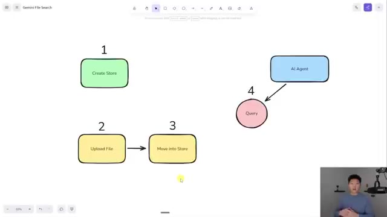
*⏱️ 00:03:48 — Un schéma logique numéroté de 1 à 4 détaillant les étapes d'automatisation pour le "Gemini File Search".*

---

### ⏱️ `[00:04:11 - 00:04:30]` | Segment #09

**🔊 Audio (Transcription Intégrale Mot pour Mot en Français) :**
> All right, so here's what it looks like in NNN. We've got the create store, we've got the upload file, and we have the query. And then after I show you guys how all of this works, we're gonna run a quick evaluation to see how accurate the results actually are coming back. Okay, so I already have all of this built out for you guys. If you wanna download it for completely free so you can just plug in your own information, you can do so by joining my FreeSchool community.

**👁️ Analyse Visuelle d'Écran (gemini-3.5-flash-lite) :**
**Interface & Outils** : n8n (éditeur de workflow visuel).

**Contenu textuel & Code** : Diagramme de flux de données incluant les nœuds de déclenchement (When clicking...), de traitement de fichiers, et d'agents IA interagissant avec un « Knowledge Base » et des modèles LLM.

**Action / Démonstration** : Le présentateur explique la structure logique du workflow affiché à l'écran avant de procéder à une évaluation de ses résultats.

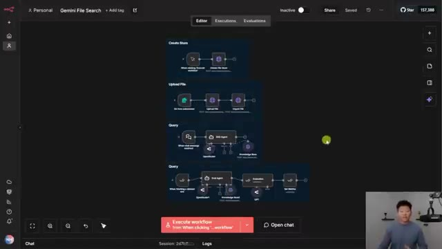
*⏱️ 00:04:15 — Une capture d'écran de l'interface n8n montrant plusieurs workflows organisés en sections : « Create Store », « Upload File », et « Query », avec des nœuds connectés illustrant les étapes d'automatisation.*

---

### ⏱️ `[00:04:30 - 00:04:50]` | Segment #10

**🔊 Audio (Transcription Intégrale Mot pour Mot en Français) :**
> The link for that is down in the description. I also just recorded a full step-by-step breakdown of this in my plus community, if you wanna check that out where I do other live builds and we've got full courses in here as well. So if that interests you, go check it out. So anyways, the way that this works is we're setting up our HTTP requests. And the way that I knew how to set this up was by looking at the file search API documentation.

**👁️ Analyse Visuelle d'Écran (gemini-3.5-flash-lite) :**
**Interface & Outils** : n8n (éditeur de workflow), AI Automation Society Plus (plateforme éducative).

**Contenu textuel & Code** : Nœuds de workflow : "When clicking 'Execute workflow'", "Create File Store", "On form submission", "Upload File", "Import File".

**Action / Démonstration** : Navigation et présentation des outils d'automatisation (n8n) et promotion de la communauté d'apprentissage associée.

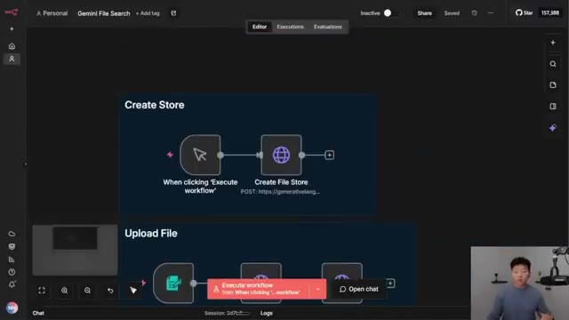
*⏱️ 00:04:35 — Interface de l'outil d'automatisation n8n montrant des workflows nommés "Create Store" et "Upload File" avec des nœuds de déclenchement et d'exécution HTTP.*

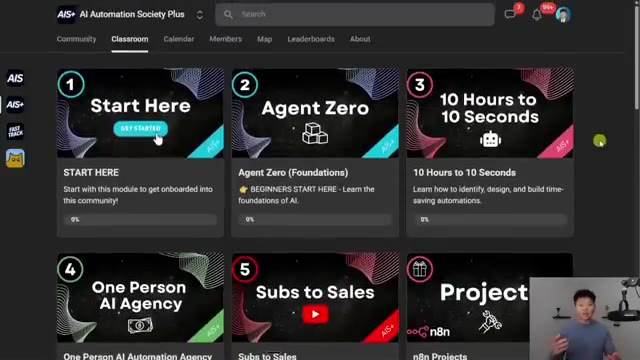
*⏱️ 00:04:40 — Interface de la plateforme "AI Automation Society Plus", affichant divers modules de cours et de formation comme "Agent Zero" et "10 Hours to 10 Seconds".*

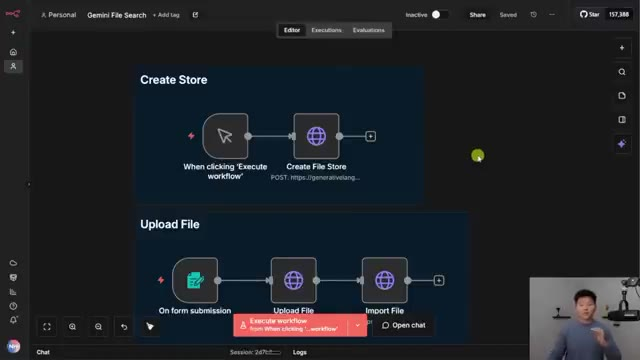
*⏱️ 00:04:45 — Vue détaillée du workflow "Upload File" dans n8n, montrant la séquence de nœuds : déclencheur, "Upload File" et "Import File".*

---

### ⏱️ `[00:04:50 - 00:05:09]` | Segment #11

**🔊 Audio (Transcription Intégrale Mot pour Mot en Français) :**
> And I'm going to be honest, this API documentation from Google and most of Google's are not my favorite. They're not super intuitive, they're very confusing. And so I will show you guys where I found the operations that we need to do. But once again, you can download this workflow for free and just plug in your key information. So you can see this is our file search API.

**👁️ Analyse Visuelle d'Écran (gemini-3.5-flash-lite) :**
**Interface & Outils** : Navigateur web affichant la documentation développeur de Google (Gemini API Docs).

**Contenu textuel & Code** : Documentation sur le "File Search" et exemple de commande cURL pour "Directly upload to File Search store" avec définition des variables `FILE_PATH`, `MIME_TYPE` et `NUM_BYTES`.

**Action / Démonstration** : Navigation dans la documentation pour localiser les opérations d'API nécessaires à l'implémentation du flux de travail.

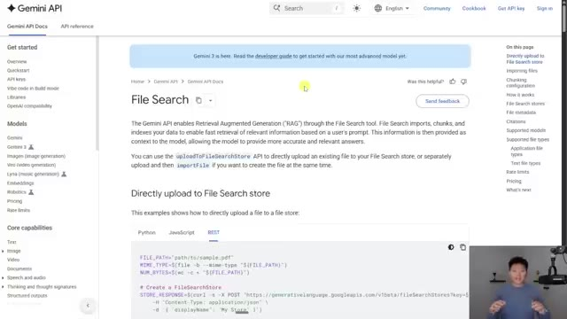
*⏱️ 00:04:55 — Capture d'écran de la documentation officielle de l'API Gemini concernant la fonctionnalité "File Search", avec une vue sur les exemples de requêtes REST.*

---

### ⏱️ `[00:05:09 - 00:05:28]` | Segment #12

**🔊 Audio (Transcription Intégrale Mot pour Mot en Français) :**
> We have different scenarios like directly uploading to file search store. We can import files. We can learn how the chunking works. We can look at the metadata and citations and stuff like that. And also another cool tip that I saw from Mark Kashif is you can actually go ahead and view as Markdown and then you could paste in all of this information to an LLM and it could help you set up some requests.

**👁️ Analyse Visuelle d'Écran (gemini-3.5-flash-lite) :**
**Interface & Outils** : Documentation officielle de l'API Gemini (site web Google AI).

**Contenu textuel & Code** : Commandes terminal (curl) pour le chunking de fichiers et code source Python utilisant `google.genai` pour la recherche de fichiers et la génération de réponses.

**Action / Démonstration** : Présentation des méthodes techniques pour manipuler le découpage de données et l'importation de fichiers dans l'API Gemini pour optimiser la recherche documentaire.

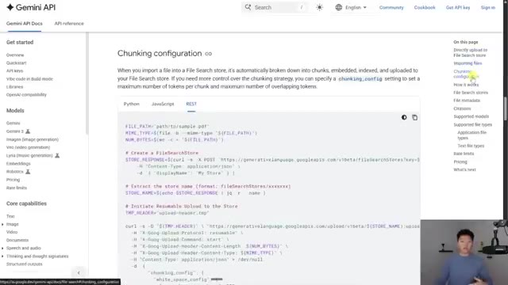
*⏱️ 00:05:14 — Documentation officielle de l'API Gemini affichant la configuration du "chunking" (découpage) pour le stockage de recherche de fichiers, incluant des exemples de commandes curl.*

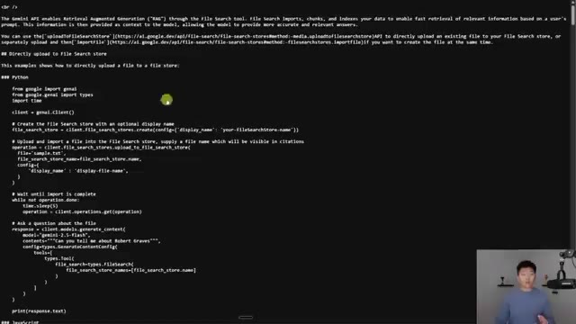
*⏱️ 00:05:23 — Vue de la documentation au format Markdown affichant un script Python complet pour utiliser la fonctionnalité "File Search" de Gemini, incluant l'importation et la génération de contenu.*

---

### ⏱️ `[00:05:28 - 00:05:47]` | Segment #13

**🔊 Audio (Transcription Intégrale Mot pour Mot en Français) :**
> It's definitely not perfect and you have to work with it a little bit. So that's why I'm here to just show you what to do. So the way that I went about this is I went down to the second one, which is importing files. And I kind of followed this order of operations. So the first thing that you can see what we have to do is we have to create a file search store. So what I did is I saw that this was a post request.

**👁️ Analyse Visuelle d'Écran (gemini-3.5-flash-lite) :**
**Interface & Outils** : Présentation ou face-caméra explicatif sans interface logicielle partagée.

**Contenu textuel & Code** : Explications orales et mise en contexte méthodologique.

**Action / Démonstration** : Explications face caméra et démonstration conceptuelle.

---

### ⏱️ `[00:05:47 - 00:06:06]` | Segment #14

**🔊 Audio (Transcription Intégrale Mot pour Mot en Français) :**
> I grabbed this whole endpoint right here and I'm gonna throw this into this HTTP request right there. And I'm not gonna dive into the nitty gritties of setting up an HTTP request. But one thing that I know just because I've done it so many times is when you see a question mark in the URL, this basically just means that anything following that question mark is a query parameter.

**👁️ Analyse Visuelle d'Écran (gemini-3.5-flash-lite) :**
**Interface & Outils** : Outil d'automatisation de workflow (n8n) ; Documentation officielle de l'API Gemini.

**Contenu textuel & Code** : URL de l'API Google Generative Language : `https://generativelanguage.googleapis.com/v1beta/fileSearchStores`. Paramètres de requête avec clé (key) en cours de saisie.

**Action / Démonstration** : Configuration manuelle d'une requête HTTP POST en copiant une URL d'API depuis la documentation pour l'intégrer dans un workflow d'automatisation.

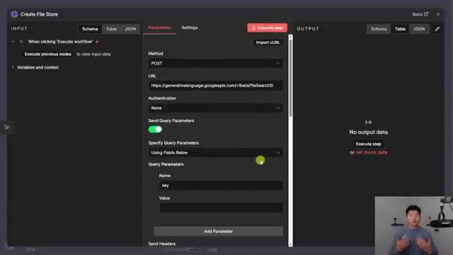
*⏱️ 00:05:52 — Interface de configuration d'un nœud HTTP dans un outil d'automatisation (probablement n8n), avec les champs de méthode POST, URL et paramètres de requête (Query Parameters) définis.*

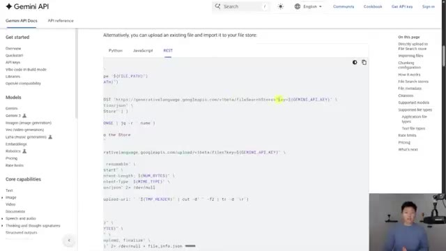
*⏱️ 00:06:01 — Documentation de l'API Gemini affichée dans un navigateur, présentant un exemple de commande cURL pour interagir avec le endpoint 'fileSearchStores'.*

---

### ⏱️ `[00:06:06 - 00:06:35]` | Segment #15

**🔊 Audio (Transcription Intégrale Mot pour Mot en Français) :**
> And so you can see our query parameter is a key, and then we need to go get a Gemini API key. So if you're in this documentation page, you can click up here to get a API key, or you could go to Google AI Studio, and then you'll find when you create your profile, you can create a key right here, which I will just go ahead and call test, throw that in there. And then when I get this key, it will give me this value, which I can go ahead and copy and go back into NNN, and you would just be pasting this right in here where I have my query parameter that says key, and then I've got that value.

**👁️ Analyse Visuelle d'Écran (gemini-3.5-flash-lite) :**
**Interface & Outils** : Documentation Gemini API, Google AI Studio, n8n (éditeur de workflow).

**Contenu textuel & Code** : Commandes cURL et structure JSON pour les appels d'API, configuration des paramètres de requête (Name: "key", Value: "") dans n8n.

**Action / Démonstration** : Navigation dans la documentation, configuration d'un projet pour générer une clé API, et saisie des paramètres d'authentification dans un outil d'automatisation.

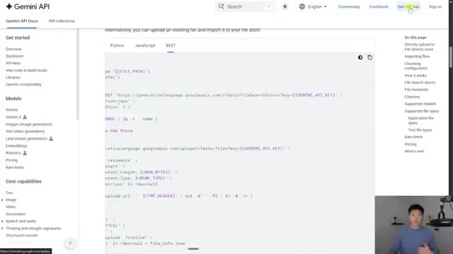
*⏱️ 00:06:13 — Documentation officielle de l'API Gemini affichant des exemples de requêtes REST pour manipuler des fichiers.*

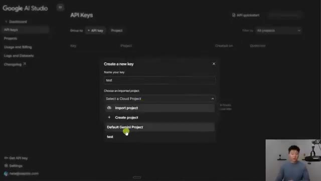
*⏱️ 00:06:21 — Interface de création d'une nouvelle clé API dans Google AI Studio, avec un menu déroulant pour sélectionner un projet.*

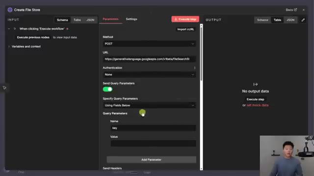
*⏱️ 00:06:28 — Interface de configuration d'un nœud HTTP dans n8n, montrant les paramètres de requête pour une méthode POST avec un champ "key".*

---

### ⏱️ `[00:06:35 - 00:07:03]` | Segment #16

**🔊 Audio (Transcription Intégrale Mot pour Mot en Français) :**
> Now that's one way you can do it, and I have the rest of the template set up so that you can do that, but a much better way to do it so that you don't have to go copy and paste your key every time is to create an authentication up here. So we know this is a query parameter, so I'm gonna choose generic. I'm gonna go to generic type and choose query, and then I'm going to create a new query auth where I basically for the name, just type in key for the value, paste in that API key, And then I'm just gonna name this Google demo 11 19.

**👁️ Analyse Visuelle d'Écran (gemini-3.5-flash-lite) :**
**Interface & Outils** : Présentation ou face-caméra explicatif sans interface logicielle partagée.

**Contenu textuel & Code** : Explications orales et mise en contexte méthodologique.

**Action / Démonstration** : Explications face caméra et démonstration conceptuelle.

---

### ⏱️ `[00:07:03 - 00:07:22]` | Segment #17

**🔊 Audio (Transcription Intégrale Mot pour Mot en Français) :**
> And so I can save that. And now I know exactly what query auth that this is. And I can use this every time rather than sending over these query parameters. So anyways, I've got my header content type in here. And then the most important thing that you need to do in this request is choose the name for your file store. So I'm gonna call my file store, YouTube dash test.

**👁️ Analyse Visuelle d'Écran (gemini-3.5-flash-lite) :**
**Interface & Outils** : n8n (workflow automation tool).

**Contenu textuel & Code** : Paramètres configurés : "Authentication" (Generic Credential Type), "Generic Auth Type" (Query Auth), "Query Auth" (Google Demo 11/19), "Name" (key), "Value" (chaîne de caractères de clé API).

**Action / Démonstration** : Le présentateur explique comment configurer l'authentification par requête pour réutiliser des identifiants enregistrés au lieu de saisir manuellement les paramètres à chaque fois.

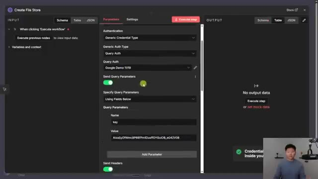
*⏱️ 00:07:08 — Interface de configuration d'un nœud "Create File Store" dans n8n, montrant les paramètres d'authentification et les paramètres de requête (Query Parameters).*

---

### ⏱️ `[00:07:22 - 00:07:40]` | Segment #18

**🔊 Audio (Transcription Intégrale Mot pour Mot en Français) :**
> And then I'm just gonna go ahead and execute this step. And you can see that we got the success message back from Google, which is basically saying, okay, here's the name of your file store, here's the display name, and here's the time that we created it. And so right now I'm just gonna pin this data so we can save it, because we're gonna have to come back and use this name in the next step. Okay, so we created our file store.

**👁️ Analyse Visuelle d'Écran (gemini-3.5-flash-lite) :**
**Interface & Outils** : n8n (outil d'automatisation de workflow).

**Contenu textuel & Code** : Configuration HTTP : Méthode POST, URL de l'API Google Generative Language, authentification "Google Demo 11/19". Le panneau de sortie affiche un tableau avec les colonnes "name", "displayName" et "createTime".

**Action / Démonstration** : Exécution du nœud ("Execute step") pour valider la création du File Store et réception de la réponse confirmant les détails du fichier créé.

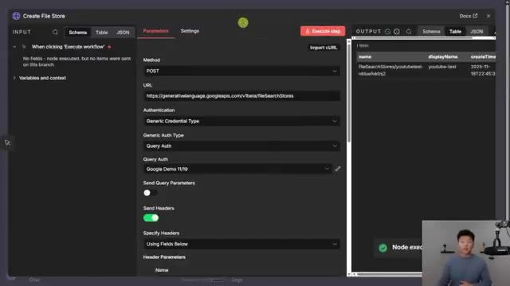
*⏱️ 00:07:27 — Interface n8n affichant la configuration d'un nœud HTTP Request pour créer un "File Store" via l'API Google, avec les résultats de l'exécution affichés dans le panneau de droite.*

---

### ⏱️ `[00:07:40 - 00:08:00]` | Segment #19

**🔊 Audio (Transcription Intégrale Mot pour Mot en Français) :**
> The next thing we need to do is we need to upload the file to Google, and then we have to move it into that file store. So real quick, what I'm gonna do is just delete this connection. We're gonna go ahead and pull up this form submission trigger, which just makes me drop in a document. And I just dropped in this PDF, which is the rules of golf. And it's like a 22 page PDF or something like that.

**👁️ Analyse Visuelle d'Écran (gemini-3.5-flash-lite) :**
**Interface & Outils** : Présentation ou face-caméra explicatif sans interface logicielle partagée.

**Contenu textuel & Code** : Explications orales et mise en contexte méthodologique.

**Action / Démonstration** : Explications face caméra et démonstration conceptuelle.

---

### ⏱️ `[00:08:00 - 00:08:19]` | Segment #20

**🔊 Audio (Transcription Intégrale Mot pour Mot en Français) :**
> Now let's go into this HTTP request and take a look at what we're doing. So the way that I found out how to configure this one was back in the API documentation. You can see that after we created our file search store, we needed to initiate resumable upload to the store. So I went ahead and grabbed this post request. I grabbed this URL right here. As you can see, it ends in files.

**👁️ Analyse Visuelle d'Écran (gemini-3.5-flash-lite) :**
**Interface & Outils** : n8n (no-code automation platform) et le site web de documentation Gemini API.

**Contenu textuel & Code** : - Image 1 : Paramètres de requête, clé API, configuration du corps (Body) défini sur "n8n Binary File".
- Image 2 : Scripts shell/curl pour `Create a FileSearchStore` et `Initiate Resumable Upload to the Store`.

**Action / Démonstration** : Le présentateur explique la configuration d'une requête HTTP dans n8n en s'appuyant sur les instructions techniques trouvées dans la documentation de l'API Gemini.

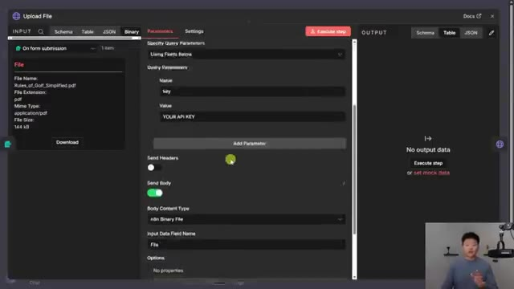
*⏱️ 00:08:04 — Interface n8n montrant la configuration d'un nœud "Upload File" avec des paramètres de requête HTTP.*

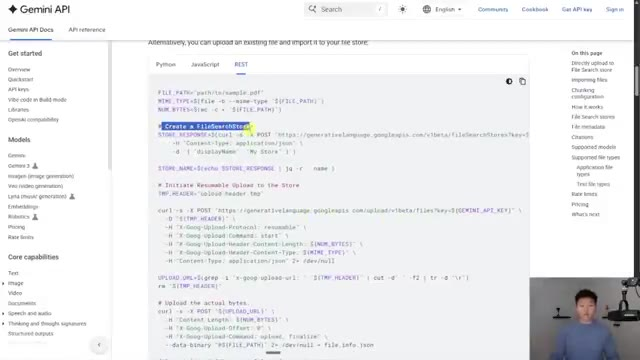
*⏱️ 00:08:09 — Documentation officielle de l'API Gemini affichant des exemples de commandes curl pour la création d'un "FileSearchStore" et l'initialisation d'un "resumable upload".*

---

### ⏱️ `[00:08:19 - 00:08:38]` | Segment #21

**🔊 Audio (Transcription Intégrale Mot pour Mot en Français) :**
> And then I threw in right here, this URL. And then we have our career parameter, which I'm actually gonna get rid of. because as you guys saw, we just set up a query auth together, which was Google demo 1119 right there. And then the last thing that we actually need to send over is the actual NNN file. So right here for the body, we're choosing NNN binary file, which is right over here.

**👁️ Analyse Visuelle d'Écran (gemini-3.5-flash-lite) :**
**Interface & Outils** : Présentation ou face-caméra explicatif sans interface logicielle partagée.

**Contenu textuel & Code** : Explications orales et mise en contexte méthodologique.

**Action / Démonstration** : Explications face caméra et démonstration conceptuelle.

---

### ⏱️ `[00:08:38 - 00:08:57]` | Segment #22

**🔊 Audio (Transcription Intégrale Mot pour Mot en Français) :**
> You can tell it's binary because you have schema, table, JSON, and then binary, and that's where it shows up. And so all you have to do is copy whatever the name is right here of that binary file, and then put it in there. So that's why I'm saying file, those two things match up, and I can go ahead and execute this step. And what this is gonna do is it's going to tell us that our file is now in the Google environment.

**👁️ Analyse Visuelle d'Écran (gemini-3.5-flash-lite) :**
**Interface & Outils** : n8n (éditeur de workflow low-code)

**Contenu textuel & Code** : Détails du fichier (nom: Rules_of_Golf_Simplified.pdf, type: application/pdf), paramètres d'authentification, type de contenu "n8n Binary File", et champ "Input Data Field Name" réglé sur "File".

**Action / Démonstration** : Configuration des paramètres d'entrée pour un transfert de fichier binaire au sein d'un workflow d'automatisation.

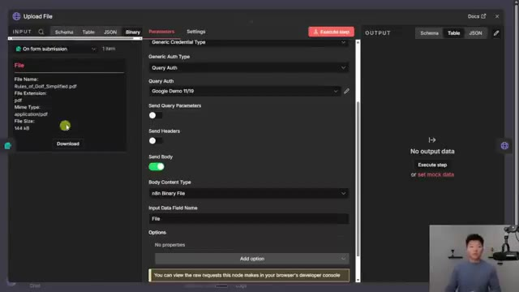
*⏱️ 00:08:43 — Interface de configuration d'un nœud "Upload File" dans n8n, montrant les détails d'un fichier binaire ("Rules_of_Golf_Simplified.pdf") et les paramètres de requête HTTP.*

---

### ⏱️ `[00:08:57 - 00:09:16]` | Segment #23

**🔊 Audio (Transcription Intégrale Mot pour Mot en Français) :**
> So what it does is it temporarily holds this file, which is why you see an expiration time. So if you don't move it into a folder by this date, it will expire. So you can see we got a name, we got a MIME type, we have a size, we have a URI, we have a state, we have a source, and that's just some metadata about this. And this is basically just our success message from Google.

**👁️ Analyse Visuelle d'Écran (gemini-3.5-flash-lite) :**
**Interface & Outils** : n8n (outil d'automatisation de workflow)

**Contenu textuel & Code** : Métadonnées de fichier (name, mimeType, sizeBytes, createTime, updateTime, expirationTime, sha256Hash, uri, state, source) et configuration d'une requête POST vers l'API Google Generative Language.

**Action / Démonstration** : Le présentateur explique la structure des métadonnées de sortie après l'upload d'un fichier PDF et souligne l'importance de la valeur "expirationTime".

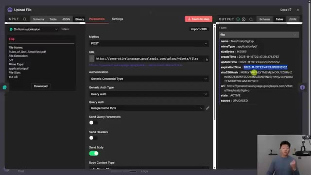
*⏱️ 00:09:02 — Interface n8n affichant les détails d'un nœud de requête HTTP configuré pour uploader un fichier vers l'API de Google, avec les métadonnées du fichier visibles dans le panneau de sortie.*

---

### ⏱️ `[00:09:16 - 00:09:36]` | Segment #24

**🔊 Audio (Transcription Intégrale Mot pour Mot en Français) :**
> So moving on to the next one, what we have to do is actually move that file that's up in Google's cloud into our folder. So I'm gonna go back once again into the API documentation. You can see that there's one right here which is import files into the right store. So I would basically grab this request. I then came into this HTTP request and pasted it right in here.

**👁️ Analyse Visuelle d'Écran (gemini-3.5-flash-lite) :**
**Interface & Outils** : n8n (workflow automation), Site web de documentation de l'API Google Gemini.

**Contenu textuel & Code** : Nœuds de workflow n8n (POST requests vers l'API Gemini), extraits de code bash/curl pour l'upload et l'importation de fichiers dans le file search store.

**Action / Démonstration** : Le présentateur passe de la visualisation du workflow dans n8n à la documentation technique de l'API pour copier les instructions d'importation de fichiers.

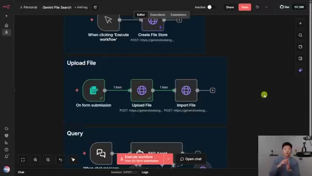
*⏱️ 00:09:21 — Interface n8n montrant un workflow de traitement de fichiers avec des nœuds pour "On form submission", "Upload File" et "Import File".*

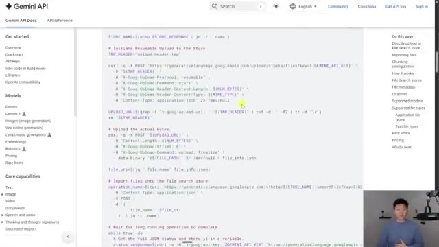
*⏱️ 00:09:26 — Documentation officielle de l'API Gemini affichant des exemples de commandes curl pour l'upload de fichiers et l'importation dans un store.*

---

### ⏱️ `[00:09:36 - 00:09:55]` | Segment #25

**🔊 Audio (Transcription Intégrale Mot pour Mot en Français) :**
> And what you notice is that we have a variable to configure because right here you can see it's asking for our store name. Now, the reason why we have to do it in the end point is because it didn't come after the question mark. So it's not actually a query parameter. So that's why we have to copy and paste the name of our file store in the actual URL. So I'm gonna go back into this first node where we got that.

**👁️ Analyse Visuelle d'Écran (gemini-3.5-flash-lite) :**
**Interface & Outils** : Navigateur web (documentation Google AI) et interface de workflow d'automatisation (n8n ou similaire).

**Contenu textuel & Code** : - Image 1 : Snippet de code cURL : `curl ... https://generativelanguage.googleapis.com/v1beta/${STORE_NAME}:importFile?key=${GEMINI_API_KEY}`
- Image 2 : Champ URL : `https://generativelanguage.googleapis.com/v1beta/YOUR_FILE_STORE:importFile`

**Action / Démonstration** : Le présentateur explique la nécessité de configurer manuellement le nom du store (variable) directement dans l'URL de l'endpoint car il ne s'agit pas d'un paramètre de requête standard.

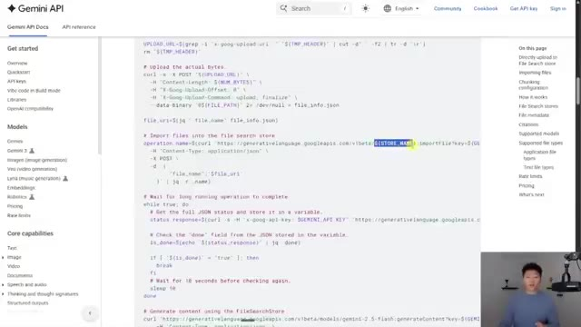
*⏱️ 00:09:41 — Documentation officielle de l'API Gemini affichant un exemple de script Bash/cURL montrant l'intégration d'une variable ${STORE_NAME} dans l'URL de requête.*

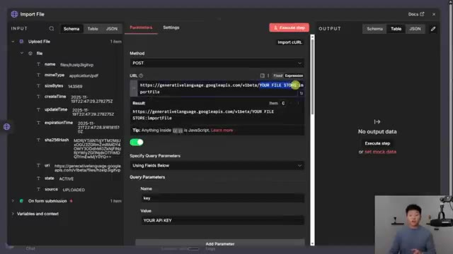
*⏱️ 00:09:50 — Interface de configuration d'un outil d'automatisation (type n8n) montrant la configuration d'un nœud "Import File" avec une URL requérant l'insertion manuelle du nom du store.*

---

### ⏱️ `[00:09:55 - 00:10:16]` | Segment #26

**🔊 Audio (Transcription Intégrale Mot pour Mot en Français) :**
> I'm going to copy this name right here of our file store and then open up this import file node and we're gonna delete this and we're gonna paste in the name of our file store right there. I'm gonna go ahead and get rid of our query parameters because we already set that up together. We've got our headers we're sending over. And then finally for the JSON body, we just need to send over the name of the file that we just uploaded.

**👁️ Analyse Visuelle d'Écran (gemini-3.5-flash-lite) :**
**Interface & Outils** : n8n (outil d'automatisation de workflow)

**Contenu textuel & Code** : URL de l'API : `https://generativelanguage.googleapis.com/v1beta/YOUR FILE STORE:importFile`, avec des champs pour la méthode POST et les paramètres de requête (API KEY).

**Action / Démonstration** : Le présentateur configure l'URL de l'API dans le champ dédié au sein du nœud d'importation de fichier.

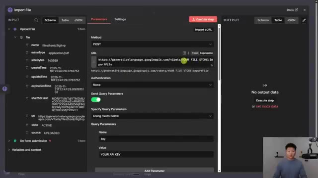
*⏱️ 00:10:00 — Interface du nœud "Import File" dans n8n, montrant la configuration d'une requête API avec l'URL pointant vers l'API Google Generative Language.*

---

### ⏱️ `[00:10:16 - 00:10:35]` | Segment #27

**🔊 Audio (Transcription Intégrale Mot pour Mot en Français) :**
> So on this left-hand side, we had the upload file operation and it gave us a name. I basically just dragged in that name right there. And now if we execute this step, we're gonna get a success message from Google that's telling us that our file has been put into that folder. All right, so we made our folder, we uploaded the file, and then we moved that file into that folder.

**👁️ Analyse Visuelle d'Écran (gemini-3.5-flash-lite) :**
**Interface & Outils** : Outil d'automatisation de workflow (Type n8n ou plateforme similaire basée sur des nœuds).

**Contenu textuel & Code** : Expression `{ { $json.file_name } }` insérée dans le champ "Value" du paramètre "file_name" pour mapper les données d'entrée vers l'API Google.

**Action / Démonstration** : Configuration des paramètres d'un nœud d'importation de fichier suivie de l'exécution du workflow global pour traiter la soumission de formulaire.

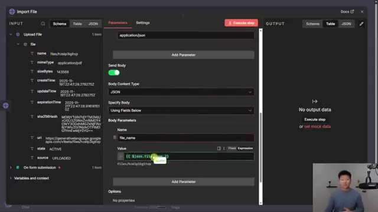
*⏱️ 00:10:21 — Interface de configuration du nœud "Import File" dans un outil d'automatisation, montrant la liaison dynamique d'une valeur (file_name) via une expression.*

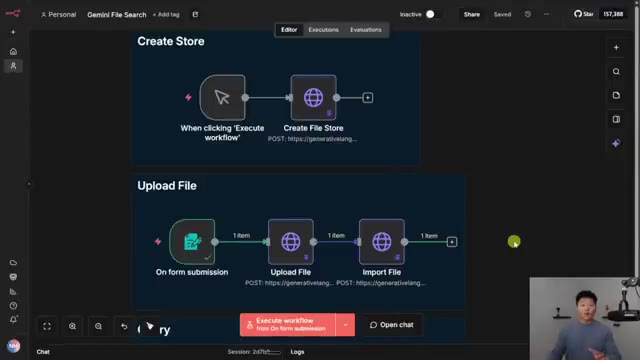
*⏱️ 00:10:30 — Vue d'ensemble du workflow d'automatisation "Gemini File Search", illustrant les étapes "On form submission", "Upload File" et "Import File".*

---

### ⏱️ `[00:10:35 - 00:10:53]` | Segment #28

**🔊 Audio (Transcription Intégrale Mot pour Mot en Français) :**
> So now we're ready to actually test out the agent and see if it can understand what is in that PDF that we just gave it. So the way that this knowledge-based tool works is it is another HTTP request. So of course I went to the API documentation and I saw this request right here, which is to generate content, which just means it's gonna get an answer back for us.

**👁️ Analyse Visuelle d'Écran (gemini-3.5-flash-lite) :**
**Interface & Outils** : n8n (éditeur de workflow) et le site web de la documentation officielle de l'API Gemini.

**Contenu textuel & Code** : URL de l'API (`generativelanguage.googleapis.com/...`), commande cURL pour `generateContent`, configuration des méthodes HTTP POST et paramètres d'authentification.

**Action / Démonstration** : Configuration d'un nœud HTTP dans n8n pour interroger la base de connaissances (Knowledge Base) de l'agent IA, basée sur les instructions trouvées dans la documentation API.

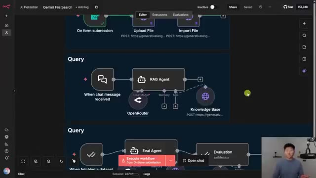
*⏱️ 00:10:40 — Vue d'ensemble de l'interface de travail dans n8n montrant un workflow d'automatisation incluant un nœud "RAG Agent" connecté à une "Knowledge Base".*

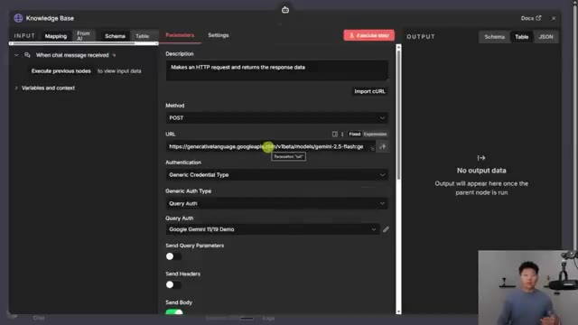
*⏱️ 00:10:44 — Configuration détaillée du nœud "Knowledge Base" dans n8n, affichant les paramètres de la requête HTTP (méthode POST) et l'URL de l'API Gemini.*

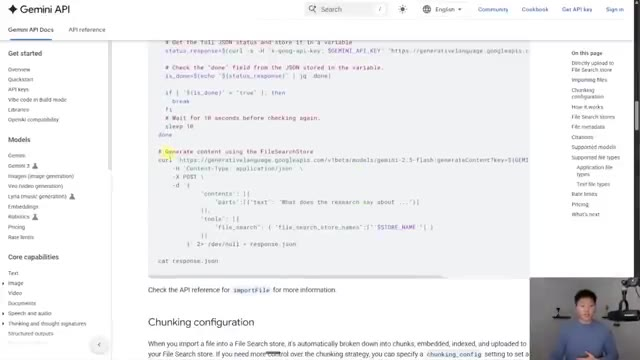
*⏱️ 00:10:49 — Page de documentation officielle de l'API Gemini affichant un exemple de commande cURL pour générer du contenu via "FileSearchStore".*

---

### ⏱️ `[00:10:54 - 00:11:13]` | Segment #29

**🔊 Audio (Transcription Intégrale Mot pour Mot en Français) :**
> So I grabbed the endpoint right here. You can see that it's using Gemini 2.5 Flash as the model. I saw the header parameters, I saw it was a post, and then I saw the actual body of the request that we need to send over. And what you'll notice is in the body, it asks us for a store name. So once again, what we wanna do is we go all the way back up here. We would grab the name of the file store that we wanna search in.

**👁️ Analyse Visuelle d'Écran (gemini-3.5-flash-lite) :**
**Interface & Outils** : Navigateur web (Documentation API Google) et interface n8n.

**Contenu textuel & Code** : - Image 1 : Commande cURL utilisant `gemini-2.5-flash` avec un corps JSON incluant `file_search_store_names: $STORE_NAME`.
- Image 2 : Champs de configuration : Méthode POST, URL pointant vers `gemini-2.5-flash`, authentification par Query Auth et activation du corps (Send Body).

**Action / Démonstration** : Le présentateur explique la structure de la requête API nécessaire en se basant sur la documentation pour configurer le noeud HTTP dans son automatisation.

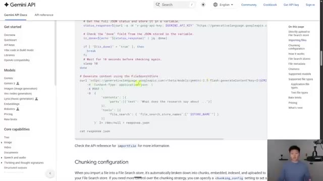
*⏱️ 00:10:59 — Documentation officielle de l'API Gemini affichant un exemple de requête cURL pour générer du contenu avec le File Search Store.*

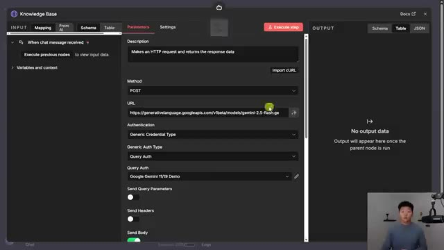
*⏱️ 00:11:08 — Interface de configuration d'un noeud HTTP Request dans un outil d'automatisation (n8n), montrant les paramètres de la requête POST vers Gemini.*

---

### ⏱️ `[00:11:14 - 00:11:32]` | Segment #30

**🔊 Audio (Transcription Intégrale Mot pour Mot en Français) :**
> And then we would open up this HTTP request and we would make sure that it goes right in here. And now it knows to look in that file store. Now, the other thing that we had to configure was this from AI function for the actual query that we're sending to the file store. And so what I did is I used the from AI function, which basically just means that the agent that controls this tool will make the query.

**👁️ Analyse Visuelle d'Écran (gemini-3.5-flash-lite) :**
**Interface & Outils** : n8n (éditeur de workflow workflow automation).

**Contenu textuel & Code** : Code JSON : `{"contents": [{"parts": [{"text": "{{ $fromAI("query", "the question the user needs an answer to") }}"}]}], "tools": [{"file_search": {"file_search_store_names": ["YOUR STORE NAME HERE"]}}]}`.

**Action / Démonstration** : Configuration dynamique d'une requête de recherche de fichiers (file_search) utilisant une fonction $fromAI avec un espace réservé pour le nom du magasin de fichiers.

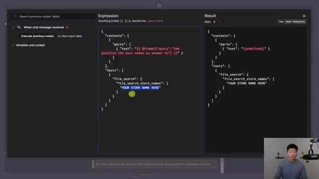
*⏱️ 00:11:18 — Interface d'édition de workflow dans n8n, affichant un éditeur d'expression JavaScript contenant la configuration d'un objet JSON pour une requête AI.*

---

### ⏱️ `[00:11:33 - 00:11:52]` | Segment #31

**🔊 Audio (Transcription Intégrale Mot pour Mot en Français) :**
> And I told it that the query is the question that the user needs an answer to. So it will be filling in the information here. And I'll show you guys what I mean by that when we actually run a demo. But then finally, for the actual prompt, I kept it really simple. I said, you are a helpful RAG agent. Your job is to answer the user's question using your knowledge-based tool to make sure all of your answers are grounded in truth. Please cite your sources when you're giving your answers.

**👁️ Analyse Visuelle d'Écran (gemini-3.5-flash-lite) :**
**Interface & Outils** : n8n (outil d'automatisation de workflow).

**Contenu textuel & Code** : Objet JSON avec une expression dynamique `{{ $fromAI("query", "the question the user needs an answer to") }}` et une configuration `file_search` pointant vers `fileSearchStores/youtubetest-nbluefoktnj2`.

**Action / Démonstration** : Configuration des paramètres d'entrée d'un nœud IA pour définir la requête utilisateur et les outils de recherche de fichiers associés.

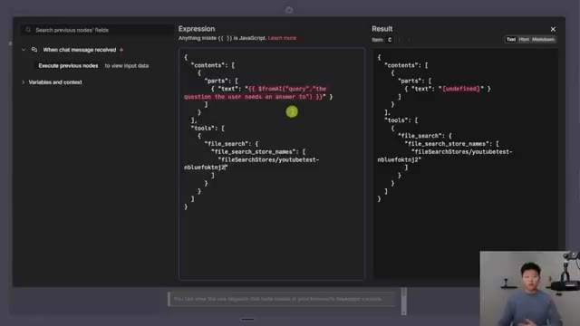
*⏱️ 00:11:37 — Interface d'édition de workflow dans n8n montrant la configuration d'un nœud avec un objet JSON incluant des champs "contents" et "tools".*

---

### ⏱️ `[00:11:52 - 00:12:11]` | Segment #32

**🔊 Audio (Transcription Intégrale Mot pour Mot en Français) :**
> When you are sending a query to the knowledge-based tool, only send over text, no punctuation, question marks, or new lines, just to keep the JSON body from breaking. So here's the rules of golf PDF that I uploaded. Let's just go ahead and ask a basic question to see if it's working. So I'm going to ask the agent what happens if your club breaks during the round. All right, so I just shut that off. It's going to use its brain. It's going to call the knowledge-based tool.

**👁️ Analyse Visuelle d'Écran (gemini-3.5-flash-lite) :**
**Interface & Outils** : n8n (éditeur de workflow) et visionneuse PDF intégrée au navigateur.

**Contenu textuel & Code** : - Image 1 : Prompt système définissant le comportement d'un agent RAG ("You are a helpful RAG agent...") et une consigne spécifique sur le formatage du texte pour éviter les erreurs JSON.
- Image 2 : Contenu textuel de la page 2 du document PDF sur les règles du golf (Rule 4 - Clubs, Rule 5 - The Ball).

**Action / Démonstration** : Le présentateur explique les contraintes de formatage des données pour l'agent avant de passer à l'examen du document PDF servant de source de connaissances (Knowledge Base).

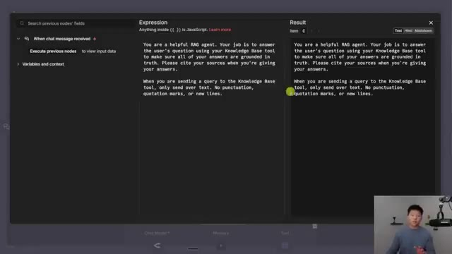
*⏱️ 00:11:57 — Interface de configuration d'un nœud dans n8n montrant un éditeur d'expression avec les instructions système pour l'agent RAG.*

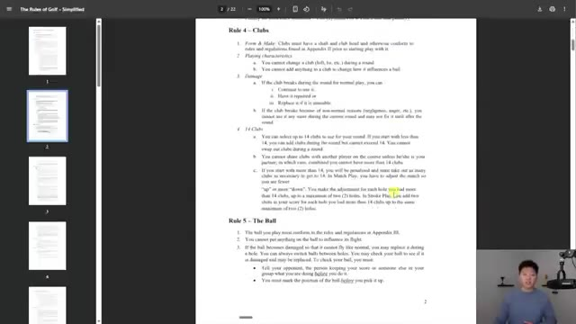
*⏱️ 00:12:02 — Visualisation du fichier PDF "The Rules of Golf - Simplified" affichant les règles relatives aux clubs et aux balles de golf.*

---

### ⏱️ `[00:12:11 - 00:12:30]` | Segment #33

**🔊 Audio (Transcription Intégrale Mot pour Mot en Français) :**
> And then we should see a correct answer that also tells us where it got it from. Okay, so we just got this back. It says, short answer, if a club breaks during the round because of normal play, you may continue to use the damage club, have it repaired or replace it during the round. But if it breaks for non-normal reasons, you may not use that club for the remainder of the round and you may not repair it until after the round.

**👁️ Analyse Visuelle d'Écran (gemini-3.5-flash-lite) :**
**Interface & Outils** : n8n (éditeur de workflow d'automatisation).

**Contenu textuel & Code** : Le panneau de chat affiche la réponse de l'agent : "Short answer: If a club breaks during the round because of normal play... you may continue to use the damaged club...". Le diagramme de workflow montre un déclencheur "When chat message received" connecté à un nœud "RAG Agent" et à une base de connaissances.

**Action / Démonstration** : L'agent RAG a été exécuté avec succès (indiqué par "Success in 16.432s"), traitant une requête utilisateur sur les règles de golf et fournissant une réponse sourcée.

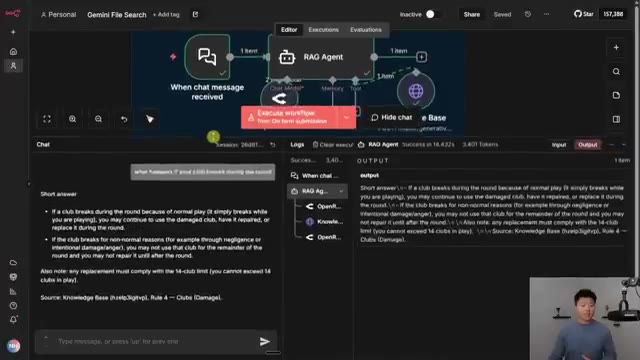
*⏱️ 00:12:16 — Une interface de workflow automatisé montrant un agent RAG en cours d'exécution, affichant une réponse textuelle détaillée sur les règles de golf concernant les clubs endommagés.*

---

### ⏱️ `[00:12:30 - 00:12:52]` | Segment #34

**🔊 Audio (Transcription Intégrale Mot pour Mot en Français) :**
> It showed us the source was from the knowledge base from this document and then rule four clubs. Okay, so that's how it handles one document in there. Let's go ahead and throw in another one and see what that's like. So we already have this pipeline configured. I should be able to just pull up this form, drop in another file, which is completely different. This one's about NVIDIA and it should upload the file and import it into the correct store once again.

**👁️ Analyse Visuelle d'Écran (gemini-3.5-flash-lite) :**
**Interface & Outils** : n8n (outil d'automatisation de workflow low-code).

**Contenu textuel & Code** : Workflow d'automatisation incluant des déclencheurs ("On form submission", "When chat message received") et des nœuds de traitement de données ("Upload File", "Knowledge Base", "RAG Agent").

**Action / Démonstration** : Le présentateur explique le fonctionnement du pipeline de RAG, puis interagit avec le formulaire de téléchargement de document pour tester l'ajout d'un nouveau fichier dans le système.

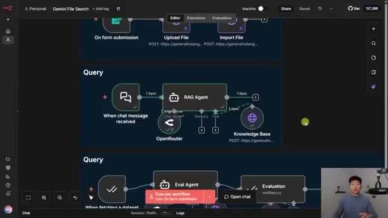
*⏱️ 00:12:36 — Interface n8n affichant un workflow de RAG (Retrieval-Augmented Generation) avec un nœud "RAG Agent" connecté à "OpenRouter" et une "Knowledge Base".*

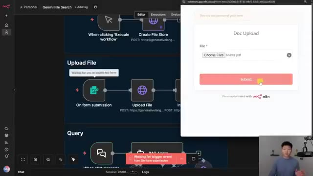
*⏱️ 00:12:46 — Interface n8n affichant le workflow en arrière-plan avec une fenêtre contextuelle "Doc Upload" au premier plan permettant de choisir et soumettre un fichier (Nvidia.pdf).*

---

### ⏱️ `[00:12:52 - 00:13:13]` | Segment #35

**🔊 Audio (Transcription Intégrale Mot pour Mot en Français) :**
> Okay, so that was quick. It looks like it's already done. I'm just gonna go ahead and ask some random question about NVIDIA and we will see if it is able to pull it. Okay, so I just asked it to give me a Q1 2025 fiscal summary for NVIDIA. All right, so we got that back and we see, okay, here is a concise Q1 fiscal summary for NVIDIA. We've got total revenue, 26 billion, data center revenue, 22 billion.

**👁️ Analyse Visuelle d'Écran (gemini-3.5-flash-lite) :**
**Interface & Outils** : Flowise (plateforme d'automatisation IA no-code).

**Contenu textuel & Code** : Prompt : "give me a Q1 2025 fiscal summary for nvidia". Réponse détaillée incluant : "Total revenue: $26.0 billion", "Data Center revenue: $22.6 billion", marges et résultats nets.

**Action / Démonstration** : Exécution d'un workflow RAG (Retrieval-Augmented Generation) pour interroger une base de connaissances et afficher les données financières extraites dans l'interface de chat.

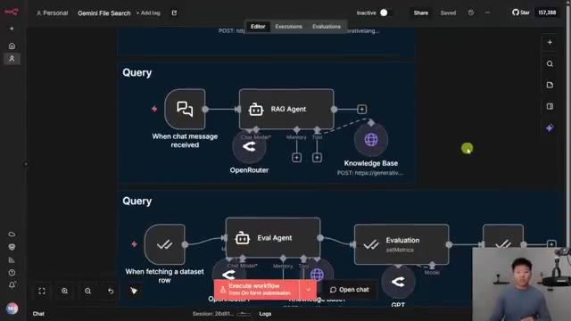
*⏱️ 00:12:57 — Interface de conception de workflow dans Flowise montrant deux nœuds principaux : "RAG Agent" connecté à une "Knowledge Base" et un nœud "Eval Agent".*

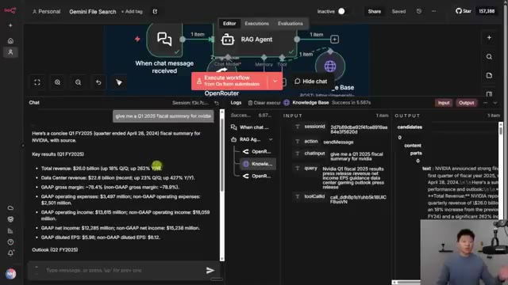
*⏱️ 00:13:08 — Interface de chat de Flowise affichant la réponse détaillée sur les résultats financiers du T1 2025 de NVIDIA, avec le panneau de logs technique ouvert à droite.*

---

### ⏱️ `[00:13:13 - 00:13:46]` | Segment #36

**🔊 Audio (Transcription Intégrale Mot pour Mot en Français) :**
> We've got a gap gross margin. We've got some other stats like this. And you can see that this came from the NVIDIA press release. NVIDIA announces financial results for first quarter fiscal year 2025, April 28th, 2024. And if I go to the document that this actually pulled from, you can see that this is in fact correct. But you still of course want to know that this is grounded in truth and you could prompt your agent to make sure they're always giving you like exact quotes and things like that. And so if I real quick just actually click into this knowledge base tool, we can go ahead and see the output that it got. And what you'll see is first of all, we get a candidates array. And in

**👁️ Analyse Visuelle d'Écran (gemini-3.5-flash-lite) :**
**Interface & Outils** : Plateforme d'automatisation de workflow (Type n8n / Workflow Builder), lecteur PDF intégré.

**Contenu textuel & Code** : Données financières NVIDIA (Q1 2025) : revenus, marges brutes (GAAP/Non-GAAP), prévisions Outlook Q2, détails sur le stock split et les dividendes.

**Action / Démonstration** : Démonstration de l'extraction de données structurées à partir d'un PDF via un agent IA, et comparaison entre le document source et le résultat généré par l'agent.

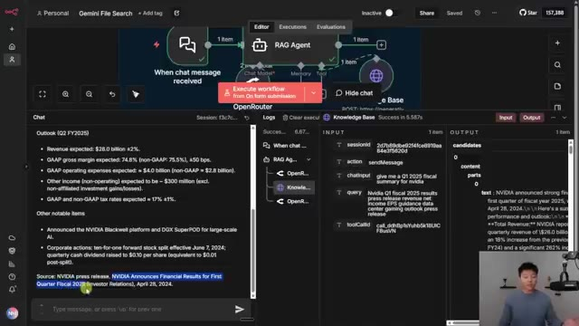
*⏱️ 00:13:21 — Interface d'un agent de workflow (type n8n ou plateforme similaire) affichant le résultat d'une requête sur les résultats financiers de NVIDIA Q1 2025 avec un panneau de chat à gauche et les logs de l'exécution à droite.*

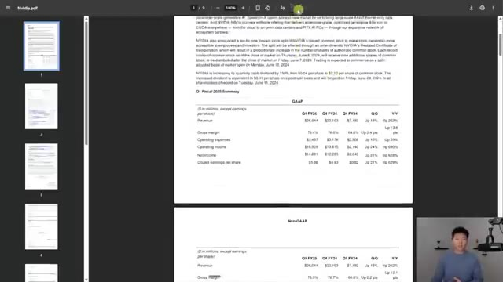
*⏱️ 00:13:30 — Visualisation du document PDF source original de NVIDIA, montrant le tableau des résultats financiers "GAAP" (Revenue, Gross margin, etc.) pour le premier trimestre fiscal 2025.*

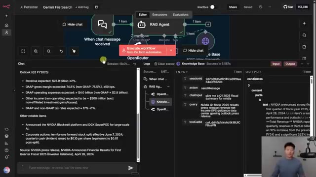
*⏱️ 00:13:38 — Même interface de workflow que l'image 1, avec le panneau de chat présentant une synthèse des données financières extraites de la source NVIDIA (Outlook Q2 FY2025).*

---

### ⏱️ `[00:13:46 - 00:14:15]` | Segment #37

**🔊 Audio (Transcription Intégrale Mot pour Mot en Français) :**
> this candidates array, we see the actual text of the real answer that the Gemini model was able to get to based on all of the data that it was looking through. But then from there, if we go further down, we can actually see grounding metadata. So this means these are all the actual chunks that it pulled in order to get to that conclusion that we just saw. This is an actual chunk that it pulled from its file store. And if we keep going down, we'll see more. We can see chunk two, and we can also see where each chunk came from as far as which folder it was in. Chunk three, chunk four, and we get all these different chunks.

**👁️ Analyse Visuelle d'Écran (gemini-3.5-flash-lite) :**
**Interface & Outils** : Interface web d'automatisation (potentiellement n8n ou un outil de gestion d'API).

**Contenu textuel & Code** : Réponse JSON structurée incluant les champs "candidates", "content", "parts", ainsi que les métadonnées de tokens ("usageMetadata", "promptTokenCount"). Le texte mis en surbrillance bleue détaille les résultats financiers de NVIDIA (revenus, bénéfices GAAP/non-GAAP, prévisions).

**Action / Démonstration** : Le présentateur illustre la réception et l'affichage des données de sortie ("output") après l'exécution d'un appel API vers un modèle LLM.

*⏱️ 00:13:53 — Une interface de plateforme d'automatisation (type n8n ou plateforme API) affichant les résultats d'une requête API vers le modèle Gemini-1.5-flash. La partie gauche montre la configuration de la requête (POST, URL Google API) et la partie droite affiche en format JSON la réponse du modèle ("candidates") contenant une analyse financière de NVIDIA.*

---

### ⏱️ `[00:14:16 - 00:14:34]` | Segment #38

**🔊 Audio (Transcription Intégrale Mot pour Mot en Français) :**
> We're also able to see grounding supports. So this will pull different explicit sentences and things like that out of the chunks. And it will tell us where it started and where it ended. And you can go ahead and verify all of this stuff in your document as well. So I just wanted to give you guys some quick insight of what the tool actually comes back with and then how your agents work together in order to give you the right answer.

**👁️ Analyse Visuelle d'Écran (gemini-3.5-flash-lite) :**
**Interface & Outils** : Interface web d'automatisation (potentiellement n8n ou un outil similaire de gestion de workflows IA).

**Contenu textuel & Code** : Configuration d'une requête POST vers `generativelanguage.googleapis.com` et, à droite, un objet JSON contenant des segments de texte sourcés avec des index de début/fin (ex: "NVIDIA announced strong financial results...").

**Action / Démonstration** : Le présentateur illustre le fonctionnement des "grounding supports" en montrant comment l'outil extrait des segments de texte précis et les index associés depuis une base de connaissances.

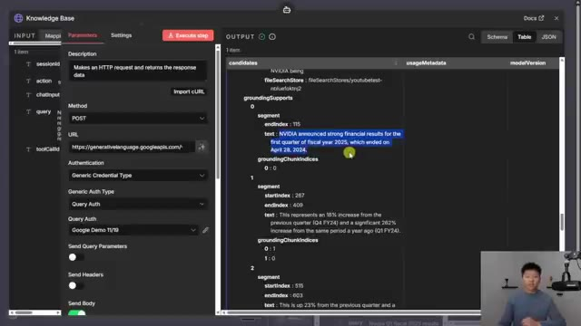
*⏱️ 00:14:20 — Une interface de plateforme d'automatisation montrant une configuration de requête HTTP (à gauche) et une sortie JSON structurée (à droite) affichant des métadonnées de "grounding" extraites d'un document.*

---

### ⏱️ `[00:14:35 - 00:14:53]` | Segment #39

**🔊 Audio (Transcription Intégrale Mot pour Mot en Français) :**
> Now, of course, we actually wanna test this. So what I'm gonna do is I'm gonna upload one more file using this flow right here. And then I'm going to run this evaluation where we're testing this agent on these 10 different questions, and we're going to see how accurate it's able to answer them. Okay, so we've got three total PDFs in our store. We have the Rules of Golf, which is 22-page PDF.

**👁️ Analyse Visuelle d'Écran (gemini-3.5-flash-lite) :**
**Interface & Outils** : Présentation ou face-caméra explicatif sans interface logicielle partagée.

**Contenu textuel & Code** : Explications orales et mise en contexte méthodologique.

**Action / Démonstration** : Explications face caméra et démonstration conceptuelle.

---

### ⏱️ `[00:14:54 - 00:15:12]` | Segment #40

**🔊 Audio (Transcription Intégrale Mot pour Mot en Français) :**
> We've got the NVIDIA announcement, which was nine pages, and then we have Apple's 10K, which was 121 pages, and we've got 10 different questions across all three of these different PDFs, and we're going to go ahead and see how well it does. So I'm running the evaluation right now. I will check back in with you guys when we get these results. Okay, so we just got that finished up.

**👁️ Analyse Visuelle d'Écran (gemini-3.5-flash-lite) :**
**Interface & Outils** : Présentation ou face-caméra explicatif sans interface logicielle partagée.

**Contenu textuel & Code** : Explications orales et mise en contexte méthodologique.

**Action / Démonstration** : Explications face caméra et démonstration conceptuelle.

---

### ⏱️ `[00:15:13 - 00:15:38]` | Segment #41

**🔊 Audio (Transcription Intégrale Mot pour Mot en Français) :**
> You can see the first run, I actually had the wrong API key put in. So it aired eight times in a row. But on the second run, things went much better. So what we see here is that it got a 4.2 correctness, which is out of five. So on these questions, it was able to get five, five, four, five. It had one tough one with a two, but these questions were really tough. And keep in mind that we dropped in basically almost 200 pages worth of PDFs and we didn't do anything special and hardly even any prompting.

**👁️ Analyse Visuelle d'Écran (gemini-3.5-flash-lite) :**
**Interface & Outils** : Plateforme de développement/évaluation d'agents IA (probablement LangSmith ou outil similaire).

**Contenu textuel & Code** : Tableau présentant deux exécutions ("All runs (2)") : l'exécution #1 ("Cancelled") et l'exécution #2 ("Completed"). La ligne #2 affiche les métriques : 937.50 completionTokens, 4179.30 promptTokens, 28963.40 executionTime et un score de "Correctness" de 4.20.

**Action / Démonstration** : Affichage des résultats après l'exécution d'un test d'évaluation pour un projet de recherche de fichiers Gemini.

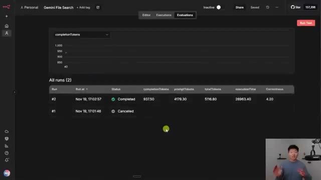
*⏱️ 00:15:19 — Interface de la plateforme montrant les résultats d'évaluation du projet "Gemini File Search", avec un tableau récapitulatif des exécutions.*

---

### ⏱️ `[00:15:38 - 00:15:59]` | Segment #42

**🔊 Audio (Transcription Intégrale Mot pour Mot en Français) :**
> We basically just had the agent take its best shot at it. And these PDFs were about Apple, NVIDIA, and Golf, so they just really didn't have any correlation, but we shoved them all in the same store as well. So anyways, just to kind of wrap up here, we have some final considerations that I wanted to talk about when it comes to RAG in general, as well as this specific Gemini file search API.

**👁️ Analyse Visuelle d'Écran (gemini-3.5-flash-lite) :**
**Interface & Outils** : Plateforme de développement d'agents (type LangSmith ou similaire).

**Contenu textuel & Code** : Tableau récapitulatif des exécutions incluant les colonnes : Run, Run at, Status (Completed/Cancelled), completionTokens, promptTokens, totalTokens, executionTime et Correctness.

**Action / Démonstration** : Affichage des métriques de performance et des logs d'exécution suite à un test d'agent IA.

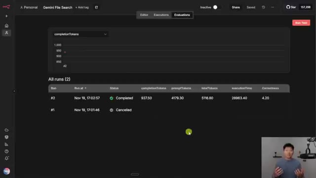
*⏱️ 00:15:44 — Interface d'évaluation d'agent IA montrant un tableau de bord avec les résultats de deux exécutions ("runs") et un graphique de performance.*

---

### ⏱️ `[00:15:59 - 00:16:17]` | Segment #43

**🔊 Audio (Transcription Intégrale Mot pour Mot en Français) :**
> And so the first three honestly just kind of fall under the umbrella of the fact that this is not magic. It's great that you can drop in these files, but what happens if you need to update a file and throw it back in? Now you have duplicate data because Google isn't really keeping a record of all of this data and making sure that things aren't duplicated or that old ones need to be updated and deleted, things like that.

**👁️ Analyse Visuelle d'Écran (gemini-3.5-flash-lite) :**
**Interface & Outils** : Présentation de diapositives (type Google Slides ou PowerPoint).

**Contenu textuel & Code** : Liste à puces abordant la détection des doublons, la suppression de documents, la qualité des données, et les risques de sécurité/confidentialité (mention de Google, données sensibles, GDPR, HIPAA, CCPA).

**Action / Démonstration** : Le présentateur illustre les points théoriques concernant les limites techniques et les risques de sécurité liés à l'indexation de fichiers.

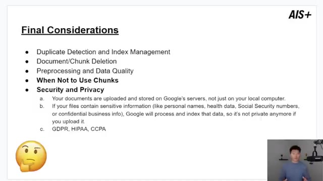
*⏱️ 00:16:04 — Une diapositive de présentation titrée "Final Considerations" listant les défis liés à la gestion de données et à la confidentialité lors de l'utilisation de documents avec des outils d'IA.*

---

### ⏱️ `[00:16:18 - 00:16:51]` | Segment #44

**🔊 Audio (Transcription Intégrale Mot pour Mot en Français) :**
> And if you keep on exploding your database with duplicate data, it's going to lower the quality of your agent's responses. And you also have to remember that garbage in is garbage out. So yes, Gemini's file search API does utilize some OCR and stuff like that to make sure it can understand what's actually going on in your documents. but if it is super messy or if it was scanned bad or if it just doesn't make sense going in it's not going to make any sense going out and so sometimes you may need to do some pre-processing before you drop in those files to Gemini. Now this one is also super important because sometimes you just don't want to do chunk-based retrieval. Semantic search is good for being quick and

**👁️ Analyse Visuelle d'Écran (gemini-3.5-flash-lite) :**
**Interface & Outils** : Présentation ou face-caméra explicatif sans interface logicielle partagée.

**Contenu textuel & Code** : Explications orales et mise en contexte méthodologique.

**Action / Démonstration** : Explications face caméra et démonstration conceptuelle.

---

### ⏱️ `[00:16:51 - 00:17:24]` | Segment #45

**🔊 Audio (Transcription Intégrale Mot pour Mot en Français) :**
> cost-effective when you need to find basically a needle in a haystack but if you need a context of the entire document or transcript or video or whatever it is you should not be using chunk-based retrieval. Unless you're getting really, really granular with some metadata tagging and things like that, but ultimately it's just not the best path. I did an example in my community where I basically had this document in there and I asked it, how many total rules are in your PDF? And it came back and said five because it actually couldn't look through the entire document in one swoop. It had to basically chunk it up and look at just individual chunks. But of course, if I asked about the last

**👁️ Analyse Visuelle d'Écran (gemini-3.5-flash-lite) :**
**Interface & Outils** : Visionneuse de documents PDF (interface standard type Google Drive/Chrome PDF Viewer).

**Contenu textuel & Code** : Texte structuré sous forme de règles de jeu : "Rule 1 - The Game", "Rule 2 - Match Play", "Rule 3 - Stroke Play", "Rule 4 - Clubs".

**Action / Démonstration** : Défilement (scrolling) à travers les pages d'un document long pour illustrer la nécessité d'une compréhension globale du contexte plutôt que d'un simple découpage (chunking).

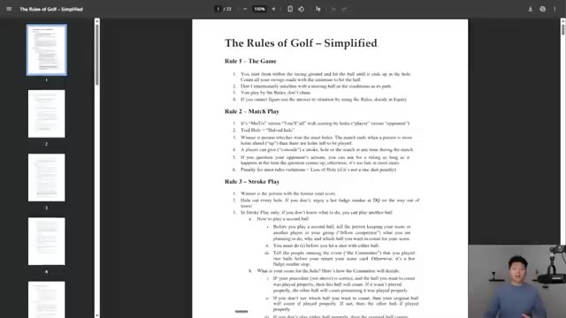
*⏱️ 00:17:07 — Visualisation d'un document PDF ouvert dans une visionneuse, affichant "The Rules of Golf - Simplified" avec une barre latérale de navigation des pages.*

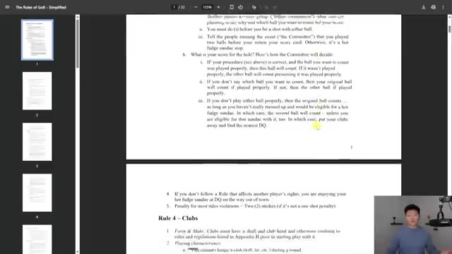
*⏱️ 00:17:15 — Gros plan sur le contenu textuel du même document PDF montrant les règles 3 et 4 du golf ("Stroke Play" et "Clubs").*

---

### ⏱️ `[00:17:24 - 00:17:43]` | Segment #46

**🔊 Audio (Transcription Intégrale Mot pour Mot en Français) :**
> rule, which is rule 28, it would get it right. And then finally, just about security and privacy, your documents are being uploaded and stored on Google servers. And so if you're doing this, just make sure that you're not uploading anything that has sensitive information like PII, because Google will process and index that data. So it will no longer be private. And of course, every situation is different.

**👁️ Analyse Visuelle d'Écran (gemini-3.5-flash-lite) :**
**Interface & Outils** : Présentation ou face-caméra explicatif sans interface logicielle partagée.

**Contenu textuel & Code** : Explications orales et mise en contexte méthodologique.

**Action / Démonstration** : Explications face caméra et démonstration conceptuelle.

---

### ⏱️ `[00:17:43 - 00:18:04]` | Segment #47

**🔊 Audio (Transcription Intégrale Mot pour Mot en Français) :**
> So just think about the rules or company regulations or industry regulations, things like GDPR, HIPAA, or CCPA. But anyways, that's going to do it for this one. I don't want the video to go too long. Just a reminder, if you want to download this workflow, you can do so for free by joining my FreeSchool community. The link for that is down in the description. And if this kind of stuff interests you and you want to dive deeper on RAG or evaluations and things like that, then definitely check out my plus community.

**👁️ Analyse Visuelle d'Écran (gemini-3.5-flash-lite) :**
**Interface & Outils** : n8n (outil d'automatisation de workflows).

**Contenu textuel & Code** : Workflow automatisé incluant des étapes de création de stockage de fichiers, d'upload, de requêtage via un agent RAG, d'évaluation et de gestion de base de connaissances.

**Action / Démonstration** : Visualisation du canevas d'automatisation n8n et exécution d'un workflow via une bannière de contrôle située en bas de l'écran.

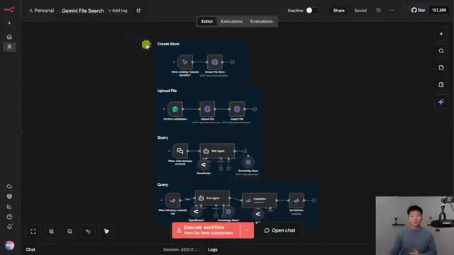
*⏱️ 00:17:54 — Interface de l'outil d'automatisation n8n affichant un workflow complet composé de plusieurs nœuds ("Create Store", "Upload File", "Query", "RAG Agent").*

---

### ⏱️ `[00:18:05 - 00:18:26]` | Segment #48

**🔊 Audio (Transcription Intégrale Mot pour Mot en Français) :**
> The link for that is also down in the description. We've got a great community of over 2,500 members who are building with NNN and building businesses around AI automation every single day. We've also got full courses in here. We've got Agent Zero, which is the foundations for AI automation. We've got 10 hours to 10 seconds where you learn how to identify, design and build time-saving automations. And then for our premium members, we've got one person AI agency and subs to sales.

**👁️ Analyse Visuelle d'Écran (gemini-3.5-flash-lite) :**
**Interface & Outils** : Plateforme communautaire en ligne (type Circle.so) hébergeant les formations "AI Automation Society Plus".

**Contenu textuel & Code** : Noms des modules de formation : "Start Here", "Agent Zero (Foundations)", "10 Hours to 10 Seconds", "One Person AI Automation Agency", "Subs to Sales", et "n8n Projects".

**Action / Démonstration** : Navigation de l'interface utilisateur montrant le contenu pédagogique et la structure de la communauté.

*⏱️ 00:18:10 — Interface de la plateforme "AI Automation Society Plus" montrant le flux d'actualités communautaire avec des publications épinglées, des discussions et une barre latérale affichant les statistiques des membres.*

*⏱️ 00:18:15 — Interface de la section "Classroom" de la plateforme, présentant une grille de cours organisés (Start Here, Agent Zero, 10 Hours to 10 Seconds, One Person AI Agency, Subs to Sales, n8n Projects).*

---

### ⏱️ `[00:18:26 - 00:18:45]` | Segment #49

**🔊 Audio (Transcription Intégrale Mot pour Mot en Français) :**
> And we've got projects for everyone and tons of other resources in here. We also run one live Q&A every week, which are super fun. So I'd love to see you guys in those calls, in the communities, but that's gonna do it for today's video. So if you enjoyed or you learned something new, please give it a like. It definitely helps me out a ton. And as always, I appreciate you guys making it to the end of the video. I'll see you on the next one. Thanks everyone.

**👁️ Analyse Visuelle d'Écran (gemini-3.5-flash-lite) :**
**Interface & Outils** : Skool (plateforme communautaire), n8n (automatisation de workflows).

**Contenu textuel & Code** : Modules de formation, publications de communauté sur Gemini File Search, diagramme de workflow n8n pour la recherche de fichiers RAG.

**Action / Démonstration** : Navigation dans les ressources de la communauté et affichage d'un workflow d'automatisation complexe.

*⏱️ 00:18:31 — Interface de la plateforme "AI Automation Society Plus" montrant les modules de formation "Classroom" (Start Here, Agent Zero, etc.).*

*⏱️ 00:18:35 — Fil d'actualité de la communauté "AI Automation Society Plus" affichant des discussions, des annonces et des tutoriels épinglés.*

*⏱️ 00:18:40 — Éditeur de workflow n8n montrant plusieurs sections : "Create Store", "Upload File", "Query" et "RAG Agent" avec leurs connexions.*

---

