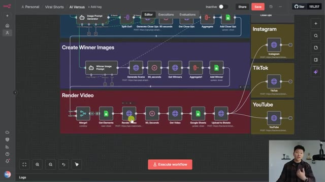
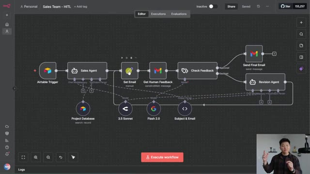
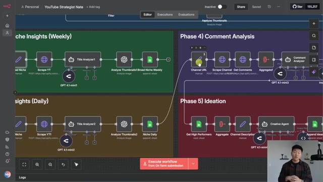
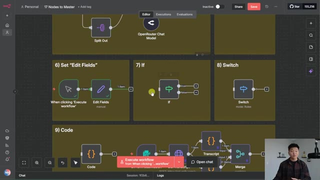
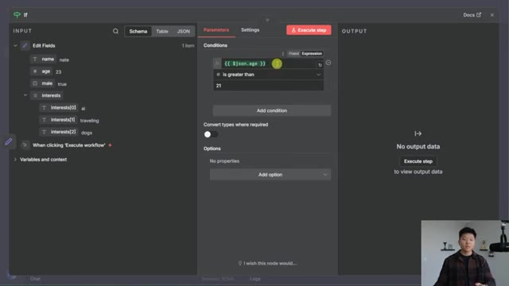
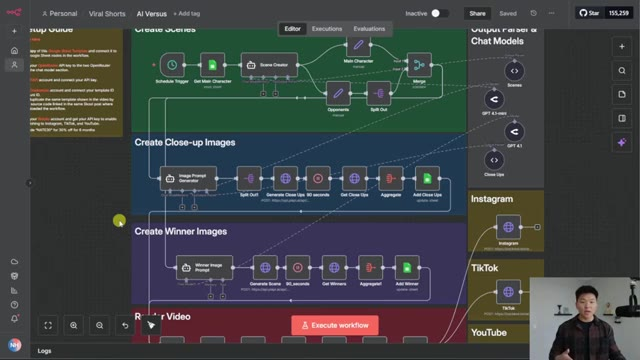
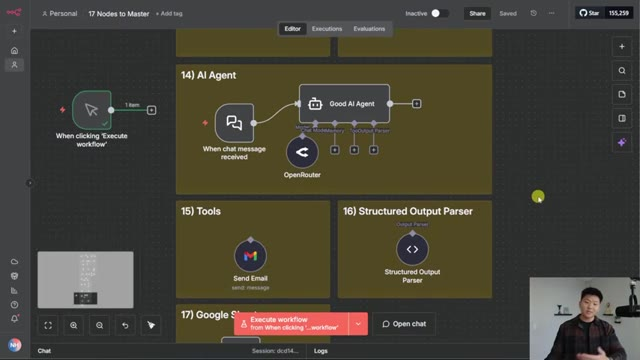
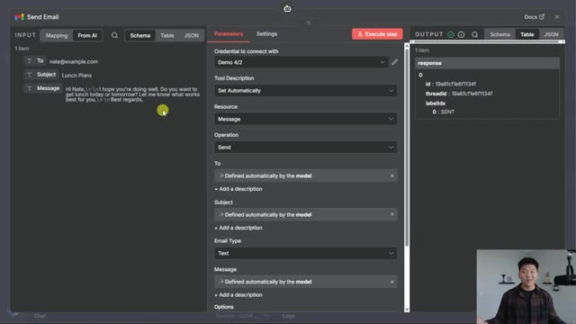
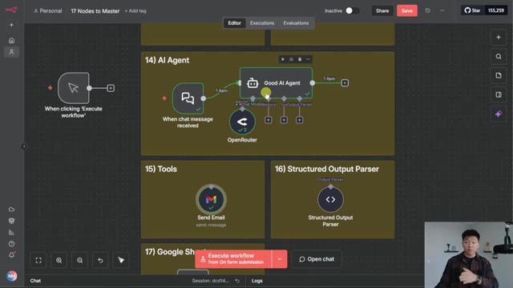

# 🎬 Master n8n Fast With These 17 Essential Nodes (real examples)

> **Chaîne** : [Nate Herk | AI Automation](https://www.youtube.com/@nateherk/featured)  
> **Lien YouTube** : [https://www.youtube.com/watch?v=D9MIGseFB3g](https://www.youtube.com/watch?v=D9MIGseFB3g)  
> **Date de publication** : 20251125  
> **Durée** : 00:24:02  
> **Identifiant vidéo** : `D9MIGseFB3g`  
> **Transcription & Analyse** : `whisper-v3-large-turbo+gemini-3.5-flash-lite`  

---

## 📌 Synthèse Exécutive & Outils

### 💡 Résumé
Dans cette vidéo intitulée **Master n8n Fast With These 17 Essential Nodes (real examples)**, Nate Herk décortique les capacités pratiques d'automatisation et de développement propulsées par les modèles de pointe.

### 🛠️ Outils, Modèles & Logiciels Présentés
- **Opus 5.5 & Claude Code** : Modèles d'ingénierie et agents de codage autonome.

### 🔑 Points Clés & Enseignements Stratégiques
- Optimiser le niveau d'effort et le raisonnement des modèles IA pour des résultats industriels.
- Automatiser les cycles de création logicielle de bout en bout.

---

## ⏱️ Chronologie & Transcription Complète Audio & Visuelle (Mot pour Mot)

### ⏱️ `[00:00:00 - 00:00:32]` | Segment #01

**🔊 Audio (Transcription Intégrale Mot pour Mot en Français) :**
> In the past year, I've built over 200 AI automations in NNN. These automations have either been for a real client, for YouTube videos, or for me personally, in my own business. And when I look at all these different automations that I've built, I notice that I'm using roughly the same 17 nodes throughout all of them. So if you want to get started with NNN, I would just focus on these 17 core nodes first, and then branch out when you need to. So in today's video, I'm going to be breaking down those 17 nodes that I'm talking about, and I'm going to show you guys real examples of workflows that I've built that have those nodes in them. And I know you guys like to take notes, but just sit back and watch because I threw together a 39 page document with all of these

**👁️ Analyse Visuelle d'Écran (gemini-3.5-flash-lite) :**
**Interface & Outils** : Présentation ou face-caméra explicatif sans interface logicielle partagée.

**Contenu textuel & Code** : Explications orales et mise en contexte méthodologique.

**Action / Démonstration** : Explications face caméra et démonstration conceptuelle.

---

### ⏱️ `[00:00:32 - 00:00:58]` | Segment #02

**🔊 Audio (Transcription Intégrale Mot pour Mot en Français) :**
> 17 nodes with different examples, how to use them, best practices, and stuff like that. And so you can grab this entire doc for free. All you have to do is join my FreeSchool community. The link for that is down in the description. So super pumped about this one. Let's not waste any time and get straight into the video. Okay, so not counting the manual trigger here as the first node, we're going to count number one as the scheduled trigger. So what this does is it lets you trigger your workflows based on some sort of schedule. So that can be once a day. It can be every day at 6am and 6pm.

**👁️ Analyse Visuelle d'Écran (gemini-3.5-flash-lite) :**
**Interface & Outils** : Présentation ou face-caméra explicatif sans interface logicielle partagée.

**Contenu textuel & Code** : Explications orales et mise en contexte méthodologique.

**Action / Démonstration** : Explications face caméra et démonstration conceptuelle.

---

### ⏱️ `[00:00:58 - 00:01:29]` | Segment #03

**🔊 Audio (Transcription Intégrale Mot pour Mot en Français) :**
> It could be every Tuesday. Whatever you want it to be, this is how you can make automations that go off while you're sleeping. And all you have to do to configure it is double click into it and you can see you can set the interval as days, seconds, minutes, hours, weeks, or months. Or if you really want to get technical, you can do a custom cron. And then you can say how many days between trigger, what hour do you want to trigger at, what minute do you want to trigger at. So you can get really, really specific here. So a real example of a workflow that I use with a scheduled trigger is my personal AI news summary. So I have this thing go off every day at 5am. It scrapes the internet for latest AI news and some other topic of my choice.

**👁️ Analyse Visuelle d'Écran (gemini-3.5-flash-lite) :**
**Interface & Outils** : Présentation ou face-caméra explicatif sans interface logicielle partagée.

**Contenu textuel & Code** : Explications orales et mise en contexte méthodologique.

**Action / Démonstration** : Explications face caméra et démonstration conceptuelle.

---

### ⏱️ `[00:01:29 - 00:01:50]` | Segment #04

**🔊 Audio (Transcription Intégrale Mot pour Mot en Français) :**
> Right now I'm having voice AI be in there. And then it sends that to two agents that will write me a newsletter and it's trained on my data and what my business is. So it makes sure that I'm getting news tailored towards me. And then it stylizes it and chucks it to my email every morning. All right, so number two, we have event triggers. Now these event triggers can be a lot of different types of apps. You can see here as an example, I threw in a Gmail trigger and a Slack trigger.

**👁️ Analyse Visuelle d'Écran (gemini-3.5-flash-lite) :**
**Interface & Outils** : Présentation ou face-caméra explicatif sans interface logicielle partagée.

**Contenu textuel & Code** : Explications orales et mise en contexte méthodologique.

**Action / Démonstration** : Explications face caméra et démonstration conceptuelle.

---

### ⏱️ `[00:01:51 - 00:02:24]` | Segment #05

**🔊 Audio (Transcription Intégrale Mot pour Mot en Français) :**
> And so this one would go off whenever you get a new email. This one would go off whenever there's a new message in a channel. But this doesn't have to be just messaging platforms. It could be a new record in your crm It could be a new form submitted on your website It could be a new payment processed. I think you guys see where i'm going with this And so a real example that i'm using right now is one of my email agents and this one is kind of just classifying emails Labeling them and then just shooting off kind of a basic draft or moving them around And as you can see the trigger over here is a gmail trigger because every time this email account gets an email It will go ahead and take care of it for me. And once again another super simple workflow All right, number three we have sub workflows now

**👁️ Analyse Visuelle d'Écran (gemini-3.5-flash-lite) :**
**Interface & Outils** : Présentation ou face-caméra explicatif sans interface logicielle partagée.

**Contenu textuel & Code** : Explications orales et mise en contexte méthodologique.

**Action / Démonstration** : Explications face caméra et démonstration conceptuelle.

---

### ⏱️ `[00:02:24 - 00:03:00]` | Segment #06

**🔊 Audio (Transcription Intégrale Mot pour Mot en Français) :**
> these are super, super powerful. And one of the things that I saw about NNN that made me switch over to it. You have the ability to have any workflow be triggered by another workflow, and you have the ability to have any workflow call on another workflow. So think about it like this. You build a tool. Let's say you build a send email tool. You can now have an infinite number of your other workflows use that tool. So you never have to build that function or that tool again. And these make your agents and your workflows extremely modular and scalable. So an example that I wanted to show is we have this marketing team AI agent, and you can see it's calling on these different tools down here. And all of these tools are different NNN workflows. So let's say it

**👁️ Analyse Visuelle d'Écran (gemini-3.5-flash-lite) :**
**Interface & Outils** : Présentation ou face-caméra explicatif sans interface logicielle partagée.

**Contenu textuel & Code** : Explications orales et mise en contexte méthodologique.

**Action / Démonstration** : Explications face caméra et démonstration conceptuelle.

---

### ⏱️ `[00:03:00 - 00:03:30]` | Segment #07

**🔊 Audio (Transcription Intégrale Mot pour Mot en Français) :**
> wants to call on the blog post tool. Okay. If I click into this workflow to see what it actually is, you can see that it starts right here with a when executed by another workflow trigger. And so that basically links this workflow back to this parent workflow. And now our workflows can talk to each other and send data between each other. All right. So number four right here, we have split out. Now what this does is it takes an array of items and it splits them out into separate ones. If I run this node real quick, we can see that we have a list of sports. We have golf, baseball, and basketball, but you'll notice right here, it's coming through as one item.

**👁️ Analyse Visuelle d'Écran (gemini-3.5-flash-lite) :**
**Interface & Outils** : Présentation ou face-caméra explicatif sans interface logicielle partagée.

**Contenu textuel & Code** : Explications orales et mise en contexte méthodologique.

**Action / Démonstration** : Explications face caméra et démonstration conceptuelle.

---

### ⏱️ `[00:03:31 - 00:03:50]` | Segment #08

**🔊 Audio (Transcription Intégrale Mot pour Mot en Français) :**
> You can also see right here, the green line right there, it says one item. And now if I run the split out node, what it's going to do is it's going to output three items because it took this field of sports and it output it, each of those sports as their own individual items. And why that's helpful is because now our AI agent is actually going to run three separate times.

**👁️ Analyse Visuelle d'Écran (gemini-3.5-flash-lite) :**
**Interface & Outils** : Présentation ou face-caméra explicatif sans interface logicielle partagée.

**Contenu textuel & Code** : Explications orales et mise en contexte méthodologique.

**Action / Démonstration** : Explications face caméra et démonstration conceptuelle.

---

### ⏱️ `[00:03:50 - 00:04:23]` | Segment #09

**🔊 Audio (Transcription Intégrale Mot pour Mot en Français) :**
> Because however many items go into a node, that's how many times that node's actually going to run. So if we want this agent to write a five-sentence description about the sport that you're given, and I execute that now, it's going to output three different descriptions. One about golf, as you can see, one about baseball, and then one about basketball. But if we wouldn't have used the split out node, it would have gotten only one item, and it would have just tried to make one sentence about all three of those sports combined. But you can see the agent also outputs three items. And so one example of that in real time is this AI versus workflow that I built for YouTube. It's taking a type of animal and it's going to create different scenes. And what we

**👁️ Analyse Visuelle d'Écran (gemini-3.5-flash-lite) :**
**Interface & Outils** : Présentation ou face-caméra explicatif sans interface logicielle partagée.

**Contenu textuel & Code** : Explications orales et mise en contexte méthodologique.

**Action / Démonstration** : Explications face caméra et démonstration conceptuelle.

---

### ⏱️ `[00:04:23 - 00:04:58]` | Segment #10

**🔊 Audio (Transcription Intégrale Mot pour Mot en Français) :**
> need to do down here where it's creating the close-up images, we can't have it just run one request to make those images because we have like eight different animals. So we have to split those up so that we can make eight different requests to PyAPI to actually make those requests. So right here you can see we have eight items leaving the image prompt generator and then we have 16 items leaving the split out. And so now this is actually going to make all the different images that we need because we were able to use the split out node. And then literally the exact opposite of splitting out is aggregating. So once we have three items, if we want to turn it back into one, for whatever reason, maybe we want to process them all together, we can go ahead and aggregate them.

**👁️ Analyse Visuelle d'Écran (gemini-3.5-flash-lite) :**
**Interface & Outils** : Présentation ou face-caméra explicatif sans interface logicielle partagée.

**Contenu textuel & Code** : Explications orales et mise en contexte méthodologique.

**Action / Démonstration** : Explications face caméra et démonstration conceptuelle.

---

### ⏱️ `[00:04:58 - 00:05:19]` | Segment #11

**🔊 Audio (Transcription Intégrale Mot pour Mot en Français) :**
> So if I go ahead and run this one, you can see that we turn three items back into an original list of sports. And we have our sentences about each of them. As you can see, we've got golf, we've got baseball, and then we've got basketball down here. And so in the same exact example, where we're basically splitting out all of the images so we can make more, what do we have to do later? We have to bring them back together so that we can write them back into the Google Sheet.

**👁️ Analyse Visuelle d'Écran (gemini-3.5-flash-lite) :**
**Interface & Outils** : Présentation ou face-caméra explicatif sans interface logicielle partagée.

**Contenu textuel & Code** : Explications orales et mise en contexte méthodologique.

**Action / Démonstration** : Explications face caméra et démonstration conceptuelle.

---

### ⏱️ `[00:05:19 - 00:05:40]` | Segment #12

**🔊 Audio (Transcription Intégrale Mot pour Mot en Français) :**
> So you can see we have this pattern of splitting out, aggregating, and then we're aggregating back again so that we can have everything come together in one final video that we render at the end. And if you wanna play around with this template for free and watch the video, I'll leave that link up above. All right, so number six, we have the edit fields node, although you'll probably hear me referring to it as the set node, because essentially what you're doing here is you're just setting data and you're setting the data types.

**👁️ Analyse Visuelle d'Écran (gemini-3.5-flash-lite) :**
**Interface & Outils** : n8n (outil d'automatisation de workflow)

**Contenu textuel & Code** : Workflow structuré en sections : "Create Winner Images" et "Render Video", avec des nœuds spécifiques comme "Merge1", "Get Elements", "Render Video", "Google Sheets" et des sorties vers "Instagram", "TikTok", et "YouTube".

**Action / Démonstration** : Le workflow montre la logique d'agrégation et de rendu final décrite par le présentateur, avec le curseur pointant vers le nœud "Render Video".

*⏱️ 00:05:24 — Une capture d'écran de l'interface de travail montrant un workflow d'automatisation complexe avec des nœuds connectés pour la génération d'images, le traitement vidéo et la publication sur les réseaux sociaux.*

---

### ⏱️ `[00:05:40 - 00:06:09]` | Segment #13

**🔊 Audio (Transcription Intégrale Mot pour Mot en Français) :**
> So you can see that we set four different things. We set a field called name as a string and it's Nate We have a field called age as a number and it's 23 We have a field called male and it's a boolean and it's true and then we have a field called interests and it's an array and we have AI traveling and dogs and so this lets us take full control of our data We can change the variables We can change the types and we can set things if we want and this node is super super versatile So I'm going to show you guys three quick examples real quick of how I've used it before.

**👁️ Analyse Visuelle d'Écran (gemini-3.5-flash-lite) :**
**Interface & Outils** : Présentation ou face-caméra explicatif sans interface logicielle partagée.

**Contenu textuel & Code** : Explications orales et mise en contexte méthodologique.

**Action / Démonstration** : Explications face caméra et démonstration conceptuelle.

---

### ⏱️ `[00:06:10 - 00:06:30]` | Segment #14

**🔊 Audio (Transcription Intégrale Mot pour Mot en Français) :**
> This first one is what I like to call just the source of truth. So this was a travel agent video I did a while back. We got data from a webhook and I immediately just set it all right here. So you can see I was setting the origin, the destination, the departure date, the return date, travelers, all this information. Just so later on I knew that whenever I needed to reference that data, I could just reference back to this core node.

**👁️ Analyse Visuelle d'Écran (gemini-3.5-flash-lite) :**
**Interface & Outils** : Présentation ou face-caméra explicatif sans interface logicielle partagée.

**Contenu textuel & Code** : Explications orales et mise en contexte méthodologique.

**Action / Démonstration** : Explications face caméra et démonstration conceptuelle.

---

### ⏱️ `[00:06:31 - 00:07:03]` | Segment #15

**🔊 Audio (Transcription Intégrale Mot pour Mot en Français) :**
> Now, another way that you can use it is to keep things really dynamic. So in this human in the loop workflow, what I did was I used it here to make sure that this was always the most recent version of our email Basically the sales agent would make an email and then we'd have the revision agent make revisions over and over and over until we're happy And so the set node was the answer to make sure that we're always looking at the most recent version of our email And then finally you could also use it to be able to change data So in this YouTube strategist workflow when I gave this to you guys I said all right when you guys get in here what you're going to do is you're going to come into this broad niche node and you're going to set

**👁️ Analyse Visuelle d'Écran (gemini-3.5-flash-lite) :**
**Interface & Outils** : n8n (outil d'automatisation de workflow).

**Contenu textuel & Code** : Le schéma montre des nœuds connectés : "Airtable Trigger" -> "Sales Agent" -> "Set Email" -> "Get Human Feedback" -> "Check Feedback" (avec des branches "Approved" et "Declined"). Les branches mènent soit à "Send Final Email" (Gmail), soit à un "Revision Agent" qui boucle sur le processus. Des modèles comme "3.5 Sonnet" et "Flash 2.0" sont intégrés comme sous-nœuds.

**Action / Démonstration** : Le workflow illustre le processus "human-in-the-loop" où un agent génère un e-mail, reçoit un retour humain, et utilise un agent de révision pour corriger le contenu si nécessaire avant l'envoi.

*⏱️ 00:06:39 — Un diagramme de workflow complexe dans une interface d'automatisation montrant une boucle de validation humaine pour la rédaction d'e-mails.*

---

### ⏱️ `[00:07:03 - 00:07:30]` | Segment #16

**🔊 Audio (Transcription Intégrale Mot pour Mot en Français) :**
> your own broad niche. And then you're going to come into the niche node and set your own niche. You're going to come into the channel URL node and set your own channel. And that's how you could set data. And then when you hit run, it'll pass through the rest of the flow dynamically with your information. All right. So the next one is the if node. And this one is basically just going to check if a condition is true or false. So in this case, what you can see is that I put, we're checking if the person's age from this left-hand side is greater than 21. So this is our if node bouncer.

**👁️ Analyse Visuelle d'Écran (gemini-3.5-flash-lite) :**
**Interface & Outils** : n8n (outil d'automatisation de workflows).

**Contenu textuel & Code** : Nœuds de workflow, flux de données API, paramètres de conditions logiques ({{ $json.age }} > 21), structures JSON.

**Action / Démonstration** : Navigation et configuration de la logique conditionnelle dans un workflow d'automatisation pour traiter des données utilisateur.

*⏱️ 00:07:10 — Vue d'ensemble d'un flux de travail complexe dans n8n montrant plusieurs phases d'automatisation (Comment Analysis, Ideation, etc.) avec des nœuds connectés.*

*⏱️ 00:07:16 — Gros plan sur une section du canevas n8n affichant des nœuds de logique comme "Set Edit Fields", "If" et "Switch" au sein d'un workflow.*

*⏱️ 00:07:23 — Interface détaillée du nœud "If" dans n8n, montrant la configuration des conditions logiques basées sur des données JSON (âge > 21).*

---

### ⏱️ `[00:07:30 - 00:07:51]` | Segment #17

**🔊 Audio (Transcription Intégrale Mot pour Mot en Français) :**
> And then when we hit execute step, it puts it down the true branch, not the false branch, because it sees that my age right here is greater than 21. And what happens is it actually goes down two different paths. So you can have data get sent this way if it's true and this way if it's false. So cool example of this is something called polling, as you guys might've seen in a lot of my video generation type of videos.

**👁️ Analyse Visuelle d'Écran (gemini-3.5-flash-lite) :**
**Interface & Outils** : Présentation ou face-caméra explicatif sans interface logicielle partagée.

**Contenu textuel & Code** : Explications orales et mise en contexte méthodologique.

**Action / Démonstration** : Explications face caméra et démonstration conceptuelle.

---

### ⏱️ `[00:07:51 - 00:08:09]` | Segment #18

**🔊 Audio (Transcription Intégrale Mot pour Mot en Français) :**
> So right here, what we're doing is we're making a request to Sora 2, and we're basically asking it to turn our text into a video. And so what happens right here is the first node is making that request to Sora. And then the second node is basically saying, is it done yet? So when you go order fast food and they give you number 43, you're basically waiting. And then you're gonna go say, hey, I'm number 43. Is it done yet?

**👁️ Analyse Visuelle d'Écran (gemini-3.5-flash-lite) :**
**Interface & Outils** : Présentation ou face-caméra explicatif sans interface logicielle partagée.

**Contenu textuel & Code** : Explications orales et mise en contexte méthodologique.

**Action / Démonstration** : Explications face caméra et démonstration conceptuelle.

---

### ⏱️ `[00:08:09 - 00:08:28]` | Segment #19

**🔊 Audio (Transcription Intégrale Mot pour Mot en Français) :**
> And then the if node is either saying it's done or it's not done. And you can see twice, it's already said it's not done yet. So this if node basically is checking, is the state success or is the state still generating? And so every time that it checks in and the state isn't success, it's gonna go down the false branch. It's gonna come back and wait again. and then it's gonna check again.

**👁️ Analyse Visuelle d'Écran (gemini-3.5-flash-lite) :**
**Interface & Outils** : Présentation ou face-caméra explicatif sans interface logicielle partagée.

**Contenu textuel & Code** : Explications orales et mise en contexte méthodologique.

**Action / Démonstration** : Explications face caméra et démonstration conceptuelle.

---

### ⏱️ `[00:08:28 - 00:08:50]` | Segment #20

**🔊 Audio (Transcription Intégrale Mot pour Mot en Français) :**
> So we're basically stuck in this infinite loop until state equals success. And that's all thanks to this if node right here, which is checking on our condition. All right, so that just finished up. It had to check in 16 times, and you can see that the final run, the state equals success, and that's why it finally pushed it down the true branch. And also I didn't include it on this list, but honorable mention to the wait node, also super powerful.

**👁️ Analyse Visuelle d'Écran (gemini-3.5-flash-lite) :**
**Interface & Outils** : Présentation ou face-caméra explicatif sans interface logicielle partagée.

**Contenu textuel & Code** : Explications orales et mise en contexte méthodologique.

**Action / Démonstration** : Explications face caméra et démonstration conceptuelle.

---

### ⏱️ `[00:08:50 - 00:09:15]` | Segment #21

**🔊 Audio (Transcription Intégrale Mot pour Mot en Français) :**
> All right, so moving on to number eight, this is a switch node. Now this is very, very similar to the if, except for it lets you have way more than just two paths. You could come in here and you could add as many as you want. So you could add eight different routing rules if you wanted, as long as they don't like contradict with each other. But here you can see we have four different paths. So a quick example of that switch node, you can see right here, this is a rag pipeline, and we're checking in this Google Drive, what type of file we're gonna have.

**👁️ Analyse Visuelle d'Écran (gemini-3.5-flash-lite) :**
**Interface & Outils** : Présentation ou face-caméra explicatif sans interface logicielle partagée.

**Contenu textuel & Code** : Explications orales et mise en contexte méthodologique.

**Action / Démonstration** : Explications face caméra et démonstration conceptuelle.

---

### ⏱️ `[00:09:15 - 00:09:43]` | Segment #22

**🔊 Audio (Transcription Intégrale Mot pour Mot en Français) :**
> So in this switch node, you can see that we're either checking if it's a PDF, a text file, an Excel, or three different types of Windows docs. And once again, in here, we're just setting those different conditions. And if it meets that condition, it will go down that respective path. All right, the next one we have, number nine, is a code node. Now don't get scared because I know we're trying to typically build workflows that are no code and low code, but sometimes the code node is super, super effective and powerful because the code node is really good at taking predictable structure of data and manipulating in some way.

**👁️ Analyse Visuelle d'Écran (gemini-3.5-flash-lite) :**
**Interface & Outils** : Présentation ou face-caméra explicatif sans interface logicielle partagée.

**Contenu textuel & Code** : Explications orales et mise en contexte méthodologique.

**Action / Démonstration** : Explications face caméra et démonstration conceptuelle.

---

### ⏱️ `[00:09:43 - 00:10:06]` | Segment #23

**🔊 Audio (Transcription Intégrale Mot pour Mot en Français) :**
> And so if you can do something with code rather than AI, you'd rather do it with code because it's gonna be cheaper, quicker, and more predictable. So as you build more automations, you'll get more familiar with when you may need a code node. But typically the way I like to think about it is if I'm getting the same type of structure of data every single time, and I need to do something based on that structure rather than something really creative, then I'm gonna try a code node first.

**👁️ Analyse Visuelle d'Écran (gemini-3.5-flash-lite) :**
**Interface & Outils** : Présentation ou face-caméra explicatif sans interface logicielle partagée.

**Contenu textuel & Code** : Explications orales et mise en contexte méthodologique.

**Action / Démonstration** : Explications face caméra et démonstration conceptuelle.

---

### ⏱️ `[00:10:06 - 00:10:25]` | Segment #24

**🔊 Audio (Transcription Intégrale Mot pour Mot en Français) :**
> But anyways, of course I wanted to show you guys a real example. And I don't know why I just copied this example in rather than going to the actual workflow like I've done for all the other videos. But anyways, this one was my YouTube transcript sort of metadata rag agent. So what I do in the form is I drop in a YouTube video link And then Appify, HTTP request, gets the transcript from that video.

**👁️ Analyse Visuelle d'Écran (gemini-3.5-flash-lite) :**
**Interface & Outils** : Présentation ou face-caméra explicatif sans interface logicielle partagée.

**Contenu textuel & Code** : Explications orales et mise en contexte méthodologique.

**Action / Démonstration** : Explications face caméra et démonstration conceptuelle.

---

### ⏱️ `[00:10:26 - 00:10:46]` | Segment #25

**🔊 Audio (Transcription Intégrale Mot pour Mot en Français) :**
> Now in the transcript, it's super messy because what you can see is we get these different chunks of data and they all have the text and also like two seconds of actual words. And this is just really, really messy to work with. But I recognize that every time I made this request to Appify, it always came in this structure. Even though we weren't sure if there was going to be 50 total blocks or 46, we knew that it would hold this structure.

**👁️ Analyse Visuelle d'Écran (gemini-3.5-flash-lite) :**
**Interface & Outils** : Présentation ou face-caméra explicatif sans interface logicielle partagée.

**Contenu textuel & Code** : Explications orales et mise en contexte méthodologique.

**Action / Démonstration** : Explications face caméra et démonstration conceptuelle.

---

### ⏱️ `[00:10:47 - 00:11:08]` | Segment #26

**🔊 Audio (Transcription Intégrale Mot pour Mot en Français) :**
> So what I did is I worked with Claude to help me write this code. And so the first one is a transcript one. It takes all of the text fields, as you can see, and it just combines them all together. So now we have this field right here called combined text. And this basically is the actual transcript that we want to play with. But I also wanted to get a little more granular here and I wanted to get timestamps. So what I did down here is I worked with Claude once again to give me timestamps.

**👁️ Analyse Visuelle d'Écran (gemini-3.5-flash-lite) :**
**Interface & Outils** : Présentation ou face-caméra explicatif sans interface logicielle partagée.

**Contenu textuel & Code** : Explications orales et mise en contexte méthodologique.

**Action / Démonstration** : Explications face caméra et démonstration conceptuelle.

---

### ⏱️ `[00:11:08 - 00:11:30]` | Segment #27

**🔊 Audio (Transcription Intégrale Mot pour Mot en Français) :**
> So you can now see we have 31 items and each of those items have the text. But then for each of those blocks of text, we have the start time, the end time and the duration. So now we're getting different chunks of text that we can vectorize. And for each of those chunks, we can see exactly where it came from in that YouTube video transcript. So really the key here, because I don't know how to code, is to use an AI assistant like Claude, Cursor, whatever you want to use.

**👁️ Analyse Visuelle d'Écran (gemini-3.5-flash-lite) :**
**Interface & Outils** : Présentation ou face-caméra explicatif sans interface logicielle partagée.

**Contenu textuel & Code** : Explications orales et mise en contexte méthodologique.

**Action / Démonstration** : Explications face caméra et démonstration conceptuelle.

---

### ⏱️ `[00:11:30 - 00:11:51]` | Segment #28

**🔊 Audio (Transcription Intégrale Mot pour Mot en Français) :**
> But you have to give it, here's the input, here's what I want you to do, and then you test it. And it's usually not going to work the first time perfectly. So then what I would do is I would say, okay, here's the input, here's what you gave me, and here's the output I got. And here's why that's wrong. So here's what I'd rather get. And you just have to go back and forth a couple of times, but typically that's how I do all of my code nodes.

**👁️ Analyse Visuelle d'Écran (gemini-3.5-flash-lite) :**
**Interface & Outils** : Présentation ou face-caméra explicatif sans interface logicielle partagée.

**Contenu textuel & Code** : Explications orales et mise en contexte méthodologique.

**Action / Démonstration** : Explications face caméra et démonstration conceptuelle.

---

### ⏱️ `[00:11:51 - 00:12:13]` | Segment #29

**🔊 Audio (Transcription Intégrale Mot pour Mot en Français) :**
> All right, so the next one is number 10, HTTP requests. This is probably the most important node that you'll have to learn in NNN. Because without an HTTP request, you're basically just stuck to the internal environment of NNN itself. And just keep in mind, when you click on this plus and you click on action in an app, and you see these thousands of integrations, all of these are HTTP requests.

**👁️ Analyse Visuelle d'Écran (gemini-3.5-flash-lite) :**
**Interface & Outils** : Présentation ou face-caméra explicatif sans interface logicielle partagée.

**Contenu textuel & Code** : Explications orales et mise en contexte méthodologique.

**Action / Démonstration** : Explications face caméra et démonstration conceptuelle.

---

### ⏱️ `[00:12:13 - 00:12:41]` | Segment #30

**🔊 Audio (Transcription Intégrale Mot pour Mot en Français) :**
> They're just not as scary because they're packaged up nicely because NNN went out and made an integration for it So like when you're sending an email or you're getting a record or you're making a call to perplexity All of this is an HTTP request It just was wrapped up a little prettier for you and most things nowadays have an API You would just have to go find out if it does So let's say you want to work with something like fathom and you can't find it right here in NNN because there's no native fathom integration You just go to google you would type fathom api documentation and then you would basically be able to find it right here.

**👁️ Analyse Visuelle d'Écran (gemini-3.5-flash-lite) :**
**Interface & Outils** : Présentation ou face-caméra explicatif sans interface logicielle partagée.

**Contenu textuel & Code** : Explications orales et mise en contexte méthodologique.

**Action / Démonstration** : Explications face caméra et démonstration conceptuelle.

---

### ⏱️ `[00:12:42 - 00:13:04]` | Segment #31

**🔊 Audio (Transcription Intégrale Mot pour Mot en Français) :**
> And you can go to the API docs and set up your endpoint, your body, your parameters, and all this kind of stuff. So you would just type in your tool name and then API documentation. All right, so number 11, we have the loop. Now the loop is super important because sometimes you may have hundreds of items in your workflow and you don't wanna process all 100 at the same time because you may hit rate limits or you may have a memory issue or whatever it is.

**👁️ Analyse Visuelle d'Écran (gemini-3.5-flash-lite) :**
**Interface & Outils** : Présentation ou face-caméra explicatif sans interface logicielle partagée.

**Contenu textuel & Code** : Explications orales et mise en contexte méthodologique.

**Action / Démonstration** : Explications face caméra et démonstration conceptuelle.

---

### ⏱️ `[00:13:04 - 00:13:37]` | Segment #32

**🔊 Audio (Transcription Intégrale Mot pour Mot en Français) :**
> So the loop basically lets you process them in batches or loop over items. And I think originally this node was called split in batches. So if you're using some AI assistance or looking up old reference docs You may see split in batches, but now it's called loop over items And in here it lets you customize the batch size It also lets you customize if you want to have a loop branch a done branch and like an error branch Whatever it is, you're able to take a larger list and just do it one at a time So if I go ahead and run this one what you can see is that we're outputting a list of urls We have three items and then what it did here is it ran each of those one at a time

**👁️ Analyse Visuelle d'Écran (gemini-3.5-flash-lite) :**
**Interface & Outils** : Présentation ou face-caméra explicatif sans interface logicielle partagée.

**Contenu textuel & Code** : Explications orales et mise en contexte méthodologique.

**Action / Démonstration** : Explications face caméra et démonstration conceptuelle.

---

### ⏱️ `[00:13:37 - 00:14:12]` | Segment #33

**🔊 Audio (Transcription Intégrale Mot pour Mot en Français) :**
> And so that was kind of a quick example. So it was hard to see But some ways that i've used this before have been in something like this a rag system Or maybe we're processing five files at once But we want to just be able to download them one at a time and then continue on Or something like this scraper that i've made So this actually uses another one which is the execute a different workflow node But what it would do is right here We have 97 items going through and I don't want to run all 97 at once So i'm utilizing a loop to send them one at a time to this other workflow And then i'm also utilizing a weight so that we're not overloading the workflow and then it's going to go ahead and grab the second one, run it, grab the third one, run it,

**👁️ Analyse Visuelle d'Écran (gemini-3.5-flash-lite) :**
**Interface & Outils** : Présentation ou face-caméra explicatif sans interface logicielle partagée.

**Contenu textuel & Code** : Explications orales et mise en contexte méthodologique.

**Action / Démonstration** : Explications face caméra et démonstration conceptuelle.

---

### ⏱️ `[00:14:12 - 00:14:45]` | Segment #34

**🔊 Audio (Transcription Intégrale Mot pour Mot en Français) :**
> and that's how we can basically keep control of our workflow. And by the way, all of these workflows that you guys have been seeing me flip between, you can go ahead and download for free in my FreeSchool community. And speaking of free workflows, I wanted to take a quick second to show you guys how I've been self-hosting my NNN that comes with 100 plus free workflows and unlimited active workflows and executions. So I'm using Hostinger VPS for my NNN self-hosting. As someone who doesn't have a DevOps background, Hostinger makes it super, super easy for you to update your instance, maintain it, scale it up, and do what you need to do, especially because they have an AI assistant that can help answer all your questions. So let's just take the next 30 seconds and let me show you

**👁️ Analyse Visuelle d'Écran (gemini-3.5-flash-lite) :**
**Interface & Outils** : Présentation ou face-caméra explicatif sans interface logicielle partagée.

**Contenu textuel & Code** : Explications orales et mise en contexte méthodologique.

**Action / Démonstration** : Explications face caméra et démonstration conceptuelle.

---

### ⏱️ `[00:14:45 - 00:15:13]` | Segment #35

**🔊 Audio (Transcription Intégrale Mot pour Mot en Français) :**
> guys how quickly you can get set up. So here are the different plans. Don't worry about the specs right now. I'm just going to go with KVM2, which is the most popular plan, because you can always change this later. So once you're in here, you pay for a certain amount of months for your VPS. In this example, we're looking at 24 months, which actually comes out to just $6 a month, which is insanely cheap. You can also enable your daily auto backups for another six bucks a month, which is just going to help you sleep at night a lot better. Then down here at the bottom, you need to select an operating system. You can see right now I just have the basic NNN.

**👁️ Analyse Visuelle d'Écran (gemini-3.5-flash-lite) :**
**Interface & Outils** : Présentation ou face-caméra explicatif sans interface logicielle partagée.

**Contenu textuel & Code** : Explications orales et mise en contexte méthodologique.

**Action / Démonstration** : Explications face caméra et démonstration conceptuelle.

---

### ⏱️ `[00:15:13 - 00:15:46]` | Segment #36

**🔊 Audio (Transcription Intégrale Mot pour Mot en Français) :**
> There's NNN with 100 workflows, there's NNN with Q mode, and there's lots of other things that you can add on later. And so the last step here is if you're purchasing a annual plan, so the 12 or 24 months, you're able to use coupon code NATEHERK and get 10% off your entire order. And as a special treat anyone that is in my plus community can actually receive a larger discount so check out that link in the description for more details there all right so there we go here's our dashboard there's a few different settings that we'll be able to look at and some metrics we'll be able to track once our instance has been running for a while but what you guys want to see is what nnn looks like so i'm going to go ahead to the top and click on manage app and we're going to go

**👁️ Analyse Visuelle d'Écran (gemini-3.5-flash-lite) :**
**Interface & Outils** : Présentation ou face-caméra explicatif sans interface logicielle partagée.

**Contenu textuel & Code** : Explications orales et mise en contexte méthodologique.

**Action / Démonstration** : Explications face caméra et démonstration conceptuelle.

---

### ⏱️ `[00:15:46 - 00:16:21]` | Segment #37

**🔊 Audio (Transcription Intégrale Mot pour Mot en Français) :**
> ahead and get to set up our nnn account right now and as you can see this is just the same as your typical nnn workflow i'll go ahead and open up a new one so you guys can in fact see this is regular NNN. Except for now, we're just not being limited on our workflow executions. So if you've been wanting to switch to self-hosted for a while, then this is your sign. Click on that link in the description and use code NATEHERK to get 10% off. But let's get back to the video. Okay, so now we have number 12 and 13, which are the webhook and respond to webhook nodes. Now the webhook is actually very, very similar to what we talked about earlier up here with the event triggers. It's kind of the same relationship as HTTP requests, where sometimes we

**👁️ Analyse Visuelle d'Écran (gemini-3.5-flash-lite) :**
**Interface & Outils** : Présentation ou face-caméra explicatif sans interface logicielle partagée.

**Contenu textuel & Code** : Explications orales et mise en contexte méthodologique.

**Action / Démonstration** : Explications face caméra et démonstration conceptuelle.

---

### ⏱️ `[00:16:21 - 00:16:43]` | Segment #38

**🔊 Audio (Transcription Intégrale Mot pour Mot en Français) :**
> have a native node, sometimes we don't. And so these two triggers are actually just webhooks, but they've just been natively integrated with NNN and Gmail or NNN and Slack. So maybe you noticed that your CRM or your service doesn't have a native webhook or a native trigger. You could go ahead and set this webhook by yourself. And then what the Respond to Webhook lets you do is it lets you send data right back to that original source if you need to.

**👁️ Analyse Visuelle d'Écran (gemini-3.5-flash-lite) :**
**Interface & Outils** : Présentation ou face-caméra explicatif sans interface logicielle partagée.

**Contenu textuel & Code** : Explications orales et mise en contexte méthodologique.

**Action / Démonstration** : Explications face caméra et démonstration conceptuelle.

---

### ⏱️ `[00:16:43 - 00:17:07]` | Segment #39

**🔊 Audio (Transcription Intégrale Mot pour Mot en Français) :**
> You don't always need to, but sometimes you do. So if you've seen any of my videos where I built with Lovable or Base44, you see how I have the landing page that I built send data to NNN, NNN processes it with some sort of agent, and then it sends that data back to the front end for it to be displayed over there. Another example of this is something like my voice email agent that I did with 11labs. So 11labs would send the request to N8N, our email agent would take action, and then it would tell 11labs that it actually took that action.

**👁️ Analyse Visuelle d'Écran (gemini-3.5-flash-lite) :**
**Interface & Outils** : Présentation ou face-caméra explicatif sans interface logicielle partagée.

**Contenu textuel & Code** : Explications orales et mise en contexte méthodologique.

**Action / Démonstration** : Explications face caméra et démonstration conceptuelle.

---

### ⏱️ `[00:17:07 - 00:17:32]` | Segment #40

**🔊 Audio (Transcription Intégrale Mot pour Mot en Français) :**
> So these two nodes let us get really powerful by connecting to other services. All right, coming down to number 14, which is my personal favorite, good old AI agent. And really when I say AI agent, a lot of times I just mean an LLM. Because within this node, you don't even have to connect it to tools or memory to really make it like a true agent, you can just use Open Router or a different chat model to connect to any LLM you want and have it process your data and output some sort of decision or some sort of creative output.

**👁️ Analyse Visuelle d'Écran (gemini-3.5-flash-lite) :**
**Interface & Outils** : Présentation ou face-caméra explicatif sans interface logicielle partagée.

**Contenu textuel & Code** : Explications orales et mise en contexte méthodologique.

**Action / Démonstration** : Explications face caméra et démonstration conceptuelle.

---

### ⏱️ `[00:17:33 - 00:17:52]` | Segment #41

**🔊 Audio (Transcription Intégrale Mot pour Mot en Français) :**
> And there's so many levers in here that you can tweak. You can give it a system prompt. You can have it look at different things. You can of course give it memory or tools or a structured output parser. And so you actually may notice in a lot of my workflows, I have AI agents, even though they're not doing any tool calling. And that's simply because I like to just keep it consistent. So whenever I need an LLM, I'll typically just grab an AI agent.

**👁️ Analyse Visuelle d'Écran (gemini-3.5-flash-lite) :**
**Interface & Outils** : Présentation ou face-caméra explicatif sans interface logicielle partagée.

**Contenu textuel & Code** : Explications orales et mise en contexte méthodologique.

**Action / Démonstration** : Explications face caméra et démonstration conceptuelle.

---

### ⏱️ `[00:17:52 - 00:18:11]` | Segment #42

**🔊 Audio (Transcription Intégrale Mot pour Mot en Français) :**
> I'm really used to the interface. I think it might make it easier for you guys too to always see the same thing. And then if I do want to add a tool, I've already got that functionality right there. And now, just like we talked about with tools, that's number 15, which actually lets your agents have the ability to take action in something. And so this is basically any sort of HTTP request. It could be this native node, like send an email in Gmail.

**👁️ Analyse Visuelle d'Écran (gemini-3.5-flash-lite) :**
**Interface & Outils** : n8n (automatisation de workflows).

**Contenu textuel & Code** : Nœuds de workflow : "AI Agent", "OpenRouter", "Send Email" (Gmail), "Structured Output Parser", et déclencheurs d'exécution.

**Action / Démonstration** : Navigation et présentation visuelle des différentes sections et blocs fonctionnels (nœuds) du workflow d'automatisation.

*⏱️ 00:17:57 — Interface n8n montrant un workflow complexe segmenté en zones colorées ("Create Scenes", "Create Close-up Images", "Create Winner Images").*

*⏱️ 00:18:01 — Interface n8n focalisée sur les modules "AI Agent" (14), "Tools" (15) avec l'icône Gmail, et "Structured Output Parser" (16).*

---

### ⏱️ `[00:18:11 - 00:18:34]` | Segment #43

**🔊 Audio (Transcription Intégrale Mot pour Mot en Français) :**
> But if you click on tools, you can also see it could be calling another edit and workflow like we saw earlier. It could be making an HTTP request. It could be connecting to an MCP server. It could be a vector store. It could be a database. It could be an Airtable. It could be any of these integrations that we have. And like I said, your agent's able to not only fill in the parameters by itself, but it's also able to decide, okay, I have these six tools. Here's the request I got. Here are my instructions.

**👁️ Analyse Visuelle d'Écran (gemini-3.5-flash-lite) :**
**Interface & Outils** : Présentation ou face-caméra explicatif sans interface logicielle partagée.

**Contenu textuel & Code** : Explications orales et mise en contexte méthodologique.

**Action / Démonstration** : Explications face caméra et démonstration conceptuelle.

---

### ⏱️ `[00:18:35 - 00:18:53]` | Segment #44

**🔊 Audio (Transcription Intégrale Mot pour Mot en Français) :**
> Which tool or which tools do I use to achieve the end goal? And what's cool about these AI tools, like I said, is the agent is able to fill in the different parameters. So in this tool, you can see when you send an email, you typically have to configure who's it to, what's the subject, and what is the message. And all of these you can see are being defined automatically by the model.

**👁️ Analyse Visuelle d'Écran (gemini-3.5-flash-lite) :**
**Interface & Outils** : Présentation ou face-caméra explicatif sans interface logicielle partagée.

**Contenu textuel & Code** : Explications orales et mise en contexte méthodologique.

**Action / Démonstration** : Explications face caméra et démonstration conceptuelle.

---

### ⏱️ `[00:18:53 - 00:19:12]` | Segment #45

**🔊 Audio (Transcription Intégrale Mot pour Mot en Français) :**
> So if I open up the agent and I say, please send an email to nateatexample.com asking him if he wants to get lunch today or tomorrow. I go ahead and shoot this off. It's gonna use its brain. It's gonna call the tool and it's gonna fill in the to, the subject and the email. So if I click into this, you can see that it filled out the to as nateatexample.com.

**👁️ Analyse Visuelle d'Écran (gemini-3.5-flash-lite) :**
**Interface & Outils** : Présentation ou face-caméra explicatif sans interface logicielle partagée.

**Contenu textuel & Code** : Explications orales et mise en contexte méthodologique.

**Action / Démonstration** : Explications face caméra et démonstration conceptuelle.

---

### ⏱️ `[00:19:12 - 00:19:44]` | Segment #46

**🔊 Audio (Transcription Intégrale Mot pour Mot en Français) :**
> It made the subject lunch plans and it made the message, hi Nate, I hope you're doing well. Do you wanna get lunch today or tomorrow? Let me know what works best for you. best regards. And then it didn't sign off because we didn't give it a personality. So that's awesome. Now let's say we got rid of this tool and we wanted this agent to create that output, create that email. And then we wanted to just use, you know, like a typical Gmail send message node to actually send it off. Well, what you'll notice is we have a two, we have a subject and we have a message and we can't just drag the output into one of those because it's all lumped together.

**👁️ Analyse Visuelle d'Écran (gemini-3.5-flash-lite) :**
**Interface & Outils** : n8n (outil d'automatisation de workflow).

**Contenu textuel & Code** : Contenu de l'e-mail généré : "Hi Nate, I hope you're doing well. Do you want to get lunch today or tomorrow? Let me know what works best for you. Best regards,". Nœuds de workflow : AI Agent, OpenRouter, Send Email, Structured Output Parser.

**Action / Démonstration** : Analyse des données transmises entre l'agent IA et le service d'envoi d'e-mails (Gmail) au sein d'un workflow automatisé.

*⏱️ 00:19:20 — Vue détaillée de l'interface de configuration du nœud "Send Email" dans n8n, affichant les données d'entrée (input) générées par l'IA et les paramètres de sortie confirmant l'envoi.*

*⏱️ 00:19:28 — Vue d'ensemble du workflow automatisé dans n8n, mettant en avant le nœud "AI Agent" connecté à "OpenRouter" et les étapes suivantes comme "Send Email" et "Structured Output Parser".*

---

### ⏱️ `[00:19:44 - 00:20:17]` | Segment #47

**🔊 Audio (Transcription Intégrale Mot pour Mot en Français) :**
> So what we have to do is that's when we use a structured output parser. So I'm going to go ahead and connect that structured output parser, you won't natively see that option right here. You'll have to click into the agent and then toggle this on, and then it allows you to connect a structured output parser. But all we're doing in here is we're basically saying, this is how we want you to output information. You have to output a to, a subject, and an email. And so now if I basically just run that same exact query once again, this agent will use its structured output parser to make sure that it gives us that output. It gives us a to, a subject, and an email, and then we're able to turn this Gmail node back on.

**👁️ Analyse Visuelle d'Écran (gemini-3.5-flash-lite) :**
**Interface & Outils** : Présentation ou face-caméra explicatif sans interface logicielle partagée.

**Contenu textuel & Code** : Explications orales et mise en contexte méthodologique.

**Action / Démonstration** : Explications face caméra et démonstration conceptuelle.

---

### ⏱️ `[00:20:17 - 00:20:40]` | Segment #48

**🔊 Audio (Transcription Intégrale Mot pour Mot en Français) :**
> And all of these fields are individual and we can actually drag them into the three separate parameters right here. And then our agent could go ahead and shoot off that email just like we want it to. So understanding how to use this tool is super, super crucial. And once again, I would never go write this by myself. I would use Claude or ChatGPT to help me write the structured output parser. All right, and last but not least, one of my favorite all time nodes, Google Sheets.

**👁️ Analyse Visuelle d'Écran (gemini-3.5-flash-lite) :**
**Interface & Outils** : Présentation ou face-caméra explicatif sans interface logicielle partagée.

**Contenu textuel & Code** : Explications orales et mise en contexte méthodologique.

**Action / Démonstration** : Explications face caméra et démonstration conceptuelle.

---

### ⏱️ `[00:20:40 - 00:21:02]` | Segment #49

**🔊 Audio (Transcription Intégrale Mot pour Mot en Français) :**
> This node is so versatile, it's free. I hardly ever run into rate limit issues. And being able to store data externally somewhere third party is really, really important to know how to use. Because sometimes, like in this deep research workflow, we have so much data to process that I don't want to keep it throughout the entire flow. So in this flow, it's doing a bunch of deep research and it's getting different chapters.

**👁️ Analyse Visuelle d'Écran (gemini-3.5-flash-lite) :**
**Interface & Outils** : Présentation ou face-caméra explicatif sans interface logicielle partagée.

**Contenu textuel & Code** : Explications orales et mise en contexte méthodologique.

**Action / Démonstration** : Explications face caméra et démonstration conceptuelle.

---

### ⏱️ `[00:21:02 - 00:21:20]` | Segment #50

**🔊 Audio (Transcription Intégrale Mot pour Mot en Français) :**
> And so what I'm doing at the end of each chapter is I'm writing all of that data back to a Google Sheet. And then what I'm able to do at the very end when we're actually formatting its sources in our table of contents, I'm pulling it all back in. And then we can turn it into a PDF. So it's just so much data to work with. It's nice to be able to grab some, go store it, grab some more, go store it.

**👁️ Analyse Visuelle d'Écran (gemini-3.5-flash-lite) :**
**Interface & Outils** : Présentation ou face-caméra explicatif sans interface logicielle partagée.

**Contenu textuel & Code** : Explications orales et mise en contexte méthodologique.

**Action / Démonstration** : Explications face caméra et démonstration conceptuelle.

---

### ⏱️ `[00:21:20 - 00:21:39]` | Segment #51

**🔊 Audio (Transcription Intégrale Mot pour Mot en Français) :**
> And then at the end, grab it all and bring it back together. And now another cool way to use it is actually storing information that we can then process. So for this UGC ads workflow, what I do is I have a Google sheet like this that's storing information about our products and our features and stuff like that. And so this lets me, the user, fill in my products, my product photos.

**👁️ Analyse Visuelle d'Écran (gemini-3.5-flash-lite) :**
**Interface & Outils** : Présentation ou face-caméra explicatif sans interface logicielle partagée.

**Contenu textuel & Code** : Explications orales et mise en contexte méthodologique.

**Action / Démonstration** : Explications face caméra et démonstration conceptuelle.

---

### ⏱️ `[00:21:39 - 00:22:03]` | Segment #52

**🔊 Audio (Transcription Intégrale Mot pour Mot en Français) :**
> I can choose the different model I want, and then I can mark them off as ready or finished. And so it's a really easy place for me to just manage all my creatives here. But the workflow itself is gonna be making sure to check that it's only pulling in records where the status equals ready. And it's only gonna be pulling in one row at a time. It's also then later using a switch node to check if the model was selected as VO 3.1, Nano Plus VO, or Sora 2.

**👁️ Analyse Visuelle d'Écran (gemini-3.5-flash-lite) :**
**Interface & Outils** : Présentation ou face-caméra explicatif sans interface logicielle partagée.

**Contenu textuel & Code** : Explications orales et mise en contexte méthodologique.

**Action / Démonstration** : Explications face caméra et démonstration conceptuelle.

---

### ⏱️ `[00:22:03 - 00:22:39]` | Segment #53

**🔊 Audio (Transcription Intégrale Mot pour Mot en Français) :**
> And you can see once again, we're able to control all of that right here from the front end, which is our Google Sheet. But anyways, that is gonna do it. That is the 17 of the most common nodes that I use in NNN across all of the different workflows I've built, 200 plus, which have been for real clients, for YouTube videos and templates for you guys, and for automations that I use myself every day. And trust me, this workflow here of all these different random nodes, this is not holistic of all the different types of use cases and things that I've built or experienced. So once again, I chucked all of this into this 39 page document where I highlight each of the nodes, what they do, best practices, when to use them, all this kind of

**👁️ Analyse Visuelle d'Écran (gemini-3.5-flash-lite) :**
**Interface & Outils** : Présentation ou face-caméra explicatif sans interface logicielle partagée.

**Contenu textuel & Code** : Explications orales et mise en contexte méthodologique.

**Action / Démonstration** : Explications face caméra et démonstration conceptuelle.

---

### ⏱️ `[00:22:39 - 00:23:15]` | Segment #54

**🔊 Audio (Transcription Intégrale Mot pour Mot en Français) :**
> stuff. As you can see, it's pretty holistic. And you can get this for completely free by joining my FreeSchool community. The link for that is down in the description. Once you get in here, all you'll have to do is go to YouTube resources or search for the title of the video or go to the classroom and look at free and in templates. You'll be able to find it in here. Trust me. And once you do, let's say that this is the video that you're looking for. There'll be the PDF attached right here. So you'll be able to download that and use it for later. And if you're interested in taking your learnings a little deeper and connecting with 2,800 members who are building businesses with AI automations, then definitely check out my plus community. The link for that's also down in the description. We've got four full courses in here. We have agent zero, which is the foundations

**👁️ Analyse Visuelle d'Écran (gemini-3.5-flash-lite) :**
**Interface & Outils** : Présentation ou face-caméra explicatif sans interface logicielle partagée.

**Contenu textuel & Code** : Explications orales et mise en contexte méthodologique.

**Action / Démonstration** : Explications face caméra et démonstration conceptuelle.

---

### ⏱️ `[00:23:15 - 00:23:38]` | Segment #55

**🔊 Audio (Transcription Intégrale Mot pour Mot en Français) :**
> of AI for beginners. We've got 10 hours to 10 seconds where you learn how to identify, design, and build time-saving automations. For our premium members or annual members, we've got one person AI agency where you learn how to lay the foundations for a scalable AI automation business. And then we have a new one, subs to sales, where I basically teach you my process for how I make YouTube videos and how I was able to build a content engine that fuels my AI automation business.

**👁️ Analyse Visuelle d'Écran (gemini-3.5-flash-lite) :**
**Interface & Outils** : Présentation ou face-caméra explicatif sans interface logicielle partagée.

**Contenu textuel & Code** : Explications orales et mise en contexte méthodologique.

**Action / Démonstration** : Explications face caméra et démonstration conceptuelle.

---

### ⏱️ `[00:23:38 - 00:23:57]` | Segment #56

**🔊 Audio (Transcription Intégrale Mot pour Mot en Français) :**
> We've also got projects, which are basically step-by-step tutorials and projects that you guys can follow along with me on, where you see pretty much live how I build things and why I'm doing what I'm doing. We also run one live call per week in here. So I'd love to see you guys in those calls in the communities, but that's gonna do it for today. So if you enjoyed the video or you learned something new, please give it a like, it definitely helps me out a ton.

**👁️ Analyse Visuelle d'Écran (gemini-3.5-flash-lite) :**
**Interface & Outils** : Présentation ou face-caméra explicatif sans interface logicielle partagée.

**Contenu textuel & Code** : Explications orales et mise en contexte méthodologique.

**Action / Démonstration** : Explications face caméra et démonstration conceptuelle.

---

### ⏱️ `[00:23:57 - 00:24:01]` | Segment #57

**🔊 Audio (Transcription Intégrale Mot pour Mot en Français) :**
> And as always, I appreciate you guys making it to the end of the video. I'll see you on the next one. Thanks so much, everyone.

**👁️ Analyse Visuelle d'Écran (gemini-3.5-flash-lite) :**
**Interface & Outils** : Présentation ou face-caméra explicatif sans interface logicielle partagée.

**Contenu textuel & Code** : Explications orales et mise en contexte méthodologique.

**Action / Démonstration** : Explications face caméra et démonstration conceptuelle.

---

