# 🎬 OpenAI Just Leveled Up n8n AI Agents (here's how it works)

> **Chaîne** : [Nate Herk | AI Automation](https://www.youtube.com/@nateherk/featured)  
> **Lien YouTube** : [https://www.youtube.com/watch?v=lokbsA5VXOk](https://www.youtube.com/watch?v=lokbsA5VXOk)  
> **Date de publication** : 20251203  
> **Durée** : 00:10:31  
> **Identifiant vidéo** : `lokbsA5VXOk`  
> **Transcription & Analyse** : `whisper-v3-large-turbo+gemini-3.5-flash-lite`  

---

## 📌 Synthèse Exécutive & Outils

### 💡 Résumé
Dans cette vidéo intitulée **OpenAI Just Leveled Up n8n AI Agents (here's how it works)**, Nate Herk décortique les capacités pratiques d'automatisation et de développement propulsées par les modèles de pointe.

### 🛠️ Outils, Modèles & Logiciels Présentés
- **Opus 5.5 & Claude Code** : Modèles d'ingénierie et agents de codage autonome.

### 🔑 Points Clés & Enseignements Stratégiques
- Optimiser le niveau d'effort et le raisonnement des modèles IA pour des résultats industriels.
- Automatiser les cycles de création logicielle de bout en bout.

---

## ⏱️ Chronologie & Transcription Complète Audio & Visuelle (Mot pour Mot)

### ⏱️ `[00:00:00 - 00:00:25]` | Segment #01

**🔊 Audio (Transcription Intégrale Mot pour Mot en Français) :**
> So if we want to have an AI agent that can search through documents and search the web, we would have to give that agent access to tools. So something like perplexity for web search and something like a super base vector store for file search. So that way I can ask my AI agent, what number is the rule about the flagstick? And what is the Chicago Bears current record? It's going to search perplexity for the Bears record. It's going to search its vector store for the rule about the pin. You can see it says that the rule about the flagstick is rule 17.

**👁️ Analyse Visuelle d'Écran (gemini-3.5-flash-lite) :**
**Interface & Outils** : Flowise (interface de création de workflows d'agents IA)

**Contenu textuel & Code** : Nœuds de workflow : "AI Agent", "OpenAI Chat Model", "Message a model in Perplexity", "Supabase Vector Store", et "Embeddings OpenAI".

**Action / Démonstration** : Le pointeur de la souris survole le bloc "AI Agent" dans l'éditeur visuel pour mettre en évidence les connexions entre l'agent et ses outils de recherche.

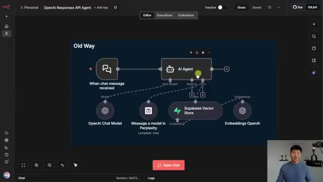
*⏱️ 00:00:06 — Un schéma de workflow au sein de l'interface Flowise illustrant une architecture d'agent IA nommée "Old Way", connectant un déclencheur de message, un agent IA, et des outils comme Perplexity et Supabase.*

---

### ⏱️ `[00:00:25 - 00:00:51]` | Segment #02

**🔊 Audio (Transcription Intégrale Mot pour Mot en Français) :**
> And if I go to the PDF that it's looking at, we have rule 17 about the flagstick. And then the Chicago Bears current record in the 2025 NFL season is 8-3. Go Bears! So what's important to know here is that it used those two tools to pull its knowledge because inside the AI agent itself, we have no system prompts. All we said is that you are a helpful assistant. So then how come I'm able to come over to this AI agent and ask the exact same question about the rule about the flagstick and what is the Chicago Bears current record?

**👁️ Analyse Visuelle d'Écran (gemini-3.5-flash-lite) :**
**Interface & Outils** : Présentation ou face-caméra explicatif sans interface logicielle partagée.

**Contenu textuel & Code** : Explications orales et mise en contexte méthodologique.

**Action / Démonstration** : Explications face caméra et démonstration conceptuelle.

---

### ⏱️ `[00:00:51 - 00:01:09]` | Segment #03

**🔊 Audio (Transcription Intégrale Mot pour Mot en Français) :**
> And you can see this agent has no tools attached at all. And if we look inside real quick, there is not even a system prompt either. So how come this agent with no tools is able to get us the exact same answer? The rule about the flagstick is rule 17. And as of today, the Chicago Bears record is 8-3. You can also see it got that from ChicagoBears.com.

**👁️ Analyse Visuelle d'Écran (gemini-3.5-flash-lite) :**
**Interface & Outils** : n8n (outil d'automatisation de workflow low-code).

**Contenu textuel & Code** : Prompt utilisateur : "What number is the rule about the Flagstick (pin)? And what is the Chicago Bears' current record?". Réponse de l'agent : "The rule about the flagstick (the pin) is Rule 17. As of today (Nov 25, 2025) the Chicago Bears' record is 8-3."

**Action / Démonstration** : Exécution d'un nœud d'agent IA pour vérifier la capacité de réponse sans outils externes ni system prompt configuré.

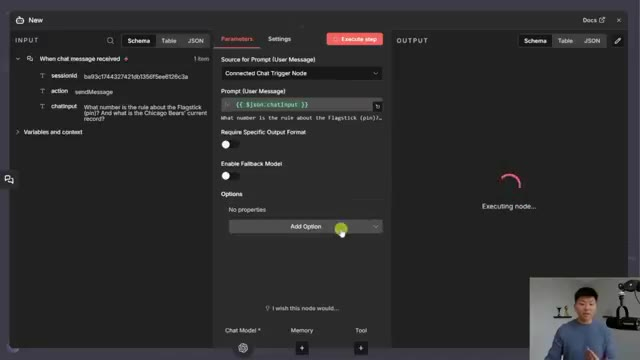
*⏱️ 00:00:56 — Interface de configuration d'un nœud d'agent IA dans n8n, montrant les paramètres d'entrée, le prompt utilisateur et l'indication "Executing node..." en cours.*

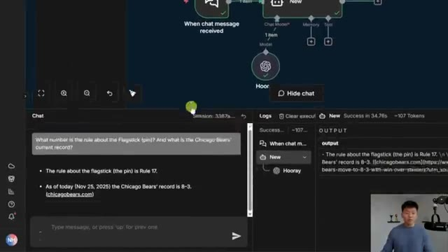
*⏱️ 00:01:00 — Interface de chat n8n affichant l'historique d'une conversation avec les réponses générées par l'agent et les logs d'exécution sur le panneau latéral droit.*

---

### ⏱️ `[00:01:10 - 00:01:42]` | Segment #04

**🔊 Audio (Transcription Intégrale Mot pour Mot en Français) :**
> So this is not magic. What we're doing is inside the actual OpenAI chat model, which is the brain for our AI agent, we're enabling web search and we're enabling file search. So that's what we're going to be talking about today using OpenAI's responses API. Okay, so in a recent update of NNN, I think it was 1.118 or later, what they did is they updated the chat model node for OpenAI. So when you click in your node and you go to settings, you should see version 1.3, which is the latest. Otherwise, you will not have access to the responses API. Now, unfortunately, right now, you do have to do it through the OpenAI chat

**👁️ Analyse Visuelle d'Écran (gemini-3.5-flash-lite) :**
**Interface & Outils** : Présentation ou face-caméra explicatif sans interface logicielle partagée.

**Contenu textuel & Code** : Explications orales et mise en contexte méthodologique.

**Action / Démonstration** : Explications face caméra et démonstration conceptuelle.

---

### ⏱️ `[00:01:42 - 00:02:14]` | Segment #05

**🔊 Audio (Transcription Intégrale Mot pour Mot en Français) :**
> model. And if you guys have been watching my channel for a while, you know that I like to use OpenRouter. But unfortunately, even if you're using OpenAI models, we don't yet have access to responses API through OpenRouter yet. But anyways, now that we're able to use the responses API natively in here, what that does is it allows our agents to have a few more capabilities. So really the big one is being able to have the built-in tools. So the OpenAI Responses API provides a range of built-in tools to enrich the model's response. And the ones that we're covering today are web search and file search. So web search allows the model to actually search the web for

**👁️ Analyse Visuelle d'Écran (gemini-3.5-flash-lite) :**
**Interface & Outils** : Présentation ou face-caméra explicatif sans interface logicielle partagée.

**Contenu textuel & Code** : Explications orales et mise en contexte méthodologique.

**Action / Démonstration** : Explications face caméra et démonstration conceptuelle.

---

### ⏱️ `[00:02:14 - 00:02:48]` | Segment #06

**🔊 Audio (Transcription Intégrale Mot pour Mot en Français) :**
> the latest information before it creates a response. And the file search allows you to drop in a file into OpenAI. OpenAI will handle the embedding and the indexing and the storage once you drop it in there, and then you can hook that up to your AI agents. We also have the ability for code interpretation and MCP servers, but right now I'm just going to be talking about these top two in today's video. So let's just first start off with a web search example. So what you're going to do is you're going to create an AI agent and you're going to hook up an OpenAI chat model. And then when you click into the chat model, the first thing you have to do if you don't already have a credential is go to OpenAI and get a API key. This is not your typical chat GPT environment.

**👁️ Analyse Visuelle d'Écran (gemini-3.5-flash-lite) :**
**Interface & Outils** : Présentation ou face-caméra explicatif sans interface logicielle partagée.

**Contenu textuel & Code** : Explications orales et mise en contexte méthodologique.

**Action / Démonstration** : Explications face caméra et démonstration conceptuelle.

---

### ⏱️ `[00:02:48 - 00:03:20]` | Segment #07

**🔊 Audio (Transcription Intégrale Mot pour Mot en Français) :**
> This is platform.openai.com, and this is what it should look like. And then you'll go here and grab an API key, putting your billing information. And once you get that key, it will be as simple as just pasting it right in here in the API key section. So once you're connected, what you have to do is just enable this little toggle that says use responses API. And this is what gives us access to adding in those built-in tools, which are web search, file search, and code interpreter. And by the way, I don't see the MCP thing right here. It still may be possible, but you might just have to do a little bit more kind of like coding in order to set up that request to use the MCP servers.

**👁️ Analyse Visuelle d'Écran (gemini-3.5-flash-lite) :**
**Interface & Outils** : n8n (éditeur de workflow d'automatisation)

**Contenu textuel & Code** : Paramètres du nœud : "Credential to connect with" (OpenAI account 2), sélection de modèle ("gpt-4o-mini"), option "Use Responses API". La section INPUT indique "No input connected" et OUTPUT indique "No output data".

**Action / Démonstration** : Le curseur de la souris survole le champ de sélection des identifiants (Credential) pour configurer l'accès à l'API OpenAI.

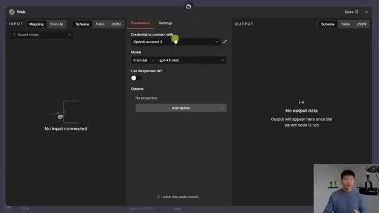
*⏱️ 00:02:56 — Une interface de configuration de nœud "Web" (probablement dans n8n) montrant les paramètres de connexion à un compte OpenAI.*

---

### ⏱️ `[00:03:20 - 00:03:56]` | Segment #08

**🔊 Audio (Transcription Intégrale Mot pour Mot en Français) :**
> So I'm not going to cover that today. So for the first example, I'm just going to enable web search and we have a few options now. So the first thing is to set the context size. So right here, you can see high level guidance for the amount of context window space to use for the search. And you can choose between low, medium, or high. And then what's pretty cool is you can actually select the city, the country, or the region to search within. And then you can also do web search allowed domains. So if you only want to search certain domains like Google or LinkedIn or Wikipedia, you could do that. And I will show an example of this in a sec. So now just to prove that this works, let me go ahead and turn off the responses API and let's chat with this agent real

**👁️ Analyse Visuelle d'Écran (gemini-3.5-flash-lite) :**
**Interface & Outils** : Présentation ou face-caméra explicatif sans interface logicielle partagée.

**Contenu textuel & Code** : Explications orales et mise en contexte méthodologique.

**Action / Démonstration** : Explications face caméra et démonstration conceptuelle.

---

### ⏱️ `[00:03:56 - 00:04:28]` | Segment #09

**🔊 Audio (Transcription Intégrale Mot pour Mot en Français) :**
> quick. So with no web search functionality in this agent, if I ask who won the world series this year, it's going to come back with something like, I don't have information on the events that occurred after June, 2024. So then all we'd have to do is come into the node, enable responses API, enable web search. And then now that we have that turned on, we can just run this again. And now when it hits its open AI brain, it's actually searching the web in order to figure out who won the World Series this year. So that just came back. The LA Dodgers won the 2025 World Series, defeating the Blue Jays in a thrilling seven-game series, and it also is pulling the actual websites that it got

**👁️ Analyse Visuelle d'Écran (gemini-3.5-flash-lite) :**
**Interface & Outils** : Présentation ou face-caméra explicatif sans interface logicielle partagée.

**Contenu textuel & Code** : Explications orales et mise en contexte méthodologique.

**Action / Démonstration** : Explications face caméra et démonstration conceptuelle.

---

### ⏱️ `[00:04:28 - 00:05:03]` | Segment #10

**🔊 Audio (Transcription Intégrale Mot pour Mot en Français) :**
> this information from. It even included a visual recap of the final moments of Game 7 at the end, so nice. Now real quick, let me just show off the actual domain thing. So if I come in here and I choose that I only want to search within a domain, which is up at AI.com, which is my really old AI agency website that has no information about the 2025 World Series in there at all. And I go ahead and rerun this question. We're going to see that it's basically not able to find this because, okay, I forgot about this, but I'm glad it happened. You can't use that filter if you're using GPT 4.1 or probably some of those older models. So what I'm going to do real quick is

**👁️ Analyse Visuelle d'Écran (gemini-3.5-flash-lite) :**
**Interface & Outils** : n8n (éditeur de workflow), Interface web de configuration d'agent IA.

**Contenu textuel & Code** : - Configuration API : "openai_api_key", "gpt-4o-mini", paramètres de timeout.
- Résultat de recherche : "The Los Angeles Dodgers won the 2025 World Series..."
- Message de log : "Problem in node 'Research' - Bad request - please check your parameters".

**Action / Démonstration** : Le présentateur explique la configuration d'un agent IA pour effectuer des recherches web, tout en affichant les détails des nœuds d'automatisation et les erreurs potentielles lors de l'exécution.

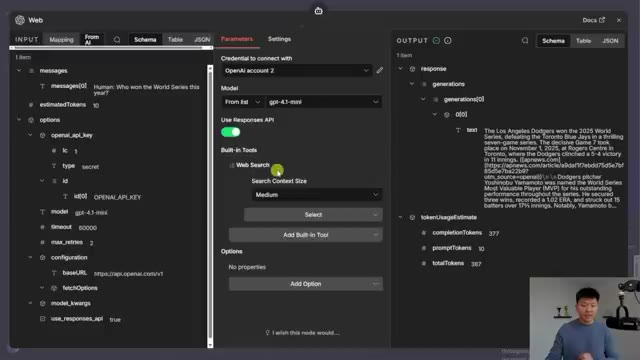
*⏱️ 00:04:37 — Interface de configuration d'un nœud IA montrant les paramètres d'API OpenAI, le modèle gpt-4o-mini et l'activation de l'outil "Web Search".*

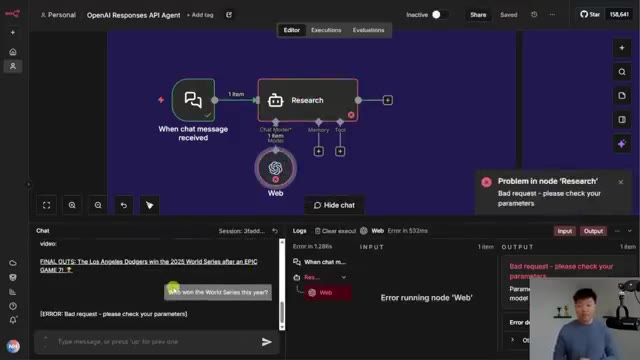
*⏱️ 00:04:54 — Éditeur de workflow de type n8n montrant un schéma d'automatisation d'agent avec une erreur dans le nœud "Research" et une fenêtre de chat latérale.*

---

### ⏱️ `[00:05:03 - 00:05:22]` | Segment #11

**🔊 Audio (Transcription Intégrale Mot pour Mot en Français) :**
> I'm just going to go ahead and grab a GPT 5 mini instead, and we should be able to see some success here. So I'll grab 5 mini and we will just go ahead and run this again. And like I was saying before I got rudely interrupted. There's no information about the world series on that website right there. So it's not going to be able to answer it. And it's gonna say, hey, I'm limited to only this domain.

**👁️ Analyse Visuelle d'Écran (gemini-3.5-flash-lite) :**
**Interface & Outils** : Présentation ou face-caméra explicatif sans interface logicielle partagée.

**Contenu textuel & Code** : Explications orales et mise en contexte méthodologique.

**Action / Démonstration** : Explications face caméra et démonstration conceptuelle.

---

### ⏱️ `[00:05:22 - 00:05:41]` | Segment #12

**🔊 Audio (Transcription Intégrale Mot pour Mot en Français) :**
> I can't find that. There you go. I can't find the answer on the domain that I'm restricted to, which is up at AI.com. All right, now for file search, which is also really, really cool. What we're doing in this node is once again, we are using the responses API. We're gonna turn off the web search and we're using file search this time. But you certainly can use both at the same time as you saw earlier in that demo.

**👁️ Analyse Visuelle d'Écran (gemini-3.5-flash-lite) :**
**Interface & Outils** : Présentation ou face-caméra explicatif sans interface logicielle partagée.

**Contenu textuel & Code** : Explications orales et mise en contexte méthodologique.

**Action / Démonstration** : Explications face caméra et démonstration conceptuelle.

---

### ⏱️ `[00:05:41 - 00:06:03]` | Segment #13

**🔊 Audio (Transcription Intégrale Mot pour Mot en Français) :**
> So you can see here what we need is a vector store ID and a filter. Now I'll explain the filter thing in a sec because this looks pretty weird, but first let's just talk about how do you actually get a vector store ID. So you're gonna go once again to the same place where you got your API key, platform.openai.com. And on the left-hand side, you can see storage. And this will let you upload files, but it will also let you create vector stores.

**👁️ Analyse Visuelle d'Écran (gemini-3.5-flash-lite) :**
**Interface & Outils** : Présentation ou face-caméra explicatif sans interface logicielle partagée.

**Contenu textuel & Code** : Explications orales et mise en contexte méthodologique.

**Action / Démonstration** : Explications face caméra et démonstration conceptuelle.

---

### ⏱️ `[00:06:03 - 00:06:25]` | Segment #14

**🔊 Audio (Transcription Intégrale Mot pour Mot en Français) :**
> So you're gonna go ahead and create a vector store, give it a name and drop in some files. So here you can see once again, I've dropped in the rules of golf PDF. And what this does is it gives you a vector store ID, which is right here. So you'd copy this value and you would put it right here as an array. So if there's just one, you put two double quotes on each side, but if you had multiple vector stores that you wanted to be able to query through, you would just put a comma and then do the exact same thing.

**👁️ Analyse Visuelle d'Écran (gemini-3.5-flash-lite) :**
**Interface & Outils** : Plateforme développeur OpenAI (Platform) et interface de workflow n8n.

**Contenu textuel & Code** : Identifiant du vector store : "vs_6925f9a9c18c8191941990521802cca8".

**Action / Démonstration** : Copie de l'ID du magasin de vecteurs depuis la plateforme OpenAI pour l'intégrer dans le champ de configuration du nœud d'automatisation.

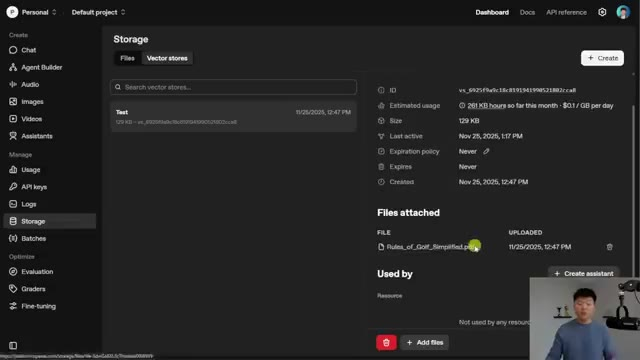
*⏱️ 00:06:08 — Interface de gestion de stockage de fichiers OpenAI montrant le détail d'un "Vector store" avec l'ID associé et le fichier PDF "Rules_of_Golf_Simplified.pdf" téléchargé.*

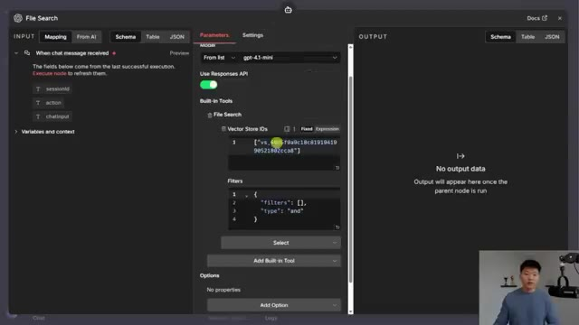
*⏱️ 00:06:14 — Interface de configuration d'un nœud "File Search" dans une plateforme d'automatisation (n8n), où l'utilisateur colle l'identifiant du Vector store récupéré précédemment.*

---

### ⏱️ `[00:06:25 - 00:06:43]` | Segment #15

**🔊 Audio (Transcription Intégrale Mot pour Mot en Français) :**
> Now, if you just try to do this without filters, it's going to error, at least it was erring for me. So I was able to figure out based on the documentation over here of how to use these tools for the responses API with web search and file search, that I needed to add this filter that looks like this. And I'll be honest, it wasn't super intuitive. So good thing I've got this right here for you guys.

**👁️ Analyse Visuelle d'Écran (gemini-3.5-flash-lite) :**
**Interface & Outils** : OpenAI Platform (Documentation) et interface de workflow de type n8n/Make (probablement le constructeur d'agents d'OpenAI ou un outil similaire).

**Contenu textuel & Code** : - JSON de filtres : `{"filters": [], "type": "and"}`
- Code JS : `const response = await client.responses.create({ tools: [{ type: "web_search" }], ... })`

**Action / Démonstration** : Le présentateur explique la nécessité d'ajouter manuellement une structure de filtre JSON dans les paramètres du nœud pour éviter des erreurs lors de l'utilisation des outils de recherche de fichiers/web.

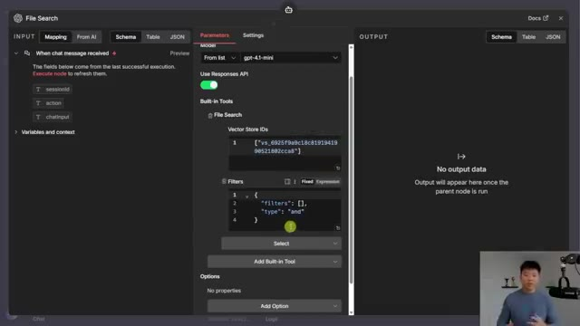
*⏱️ 00:06:30 — Interface de configuration de nœud "File Search" montrant les paramètres du modèle, les Vector Store IDs et la section "Filters" avec un objet JSON.*

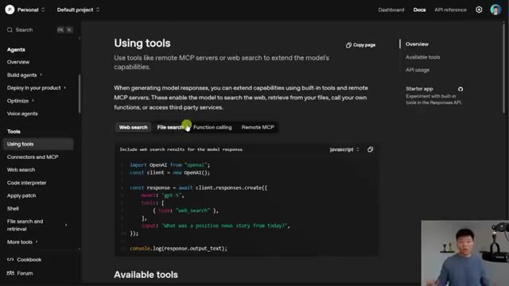
*⏱️ 00:06:34 — Documentation officielle en ligne sur l'utilisation des outils (Web Search, File Search), présentant un exemple de code JavaScript pour l'API.*

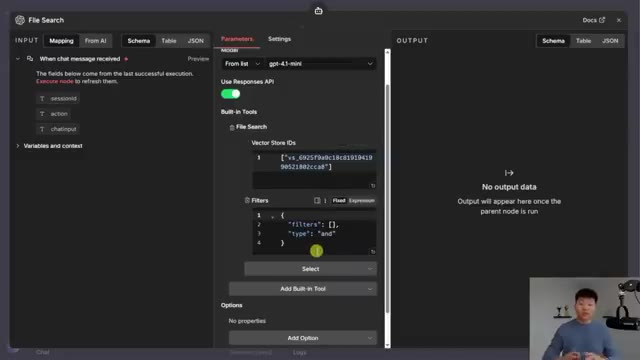
*⏱️ 00:06:39 — Vue identique à l'image #1, affichant les paramètres détaillés du nœud "File Search" dans l'éditeur de workflow.*

---

### ⏱️ `[00:06:43 - 00:07:19]` | Segment #16

**🔊 Audio (Transcription Intégrale Mot pour Mot en Français) :**
> Go ahead and take a screenshot of it and then you can paste that into your OpenAI chat model node. And then the other option that we can add in here is about max results. So we could just set a number here if we wanted to. So before we test that out again, I just wanted to call out the whole pricing thing. So if you haven't yet watched my video about Gemini file search, I will go ahead and tag that right up here. Definitely give it a watch because it's basically the exact same thing that we're doing here with OpenAI's Vector Store file search, except for Gemini's was so much cheaper. Because you can see here that OpenAI is going to charge you 10 cents per gigabyte per day. So if you have a vector store sitting here with data and you're not even using it, you're still going to get billed. And Gemini only charges

**👁️ Analyse Visuelle d'Écran (gemini-3.5-flash-lite) :**
**Interface & Outils** : Présentation ou face-caméra explicatif sans interface logicielle partagée.

**Contenu textuel & Code** : Explications orales et mise en contexte méthodologique.

**Action / Démonstration** : Explications face caméra et démonstration conceptuelle.

---

### ⏱️ `[00:07:19 - 00:07:53]` | Segment #17

**🔊 Audio (Transcription Intégrale Mot pour Mot en Français) :**
> you for uploading files, which is why everyone was like, whoa, this is awesome. So I just wanted to call that out real quick. But as far as actually what's going on on the backend when you drop in files to either Gemini or to OpenAI and indexing and like what's going on and which one's better retrieval, I haven't explicitly tested them out yet. Right now I'm kind of leaning towards Gemini because it comes back with a lot more metadata than what OpenAI does, which I'll show you guys in a sec. But I just wanted to say, because I know I'm going to get comments about that, I haven't explicitly tested it yet, but maybe a video is coming about that. Okay, so I'm going to ask it to explain what should happen if a ball at rest moves in golf. And what it's doing,

**👁️ Analyse Visuelle d'Écran (gemini-3.5-flash-lite) :**
**Interface & Outils** : OpenAI Platform (Platform Dashboard - section Storage/Vector stores).

**Contenu textuel & Code** : Détails techniques du Vector Store : ID (vs_6925f9...), utilisation estimée, taille (129 KB), politique d'expiration, et liste des fichiers attachés incluant "Rules_of_Golf_Simplified.pdf".

**Action / Démonstration** : Consultation et présentation des données de stockage et de l'indexation de fichiers via l'interface de la plateforme OpenAI.

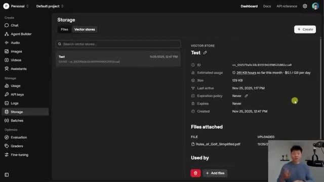
*⏱️ 00:07:27 — Interface de gestion de stockage d'OpenAI Platform affichant les détails d'un "Vector store" nommé "Test".*

---

### ⏱️ `[00:07:53 - 00:08:23]` | Segment #18

**🔊 Audio (Transcription Intégrale Mot pour Mot en Français) :**
> of course, is it's using its brain to think about what it needs to do. There are no tools to call, so it's going to search through the files. You can see the answer we get is if a ball at rest moves, what happens depends on what caused the ball to move. If X, this happens. If Y, this happens. If Z, if A, if B, as you can see, this is pulling from our document. Now by default right now with no system prompt, it's not actually exactly citing where it got this information from. And if we click into the actual chat model node, we can see this is the actual answer that it gave us.

**👁️ Analyse Visuelle d'Écran (gemini-3.5-flash-lite) :**
**Interface & Outils** : Plateforme d'automatisation de workflow (probablement n8n ou similaire).

**Contenu textuel & Code** : Réponse textuelle détaillée expliquant les règles de pénalité au golf si une balle au repos se déplace, basée sur la cause du mouvement (agence extérieure, joueur/partenaire, ou adversaire).

**Action / Démonstration** : L'agent a traité une requête utilisateur ("Please explain what should happen if a ball at rest moves in golf") et affiche la réponse générée après une recherche dans les fichiers.

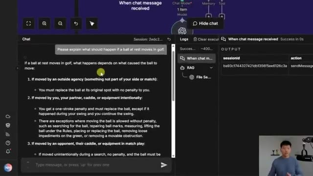
*⏱️ 00:08:00 — Une interface de plateforme d'automatisation d'agents IA montrant une fenêtre de chat avec une réponse détaillée sur les règles de golf, et un panneau latéral de logs affichant les sorties d'exécution.*

---

### ⏱️ `[00:08:23 - 00:08:49]` | Segment #19

**🔊 Audio (Transcription Intégrale Mot pour Mot en Français) :**
> But what we don't see is an exact source or an exact section that it pulled it from. And that's what Gemini does give back, which is super helpful. Now you could get this to be a little bit more specific with that sort of stuff by prompting our agent. But once again, there's nothing in here as far as the system message. Now, the last thing I wanted to hit on real quick was the other options that we actually get in addition to the built-in tools. So with the Responses API, we get these built-in tools as you guys saw, but we also have more options to choose from in here.

**👁️ Analyse Visuelle d'Écran (gemini-3.5-flash-lite) :**
**Interface & Outils** : n8n (outil d'automatisation de workflow).

**Contenu textuel & Code** : Configuration de nœuds API OpenAI (modèle gpt-4o-mini), Vector Store ID, paramètres de prompt système ("You are a helpful assistant"), et réponses textuelles concernant les règles de mouvement d'une balle de golf.

**Action / Démonstration** : Démonstration de l'exécution d'un workflow d'automatisation avec un agent IA utilisant la recherche vectorielle (RAG) pour répondre à une question spécifique sur les règles du golf.

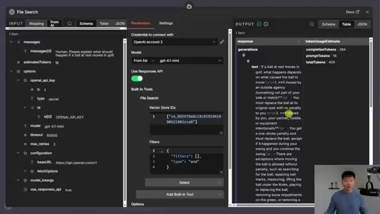
*⏱️ 00:08:29 — Interface de configuration du nœud "File Search" dans n8n, montrant les paramètres d'accès à OpenAI, l'identifiant du Vector Store et le résultat de la réponse générée dans le panneau de droite.*

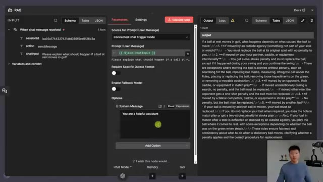
*⏱️ 00:08:36 — Interface de configuration d'un nœud de workflow RAG dans n8n, affichant les paramètres de prompt (System Message) et la réponse textuelle détaillée renvoyée par le modèle sur les règles du golf.*

---

### ⏱️ `[00:08:49 - 00:09:24]` | Segment #20

**🔊 Audio (Transcription Intégrale Mot pour Mot en Français) :**
> So in the options, if we scroll all the way down, if Responses API is enabled, we have some extra things like conversation ID, prompt cache key, all the way down to prompt. And just to show you guys, if I turned off responses API, we don't have those options anymore. I don't want this video to go too long. So I'm not going to run through an example of every single one, but here are what these additional options do. And also if you're curious in here, you can pretty much get information about all of them a little bit more detailed. And you could of course go to the open AI platform for the responses API to read more about how these all work. But at a high level, the prompt lets you have saved prompts in your open AI dashboard that you can reference with some sort of ID to

**👁️ Analyse Visuelle d'Écran (gemini-3.5-flash-lite) :**
**Interface & Outils** : n8n (outil d'automatisation de workflow).

**Contenu textuel & Code** : Liste des paramètres : Conversation ID, Prompt Cache Key, Safety Identifier, Service Tier, Metadata, Top Logprobs, Prompt.

**Action / Démonstration** : Démonstration de l'activation/désactivation de l'option "Use Responses API" dans le nœud pour faire apparaître ou disparaître les paramètres avancés.

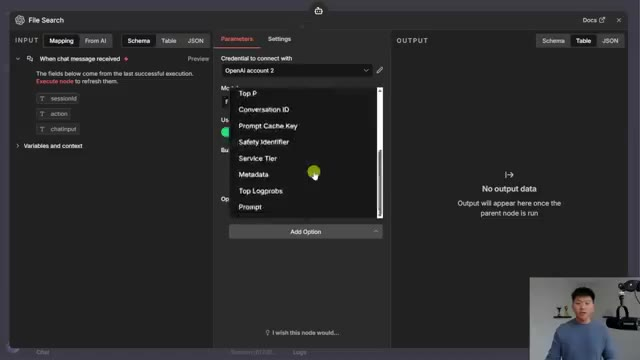
*⏱️ 00:08:58 — Interface de configuration d'un nœud "File Search" montrant une liste déroulante des options avancées disponibles (Conversation ID, Prompt Cache Key, etc.).*

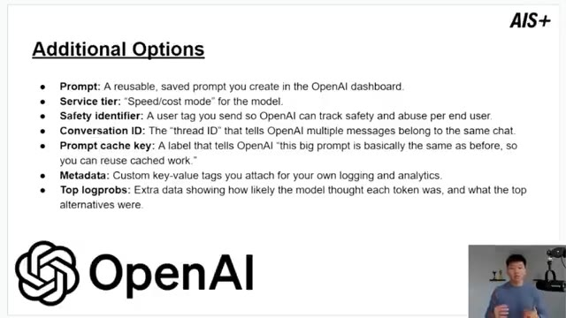
*⏱️ 00:09:07 — Une diapositive explicative détaillant les définitions techniques de chaque option supplémentaire ("Additional Options") liée à l'API OpenAI.*

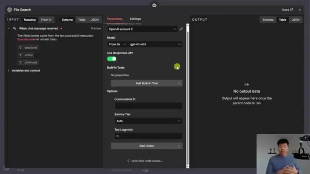
*⏱️ 00:09:16 — Interface de configuration du nœud avec l'option "Use Responses API" activée, affichant les champs de paramètres spécifiques (Conversation ID, Service Tier, Top Logprobs).*

---

### ⏱️ `[00:09:24 - 00:09:56]` | Segment #21

**🔊 Audio (Transcription Intégrale Mot pour Mot en Français) :**
> pull those into your chat model. You can have a service tier, so you can have sort of the balance between speed and cost for that use case. You can have a safety identifier to tag individuals. You can have a conversation ID, which is really cool because then you have sort of your memory being held in OpenAI rather than having like a simple memory or a Postgres memory in NNN. You can have a prompt cache key, which basically lets OpenAI cache some of those prompts and responses rather than having to run it through and burn more tokens every time. You can have metadata, so custom key value tags.

**👁️ Analyse Visuelle d'Écran (gemini-3.5-flash-lite) :**
**Interface & Outils** : Présentation ou face-caméra explicatif sans interface logicielle partagée.

**Contenu textuel & Code** : Explications orales et mise en contexte méthodologique.

**Action / Démonstration** : Explications face caméra et démonstration conceptuelle.

---

### ⏱️ `[00:09:56 - 00:10:31]` | Segment #22

**🔊 Audio (Transcription Intégrale Mot pour Mot en Français) :**
> And then you can have top log probs, which honestly I don't fully understand and I'm not sure when I would use it. But once again, if you're curious, chuck this into Perplexity and figure out how that works or check out the OpenAI docs. But if you're interested in diving deeper with all this kind of stuff, then definitely check out my plus community. The link for that is down in the description. We've got a great community of members who are building with Aniden every day and building businesses with Aniden every day. We also run one live call per week in the community, So I'd love to see you guys in those calls in the communities, but that's going to do it for today If you enjoyed or you learned something new, please give it a like it definitely helps me out a ton And as always, I appreciate you guys making it to the end of the video. I'll see you on the next one. Thanks, everyone

**👁️ Analyse Visuelle d'Écran (gemini-3.5-flash-lite) :**
**Interface & Outils** : Présentation ou face-caméra explicatif sans interface logicielle partagée.

**Contenu textuel & Code** : Explications orales et mise en contexte méthodologique.

**Action / Démonstration** : Explications face caméra et démonstration conceptuelle.

---

