# 🎬 Unlock the Full Power of Your n8n Agents (new instance MCP)

> **Chaîne** : [Nate Herk | AI Automation](https://www.youtube.com/@nateherk/featured)  
> **Lien YouTube** : [https://www.youtube.com/watch?v=5p5cV0yVDvQ](https://www.youtube.com/watch?v=5p5cV0yVDvQ)  
> **Date de publication** : 20251205  
> **Durée** : 00:13:37  
> **Identifiant vidéo** : `5p5cV0yVDvQ`  
> **Transcription & Analyse** : `whisper-v3-large-turbo+gemini-3.5-flash-lite`  

---

## 📌 Synthèse Exécutive & Outils

### 💡 Résumé
Dans cette vidéo intitulée **Unlock the Full Power of Your n8n Agents (new instance MCP)**, Nate Herk décortique les capacités pratiques d'automatisation et de développement propulsées par les modèles de pointe.

### 🛠️ Outils, Modèles & Logiciels Présentés
- **Opus 5.5 & Claude Code** : Modèles d'ingénierie et agents de codage autonome.

### 🔑 Points Clés & Enseignements Stratégiques
- Optimiser le niveau d'effort et le raisonnement des modèles IA pour des résultats industriels.
- Automatiser les cycles de création logicielle de bout en bout.

---

## ⏱️ Chronologie & Transcription Complète Audio & Visuelle (Mot pour Mot)

### ⏱️ `[00:00:00 - 00:00:33]` | Segment #01

**🔊 Audio (Transcription Intégrale Mot pour Mot en Français) :**
> NNN's new instance level MCP is truly a game changer and in today's video I'm going to talk about why that is, how easy it is to use, and how to connect it to things like ChatGPT, Claude, or Lovable. And honestly since MCP or Model Context Protocol started popping up everywhere, it's been a little bit confusing but also a buzzword. So I wanted to start off by just making sure we're all on the same page about what it is and then I'll show you how to use it. So this is where MCP really started with NNN where we had an update where you could make these native MCP server triggers. Meaning we could create our own MCP servers in in NNN that hooked up to different tools or different workflows that we built.

**👁️ Analyse Visuelle d'Écran (gemini-3.5-flash-lite) :**
**Interface & Outils** : Présentation ou face-caméra explicatif sans interface logicielle partagée.

**Contenu textuel & Code** : Explications orales et mise en contexte méthodologique.

**Action / Démonstration** : Explications face caméra et démonstration conceptuelle.

---

### ⏱️ `[00:00:33 - 00:00:55]` | Segment #02

**🔊 Audio (Transcription Intégrale Mot pour Mot en Français) :**
> And then we could have an MCP client like Claude or Cursor actually talk to these servers and trigger these workflows or tools. But with NNN instance level MCP, it's not just limited to these workflows or tools that we assign, it's actually letting our MCP clients search through our entire NNN instance and look at the workflows, understand the schemas, what they do, and actually execute any of them.

**👁️ Analyse Visuelle d'Écran (gemini-3.5-flash-lite) :**
**Interface & Outils** : Présentation ou face-caméra explicatif sans interface logicielle partagée.

**Contenu textuel & Code** : Explications orales et mise en contexte méthodologique.

**Action / Démonstration** : Explications face caméra et démonstration conceptuelle.

---

### ⏱️ `[00:00:55 - 00:01:15]` | Segment #03

**🔊 Audio (Transcription Intégrale Mot pour Mot en Français) :**
> Which means right now in your NNN instance, you probably have tons of workflows that you're like, huh, I would love to just throw this into Lovable or Claude and just have them be able to use them for me whenever they want. And now you can. But what does that really mean? And the easiest way that I like to think about it is it's just an AI agent. That's not like the technical definition, but it's the way I like to think about it. So right here, we have an NNN AI agent.

**👁️ Analyse Visuelle d'Écran (gemini-3.5-flash-lite) :**
**Interface & Outils** : Présentation ou face-caméra explicatif sans interface logicielle partagée.

**Contenu textuel & Code** : Explications orales et mise en contexte méthodologique.

**Action / Démonstration** : Explications face caméra et démonstration conceptuelle.

---

### ⏱️ `[00:01:15 - 00:01:47]` | Segment #04

**🔊 Audio (Transcription Intégrale Mot pour Mot en Français) :**
> And I'm assuming we all know what we're looking at here, where the agent has all of these different tools. And it basically understands, based on the request coming in, which tool do I need to use? And when I call that tool, what do I have to send it? So picture it as if ChatGPT is the agent and it can see all of the different workflows in your instance It knows what they do. It knows what to send it and it knows when to call each one So let's just start plugging in our NN to different clients and before we do that I'm going to be doing this on cloud. You're not limited to doing this on cloud You can go ahead to the NNN MCP docs if you want to be able to read through a little bit more information

**👁️ Analyse Visuelle d'Écran (gemini-3.5-flash-lite) :**
**Interface & Outils** : n8n (éditeur de workflow et interface de gestion).

**Contenu textuel & Code** : Nœuds de workflow : "Email Agent", "Send Email", "Email Reply", "Create Draft", "Get Emails" ; statistiques : "Prod. executions 70", "Failure rate 4.3%".

**Action / Démonstration** : Démonstration de l'architecture d'un agent IA capable de router des requêtes vers des outils spécifiques (Gmail) au sein d'un workflow automatisé.

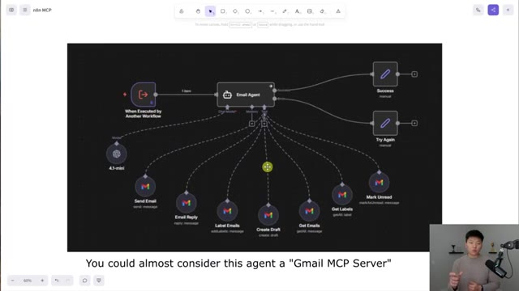
*⏱️ 00:01:23 — Vue d'un éditeur de workflow n8n montrant un "Email Agent" central connecté à divers outils Gmail.*

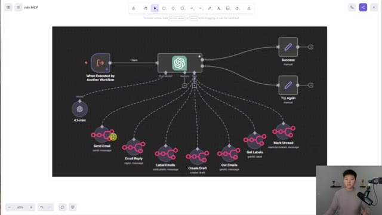
*⏱️ 00:01:31 — Visualisation du workflow n8n où le nœud central "Email Agent" est représenté par l'icône de ChatGPT.*

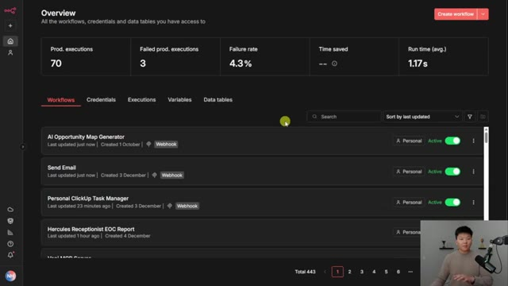
*⏱️ 00:01:39 — Tableau de bord général de n8n affichant les statistiques d'exécution et la liste des workflows actifs.*

---

### ⏱️ `[00:01:47 - 00:02:07]` | Segment #05

**🔊 Audio (Transcription Intégrale Mot pour Mot en Français) :**
> But you do need to be on version 1.2 1.2 or higher You can see i've got some workflows right here that have this icon which basically shows that they're available for MCP. And if you're on cloud and you need to update your instance, you would just do so by going to your admin panel. So anyways, you're going to go to your settings in your NNN. And right here, you should see MCP access.

**👁️ Analyse Visuelle d'Écran (gemini-3.5-flash-lite) :**
**Interface & Outils** : Présentation ou face-caméra explicatif sans interface logicielle partagée.

**Contenu textuel & Code** : Explications orales et mise en contexte méthodologique.

**Action / Démonstration** : Explications face caméra et démonstration conceptuelle.

---

### ⏱️ `[00:02:07 - 00:02:42]` | Segment #06

**🔊 Audio (Transcription Intégrale Mot pour Mot en Français) :**
> And right here, what we have is the ability to connect via OAuth or access token. Just make sure you actually enable this and you toggle that on. So right here, you can see that we're given a server URL and we have zero connected OAuth clients. So let's go hook it up. All right, I'm going to start off with Claude. And I'm not on my Claude desktop. I'm actually in the cloud version of Claude right here, which is super cool that we can just plug it in right away super easily So what I'm gonna do is I'm gonna click on this little icon right here and I'm gonna go to add connectors Now in here you can see that NNN is already a native connector right now So all I have to do is click connect and it's going to basically open up this OAuth for us

**👁️ Analyse Visuelle d'Écran (gemini-3.5-flash-lite) :**
**Interface & Outils** : Présentation ou face-caméra explicatif sans interface logicielle partagée.

**Contenu textuel & Code** : Explications orales et mise en contexte méthodologique.

**Action / Démonstration** : Explications face caméra et démonstration conceptuelle.

---

### ⏱️ `[00:02:42 - 00:03:16]` | Segment #07

**🔊 Audio (Transcription Intégrale Mot pour Mot en Français) :**
> I'm going to give it access and now we have connected to NNN Now if it's your first time doing this, you will have to basically just copy in your server URL and give it to Claude but then it's as easy as that. And so now if I go to the tools right here, you can see we're connected to NNN and we have three different options, which are execute workflow, get workflow details, or search workflows. So how many times have you had an AI help you write an email? Well, now instead of just writing it and then copy and pasting it, you can go ahead and just say, we'll send that off now. Assuming that you have an NNN workflow that's available in MCP, that actually sends emails. And you can see this one is super simple. So now that that email is

**👁️ Analyse Visuelle d'Écran (gemini-3.5-flash-lite) :**
**Interface & Outils** : Présentation ou face-caméra explicatif sans interface logicielle partagée.

**Contenu textuel & Code** : Explications orales et mise en contexte méthodologique.

**Action / Démonstration** : Explications face caméra et démonstration conceptuelle.

---

### ⏱️ `[00:03:16 - 00:03:53]` | Segment #08

**🔊 Audio (Transcription Intégrale Mot pour Mot en Français) :**
> written and I like it, I can basically say use NNN to send that email to michael at dundermifflin.com. So what it does is it says, let me search through your available workflows. It asks you to allow, but I'm just going to go ahead and do always allow. So after it searched workflows, it found one and now it's asking to get workflow details. So I'm going to always allow this tool as well. So it grabbed the details. It knows the three body fields that it needs and it knows the webhook address and everything like that So i'm going to go ahead and always allow and we didn't have to actually go in here and configure everything with this post request Claude was able to just find it and do it You can see that we got confirmation that the email has been sent and if I head over to my email, you can see that it is right here

**👁️ Analyse Visuelle d'Écran (gemini-3.5-flash-lite) :**
**Interface & Outils** : Présentation ou face-caméra explicatif sans interface logicielle partagée.

**Contenu textuel & Code** : Explications orales et mise en contexte méthodologique.

**Action / Démonstration** : Explications face caméra et démonstration conceptuelle.

---

### ⏱️ `[00:03:53 - 00:04:12]` | Segment #09

**🔊 Audio (Transcription Intégrale Mot pour Mot en Français) :**
> Okay, so let's say I just finished that up and I have a really busy day So I have my to-do list right here in click up where I have email michael about pto and that was due today and it's urgent And so I could context switch all the way back into ClickUp, or I could just use my ClickUp task manager AI agent through MCP. And I can talk to this thing in Claude. And I can just ask Claude to do it because I'm right here.

**👁️ Analyse Visuelle d'Écran (gemini-3.5-flash-lite) :**
**Interface & Outils** : Présentation ou face-caméra explicatif sans interface logicielle partagée.

**Contenu textuel & Code** : Explications orales et mise en contexte méthodologique.

**Action / Démonstration** : Explications face caméra et démonstration conceptuelle.

---

### ⏱️ `[00:04:13 - 00:04:33]` | Segment #10

**🔊 Audio (Transcription Intégrale Mot pour Mot en Français) :**
> And I can say, use NNN to move my task called email Michael about PTO to complete. So now it's going to go ahead and search through the workflows. It found my ClickUp task manager. It got the details. And now it's going to shoot that off. There you go. So it says that it finished everything up. And now if I open back up my ClickUp, we can see that this task was moved to complete. And now that that's done, we probably want to see what else we have to do today.

**👁️ Analyse Visuelle d'Écran (gemini-3.5-flash-lite) :**
**Interface & Outils** : Présentation ou face-caméra explicatif sans interface logicielle partagée.

**Contenu textuel & Code** : Explications orales et mise en contexte méthodologique.

**Action / Démonstration** : Explications face caméra et démonstration conceptuelle.

---

### ⏱️ `[00:04:33 - 00:04:57]` | Segment #11

**🔊 Audio (Transcription Intégrale Mot pour Mot en Français) :**
> So I'm going to ask it to use NNN to figure out what other tasks I have to do today. So it comes back and says, based on what NNN found, you have one task due today. Record NNN MCP video, which is high priority, which I'm doing right now. And as you can see in ClickUp, that is the only thing that is due today. Now, if we go into NNN to see what actually happened here, and I'm going to go to my executions, you can see that on the most recent execution, the webhook was sent a body that says, what tasks do I have due today?

**👁️ Analyse Visuelle d'Écran (gemini-3.5-flash-lite) :**
**Interface & Outils** : Présentation ou face-caméra explicatif sans interface logicielle partagée.

**Contenu textuel & Code** : Explications orales et mise en contexte méthodologique.

**Action / Démonstration** : Explications face caméra et démonstration conceptuelle.

---

### ⏱️ `[00:04:57 - 00:05:30]` | Segment #12

**🔊 Audio (Transcription Intégrale Mot pour Mot en Français) :**
> The agent then go ahead and process that and it calls its get tasks tool and then it returns an answer to us in Claude. Now I won't dive into this actual workflow but it's pretty simple. We've got three tools update, create, and get and then also the system prompt looks like this in case you guys are interested in reading through it a little bit. I'm basically just telling it what its job is and what tools it has and when to use each tool. Now there is something interesting here because in order to actually update a task it first has to get them so it knows its ID. So if you remember For the first ClickUp example from Claude, we basically said move my task to complete, and then you can see what it did is it got the task ID and then it went ahead and updated

**👁️ Analyse Visuelle d'Écran (gemini-3.5-flash-lite) :**
**Interface & Outils** : n8n (plateforme d'automatisation de workflows).

**Contenu textuel & Code** : Workflow complet "Personal ClickUp Task Manager", incluant les outils "Update Task", "Create Task", "Get Tasks", ainsi que le prompt système définissant les règles et l'accès à la date actuelle via JavaScript.

**Action / Démonstration** : Présentation de l'architecture d'un agent IA dans n8n, explication du workflow et visualisation des logs d'exécution réussie.

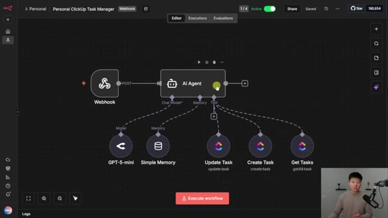
*⏱️ 00:05:05 — Interface de conception de workflow n8n montrant un nœud "AI Agent" connecté à un Webhook et à trois outils de gestion de tâches ClickUp (Update, Create, Get).*

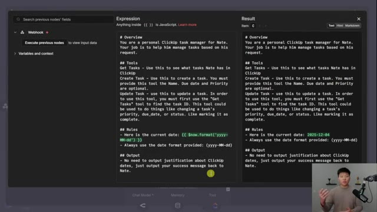
*⏱️ 00:05:14 — Éditeur de configuration du système dans n8n, affichant le prompt de l'agent IA, ses directives, ses outils (Get, Create, Update) et la gestion dynamique de la date.*

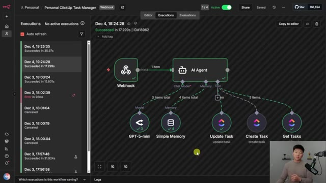
*⏱️ 00:05:22 — Onglet "Executions" dans n8n montrant l'historique des exécutions du workflow et l'état de succès des nœuds de l'agent après traitement.*

---

### ⏱️ `[00:05:30 - 00:06:04]` | Segment #13

**🔊 Audio (Transcription Intégrale Mot pour Mot en Français) :**
> it. But anyways, there are two important things that you need to know about making workflows actually accessible from MCP clients. The first one is it has to be an active workflow or a published workflow. And then second is you have to go to the settings and then when you get in there, you can see a little toggle down here that says available in MCP. Now this is actually a really good thing that you have to manually enable these because otherwise, if you had everything actually give access to your entire NITIN instance, there could be like, you know, some sensitive API keys or access to certain data in there that you probably don't want random clients to have. So you are in full control still. And once again, when they're

**👁️ Analyse Visuelle d'Écran (gemini-3.5-flash-lite) :**
**Interface & Outils** : Présentation ou face-caméra explicatif sans interface logicielle partagée.

**Contenu textuel & Code** : Explications orales et mise en contexte méthodologique.

**Action / Démonstration** : Explications face caméra et démonstration conceptuelle.

---

### ⏱️ `[00:06:04 - 00:06:22]` | Segment #14

**🔊 Audio (Transcription Intégrale Mot pour Mot en Français) :**
> available in MCP, you can see that right here, as well as if you go into your settings and you go to MCP access, you can see down here what workflows you actually have available. Now you will notice that there's a description. And for MCP, that's super important that it can actually look at the description so it understands the fields to send over and it can understand what the workflow does.

**👁️ Analyse Visuelle d'Écran (gemini-3.5-flash-lite) :**
**Interface & Outils** : Présentation ou face-caméra explicatif sans interface logicielle partagée.

**Contenu textuel & Code** : Explications orales et mise en contexte méthodologique.

**Action / Démonstration** : Explications face caméra et démonstration conceptuelle.

---

### ⏱️ `[00:06:23 - 00:06:56]` | Segment #15

**🔊 Audio (Transcription Intégrale Mot pour Mot en Français) :**
> And the way that you can actually add the description is of course in the workflow itself. So for this AI opportunity map generator I would go ahead and edit workflow description and that's where I put in a few sentences about what this workflow does. And I know that I'm using webhooks here but what you can do is have any workflow that has a webhook trigger, a schedule trigger, a chat trigger, or a form trigger. These can all work as MCP workflows. Okay so before we plug in this one to lovable and we basically have it build a full app for us with just looking at this workflow I'm going to show you guys how we can connect to chat gbt so chat gbt works very similar to claude

**👁️ Analyse Visuelle d'Écran (gemini-3.5-flash-lite) :**
**Interface & Outils** : n8n (éditeur de workflow low-code) et documentation technique n8n.

**Contenu textuel & Code** : Diagramme de workflow incluant des nœuds Webhook, AI Consultant, Style Agent, et Gmail ("Send a message"). Texte de description de workflow explicitant les champs 'prompt' et 'email'.

**Action / Démonstration** : Édition de la description du workflow dans l'interface n8n pour documenter les capacités d'automatisation.

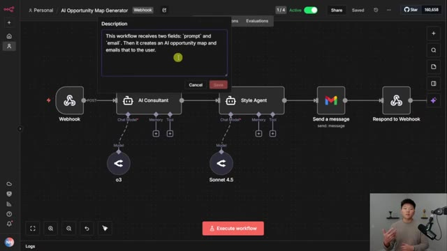
*⏱️ 00:06:31 — Interface n8n montrant un workflow "AI Opportunity Map Generator" avec une fenêtre modale de description ouverte expliquant le fonctionnement du processus (réception de 'prompt' et 'email', création de la carte).*

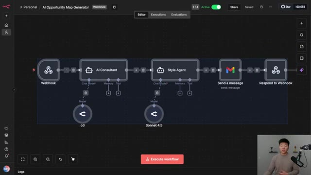
*⏱️ 00:06:48 — Vue d'ensemble du canevas n8n montrant la structure complète du workflow avec les nœuds "AI Consultant" (o3) et "Style Agent" (Sonnet 4.5) connectés.*

---

### ⏱️ `[00:06:56 - 00:07:28]` | Segment #16

**🔊 Audio (Transcription Intégrale Mot pour Mot en Français) :**
> except for there's no native integration so what you're going to do is come down here to your settings you're going to go to apps and connectors and you're going to look through and you can see that there are some native integrations so I imagine that editing will be coming soon and so the reason why I wanted to do that gmail example was because I think that's a really common use case and also the native connectors for chat and claude they don't actually let you send emails they just let you find and reference emails from your inbox. As you can see in Claude, we only have a Gmail search. But anyways, what you're going to do is in order to actually create your own connection, you just have to come down to the bottom and turn on developer mode.

**👁️ Analyse Visuelle d'Écran (gemini-3.5-flash-lite) :**
**Interface & Outils** : ChatGPT (Web), Claude.ai (Web)

**Contenu textuel & Code** : Liste d'applications (Atlassian Rovo, Figma, Monday.com, etc.) dans ChatGPT ; menu de gestion des connecteurs et log d'exécution de workflow n8n dans Claude.

**Action / Démonstration** : Navigation dans les paramètres d'intégration de ChatGPT pour l'image 1 ; sélection/activation de connecteurs (n8n, Gmail, Drive) dans Claude pour l'image 2.

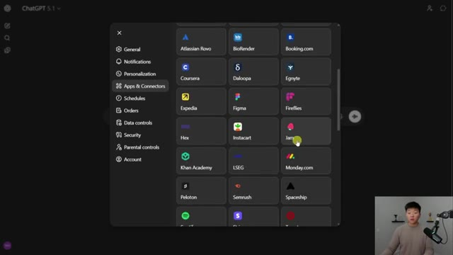
*⏱️ 00:07:04 — Interface des paramètres de ChatGPT affichant la section "Apps & Connectors" avec une grille d'applications tierces disponibles.*

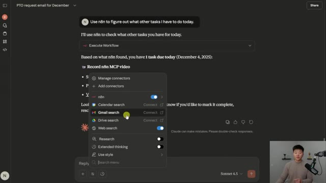
*⏱️ 00:07:20 — Interface de Claude (Sonnet 4.5) affichant un menu déroulant de gestion des connecteurs (n8n, Gmail, Drive, Web search) au sein d'une conversation.*

---

### ⏱️ `[00:07:28 - 00:08:03]` | Segment #17

**🔊 Audio (Transcription Intégrale Mot pour Mot en Français) :**
> Now this says allows you to add unverified connectors that could modify or erase data permanently. Memory is disabled and it basically highlights your chat in orange to let you know that you are in developer mode. Of course, there are security concerns. It's just a very new technology. But once again, just be careful about which workflows you're giving access to these different clients. But now you have the create button up here in the top right, and you'll go ahead and click on create. And this is where you would go back into edit end, you would grab the server URL right here, and you would just paste that right there. So if you remember in Claude, when I connected to this MCP server, it basically did the OAuth single sign on. And so that's exactly what's going

**👁️ Analyse Visuelle d'Écran (gemini-3.5-flash-lite) :**
**Interface & Outils** : Interface web de ChatGPT (version 5.1).

**Contenu textuel & Code** : Texte affiché : "Developer mode", "Memory is not used for this chat" et "Ask anything" dans la barre de saisie.

**Action / Démonstration** : Activation du mode développeur dans l'interface de discussion ChatGPT.

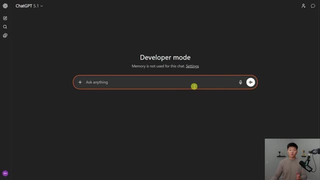
*⏱️ 00:07:37 — L'interface de ChatGPT 5.1 en mode développeur, caractérisée par une bordure orange autour de la barre de saisie, indiquant la désactivation de la mémoire.*

---

### ⏱️ `[00:08:03 - 00:08:36]` | Segment #18

**🔊 Audio (Transcription Intégrale Mot pour Mot en Français) :**
> to happen here. And that's why you will use OAuth authentication, you will click on the check mark, and then you will go ahead and click create. But I want to point out something which is a little bit unfortunate, this is not working for me right now, and I don't think it's working for anyone right now. I had it going using this exact method, and I've seen some other tutorials on YouTube where they are doing it like this, but I think that ChatGPT is doing something right now on their backend. And I deleted all the connections just for this video, so I could do them live in front of you guys, so that was kind of unfortunate. But anyways, I imagine it will be up and running soon, and I imagine it will be coming natively soon. But of course, a little workaround is you could

**👁️ Analyse Visuelle d'Écran (gemini-3.5-flash-lite) :**
**Interface & Outils** : Présentation ou face-caméra explicatif sans interface logicielle partagée.

**Contenu textuel & Code** : Explications orales et mise en contexte méthodologique.

**Action / Démonstration** : Explications face caméra et démonstration conceptuelle.

---

### ⏱️ `[00:08:36 - 00:09:13]` | Segment #19

**🔊 Audio (Transcription Intégrale Mot pour Mot en Français) :**
> take the old-fashioned way of using an MCP server trigger in NNN, and then just hooking up the workflows that you actually want to use in ChatGPT and just pasting that in there, doing no authentication, and then connecting that way. As you can see, that gave us a connector through NNN and I now have these different actions for different custom workflows in NNN. Anyways, now that we got that out of the way, let's talk about how we can do this in Lovable. So right here, I have an AI opportunity map generator workflow. And what I want to do is easily create a custom front end that I could send people to. They could put in a little blurb about their business and their process problems. And then it would send them an automated AI roadmap. So all I would do is come into NNN.

**👁️ Analyse Visuelle d'Écran (gemini-3.5-flash-lite) :**
**Interface & Outils** : ChatGPT (configuration MCP), Lovable, n8n (éditeur de workflow).

**Contenu textuel & Code** : URL de serveur MCP (nateherk.app.n8n.cloud), diagramme de nœuds n8n : "AI Consultant" (utilisant o3), "Style Agent" (utilisant Sonnet 4.5), et "Send a message".

**Action / Démonstration** : Configuration d'un nouveau connecteur MCP dans ChatGPT pour lier un workflow n8n, et visualisation d'un workflow opérationnel dans n8n.

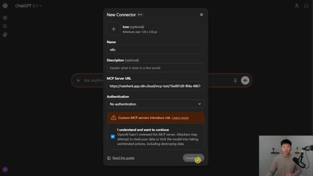
*⏱️ 00:08:45 — Interface de configuration "New Connector" dans ChatGPT pour intégrer un serveur MCP, avec le champ URL pointant vers n8n.*

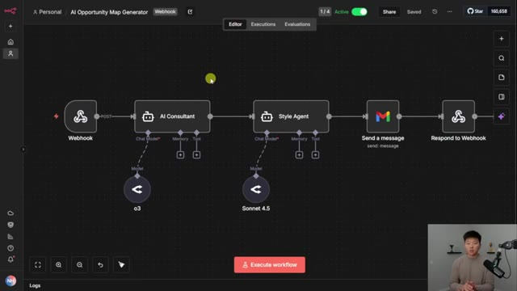
*⏱️ 00:09:04 — Éditeur de workflow dans n8n montrant un processus automatisé avec un Webhook, des agents IA (Consultant/Style) et une étape d'envoi d'e-mail.*

---

### ⏱️ `[00:09:13 - 00:09:46]` | Segment #20

**🔊 Audio (Transcription Intégrale Mot pour Mot en Français) :**
> I would grab the server URL right here, go into lovable. And I'll click on this plus right here, go to integrations, click on manage, scroll down a little bit, and you can see that we have NNN. So I would just have to set that up. And when I hit connect and paste in my server URL, it'll do another single sign on for us real quick. Just basically saying that lovable has access to our NNN instance. And once we click allow, it will basically say that we have enabled the NNN instance MCP in lovable. So now I can say build me a minimalistic form submission with a gamified interface for my NNN workflow that does AI opportunity mapping. Make sure to let the user

**👁️ Analyse Visuelle d'Écran (gemini-3.5-flash-lite) :**
**Interface & Outils** : Lovable (plateforme de développement web AI), interface de configuration des intégrations (MCP servers), fenêtre de consentement OAuth n8n.

**Contenu textuel & Code** : URL du serveur : https://nateherk.app.n8n.cloud/mcp-server/http ; Liste d'outils (search_workflows, execute_workflow, get_workflow_details).

**Action / Démonstration** : Activation de l'intégration n8n dans Lovable, saisie de l'URL du serveur MCP, et autorisation d'accès via OAuth pour connecter les flux de travail.

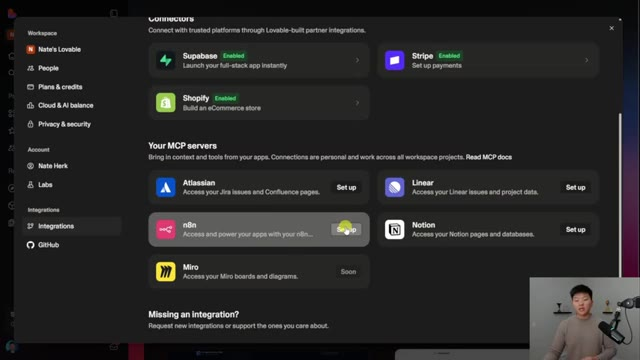
*⏱️ 00:09:21 — Interface de Lovable affichant la liste des serveurs MCP disponibles, avec le bouton "Set up" mis en évidence pour l'intégration n8n.*

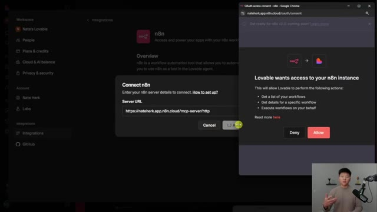
*⏱️ 00:09:29 — Fenêtre modale de connexion n8n dans Lovable demandant une URL de serveur, accompagnée d'une fenêtre de consentement OAuth du navigateur.*

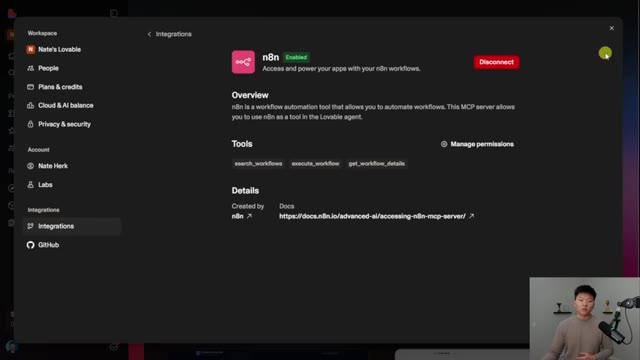
*⏱️ 00:09:37 — Interface de configuration après succès, montrant que l'intégration n8n est "Enabled" avec accès aux outils (search_workflows, execute_workflow, etc.).*

---

### ⏱️ `[00:09:46 - 00:10:19]` | Segment #21

**🔊 Audio (Transcription Intégrale Mot pour Mot en Français) :**
> know that their report is loading after they've sent it and then give them confirmation when it's done. So if you guys have seen a different lovable video I've done or a base 44 video I've done, one of the challenges is actually giving this interface the webhook configuration, the URL, the method, the body to send over, the body to send back, all this kind of stuff. And so right now you can see it's basically just going to search through my workflows. It's going to understand what the workflow does. And it's just going to one shot a landing page for us. All right. So that just finished up. It says discover your AI automation opportunities, describe any manual process and receive a personalized AI automation roadmap with ROI estimates delivered to your inbox.

**👁️ Analyse Visuelle d'Écran (gemini-3.5-flash-lite) :**
**Interface & Outils** : Lovable (plateforme de développement assistée par IA), intégration n8n.

**Contenu textuel & Code** : Prompt utilisateur demandant une interface gamifiée pour un workflow n8n ; logs de réflexion de l'IA détaillant les choix de design (dark mode, glassmorphism, Framer Motion).

**Action / Démonstration** : Génération d'une interface web interactive, connexion aux workflows n8n, et rendu visuel du design « AI Opportunity Map ».

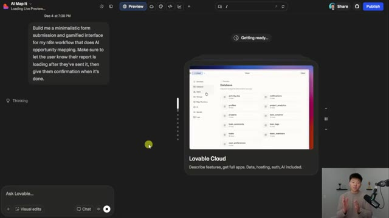
*⏱️ 00:09:54 — Interface de développement Lovable affichant un prompt utilisateur sur la gauche et une prévisualisation de base de données sur la droite.*

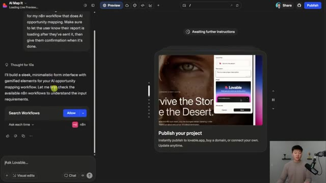
*⏱️ 00:10:02 — Interface de développement Lovable où l'agent IA confirme l'autorisation d'accéder aux workflows n8n pour la configuration.*

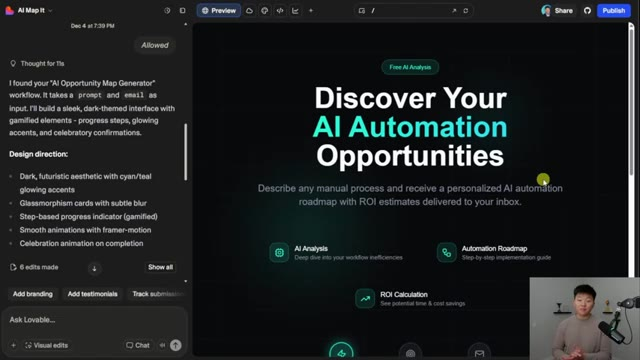
*⏱️ 00:10:11 — Interface de développement Lovable montrant le rendu final de l'interface utilisateur générée avec une esthétique sombre et des éléments graphiques « AI Automation ».*

---

### ⏱️ `[00:10:20 - 00:10:56]` | Segment #22

**🔊 Audio (Transcription Intégrale Mot pour Mot en Français) :**
> So what's interesting about this is if you actually came into the workflow and you looked at like what this is and you understood like what's going on in the consultant agent and everything, this is exactly like pretty spot on. You describe, you submit and you receive. So let's go ahead and submit a process and see what we get. All right. So I put in a process. I put in my email. I'm going to click generate my AI opportunity map. And right now it is analyzing all of this. And if I go over to the workflow and we click on executions, we should see that it is currently running. And then we will be notified over here when that's finished up. But keep in mind for a one-shot prompt that was this long, this is pretty solid. Okay. Looks like that just finished up. It says the report has

**👁️ Analyse Visuelle d'Écran (gemini-3.5-flash-lite) :**
**Interface & Outils** : Lovable (plateforme de développement web assistée par IA).

**Contenu textuel & Code** : Texte du chat expliquant la création d'un générateur de cartographie d'opportunités IA, incluant la direction artistique (esthétique sombre, accents cyan, glassmorphism) et les étapes du workflow : "Describe", "Submit", "Receive".

**Action / Démonstration** : L'utilisateur présente l'interface générée par l'agent et s'apprête à interagir avec le bouton "Submit" pour tester le workflow.

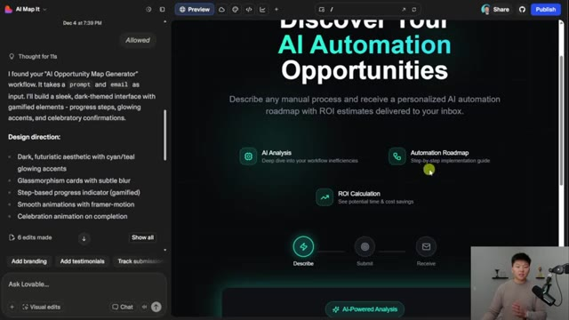
*⏱️ 00:10:29 — Interface de l'outil Lovable affichant une application web nommée "AI Map It" en cours de développement, avec une barre latérale de chat à gauche détaillant la logique de l'agent.*

---

### ⏱️ `[00:10:56 - 00:11:33]` | Segment #23

**🔊 Audio (Transcription Intégrale Mot pour Mot en Français) :**
> been sent to this email. So let's go ahead and take a look. All right. So here it is the landscaping business automation and efficiency report. We've got an executive summary. We're diagnosing the problems in sales, operations, and field reporting. We have a root cause analysis right here. Here's our automation roadmap with some quick wins, MVP two to four weeks, scalable solution, one to three months, long-term, and then we've got some estimated ROI analysis, which right here you can see total monthly benefit 20K, 250K almost annual, and just kind of all of this type of breakdown. So the point of this video is not the actual quality of this roadmap. It's more so the

**👁️ Analyse Visuelle d'Écran (gemini-3.5-flash-lite) :**
**Interface & Outils** : Gmail (interface web).

**Contenu textuel & Code** : Le document détaille trois catégories de problèmes : 1. "Sales Inefficiencies" (délais de devis, erreurs d'estimation, cycles de vente lents), 2. "Operations Bottlenecks" (planification manuelle, temps de trajet, problèmes d'équipement), et 3. "Field Reporting & Job-Costing Gaps" (communication imprécise, manque de données sur les coûts de main-d'œuvre et rétention client réactive).

**Action / Démonstration** : Le présentateur passe en revue le rapport de diagnostic reçu par e-mail pour identifier les points de friction opérationnels avant de proposer des solutions d'automatisation.

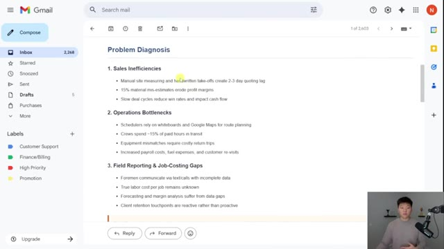
*⏱️ 00:11:05 — Une capture d'écran montrant le contenu d'un e-mail dans Gmail, affichant un rapport de diagnostic intitulé "Problem Diagnosis" pour une entreprise d'aménagement paysager.*

---

### ⏱️ `[00:11:33 - 00:11:53]` | Segment #24

**🔊 Audio (Transcription Intégrale Mot pour Mot en Français) :**
> fact that we could just tell lovable, hey, make me a landing page for this random workflow in my NNN instance. And it comes up with something that I think is pretty solid. Anyways, just wanted to quickly wrap up here with how to think about maybe like when you should use the MCP server. I think a lot of people might just kind of want to use some of this technology for certain things where it doesn't actually really save time. So think about interfaces that you are in a lot.

**👁️ Analyse Visuelle d'Écran (gemini-3.5-flash-lite) :**
**Interface & Outils** : Présentation ou face-caméra explicatif sans interface logicielle partagée.

**Contenu textuel & Code** : Explications orales et mise en contexte méthodologique.

**Action / Démonstration** : Explications face caméra et démonstration conceptuelle.

---

### ⏱️ `[00:11:53 - 00:12:19]` | Segment #25

**🔊 Audio (Transcription Intégrale Mot pour Mot en Français) :**
> If you're in Cloud a lot, then probably does make sense to integrate some of your NNN and workflows in there that could do things like, you know, moving files around in Google Drive or creating tasks or messaging your team, whatever it is. Now, something that I think is gonna be really cool is when we're able to connect our instance level MCP to something like Vappy or voice providers. And maybe we already can, but when I was playing around with it, I actually ended up doing a different solution where I just did the regular server trigger, which is kind of the workflow that you guys saw earlier.

**👁️ Analyse Visuelle d'Écran (gemini-3.5-flash-lite) :**
**Interface & Outils** : n8n (interface de gestion de workflows d'automatisation).

**Contenu textuel & Code** : Tableau de bord avec métriques de production (74 exécutions, 3 échecs, taux d'échec de 4,1%) et liste des workflows incluant "AI Opportunity Map Generator", "Send Email", et "Personal ClickUp Task Manager".

**Action / Démonstration** : Navigation dans la liste des workflows automatisés.

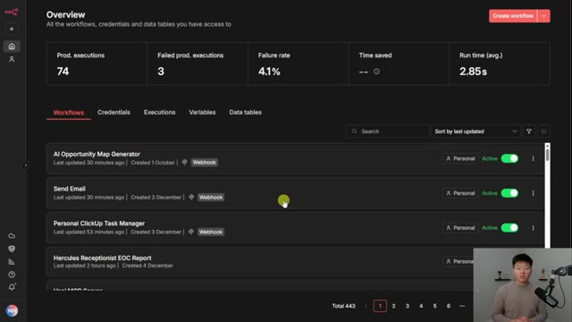
*⏱️ 00:12:00 — Une capture d'écran montrant le tableau de bord principal de l'application n8n, affichant une liste de workflows actifs et des statistiques d'exécution globale.*

---

### ⏱️ `[00:12:19 - 00:12:37]` | Segment #26

**🔊 Audio (Transcription Intégrale Mot pour Mot en Français) :**
> And something that I would challenge you to think about is just to keep it really, really simple. Like the example where Claude sent over an email for us to send in NNN, it was literally just the web hook to receive the data and then the Gmail node to send it off. And in this specific example, a lot of the workflows are just simple two or three or even one node steps.

**👁️ Analyse Visuelle d'Écran (gemini-3.5-flash-lite) :**
**Interface & Outils** : Présentation ou face-caméra explicatif sans interface logicielle partagée.

**Contenu textuel & Code** : Explications orales et mise en contexte méthodologique.

**Action / Démonstration** : Explications face caméra et démonstration conceptuelle.

---

### ⏱️ `[00:12:37 - 00:13:00]` | Segment #27

**🔊 Audio (Transcription Intégrale Mot pour Mot en Français) :**
> So the point I'm trying to make here is you probably already have lots of workflows you could go ahead and plug into something like Claude or ChatGPT right away and add value. But you could also build some really simple like one node tools and just connect them to anything that you're typically spending more time in. And even if they look like this, it's just simple conditional logic and it gets the job done really fast. So anyways, if you want to explore different use cases and talk more about some of the stuff, then you should definitely check out my plus community.

**👁️ Analyse Visuelle d'Écran (gemini-3.5-flash-lite) :**
**Interface & Outils** : Présentation ou face-caméra explicatif sans interface logicielle partagée.

**Contenu textuel & Code** : Explications orales et mise en contexte méthodologique.

**Action / Démonstration** : Explications face caméra et démonstration conceptuelle.

---

### ⏱️ `[00:13:00 - 00:13:19]` | Segment #28

**🔊 Audio (Transcription Intégrale Mot pour Mot en Français) :**
> The link for that is down in the description. We've got over 2,500 members who are building with NN and building businesses with NN every single day. We've got a classroom section full of courses. We've got Agent Zero, which is the foundations for beginners, 10 hours to 10 seconds, where you learn how to identify design and build time-saving automations. And then for our premium members, we have one person AI agency and subs to sales.

**👁️ Analyse Visuelle d'Écran (gemini-3.5-flash-lite) :**
**Interface & Outils** : Plateforme web Skool (AI Automation Society Plus).

**Contenu textuel & Code** : Titres des modules de formation : "Start Here", "Agent Zero (Foundations)", "10 Hours to 10 Seconds", "One Person AI Automation Agency", "Subs to Sales" et "n8n Projects".

**Action / Démonstration** : Navigation au sein de la section "Classroom" de la communauté pour présenter les ressources éducatives offertes aux membres.

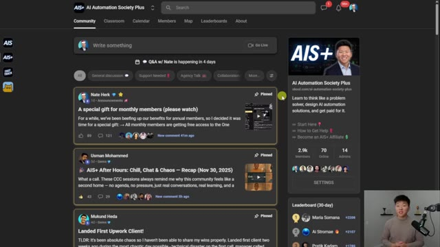
*⏱️ 00:13:05 — Interface de la plateforme communautaire Skool pour "AI Automation Society Plus", affichant le flux d'actualités avec des publications épinglées par Nate Herk et d'autres membres.*

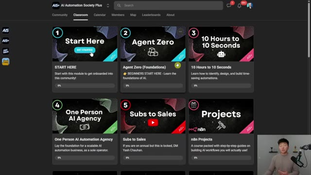
*⏱️ 00:13:10 — Interface de la section "Classroom" de la plateforme, présentant une grille de cours disponibles, notamment "Agent Zero", "10 Hours to 10 Seconds" et "One Person AI Agency".*

---

### ⏱️ `[00:13:19 - 00:13:36]` | Segment #29

**🔊 Audio (Transcription Intégrale Mot pour Mot en Français) :**
> And then we've got tons of step-by-step live build projects in here. We also run a live Q&A every single week. So I'd love to see you guys in those calls in the community, but that's going to do it for the video. So if you enjoyed, please give it a like. It definitely helps me out a ton. And as always, I appreciate you guys making it to the end of the video. I'll see you on the next one. Thanks, everyone.

**👁️ Analyse Visuelle d'Écran (gemini-3.5-flash-lite) :**
**Interface & Outils** : - Image #1 : Plateforme communautaire type Skool.
- Image #2 : Outil de tableau blanc collaboratif (ex: Excalidraw ou Miro).

**Contenu textuel & Code** : - Image #1 : Calendrier de décembre 2025 avec des rappels "Q&A w/..." programmés.
- Image #2 : Schémas et logos de Lovable, Claude, ChatGPT et n8n liés par des flèches vers une représentation visuelle d'un workflow automatisé.

**Action / Démonstration** : - Image #1 : Présentation du calendrier des événements récurrents pour la communauté.
- Image #2 : Illustration visuelle de l'écosystème d'outils utilisé pour les projets de build.

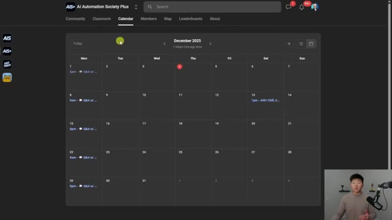
*⏱️ 00:13:24 — Interface de calendrier communautaire affichant le planning mensuel des sessions live de questions-réponses.*

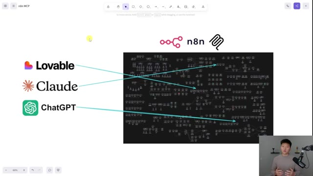
*⏱️ 00:13:32 — Diagramme conceptuel montrant l'interconnexion entre Lovable, Claude, ChatGPT et un workflow n8n complexe.*

---

