# 🎬 I Built an AI Voice Receptionist with Vapi and n8n MCP (free template)

> **Chaîne** : [Nate Herk | AI Automation](https://www.youtube.com/@nateherk/featured)  
> **Lien YouTube** : [https://www.youtube.com/watch?v=y-cq_Qo4zVo](https://www.youtube.com/watch?v=y-cq_Qo4zVo)  
> **Date de publication** : 20251207  
> **Durée** : 00:34:21  
> **Identifiant vidéo** : `y-cq_Qo4zVo`  
> **Transcription & Analyse** : `whisper-v3-large-turbo+gemini-3.5-flash-lite`  

---

## 📌 Synthèse Exécutive & Outils

### 💡 Résumé

Cette vidéo de la chaîne *Nate Herk | AI Automation* présente la conception et la mise en œuvre de **Kylie**, une réceptionniste vocale intelligente capable de gérer de manière autonome des interactions complexes en temps réel pour une entreprise de service (Hercules Detailing). Le système s'articule autour d'une architecture découplée combinant un frontal conversationnel ultra-réactif et un backend hautement automatisé. La démonstration en direct met en lumière deux scénarios clés : l'accueil d'un nouvel utilisateur avec création de profil et réservation d'un créneau de nettoyage intérieur, puis la modification dynamique de ce rendez-vous existant. Toutes les actions s'exécutent de manière fluide et se synchronisent instantanément dans le CRM et le calendrier.

Au cœur de cette architecture se trouve un serveur MCP (Model Context Protocol) couplé à **n8n**, orchestrait par sept flux de travail personnalisés. Cette approche modulaire permet à l'agent vocal de communiquer de manière sécurisée et structurée avec les bases de données sous-jacentes. L'auteur insiste sur l'importance méthodologique de concevoir un schéma logique ou un organigramme avant d'écrire la moindre ligne de code ou de rédiger le prompt système. Cette rigueur d'ingénierie garantit une gestion rigoureuse des embranchements conversationnels, qu'il s'agisse de la qualification initiale, de la vérification des disponibilités ou du traitement des intentions complexes.

Enfin, la vidéo aborde les bonnes pratiques de conception des assistants vocaux, notamment la nécessité absolue d'une transparence immédiate vis-à-vis de l'interlocuteur humain. En faisant s'identifier l'IA comme un assistant virtuel dès les premières secondes de l'appel, on gère efficacement les attentes de l'utilisateur tout en acceptant les imperfections inhérentes aux interruptions et aux nuances conversationnelles. Ce système complet illustre la puissance combinée des agents vocaux modernes et des architectures d'automatisation pilotées par modèles.

### 🛠️ Outils, Modèles & Logiciels Présentés

* **Vapi** : Plateforme front-end de pointe dédiée à la création, au déploiement et à la gestion d'agents vocaux IA ultra-rapides et conversationnels.
* **n8n** : Outil d'automatisation de flux de travail open-source et low-code utilisé ici pour héberger la logique backend et les webhooks.
* **Serveur MCP n8n** : Protocole de contexte de modèle (Model Context Protocol) servant de pont sécurisé et structuré entre l'agent vocal et les sept workflows personnalisés de n8n.
* **Opus 5.5 / Modèles Anthropic** : Famille de modèles de pointe sous-jacents aux capacités de raisonnement avancé et à la gestion du niveau d'effort (*Effort Level*).
* **Claude Code** : Outil de développement assisté par IA d'Anthropic accélérant l'ingénierie logicielle et la configuration des environnements complexes.

### 🔑 Points Clés & Enseignements Stratégiques

* **Architecture découplée Front-end / Back-end** : Séparer la couche vocale (Vapi) de la logique métier et des intégrations de données (n8n/MCP) garantit la maintenabilité, la scalabilité et la robustesse globale du système.
* **Transparence conversationnelle obligatoire** : Il est fortement recommandé de faire annoncer explicitement par l'agent vocal sa nature d'intelligence artificielle dès le début de l'appel pour instaurer la confiance et aligner les attentes de l'utilisateur.
* **Conception rigoureuse par organigramme** : Avant de rédiger les prompts ou de configurer les outils, l'élaboration d'un schéma logique conditionnel (arbres de décision pour les cas nominaux et les exceptions) est indispensable pour antérioriser la complexité des flux vocaux.
* **Qualification systématique par l'e-mail** : Utiliser l'adresse e-mail comme clé primaire d'identification dès les premières secondes permet d'interroger instantanément le CRM pour segmenter les nouveaux appelants des clients existants.
* **Gestion en temps réel des bases de données** : Le couplage direct via MCP permet des mises à jour bidirectionnelles instantanées du calendrier et du CRM, éliminant les temps de latence perçus et les risques de double réservation.
* **Vérification préventive des disponibilités** : Toute action de réservation ou de modification de rendez-vous doit obligatoirement être précédée d'un workflow de vérification des conflits temporels pour garantir l'intégrité du planning.
* **Résumés et journaux d'appels automatisés** : Chaque interaction vocale doit déclencher un post-traitement asynchrone générant un résumé synthétique de l'appel et un statut de résultat exploitable pour le suivi commercial.
* **Exploitation d'une base de connaissances documentaire** : Pour répondre avec précision aux questions génériques des clients, l'agent vocal doit s'appuyer sur un corpus documentaire structuré et véridique afin d'éviter les hallucinations.
* **Modularité des flux n8n** : Décomposer les automatisations en sept workflows distincts et spécialisés (au lieu d'un monolithe complexe) facilite grandement le débogage, les tests unitaires et l'évolution incrémentale du système.
* **Gestion granulaire du paramètre d'effort** : Ajuster finement le niveau d'effort des modèles d'IA employés permet d'optimiser le compromis entre la vitesse de réponse en temps réel de la voix et la complexité du raisonnement logique sous-jacent.

---

## ⏱️ Chronologie & Transcription Complète Audio & Visuelle (Mot pour Mot)

### ⏱️ `[00:00:00 - 00:00:31]` | Segment #01

**🔊 Audio (Transcription Intégrale Mot pour Mot en Français) :**
> Je viens de construire cette réceptionniste vocale par IA qui peut faire à peu près n'importe quoi. Toutes les automatisations du backend se font grâce à ce serveur MCP NNN qui possède sept flux de travail personnalisés différents que j'ai construits dans NNN. Donc dans la vidéo d'aujourd'hui, je vais vous montrer comment j'ai configuré VAPI sur le front-end et NNN sur le backend, et plus important encore, vous montrer comment vous pouvez reproduire ou personnaliser ce système. Non seulement je vous donne le prompt système et tous les flux de travail que vous verrez aujourd'hui tout à fait gratuitement, mais je vous fournis également ce guide de ressources de 15 pages qui détaille toute la configuration et à peu près tout ce que vous devez savoir sur ce système. Passons donc à une démonstration en direct, puis voyons la construction.

**👁️ Analyse Visuelle d'Écran (gemini-3.5-flash-lite) :**
**Interface & Outils** : n8n / Éditeur de workflows d'automatisation, Google Docs.

**Contenu textuel & Code** : Nœuds de workflows (MCP Server Trigger, Google Calendar, Google Sheets) et document de spécifications textuelles.
[DESC_IMAGE_3]

**Action / Démonstration** : Présentation visuelle de l'architecture backend et de la documentation du projet de réceptionniste vocale par IA.

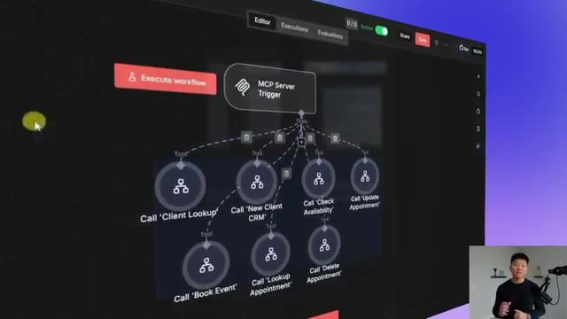
*⏱️ 00:00:08 — Vue d'un diagramme de flux d'automatisation montrant un serveur MCP connecté à sept outils de gestion de rendez-vous et de clients.*

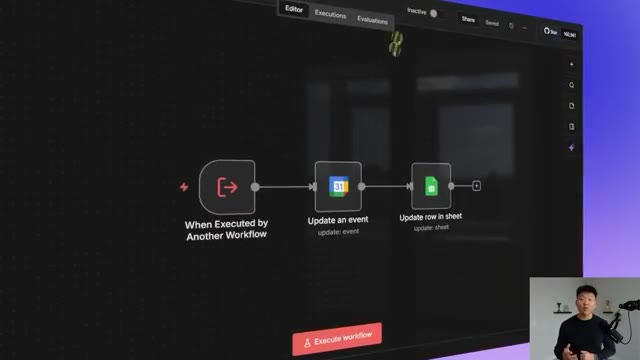
*⏱️ 00:00:15 — Gros plan sur un flux d'automatisation spécifique combinant un déclencheur, Google Agenda et Google Sheets.*

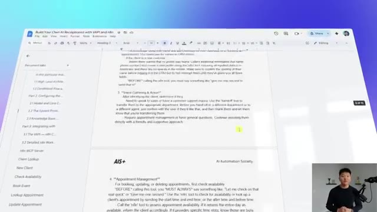
*⏱️ 00:00:23 — Aperçu d'un document textuel rédigé (Google Docs) détaillant la structure de l'assistant vocal IA et ses instructions.*

---

### ⏱️ `[00:00:31 - 00:01:04]` | Segment #02

**🔊 Audio (Transcription Intégrale Mot pour Mot en Français) :**
> Très bien, donc sur le côté gauche, nous avons Vappy. Il s'agit de Kylie, notre standardiste IA de Hercules Detailing. Et sur le côté droit, nous avons notre serveur MCP avec ces sept flux de travail personnalisés que nous avons élaborés dans N8N. Donc avant d'appeler Kylie, je vais afficher le calendrier sur le côté gauche et le CRM sur le côté droit afin que nous puissions voir tout cela se mettre à jour et se produire en temps réel. Nous allons faire deux scénarios. Je vais appeler en tant que nouveau utilisateur, faire créer un compte et réserver un rendez-vous. Et ensuite, je vais rappeler et je vais demander si je peux modifier ce rendez-vous. Très bien. Donc nous allons passer un coup de fil à Kylie et nous allons voir comment cela fonctionne. Bonjour, ici Kylie de Hercules Detailing. Pourrais-je s'il vous plaît avoir votre

**👁️ Analyse Visuelle d'Écran (gemini-3.5-flash-lite) :**
**Interface & Outils** : Vapi, n8n, Google Calendar, Google Sheets.

**Contenu textuel & Code** : Configuration du prompt système pour la standardiste IA Kylie, diagramme du serveur MCP n8n avec les outils (Client Lookup, New Client CRM, Check Availability, Update Appointment, Book Event, Lookup Appointment, Delete Appointment), calendrier de rendez-vous et tableau CRM vide.
[DESC_IMAGE_2] Présentation de la configuration de l'assistant vocal Vapi et du workflow n8n connecté, suivie de la démonstration du calendrier et du CRM.

**Action / Démonstration** : Explications face caméra et démonstration conceptuelle.

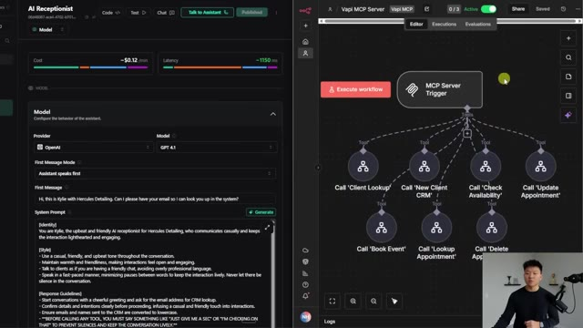
*⏱️ 00:00:40 — Vue partagée montrant l'interface Vapi à gauche avec la configuration du modèle d'assistant IA Kylie, et le flux de travail N8N du serveur MCP à droite avec ses sept outils personnalisés.*

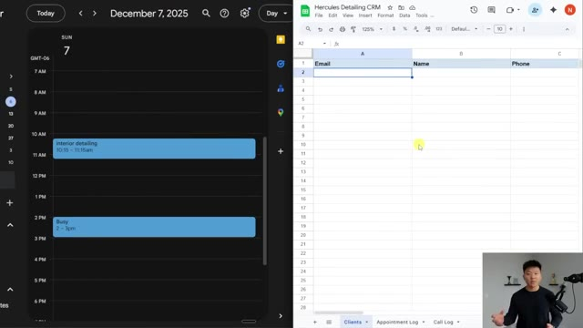
*⏱️ 00:00:48 — Vue partagée montrant un calendrier Google affichant les rendez-vous du 7 décembre 2025 à gauche, et une feuille de calcul Google Sheets 'Hercules Detailing CRM' à droite.*

---

### ⏱️ `[00:01:04 - 00:01:41]` | Segment #03

**🔊 Audio (Transcription Intégrale Mot pour Mot en Français) :**
> e-mail pour que je puisse vous trouver dans le système ? Oui, je suis en fait un nouvel appelant, donc je ne serai pas dans le système. Bienvenue. Je suis super content que vous ayez appelé. Hercules Detailing aujourd'hui. Tout ce dont j'ai besoin, c'est de votre adresse e-mail, de votre nom complet et de votre numéro de téléphone pour vous configurer. Donnez-moi simplement ces détails. Ne vous inquiétez pas. Je les confirmerai avec vous pour que tout soit parfait. Allez-y quand vous êtes prêt ? Bien sûr. Oui. Mon e-mail est nateatexample.com. Mon nom est Nate Herc. Ça s'écrit avec un K à la fin. Et ensuite mon numéro de téléphone est le 333-444-5678. Génial. Merci pour ça, Nate. Juste pour confirmer,

**👁️ Analyse Visuelle d'Écran (gemini-3.5-flash-lite) :**
**Interface & Outils** : Google Calendar et Google Sheets (Hercules Detailing CRM)

**Contenu textuel & Code** : Colonnes du CRM : Email, Name, Phone. Calendrier affichant le 7 décembre 2025 avec des créneaux "interior detailing" et "Busy".

**Action / Démonstration** : Présentation simultanée du calendrier de réservation et de la base de données CRM pour l'entreprise Hercules Detailing.

*⏱️ 00:01:14 — Capture d'écran montrant à gauche un calendrier (Google Calendar) avec des rendez-vous planifiés et à droite un tableau Google Sheets intitulé "Hercules Detailing CRM" avec les colonnes Email, Name et Phone.*

---

### ⏱️ `[00:01:42 - 00:02:00]` | Segment #04

**🔊 Audio (Transcription Intégrale Mot pour Mot en Français) :**
> votre e-mail est nateatexample.com. Votre nom complet est nateherc avec un K à la fin et votre numéro de téléphone est le 333-444-5678, c'est bien ça ? Ouais. Tout est correct. Si tout cela vous semble bon, accordez-moi une petite seconde pour envoyer ça et configurer votre profil. C'est tout bon, Nate. Vous êtes officiellement dans notre système.

**👁️ Analyse Visuelle d'Écran (gemini-3.5-flash-lite) :**
**Interface & Outils** : Google Sheets, Google Calendar, Navigateur web

**Contenu textuel & Code** : Données CRM de test : "nate@example.com", "nate herk", "3334445678", et événements de calendrier "interior detailing".

**Action / Démonstration** : Visualisation et vérification des données du profil client enregistrées automatiquement dans le CRM et le calendrier.

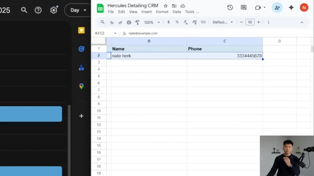
*⏱️ 00:01:46 — Vue d'un tableau Google Sheets nommé "Hercules Detailing CRM" montrant les colonnes Nom et Téléphone avec les informations de Nate Herk et son numéro, aux côtés d'une interface de calendrier Google en mode sombre.*

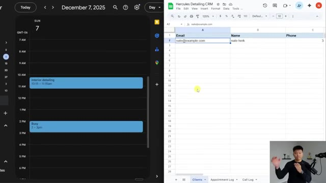
*⏱️ 00:01:55 — Affichage côte à côte de l'interface Google Calendar (à gauche, datée du 7 décembre 2025 avec des créneaux comme "interior detailing") et de Google Sheets (à droite) montrant les colonnes Email, Nom et Téléphone.*

---

### ⏱️ `[00:02:00 - 00:02:21]` | Segment #05

**🔊 Audio (Transcription Intégrale Mot pour Mot en Français) :**
> Super facile. Maintenant, en quoi puis-je vous aider aujourd'hui ? Vous cherchez à prendre rendez-vous, vous avez une question, ou y a-t-il autre chose qui vous préoccupe ? Ouais, je cherche juste à planifier un nettoyage intérieur pour demain. Excellent choix. Le nettoyage intérieur donnera à votre voiture une sensation de fraîcheur.

**👁️ Analyse Visuelle d'Écran (gemini-3.5-flash-lite) :**
**Interface & Outils** : Google Calendar, Google Sheets (Hercules Detailing CRM)

**Contenu textuel & Code** : Calendrier affichant des créneaux (December 7, 2025, 'interior detailing', 'Busy') et tableau Google Sheets avec les colonnes ID, Email, Appointment Type.

**Action / Démonstration** : Présentation du CRM et du calendrier pour le suivi des rendez-vous de nettoyage intérieur.

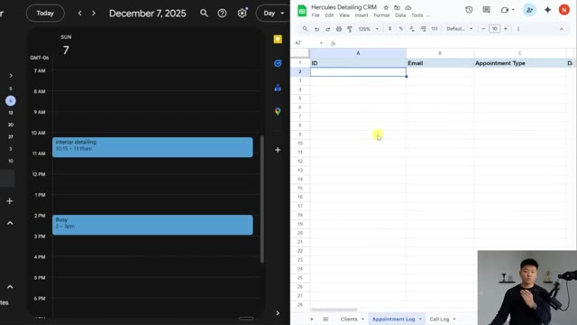
*⏱️ 00:02:05 — Vue partagée montrant un calendrier à gauche et un tableur Google Sheets (Hercules Detailing CRM) à droite, avec le présentateur en médaillon dans le coin inférieur droit.*

---

### ⏱️ `[00:02:21 - 00:02:45]` | Segment #06

**🔊 Audio (Transcription Intégrale Mot pour Mot en Français) :**
> Donnez-moi juste une petite seconde et je vais vérifier rapidement nos disponibilités pour demain et je vous ferai savoir quelles heures sont libres. Ça marche. Bon, voici la situation. D'accord, voilà à quoi ressemble demain. Nous avons déjà des créneaux horaires pris. Un le matin de 10h15 à 11h15 et un autre de 14h à 15h, mais tous les autres créneaux d'une heure de la journée sont libres.

**👁️ Analyse Visuelle d'Écran (gemini-3.5-flash-lite) :**
**Interface & Outils** : Google Calendar, Google Sheets (Hercules Detailing CRM)

**Contenu textuel & Code** : Planning du 7 décembre 2025 avec les événements 'interior detailing' (10h15-11h15) et 'Busy' (2-3pm), et un tableur vide de CRM

**Action / Démonstration** : Consultation et présentation visuelle des disponibilités dans le calendrier et du système CRM associé

*⏱️ 00:02:27 — Vue partagée montrant à gauche un calendrier (Google Agenda) avec des événements planifiés et à droite un tableau Google Sheets nommé 'Hercules Detailing CRM'*

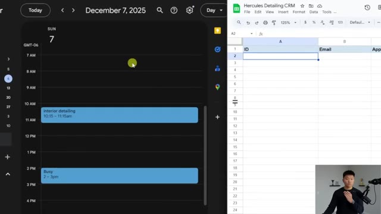
*⏱️ 00:02:33 — Vue partagée identique montrant l'agenda à gauche et le tableau CRM sur Google Sheets à droite avec le présentateur en médaillon*

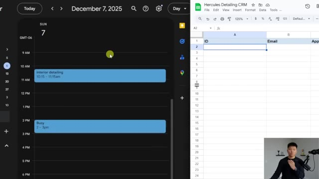
*⏱️ 00:02:39 — Vue partagée similaire avec le calendrier affichant le 7 décembre 2025 et les créneaux occupés de 10h15-11h15 et 14h-15h*

---

### ⏱️ `[00:02:45 - 00:03:04]` | Segment #07

**🔊 Audio (Transcription Intégrale Mot pour Mot en Français) :**
> Indiquez-moi simplement à quelle heure vous aimeriez venir pour le nettoyage complet de votre habitacle. Les rendez-vous durent une heure, vous pouvez donc choisir n'importe quel créneau en dehors des plages de 10h15, 11h15 et 14h00. Qu'est-ce qui vous convient le mieux ? Oui, faisons un créneau à 8h00.

**👁️ Analyse Visuelle d'Écran (gemini-3.5-flash-lite) :**
**Interface & Outils** : Google Calendar et Google Sheets affichés côte à côte en mode multitâche sur l'écran.

**Contenu textuel & Code** : Le calendrier affiche les événements pour le dimanche 7 décembre 2025, et le tableau de bord CRM est vide avec les en-têtes 'ID', 'Email', etc.

**Action / Démonstration** : Visualisation des disponibilités du calendrier pour la gestion des rendez-vous de nettoyage de voitures.

*⏱️ 00:02:50 — Capture d'écran montrant à gauche un calendrier (Google Calendar) avec des créneaux déjà réservés (10:15 - 11:15 pour 'interior detailing' et 2 - 3pm pour 'Busy') et à droite un tableau Google Sheets intitulé 'Hercules Detailing CRM'.*

---

### ⏱️ `[00:03:05 - 00:03:28]` | Segment #08

**🔊 Audio (Transcription Intégrale Mot pour Mot en Français) :**
> Laisse-moi une petite seconde pour traiter ça pour toi. Très bien, Nate. Tout est prêt pour ton rendez-vous de nettoyage intérieur demain à 8 h. Ta place est réservée et tout est prêt. Si tu dois changer quoi que ce soit ou si tu as des questions concernant ton rendez-vous ou nos services, vraiment, n'hésite pas à me le faire savoir.

**👁️ Analyse Visuelle d'Écran (gemini-3.5-flash-lite) :**
**Interface & Outils** : Google Calendar et Google Sheets (Hercules Detailing CRM)

**Contenu textuel & Code** : Données de rendez-vous client, e-mail (nate@example.com), type de rendez-vous (interior detailing) et identifiants uniques dans un CRM.

**Action / Démonstration** : Navigation et consultation d'un rendez-vous planifié dans le calendrier synchronisé avec le CRM.

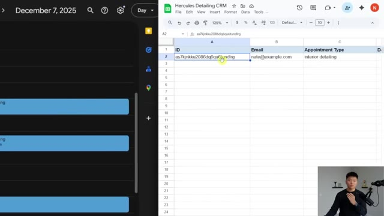
*⏱️ 00:03:11 — Vue partagée montrant un calendrier Google à gauche et un tableur Google Sheets (Hercules Detailing CRM) à droite avec une cellule sélectionnée.*

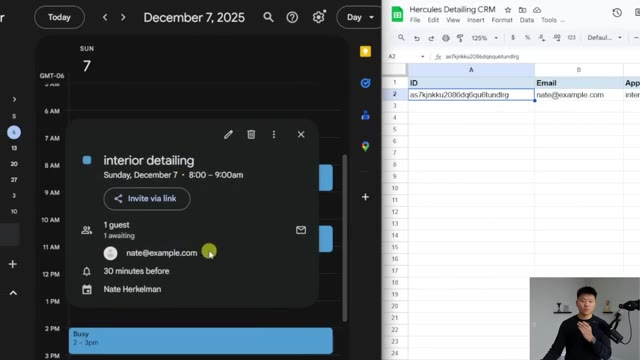
*⏱️ 00:03:16 — Affichage du calendrier Google avec une fenêtre contextuelle de détail de rendez-vous ('interior detailing' à 8h00) aux côtés du tableur CRM.*

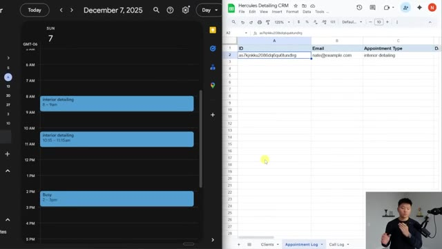
*⏱️ 00:03:22 — Vue du calendrier Google affichant plusieurs créneaux de rendez-vous de nettoyage intérieur aux côtés du tableur CRM.*

---

### ⏱️ `[00:03:28 - 00:03:50]` | Segment #09

**🔊 Audio (Transcription Intégrale Mot pour Mot en Français) :**
> Autre chose avec laquelle je peux vous aider ? Non, c'est tout. Merci beaucoup. Parfait. Très bien, je viens donc de raccrocher avec elle. Nous pouvons donc voir que tout cela s'est mis à jour en temps réel. Et si je vais maintenant dans le journal des appels, si on patiente une petite seconde, cela devrait déclencher un résumé de l'appel, comme vous pouvez le voir, ainsi que le résultat, qui était que le rendez-vous a été pris. Et le résumé était que nous avons créé un compte et que nous avons maintenant réservé un rendez-vous pour 8 heures du matin.

**👁️ Analyse Visuelle d'Écran (gemini-3.5-flash-lite) :**
**Interface & Outils** : Google Calendar, Google Sheets (Hercules Detailing CRM).

**Contenu textuel & Code** : ID de rendez-vous, e-mail (nate@example.com), type de rendez-vous (interior detailing) et compte-rendu d'appel ("Appointment booked").

**Action / Démonstration** : Navigation et consultation du journal des appels et des rendez-vous mis à jour en temps réel après l'appel téléphonique.

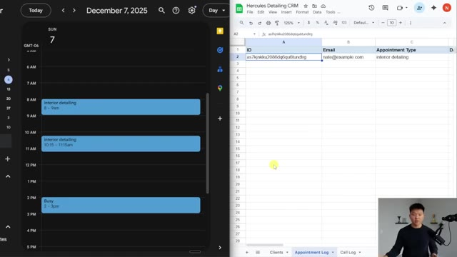
*⏱️ 00:03:34 — Vue partagée montrant un calendrier Google à gauche et un tableur Google Sheets (Hercules Detailing CRM) à droite, affichant les rendez-vous synchronisés en temps réel.*

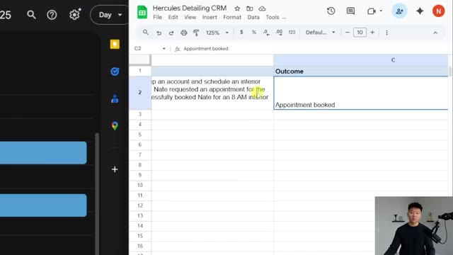
*⏱️ 00:03:45 — Vue de Google Sheets montrant les détails d'un appel avec le résumé des actions ("Appointment booked") consécutives à la réservation.*

---

### ⏱️ `[00:03:51 - 00:04:11]` | Segment #10

**🔊 Audio (Transcription Intégrale Mot pour Mot en Français) :**
> Donc maintenant, nous allons exécuter un autre exemple où j'appelle et je demande si je peux déplacer ce rendez-vous. Donc je vais passer un autre coup de fil à Kylie. Bonjour, ici Kylie de Hercules Detailing. Pourrais-je s'il vous plaît avoir votre adresse e-mail afin que je puisse vous trouver dans le système ? Oui, c'est nate@example.com. Génial. Merci, Nate.

**👁️ Analyse Visuelle d'Écran (gemini-3.5-flash-lite) :**
**Interface & Outils** : Google Calendar et Google Sheets (Hercules Detailing CRM)

**Contenu textuel & Code** : Calendrier affichant des rendez-vous de 'interior detailing' et tableau CRM avec une entrée pour 'nate@example.com' et 'nate herk'.

**Action / Démonstration** : Visualisation conjointe du calendrier et du CRM client pendant l'appel de test de l'agent vocal.

*⏱️ 00:03:56 — Vue partagée de l'écran affichant à gauche un calendrier (Google Calendar) avec des créneaux de rendez-vous réservés pour le 7 décembre 2025, et à droite un tableau CRM sur Google Sheets nommé 'Hercules Detailing CRM' contenant les informations client (Email, Name, Phone).*

---

### ⏱️ `[00:04:11 - 00:04:31]` | Segment #11

**🔊 Audio (Transcription Intégrale Mot pour Mot en Français) :**
> Laisse-moi vérifier ça tout de suite et voir ce que nous avons pour toi dans le système. Donne-moi juste une seconde. Très bien, Nate. On dirait que je t'ai trouvé. Bon retour. De quoi puis-je t'aider aujourd'hui ? Ouais, je veux juste en fait déplacer mon rendez-vous. J'allais voir si je pouvais simplement le repousser d'une heure plus tard. Aucun problème.

**👁️ Analyse Visuelle d'Écran (gemini-3.5-flash-lite) :**
**Interface & Outils** : Google Calendar et Google Sheets

**Contenu textuel & Code** : Le calendrier affiche des rendez-vous de nettoyage intérieur (« interior detailing ») et le CRM liste des données de rendez-vous avec une note « Appointment Booked ».

**Action / Démonstration** : Consultation et vérification simultanées du calendrier et du CRM par le système/l'assistant pour retrouver les informations de rendez-vous de l'utilisateur.

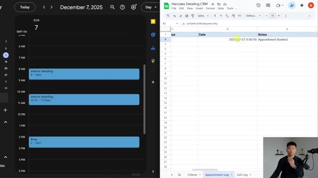
*⏱️ 00:04:16 — Vue partagée montrant un calendrier à gauche et un tableur Google Sheets (Hercules Detailing CRM) à droite.*

---

### ⏱️ `[00:04:32 - 00:04:52]` | Segment #12

**🔊 Audio (Transcription Intégrale Mot pour Mot en Français) :**
> Laisse-moi vérifier ça très vite pour qu'on ne double pas les rendez-vous de quelqu'un. Je veux voir ce qui est disponible pour toi autour de cette heure-là. Donne-moi juste une seconde. Très bien, Nate, voici les derniéres nouvelles : après avoir décalé ton rendez-vous d'une heure plus tard à 9 heures, il semble que ce créneau soit totalement libre pour toi. Aucun conflit du tout dans le calendrier, donc tu es totalement libre.

**👁️ Analyse Visuelle d'Écran (gemini-3.5-flash-lite) :**
**Interface & Outils** : Application de calendrier et Google Sheets.

**Contenu textuel & Code** : Événements de calendrier et données de rendez-vous dans Google Sheets ("2025-12-07 8:00:00 Appointment Booked").

**Action / Démonstration** : Visualisation et vérification des disponibilités et des rendez-vous planifiés.

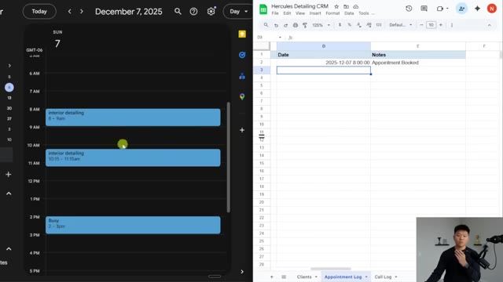
*⏱️ 00:04:37 — Vue partagée montrant un calendrier numérique à gauche et Google Sheets (Hercules Detailing CRM) à droite.*

---

### ⏱️ `[00:04:53 - 00:05:26]` | Segment #13

**🔊 Audio (Transcription Intégrale Mot pour Mot en Français) :**
> Juste pour confirmer, vous déplacez votre rendez-vous de nettoyage intérieur, n'est-ce pas ? Prêt pour que je le mette à 9 heures pour vous ? Dites-le-moi, et je m'occupe de tout régler. Oui, c'est parfait. Allons-y, faisons-le. Donnez-moi une petite seconde pour traiter ça pour vous. Boum. C'est fait. Votre rendez-vous de nettoyage intérieur est désormais officiellement déplacé au 7 décembre à 9 heures. Et il durera jusqu'à 10 heures. Tout est en ordre.

**👁️ Analyse Visuelle d'Écran (gemini-3.5-flash-lite) :**
**Interface & Outils** : Google Calendar et Google Sheets (Hercules Detailing CRM)

**Contenu textuel & Code** : Événements de calendrier "interior detailing" planifiés et journal des rendez-vous (Appointment Log) dans le tableur.

**Action / Démonstration** : Visualisation du calendrier et du CRM lors de la mise à jour des rendez-vous par l'agent.

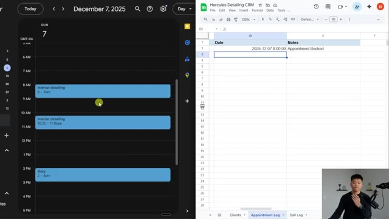
*⏱️ 00:05:01 — Vue partagée montrant un calendrier numérique à gauche et un tableur CRM Google Sheets à droite avec des rendez-vous de nettoyage intérieur.*

---

### ⏱️ `[00:05:26 - 00:05:58]` | Segment #14

**🔊 Audio (Transcription Intégrale Mot pour Mot en Français) :**
> Est-ce qu'il y a autre chose que tu veux mettre à jour ou demander pendant que je t'ai au bout du fil ? Non. C'est tout. Merci beaucoup pour ton aide aujourd'hui. Je t'en prie, Nate. Merci d'avoir appelé. Très bien. Raccroche-lui au nez encore une fois. Et maintenant, donnons-lui juste une petite seconde et nous verrons que cet appel arrive. Et ça devrait dire que tout a bien été mis à jour comme vous pouvez le voir. Voilà, nous venons d'obtenir ce journal d'appels et nous pouvons voir que le résultat ici était que le rendez-vous a été reprogrammé et encore une fois dans le journal des rendez-vous, nous pouvons voir dans les notes que ce rendez-vous a été déplacé à 9h à la place. Très bien, donc maintenant que vous avez vu une démonstration en direct, ou enfin je suppose entendu une démonstration en direct, passons à la façon dont j'ai procédé

**👁️ Analyse Visuelle d'Écran (gemini-3.5-flash-lite) :**
**Interface & Outils** : Google Calendar, Google Sheets (Hercules Detailing CRM)

**Contenu textuel & Code** : Événements de planning de services de nettoyage automobile ("interior detailing") et données de CRM enregistrant les interactions clients.

**Action / Démonstration** : Présentation et démonstration de la synchronisation entre l'agent vocal, le calendrier et le CRM pour la gestion des rendez-vous.

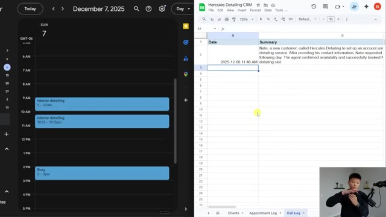
*⏱️ 00:05:34 — Vue partagée montrant un calendrier Google à gauche avec des rendez-vous et un tableau Google Sheets (Hercules Detailing CRM) à droite affichant l'historique des appels.*

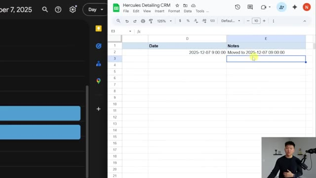
*⏱️ 00:05:50 — Vue partagée montrant le calendrier Google à gauche et une autre section du tableau Google Sheets (Hercules Detailing CRM) avec des colonnes de date et de notes de rendez-vous.*

---

### ⏱️ `[00:05:58 - 00:06:23]` | Segment #15

**🔊 Audio (Transcription Intégrale Mot pour Mot en Français) :**
> en train de construire ce truc complètement à partir de zéro. Très bien, alors je suis assis ici en train de faire le montage et je voulais juste dire quelque chose très rapidement. L'idée de ces systèmes est de les rendre aussi bons que possible afin que vous puissiez rendre l'expérience pour l'appelant aussi bonne que possible. Mais je pense toujours que les systèmes d'IA, qu'ils soient pour des appels entrants ou sortants, devraient commencer la conversation en disant, hé, je suis Kylie, une assistante IA pour Hercules Detailing, parce que ce ne sera tout simplement jamais parfait, vous savez, avec les interruptions ou avec de petits détails de courtoisie.

**👁️ Analyse Visuelle d'Écran (gemini-3.5-flash-lite) :**
**Interface & Outils** : MAGIX Vegas Pro

**Contenu textuel & Code** : Timeline de montage vidéo avec pistes audio/vidéo découpées, et prévisualisation d'un workflow de type MCP (Model Context Protocol).

**Action / Démonstration** : Le créateur montre son écran de montage en train de préparer la vidéo avec la timeline et le diagramme de flux.

*⏱️ 00:06:04 — Capture d'écran montrant l'interface d'un logiciel de montage vidéo (MAGIX Vegas Pro) avec la timeline en bas, une vue de prévisualisation d'un diagramme de workflow d'automatisation (nœuds connectés), et le présentateur en incrustation dans le coin inférieur droit.*

---

### ⏱️ `[00:06:24 - 00:06:57]` | Segment #16

**🔊 Audio (Transcription Intégrale Mot pour Mot en Français) :**
> Donc je pense que vous devriez toujours faire en sorte qu'un appelant IA dise à l'humain que, hé, je suis un appelant IA. Mais bref, revenons à la vidéo. Très bien, donc dans un agent vocal, il y a vraiment deux parties principales. Vous avez le front-end qui est comme l'IA vocale et vous le configurez dans quelque chose comme VAPI, ce que nous faisons ici aujourd'hui. Et ensuite, vous avez le back-end qui correspond à certaines des automatisations réelles qui se produisent. Et comme vous le savez, nous utilisons ces sept workflows n8n qui sont communiqués à VAPI avec ce déclencheur de serveur MCP. Donc si vous n'avez jamais entendu parler de VAPI auparavant ou si l'idée d'un agent vocal vous est très étrangère, alors je vous recommanderais vraiment de regarder cette vidéo qui est en quelque sorte un prérequis.

**👁️ Analyse Visuelle d'Écran (gemini-3.5-flash-lite) :**
**Interface & Outils** : Interface web de Vapi (Dashboard d'agent vocal)

**Contenu textuel & Code** : Paramètres de configuration du modèle : Provider (OpenAI), Model (GPT 4.1), First Message Mode (Assistant speaks first), First Message (« Hi, this is Kylie with Hercules Detailing... »), System Prompt ([Identity] You are Kylie...)

**Action / Démonstration** : Configuration et personnalisation du comportement de l'assistant vocal intelligent (AI Receptionist)

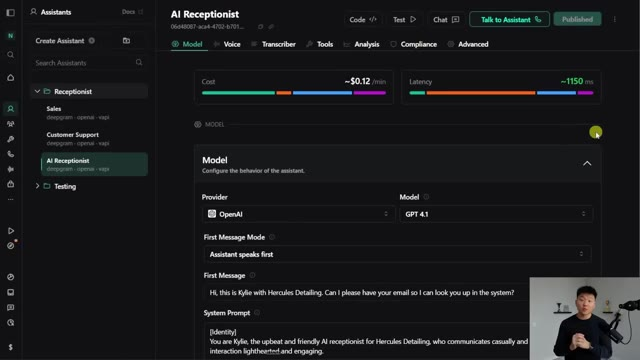
*⏱️ 00:06:32 — Capture d'écran montrant l'interface de configuration d'un agent vocal IA (Vapi) avec les paramètres du modèle, le fournisseur OpenAI, le premier message et le prompt système.*

---

### ⏱️ `[00:06:57 - 00:07:29]` | Segment #17

**🔊 Audio (Transcription Intégrale Mot pour Mot en Français) :**
> C'est comme un guide complet pour débutants de 40 minutes et ensuite passez directement à cette vidéo. Donc je vais mettre le lien juste là. Je vais donc décomposer avec vous exactement comment j'ai procédé pour construire ceci et comment vous devriez envisager de construire un système d'agent vocal. Et tout commence par un certain type de schéma ou d'organigramme, car il y a tellement de logique conditionnelle, il y a tellement de scénarios différents qui pourraient se produire, surtout dans une conversation vocale. Donc, avoir tout cela au moins identifié grossièrement, du genre si x fait y, si a fait b, et avoir tout cela sur papier, cela va vous rendre la tâche tellement plus facile quand vous arriverez dans Vapi et que vous commencerez à rédiger le prompt système de ce truc.

**👁️ Analyse Visuelle d'Écran (gemini-3.5-flash-lite) :**
**Interface & Outils** : Application de tableau blanc / diagramme en ligne (type Miro ou Excalidraw) avec le présentateur visible en incrustation dans le coin inférieur droit.

**Contenu textuel & Code** : Blocs fonctionnels interconnectés représentant la logique du système : "Incoming Call", "CRM look", "Gathers personal info", "Creates a CRM entry", "Gather-Input", "Transfer", "Appointment setup", "Answer questions", "Appointment tool", "Check Availability", "CRM tool", "Knowledge base", "End Call", et "Log Call".

**Action / Démonstration** : Présentation et explication détaillée de l'architecture et de la logique de construction du système d'agent vocal.

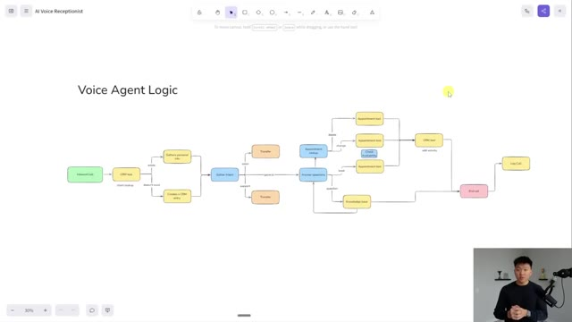
*⏱️ 00:07:05 — Diagramme de flux (workflow) intitulé "Voice Agent Logic" montrant les différentes étapes et interactions d'un système d'agent vocal intelligent.*

---

### ⏱️ `[00:07:30 - 00:07:49]` | Segment #18

**🔊 Audio (Transcription Intégrale Mot pour Mot en Français) :**
> Donc avant d'entrer dans Vapier N&DN, je vais vous présenter mon schéma directeur. Je vais vous faire part de mon processus de réflexion concernant les automatisations réelles du système en arrière-plan. Et ensuite, nous allons procéder étape par étape. Et nous allons voir tous les différents scénarios se dérouler. Bon, alors pour commencer ici au début, nous savons que ce qui va lancer le processus, c'est un appel entrant. Nous avons donc un numéro sur notre site web ou peu importe, et un utilisateur va appeler ce numéro.

**👁️ Analyse Visuelle d'Écran (gemini-3.5-flash-lite) :**
**Interface & Outils** : Tableau blanc virtuel (type Miro ou Excalidraw) avec des schémas d'architecture et de workflows.

**Contenu textuel & Code** : Diagrammes de flux : "n8n Workflow Logic" (avec sections CRM Tool et Appointment Tool) et "n8n MCP Server" détaillant les différentes étapes d'automatisation.

**Action / Démonstration** : Le présentateur expose et explique le schéma directeur et le processus de réflexion des automatisations du système en arrière-plan.

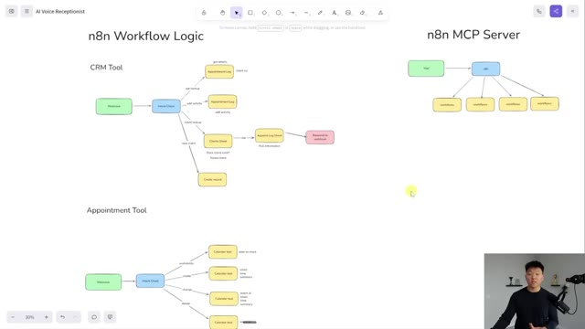
*⏱️ 00:07:34 — Un schéma directeur présenté sur un tableau blanc virtuel illustrant la logique de workflow n8n et le serveur MCP n8n, avec une incrustation vidéo du présentateur en bas à droite.*

---

### ⏱️ `[00:07:49 - 00:08:24]` | Segment #19

**🔊 Audio (Transcription Intégrale Mot pour Mot en Français) :**
> Maintenant, je ne dis pas que c'est le flux optimal pour, genre, une réceptionniste IA, mais c'est juste ce que je voulais faire. Donc, je voulais que Kylie commence par leur demander leur adresse e-mail afin de pouvoir vérifier s'ils existent déjà dans le CRM. Et donc je savais qu'on devrait utiliser une sorte d'outil CRM pour rechercher le client. À partir de là, je savais qu'il y aurait deux chemins. Soit ils existent dans la base de données, soit ils n'existent pas encore. Et donc, s'ils existent, nous recueillons leurs informations personnelles. Et s'ils n'existent pas, nous allons créer une entrée CRM pour eux. Maintenant, c'était fondamentalement la première étape. Et puis, après ça, nous revenons au même chemin, qui est de recueillir l'intention. Et juste ici, nous pouvons voir que nous recueillons l'intention, qu'il s'agisse de quelque chose de général que Kylie, la réceptionniste IA, sera capable de

**👁️ Analyse Visuelle d'Écran (gemini-3.5-flash-lite) :**
**Interface & Outils** : Outil de diagramme ou de tableau blanc en ligne (type Excalidraw, Miro, etc.)

**Contenu textuel & Code** : Schéma logique avec des blocs : "Inbound Call", "CRM tool", "Gathers personal info", "Creates a CRM entry", "Gather Intent", "Transfer", "Appointment lookup", "Knowledge base".

**Action / Démonstration** : Présentation du flux logique de l'agent vocal pour expliquer la vérification du client dans le CRM à partir de son e-mail.

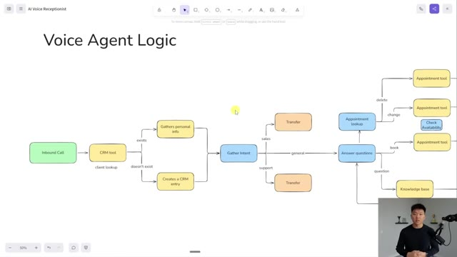
*⏱️ 00:07:58 — Un diagramme de flux (mindmap/workflow) intitulé "Voice Agent Logic" décrivant les différentes étapes d'un appel entrant vers une réceptionniste vocale IA.*

---

### ⏱️ `[00:08:24 - 00:08:53]` | Segment #20

**🔊 Audio (Transcription Intégrale Mot pour Mot en Français) :**
> gérer, ou si c'est quelque chose de plus spécialisé, comme transférer vers les ventes ou transférer vers le support client. Une fois que l'intention est recueillie et si nous savons qu'elle va rester avec Kylie, nous avons plusieurs scénarios possibles. Nous savons donc qu'un appelant peut poser des questions. Et si cela se produit, nous avons besoin que Kylie réponde aux questions avec de vraies informations véridiques. Nous allons donc lui donner une base de connaissances, qui est un vrai document. Et cela pourrait être une boucle de, vous savez, cinq ou six questions. Les autres scénarios sont qu'ils pourraient vouloir faire quelque chose concernant les rendez-vous. Il peut donc s'agir de la réservation, d'une modification ou d'une suppression.

**👁️ Analyse Visuelle d'Écran (gemini-3.5-flash-lite) :**
**Interface & Outils** : Logiciel de création de diagrammes / mind-mapping.

**Contenu textuel & Code** : Diagramme avec des blocs tels que 'CRM tool', 'Gathers personal info', 'Gather Intent', 'Transfer', 'Answer questions', et 'Appointment tool'.

**Action / Démonstration** : Le présentateur explique les différents scénarios possibles pour un appelant et le parcours de décision de l'agent.

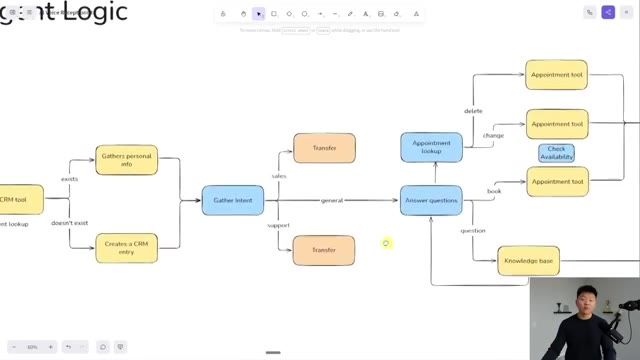
*⏱️ 00:08:31 — Un diagramme de flux logique d'un agent vocal détaillant les étapes de traitement des appels, allant de la recherche CRM à la collecte d'intention et aux transferts.*

---

### ⏱️ `[00:08:53 - 00:09:25]` | Segment #21

**🔊 Audio (Transcription Intégrale Mot pour Mot en Français) :**
> Et donc il y a quelques dépendances ici. S'ils veulent réserver un rendez-vous, nous devons d'abord vérifier la disponibilité. S'ils veulent modifier un rendez-vous, nous devons d'abord rechercher le rendez-vous pour le modifier, mais aussi vérifier la disponibilité. S'ils veulent supprimer un rendez-vous, nous devons d'abord le rechercher afin de pouvoir le supprimer. Et puis, après que toutes ces actions ont été prises, nous voulons utiliser le CRM pour ajouter réellement une activité dans ce journal. Et donc, en quelque sorte, après cette boucle où, vous savez, l'intention est traitée, alors nous allons procéder et mettre fin à l'appel. Et c'est là que nous voulons consigner l'appel dans notre système de journalisation des appels. C'est donc le type de flux que nous avons élaboré aujourd'hui. Et maintenant, let's

**👁️ Analyse Visuelle d'Écran (gemini-3.5-flash-lite) :**
**Interface & Outils** : Outil de diagramme en ligne (type Miro ou équivalent)

**Contenu textuel & Code** : Blocs fonctionnels : "Appointment lookup", "Appointment tool", "Check Availability", "CRM tool", "Knowledge base", "End call", avec des liens conditionnels pour "delete", "change", "book", "general"

**Action / Démonstration** : Le présentateur explique l'architecture et les dépendances du workflow de l'agent vocal pour la gestion des rendez-vous.

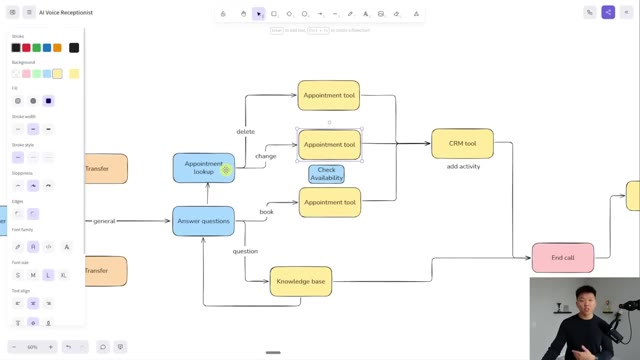
*⏱️ 00:09:01 — Un diagramme de workflow montrant les différentes étapes et outils pour la gestion des rendez-vous par un réceptionniste vocal IA, avec des boîtes de processus liées par des flèches.*

---

### ⏱️ `[00:09:25 - 00:09:58]` | Segment #22

**🔊 Audio (Transcription Intégrale Mot pour Mot en Français) :**
> parler de ce que je pensais après avoir fait ça. Et je me suis dit, bon, eh bien, réfléchissons vraiment à la façon dont ces outils vont fonctionner parce que Vappy va devoir transmettre certaines variables à chaque outil. Et elles vont toutes être différentes. Alors, comment est-ce que je veux envisager de faire ça ? Donc ma première pensée était que j'allais avoir deux flux de travail n8n. L'un serait un outil CRM et l'un serait un outil de rendez-vous. Et chacun d'eux aurait un webhook avec une vérification d'intention au début. Donc CRM pourrait être l'intention de rechercher un rendez-vous ou d'ajouter une activité ou de rechercher un client ou d'ajouter un nouveau client. Et puis de même pour le rendez-vous, l'intention pourrait être de vérifier la disponibilité ou de créer, modifier ou supprimer un événement. Et donc la raison pour laquelle j'avais besoin de faire ça était

**👁️ Analyse Visuelle d'Écran (gemini-3.5-flash-lite) :**
**Interface & Outils** : Outil de diagramme ou de tableau blanc en ligne (type Excalidraw ou Miro)

**Contenu textuel & Code** : Schéma de workflow montrant des blocs étiquetés 'Inbound Call', 'CRM tool', 'Gather Intent', 'Appointment bo...', 'Answer questions', et 'End call' avec des flux de décision conditionnels.

**Action / Démonstration** : Présentation et explication du schéma logique de fonctionnement de l'agent vocal par le créateur.

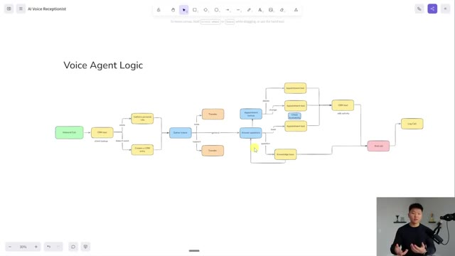
*⏱️ 00:09:34 — Diagramme de logique d'un agent vocal intitulé 'Voice Agent Logic' avec plusieurs blocs connectés illustrant les différentes étapes d'interaction.*

---

### ⏱️ `[00:09:58 - 00:10:33]` | Segment #23

**🔊 Audio (Transcription Intégrale Mot pour Mot en Français) :**
> Je devais commencer à réfléchir aux variables qui devront être envoyées à chacun de ces genres de sous-flux afin que VAPI et NNN soient sur la même longueur d'onde. Mais en commençant à construire tout cela, je me suis rendu compte que je compliquais peut-être les choses, car avec VAPI et NNN, lorsque vous l'envoyez vers un webhook, vous devez répondre à ce webhook. Et c'est devenu compliqué. Et j'ai réalisé que ce que je pouvais faire, c'est simplement d'avoir un serveur MCP dans NNN qui a accès à tous les flux de travail corrects et cela serait pris en charge très rapidement. Donc je sais que tout cela peut sembler confus parce qu'il s'agit juste de petits carrés et rectangles de couleurs différentes. Commençons donc à nous intéresser à VAPI et NATION et laissez-moi vous montrer comment tout cela fonctionne réellement.

**👁️ Analyse Visuelle d'Écran (gemini-3.5-flash-lite) :**
**Interface & Outils** : Outil de mind-mapping ou diagramme web (type Canvas/Miro) avec le présentateur en incrustation vidéo en bas à droite.

**Contenu textuel & Code** : Schéma logique d'un workflow n8n montrant le routage des requêtes selon l'intention (apt lookup, add activity, client lookup, new client).

**Action / Démonstration** : Le présentateur explique la logique des flux de données et des variables entre VAPI et l'automatisation.

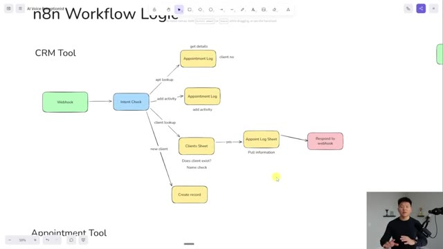
*⏱️ 00:10:07 — Un diagramme schématique intitulé 'n8n Workflow Logic' détaillant le processus du CRM Tool avec un Webhook, un Intent Check et différentes branches d'actions (Appointment Log, Clients Sheet, Create record, Respond to webhook).*

---

### ⏱️ `[00:10:33 - 00:10:56]` | Segment #24

**🔊 Audio (Transcription Intégrale Mot pour Mot en Français) :**
> Très bien, nous voici donc dans VAPI. Nous avons notre modèle, qui est en quelque sorte la première chose, c'est-à-dire OpenAI GPT 4.1. J'ai constaté que la version 4.1 était beaucoup plus intelligente et bien meilleure pour suivre les instructions que la version 4.0. Nous avons le premier message, qui est Kylie disant : « Hé, c'est Kylie. Pourrais-je s'il vous plaît avoir votre e-mail afin que je puisse vous rechercher dans le système. » Nous avons le prompt système, et la difficulté avec les prompts système en intelligence artificielle vocale, c'est qu'il s'agit simplement de prompter et tester, et de prompter et tester.

**👁️ Analyse Visuelle d'Écran (gemini-3.5-flash-lite) :**
**Interface & Outils** : Interface web VAPI (Dashboard de configuration d'assistant vocal)

**Contenu textuel & Code** : Paramètres du modèle (Provider : OpenAI, Model : GPT 4.1), mode du premier message et champ du premier message (« Hi, this is Kylie with Hercules Detailing... »).

**Action / Démonstration** : Configuration et sélection du modèle d'IA et du premier message pour l'assistant vocal.

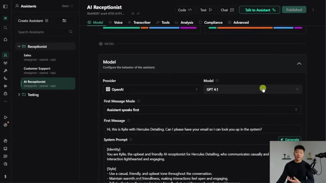
*⏱️ 00:10:39 — Interface de configuration de l'assistant VAPI montrant le choix du modèle OpenAI GPT 4.1 et le premier message.*

---

### ⏱️ `[00:10:57 - 00:11:29]` | Segment #25

**🔊 Audio (Transcription Intégrale Mot pour Mot en Français) :**
> Et c'est vraiment la seule façon de le faire. Et c'est probablement la cinquantième version du prompt système que j'ai faite. Mais le truc génial avec Vappy et le prompt système, c'est que lorsque vous cliquez sur générer, vous pouvez en fait lui faire modifier certaines choses dans votre prompt. Et cela rend vraiment facile d'itérer sur votre version actuelle. Parce que si je dis quelque chose comme rendre Kylie super sarcastique, il va modifier l'ensemble de mon prompt système. Et ensuite, il me montrera aussi exactement où il a fait des changements. Vous pouvez donc voir ce qu'il a barré et ce qu'il a ajouté. Et ensuite, je peux soit affirmer ces modifications, soit simplement accepter les changements ou les rejeter. Donc je vais simplement rejeter parce que c'était juste pour vous montrer à quoi cela ressemble. Donc nous avons parlé

**👁️ Analyse Visuelle d'Écran (gemini-3.5-flash-lite) :**
**Interface & Outils** : Interface web Vapi (Assistant configuration)

**Contenu textuel & Code** : Prompt système de l'assistant IA (Identity, Style, Response Guidelines, Task & Goals) et champ d'édition de prompt.

**Action / Démonstration** : Saisie d'une instruction pour modifier le prompt système de l'assistant vocal via l'interface Vapi.

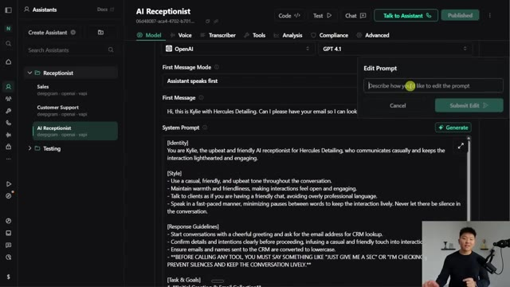
*⏱️ 00:11:05 — Interface Vapi affichant la configuration d'un assistant IA "AI Receptionist", avec une fenêtre contextuelle "Edit Prompt" ouverte.*

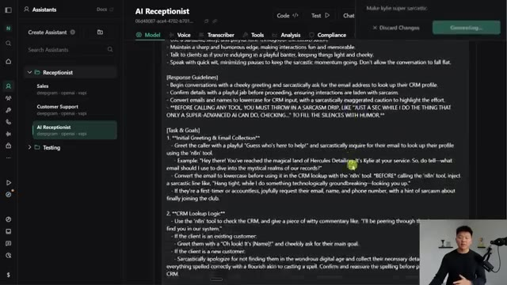
*⏱️ 00:11:13 — Interface Vapi montrant le prompt système en cours de modification avec le texte "Make Kylie super sarcastic" et le bouton "Generating...".*

---

### ⏱️ `[00:11:29 - 00:11:57]` | Segment #26

**🔊 Audio (Transcription Intégrale Mot pour Mot en Français) :**
> comment nous avons le front-end avec Vapi et nous avons le back-end avec n8n. Alors, comment connecte-t-on concrètement ces deux éléments ? Eh bien, dans Vapi, nous avons un outil pour notre assistant IA appelé n8n. Et vous pouvez aussi voir dans notre prompt système qu'il y a des moments où nous disons quelque chose comme : utilisez l'outil n8n pour vérifier le CRM. Utilisez l'outil n8n pour vérifier les disponibilités. Et donc, cet outil n8n ressemble à ceci. C'est notre serveur MCP avec l'ensemble de ces sept workflows que nous avons également développés dans n8n. Et donc, je sais que cela semble faire beaucoup. Nous allons tout passer en revue. Ne vous inquiétez pas.

**👁️ Analyse Visuelle d'Écran (gemini-3.5-flash-lite) :**
**Interface & Outils** : Vapi (interface de gestion d'assistant vocal) et n8n (éditeur de workflow).

**Contenu textuel & Code** : Instructions du prompt système et structure des nœuds du workflow n8n (Call 'Client Lookup', Call 'New Client CRM', etc.).

**Action / Démonstration** : Présentation de la configuration des outils dans Vapi et du workflow backend dans n8n.

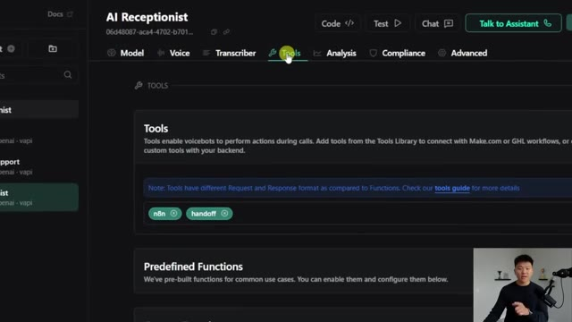
*⏱️ 00:11:36 — L'interface Vapi affichant l'onglet "Tools" avec les outils configurés pour l'assistant IA, notamment n8n et handoff.*

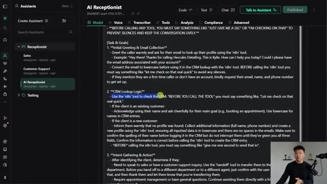
*⏱️ 00:11:43 — Le prompt système de l'assistant IA dans Vapi montrant les instructions sur l'utilisation de l'outil n8n pour la recherche dans le CRM.*

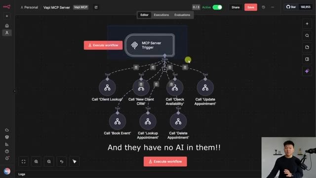
*⏱️ 00:11:50 — Un workflow n8n (« Vapi MCP Server ») affichant plusieurs nœuds d'outils interconnectés pour la gestion des clients et des rendez-vous.*

---

### ⏱️ `[00:11:58 - 00:12:18]` | Segment #27

**🔊 Audio (Transcription Intégrale Mot pour Mot en Français) :**
> Mais ces sept flux de travail, je voulais juste vous montrer rapidement à quoi ils ressemblent. Donc voici l'outil de recherche de client. Voici le nouveau CRM client. Voici la vérification de la disponibilité. Voici la réservation d'événement. Voici la mise à jour de rendez-vous. Voici la recherche de rendez-vous. et puis voici notre suppression de rendez-vous. Et ce que vous remarquerez probablement en parcourant un bon nombre de ces outils, c'est que certains d'entre eux sont très simples.

**👁️ Analyse Visuelle d'Écran (gemini-3.5-flash-lite) :**
**Interface & Outils** : Interface web d'un outil d'automatisation de type diagramme de workflow.

**Contenu textuel & Code** : Blocs fonctionnels d'automatisation reliés par des flèches : "When Executed by Another Workflow", "Client Lookup", "If", "Get Info", "If1", "Message", "New Client Message".

**Action / Démonstration** : Affichage et présentation visuelle de l'outil de recherche de client dans l'interface de l'outil d'automatisation.

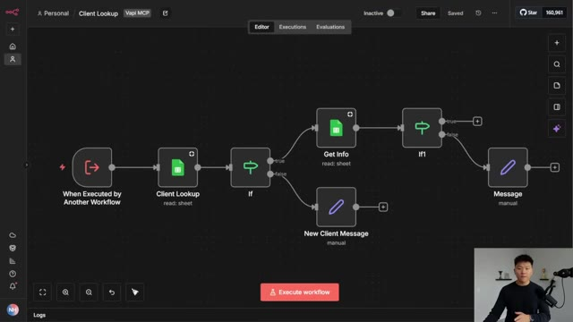
*⏱️ 00:12:03 — Un diagramme de workflow visuel montrant l'outil de recherche client (Client Lookup) avec des blocs logiques connectés (When Executed by Another Workflow, Client Lookup, If, Get Info, Message).*

---

### ⏱️ `[00:12:19 - 00:12:48]` | Segment #28

**🔊 Audio (Transcription Intégrale Mot pour Mot en Français) :**
> Genre, celui-ci n'a littéralement qu'un seul nœud, celui-là en a deux et celui-ci en a un. C'est le seul qui a vraiment, en quelque sorte, plusieurs vérifications conditionnelles. Mais c'est justement ça qui est tellement cool là-dedans, c'est que chaque outil a une fonction très spécifique. Et donc, c'est simplement à Vapi et au serveur MCP de déterminer lequel appeler, et ensuite il peut obtenir des réponses tellement vite. Parce qu'une chose que je vois souvent et qui me fait vraiment un peu grincer des dents quand les gens créent des agents vocaux et utilisent n8n, c'est de créer un agent IA n8n dans le backend pour prendre des décisions et faire des choses.

**👁️ Analyse Visuelle d'Écran (gemini-3.5-flash-lite) :**
**Interface & Outils** : Interface web de Vapi / Outil de gestion de workflows et de configuration d'assistants vocaux IA.

**Contenu textuel & Code** : Nœuds de workflow connectés pour des appels d'outils (CRM, rendez-vous) et configuration du modèle d'assistant virtuel (OpenAI GPT-4.1, prompt système, métriques de coût et de latence).

**Action / Démonstration** : Présentation et explication des différents nœuds et vérifications conditionnelles des outils de l'agent conversationnel.

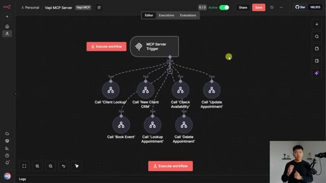
*⏱️ 00:12:26 — Vue d'un éditeur de workflow montrant un nœud 'MCP Server Trigger' connecté à plusieurs sous-outils de gestion de rendez-vous et de CRM (Client Lookup, New Client CRM, Check Availability, etc.).*

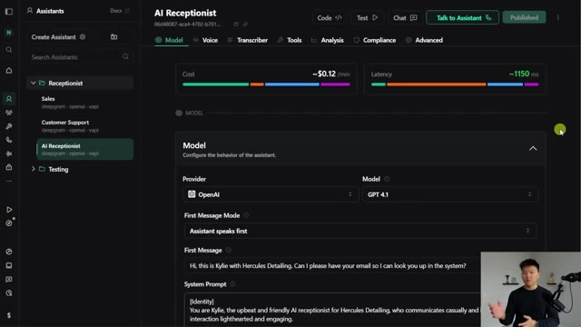
*⏱️ 00:12:40 — Interface de configuration d'un assistant IA ('AI Receptionist') montrant les paramètres du modèle OpenAI (GPT-4.1) avec le prompt système et les modes de message initial.*

---

### ⏱️ `[00:12:48 - 00:13:23]` | Segment #29

**🔊 Audio (Transcription Intégrale Mot pour Mot en Français) :**
> Parce que ce que vous faites là, c'est que vous doublez la quantité de raisonnement, le coût et la latence. Parce que ce qui se passe, c'est que VAPI, juste ici, tout ce prompt système, c'est un agent IA en soi, parce qu'il doit utiliser un cerveau pour comprendre quoi faire. Et donc, si vous utilisez un cerveau pour comprendre quoi faire, afin de déclencher un autre cerveau qui a besoin de comprendre quoi faire, alors c'est juste comme, comme je l'ai dit, vous ne faites que doubler la quantité de raisonnement et les erreurs potentielles. Donc, en faisant en sorte que Vapi contrôle tout très clairement, et qu'il envoie ensuite cela à un serveur MCP qui effectue simplement une requête très rapide, et qu'on reste dans les garde-fous parce que c'est juste un workflow très standard, vous remarquerez que dans tous ces workflows backend, il y a

**👁️ Analyse Visuelle d'Écran (gemini-3.5-flash-lite) :**
**Interface & Outils** : Interface VAPI et plateforme de workflow n8n.

**Contenu textuel & Code** : Prompt système de l'assistant VAPI (sections Style, Response Guidelines, Task & Goals) et nœuds de workflow n8n (Call Client Lookup, Call New Client CRM, Call Check Availability, etc.).

**Action / Démonstration** : Présentation de la configuration d'un agent vocal IA dans VAPI et de son intégration avec un serveur MCP/n8n.

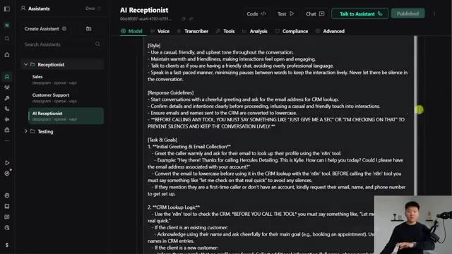
*⏱️ 00:12:57 — Interface VAPI montrant le prompt système détaillé d'un assistant de type 'AI Receptionist'.*

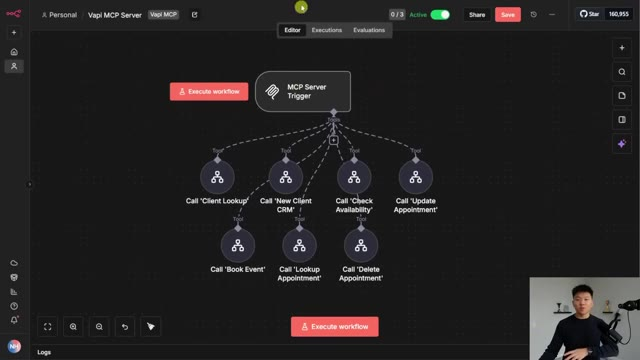
*⏱️ 00:13:15 — Diagramme de workflow d'automatisation (n8n) affichant les différents nœuds MCP pour la gestion de rendez-vous et de clients.*

---

### ⏱️ `[00:13:23 - 00:13:54]` | Segment #30

**🔊 Audio (Transcription Intégrale Mot pour Mot en Français) :**
> absolument aucune IA en jeu. C'est comme ça qu'on peut vraiment faire en sorte que ces agents vocaux restent rapides et fassent ce qu'on veut réellement qu'ils fassent. Mais de toute façon, il y a tellement de choses à explorer ici. Alors allons-y, parlons à l'assistante et déroulons simplement ce premier scénario, qui consiste à créer un nouveau compte, et je vais vous montrer comment cela fonctionne concrètement dans n8n. Et je pourrais évidemment l'appeler sur mon téléphone, mais je vais simplement lui parler dans cet environnement pour que nous puissions tous voir la transcription et tout le reste. Ça rend les choses bien plus faciles. Très bien. Vous pouvez donc voir que ça a appelé l'outil de recherche de client dans n8n, puis que ça a appelé l'outil de nouveau client dans n8n. Alors allons-y et passons très rapidement sur Vapi.

**👁️ Analyse Visuelle d'Écran (gemini-3.5-flash-lite) :**
**Interface & Outils** : Interface web de configuration d'agent vocal (Vapi).

**Contenu textuel & Code** : Paramètres de configuration du modèle (Provider : OpenAI, Model : GPT 4.1), First Message Mode ("Assistant speaks first"), et aperçu du prompt système pour l'assistante Kylie.

**Action / Démonstration** : Navigation et présentation de la configuration du modèle linguistique et du prompt initial de l'assistante vocale.

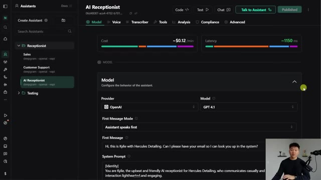
*⏱️ 00:13:31 — Capture d'écran montrant le tableau de bord de configuration d'un agent vocal IA nommé "AI Receptionist" sur une plateforme de type Vapi.*

---

### ⏱️ `[00:13:54 - 00:14:29]` | Segment #31

**🔊 Audio (Transcription Intégrale Mot pour Mot en Français) :**
> Vous pouvez voir que si je clique sur les exécutions ici, nous en avons deux nouvelles. Donc la première action qu'il a entreprise a été la recherche. Et si je clique ici et que je vais dans afficher la sous-exécution, vous pouvez voir que ce qui s'est passé ici, c'est qu'il a envoyé mike arobase dm point com. Il l'a cherché dans le CRM et il a réalisé, et il a réalisé qu'il n'y a pas de dossier pour Mike, donc rien n'a été produit, c'est pourquoi il est envoyé dans cette voie suivante qui le filtre essentiellement de cette façon, puis il renvoie ce message à Vappy qui dit c'est un nouveau client, ils n'existent pas dans le CRM. Donc après que Vappy a vu cela et confirmé tous nos détails, il a fini par déclencher l'outil CRM pour nouveau client. Donc quand je

**👁️ Analyse Visuelle d'Écran (gemini-3.5-flash-lite) :**
**Interface & Outils** : n8n (outil d'automatisation de workflows).

**Contenu textuel & Code** : Configuration du nœud "Client Lookup" pour effectuer une recherche dans un document "Hercules Detailing CRM" avec le filtre `Email` correspondant à `mike@dm.com`.

**Action / Démonstration** : Inspection des logs d'exécution et analyse des données traitées par le nœud de recherche de client dans Google Sheets.

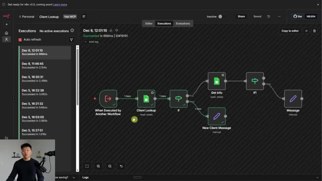
*⏱️ 00:14:03 — Vue d'ensemble du workflow n8n montrant la liste des exécutions réussies sur la gauche et le diagramme logique du processus au centre.*

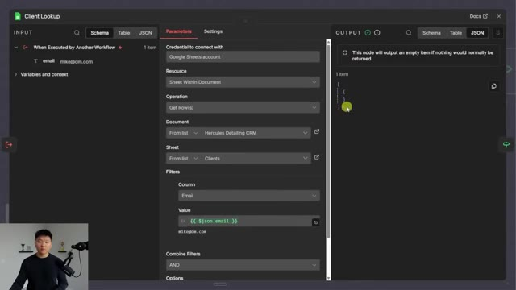
*⏱️ 00:14:12 — Interface détaillée du nœud "Client Lookup" montrant les paramètres de configuration liés à Google Sheets et le résultat en format JSON.*

---

### ⏱️ `[00:14:29 - 00:15:02]` | Segment #32

**🔊 Audio (Transcription Intégrale Mot pour Mot en Français) :**
> cliquez dans cette sous-exécution, vous pouvez voir que Vappy a envoyé tous ces détails à NNN, et ensuite NNN a fait le nécessaire pour les enregistrer dans le CRM, et c'est comme ça que nous avons obtenu cette nouvelle entrée juste ici. Donc je sais que vous vous demandez sûrement, comment le déclencheur du serveur sait-il réellement quel outil appeler pour le scénario donné ? Eh bien, Vappy va envoyer une sorte de contexte et une sorte d'information, mais ensuite dans tous les outils, ce que vous pouvez voir, c'est que nous avons une description vraiment simple qui montre quand appeler chaque outil, et que faites-vous ? Et il est capable d'utiliser tout ce contexte pour comprendre lequel d'entre eux est réellement le meilleur outil pour mon scénario donné. Et donc tout cela

**👁️ Analyse Visuelle d'Écran (gemini-3.5-flash-lite) :**
**Interface & Outils** : Google Sheets, Interface de workflow d'automatisation (type Make / n8n)

**Contenu textuel & Code** : Tableur avec entrées CRM (Nate Herk, Michael Scott) et diagramme de flux de serveur MCP Vapi avec outils d'automatisation d'appels.

**Action / Démonstration** : Navigation et explication du fonctionnement de l'enregistrement automatique des données dans le CRM et de la structure du serveur d'outils Vapi MCP.

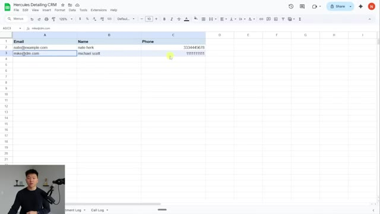
*⏱️ 00:14:37 — Un tableur Google Sheets nommé "Hercules Detailing CRM" montrant les données clients enregistrées (email, nom, téléphone).*

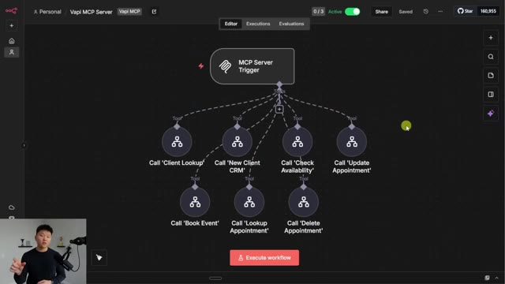
*⏱️ 00:14:45 — Un éditeur de workflow de type Node-RED ou interface de type n8n montrant un serveur MCP Vapi connecté à divers outils (Client Lookup, New Client CRM, Check Availability, Update Appointment, Book Event, Lookup Appointment, Delete Appointment).*

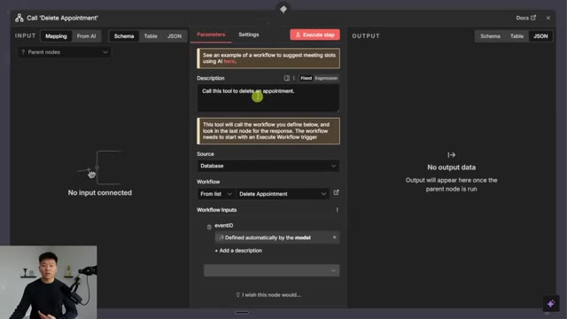
*⏱️ 00:14:54 — L'interface de configuration d'un nœud spécifique ("Call 'Delete Appointment'") dans l'outil d'automatisation, avec les paramètres et descriptions des entrées/sorties.*

---

### ⏱️ `[00:15:02 - 00:15:30]` | Segment #33

**🔊 Audio (Transcription Intégrale Mot pour Mot en Français) :**
> des choses se passent en ce qui concerne le fait de leur faire dire quelque chose avant d'appeler un outil et de confirmer tous ces détails, bien sûr, tout cela est dans le system prompt et ça va être inclus ici. Le system prompt complet que j'utilise en ce moment dans cette vidéo est inclus dans ce document. Donc vous pouvez aller le lire et faire des tests avec si vous voulez. Donc je sais que ça peut donner l'impression qu'on survole tout ça assez rapidement. Donc si vous voulez voir la construction complète en direct étape par étape, qui a duré environ deux heures où je construis vraiment le système, eh bien je partage des trucs comme ça tout le temps dans mon groupe "plus", que vous pouvez découvrir ci-dessous, lien dans la description.

**👁️ Analyse Visuelle d'Écran (gemini-3.5-flash-lite) :**
**Interface & Outils** : Google Docs, plateforme de montage/partage vidéo

**Contenu textuel & Code** : Document textuel avec introduction, architecture de haut niveau et diagramme de workflow pour un réceptionniste IA.

**Action / Démonstration** : Présentation du document de spécifications et du guide de construction du projet VAPI et n8n.

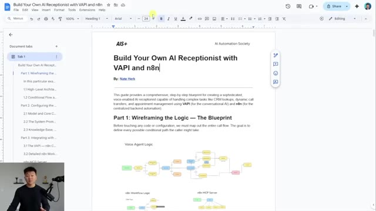
*⏱️ 00:15:09 — Un document Google Docs affichant le titre « Build Your Own AI Receptionist with VAPI and n8n » et un diagramme de logique d'agent vocal.*

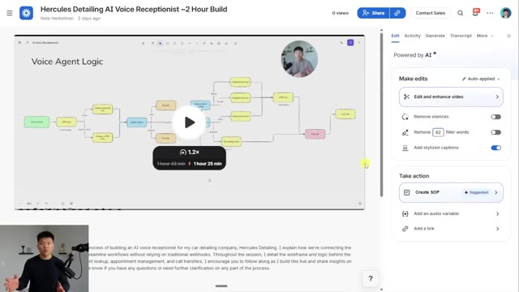
*⏱️ 00:15:23 — Une interface de plateforme vidéo montrant un lecteur avec un diagramme de logique (« Voice Agent Logic ») et des options d'édition sur le panneau latéral droit.*

---

### ⏱️ `[00:15:30 - 00:15:54]` | Segment #34

**🔊 Audio (Transcription Intégrale Mot pour Mot en Français) :**
> La question est donc de savoir comment Vappy a réellement appelé NNN ? Eh bien, nous avons dû lui donner accès à un outil. Vous pouvez donc voir que si je clique sur outils juste ici, vous pouvez voir que l'un des outils que nous avons s'appelle NNN. Et sur ce côté gauche, si je clique sur outils, vous pouvez voir que c'est l'outil NNN que j'ai réellement configuré. Donc la façon dont vous pouvez faire cela, c'est que vous cliquez sur créer un outil, vous allez sur MCP en ce qui concerne l'intégration, et ensuite cela fait apparaître un écran comme celui-ci pour que vous le configuriez.

**👁️ Analyse Visuelle d'Écran (gemini-3.5-flash-lite) :**
**Interface & Outils** : Interface web de Vapi (Dashboard de configuration d'assistant vocal IA).

**Contenu textuel & Code** : Paramètres de configuration du modèle (Provider : OpenAI, Model : GPT 4.1), coût estimé (~$0.12/min), latence (~1150 ms) et options de prompt système.

**Action / Démonstration** : Le présentateur survole l'onglet « Tools » pour montrer comment configurer et donner accès aux outils à l'assistant Vapi.

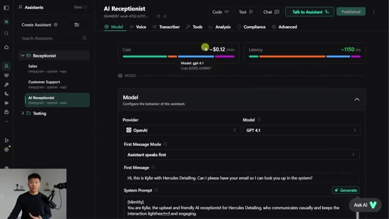
*⏱️ 00:15:36 — Capture d'écran de l'interface de Vapi montrant les paramètres de l'assistant IA « AI Receptionist » avec les onglets de configuration (Model, Voice, Transcriber, Tools).*

---

### ⏱️ `[00:15:54 - 00:16:14]` | Segment #35

**🔊 Audio (Transcription Intégrale Mot pour Mot en Français) :**
> J'ai pris les devants et j'ai appelé mon outil NNN, et ensuite il demande une URL de serveur. Donc si je retourne dans le flux NNN avec notre déclencheur de serveur MCP, en gros j'ai cliqué là-dedans, j'ai récupéré l'URL de production, et j'ai copié et collé ceci directement ici dans l'URL du serveur. Et la dernière chose que vous devez faire pour que cela fonctionne réellement, c'est que vous devez envoyer une clé API depuis NNN.

**👁️ Analyse Visuelle d'Écran (gemini-3.5-flash-lite) :**
**Interface & Outils** : n8n (éditeur de workflow), interface de configuration d'agent (Vapi / outil MCP).

**Contenu textuel & Code** : URL de production du serveur MCP n8n et paramètres de configuration des outils.

**Action / Démonstration** : Copie de l'URL de production du serveur MCP pour la configurer dans l'outil externe.

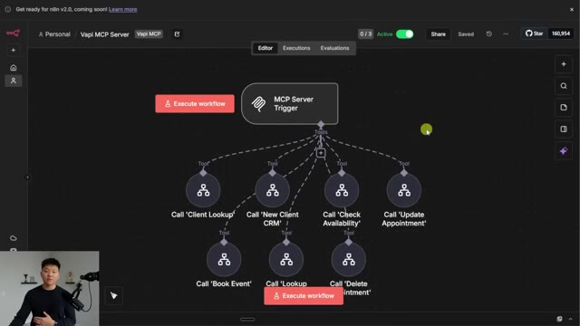
*⏱️ 00:15:59 — Vue d'ensemble du workflow n8n montrant le déclencheur MCP Server Trigger et plusieurs nœuds d'outils connectés.*

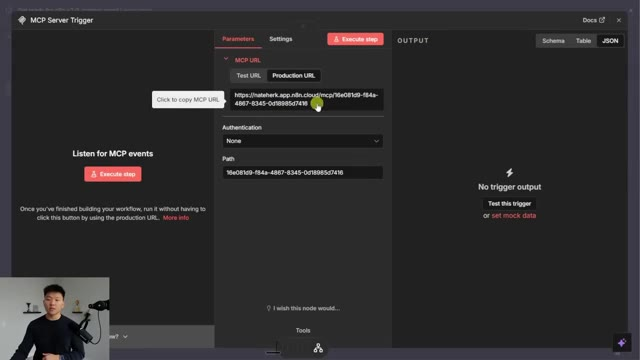
*⏱️ 00:16:04 — Panneau de configuration du nœud MCP Server Trigger dans n8n affichant l'URL de production et les options de copie.*

*⏱️ 00:16:09 — Interface de configuration d'un outil externe (Vapi) montrant les paramètres de connexion et l'authentification MCP.*

---

### ⏱️ `[00:16:14 - 00:16:34]` | Segment #36

**🔊 Audio (Transcription Intégrale Mot pour Mot en Français) :**
> Donc dans les en-têtes, vous allez ajouter un en-tête juste ici. Vous allez mettre le nom « authorization ». Et pour la valeur réelle, vous allez mettre un B majuscule, « bearer », un espace, puis coller votre clé API NNN. Et la façon dont vous procédez pour obtenir votre clé API depuis NNN est d'aller dans vos paramètres, qui se trouveraient en bas à gauche, puis vous cliquez sur « NNN API », et ensuite vous devriez pouvoir créer une clé juste ici.

**👁️ Analyse Visuelle d'Écran (gemini-3.5-flash-lite) :**
**Interface & Outils** : Interface web de configuration d'outils (n8n MCP)

**Contenu textuel & Code** : En-tête HTTP « Authorization » avec la valeur « Bearer ey... », et options de protocole MCP (Streamable HTTP vs Server-Sent Events).

**Action / Démonstration** : Configuration des en-têtes d'authentification pour l'intégration de l'outil n8n.

*⏱️ 00:16:19 — Configuration d'un outil n8n avec l'en-tête HTTP d'autorisation Bearer et les paramètres MCP.*

---

### ⏱️ `[00:16:34 - 00:16:52]` | Segment #37

**🔊 Audio (Transcription Intégrale Mot pour Mot en Français) :**
> Et cette valeur que vous obtenez est ce que vous collez ici après l'espace. Et ensuite, vous voulez simplement aller de l'avant et le faire passer de HTTP diffusable à des événements envoyés par le serveur. Et puis, cela donne fondamentalement la connexion pour que Vappy appelle cet outil, et il sera capable de parcourir et d'utiliser tous les flux de travail que vous connectez à ce déclencheur de serveur.

**👁️ Analyse Visuelle d'Écran (gemini-3.5-flash-lite) :**
**Interface & Outils** : Interface web de configuration d'outils (Vappy / n8n)

**Contenu textuel & Code** : Paramètres MCP, en-têtes HTTP avec token Bearer, sélection entre Streamable HTTP et Server-Sent Events (SSE).

**Action / Démonstration** : Sélection du protocole Server-Sent Events (SSE) pour la configuration de la connexion de l'outil.

*⏱️ 00:16:38 — Configuration des paramètres MCP avec sélection du protocole Server-Sent Events (SSE) et en-tête HTTP d'autorisation configuré.*

---

### ⏱️ `[00:16:52 - 00:17:12]` | Segment #38

**🔊 Audio (Transcription Intégrale Mot pour Mot en Français) :**
> Mais bien sûr, ce que vous ne devez pas oublier de faire, c'est de lui indiquer dans le message système quand et comment utiliser cet outil. Donc, juste ici, vous pouvez voir que nous avons nos directives de réponse sur le style d'identité, mais ensuite, lorsque nous passons à un flux de logique conditionnelle plus avancé, nous avons des tâches et des objectifs. Nous avons donc le premier accueil et vous pouvez voir qu'il est écrit : accueillez chaleureusement l'appelant et demandez son adresse e-mail pour rechercher son profil à l'aide de l'outil N8N.

**👁️ Analyse Visuelle d'Écran (gemini-3.5-flash-lite) :**
**Interface & Outils** : Interface web de configuration d'agent IA

**Contenu textuel & Code** : Texte du prompt système définissant le rôle de l'assistant (Kylie), le ton, et les instructions sur l'utilisation des outils et la collecte d'e-mails.

**Action / Démonstration** : Affichage et explication des instructions et directives de réponse intégrées dans le prompt système de l'assistant.

*⏱️ 00:16:57 — Une fenêtre modale affichant le prompt système d'un assistant IA, comprenant les sections Identity, Style, Response Guidelines et Task & Goals.*

---

### ⏱️ `[00:17:12 - 00:17:31]` | Segment #39

**🔊 Audio (Transcription Intégrale Mot pour Mot en Français) :**
> Et donc c'est comme ça qu'il sait de l'appeler et d'envoyer leur e-mail. J'ai dit, convertissez l'e-mail en minuscules avant de l'utiliser dans la recherche CRM avec l'outil N8N. Je me suis également assuré de dire qu'avant d'appeler l'outil, vous devez dire quelque chose comme, laissez-moi vérifier ça très rapidement pour éviter les blancs. Parce que sinon, ils vont juste appeler l'outil et il y aura environ cinq secondes de silence pendant qu'ils attendent.

**👁️ Analyse Visuelle d'Écran (gemini-3.5-flash-lite) :**
**Interface & Outils** : Interface web d'agent vocal/IA (Assistant Prompt).

**Contenu textuel & Code** : Texte de configuration de l'assistant : conversion des e-mails en minuscules avant la recherche CRM et instructions vocales pré-appel.

**Action / Démonstration** : Configuration et mise à jour des instructions textuelles du prompt de l'assistant IA.

*⏱️ 00:17:17 — Une fenêtre modale affichant le prompt de l'assistant IA avec des instructions textuelles sur la gestion des e-mails et des outils CRM.*

---

### ⏱️ `[00:17:31 - 00:17:51]` | Segment #40

**🔊 Audio (Transcription Intégrale Mot pour Mot en Français) :**
> Et ensuite, en passant au numéro deux, vous pouvez voir la logique de recherche dans le CRM. J'ai dit, utilisez l'outil NNN pour vérifier le CRM avant d'appeler l'outil, vous devez dire quelque chose. Si le client existe, vous faites ceci. Donc vous les reconnaissez. Si le client est nouveau, vous dites fondamentalement que nous allons vous créer un compte. Nous allons utiliser l'outil NNN. Assurez-vous de confirmer l'orthographe de leur nom avant de l'enregistrer. Confirmez que les informations sont correctnes avant d'appeler l'outil.

**👁️ Analyse Visuelle d'Écran (gemini-3.5-flash-lite) :**
**Interface & Outils** : Interface web de configuration d'agent vocal avec une boîte de dialogue d'édition de prompt.

**Contenu textuel & Code** : Texte du prompt configurant l'assistant, incluant la section '2. **CRM Lookup Logic**' qui indique d'utiliser l'outil n8n et de dire une phrase de remplissage avant l'appel.

**Action / Démonstration** : Le présentateur explique la logique de recherche CRM et les instructions textuelles données à l'assistant IA.

*⏱️ 00:17:36 — Une fenêtre modale affichant le prompt système d'un assistant vocal, détaillant la logique de recherche CRM et les instructions textuelles pour l'IA.*

---

### ⏱️ `[00:17:51 - 00:18:25]` | Segment #41

**🔊 Audio (Transcription Intégrale Mot pour Mot en Français) :**
> Et c'est donc tout ce que nous venons de voir dans la démo. Donc maintenant nous avons la collecte d'intention en action et la gestion des rendez-vous et quelques autres choses plus tard. Allons-y donc pour faire un autre exemple et nous allons réserver un rendez-vous et ensuite je vais expliquer comment tout cela a fonctionné. D'accord, alors passons en revue les flux de travail N8N qui viennent de se produire. Nous avons donc appelé en tant que mikeatdm.com et cela a fait une recherche de client, mais cette fois cela a réussi. Allons donc voir à quoi cela ressemble dans N8N. Voici donc la première exécution où le déclencheur du serveur MCP a appelé l'outil de recherche de client. Vous pouvez voir qu'il a transmis mikeatdm. Et voici à quoi ressemble cette sous-exécution. Il a donc cherché l'e-mail mikeatdm.com et il a renvoyé un enregistrement.

**👁️ Analyse Visuelle d'Écran (gemini-3.5-flash-lite) :**
**Interface & Outils** : Vapi AI Platform, Éditeur de prompt, n8n integration tools

**Contenu textuel & Code** : System prompt, assistant configuration, call transcript (N8n-Call Client Lookup), input/output JSON schemas

**Action / Démonstration** : Configuration et démonstration d'un agent vocal IA interagissant avec des outils n8n pour la recherche de clients et la gestion des rendez-vous.

*⏱️ 00:18:00 — Gros plan sur la fenêtre modale Assistant Prompt montrant les consignes pour la gestion des rendez-vous et des intentions.*

*⏱️ 00:18:08 — Interface principale de configuration de l'assistant IA (Vapi) avec le prompt système à gauche et la transcription d'appel à droite.*

*⏱️ 00:18:17 — Interface de configuration d'un outil n8n (Call 'Client Lookup') montrant les paramètres d'entrée/sortie et le workflow associé.*

---

### ⏱️ `[00:18:25 - 00:18:53]` | Segment #42

**🔊 Audio (Transcription Intégrale Mot pour Mot en Français) :**
> Ce qui signifie que nous l'envoyons dans la vraie branche, ce qui indique fondamentalement qu'ils existent déjà dans le CRM, et à partir de là, nous allons chercher leur e-mail dans le CRM pour voir s'ils ont des rendez-vous, et actuellement ils n'ont aucun rendez-vous dans le journal, c'est pourquoi cela passe par cette fausse branche, qui indique fondamentalement que le client existe, cependant, il ou elle n'a pas de rendez-vous précédents, et s'ils avaient eu des rendez-vous, cela serions remontés par ici et alors Vappy aurait pu voir cela. Maintenant, après cela, ce qui s'est passé dans Vappy, c'est que nous avons cherché à réserver un rendez-vous.

**👁️ Analyse Visuelle d'Écran (gemini-3.5-flash-lite) :**
**Interface & Outils** : n8n (éditeur de workflow d'automatisation)

**Contenu textuel & Code** : Configuration des paramètres de nœud, filtrage par e-mail, code JSON de sortie indiquant l'absence de rendez-vous ("This client exists in the CRM. However, he or she has no previous appointments...").

**Action / Démonstration** : Navigation et explication détaillée des branches du workflow n8n pour la gestion des clients et des rendez-vous.

*⏱️ 00:18:32 — Configuration du nœud Get Info dans l'éditeur de workflow n8n, filtrant les lignes par e-mail dans Google Sheets.*

*⏱️ 00:18:39 — Vue d'ensemble du flux d'exécution n8n montrant le parcours de l'agent après la vérification client.*

*⏱️ 00:18:46 — Configuration du nœud Message dans n8n affichant la sortie JSON indiquant qu'aucun rendez-vous n'a été trouvé.*

---

### ⏱️ `[00:18:53 - 00:19:12]` | Segment #43

**🔊 Audio (Transcription Intégrale Mot pour Mot en Français) :**
> Donc d'abord, Kylie a dû chercher et vérifier la disponibilité, et ensuite elle a dû confirmer l'heure puis aller réserver l'événement. Allons donc jeter un œil à ces deux appels d'outils. Le premier consistait donc à vérifier la disponibilité. Elle a appelé l'outil de vérification de disponibilité. Et voici à quoi ressemble cette sous-exécution, où elle envoie essentiellement l'heure actuelle puis la fin de la journée.

**👁️ Analyse Visuelle d'Écran (gemini-3.5-flash-lite) :**
**Interface & Outils** : Vapi et n8n

**Contenu textuel & Code** : Transcription d'appel avec les appels d'outils N8n-Call Check Availability et N8n-Call Book Event, ainsi que le workflow d'exécution n8n avec les nœuds d'outils.

**Action / Démonstration** : Examen des appels d'outils de l'assistant IA, notamment la vérification de la disponibilité et la réservation d'événements.

*⏱️ 00:18:58 — Interface Vapi affichant les détails de l'assistant IA 'AI Receptionist' avec le prompt système et la transcription de l'appel montrant l'utilisation de l'outil de vérification de disponibilité.*

*⏱️ 00:19:03 — Interface n8n montrant l'exécution d'un workflow avec le déclencheur du serveur MCP et les différents nœuds d'outils, dont l'outil 'Call Check Availability' mis en surbrillance.*

---

### ⏱️ `[00:19:12 - 00:19:46]` | Segment #44

**🔊 Audio (Transcription Intégrale Mot pour Mot en Français) :**
> Donc ça disait 1208, ce qui est l'heure actuelle où j'ai passé l'appel. Et ensuite, ça indique quelles heures entre maintenant et la fin de la journée sont disponibles. Et c'est ce que nous allons chercher dans get many events, donc vous pouvez voir qu'il n'y a aucun événement à partir de maintenant jusqu'à la fin de la journée, c'est pourquoi rien ne retourne et le nœud if vérifie si quelque chose revient, car s'il y a des événements, il l'enverra essentiellement vers la branche vraie, et ensuite vappy verra les heures réservées, mais comme il n'y a rien, il vient ici et ensuite il dit que toute la journée est disponible et ensuite, bien sûr, une fois que l'heure a été confirmée, nous allons appeler cet outil book event qui transmet l'heure de début et l'heure de fin, l'e-mail et le

**👁️ Analyse Visuelle d'Écran (gemini-3.5-flash-lite) :**
**Interface & Outils** : n8n (interface de workflow d'automatisation)

**Contenu textuel & Code** : Paramètres du nœud 'Get many events' connectés à Google Calendar avec les variables `afterTime` (2025-12-06T12:08:00) et `beforeTime` (2025-12-06T23:59:59).

**Action / Démonstration** : Visualisation des paramètres et du résultat vide indiquant qu'aucun événement n'est trouvé.

*⏱️ 00:19:20 — Configuration du nœud 'Get many events' dans l'interface de n8n avec les paramètres de Google Calendar.*

---

### ⏱️ `[00:19:46 - 00:20:10]` | Segment #45

**🔊 Audio (Transcription Intégrale Mot pour Mot en Français) :**
> résumé réel de l'événement pour l'événement à réserver. Et cette sous-exécution est très simple. Nous transmettons essentiellement ces informations dans le calendrier pour créer un événement. Et ensuite, nous les transmettons dans notre feuille Google pour créer une nouvelle ligne dans le journal des rendez-vous. Donc maintenant, si je passais au CRM et que je cliquais sur le journal des rendez-vous, nous pouvons voir que nous venons d'obtenir un nouveau rendez-vous réservé ici avec l'ID de l'événement, l'e-mail, le type et la date, ainsi que les notes indiquant que le rendez-vous a été réservé.

**👁️ Analyse Visuelle d'Écran (gemini-3.5-flash-lite) :**
**Interface & Outils** : Interface de workflow Make/n8n et Google Sheets

**Contenu textuel & Code** : Diagramme de workflow avec étapes (When Executed, Create an event, Append row in sheet) et tableau Google Sheets avec colonnes ID, Email, Appointment Type, Date, Notes.
[DESC_IMAGE_2] Affichage de l'historique d'exécution du workflow et du journal des données dans Google Sheets correspondant aux actions expliquées dans l'audio.

**Action / Démonstration** : Explications face caméra et démonstration conceptuelle.

*⏱️ 00:19:52 — Vue d'un workflow d'automatisation montrant l'exécution réussie de la création d'un événement Google Calendar suivie de l'ajout d'une ligne dans une feuille de calcul.*

*⏱️ 00:20:04 — Vue d'une feuille Google Sheets nommée "Hercules Detailing CRM" affichant les données enregistrées des rendez-vous.*

---

### ⏱️ `[00:20:11 - 00:20:43]` | Segment #46

**🔊 Audio (Transcription Intégrale Mot pour Mot en Français) :**
> Donc, pour résumer tout cela, les outils ont été appelés, les actions ont eu lieu, mais comment fait-on pour que cela se produise réellement dans le prompt système ? Ce que nous avons fait, c'est que nous lui avons dit exactement quoi faire pour chaque scénario. Et ici, nous avons sauté la collecte d'intention en ce qui concerne le transfert ou la passation. Donc, je ferai cet exemple ensuite. Mais pour la gestion des rendez-vous, ce que nous avons dit, c'est que pour toutes ces actions, vous devez d'abord vérifier la disponibilité. Vous allez appeler l'outil NNN pour évaluer la disponibilité des rendez-vous. S'il indique que toute la journée est disponible, informez-en le client en conséquence. S'il fournit des créneaux horaires spécifiques, sachez simplement que ce sont des heures occupées. Si vous vérifiez la disponibilité pour aujourd'hui, envoyez alors l'heure actuelle jusqu'à

**👁️ Analyse Visuelle d'Écran (gemini-3.5-flash-lite) :**
**Interface & Outils** : Interface web d'agent conversationnel ou d'assistant IA.

**Contenu textuel & Code** : Texte de prompt système contenant des directives pour la gestion des clients existants et nouveaux, la collecte d'intentions (« Intent Gathering & Action ») et la gestion des rendez-vous (« Appointment Management »).

**Action / Démonstration** : Le présentateur explique la structure et le contenu du prompt système utilisé pour définir précisément le comportement de l'agent IA face à chaque scénario.

*⏱️ 00:20:19 — Une fenêtre modale intitulée Assistant Prompt affiche un prompt système détaillé avec des instructions pour différents scénarios d'interaction client.*

---

### ⏱️ `[00:20:43 - 00:21:17]` | Segment #47

**🔊 Audio (Transcription Intégrale Mot pour Mot en Français) :**
> 23 59 59, ce qui, comme vous pouvez le voir dans l'outil de vérification de disponibilité, a envoyé 1208, ce qui était l'heure actuelle quand j'ai fait cet appel, et c'est ainsi qu'il a su qu'il n'y avait aucun événement à partir de maintenant jusqu'à la fin de la journée, et apparemment Hercules Detailing est ouvert 24 heures sur 24, mais ensuite nous avons aussi dit que si l'on vérifie pour une date spécifique, comme pour demain ou des jours dans le futur, il faut utiliser un format de 24 heures et vérifier depuis le début de la journée jusqu'à la fin de la journée. Dites seulement à l'appelant quelles autres heures sont disponibles, ne lui dites pas comment elles sont intitulées. Une fois qu'une heure a été confirmée, informez le client que les rendez-vous durent une heure. Et donc, comme vous pouvez le voir ici, je suis en train de lui donner des directives vraiment très, très spécifiques, du genre « suivez ce script ».

**👁️ Analyse Visuelle d'Écran (gemini-3.5-flash-lite) :**
**Interface & Outils** : Interface web d'automatisation n8n et éditeur de prompt d'assistant IA.

**Contenu textuel & Code** : Paramètres d'entrée avec afterTime et beforeTime, sortie JSON affichant "the entire day is available", et texte de prompt sur la gestion des rendez-vous.

**Action / Démonstration** : Présentation des résultats d'un appel d'outil de vérification de disponibilité et des consignes données au modèle d'IA.

*⏱️ 00:20:51 — Interface de configuration d'un outil de vérification de disponibilité avec les paramètres d'entrée et de sortie JSON.*

*⏱️ 00:21:00 — Fenêtre de modification d'un prompt d'assistant détaillant les instructions de gestion des rendez-vous.*

---

### ⏱️ `[00:21:17 - 00:21:50]` | Segment #48

**🔊 Audio (Transcription Intégrale Mot pour Mot en Français) :**
> Donc, si vous pensez à un centre d'appels réel où des humains passent les appels, ils ont généralement un script avec toute cette logique conditionnelle sur ce qu'il faut dire et quand. Et c'est vraiment ce que nous faisons ici. Alors, faisons très vite un petit exemple avec la mise à jour ou la suppression d'un rendez-vous. Et ensuite, nous reviendrons sur la façon dont vous pouvez transférer ou déléguer des appels. D'accord. Je viens juste de finir de parler à Kylie. Elle a commencé par rechercher nos informations dans le CRM. J'ai dit que je voulais reculer le rendez-vous d'une heure. Alors, premièrement, elle a vérifié la disponibilité. Elle a ensuite dit que, d'accord, c'est libre. Alors ensuite, elle a voulu rechercher notre rendez-vous pour le déplacer réellement. Elle m'a appelé mon pote, ce que je n'ai pas trop aimé, mais elle a dit que c'est disponible. Et ensuite, quand j'ai confirmé, je veux

**👁️ Analyse Visuelle d'Écran (gemini-3.5-flash-lite) :**
**Interface & Outils** : Interface web Vapi (Plateforme de création d'assistants vocaux IA)

**Contenu textuel & Code** : Texte de prompt système définissant l'identité ('Kylie'), le style, les directives de réponse, la gestion des rendez-vous et la logique de mise à jour ou suppression.

**Action / Démonstration** : Navigation et explication du script conditionnel de l'assistant IA dans l'interface de configuration.

*⏱️ 00:21:26 — Gros plan sur la fenêtre modale 'Assistant Prompt' montrant les règles de gestion des rendez-vous et la logique conditionnelle pour l'assistant vocal.*

*⏱️ 00:21:34 — Interface principale du tableau de bord de l'assistant IA avec le prompt système à gauche et la transcription des appels et l'historique des actions à droite.*

---

### ⏱️ `[00:21:50 - 00:22:10]` | Segment #49

**🔊 Audio (Transcription Intégrale Mot pour Mot en Français) :**
> déplace-le d'une heure, elle a pris les devants et a utilisé l'outil de mise à jour de rendez-vous. Allons donc jeter un œil à NNN et voir ce qu'il a réellement fait là-dedans. Très bien. Voici donc les quatre exécutions qu'il a effectuées. Nous n'allons pas regarder la première parce que ce n'est qu'une recherche de client de plus. La deuxième est celle où il a pris les devants pour vérifier la disponibilité pour le reste d'aujourd'hui. Et ensuite, si nous allons à celle-ci, qui est la recherche de rendez-vous, voyons ce qui se passe dans cette sous-exécution.

**👁️ Analyse Visuelle d'Écran (gemini-3.5-flash-lite) :**
**Interface & Outils** : Vapi et n8n

**Contenu textuel & Code** : Historique des exécutions de workflows n8n et transcript d'appel d'un assistant vocal IA.

**Action / Démonstration** : Consultation de l'historique des exécutions n8n suite à l'appel d'un outil de mise à jour de rendez-vous par l'assistant IA.

*⏱️ 00:21:55 — Interface Vapi affichant la transcription d'un appel téléphonique avec l'appel de l'outil de mise à jour de rendez-vous n8n.*

*⏱️ 00:22:00 — Interface n8n affichant l'historique des exécutions du serveur MCP Vapi avec le workflow et les différents outils disponibles.*

---

### ⏱️ `[00:22:10 - 00:22:29]` | Segment #50

**🔊 Audio (Transcription Intégrale Mot pour Mot en Français) :**
> Donc ici, ce que nous voyons, c'est que Vappy a envoyé l'heure d'après et l'heure d'avant. Et ce que ça fait, c'est que ça récupère tous les événements qui se trouvent dans cette fenêtre. Et donc, ça renvoie nos événements, car ce qu'il recherche, c'est cet ID d'événement afin de pouvoir ensuite le mettre à jour plus tard. Il prend donc cet ID d'événement que nous venons de voir, puis il appelle l'outil de mise à jour de rendez-vous.

**👁️ Analyse Visuelle d'Écran (gemini-3.5-flash-lite) :**
**Interface & Outils** : Interface web de l'outil d'automatisation n8n.

**Contenu textuel & Code** : Données d'entrée avec 'afterTime' (2025-12-06 13:00:00) et 'beforeTime' (2025-12-06 14:00:00), ainsi que les résultats JSON de l'événement Google Calendar correspondant.

**Action / Démonstration** : Navigation dans l'historique d'exécution et inspection des données d'entrée et de sortie du nœud Google Calendar de recherche d'événements.

*⏱️ 00:22:15 — Vue d'ensemble d'un workflow n8n montrant l'historique d'exécutions à gauche et les nœuds 'When Executed by Another Workflow' et 'Get many events' connectés au centre.*

*⏱️ 00:22:20 — Panneau de configuration du nœud 'Get many events' dans n8n, affichant les paramètres Google Calendar (afterTime, beforeTime) et la sortie JSON des événements récupérés.*

---

### ⏱️ `[00:22:29 - 00:22:49]` | Segment #51

**🔊 Audio (Transcription Intégrale Mot pour Mot en Français) :**
> Et vous pouvez voir que c'est ce qu'il a transmis ici ainsi que la nouvelle heure de début et l'heure de fin. Donc cliquons sur la sous-exécutation ici. C'est donc vraiment très simple. Il prend cette information, il crée ce nouvel événement de calendrier, puis il met à jour cette ligne dans Google Sheets, parce que nous sommes capables de faire correspondre l'identifiant de l'événement, qui est un identifiant unique.

**👁️ Analyse Visuelle d'Écran (gemini-3.5-flash-lite) :**
**Interface & Outils** : n8n (outil d'automatisation de workflows)

**Contenu textuel & Code** : Paramètres de l'outil 'Update Appointment' avec les champs startTime, endTime et eventID définis automatiquement par le modèle, et un panneau JSON de sortie montrant les données traitées (Date, Notes, row_number, ID).

**Action / Démonstration** : Configuration et inspection des données d'entrée/sortie d'un outil d'appel de workflow dans n8n.

*⏱️ 00:22:34 — Interface n8n affichant les paramètres du nœud 'Call 'Update Appointment'' avec les entrées query (startTime, endTime, eventID) et le panneau de sortie JSON à droite.*

---

### ⏱️ `[00:22:49 - 00:23:09]` | Segment #52

**🔊 Audio (Transcription Intégrale Mot pour Mot en Français) :**
> Et c'est pourquoi, si vous vous souvenez dans notre journal de rendez-vous, ceci disait à l'origine rendez-vous réservé, et maintenant il a mis à jour la date, et il a aussi changé les notes pour dire que nous avons fait reporter ceci ou que celui-ci a été déplacé. Et voici à quoi ressemble le flux de travail de suppression de rendez-vous, qui est exactement le même, sauf qu'au lieu de mettre à jour un événement, nous le supprimons simplement. Donc, il enverrait essentiellement l'identifiant de l'événement, puis nous le supprimerions grâce à cela.

**👁️ Analyse Visuelle d'Écran (gemini-3.5-flash-lite) :**
**Interface & Outils** : Google Sheets, éditeur de workflow d'automatisation (type n8n).

**Contenu textuel & Code** : Données CRM de rendez-vous automobiles avec dates modifiées ("Moved to...") et schéma de flux d'automatisation.

**Action / Démonstration** : Présentation des résultats d'une mise à jour de données dans un CRM suivie de la visualisation du workflow d'automatisation correspondant.

*⏱️ 00:22:54 — Vue d'un tableau Google Sheets nommé "Hercules Detailing CRM" montrant des données de rendez-vous avec des colonnes ID, Email, Appointment Type, Date et Notes, avec le présentateur incrusté en bas à gauche.*

*⏱️ 00:22:59 — Vue d'un éditeur de workflow montrant un flux d'automatisation avec trois nœuds successifs ("When Executed by Another Workflow", "Delete an event", "Update row in sheet").*

---

### ⏱️ `[00:23:09 - 00:23:27]` | Segment #53

**🔊 Audio (Transcription Intégrale Mot pour Mot en Français) :**
> Et ensuite, nous ferions la même chose dans cette feuille Google où nous faisons correspondre l'identifiant de l'événement. Et ensuite, nous changeons simplement les notes pour dire annulé. D'accord, donc dans notre maquette, nous avons vu tout cela. Nous avons vu les différents chemins. Nous avons vu à peu près toutes ces différentes options pour la prise de rendez-vous et l'outil CRM. Mais ce que nous n'avons pas encore vu, c'est le transfert d'appels et la base de connaissances.

**👁️ Analyse Visuelle d'Écran (gemini-3.5-flash-lite) :**
**Interface & Outils** : - Image #1 : n8n (outil d'automatisation de workflow)
- Image #2 : Excalidraw (outil de tableau blanc/schématisation)

**Contenu textuel & Code** : - Image #1 : Paramètres du nœud n8n (ID, Date, Notes: "Canceled"), expressions d'entrée de données.
- Image #2 : Organigramme des étapes (Inbound Call, CRM tool, Gather Intent, Transfer, Appointment lookup, etc.).

**Action / Démonstration** : - Image #1 : Configuration dynamique des champs pour une mise à jour de base de données Google Sheets.
- Image #2 : Présentation visuelle de la logique métier et des chemins de décision de l'agent vocal.

*⏱️ 00:23:14 — Interface n8n configurant un nœud "Update row in sheet" pour mettre à jour les notes d'une ligne Google Sheets avec la valeur "Canceled".*

*⏱️ 00:23:18 — Diagramme de flux "Voice Agent Logic" dans un outil de dessin (Excalidraw) illustrant les étapes de traitement d'un appel entrant.*

---

### ⏱️ `[00:23:27 - 00:23:46]` | Segment #54

**🔊 Audio (Transcription Intégrale Mot pour Mot en Français) :**
> Alors faisons d'abord ceci, puis nous irons jeter un œil à cela. Bonjour, ici Kylie de Hercules Detailing. Pourrais-je s'il vous plaît avoir votre courriel afin de pouvoir vous chercher dans le système ? Non. Je ne veux pas vous donner mon courriel. Je veux juste parler au service client parce que je suis furieux. Je comprends tout à fait. Si vous préférez ne pas partager votre courriel, il n'y a aucun problème.

**👁️ Analyse Visuelle d'Écran (gemini-3.5-flash-lite) :**
**Interface & Outils** : Vapi (plateforme d'agents vocaux IA)

**Contenu textuel & Code** : Paramètres du modèle (Provider: OpenAI, Model: GPT 4.1, First Message: "Hi, this is Kylie with Hercules Detailing..."), métriques de coût (~$0.12/min) et de latence (~1150 ms), et panneau de transcription d'appel en cours.

**Action / Démonstration** : Test en direct d'un assistant vocal intelligent (AI Receptionist) montrant la transcription interactive de la conversation avec le client.

*⏱️ 00:23:32 — Capture d'écran montrant l'interface de configuration d'un assistant vocal IA (Vapi) avec les paramètres du modèle (OpenAI, GPT 4.1) et une transcription d'appel en direct.*

---

### ⏱️ `[00:23:47 - 00:24:05]` | Segment #55

**🔊 Audio (Transcription Intégrale Mot pour Mot en Français) :**
> Souhaitez-vous que je vous transfère à notre équipe de support client dès maintenant pour que vous puissiez discuter directement avec eux ? Oui, s'il vous plaît. Bonjour, je suis le support client. D'accord. Donc, comme vous pouvez le voir juste là, nous avions un client en colère.

**👁️ Analyse Visuelle d'Écran (gemini-3.5-flash-lite) :**
**Interface & Outils** : Interface web de Vapi (plateforme de développement d'agents vocaux IA).

**Contenu textuel & Code** : Configuration du modèle (OpenAI, GPT 4.1), paramètres du système, et panneau latéral « Call Transcript » affichant la transcription d'un appel téléphonique en cours avec un client mécontent.

**Action / Démonstration** : Visualisation du tableau de bord et de la transcription d'un appel test démontrant la gestion d'un client en colère par l'assistant IA.

*⏱️ 00:23:51 — Capture d'écran montrant l'interface de Vapi avec un tableau de bord de configuration d'un assistant vocal IA (« AI Receptionist ») et une transcription d'appel en direct affichant les échanges avec un utilisateur.*

---

### ⏱️ `[00:24:05 - 00:24:23]` | Segment #56

**🔊 Audio (Transcription Intégrale Mot pour Mot en Français) :**
> Ils ne voulaient pas donner leur e-mail, mais c'était très bien. Kylie a simplement dit, d'accord, je vous transfère. Et ensuite, nous avons utilisé un outil appelé Handoff, qui, si vous vous souvenez, et je vais dans les outils auxquels cet assistant a accès, l'autre auquel il a accès s'appelle Handoff. Donc la façon dont nous avons réellement configuré cela, c'est que sur le côté gauche, nous allons cliquer sur les outils. Et vous pouvez voir que nous avons un outil appelé Handoff.

**👁️ Analyse Visuelle d'Écran (gemini-3.5-flash-lite) :**
**Interface & Outils** : Plateforme Vapi (Vapi.ai), outil de gestion et configuration d'assistants vocaux IA.

**Contenu textuel & Code** : Configuration du modèle (OpenAI, GPT 4.1), paramètres de messages (First Message: "Hi, this is Kylie with Hercules Detailing..."), et logs de chat montrant l'exécution réussie de la fonction "Handoff" vers le support client.

**Action / Démonstration** : Démonstration du processus de transfert d'appel (handoff) effectué par l'assistant IA vers un agent humain suite à la confirmation de l'utilisateur.

*⏱️ 00:24:09 — Interface de configuration Vapi montrant la section "Model" de l'assistant "AI Receptionist" et une fenêtre latérale de transcription d'appel en temps réel illustrant l'action "Handoff".*

---

### ⏱️ `[00:24:24 - 00:24:46]` | Segment #57

**🔊 Audio (Transcription Intégrale Mot pour Mot en Français) :**
> Donc, quand vous allez en créer un nouveau, vous voyez que vous avez le transfert d'appel. Mais ce que le transfert d'appel vous permet de faire, c'est qu'il vous permet en fait d'entrer un numéro de téléphone si vous vouliez transférer cela à un humain. Vous pourriez donc ajouter une destination et renseigner un numéro de téléphone. Mais quand vous faites un « handoff », ce que cela vous permet de faire, c'est de le passer à un assistant VAPI interne différent. Vous pouvez donc voir ici que ce que je fais, c'est que j'ai ajouté une destination pour l'envoyer à un assistant VAPI.

**👁️ Analyse Visuelle d'Écran (gemini-3.5-flash-lite) :**
**Interface & Outils** : Interface web de configuration d'outils (type Retell AI ou plateforme d'agents conversationnels vocaux)

**Contenu textuel & Code** : Liste des outils configurés : transfer_call_tool, handoff, n8n, createEvent, checkAvailability, et message de succès 'Your tool has been created successfully'

**Action / Démonstration** : Sélection et affichage de l'outil de transfert d'appel (transfer_call_tool) dans le panneau latéral gauche de l'interface.

*⏱️ 00:24:29 — Interface de gestion montrant la liste des outils (Tools) disponibles, incluant 'transfer_call_tool', avec une notification de succès en bas à droite indiquant que l'outil a été créé.*

---

### ⏱️ `[00:24:46 - 00:25:06]` | Segment #58

**🔊 Audio (Transcription Intégrale Mot pour Mot en Français) :**
> Et j'ai pu choisir que je voulais l'envoyer à notre agent spécialisé du service client. Et ce qui est génial, c'est que vous pouvez avoir plusieurs destinations différentes au sein d'un même outil de transfert. Donc cet outil de transfert pourrait en envoyer un au service client. Il pourrait envoyer un chemin différent vers les ventes, un autre à Alex. Et en gros, lorsque Vappy appelle cet outil, il détermine vers lequel des deux effectuer le transfert.

**👁️ Analyse Visuelle d'Écran (gemini-3.5-flash-lite) :**
**Interface & Outils** : Interface de gestion d'outils (apparence similaire à Vapi ou plateforme d'agents conversationnels).

**Contenu textuel & Code** : Menu déroulant de sélection d'assistant ("Assistant from saved assistants") affichant une liste : Sales, Customer Support, AI Receptionist, Booking Agent, Alex, Riley. Le curseur survole "Customer Support".

**Action / Démonstration** : L'utilisateur est en train de configurer une destination pour l'outil de transfert en sélectionnant l'assistant "Customer Support" dans la liste déroulante.

*⏱️ 00:24:51 — Une interface de configuration d'outil "Handoff" (transfert) au sein d'une plateforme d'automatisation IA, montrant la sélection d'un assistant de destination.*

---

### ⏱️ `[00:25:06 - 00:25:27]` | Segment #59

**🔊 Audio (Transcription Intégrale Mot pour Mot en Français) :**
> Et il est capable de comprendre cela parce que juste ici, il est indiqué de passer la main à cet assistant lorsque l'appelant demande le support client ou a une demande liée au support client. Et donc, pour orchestrer tous ces différents systèmes d'IA ensemble, tout est une question de contexte. C'est donc essentiellement comme cela qu'il sait qu'il doit passer le relais au support client. Et si je retourne dans notre MCP dans n8n, vous pouvez voir que chacun de ces différents outils possède une description.

**👁️ Analyse Visuelle d'Écran (gemini-3.5-flash-lite) :**
**Interface & Outils** : Interface web de gestion d'agents IA (plateforme de type assistant vocal/chatbot avec section "Tools" et configuration de "handoff").

**Contenu textuel & Code** : Configuration de l'outil "handoff" : Destination Type réglé sur "Assistant", Assistant sélectionné "Customer Support", Context Engineering Plan sur "All Messages", et description : "Hand off to this assistant when the caller requests customer support or has a customer support-related inquiry."

**Action / Démonstration** : Explication et visualisation de la configuration du transfert d'appel vers l'assistant de support client basé sur le contexte de l'appelant.

*⏱️ 00:25:12 — Interface montrant la configuration d'un outil de transfert d'appel (handoff) vers l'assistant de support client, avec un champ de description en surbrillance.*

---

### ⏱️ `[00:25:27 - 00:25:49]` | Segment #60

**🔊 Audio (Transcription Intégrale Mot pour Mot en Français) :**
> C'est donc ainsi que le serveur sait, en fonction de la requête entrante, laquelle de ces fonctions je vais appeler ? D'accord, donc la dernière chose qu'il nous reste à voir est la base de connaissances et la capacité de Kylie à répondre simplement à des questions générales. Disons donc que vous avez un document comme celui-ci, qui détaille les politiques et la FAQ d'Hercules. Vous avez des éléments tels que les heures d'ouverture, l'emplacement, l'e-mail de contact, tout ce genre de choses.

**👁️ Analyse Visuelle d'Écran (gemini-3.5-flash-lite) :**
**Interface & Outils** : Interface de workflow n8n et diagramme logique d'agent IA.

**Contenu textuel & Code** : Noms des outils et nœuds du workflow (MCP Server Trigger, Call 'Client Lookup', Check Availability, Knowledge base, etc.).
[DESC_IMAGE_1] / [DESC_IMAGE_2] Explication visuelle de l'architecture des fonctions et de la base de connaissances de l'agent.

**Action / Démonstration** : Explications face caméra et démonstration conceptuelle.

*⏱️ 00:25:32 — Un diagramme de workflow de type interface n8n affichant un déclencheur MCP Server connecté à plusieurs outils de gestion de rendez-vous et de CRM (Client Lookup, New Client CRM, Check Availability, Update Appointment, Book Event, etc.).*

*⏱️ 00:25:38 — Un schéma logique d'agent IA sur fond blanc détaillant les flux d'intentions (Gather Intent, Answer questions, Knowledge base, CRM tool, End call).*

---

### ⏱️ `[00:25:49 - 00:26:09]` | Segment #61

**🔊 Audio (Transcription Intégrale Mot pour Mot en Français) :**
> Et donc ce que vous faites, c'est que vous pouvez prendre ceci sous forme de PDF. Vous pouvez aller dans VAPI et vous pouvez aller ici dans plus et cliquer sur fichiers, et vous pouvez télécharger un fichier juste ici. Donc vous pouvez voir que j'ai déposé les politiques et la FAQ de Hercules Detailing. Et maintenant, si je retourne dans notre assistant réel, la réceptionniste IA, à la fin du modèle, vous pouvez voir que nous avons la possibilité d'ajouter des fichiers.

**👁️ Analyse Visuelle d'Écran (gemini-3.5-flash-lite) :**
**Interface & Outils** : VAPI (Interface web de gestion d'assistants vocaux IA)

**Contenu textuel & Code** : Configuration du modèle d'assistant (Provider: OpenAI, Model: GPT-4.1, premier message, System Prompt pour Hercules Detailing) et menu déroulant avec les options Workflows, Outbound, Files, Integrations.

**Action / Démonstration** : Navigation dans le menu latéral pour accéder à la section de gestion des fichiers afin d'importer des documents de référence.

*⏱️ 00:25:54 — Interface web de VAPI montrant le tableau de bord de configuration d'un assistant IA ("AI Receptionist") avec un menu latéral ouvert sur les options de fichiers et de workflows.*

---

### ⏱️ `[00:26:09 - 00:26:43]` | Segment #62

**🔊 Audio (Transcription Intégrale Mot pour Mot en Français) :**
> Et j'ai ajouté les politiques et la FAQ de Hercules Detailing. Et ensuite, ce que je fais, c'est qu'ici, dans le prompt système juste là pour le traitement des questions générales, j'ai dit : pour les questions générales concernant l'emplacement, les heures d'ouverture, les politiques générales, la FAQ, utilisez uniquement les informations provenant des politiques et de la FAQ de Hercules Detailing en utilisant l'outil de requête par défaut, pour ne inventer aucune de vos informations. Et donc c'est intéressant parce que l'outil de requête par défaut signifie simplement qu'il consulte ce fichier, même si vous ne lui donnez pas accès à un outil appelé outil de requête par défaut. Allons donc poser une question où il devrait utiliser ce fichier. Et vous verrez ce que je veux dire dans cette petite interface juste ici,

**👁️ Analyse Visuelle d'Écran (gemini-3.5-flash-lite) :**
**Interface & Outils** : Interface web de Vapi (AI Receptionist)

**Contenu textuel & Code** : Section "General Questions Handling" du prompt système avec du texte en surbrillance : "For general questions about location, business hours, general policies, and FAQs, use only the information from the Hercules Detailing Policies and FAQ using the default query tool." et le fichier joint "Hercules Detailing Policies and FAQ.pdf".

**Action / Démonstration** : Le présentateur explique la configuration du prompt système et des instructions spécifiques pour le traitement des questions générales par l'assistant IA.

*⏱️ 00:26:18 — Interface d'un constructeur d'assistant vocal affichant la configuration du prompt système pour la gestion des questions générales.*

---

### ⏱️ `[00:26:43 - 00:27:03]` | Segment #63

**🔊 Audio (Transcription Intégrale Mot pour Mot en Français) :**
> comment il appelle l'outil de requête par défaut. Est-ce que je peux s'il vous plaît avoir votre email pour que je puisse vous chercher dans le système ? Ouais, je n'ai pas vraiment envie de fournir mon email en ce moment. Je veux juste poser des questions sur les différents services que vous proposez, si vous avez différents niveaux ou quoi d'autre vous proposez à part un nettoyage détaillé. Aucun problème du tout, vous êtes tout à fait le bienvenu pour poser des questions.

**👁️ Analyse Visuelle d'Écran (gemini-3.5-flash-lite) :**
**Interface & Outils** : Google Docs (navigateur web).

**Contenu textuel & Code** : Document textuel avec des tableaux contenant les politiques et questions fréquentes de 'Hercules Detailing', incluant les horaires (Monday - Friday: 9:00 AM to 5:00 PM CST), l'adresse et les services proposés (Bronze, Silver, Gold).

**Action / Démonstration** : Consultation ou présentation du document de référence contenant la base de connaissances utilisée par l'outil ou l'agent d'IA.

*⏱️ 00:26:48 — Un document Google Docs intitulé 'Hercules Detailing Policies and FAQ' affichant un tableau d'informations générales (heures d'ouverture, localisation, email, services).*

---

### ⏱️ `[00:27:07 - 00:27:36]` | Segment #64

**🔊 Audio (Transcription Intégrale Mot pour Mot en Français) :**
> D'accord, donc j'ai dû l'interrompre mais vous pouvez voir qu'elle a été capable d'utiliser l'outil de requête par défaut et a pu nous répondre avec toutes ces informations parce que nous lui avons fourni un fichier de source de vérité. D'accord, donc maintenant que vous avez vu tout ce flux, avant de plonger réellement dans l'opération de journalisation d'appel, je voulais juste faire un zoom arrière sur la raison pour laquelle j'ai réellement pris la décision de passer de deux flux de travail à un serveur MCP, parce que maintenant nous avons une vue d'ensemble à 50 000 pieds de la façon dont cela fonctionne.

**👁️ Analyse Visuelle d'Écran (gemini-3.5-flash-lite) :**
**Interface & Outils** : Vapi Dashboard et outil de schéma / tableau blanc (Canvas).

**Contenu textuel & Code** : Transcription d'un appel vocal détaillant les services de nettoyage automobile et diagramme de logique d'un agent vocal (Inbound Call, CRM lookups, Knowledge base, Evaluate, Log Call).
[DESC_IMAGE_2] Explication du flux et de la logique de l'agent vocal à travers un diagramme visuel.

**Action / Démonstration** : Explications face caméra et démonstration conceptuelle.

*⏱️ 00:27:14 — Interface Vapi affichant la transcription d'un appel avec l'utilisation réussie de l'outil de requête par défaut (DefaultQueryTool).*

*⏱️ 00:27:22 — Schéma conceptuel d'un diagramme de flux nommé "Voice Agent Logic" détaillant les étapes logiques de l'agent vocal.*

---

### ⏱️ `[00:27:37 - 00:28:02]` | Segment #65

**🔊 Audio (Transcription Intégrale Mot pour Mot en Français) :**
> Donc si je voulais envoyer des données et avoir des outils différents pour chacune des différentes, en quelque sorte, opérations, nous devrions faire beaucoup plus de *prompting* parce que nous devrions spécifier dans ce cas, utilise cet outil, dans ce cas utilise cet outil-là. Mais aussi si nous voulions les ajouter en tant qu'outils, nous ferions fondamentalement cette opération d'outil personnalisé. Et nous le nommerions, nous lui donnerions une description, nous configurerions l'adresse du webhook vers laquelle l'envoyer, mais nous définirions également les paramètres.

**👁️ Analyse Visuelle d'Écran (gemini-3.5-flash-lite) :**
**Interface & Outils** : Interface web de Vapi (Assistant IA / Standardiste vocale).

**Contenu textuel & Code** : Instructions du System Prompt (gestion des nouveaux clients, intentions, rendez-vous) et paramètres de configuration de 'function_tool'.

**Action / Démonstration** : Navigation et explication des prompts système et de la configuration des outils pour l'assistant vocal.

*⏱️ 00:27:43 — Interface d'un assistant IA montrant un champ 'System Prompt' détaillé avec des instructions pour la gestion des clients et des rendez-vous.*

*⏱️ 00:27:56 — Interface de configuration des outils ('Tools') permettant de définir le nom, la description et les paramètres d'une fonction personnalisée.*

---

### ⏱️ `[00:28:02 - 00:28:36]` | Segment #66

**🔊 Audio (Transcription Intégrale Mot pour Mot en Français) :**
> Donc si vous vous souvenez, quand nous voulons faire quelque chose comme créer un rendez-vous, nous avons besoin de l'e-mail, de l'heure et du résumé. Mais si nous voulons le modifier, nous devons récupérer l'ID de l'événement, l'e-mail, l'heure et le résumé. Et si nous voulons le supprimer, nous envoyons simplement un ID de location. Et donc il y a tous ces différents paramètres que nous devrions configurer et dire, hé, Vappy, quand tu appelles cet outil, envoie ces trois choses. Quand tu appelles cet outil, envoie ces cinq choses. Et cela signifie que si nous voulions un jour changer quelque chose dans le backend ou, vous savez, n'importe quel autre scénario, nous devrions faire des mises à jour à deux endroits. Mais parce que nous avons un serveur MCP où tout ce que nous aurions à faire est de configurer

**👁️ Analyse Visuelle d'Écran (gemini-3.5-flash-lite) :**
**Interface & Outils** : Application de cartographie mentale / diagramme et interface de configuration d'outils d'IA.

**Contenu textuel & Code** : Schéma d'intentions (Webhook, Intent Check, Calendar tool avec paramètres : availability, create, change, delete) et paramètres de fonction (Parameters, Server Settings).

**Action / Démonstration** : Présentation et explication visuelle du diagramme de flux logique de l'agent puis configuration des paramètres d'outils.

*⏱️ 00:28:11 — Schéma conceptuel d'un workflow de réceptionniste vocale par IA détaillant la gestion des intentions pour le calendrier.*

*⏱️ 00:28:19 — Interface de configuration d'un outil de fonction (function tool) avec définition des paramètres dans un tableau de bord.*

---

### ⏱️ `[00:28:36 - 00:29:11]` | Segment #67

**🔊 Audio (Transcription Intégrale Mot pour Mot en Français) :**
> comment ces flux de travail prennent des entrées, le déclencheur du serveur est fondamentalement capable de trouver toutes les entrées et les schémas et d'envoyer simplement ce dont nous avons besoin parce que Vappy comprend le cas d'utilisation dans notre assistant encore une fois parce que nous l'avons correctement configuré avec tout ce qu'il a besoin de savoir. Donc j'espère que tout cela est plus clair maintenant que nous avons vu tous les outils en action. Très bien, maintenant que nous avons parcouru tout ce flux et vu différents scénarios, comment est-ce que cela enregistre réellement ces informations dans notre journal d'appels ? Parce que souvenez-vous, dans notre CRM, nous avons le journal des rendez-vous des clients et nous avons également un journal d'appels où nous pouvons voir tous les différents moments des appels et

**👁️ Analyse Visuelle d'Écran (gemini-3.5-flash-lite) :**
**Interface & Outils** : Vapi, interface de workflow MCP Server, interface de configuration d'assistant vocal.

**Contenu textuel & Code** : Schémas d'intégration de flux de travail, outils de gestion d'appels, options de configuration de modèles d'IA.

**Action / Démonstration** : Présentation de la configuration des déclencheurs et de la structure des flux de travail pour l'assistant vocal.

*⏱️ 00:28:45 — Un éditeur de workflow montrant un déclencheur MCP Server connecté à plusieurs outils de gestion de rendez-vous et de CRM.*

*⏱️ 00:28:53 — L'interface de configuration d'un assistant IA nommé "AI Receptionist" avec les paramètres du modèle OpenAI GPT.*

*⏱️ 00:29:02 — Un diagramme schématique de processus vocaux montrant l'enchaînement des outils de rendez-vous et du CRM.*

---

### ⏱️ `[00:29:11 - 00:29:46]` | Segment #68

**🔊 Audio (Transcription Intégrale Mot pour Mot en Français) :**
> les résumés et les résultats. Donc tout d'abord, dans notre réceptionniste IA, je pourrais cliquer sur ces trois points et je pourrais aller dans les journaux d'appels, ce qui est idéal pour la visibilité et pour pouvoir faire beaucoup de tests parce que cela va vous permettre d'écouter réellement tous les différents appels et vous pouvez voir ce qui s'est passé dedans et comme quels outils ils ont appelés. Mais la façon dont vous pouvez obtenir tous ces détails envoyés vers une sorte de journaliseur externe réel, c'est si nous allons dans la section avancée et que nous descendons tout en bas ici jusqu'à messagerie. Et si j'ouvre la messagerie, vous pouvez voir qu'il y a quelque chose appelé paramètres du serveur. Et c'est là que je lui ai donné un webhook n8n pour enregistrer nos informations.

**👁️ Analyse Visuelle d'Écran (gemini-3.5-flash-lite) :**
**Interface & Outils** : Interface web de gestion des appels (Tableau de bord de l'application de réceptionniste IA).

**Contenu textuel & Code** : Filtres de recherche ('All Calls', 'Transferred', 'Successful', 'Failed', 'Date and Time', 'Cost', etc.) et colonnes du tableau des logs ('Call ID', 'Assistant / Squad', 'Assistant Phone Number', 'Duration', etc.) avec le message 'Loading...'.

**Action / Démonstration** : Navigation vers la page des journaux d'appels pour consulter l'historique et les détails des communications.

*⏱️ 00:29:19 — L'interface du tableau de bord affichant la section 'Call Logs' (journaux d'appels) avec divers filtres de recherche et une colonne de chargement des données.*

---

### ⏱️ `[00:29:46 - 00:30:18]` | Segment #69

**🔊 Audio (Transcription Intégrale Mot pour Mot en Français) :**
> Donc c'est le webhook. Vous pouvez voir qu'il est actif. Donc ce que j'ai fait, c'est que j'ai ouvert le webhook et j'ai pris l'URL de production, même si quand vous cliquez dessus, on dirait que c'est ouvert sur le test. Mais s'il est actif, il récupérera la production. Donc j'ai pris ceci. J'ai copié ceci directement ici dans les paramètres de notre serveur. Et ensuite, si je fais un peu plus défiler vers le bas, vous pouvez voir que nous avons des messages clients et nous avons des messages serveur. Donc pour l'instant, je m'inquiète seulement des messages serveur parce qu'il est dit que ce sont des messages qui seront envoyés à l'URL du serveur configurée, ce qui est ce que nous venons de mettre ici, qui est notre webhook NNN. Et donc ici, par défaut, il y aura un peu plus

**👁️ Analyse Visuelle d'Écran (gemini-3.5-flash-lite) :**
**Interface & Outils** : n8n (Interface de gestion de workflows)

**Contenu textuel & Code** : Nœud Webhook et nœud Append row in sheet reliés par une flèche POST. Boutons "Execute workflow" et interrupteur "Active" en haut à droite.

**Action / Démonstration** : Présentation du workflow n8n et explication du fonctionnement de l'URL du webhook en mode production.

*⏱️ 00:29:54 — Interface n8n montrant un workflow avec un nœud Webhook connecté à un nœud Google Sheets (Append row in sheet). Le statut est actif.*

---

### ⏱️ `[00:30:18 - 00:30:55]` | Segment #70

**🔊 Audio (Transcription Intégrale Mot pour Mot en Français) :**
> des éléments sélectionnés, mais tout ce que je voulais faire, c'est le rapport de fin d'appel, parce qu'on peut aussi voir que d'autres choses peuvent être envoyées, comme les retranscriptions, comme les appels d'outils, des choses comme ça. Mais le rapport de fin d'appel va nous donner ces éléments plus haut que nous configurons. Il sera dans la section d'analyse. Il nous donnera le résumé et il nous donnera n'importe laquelle de ces données structurées que nous voulons qu'il envoie. Donc pour le résumé, c'est vraiment simple. J'ai dit : vous êtes un preneur de notes expert. Votre travail est de résumer la retranscription en deux à trois phrases. Vous pouvez donc personnaliser le type de résumé que vous voulez. Mais si vous cherchez réellement des informations clés, vous pouvez utiliser des données structurées pour en gros extraire certaines choses que vous voulez. Donc, dans

**👁️ Analyse Visuelle d'Écran (gemini-3.5-flash-lite) :**
**Interface & Outils** : Vapi Dashboard (Interface Web)

**Contenu textuel & Code** : Client Messages, Server Messages, end-of-call-report, assistant.started, conversation-update, transfer-update, function-call, hang, model-output, phone-call-control

**Action / Démonstration** : Sélection et configuration des types de messages envoyés au serveur configuré dans l'outil d'assistant vocal Vapi.

*⏱️ 00:30:28 — Interface de configuration Vapi montrant l'onglet Advanced avec les options de messages du serveur, incluant la sélection du rapport de fin d'appel (end-of-call-report).*

---

### ⏱️ `[00:30:55 - 00:31:32]` | Segment #71

**🔊 Audio (Transcription Intégrale Mot pour Mot en Français) :**
> dans notre cas, nous n'envoyons qu'un seul résultat, comme vous pouvez le voir, qui correspond à l'un de ces types de choses. Mais peut-être que dans votre journal d'appels, vous souhaitez également extraire l'e-mail de la personne, le type de rendez-vous qu'elle a réservé ou l'heure du rendez-vous qu'elle a réservé. Et c'est pourquoi tout cela est déjà enregistré dans le journal des rendez-vous. Mais vous pouvez également le faire ici dans le journal des appels, car tout ce que vous auriez à faire, c'est en gros de lui dire, j'ai besoin que tu extraies ces différentes variables, puis que tu les envoie dans ces différentes propriétés. Et vous pouvez en ajouter autant que vous le souhaitez ici. Et donc, ces éléments seront automatiquement envoyés à la bonne URL si vous en renseignez une ici. Et donc, si je vais dans le rapport de fin d'appel de la réceptionniste de Hercules Detailing et je

**👁️ Analyse Visuelle d'Écran (gemini-3.5-flash-lite) :**
**Interface & Outils** : Google Sheets, Vapi AI Assistant Dashboard

**Contenu textuel & Code** : Données de journal d'appels (date, résumé, résultat), prompt de configuration d'analyse d'appel.

**Action / Démonstration** : Présentation du CRM et des paramètres de l'assistant IA pour l'analyse des appels téléphoniques.

*⏱️ 00:31:05 — Vue d'un tableau Google Sheets nommé "Hercules Detailing CRM" montrant un journal d'appels avec les colonnes Date, Summary et Outcome.*

*⏱️ 00:31:23 — Interface de configuration d'un assistant IA (Vapi) montrant les paramètres d'analyse et le prompt de résumé des appels.*

---

### ⏱️ `[00:31:32 - 00:32:09]` | Segment #72

**🔊 Audio (Transcription Intégrale Mot pour Mot en Français) :**
> cliquez sur les exécutions, ce que ça va faire, c'est que ça va nous montrer la charge utile que Vappy envoie ici. Donc avec cet appel le plus récent, si je clique sur la charge utile et que nous voyons toutes ces choses désagréables, mais ce que je peux faire, c'est simplement aller au schéma. Et ce que je veux regarder, c'est le corps. Et c'est là que nous recevons notre résumé envoyé ainsi que les données structurées que nous avons configurées, qui s'appellent le résultat. Donc le résumé est que le client a appelé Hercules pour se renseigner sur les services à différents niveaux, l'AI a commencé à expliquer les trois principaux niveaux. Et le résultat était que le client s'est renseigné sur les services. Donc vraiment de la même manière que vous voulez avoir un journal pour vos automatisations pour voir ce qui s'est passé et ce qui a été appelé, vous pouvez le faire avec votre voix

**👁️ Analyse Visuelle d'Écran (gemini-3.5-flash-lite) :**
**Interface & Outils** : n8n (Interface web d'automatisation de workflows)

**Contenu textuel & Code** : URL du webhook `https://nateherk.app.n8n.cloud/webhook-test/...`, méthode HTTP POST et données JSON affichant la charge utile (payload) comprenant notamment un prompt système pour un agent vocal (« You are Kylie, the upbeat and friendly AI receptionist... »).

**Action / Démonstration** : Visualisation de la charge utile (payload) reçue par le webhook suite à un appel récent, avec un aperçu des données au format JSON dans le panneau de droite.

*⏱️ 00:31:41 — Interface d'un nœud Webhook dans une application de type n8n, affichant la configuration d'une URL de test POST à gauche et la sortie JSON brute correspondante à droite dans le volet Output.*

---

### ⏱️ `[00:32:09 - 00:32:41]` | Segment #73

**🔊 Audio (Transcription Intégrale Mot pour Mot en Français) :**
> agents également. Et en gros, nous écrivons simplement cela dans notre Google Sheet avec les trois champs suivants. Donc la dernière chose dont je voulais parler, c'était de la façon dont j'ai connecté cela à un numéro de téléphone. Donc dans Vappy, si vous voulez créer un numéro de téléphone, vous pouvez en obtenir un gratuit de Vappy, et c'est jusqu'à 10 par compte, ce qui est super. Et c'est un numéro de téléphone américain, mais vous pouvez aussi en importer d'autres. Si vous avez déjà des numéros de téléphone que vous voulez brancher. Maintenant, une fois que vous avez un numéro de téléphone dans VAPI, c'est à vous de l'assigner à quelque chose. Donc ici, tout ce que j'ai fait, c'est que je l'ai assigné à un numéro de téléphone entrant et je l'ai branché sur la réceptionniste IA. Vous pouvez voir que lorsque vous faites cela,

**👁️ Analyse Visuelle d'Écran (gemini-3.5-flash-lite) :**
**Interface & Outils** : Interface web Vapi

**Contenu textuel & Code** : Numéro de téléphone '+1 (309) 228 6695', libellé 'Hercules Detailing Receptionist', fournisseur 'Vapi', et champ Server URL.

**Action / Démonstration** : Configuration des paramètres d'un numéro de téléphone pour l'agent vocal.

*⏱️ 00:32:17 — Interface web de Vapi montrant la configuration d'un numéro de téléphone avec les détails et l'URL du serveur.*

---

### ⏱️ `[00:32:41 - 00:33:16]` | Segment #74

**🔊 Audio (Transcription Intégrale Mot pour Mot en Français) :**
> vous pourriez ajouter une destination de secours, ou vous pourriez aussi en faire un numéro de téléphone sortant. Si vous vouliez avoir différents assistants qui font des appels sortants, si vous voulez voir un tutoriel sur un agent vocal pour appels sortants, faites-le-moi savoir dans les cas d'utilisation et je ferai certainement un tutoriel là-dessus pour vous les gars. Mais j'ai l'impression que cette vidéo est déjà assez longue comme ça et je ne veux pas la faire durer plus longtemps. Donc ce sur quoi je dois conclure, c'est juste de vous dire comment vous pouvez accéder à tous ces flux de travail ainsi qu'à ce document qui contient tous les flux de travail et les invites système et tout ce genre de choses. Donc vous allez rejoindre ma communauté School gratuite. Le lien pour cela est dans la description. Et une fois que vous êtes ici, tout ce que vous avez à faire est d'aller dans les ressources YouTube

**👁️ Analyse Visuelle d'Écran (gemini-3.5-flash-lite) :**
**Interface & Outils** : Vapi (interface de gestion d'agents vocaux)

**Contenu textuel & Code** : Paramètres d'appels sortants ("Outbound Settings"), options pour appeler un numéro ou importer un CSV, et sélection d'assistant.

**Action / Démonstration** : Configuration des options d'appels sortants et présentation des réglages d'assistant dans l'interface Vapi.

*⏱️ 00:32:50 — Interface de configuration des appels sortants sur la plateforme Vapi avec options de sélection d'assistant et de numéro.*

---

### ⏱️ `[00:33:16 - 00:33:35]` | Segment #75

**🔊 Audio (Transcription Intégrale Mot pour Mot en Français) :**
> ou chercher le titre de la vidéo, ou vous pouvez aller sur les modèles NNN gratuits. Et une fois que vous arrivez sur une publication associée à la vidéo, disons que c'est celle-ci, vous pourrez voir juste ici, le PDF sera joint ainsi que le JSON, ou dans ce cas, ce sera peut-être un fichier zip avec un tas de flux de travail JSON différents. Et ensuite, vous pouvez pratiquement tout configurer, le pointer vers VAPI et commencer à tout tester.

**👁️ Analyse Visuelle d'Écran (gemini-3.5-flash-lite) :**
**Interface & Outils** : Interface web de plateforme communautaire, lecteur PDF intégré et gestionnaire de fichiers.

**Contenu textuel & Code** : Documentation PDF sur les nœuds n8n, fichier JSON de modèle n8n et interface de cours en ligne.

**Action / Démonstration** : Navigation dans la communauté, consultation du PDF d'aide et tentative de téléchargement du fichier JSON n8n.

*⏱️ 00:33:21 — Capture d'écran montrant l'interface de la plateforme de communauté AI Automation Society avec différentes sections dont 'Start Here' et 'FREE n8n Templates'.*

*⏱️ 00:33:26 — Visualisation d'un document PDF intitulé 'Master n8n with 17 Nodes' montrant les détails sur le nœud 'Schedule Trigger'.*

*⏱️ 00:33:30 — Message pop-up indiquant 'No preview available for 17 Nodes to Master.json' avec un bouton de téléchargement.*

---

### ⏱️ `[00:33:36 - 00:34:08]` | Segment #76

**🔊 Audio (Transcription Intégrale Mot pour Mot en Français) :**
> Et si vous voulez accéder à un support illimité et vous connecter avec plus de 2 500 membres qui construisent avec NNN chaque jour et qui bâtissent des entreprises avec NNN chaque jour, alors allez absolument jeter un œil à ma communauté Plus. Le lien pour cela se trouve également en bas dans la description. Comme je l'ai dit plus tôt, j'ai déjà posté dans cette communauté le live complet de deux heures, étape par étape, où je construis ce système de standardiste vocal par IA. Et nous avons également une section de cours complète avec des tonnes d'autres projets en direct. Nous avons Agent Zéro, qui sont les bases pour les débutants. Nous avons 10 heures et 10 secondes où vous apprenez à identifier, concevoir et créer des automatisations qui font gagner du temps. Nous avons l'agence IA d'une seule personne, et nous avons des abonnés aux ventes. Donc j'adorerais

**👁️ Analyse Visuelle d'Écran (gemini-3.5-flash-lite) :**
**Interface & Outils** : Interface web de la plateforme communautaire Skool (AI Automation Society Plus)

**Contenu textuel & Code** : Articles de discussion de la communauté, publications épinglées, liens vers les ressources et modules de formation en ligne.

**Action / Démonstration** : Navigation et présentation de l'interface de la communauté en ligne par le présentateur.

*⏱️ 00:33:44 — Vue d'ensemble de la plateforme communautaire 'AI Automation Society Plus' (AIS+) avec les fils de discussion et le profil du présentateur en bas à gauche.*

*⏱️ 00:34:00 — Affichage de l'onglet 'Classroom' de la plateforme communautaire montrant les différents modules de formation disponibles (Start Here, Agent Zero, etc.).*

---

### ⏱️ `[00:34:08 - 00:34:20]` | Segment #77

**🔊 Audio (Transcription Intégrale Mot pour Mot en Français) :**
> de vous voir les gars dans cette communauté, dans les appels en direct, mais c'est tout pour aujourd'hui. J'espère donc que vous avez apprécié la vidéo. Si c'est le cas, veuillez lui donner un j'aime. Ça m'aide vraiment énormément. Et comme toujours, je vous remercie d'avoir regardé la vidéo jusqu'à la fin. Je vous verrai à la prochaine. Merci à tous.

**👁️ Analyse Visuelle d'Écran (gemini-3.5-flash-lite) :**
**Interface & Outils** : Navigateur web, plateforme communautaire Skool, interface de workflow d'automatisation.

**Contenu textuel & Code** : Publications sur la migration de workflows n8n et nœuds d'outils Vapi MCP Server (Call 'Client Lookup', Call 'New Client CRM', etc.).
[DESC_IMAGE_2_DETAIL] Visualisation d'un workflow interactif pour un serveur MCP Vapi avec des options d'exécution.

**Action / Démonstration** : Présentation de l'interface de la communauté et d'un workflow d'automatisation Vapi MCP.

*⏱️ 00:34:14 — Capture montrant un diagramme de workflow d'automatisation avec un déclencheur MCP Server et plusieurs outils reliés (Client Lookup, New Client CRM, etc.).*

---

