# 🎬 n8n 2.0 is Here (What You Need to Know)

> **Chaîne** : [Nate Herk | AI Automation](https://www.youtube.com/@nateherk/featured)  
> **Lien YouTube** : [https://www.youtube.com/watch?v=67BVIScAlbs](https://www.youtube.com/watch?v=67BVIScAlbs)  
> **Date de publication** : 20251208  
> **Durée** : 00:11:08  
> **Identifiant vidéo** : `67BVIScAlbs`  
> **Transcription & Analyse** : `whisper-v3-large-turbo+gemini-3.5-flash-lite`  

---

## 📌 Synthèse Exécutive & Outils

### 💡 Résumé
La version 2 de n8n représente un tournant majeur pour l'automatisation des workflows et l'intégration des agents IA, tout en préservant une continuité ergonomique appréciable. Nate Herk propose dans cette vidéo une analyse comparative approfondie entre la v1 et la v2, soulignant que si l'interface utilisateur conserve ses repères familiers, de nettes améliorations visuelles et structurelles ont été introduites. Parmi les nouveautés notables figurent des animations de traitement plus épurées — comme le cercle de contour rouge et les lignes vertes pour les agents —, une barre latérale redimensionnable, l'accès direct aux paramètres et un passage de la terminologie « actif/inactif » à « publié/dépublié ». 

Au-delà de l'interface, la v2 mise massivement sur la robustesse du backend, la sécurité et la scalabilité en prévision de l'arrivée de la sauvegarde automatique en janvier 2026. La démonstration technique la plus critique réside dans la gestion des sous-workflows asynchrones impliquant une validation humaine. Alors que la version 1 péchait en ne renvoyant aucune donnée exploitable à l'agent après une approbation (comme via Slack), la version 2 corrige ce comportement fondamental. Désormais, les sous-workflows doivent impérativement être publiés pour être appelés, et les retours d'information issus des interactions humaines sont transmis de manière transparente, permettant à l'agent IA de réagir contextuellement et d'achever ses tâches avec précision.

### 🛠️ Outils, Modèles & Logiciels Présentés
* **n8n v2.0** : La nouvelle version majeure de la plateforme d'automatisation, axée sur la scalabilité du backend, la sécurité et des améliorations de l'expérience utilisateur.
* **n8n v1.0** : La version historique utilisée pour la comparaison directe des flux de travail, de l'ergonomie et des comportements d'exécution.
* **Hostinger** : La solution d'hébergement cloud/auto-hébergée utilisée pour déployer et tester l'environnement n8n v2.0.
* **n8n Cloud** : La plateforme gérée utilisée pour exécuter et comparer l'environnement de la version 1.0.
* **Slack** : L'outil de messagerie collaborative utilisé dans le workflow pour notifier les équipes et recueillir des approbations ou refus humains.
* **Perplexity** : L'outil de recherche intégré aux agents IA pour collecter des données contextuelles (ex. sur l'IA vocale).

### 🔑 Points Clés & Enseignements Stratégiques
* **Continuité structurelle du JSON** : Le format sous-jacent des workflows n8n v2 reste compatible avec la v1, permettant de copier et coller des structures complexes sans perte de propriétés.
* **Refonte visuelle et minimalisme** : L'abandon de l'effet 3D au profit de nœuds plus plats et intégrés offre un rendu plus moderne et épuré.
* **Animations d'exécution futuristes** : Les contours rouges animés pendant le traitement et les lignes vertes à la validation améliorent la lisibilité du statut des agents et des nœuds.
* **Ergonomie de la barre latérale** : La v2 introduit une barre latérale extensible et un accès direct aux paramètres sans passer par les menus de profil.
* **Standardisation sémantique** : Le passage des statuts « actif/inactifs » aux états « publié/dépublié » uniformise la gestion du cycle de vie des automatisations.
* **Préparation à l'auto-sauvegarde** : Les performances instantanées de la fonction d'enregistrement préfigurent l'arrivée imminente de la sauvegarde automatique planifiée pour janvier 2026.
* **Architecture renforcée du backend** : La majorité des modifications de la v2 se situent sous le capot pour garantir une scalabilité accrue et une sécurité de niveau entreprise.
* **Obligation de publication des sous-workflows** : Contrairement à la v1 où un sous-workflow pouvait rester inactif tout en étant appelable, la v2 exige qu'il soit explicitement publié et versionné.
* **Résolution du retour d'information humain** : La v2 comble une lacune critique en transmettant fidèlement le résultat des validations humaines (ex. : "approuvé = vrai") directement au contexte de l'agent IA.
* **Efficacité contextuelle des agents** : Grâce au nouveau comportement des sous-workflows, les agents IA comprennent enfin l'issue d'une action asynchrone et peuvent formuler des réponses adaptées à l'utilisateur final.

---

## ⏱️ Chronologie & Transcription Complète Audio & Visuelle (Mot pour Mot)

### ⏱️ `[00:00:00 - 00:00:18]` | Segment #01

**🔊 Audio (Transcription Intégrale Mot pour Mot en Français) :**
> La version 2 de NN est enfin là et j'ai passé plusieurs heures à comparer la version 1 avec la version 2, donc dans la vidéo d'aujourd'hui, je vais passer en revue les choses que vous devez réellement savoir ainsi que les changements majeurs. Ne perdons donc pas de temps et allons directement dans la vidéo. Ce que nous regardons en ce moment est la version 2 de NN, et ce que vous remarquez probablement immédiatement, c'est qu'elle n'a pas l'air si différente que ça, et c'est une très bonne chose.

**👁️ Analyse Visuelle d'Écran (gemini-3.5-flash-lite) :**
**Interface & Outils** : Interface web de n8n (éditeur de workflows d'automatisation et d'agents IA)

**Contenu textuel & Code** : Workflow d'agent IA connecté à OpenRouter, Slack et Perplexity, avec un déclencheur de message de chat.

**Action / Démonstration** : Présentation et comparaison visuelle des versions 1 et 2 de l'interface de création d'agents IA dans n8n.

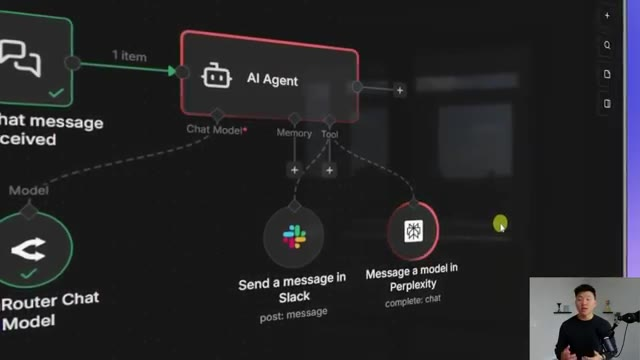
*⏱️ 00:00:05 — Gros plan sur un nœud de workflow d'agent IA avec des connexions vers des outils comme Slack et Perplexity.*

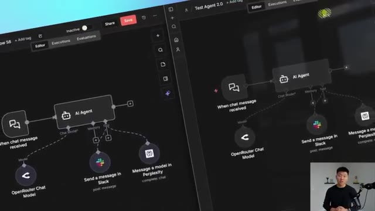
*⏱️ 00:00:09 — Comparaison côte à côte de deux versions d'une interface de workflow d'automatisation.*

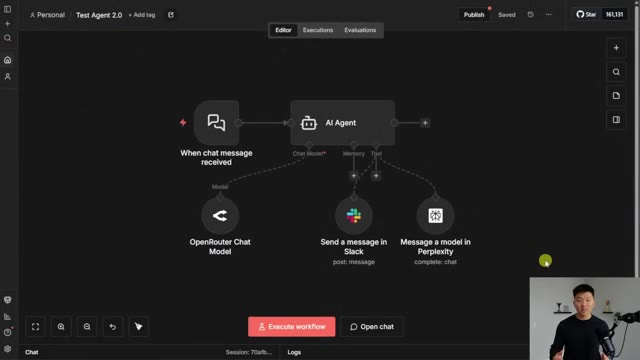
*⏱️ 00:00:14 — Vue complète de l'interface d'édition de workflow n8n montrant un agent IA et ses outils connectés.*

---

### ⏱️ `[00:00:19 - 00:00:50]` | Segment #02

**🔊 Audio (Transcription Intégrale Mot pour Mot en Français) :**
> Mais à mesure que nous commençons à nous plonger dans les choses et à cliquer un peu partout, vous remarquerez quelques changements, je suis donc là pour vous guider à travers ceux-ci. Donc, très rapidement, laissez-moi juste envoyer ce message à notre agent IA, qui dispose d'un outil Slack et d'un outil Perplexity, et je lui demande de faire des recherches sur l'IA vocale et d'envoyer ces résultats à Nate sur Slack. Et la première chose que vous verrez, c'est cette nouvelle animation vraiment sympa où, lorsque les nœuds tournent ou réfléchissent, ils ont en fait ce petit cercle de contour rouge autour, ce qui a l'air beaucoup plus futuriste, et ça a vraiment fière allure par rapport à l'ancienne méthode où les agents avaient en quelque sorte juste un cercle tournant rouge à l'intérieur du nœud lui-même.

**👁️ Analyse Visuelle d'Écran (gemini-3.5-flash-lite) :**
**Interface & Outils** : Interface web de construction de workflows (type Flowise ou équivalent)

**Contenu textuel & Code** : Schéma de workflow nommé 'Test Agent 2.0' avec les composants 'When chat message received', 'AI Agent', 'OpenRouter Chat Model', 'Send a message in Slack', et 'Message a model in Perplexity'. Dans le chat en bas : 'Research Voice AI and send those results to Nate in slack.'

**Action / Démonstration** : Saisie d'un message de test dans le panneau de chat pour déclencher et tester le workflow de l'agent IA.

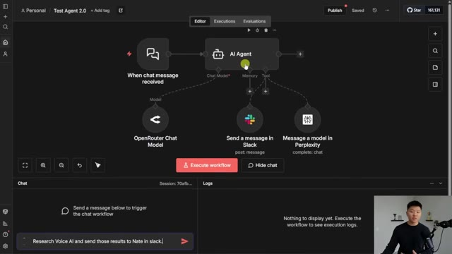
*⏱️ 00:00:27 — Interface d'un éditeur de workflow d'agent IA montrant un schéma avec un déclencheur de message, un bloc 'AI Agent' connecté à OpenRouter, Slack et Perplexity, avec un panneau de chat en bas.*

---

### ⏱️ `[00:00:51 - 00:01:18]` | Segment #03

**🔊 Audio (Transcription Intégrale Mot pour Mot en Français) :**
> Mais ensuite, quand tout est exécuté, ils ont le contour vert et les lignes vertes comme d'habitude. Et cette animation de traitement n'est pas réservée à l'IA, c'est aussi pour chaque fois que des nœuds en général sont en train de traiter et de s'exécuter encore. Comme vous pouvez le voir ici avec ce nœud Perplexity et les autres qui tournent un peu de la même manière. Et l'autre chose que vous remarquerez, c'est que les nœuds ont l'air d'être un peu plus intégrés dans le flux de travail et il n'y a pas vraiment d'effet 3D, ce qui, je pense, a en fait un aspect beaucoup plus moderne et minimaliste.

**👁️ Analyse Visuelle d'Écran (gemini-3.5-flash-lite) :**
**Interface & Outils** : Interface web de création de workflow (type n8n/Flowise/Langflow)

**Contenu textuel & Code** : Nœuds de workflow : 'When clicking Execute workflow', 'Search Term', 'Message a model', 'Send a message'

**Action / Démonstration** : Visualisation du diagramme de workflow et de ses étapes d'exécution

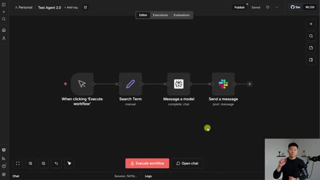
*⏱️ 00:00:57 — Un éditeur de workflow avec quatre nœuds connectés : 'When clicking Execute workflow', 'Search Term', 'Message a model' et 'Send a message', sur fond sombre avec le présentateur en bas à droite.*

---

### ⏱️ `[00:01:18 - 00:01:54]` | Segment #04

**🔊 Audio (Transcription Intégrale Mot pour Mot en Français) :**
> Donc, si je vais de l'avant et que je copie réellement ce flux de travail ici, et que je vais dans la version 1.0 et que je le colle, vous pouvez voir la différence ici. Comment ceux-ci ont l'air un peu plus volumineux maintenant. Et il y a aussi comme un schéma de couleurs différent entre l'outil et l'IA ici en haut. Une autre chose que j'ai remarquée, mais c'est assez subtil, ce sont les connexions entre les nœuds. Donc, dans cette nouvelle version, lorsque vous passez la souris sur les connecteurs, ils sortent en quelque sorte et ils sont juste entourés de blanc. Comme vous pouvez le voir avec ces losanges pour l'agent et ensuite les cercles pour les autres connecteurs. Mais dans l'ancienne version, ça devenait juste orange et ça ne devenait pas plus grand. Il n'y avait pas d'effet de pulsation. Et c'est également la même chose pour

**👁️ Analyse Visuelle d'Écran (gemini-3.5-flash-lite) :**
**Interface & Outils** : n8n (interface web de gestion de flux de travail d'automatisation)

**Contenu textuel & Code** : Nœuds de workflow : "When chat message received", "AI Agent", "OpenRouter Chat Model", "Send a message in Slack", "Message a model in Perplexity"

**Action / Démonstration** : Comparaison et présentation d'un flux de travail collé dans l'interface montrant les différences de design et de blocs entre les versions

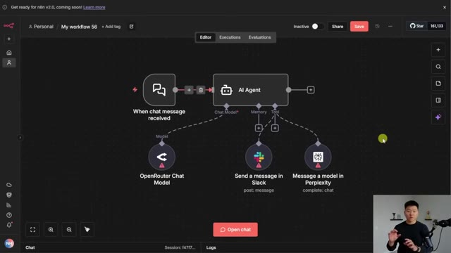
*⏱️ 00:01:27 — Interface n8n affichant un flux de travail avec un nœud 'AI Agent' connecté à OpenRouter, Slack et Perplexity, avec le présentateur en bas à droite.*

---

### ⏱️ `[00:01:54 - 00:02:23]` | Segment #05

**🔊 Audio (Transcription Intégrale Mot pour Mot en Français) :**
> des nœuds comme celui-ci, même s'ils ne sont pas des agents IA en soi. Très bien, donc ici nous avons la version un sur la gauche et nous avons la version deux sur la droite. Et nous allons simplement examiner les différences ici. Maintenant, une chose à garder à l'esprit, sur le côté gauche, je suis sur N8N Cloud. Et sur le côté droit, je suis sur ma version auto-hébergée avec Hostinger. Il peut donc y avoir juste quelques éléments comme le panneau d'administration ici qui sont différents uniquement en raison de la différence entre le cloud et l'auto-hébergement. Donc, l'une des premières choses que vous remarquerez concerne la barre latérale. Vous pouvez donc voir que si je développe la barre latérale, nous avons aperçu, personnel, et ensuite nous avons ces éléments en bas.

**👁️ Analyse Visuelle d'Écran (gemini-3.5-flash-lite) :**
**Interface & Outils** : Interface web de type outil de workflow / automatisation d'agents IA (analogue à n8n) avec affichage divisé en deux panneaux.

**Contenu textuel & Code** : Diagrammes de flux avec des nœuds "When chat message received", "AI Agent", "OpenRouter Chat Model", "Send a message in Slack" et "Message a model in Perplexity".

**Action / Démonstration** : Le présentateur compare les deux versions du workflow affichées à l'écran.

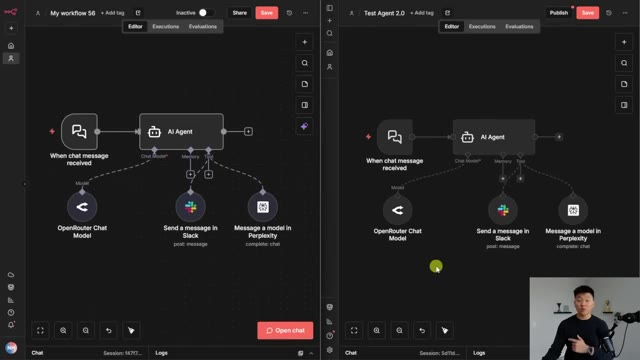
*⏱️ 00:02:01 — Comparaison côte à côte de deux versions d'un workflow d'agent IA dans une interface d'automatisation.*

---

### ⏱️ `[00:02:23 - 00:02:47]` | Segment #06

**🔊 Audio (Transcription Intégrale Mot pour Mot en Français) :**
> Et si j'agrandis la barre latérale de ce côté-ci, nous faisons cela en cliquant sur cette petite flèche. Maintenant, en plus des barres latérales qui sont un peu différentes, vous pouvez aussi voir que dans la nouvelle version, nous pouvons agrandir la barre latérale. Nous pouvons donc réellement l'étirer. Mais de ce côté gauche, nous ne pouvons pas faire cela. Nous avons aussi la possibilité dans la nouvelle version d'accéder à nos paramètres beaucoup plus facilement, car lorsque je clique sur paramètres, je peux tout voir directement ici. Alors que dans cette première version, vous deviez simplement cliquer sur votre profil, puis cliquer sur paramètres, et ensuite cela vous amenait vers un onglet de paramètres différent.

**👁️ Analyse Visuelle d'Écran (gemini-3.5-flash-lite) :**
**Interface & Outils** : Interface web n8n (tableaux de bord de workflows d'agents IA)

**Contenu textuel & Code** : Workflows n8n comprenant des nœuds "When chat message received", "AI Agent", "OpenRouter Chat Model", "Send a message in Slack" et "Message a model in Perplexity".

**Action / Démonstration** : Le présentateur compare les différentes versions de l'interface n8n et démontre comment agrandir la barre latérale.

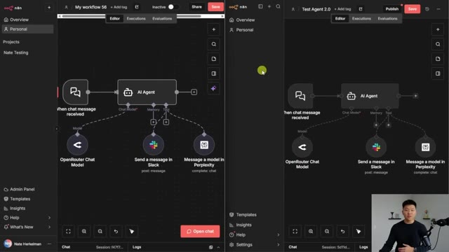
*⏱️ 00:02:29 — Comparaison côte à côte de l'interface n8n montrant l'ancienne et la nouvelle version avec les options de barre latérale.*

---

### ⏱️ `[00:02:47 - 00:03:05]` | Segment #07

**🔊 Audio (Transcription Intégrale Mot pour Mot en Français) :**
> Vous pouvez également voir qu'à l'arrière-plan, les petits points du canevas réel sont un peu plus difficiles à voir dans cette version. Si nous remontons tout en haut, vous pouvez voir que dans la version un, nous avons des flux de travail inactifs ou actifs. Alors que dans la version deux, nous avons la possibilité de publier et de dépublier, ce qui fait essentiellement la même chose, mais avec une terminologie un peu différente maintenant.

**👁️ Analyse Visuelle d'Écran (gemini-3.5-flash-lite) :**
**Interface & Outils** : Interface web de création de workflows d'agents IA (deux fenêtres comparées).

**Contenu textuel & Code** : Deux diagrammes de workflow contenant un nœud "When chat message received", un nœud "AI Agent", et des connexions vers "OpenRouter Chat Model", "Send a message in Slack" et "Message a model in Perplexity".

**Action / Démonstration** : Comparaison visuelle entre les versions un et deux des flux de travail de l'agent.

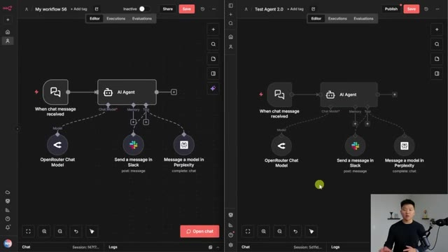
*⏱️ 00:02:51 — Comparaison côte à côte de deux versions d'une interface de workflow d'agent IA, montrant les différences de design des canevas et des barres supérieures.*

---

### ⏱️ `[00:03:05 - 00:03:26]` | Segment #08

**🔊 Audio (Transcription Intégrale Mot pour Mot en Français) :**
> Une autre chose que je voulais vous montrer ici, c'était la fonctionnalité de sauvegarde elle-même. Donc, dans la version un, quand on clique sur enregistrer, ça tourne pendant une seconde et puis ça nous indique que ça a été enregistré. Mais dans la version deux, c'est pour ainsi dire instantané. Et c'était une toute petite fonctionnalité, mais je pense que c'est parce que la fonctionnalité de sauvegarde automatique, qui est une fonctionnalité extrêmement demandée, va arriver. Elle n'est pas encore disponible à ce jour, mais j'ai entendu dire qu'elle arriverait en janvier 2026.

**👁️ Analyse Visuelle d'Écran (gemini-3.5-flash-lite) :**
**Interface & Outils** : Interface web de construction de workflows / agents IA (Flowise ou similaire) avec affichage en double écran.

**Contenu textuel & Code** : Diagrammes de flux avec nœuds "When chat message received", "AI Agent", "OpenRouter Chat Model", "Send a message in Slack" et "Message a model in Perplexity".

**Action / Démonstration** : Comparaison visuelle des versions 1 et 2 du workflow et de leur interface de sauvegarde.

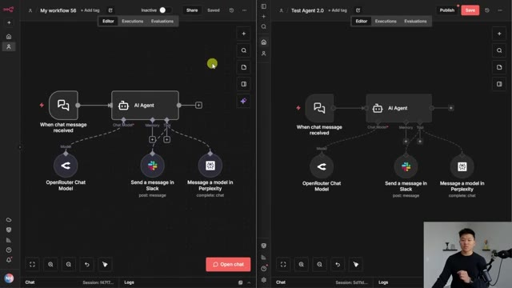
*⏱️ 00:03:10 — Comparaison côte à côte de deux interfaces de workflows avec un diagramme d'agent IA montrant les connexions vers OpenRouter, Slack et Perplexity, et la webcam du présentateur en bas à droite.*

---

### ⏱️ `[00:03:27 - 00:03:45]` | Segment #09

**🔊 Audio (Transcription Intégrale Mot pour Mot en Français) :**
> Maintenant, de retour sur l'écran d'accueil réel de la version un et de la version deux, c'est à peu près la même chose. Nous avons des éléments comme les identifiants, les exécutions, nous avons exactement la même chose dans les deux. Mais l'autre chose concernant le fait d'être actif ou inactif, publié ou non publié, c'est que sur ce côté droit, vous pouvez voir que nous avons ce petit indicateur avec la coche verte. Et sur le côté gauche, nous avions fondamentalement juste un petit interrupteur qui était soit activé, soit désactivé.

**👁️ Analyse Visuelle d'Écran (gemini-3.5-flash-lite) :**
**Interface & Outils** : Interface web d'automatisation n8n (vue partagée version 1 et version 2)

**Contenu textuel & Code** : Tableaux de bord de présentation avec statistiques d'exécution, listes de workflows ("My workflow 56", "Test Agent 2.0", "Parent Wait", "Child Wait") et curseurs d'activation/désactivation.

**Action / Démonstration** : Comparaison visuelle des écrans d'accueil des deux versions avec un curseur de souris pointant sur l'onglet Credentials de la version droite.

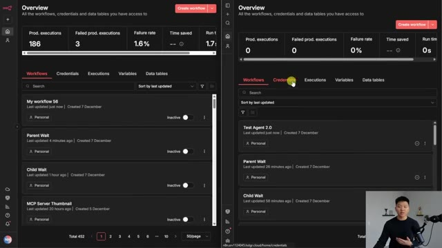
*⏱️ 00:03:31 — Comparaison côte à côte de deux versions d'une interface de tableau de bord d'automatisation (n8n), affichant les onglets Workflows, Credentials, Executions, Variables et Data tables.*

---

### ⏱️ `[00:03:46 - 00:04:05]` | Segment #10

**🔊 Audio (Transcription Intégrale Mot pour Mot en Français) :**
> Mais de toute façon, vous avez probablement vu, quand vous allez dans votre NNN, vous avez cette petite barre en haut qui dit : préparez-vous pour la V2, en savoir plus. Et si vous cliquez dessus, ça va grosso modo présenter ce qui arrive dans ces nouvelles versions. Il y a un énorme accent mis sur la sécurité, la fiabilité et les performances. Donc la majorité des changements ici sont en fait dans le backend, juste pour préparer la scalabilité et l'avenir de NNN.

**👁️ Analyse Visuelle d'Écran (gemini-3.5-flash-lite) :**
**Interface & Outils** : Interface web n8n et page de documentation officielle.

**Contenu textuel & Code** : Bannière "Get ready for n8n v2.0, coming soon!" et article de blog annonçant n8n version 2.0.

**Action / Démonstration** : Navigation sur l'interface et consultation de la page d'annonce de la mise à jour v2.

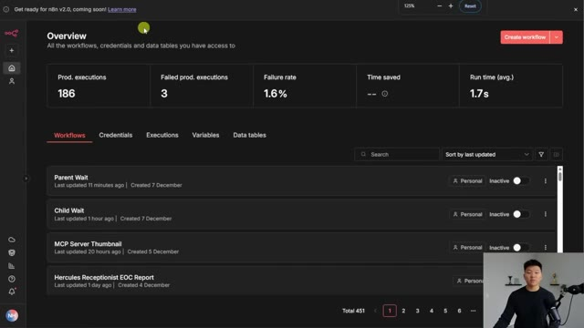
*⏱️ 00:03:51 — Vue d'ensemble de l'interface n8n avec une bannière en haut indiquant la sortie prochaine de la version 2.0.*

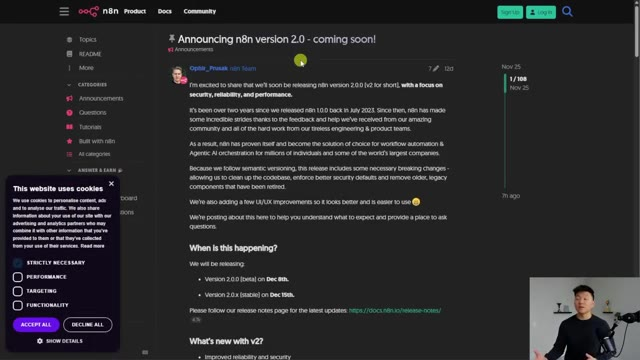
*⏱️ 00:03:55 — Page web de documentation de n8n annonçant officiellement la sortie de la version 2.0 avec les détails et dates de déploiement.*

---

### ⏱️ `[00:04:05 - 00:04:38]` | Segment #11

**🔊 Audio (Transcription Intégrale Mot pour Mot en Français) :**
> Donc la version 2.0, qui est la bêta, aujourd'hui 8 décembre, et ensuite la 2.0 stable sort environ une semaine plus tard, le 15. Maintenant, il y a quelques changements majeurs de rupture et nous allons les passer en revue et je vais montrer un exemple, mais je suis vraiment ravi que la majorité des fondations réelles du fonctionnement de n8n soit quasiment exactement la même. Et donc ici dans l'ancienne version, si je devais copier l'intégralité de ce workflow et ouvrir la version 2.0, ouvrir un nouveau workflow et le coller dedans, vous pouvez voir que tout se colle parfaitement bien et que tous les nœuds ont toujours les mêmes propriétés, ce qui signifie que le JSON sous-jacent qui construit concrètement les workflows, les connexions et les paramètres est toujours le même.

**👁️ Analyse Visuelle d'Écran (gemini-3.5-flash-lite) :**
**Interface & Outils** : Navigateur web affichant la documentation et l'éditeur visuel de n8n.

**Contenu textuel & Code** : Texte de l'annonce n8n v2.0 listant les breaking changes, et diagramme de workflow d'automatisation IA.

**Action / Démonstration** : Présentation des notes de version et démonstration d'un workflow d'automatisation sur n8n.

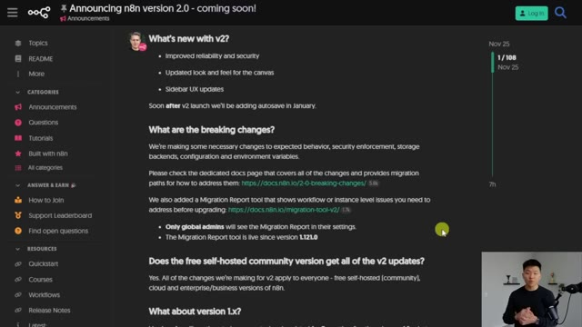
*⏱️ 00:04:13 — Page de documentation officielle de n8n listant les nouveautés et changements majeurs de la version 2.0.*

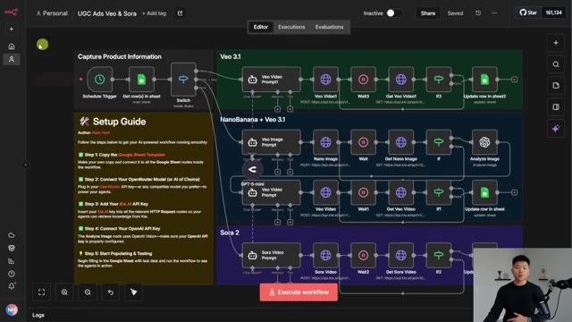
*⏱️ 00:04:21 — Interface de l'éditeur de workflow n8n montrant un flux complexe intégrant Veo 3.1, NanoBanana et Sora 2.*

---

### ⏱️ `[00:04:38 - 00:05:03]` | Segment #12

**🔊 Audio (Transcription Intégrale Mot pour Mot en Français) :**
> En ce qui concerne les changements majeurs, nous avons un changement de comportement, dont je suis sur le point de montrer un exemple, mais nous avons également beaucoup de choses concernant la sécurité, les données backend, la configuration et l'environnement. Donc, comme je l'ai dit, beaucoup de changements qui vont simplement aider à modifier et à passer à l'échelle à l'avenir. Mais je dois absolument passer en revue ce changement de comportement, qui est vraiment très important, où les données du sous-workflow peuvent en fait être renvoyées au workflow principal s'il y a eu une sorte d'attente, ou une sorte d'approbation humaine ou de retour humain.

**👁️ Analyse Visuelle d'Écran (gemini-3.5-flash-lite) :**
**Interface & Outils** : Navigateur web affichant la documentation de n8n (n8n Docs)

**Contenu textuel & Code** : Texte de documentation technique listant les points de rupture (breaking changes) : blocage par défaut de l'accès aux variables d'environnement depuis le Code Node, application stricte des permissions de fichiers (0600), et activation des task runners par défaut.

**Action / Démonstration** : Le présentateur commente les notes de version de n8n v2.0 affichées à l'écran, en insistant sur les aspects de sécurité et de configuration.

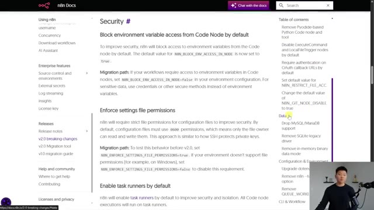
*⏱️ 00:04:44 — Capture d'écran de la documentation officielle de n8n affichant les notes de version et les changements majeurs de la version 2.0, notamment concernant la sécurité et les variables d'environnement.*

---

### ⏱️ `[00:05:03 - 00:05:22]` | Segment #13

**🔊 Audio (Transcription Intégrale Mot pour Mot en Français) :**
> Et donc vous pouvez aller consulter la documentation pour en savoir plus sur tout cela si vous le souhaitez, mais je vais juste vous montrer un exemple de la façon dont tout cela fonctionne et de ce que cela signifie réellement. D'accord, donc les sous-workflows, pouvoir attendre et renvoyer des données que l'agent peut réellement utiliser. Donc c'est la version 1.0. Et ce que nous faisons ici, c'est que nous avons un sous-workflow, qui va obtenir une approbation. Donc voici le sous-workflow.

**👁️ Analyse Visuelle d'Écran (gemini-3.5-flash-lite) :**
**Interface & Outils** : n8n (documentation et interface de création de workflows)

**Contenu textuel & Code** : Documentation sur les sous-workflows n8n et diagramme de workflow avec un nœud AI Agent connecté à OpenRouter Chat Model et un outil 'Get approval'.

**Action / Démonstration** : Présentation de la documentation et des exemples de configuration de sous-workflows dans n8n.

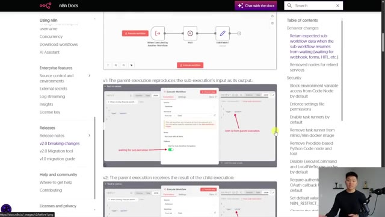
*⏱️ 00:05:08 — Documentation officielle de n8n montrant les changements de version v2.0 concernant les sous-workflows et l'exécution parente.*

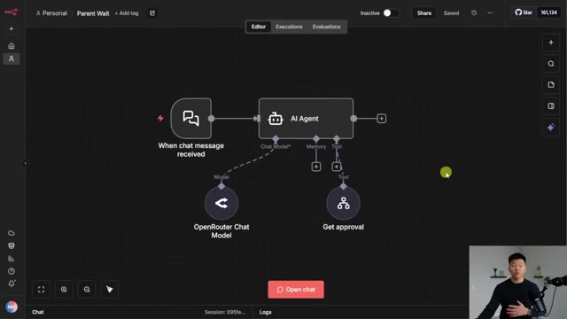
*⏱️ 00:05:12 — Interface de l'éditeur n8n affichant un workflow nommé 'Parent Wait' avec un nœud 'AI Agent', un modèle OpenRouter et un outil de validation.*

---

### ⏱️ `[00:05:22 - 00:05:45]` | Segment #14

**🔊 Audio (Transcription Intégrale Mot pour Mot en Français) :**
> Il s'agit essentiellement d'utiliser l'opération envoyer et attendre dans Slack pour obtenir une approbation ou un refus. Et lorsque l'agent principal fait appel à cela, ce que vous verrez, c'est que l'agent va attendre. Mais ensuite, lorsque nous cliquons sur la réponse, l'agent ne voit en réalité pas ce que le flux de travail a fourni. Donc je sais que cela peut n'avoir aucun sens. Laissez-moi donc vous montrer. Très bien, alors je dis à l'agent de bien vouloir obtenir une approbation pour la note de service suivante, qui est : « Hé l'équipe, nous déplaçons nos mercredis de la crème glacée aux jeudis à la place. »

**👁️ Analyse Visuelle d'Écran (gemini-3.5-flash-lite) :**
**Interface & Outils** : Interface web de construction de workflows d'agents IA (style Langflow ou outil similaire)

**Contenu textuel & Code** : Diagramme avec les nœuds 'When chat message received', 'AI Agent', 'OpenRouter Chat Model' et 'Get approval' reliés entre eux.

**Action / Démonstration** : Visualisation et explication du flux d'exécution et des connexions entre l'agent principal et l'outil d'approbation.

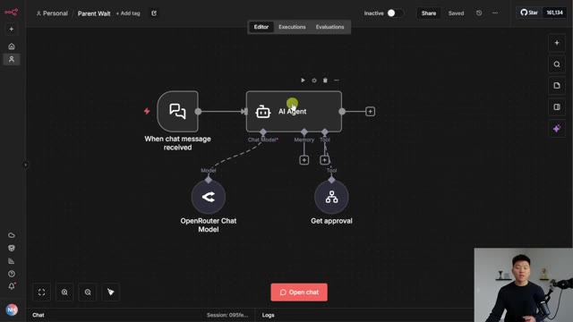
*⏱️ 00:05:27 — Un éditeur de workflow d'agents IA montrant un diagramme avec un déclencheur de message, un bloc 'AI Agent' connecté à un modèle OpenRouter et à un outil 'Get approval'.*

---

### ⏱️ `[00:05:45 - 00:06:03]` | Segment #15

**🔊 Audio (Transcription Intégrale Mot pour Mot en Français) :**
> Et donc ce que vous pouvez voir, c'est qu'il a fait appel à l'outil d'obtention d'approbation et qu'il va rester là à attendre jusqu'à ce que nous obtenions une sorte de réponse de la part de notre équipe. Et donc si je vais dans Slack et que nous voyons juste ici, nous avons reçu ce message où nous pouvons approuver ou refuser, je vais aller de l'avant et approuver ce message et nous obtenons ce succès et je reviens dans le flux de travail et il se termine.

**👁️ Analyse Visuelle d'Écran (gemini-3.5-flash-lite) :**
**Interface & Outils** : Interface de workflow d'automatisation IA et application de messagerie Slack.

**Contenu textuel & Code** : Message de demande d'approbation envoyé par l'agent IA : 'Please approve or deny the following memo: Hey team, we're moving our Ice Cream Wednesdays to Thursdays instead.'

**Action / Démonstration** : L'agent IA exécute le workflow et se met en pause en attendant l'approbation humaine sur Slack.

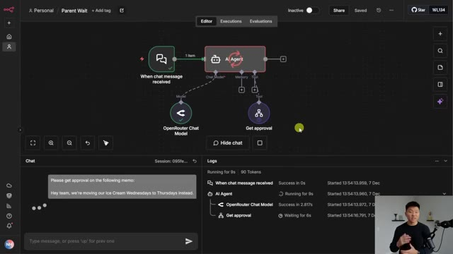
*⏱️ 00:05:50 — Interface de workflow montrant un agent IA en cours d'exécution avec un outil 'Get approval' en attente de réponse.*

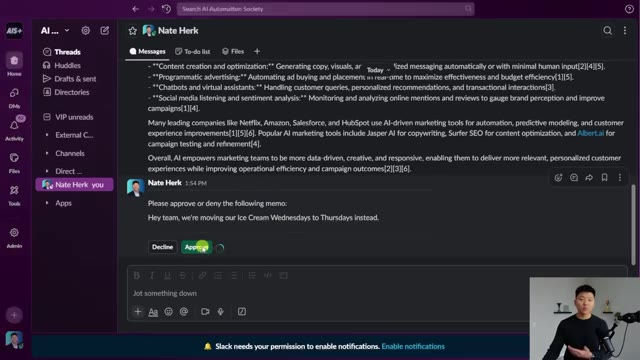
*⏱️ 00:05:59 — Interface de l'application Slack affichant un message de demande d'approbation avec les boutons 'Decline' et 'Approve'.*

---

### ⏱️ `[00:06:04 - 00:06:23]` | Segment #16

**🔊 Audio (Transcription Intégrale Mot pour Mot en Français) :**
> Et ce que l'agent nous répond, c'est : J'ai soumis la note de service pour approbation concernant le déplacement du mercredi des glaces au jeudi. Y a-t-il autre chose que vous aimeriez que je fasse ? Et donc, nous ne savons pas réellement si l'équipe a approuvé ou refusé cela. Parce que si je clique sur l'outil, vous pouvez voir que la réponse que nous avons obtenue de l'outil n'était pratiquement rien. Tout ce que nous savons, c'est l'identifiant de session, l'action, la saisie du chat, la note de service, l'identifiant d'appel d'outil.

**👁️ Analyse Visuelle d'Écran (gemini-3.5-flash-lite) :**
**Interface & Outils** : n8n (éditeur de workflow d'automatisation et d'agents IA)

**Contenu textuel & Code** : Workflow n8n avec les nœuds "OpenRouter Chat Model", "Get approval", et le panneau de chat interactif montrant l'interaction avec l'agent IA.

**Action / Démonstration** : Navigation et explication du fonctionnement de l'agent IA et de ses outils d'approbation dans l'interface n8n.

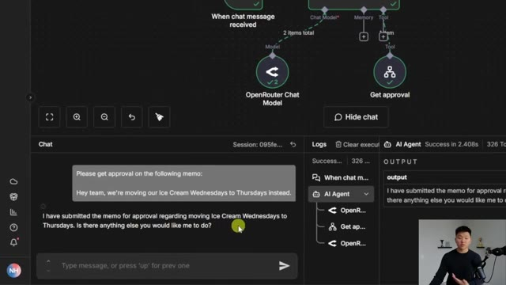
*⏱️ 00:06:08 — Interface n8n montrant un workflow d'agent IA avec le panneau de chat affichant la réponse de l'agent sur l'approbation de la note de service.*

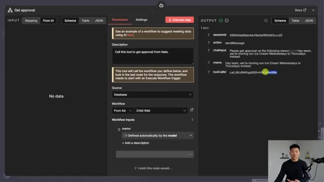
*⏱️ 00:06:18 — Panneau de configuration du nœud "Get approval" dans n8n, détaillant les paramètres et les données de sortie (output) d'un appel d'outil (tool call).*

---

### ⏱️ `[00:06:24 - 00:06:46]` | Segment #17

**🔊 Audio (Transcription Intégrale Mot pour Mot en Français) :**
> Donc aucune information qui ne soit réellement précieuse pour nous. Donc si je vais réellement dans le flux de travail et que je vais dans l'exécution qui vient de s'exécuter, qui est ce flux de travail juste ici, vous pouvez voir que la réponse de cette opération Slack était que l'approbation était vraie. Et donc c'est ce que vous voulez réellement que l'agent IA dans ce flux voie, mais il ne le voit pas. Donc nous allons faire exactement le même flux, exactement le même flux de travail dans la version 2.0.

**👁️ Analyse Visuelle d'Écran (gemini-3.5-flash-lite) :**
**Interface & Outils** : n8n (interface de création de workflows d'automatisation)

**Contenu textuel & Code** : Nœuds de workflow connectés (Webhook, Slack, AI Agent, OpenRouter) et données JSON de sortie de l'opération Slack.
[DESC_IMAGE_3_ALT] Navigation et explication des flux de travail dans l'éditeur de l'application.

**Action / Démonstration** : Navigation et explication des résultats d'exécution du workflow d'approbation Slack dans l'interface n8n.

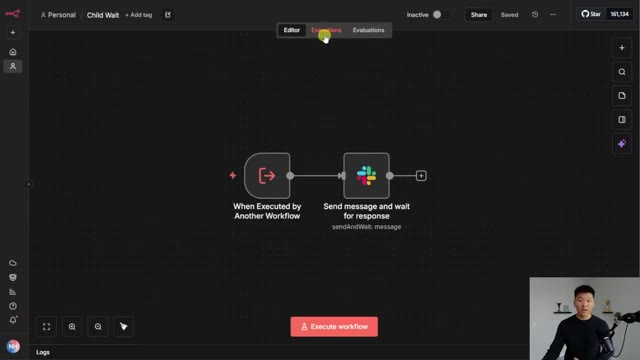
*⏱️ 00:06:29 — Vue d'ensemble du workflow n8n 'Child Wait' montrant les nœuds de déclenchement et Slack.*

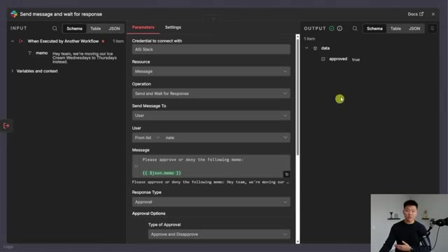
*⏱️ 00:06:35 — Panneau de configuration du nœud Slack avec la sortie JSON affichant 'approved: true'.*

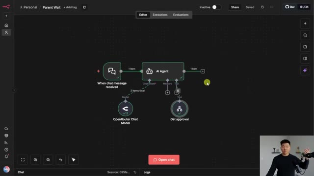
*⏱️ 00:06:40 — Vue d'ensemble du workflow principal 'Parent Wait' avec l'agent IA, le modèle OpenRouter et l'outil 'Get approval'.*

---

### ⏱️ `[00:06:46 - 00:07:21]` | Segment #18

**🔊 Audio (Transcription Intégrale Mot pour Mot en Français) :**
> Mais avant de faire cela, je voulais vous montrer une différence. Dans la version 1 de N8N, si vous aviez un sous-flux de travail, il pouvait être inactif parce que le flux de travail principal pouvait l'appeler, ce qui l'activait essentiellement. Mais dans la version 2, votre sous-flux de travail doit être publié afin d'être appelé par un autre flux de travail. Vous pouvez donc voir ici que si j'essaie de configurer cet outil pour appeler le flux de travail de poids enfant, il est indiqué qu'il doit être publié avant d'être utilisé, je devrais donc aller dans ce flux de travail, je devrais cliquer sur publier et je pourrais lui donner un nom de version et une description concernant les modifications apportées. Et maintenant que je clique sur publier, nous pouvons effectivement le déclencher à partir d'un flux de travail différent.

**👁️ Analyse Visuelle d'Écran (gemini-3.5-flash-lite) :**
**Interface & Outils** : n8n (outil d'automatisation de flux de travail)

**Contenu textuel & Code** : Nœuds de workflow n8n (When chat message received, AI Agent, OpenRouter Chat Model, Get approval) et fenêtre modale de publication de workflow.

**Action / Démonstration** : Navigation et configuration de nœuds dans un workflow n8n, puis ouverture de la fenêtre de publication pour versionner le sous-flux.

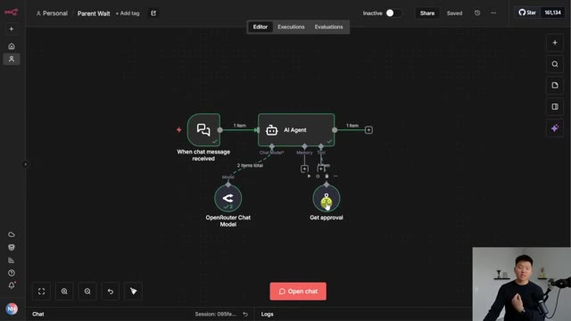
*⏱️ 00:06:54 — Interface n8n montrant un workflow avec un nœud 'AI Agent', relié à un nœud 'OpenRouter Chat Model' et un sous-flux 'Get approval'.*

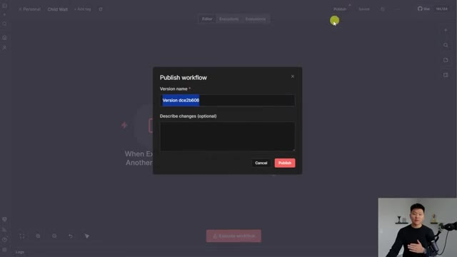
*⏱️ 00:07:12 — Boîte de dialogue 'Publish workflow' dans l'interface n8n permettant de nommer et publier une version du sous-flux de travail.*

---

### ⏱️ `[00:07:21 - 00:07:39]` | Segment #19

**🔊 Audio (Transcription Intégrale Mot pour Mot en Français) :**
> Donc maintenant, je peux aller ici et je peux choisir le flux de travail de pondération enfant. Donc ici, je vais envoyer exactement le même message. Veuillez obtenir une approbation sur la note suivante. Salut l'équipe, nous déplaçons nos mercredis de la crème glacée aux jeudis, vous pouvez voir ici que cela a déclenché la demande vers l'outil d'approbation. Et ça va continuer et rester ici à attendre que nous allions approuver cela dans Slack.

**👁️ Analyse Visuelle d'Écran (gemini-3.5-flash-lite) :**
**Interface & Outils** : Interface web d'automatisation de workflow (éditeur de type n8n ou plateforme similaire d'agent IA).

**Contenu textuel & Code** : Message dans le chat de test : "Please get approval on the following memo: Hey team, we're moving our Ice Cream Wednesdays to Thursdays instead".

**Action / Démonstration** : Le présentateur configure et teste l'envoi d'un message pour déclencher le workflow d'approbation dans l'agent IA.

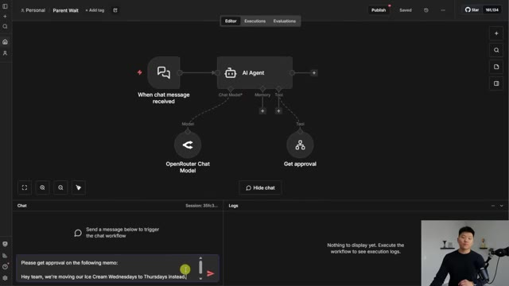
*⏱️ 00:07:25 — Interface d'un éditeur de workflow d'agents IA montrant un diagramme avec un déclencheur de message de chat, un agent IA relié à un modèle OpenRouter et un outil d'approbation.*

---

### ⏱️ `[00:07:39 - 00:07:58]` | Segment #20

**🔊 Audio (Transcription Intégrale Mot pour Mot en Français) :**
> Donc je vais passer par ici. Je vais à nouveau approuver cette action. Nous obtenons notre message de réussite. Et quand je retourne ici, il est effectivement écrit que la note de service pour déplacer les mercredis de la crème glacée aux jeudis a été approuvée. Voudrais-tu que je t'aide ? Blabla, blabla, blabla. Et si je clique sur cet outil, nous pouvons voir que nous obtenons effectivement ce message de réponse du sous-flux de travail, qui indique qu'il a été approuvé.

**👁️ Analyse Visuelle d'Écran (gemini-3.5-flash-lite) :**
**Interface & Outils** : Interface web de workflow d'automatisation (type n8n ou plateforme similaire).

**Contenu textuel & Code** : Workflow comprenant "When chat message received", "AI Agent", "OpenRouter Chat Model", et "Get approval" ; panneau de chat avec le message de confirmation.

**Action / Démonstration** : Exécution d'un workflow d'agent IA et vérification du résultat d'approbation d'une note de service.

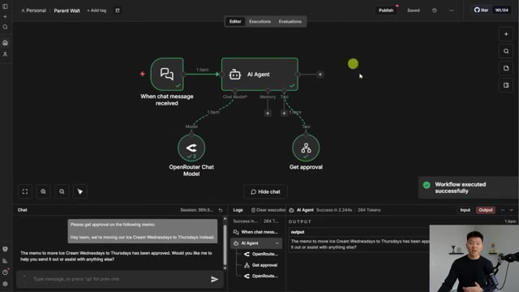
*⏱️ 00:07:44 — Vue d'ensemble du workflow d'agent IA dans une interface de type canvas avec une notification de succès d'exécution et la sortie du chat.*

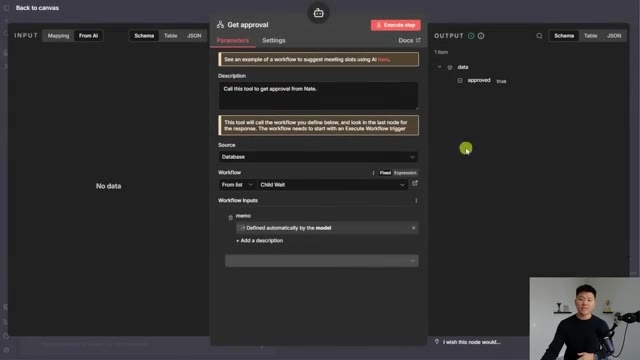
*⏱️ 00:07:53 — Panneau de configuration de l'étape "Get approval" affichant les paramètres et les données de sortie avec le champ "approved" réglé sur true.*

---

### ⏱️ `[00:07:58 - 00:08:32]` | Segment #21

**🔊 Audio (Transcription Intégrale Mot pour Mot en Français) :**
> Et encore une fois, ce sous-flux de travail réel ici est exactement le même que celui que nous venons de voir dans la version un. C'est exactement la même chose et il répond avec le même message approuvé. Donc, évidemment, ce n'était qu'un cas d'utilisation. Il y a des tonnes de moments où l'on veut qu'un sous-flux de travail puisse attendre, ou que l'on veut qu'un agent puisse attendre une intervention humaine, ou pour vous savez, un sondage ou quoi que ce soit d'autre, et maintenant c'est possible. Et juste une autre petite parenthèse, si vous voulez dépublier un flux de travail, vous devez essentiellement, au lieu de le désactiver ici en haut, aller dans vos paramètres, puis cliquer simplement sur ce bouton ici qui dit dépublier. Il y a deux autres fonctionnalités que je veux présenter qui ne sont pas vraiment nouvelles pour cette

**👁️ Analyse Visuelle d'Écran (gemini-3.5-flash-lite) :**
**Interface & Outils** : Interface de l'outil d'automatisation n8n.

**Contenu textuel & Code** : Configuration du nœud Slack avec les paramètres d'envoi de message et d'attente de réponse ("approved: true").

**Action / Démonstration** : Explication et visualisation de la structure d'un sous-flux de travail automatisé de validation.

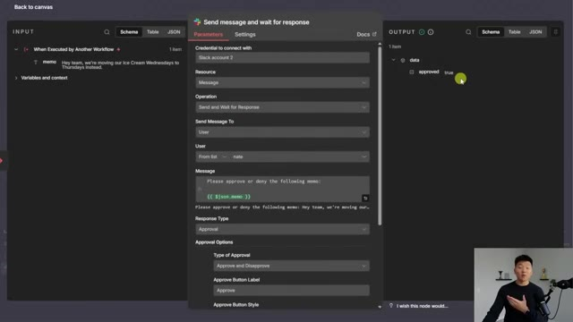
*⏱️ 00:08:07 — Capture montrant les paramètres détaillés du nœud Slack "Send message and wait for response" dans n8n, avec un aperçu des données d'entrée et de sortie.*

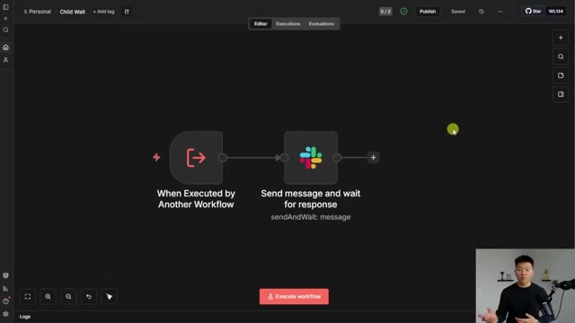
*⏱️ 00:08:15 — Vue globale du canevas d'un workflow n8n montrant l'enchaînement de deux blocs : "When Executed by Another Workflow" et "Send message and wait for response".*

---

### ⏱️ `[00:08:32 - 00:09:05]` | Segment #22

**🔊 Audio (Transcription Intégrale Mot pour Mot en Français) :**
> mise à jour, mais je pense que ce sont des fonctionnalités très discrètes. Je veux donc simplement les mettre un peu en valeur. Nous avons ce panneau latéral juste ici, qui s'appelle un panneau de focalisation. Et vous pouvez voir que nous pouvons afficher les paramètres des nœuds et en fait les modifier tout en construisant sur le canevas ici. Donc si je clique sur l'agent IA et que nous cliquons sur le message système, il y a un petit bouton de paramètre de focalisation juste ici. Si je clique dessus, cela ouvre en fait le message système de l'agent sur le côté. Nous pouvons donc procéder à sa personnalisation et continuer à construire, puis nous pouvons exécuter l'agent et nous pouvons continuer à faire des choses comme ça tout en ayant une vue complète du canevas ici,

**👁️ Analyse Visuelle d'Écran (gemini-3.5-flash-lite) :**
**Interface & Outils** : n8n (Interface de conception de workflows d'automatisation IA)

**Contenu textuel & Code** : Workflow d'agent IA comprenant un déclencheur de chat, un modèle OpenRouter, Slack et Perplexity, avec des champs de configuration de prompt (System Message : "You are a helpful assistant").

**Action / Démonstration** : Manipulation de l'interface n8n pour ouvrir et épingler un paramètre de nœud dans le panneau latéral de focalisation afin de pouvoir l'éditer plus facilement.

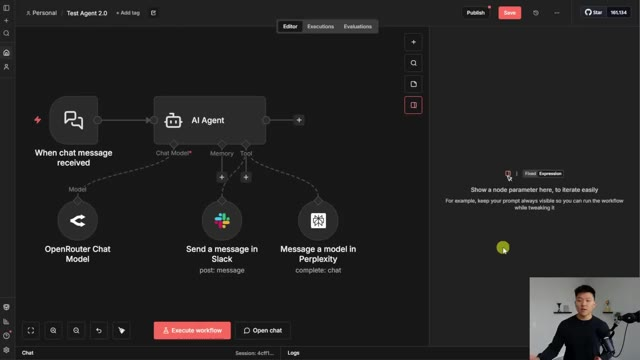
*⏱️ 00:08:41 — Vue d'ensemble de l'interface n8n montrant un workflow avec un nœud AI Agent et le panneau latéral de focalisation vide à droite.*

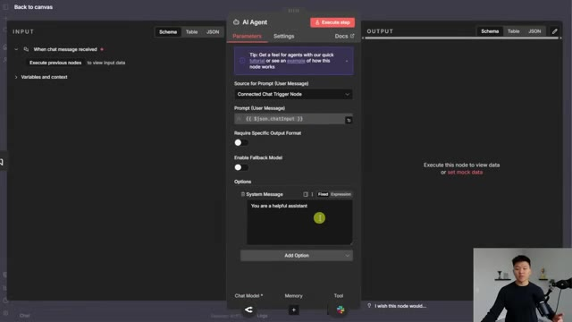
*⏱️ 00:08:49 — Gros plan sur la configuration détaillée d'un nœud AI Agent dans n8n, affichant les paramètres et le champ du message système.*

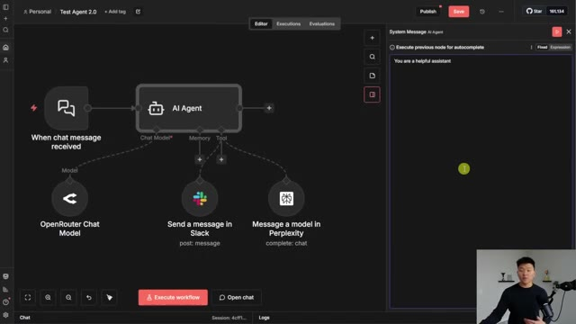
*⏱️ 00:08:57 — Retour à la vue principale de n8n avec le panneau de focalisation latéral activé à droite, affichant spécifiquement les paramètres du message système.*

---

### ⏱️ `[00:09:05 - 00:09:38]` | Segment #23

**🔊 Audio (Transcription Intégrale Mot pour Mot en Français) :**
> ce qui est plutôt sympa parce que ça ne doit pas être juste un prompt système d'agent. Ça peut aussi être différents paramètres ou différents nœuds. Par exemple, dans celui-ci sur Slack, on pourrait en fait créer le message à envoyer sur un panneau de focus ici et continuer à itérer là-dessus et à déplacer des variables au fur et à mesure qu'on construit le reste de la logique. Et puis un autre truc sympa en termes de productividad que beaucoup de gens n'utilisent pas, c'est que quand vous êtes dans des nœuds du côté gauche et du côté droit, vous pouvez passer d'un nœud à l'autre comme ça au lieu de devoir, vous savez, à chaque fois cliquer en dehors puis double-cliquer pour revenir dedans, et ça marche aussi pour les configurations d'agents où, si je suis dans l'agent, je peux aller directement sur le chat, je peux revenir en arrière

**👁️ Analyse Visuelle d'Écran (gemini-3.5-flash-lite) :**
**Interface & Outils** : n8n (éditeur de workflows d'automatisation)

**Contenu textuel & Code** : Nœuds de workflow : « When clicking 'Execute workflow' », « Search Term », « Message a model », « Send a message ». Variable JSON affichée : `{{ $json.choices[0].message.content }}`.

**Action / Démonstration** : Navigation et configuration des nœuds dans l'interface du constructeur de flux d'automatisation n8n.

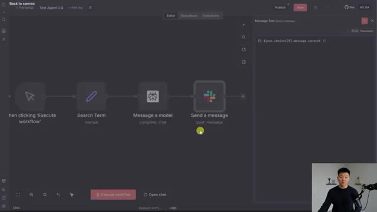
*⏱️ 00:09:13 — Vue d'un workflow n8n avec un panneau latéral droit ouvert sur les paramètres d'un nœud Slack (« Send a message »).*

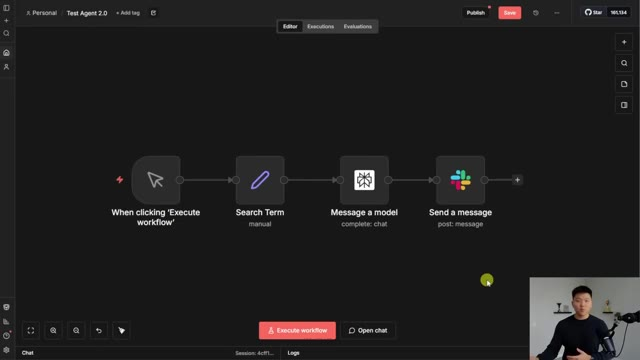
*⏱️ 00:09:22 — Vue d'ensemble du workflow n8n montrant quatre nœuds connectés : déclencheur, terme de recherche, modèle de message et envoi Slack.*

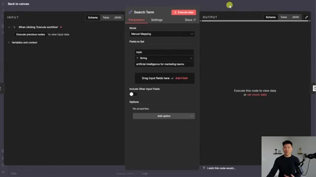
*⏱️ 00:09:30 — Vue détaillée des paramètres d'un nœud de recherche (« Search Term ») avec le champ de saisie « topic » configuré sur « artificial intelligence for marketing teams ».*

---

### ⏱️ `[00:09:38 - 00:09:58]` | Segment #24

**🔊 Audio (Transcription Intégrale Mot pour Mot en Français) :**
> vers l'agent, je peux descendre au modèle de chat, je peux remonter vers l'agent et je peux aussi choisir entre les différents outils ici bas, que ce soit Slack et puis remonter vers l'agent ou si je voulais aller sur Perplexity, donc juste une autre façon de gagner quelques secondes ici et là, mais sur le long d'une année, pensez à tout cet RSI annualisé. Je voulais donc aussi parler de la migration.

**👁️ Analyse Visuelle d'Écran (gemini-3.5-flash-lite) :**
**Interface & Outils** : n8n (Interface de conception de workflows d'automatisation)

**Contenu textuel & Code** : Nœuds de workflow : When chat message received, AI Agent, OpenRouter Chat Model, Send a message in Slack, Message a model in Perplexity.

**Action / Démonstration** : Configuration des connexions entre l'agent IA, le modèle de langage et les outils externes (Slack, Perplexity).

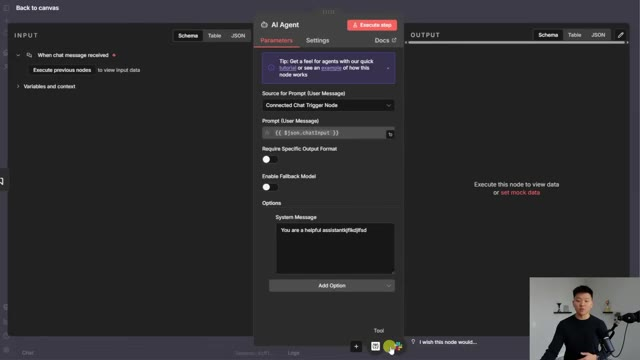
*⏱️ 00:09:43 — Gros plan sur le panneau de configuration d'un agent IA dans n8n, montrant les paramètres du prompt et les outils disponibles.*

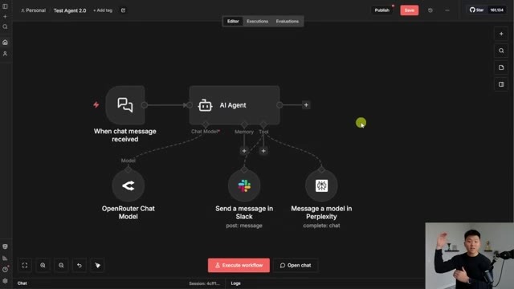
*⏱️ 00:09:53 — Vue d'ensemble du workflow sur n8n montrant un agent IA connecté à un modèle de chat OpenRouter, Slack et Perplexity.*

---

### ⏱️ `[00:09:58 - 00:10:17]` | Segment #25

**🔊 Audio (Transcription Intégrale Mot pour Mot en Français) :**
> Il y a donc un outil de migration NNN v2.0, et vous pouvez venir sur la documentation une fois de plus et lire sur la façon dont tout cela fonctionne et tous les différents problèmes que vous pourriez rencontrer. Mais en fait, la façon d'accéder à cela est que dans votre NNN, vous allez aller dans vos paramètres. Vous devriez voir sur le côté gauche ici un rapport de migration, et il vous dira fondamentalement combien de vos workflows sont déjà compatibles avec la version 2.0.

**👁️ Analyse Visuelle d'Écran (gemini-3.5-flash-lite) :**
**Interface & Outils** : Documentation web n8n et interface utilisateur n8n

**Contenu textuel & Code** : Texte de documentation technique sur la migration v2.0 et liste des workflows de l'application (My workflow 56, Parent Wait, etc.)

**Action / Démonstration** : Présentation de la documentation de l'outil de migration puis navigation vers l'interface n8n.

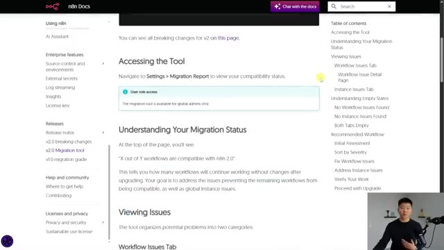
*⏱️ 00:10:03 — Documentation officielle de n8n montrant la page sur l'outil de migration v2.0 et l'accès via les paramètres.*

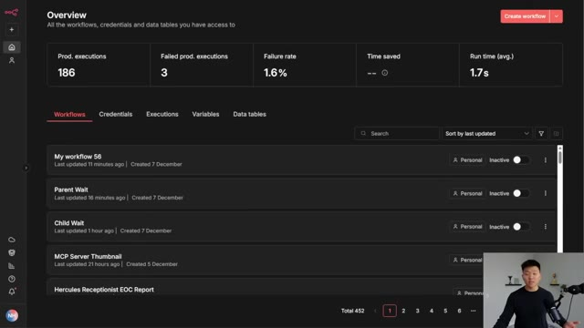
*⏱️ 00:10:08 — Interface principale du tableau de bord n8n affichant la liste des workflows et les statistiques de production.*

---

### ⏱️ `[00:10:17 - 00:10:52]` | Segment #26

**🔊 Audio (Transcription Intégrale Mot pour Mot en Français) :**
> Et il vous montrera les différences entre vos problèmes de flux de travail ou certains problèmes d'instance, ainsi qu'un score de priorité ou un score d'urgence. Et tout cela devrait pratiquement avoir une documentation. Donc, si ceux-ci portent à confusion, vous pouvez aller les lire et vous assurer que tout cela est résolu. Encore une fois, cela arrivera pour l'édition communautaire cloud et auto-hébergée, peu importe où vous voulez avoir votre NNN, cela va arriver. Dans la vidéo d'aujourd'hui, je vous montrais la version 2.0 dans ma version auto-hébergée de NNN avec Hostinger. Si vous voulez regarder une vidéo complète sur la façon dont vous pouvez configurer cela, vous pouvez cliquer sur le lien là-haut. Et vous pouvez également utiliser le code NateHerk pour 10 % de réduction sur les abonnements annuels lorsque vous vous auto-hébergez sur Hostinger. Et si vous voulez approfondir NNN et l'IA

**👁️ Analyse Visuelle d'Écran (gemini-3.5-flash-lite) :**
**Interface & Outils** : Interface web n8n (paramètres et éditeur de workflow)

**Contenu textuel & Code** : Compatibility report for version 2.0.0, Instance issues, Workflow issues, AI Agent workflow avec nœuds OpenRouter, Slack et Perplexity.

**Action / Démonstration** : Navigation dans les rapports de compatibilité n8n et présentation de l'éditeur de workflow d'un agent IA.

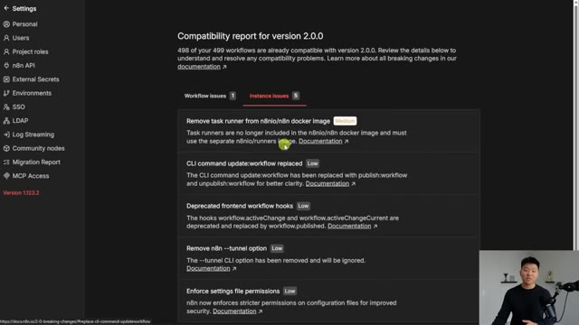
*⏱️ 00:10:26 — Rapport de compatibilité n8n montrant les problèmes d'instance et de flux de travail avec leurs niveaux de sévérité et liens vers la documentation.*

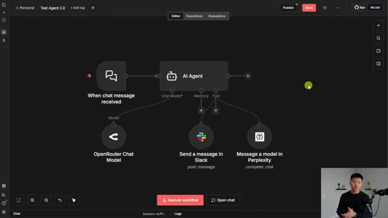
*⏱️ 00:10:35 — Éditeur de workflow n8n affichant un agent IA connectant un modèle OpenRouter avec des outils Slack et Perplexity.*

---

### ⏱️ `[00:10:52 - 00:11:07]` | Segment #27

**🔊 Audio (Transcription Intégrale Mot pour Mot en Français) :**
> des automatisations et de vous connecter avec d'autres personnes qui font de même, alors consultez définitivement ma communauté Plus. Le lien pour cela sera en bas. Mais c'est tout pour aujourd'hui. J'espère que vous avez apprécié ou que vous avez appris quelque chose de nouveau. Si c'est le cas, veuillez laisser un pouce bleu. Ça m'aide énormément. Et comme toujours, je vous remercie tous d'être arrivés jusqu'à la fin de la vidéo. Je vous vois dans la prochaine. Merci les gars.

**👁️ Analyse Visuelle d'Écran (gemini-3.5-flash-lite) :**
**Interface & Outils** : Navigateur web affichant la plateforme Skool et l'interface n8n.

**Contenu textuel & Code** : Publications de communauté, discussions, et diagramme de workflow IA avec nœuds connectés (OpenRouter Chat Model, Send a message in Slack, Message a model in Perplexity).

**Action / Démonstration** : Navigation et présentation de la communauté d'automatisation puis d'un exemple de workflow d'agent IA.

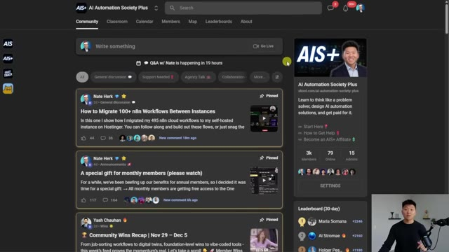
*⏱️ 00:10:56 — Capture d'écran montrant l'interface de la communauté Skool "AI Automation Society Plus" avec des publications épinglées sur les workflows n8n.*

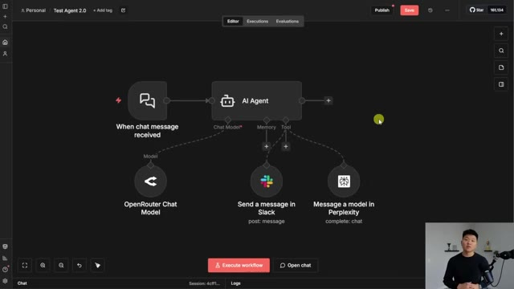
*⏱️ 00:11:00 — Capture d'écran montrant l'éditeur de workflow n8n avec un agent IA connecté à OpenRouter, Slack et Perplexity.*

---

