# 🎬 How I'd Learn n8n if I had to Start Over in 2026

> **Chaîne** : [Nate Herk | AI Automation](https://www.youtube.com/@nateherk/featured)  
> **Lien YouTube** : [https://www.youtube.com/watch?v=Fqeo8q8-nJg](https://www.youtube.com/watch?v=Fqeo8q8-nJg)  
> **Date de publication** : 20251210  
> **Durée** : 00:14:17  
> **Identifiant vidéo** : `Fqeo8q8-nJg`  
> **Transcription & Analyse** : `whisper-v3-large-turbo+gemini-3.5-flash-lite`  

---

## 📌 Synthèse Exécutive & Outils

### 💡 Résumé

Dans cette vidéo stratégique de la chaîne *Nate Herk | AI Automation*, l'analyseur et développeur en IA décortique sa méthode d'apprentissage idéale pour s'approprier **n8n** et l'automatisation intelligente en 2026. L'erreur fondamentale commise par la grande majorité des débutants réside dans la précipitation : vouloir concevoir des agents IA complexes avant même de maîtriser les fondations des flux de travail déterministes. S'appuyant sur des statistiques éloquentes (comme celles de McKinsey montrant qu'une simple automatisation standard génère entre 30 % et 200 % de ROI dès la première année), la vidéo redéfinit la hiérarchie des compétences à acquérir pour éviter l'épuisement et la fameuse « crise de sens » de la courbe de transition.

L'approche préconisée repose sur une architecture à trois couches : d'abord les flux de travail traditionnels basés sur des règles (prévisibles et robustes), ensuite les automatisations assistées par IA (qui injectent de la prise de décision ciblée), et enfin les agents IA autonomes de niveau supérieur. Pour réussir cette transition, l'ingénieur en automatisation doit impérativement dompter les structures de données (JSON), les requêtes HTTP et les API, qui constituent le moteur sous-jacent de tous les nœuds préconstruits. En comprenant que les intégrations natives ne sont que des requêtes HTTP joliment packagées, le développeur s'affranchit des limites de la plateforme.

Enfin, la vidéo aborde la psychologie de l'apprentissage à travers la courbe de transition — de l'optimiste non informé au pessimiste éclairé — et souligne l'importance vitale de l'ingénierie du contexte. Les LLM n'ayant aucune intuition inhérente des processus métiers, c'est la qualité des données injectées et du contexte fourni (l'équivalent d'un antisèche en plein examen) qui garantit la fiabilité et la valeur réelle des systèmes automatisés.

### 🛠️ Outils, Modèles & Logiciels Présentés

* **n8n** : La plateforme principale d'automatisation des flux de travail et d'orchestration d'agents au cœur de la méthodologie d'apprentissage.
* **Claude (Anthropic) / API de Claude** : Le grand modèle de langage utilisé pour assister la configuration des requêtes API et générer du code ou de la logique de flux.
* **ChatGPT (OpenAI)** : Modèle conversationnel exploité pour analyser la documentation technique des outils et structurer des requêtes HTTP complexes.
* **Gmail** : Outil de messagerie utilisé comme cas d'usage concret pour illustrer les intégrations natives et les déclencheurs de flux.
* **Perplexity** : Moteur de recherche conversationnel cité parmi les intégrations natives permettant d'enrichir les automatisations en temps réel.
* **Slack** : Plateforme de messagerie instantanée employée pour démontrer la réception de webhooks et l'envoi de notifications contextuelles.
* **HubSpot** : CRM d'entreprise utilisé pour illustrer la synchronisation des données et l'automatisation des processus commerciaux basés sur des règles.

### 🔑 Points Clés & Enseignements Stratégiques

* **Hiérarchiser l'apprentissage (Flux vs IA)** : Ne commencez jamais par l'IA ; apprenez d'abord les fondamentaux des flux de travail déterministes pour comprendre comment les données circulent avant d'introduire de l'autonomie.
* **L'architecture à trois couches** : Distinguez clairement les flux de travail basés sur des règles (prévisibles, ROI massif de 30 % à 200 %), les flux assistés par IA (décisions ciblées) et les agents autonomes (non déterministes et complexes).
* **Le coût de la non-détermination** : Plus un système intègre d'IA, plus il présente un risque d'erreur élevé, nécessitant une maintenance, un entretien et des évaluations constants pour éviter les pannes.
* **Comprendre la courbe de transition** : Anticipez la baisse de moral inévitable (passant de l'optimiste non informé au pessimiste éclairé, puis à la crise de sens) pour persévérer et atteindre le stade de l'optimiste éclairé.
* **Le JSON comme alphabet universel** : Maîtrisez le JSON (paires clés-valeurs) pour décoder instantanément les données entrantes et sortantes, éliminant ainsi le besoin de deviner le comportement de vos nœuds.
* **Le secret des requêtes HTTP et des API** : Réalisez que les nœuds natifs de n8n ne sont que des requêtes HTTP préconstruites ; cela permet de se connecter à n'importe quel logiciel externe disposant d'une documentation API.
* **L'utilisation d'assistants IA pour l'ingénierie** : Confiez la documentation technique des outils à Claude ou ChatGPT pour configurer rapidement des en-têtes d'authentification et des requêtes complexes sans blocage psychologique.
* **L'inversion du flux grâce aux Webhooks** : Apprenez à exploiter les webhooks pour que les applications externes contactent directement vos automatisations en temps réel suite à un événement (formulaire, e-mail, message).
* **Robustesse de la logique et gestion des erreurs** : Configurez rigoureusement les nœuds conditionnels ("If"), les boucles et les routes d'exceptions pour concevoir des workflows stables, prévisibles et sécurisés.
* **Démystifier les LLM** : Considérez les grands modèles de langage non pas comme des entités omniscientes, mais comme des moteurs de prédiction du mot suivant qui exigent des garde-fous stricts.
* **Prompt Engineering vs Context Engineering** : Ne vous limitez pas à dire à l'IA *quoi faire* (prompt), apprenez à lui fournir *comment penser* en lui injectant les données métiers et les informations précises nécessaires (le contexte).
* **L'analogie de l'antisèche** : Considérez le contexte fourni à l'IA pendant l'exécution comme un antisèche lors d'un examen, surpassant de loin la simple mémorisation théorique (prompt système).

---

## ⏱️ Chronologie & Transcription Complète Audio & Visuelle (Mot pour Mot)

### ⏱️ `[00:00:00 - 00:00:19]` | Segment #01

**🔊 Audio (Transcription Intégrale Mot pour Mot en Français) :**
> Quand j'ai commencé à apprendre NNN, j'ai forcé mon chemin à travers le processus d'apprentissage. Et ne vous méprenez pas, en un an j'ai beaucoup appris et je suis devenu plutôt compétent en NNN. Mais si je pouvais recommencer en 2026, je ferais les choses complètement différemment. Parce qu'à l'époque, je pensais que le but était simplement de construire des agents IA aussi rapidement que possible. Mais ce que je ne réalisais pas, c'est qu'on ne peut pas construire de bons agents tant qu'on ne comprend pas les flux de travail. Et je pense que c'est là que tout le monde se trompe.

**👁️ Analyse Visuelle d'Écran (gemini-3.5-flash-lite) :**
**Interface & Outils** : Navigateur web, Éditeur de workflow de type n8n

**Contenu textuel & Code** : Schéma d'automatisation avec un agent IA, un modèle de chat OpenAI et un déclencheur de message de chat

**Action / Démonstration** : Présentation visuelle de nœuds de workflow d'automatisation connectés entre eux

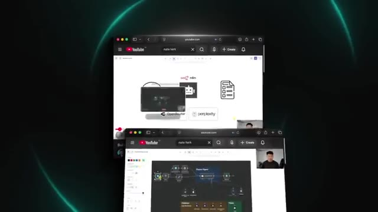
*⏱️ 00:00:05 — Capture montrant des fenêtres de navigateur superposées affichant une interface graphique avec des flux de travail et des schémas d'automatisation.*

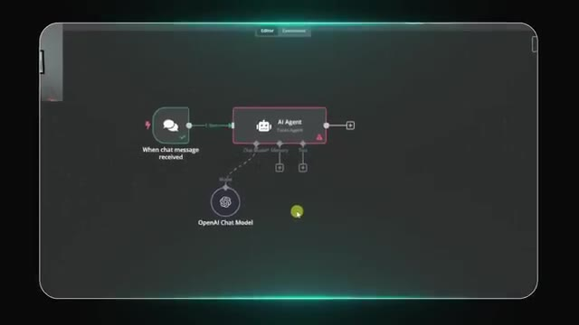
*⏱️ 00:00:15 — Capture d'écran d'un éditeur de workflow montrant un nœud 'AI Agent' connecté à un nœud 'OpenAI Chat Model' et un déclencheur 'When chat message received'.*

---

### ⏱️ `[00:00:19 - 00:00:39]` | Segment #02

**🔊 Audio (Transcription Intégrale Mot pour Mot en Français) :**
> Donc dans cette vidéo, je vais vous guider exactement à travers la façon dont j'apprendrais NNN et les automatisations de l'IA en général si je devais recommencer de zéro aujourd'hui, étape par étape. Donc entrons dans le vif du sujet. Donc si je commençais à partir de zéro en ce moment, la première chose que je me graverais dans la tête, c'est ceci. Ne commencez pas par l'IA. Commencez par les flux de travail. Apprenez les fondamentaux de l'automatisation avant même de penser à créer des agents. La plupart des débutants sautent cette étape parce qu'ils veulent créer des agents IA tout de suite.

**👁️ Analyse Visuelle d'Écran (gemini-3.5-flash-lite) :**
**Interface & Outils** : AUCUNE

**Contenu textuel & Code** : AUCUNE

**Action / Démonstration** : AUCUNE

---

### ⏱️ `[00:00:39 - 00:01:00]` | Segment #03

**🔊 Audio (Transcription Intégrale Mot pour Mot en Français) :**
> Parce qu'ils sont cool et c'est ce qu'on voit en ligne. Mais la vérité, c'est qu'on ne peut pas construire de bons agents si on ne comprend pas comment fonctionnent réellement les flux de travail. C'est essentiellement essayer de courir avant de savoir marcher. Donc voici comment je concevrais les trois couches. Vous avez les flux de travail. Ceux-là sont basés sur des règles, ils sont prévisibles, et ils sont ennuyeux, mais de la meilleure façon possible. Vous savez à quoi ressemblent les entrées donc vous savez quels seront les résultats, et vous pouvez mapper ces variables, définir vos propres conditions, et cela s'exécute de la même manière à chaque fois.

**👁️ Analyse Visuelle d'Écran (gemini-3.5-flash-lite) :**
**Interface & Outils** : Graphique 3D de pyramide conceptuelle animée

**Contenu textuel & Code** : Niveaux de la pyramide numérotés #1 ("WORKFLOWS"), #2 et #3 avec des libellés textuels.

**Action / Démonstration** : Présentation visuelle de la base de la pyramide conceptuelle dédiée aux flux de travail (workflows).

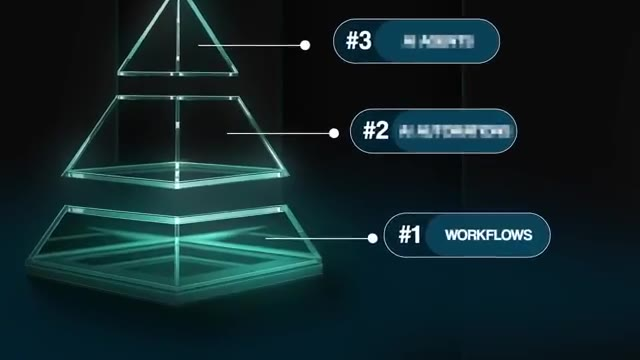
*⏱️ 00:00:50 — Un graphique en pyramide transparente à trois niveaux, illustrant une hiérarchie conceptuelle avec le niveau #1 étiqueté "WORKFLOWS" à la base.*

---

### ⏱️ `[00:01:00 - 00:01:33]` | Segment #04

**🔊 Audio (Transcription Intégrale Mot pour Mot en Français) :**
> C'est l'automatisation des processus commerciaux classique, et elle existe déjà depuis des décennies, mais c'est toujours l'un des moyens les plus puissants pour produire réellement un retour sur investissement. McKinsey a constaté que la simple automatisation des flux de travail standard peut générer entre 30 % et 200 % de retour sur investissement dès la première année, avec des économies de coûts de main-d'œuvre de 25 % à 40 %. Et la plupart des petites entreprises n'ont toujours pas mis en place ces automatisations de base. Je crois donc fermement que vous pourriez littéralement vous positionner aujourd'hui simplement comme une agence d'automatisation ou une agence d'efficacité et bâtir une entreprise vraiment solide sans jamais toucher à l'IA et générer des résultats massifs pour vos clients. Mais les automatisations par l'IA constituent ensuite l'étape supérieure.

**👁️ Analyse Visuelle d'Écran (gemini-3.5-flash-lite) :**
**Interface & Outils** : Document texte / Article de recherche

**Contenu textuel & Code** : Texte extrait d'une étude de cas McKinsey sur les bénéfices de la RPA et le retour sur investissement.

**Action / Démonstration** : Affichage d'un extrait de texte et mise en surbrillance d'une citation clé sur le ROI de l'automatisation.

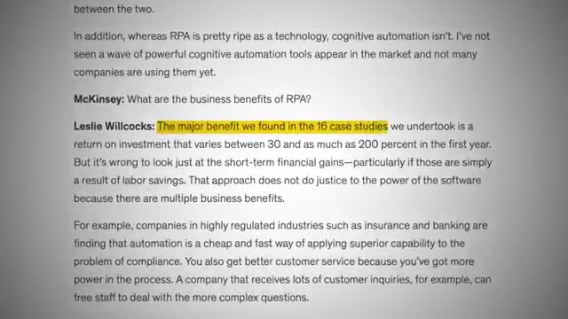
*⏱️ 00:01:09 — Capture d'écran montrant un article de texte avec un paragraphe sur la RPA (Robotic Process Automation) et McKinsey, avec une phrase surlignée en jaune concernant le retour sur investissement.*

---

### ⏱️ `[00:01:33 - 00:01:55]` | Segment #05

**🔊 Audio (Transcription Intégrale Mot pour Mot en Français) :**
> parce que vous avez toujours ces flux de travail prévisibles, mais maintenant vous pouvez y ajouter un peu d'intelligence et de prise de décision. Peut-être avez-vous simplement besoin d'utiliser l'IA à la fin du flux de travail pour personnaliser l'e-mail. Peut-être en avez-vous besoin au début pour attribuer aux tickets de support une priorité haute ou basse. Ce sont de petites décisions contrôlées au sein d'un flux de travail plus vaste basé sur des règles. McKinsey estime également qu'environ 50 % des activités de travail et des processus peuvent être automatisés sans utiliser du tout l'IA.

**👁️ Analyse Visuelle d'Écran (gemini-3.5-flash-lite) :**
**Interface & Outils** : AUCUNE

**Contenu textuel & Code** : AUCUNE

**Action / Démonstration** : AUCUNE

---

### ⏱️ `[00:01:55 - 00:02:19]` | Segment #06

**🔊 Audio (Transcription Intégrale Mot pour Mot en Français) :**
> Donc ces flux de travail assistés par IA conviennent à la plupart des cas d'utilisation qu'une entreprise peut avoir. Ensuite, enfin, nous avons nos agents IA, qui constituent la couche supérieure. Ces systèmes peuvent prendre des décisions, faire référence à la mémoire, utiliser des outils et s'ajuster en fonction du contexte. Ils sont super puissants, mais ils sont aussi beaucoup plus difficiles à contrôler et ils ont une plus forte probabilité de tomber en panne. C'est là que les gens ont tendance à se perdre, parce qu'ils sautent directement dans ces flux de travail agentiques avant même d'avoir appris les variables et le JSON, les structures de données, et comment se comporte un flux de travail de base.

**👁️ Analyse Visuelle d'Écran (gemini-3.5-flash-lite) :**
**Interface & Outils** : Interface graphique d'automatisation visuelle (type éditeur de workflows de type n8n ou similaire).

**Contenu textuel & Code** : Nœuds de workflow connectés incluant Telegram Trigger, Switch, Personal Assistant (Agent), OpenAI Chat Model, Window Buffer Memory, Contact Database, Vector Store Tool et Pinecone Vector Store.
[DESC_IMAGE_3] Visualisation d'un workflow d'agent IA complet intégrant des outils de communication, de mémoire et de base de données.

**Action / Démonstration** : Explications face caméra et démonstration conceptuelle.

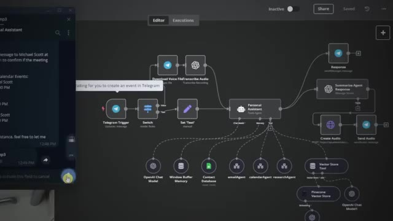
*⏱️ 00:02:13 — Capture d'écran montrant un éditeur de flux de travail complexe (type interface d'automatisation) avec un agent personnel centralisé connectant Telegram, OpenAI et divers outils et bases de données vectorielles.*

---

### ⏱️ `[00:02:19 - 00:02:40]` | Segment #07

**🔊 Audio (Transcription Intégrale Mot pour Mot en Français) :**
> Donc cela vous amènerait à être confus, des choses se casseraient, et ensuite vous voudriez abandonner. Donc les workflows sont déterministes, et ils demandent beaucoup plus qu'on les configure et qu'on les oublie que les agents IA, car les agents IA sont non déterministes. Plus vous avez d'IA, plus il y a de risques d'erreurs, ce qui signifie que vous avez besoin d'une maintenance, d'un entretien et d'évaluations constants pour vous assurer que les systèmes apportent réellement de la valeur plutôt que de devenir simplement un casse-tête.

**👁️ Analyse Visuelle d'Écran (gemini-3.5-flash-lite) :**
**Interface & Outils** : Interface de workflow / automatisation web.

**Contenu textuel & Code** : Paramètres de configuration d'un nœud (opération "Check Text for Violations", mots-clés "password, system").

**Action / Démonstration** : Affichage des réglages de configuration d'un workflow pour illustrer la maintenance et le paramétrage.

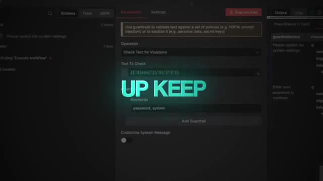
*⏱️ 00:02:35 — Interface d'un outil d'automatisation ou de workflow montrant des paramètres de configuration avec un texte superposé "UP KEEP".*

---

### ⏱️ `[00:02:40 - 00:03:13]` | Segment #08

**🔊 Audio (Transcription Intégrale Mot pour Mot en Français) :**
> Et une fois que vous aurez compris cette base, vous voudrez apprendre les éléments constitutifs essentiels qui font fonctionner chaque flux de travail. Tout dans NNN se résume à des données qui entrent, puis qui sortent. Et une fois que vous aurez compris comment les données sont formées et comment elles circulent, toute la plateforme devient beaucoup moins intimidante. Il y a une chose très rapide dont je veux vous parler, et cela s'appelle la courbe de transition. Dans la vie, chaque fois que vous essayez quelque chose de nouveau ou que vous essayez d'apprendre quelque chose, vous traversez ces phases. Et c'est bien d'en être conscient à l'avance afin que vos attentes soient alignées et que vous ayez le plus de chances de réussir. Parce que je ne vais pas vous mentir, quand vous commencez pour la première fois et que vous allez regarder du JSON ou configurer une requête HTTP ou essayer de prompter votre agent, vous allez probablement vous sentir dépassé. Je sais que ça a été mon cas.

**👁️ Analyse Visuelle d'Écran (gemini-3.5-flash-lite) :**
**Interface & Outils** : Interface graphique de workflow (type n8n ou Make)

**Contenu textuel & Code** : Schémas conceptuels illustrant le flux de données ("DATA IN" / "DATA OUT") et les 4 phases.

**Action / Démonstration** : Présentation des concepts fondamentaux et de la structure des flux de travail d'automatisation.

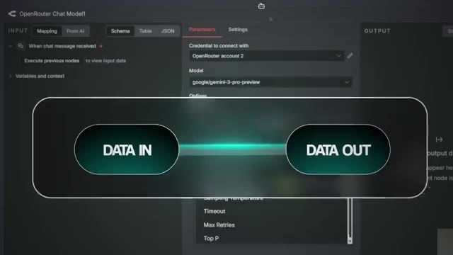
*⏱️ 00:02:48 — Interface d'un nœud de workflow avec un encadré central affichant "DATA IN" et "DATA OUT".*

*⏱️ 00:02:56 — Graphique animé montrant les "4 phases" d'un processus sous forme de courbe d'apprentissage ou de progression.*

---

### ⏱️ `[00:03:13 - 00:03:33]` | Segment #09

**🔊 Audio (Transcription Intégrale Mot pour Mot en Français) :**
> Donc la courbe de transition est fondamentalement l'idée que vous commencez dans la phase un et vous êtes sur une pente ascendante en tant qu'optimiste non informé parce que vous voyez l'opportunité. Vous voyez des gens construire des agents sympas ou gagner de l'argent avec des agents ou peu importe ce que c'est, et vous êtes enthousiasmé par cette opportunité. Mais ensuite, vous franchissez en quelque sorte cette bosse et vous devenez un pessimiste informé dans l'étape deux. Et c'est sur la pente descendante parce que maintenant vous comprenez les complexités qui entrent dans tout cela et vous vous sentez submergé.

**👁️ Analyse Visuelle d'Écran (gemini-3.5-flash-lite) :**
**Interface & Outils** : Graphique explicatif animé affiché à l'écran.

**Contenu textuel & Code** : Schéma des 4 phases de la courbe de transition avec les termes 'Uninformed Optimist' et 'Informed Pessimist'.

**Action / Démonstration** : Présentation visuelle et explication des différentes étapes de la courbe de transition par le présentateur.

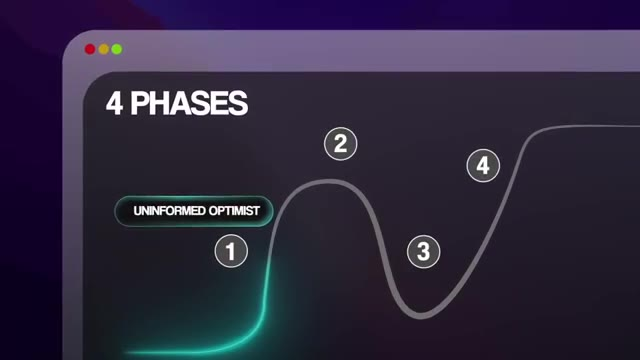
*⏱️ 00:03:18 — Un graphique animé représentant les 4 phases, mettant en surbrillance la phase 1 avec le libellé 'Uninformed Optimist'.*

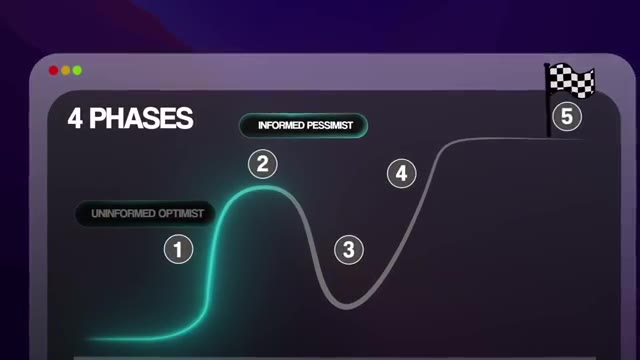
*⏱️ 00:03:28 — Le même graphique animé illustrant la progression vers la phase 2, étiquetée 'Informed Pessimist'.*

---

### ⏱️ `[00:03:33 - 00:04:02]` | Segment #10

**🔊 Audio (Transcription Intégrale Mot pour Mot en Français) :**
> Alors que vous passez à la troisième étape, vous touchez la crise de sens. Et c'est là que vous devez prendre une décision. Vous pouvez soit aller à la quatrième étape et vous planter lamentablement, soit utiliser cet élan pour remonter vers la cinquième étape, qui est celle de l'optimiste éclairé, et c'est là que vous voulez être. Ce n'est pas seulement un événement unique. Au cours des 12 derniers mois, je suis probablement devenu un pessimiste éclairé environ 17 fois. Mais maintenant que vous comprenez tout ce cycle, il est beaucoup plus facile de traverser la crise de sens et de poursuivre votre ascension. Je devais donc parler de cela rapidement avant de passer aux parties suivantes, car tout le Qu'on se sente submergé quand on commence. Quoi qu'il en soit, la première chose à apprendre est le JSON et les types de données.

**👁️ Analyse Visuelle d'Écran (gemini-3.5-flash-lite) :**
**Interface & Outils** : Graphique conceptuel (infographie animée)

**Contenu textuel & Code** : Texte affiché : '4 PHASES', 'UNINFORMED OPTIMIST', 'INFORMED PESSIMIST', 'CRISIS OF MEANING', 'CRASH AND BURN'.

**Action / Démonstration** : Présentation visuelle du modèle des phases de progression et de la crise de sens.

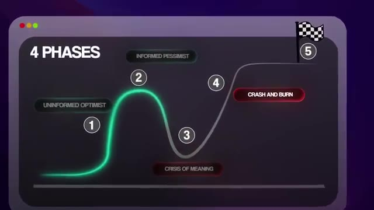
*⏱️ 00:03:40 — Schéma graphique illustrant les 4 phases de la courbe d'apprentissage/adoption avec les différentes étapes (Uninformed Optimist, Informed Pessimist, Crisis of Meaning, Crash and Burn).*

---

### ⏱️ `[00:04:02 - 00:04:25]` | Segment #11

**🔊 Audio (Transcription Intégrale Mot pour Mot en Français) :**
> C'est le langage de presque tout ce que vous toucherez dans l'automatisation. Et à première vue, le JSON peut ressembler à du code, mais quand on regarde de plus près, ce ne sont que des paires de clés et de valeurs. Pensez donc aux achats en ligne. Vous cliquez sur un produit et vous pouvez voir couleur égale bleu, taille égale moyen, prix égal 99 dollars et 99 cents. Le JSON, c'est exactement la même chose. C'est simplement écrit dans un format structuré spécifique. Et une fois que vous comprenez comment vous pouvez le lire et y naviguer, vous arrêtez de deviner et vous commencez à savoir exactement avec quelles données vous devez travailler.

**👁️ Analyse Visuelle d'Écran (gemini-3.5-flash-lite) :**
**Interface & Outils** : Visual Studio Code (VS Code) et navigateur web e-commerce.

**Contenu textuel & Code** : Fichiers JSON (`people.json`), code JavaScript (`index.js`) et page de commerce en ligne.
[DESC_IMAGE_1] VS Code avec structure JSON.
[DESC_IMAGE_2] Interface e-commerce (analogie clé-valeur).
[DESC_IMAGE_3] VS Code avec code JS et commentaires JSON.

**Action / Démonstration** : Navigation et explication visuelle des structures JSON à l'aide de l'éditeur de code et d'un exemple d'achat en ligne.

*⏱️ 00:04:08 — Éditeur de code VS Code affichant un fichier JSON (`people.json`) avec des paires clé-valeur.*

*⏱️ 00:04:14 — Page web d'achat en ligne montrant des options de produits, illustrant visuellement la structure de données des paires clé-valeur.*

*⏱️ 00:04:19 — Éditeur VS Code affichant un fichier JavaScript (`index.js`) avec des commentaires explicatifs sur le format JSON.*

---

### ⏱️ `[00:04:25 - 00:04:44]` | Segment #12

**🔊 Audio (Transcription Intégrale Mot pour Mot en Français) :**
> Ensuite, ce sont les API et les requêtes HTTP, qui représentent probablement la compétence la plus importante que vous aurez jamais à apprendre en automatisation. C'est ainsi que les données circulent entre différents outils. Donc, si vous ne comprenez pas les API, vous serez presque toujours limité aux intégrations que NADEN vous offre directement. La bonne nouvelle, c'est que NADN propose des milliers d'intégrations natives avec des outils comme Gmail, Perplexity, Slack, HubSpot, et bien d'autres encore.

**👁️ Analyse Visuelle d'Écran (gemini-3.5-flash-lite) :**
**Interface & Outils** : n8n (outil d'automatisation de workflows)

**Contenu textuel & Code** : Configuration d'un nœud HTTP Request avec une méthode GET et une URL de recherche Google Maps intégrant une variable JSON.

**Action / Démonstration** : Configuration et paramétrage d'une requête HTTP au sein d'un workflow d'automatisation.

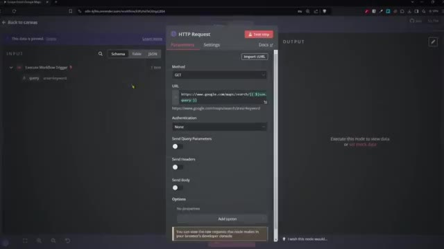
*⏱️ 00:04:39 — Capture d'écran de l'interface de n8n montrant la configuration d'un nœud de requête HTTP (HTTP Request) avec les paramètres de méthode GET et l'URL.*

---

### ⏱️ `[00:04:44 - 00:05:04]` | Segment #13

**🔊 Audio (Transcription Intégrale Mot pour Mot en Français) :**
> Mais une fois que vous réalisez que ces nœuds, ces intégrations natives, ne sont en réalité que des requêtes HTTP préconstruites, juste avec une interface utilisateur plus propre parce que n8n les a joliment emballées pour nous. Mais le point que je faisais valoir là-bas, c'est qu'une fois que vous réalisez cela, tout commence à faire tilt, car vous commencez à comprendre comment vous pouvez vous connecter à des plateformes que n8n ne prend pas encore en charge. Vous pouvez ouvrir la documentation de l'API, vous pouvez lire les points de terminaison, vous pouvez faire la requête, et vous pouvez accéder à tout ce dont vous avez besoin.

**👁️ Analyse Visuelle d'Écran (gemini-3.5-flash-lite) :**
**Interface & Outils** : n8n (éditeur de workflows)

**Contenu textuel & Code** : Paramètres de connexion Google Sheets (Credential, Resource, Operation, Document, Sheet) et message d'erreur 'Could not load list'.

**Action / Démonstration** : Configuration d'un nœud d'intégration et illustration du fonctionnement des requêtes HTTP sous-jacentes.

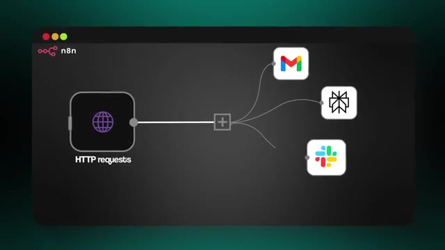
*⏱️ 00:04:49 — Schéma explicatif montrant un nœud 'HTTP requests' connecté à plusieurs applications (Gmail, Slack, etc.) sous l'interface n8n.*

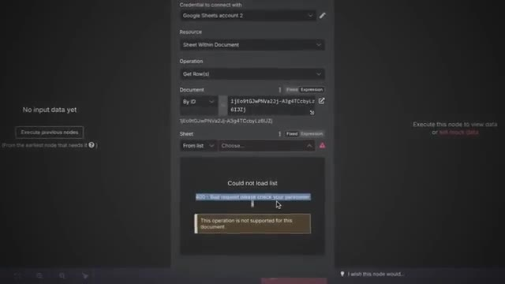
*⏱️ 00:04:59 — Panneau de configuration d'un nœud Google Sheets dans l'interface n8n affichant une erreur de chargement.*

---

### ⏱️ `[00:05:04 - 00:05:38]` | Segment #14

**🔊 Audio (Transcription Intégrale Mot pour Mot en Français) :**
> Et voici une astuce de pro. Si vous donnez à quelque chose comme ChatGPT ou l'API de Claude la documentation de n'importe quel outil dont vous avez besoin, cela peut vous aider à configurer toutes les requêtes que vous devez effectuer. Il s'agit donc vraiment de surmonter cette intimidation initiale lorsque vous voyez les mots « authentification par en-tête ». Ensuite, nous avons les webhooks, qui inversent fondamentalement le flux. Donc, au lieu que Make contacte un autre outil, l'autre outil contacte Make, et c'est ce qui déclenche notre webhook. Cela permet à n'importe lequel de nos flux de travail d'être déclenché par des événements en temps réel, comme la réception d'un e-mail, l'arrivée d'un nouveau message sur Slack, ou quelqu'un qui remplit un formulaire sur votre site web. Et enfin, vous devez comprendre la logique et la gestion des erreurs. Apprenez ce que fait un nœud « si », apprenez comment se comportent les boucles, apprenez à acheminer les données dans différentes directions, et comprenez ce que

**👁️ Analyse Visuelle d'Écran (gemini-3.5-flash-lite) :**
**Interface & Outils** : n8n (schéma conceptuel), Slack

**Contenu textuel & Code** : Schéma d'architecture API / requêtes HTTP, et messages de discussion Slack entre collaborateurs (adam, shadie, jp).
[DESC_IMAGE_3]

**Action / Démonstration** : Explications face caméra et démonstration conceptuelle.

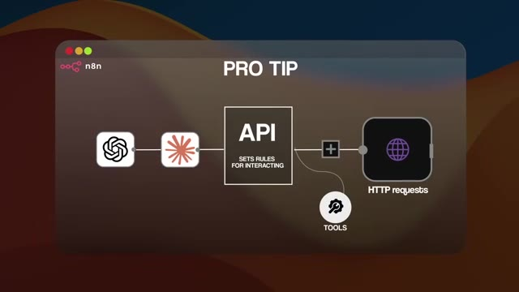
*⏱️ 00:05:13 — Schéma explicatif animé "PRO TIP" illustrant l'utilisation d'une API avec des requêtes HTTP et des outils.*

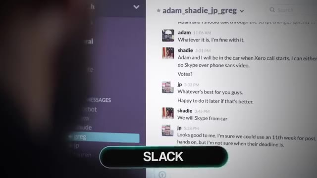
*⏱️ 00:05:30 — Capture d'écran de l'interface de messagerie Slack montrant une conversation de groupe avec des messages d'utilisateurs.*

---

### ⏱️ `[00:05:38 - 00:06:00]` | Segment #15

**🔊 Audio (Transcription Intégrale Mot pour Mot en Français) :**
> le workflow fait lorsqu'il rencontre une erreur et comment vous pouvez modifier cela. C'est ce qui vous aide à créer des workflows qui sont stables, prévisibles, faciles à améliorer et sûrs. Cela vous apprend également à concevoir la façon dont les données circulent étape par étape dans un workflow. Mais savoir comment déplacer des données ne suffit pas. Vous devez également comprendre comment l'IA elle-même réfléchit. Et c'est là qu'interviennent les LLM. Un LLM, ou grand modèle de langage, ne connaît pas votre entreprise. Il ne connaît pas vos clients. Il ne connaît pas vos processus internes.

**👁️ Analyse Visuelle d'Écran (gemini-3.5-flash-lite) :**
**Interface & Outils** : Interface web de démonstration

**Contenu textuel & Code** : Arborescence de dossiers 'TechCorp Knowledge Repository' incluant 'employee-handbook/', 'product-specs/', 'meeting-notes/' et 'customer-faqs/'

**Action / Démonstration** : Exploration d'un dépôt de documents et visualisation de la structure des fichiers au sein d'une tâche de démonstration.

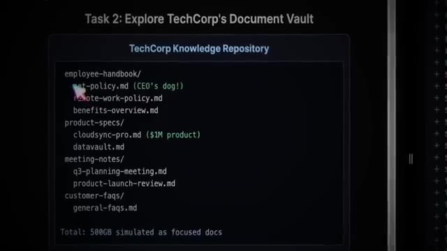
*⏱️ 00:05:54 — Capture d'écran d'une interface de démonstration montrant le référentiel de connaissances 'TechCorp Knowledge Repository' avec différents dossiers et fichiers markdown.*

---

### ⏱️ `[00:06:00 - 00:06:18]` | Segment #16

**🔊 Audio (Transcription Intégrale Mot pour Mot en Français) :**
> Au fond, tout ce qu'il fait, c'est prédire le mot suivant qui aurait du sens. C'est pourquoi vous ne devriez jamais faire aveuglément confiance à ce qu'un IA ou un LLM vous dit. Donc, pour obtenir réellement des résultats utiles, vous devez apprendre l'ingénierie du contexte. C'est l'une des compétences les plus importantes de l'automatisation moderne. Vous avez probablement déjà entendu parler de l'ingénierie des prompts auparavant, tout le monde en parle, et cela entre en quelque sorte dans cette catégorie de l'ingénierie du contexte.

**👁️ Analyse Visuelle d'Écran (gemini-3.5-flash-lite) :**
**Interface & Outils** : Aucun éditeur ou logiciel affiché (plans de coupe sur le présentateur avec un bandeau graphique textuel).

**Contenu textuel & Code** : Texte à l'écran : 'PROMPT ENGINEERING'.

**Action / Démonstration** : Présentation orale du concept d'ingénierie du contexte par le créateur de la chaîne.

---

### ⏱️ `[00:06:19 - 00:06:39]` | Segment #17

**🔊 Audio (Transcription Intégrale Mot pour Mot en Français) :**
> Parce que l'ingénierie des prompts consiste à dire au modèle quoi faire, mais l'ingénierie du contexte dans son ensemble consiste à donner au modèle les informations dont il a besoin pour savoir comment penser. Ces systèmes ne sont vraiment aussi intelligents que les données, l'expertise métier et le contexte réel que vous leur fournissez. Voici donc une analogie simple que j'aime utiliser. Un prompt système pour une IA, c'est comme étudier la veille d'un examen. Cela aide le modèle à comprendre les règles, le ton, la structure, et peut-être quelques connaissances de base.

**👁️ Analyse Visuelle d'Écran (gemini-3.5-flash-lite) :**
**Interface & Outils** : AUCUNE

**Contenu textuel & Code** : AUCUN

**Action / Démonstration** : AUCUNE

---

### ⏱️ `[00:06:39 - 00:06:58]` | Segment #18

**🔊 Audio (Transcription Intégrale Mot pour Mot en Français) :**
> Mais un bon contexte, c'est comme avoir un antisèche pendant l'examen. Ça vous donne les détails exacts au moment précis où vous en avez besoin. Donc si vous deviez choisir entre étudier et avoir un antisèche, la plupart d'entre nous choisiraient l'antisèche. Mais évidemment, les meilleurs résultats viendront en faisant bien ces deux choses. C'est ainsi que vous devez concevoir les LLM à l'intérieur et à la fin. Le modèle n'a rien de magique. Ce n'est pas un lecteur de pensée. Il n'est bon que grâce au contexte que vous lui donnez.

**👁️ Analyse Visuelle d'Écran (gemini-3.5-flash-lite) :**
**Interface & Outils** : Aucune interface logicielle ou technique affichée

**Contenu textuel & Code** : Aucun code, terminal ou prompt visible

**Action / Démonstration** : Aucune action technique ou manipulation d'outil montrée

---

### ⏱️ `[00:06:58 - 00:07:17]` | Segment #19

**🔊 Audio (Transcription Intégrale Mot pour Mot en Français) :**
> Et une fois que vous comprenez cela, vous arrêtez d'attendre du modèle qu'il devine les choses et vous commencez à lui donner les informations dont il a besoin afin de bien fonctionner. Et une fois que vous avez cet état d'esprit, la prochaine étape est de vous concentrer sur la création d'automations qui comptent vraiment. Donc cela signifie celles qui apportent de vrais résultats ou font gagner un temps précieux. Alors, voyez les choses comme ça. Créez des systèmes qui s'exécutent pendant que vous dormez, et non des systèmes qui restent là à attendre que vous cliquiez sur un bouton ou que vous leur parliez.

**👁️ Analyse Visuelle d'Écran (gemini-3.5-flash-lite) :**
**Interface & Outils** : AUCUNE

**Contenu textuel & Code** : Texte à l'écran : "BUILDING AUTOMATIONS THAT ACTUALLY MATTER" et "TYPES OF SYSTEMS".

**Action / Démonstration** : Présentation orale et affichage d'un titre de section sur les types de systèmes d'automatisation.

---

### ⏱️ `[00:07:17 - 00:07:50]` | Segment #20

**🔊 Audio (Transcription Intégrale Mot pour Mot en Français) :**
> Parce que tout le principe de l'automatisation repose sur le levier. Vous voulez des flux de travail qui font gagner du temps sans que vous ayez à intervenir. Il y a donc quatre piliers auxquels j'aime penser et qui vous aident à juger si quelque chose vaut la peine d'être automatisé. Répétitif, chronophage, sujet aux erreurs et évolutif. Donc, si un processus ne coche pas au moins deux de ces cases, ce n'est probablement pas encore quelque chose qui vaut la peine d'être automatisé. Et évidemment, les meilleures automatisations cochent les quatre. Un bon exemple de cela est lorsque j'ai publié la vidéo sur l'assistant personnel ultime sur ma chaîne YouTube. J'avais des milliers de personnes qui me contactaient pour vouloir que je le construise pour eux ou que je le personnalise d'une certaine manière. Et même si je comprends tout à fait, parce que ce serait formidable d'avoir votre propre assistant IA personnel à qui vous pouvez parler, ce type de système n'agit que lorsque vous lui dites de le faire.

**👁️ Analyse Visuelle d'Écran (gemini-3.5-flash-lite) :**
**Interface & Outils** : YouTube, n8n

**Contenu textuel & Code** : Interface de création de flux de travail n8n avec les paramètres Google Calendar.

**Action / Démonstration** : Navigation et présentation de la configuration d'un agent IA sous n8n.

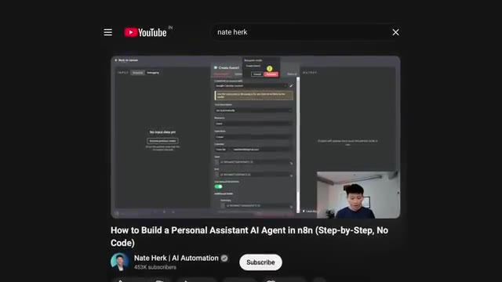
*⏱️ 00:07:42 — Capture d'écran d'une vidéo YouTube montrant l'interface de n8n avec un workflow en cours de configuration.*

---

### ⏱️ `[00:07:50 - 00:08:08]` | Segment #21

**🔊 Audio (Transcription Intégrale Mot pour Mot en Français) :**
> quelque chose. Il ne tourne pas constamment en arrière-plan, du moins de la façon dont je l'ai configuré. Donc cela ne crée vraiment pas beaucoup de levier. Maintenant, si vous comparez cela à un flux de travail qui est réellement déclenché par de vrais événements, comme un nouveau prospect qui soumet un formulaire, un paiement qui arrive ou un nouveau e-mail qui arrive dans votre boîte de réception, ces systèmes se réveillent d'eux-mêmes. Ils agissent automatiquement. Ils peuvent tourner toute la journée et toute la nuit. Et c'est là que vous obtenez de l'évolutivité.

**👁️ Analyse Visuelle d'Écran (gemini-3.5-flash-lite) :**
**Interface & Outils** : Navigateur web sur ordinateur portable

**Contenu textuel & Code** : Formulaire web de soumission de prospects ('New Lead Submitting')

**Action / Démonstration** : Illustration visuelle de la soumission d'un nouveau prospect sur un site web pour appuyer l'explication.

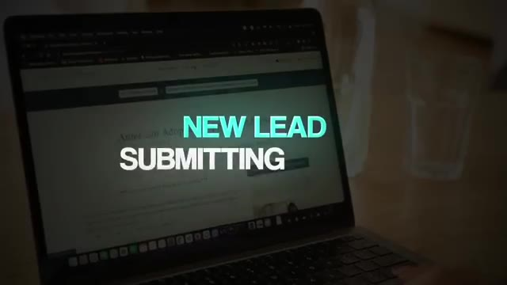
*⏱️ 00:07:59 — Gros plan sur un ordinateur portable affichant un formulaire web avec le texte superposé 'NEW LEAD SUBMITTING'.*

---

### ⏱️ `[00:08:09 - 00:08:44]` | Segment #22

**🔊 Audio (Transcription Intégrale Mot pour Mot en Français) :**
> Et c'est le genre de travail sur lequel vous voulez vous concentrer au début. Et c'est quelque chose qui me passionne énormément. Mais si vous y réfléchissez, disons que vous concevez un système qui fait gagner du temps à l'entreprise et la fait croître. Et en raison de tout ce temps que vous gagnez et de toute la nouvelle croissance que traverse l'entreprise, ce système que vous avez construit va être davantage utilisé. Donc, cela crée simplement une sorte de volant d'inertie infini de valeur et un retour sur investissement à mise à l'échelle exponentielle. Et pour trouver et construire de manière cohérente ces flux de travail à fort retour sur investissement, vous devez commencer à penser comme un ingénieur des procédés. Donc, ce que je veux dire par là, c'est qu'avant même d'ouvrir NNN, je m'assoierais, je cartographierais le processus sur papier. La plupart des gens sautent directement dans le canevas et commencent à faire glisser des nœuds, en espérant que tout finira par s'assembler. Et c'est comme ça qu'on se retrouve avec des flux de travail désordonnés et fragiles qui

**👁️ Analyse Visuelle d'Écran (gemini-3.5-flash-lite) :**
**Interface & Outils** : Graphique conceptuel animé (interface logicielle de présentation ou de montage vidéo).

**Contenu textuel & Code** : Trois icônes circulaires reliées par des flèches : 'SYSTEM' (engrenages), 'TIME' (horloge), 'GROWTH' (graphique de croissance).

**Action / Démonstration** : Affichage d'un diagramme conceptuel illustrant le flux entre système, gain de temps et croissance d'entreprise.

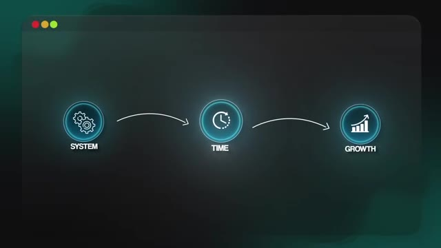
*⏱️ 00:08:17 — Schéma explicatif animé montrant le lien logique de cause à effet entre 'SYSTEM', 'TIME' et 'GROWTH'.*

---

### ⏱️ `[00:08:44 - 00:09:03]` | Segment #23

**🔊 Audio (Transcription Intégrale Mot pour Mot en Français) :**
> qui ne sont pas modulaires, qui ne sont pas évolutifs, et qui nécessitent énormément de raffinement après les avoir mis en production. Cela les rend également plus difficiles à expliquer lorsque vous devez les transmettre à un autre ingénieur ou lorsque vous devez expliquer leur fonctionnement à l'équipe. Alors, à la place, commencez simplement par penser comme un ingénieur des méthodes. Décomposez le processus métier en étapes claires et détaillées. Qui fait quoi ? Quand cela se produit-il ? Qu'est-ce qui déclenche cela ? D'où viennent les données ?

**👁️ Analyse Visuelle d'Écran (gemini-3.5-flash-lite) :**
**Interface & Outils** : Interface graphique de présentation vidéo (diagramme de processus métier)

**Contenu textuel & Code** : Texte "BUSINESS PROCESS" et bloc "PROCESS ENGINEER" avec icône associée

**Action / Démonstration** : Affichage d'un diagramme de flux illustrant le rôle d'un ingénieur processus dans le workflow IA

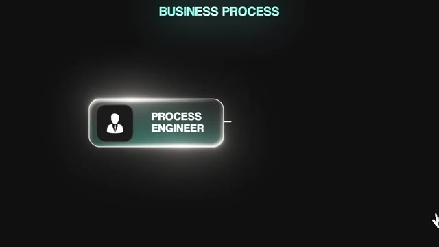
*⏱️ 00:08:59 — Schéma graphique animant un processus métier avec une boîte "PROCESS ENGINEER" sur fond sombre.*

---

### ⏱️ `[00:09:03 - 00:09:23]` | Segment #24

**🔊 Audio (Transcription Intégrale Mot pour Mot en Français) :**
> Qu'est-ce qu'on fait des données ? Quel est le résultat final qui nous importe ? Je pense que vous avez compris. Et à partir de là, j'aime faire une maquette avant de le construire réellement et de le finaliser. Et c'est exactement ce que j'enseigne dans mon cours, « 10 heures en 10 secondes ». Si vous voulez approfondir ce sujet, vous pouvez rejoindre mon groupe Plus. Le lien se trouve dans la description. Mais voici l'idée clé : si vous ne pouvez pas expliquer un processus clairement sur papier et obtenir l'adhésion de votre client ou de votre équipe, alors il est impossible que vous puissiez automatiser ce processus clairement.

**👁️ Analyse Visuelle d'Écran (gemini-3.5-flash-lite) :**
**Interface & Outils** : Navigateur web affichant la plateforme Skool (AI Automation Society Plus)

**Contenu textuel & Code** : Interface de la communauté Skool avec les onglets Community, Classroom, Calendar, Members, Map, Leaderboards et About, ainsi qu'une bannière « AIS+ ».

**Action / Démonstration** : Présentation visuelle de la communauté Skool associée au cours et au programme d'automatisation.

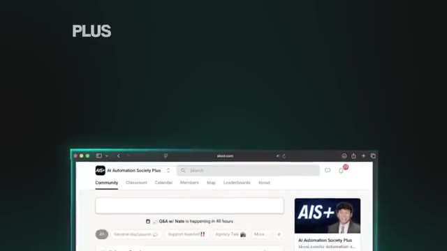
*⏱️ 00:09:13 — Capture d'écran d'une interface de navigateur web montrant la communauté Skool « AI Automation Society Plus ».*

---

### ⏱️ `[00:09:23 - 00:09:43]` | Segment #25

**🔊 Audio (Transcription Intégrale Mot pour Mot en Français) :**
> C'est essentiellement comme si vous renversiez un sac de Lego et jetiez ensuite les instructions, et que vous essayiez de construire la voiture de mémoire à partir de l'image que vous avez vue sur la boîte des Lego. Vous pourriez finir par obtenir quelque chose qui fonctionne un peu, qui y ressemble un peu, mais cela va prendre beaucoup plus de temps et ce ne sera probablement pas correct. Alors, ralentissez au début, cartographiez le processus, définissez bien les étapes, obtenez l'accord de toutes les personnes impliquées, et ensuite allez dans NNN pour le construire.

**👁️ Analyse Visuelle d'Écran (gemini-3.5-flash-lite) :**
**Interface & Outils** : AUCUNE

**Contenu textuel & Code** : AUCUNE

**Action / Démonstration** : AUCUNE

---

### ⏱️ `[00:09:43 - 00:10:02]` | Segment #26

**🔊 Audio (Transcription Intégrale Mot pour Mot en Français) :**
> Ce petit effort de planification au départ vous fera gagner énormément de temps et vous évitera bien des maux de tête par la suite. Je pense toujours à la citation d'Abe Lincoln : si j'avais six heures pour abattre un arbre, je passerais les quatre premières à aiguiser la hache. Donc, une fois que vous avez tout mis au point, il est temps de tester et d'affiner tout cela en pratique. Si je pouvais enseigner un seul état d'esprit à chaque débutant, ce serait celui-ci. Votre première version plantera, et c'est tout à fait normal. On ne sait pas ce qu'on ne sait pas.

**👁️ Analyse Visuelle d'Écran (gemini-3.5-flash-lite) :**
**Interface & Outils** : AUCUNE

**Contenu textuel & Code** : AUCUNE

**Action / Démonstration** : AUCUNE

---

### ⏱️ `[00:10:02 - 00:10:26]` | Segment #27

**🔊 Audio (Transcription Intégrale Mot pour Mot en Français) :**
> L'objectif au début est d'échouer rapidement, d'en tirer des leçons et d'améliorer le système à chaque fois. Et je ne veux pas seulement parler de votre tout premier flux de travail, je veux dire le premier flux de travail de chaque processus que vous essayez d'automatiser. Chaque fois que je vais construire un nouveau système pour une vidéo YouTube, pour moi, pour un client ou peu importe quoi d'autre, j'obtiens toujours des tonnes d'échecs et ça plante tout de suite. Mais tout cela constitue des données que vous pouvez utiliser pour l'améliorer. C'est la même raison pour laquelle les experts en publicités Facebook, ou les experts YouTube, ou peu importe le type d'expert que vous avez, même s'ils savent ce qu'ils font, ils font quand même des tests fractionnés sur tout.

**👁️ Analyse Visuelle d'Écran (gemini-3.5-flash-lite) :**
**Interface & Outils** : Navigateur web affichant le site TrueHorizon AI.

**Contenu textuel & Code** : Témoignages clients (Erich Rohn, Nick Sonnenberg, Jim Hankins) sur le site web TrueHorizon AI.

**Action / Démonstration** : Présentation visuelle de témoignages clients et de cas d'usage réels.

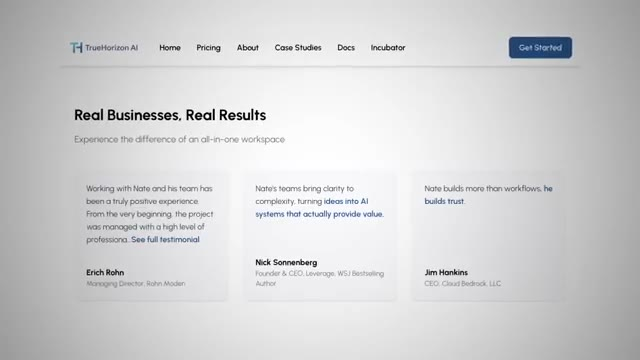
*⏱️ 00:10:14 — Capture d'écran d'une page web montrant le site de "TrueHorizon AI" avec la section "Real Businesses, Real Results" et des témoignages clients.*

---

### ⏱️ `[00:10:27 - 00:11:02]` | Segment #28

**🔊 Audio (Transcription Intégrale Mot pour Mot en Français) :**
> Et ils utilisent toujours toutes ces données et conclusions pour aider à l'itération continue à l'avenir. C'est donc pour cela que nous construisons des POC, des preuves de concept, et des MVP, des produits minimum viables. Ils existent simplement pour que vous puissiez obtenir quelque chose qui fonctionne, même si ce n'est pas parfait, puis vous pouvez le surveiller et voir où cela bloque et corriger ces points faibles. En fait, vous devriez honnêtement essayer de casser vos propres flux de travail exprès autant que vous le pouvez. Poussez-les dans leurs retranchements, alimentez-les avec des cas limites, et voyez simplement ce qui se passe. Parce que plus vous trouvez de faiblesses tôt, plus le système final sera solide. Et une partie majeure de cela est en fait le suivi et la journalisation. Ainsi, chaque flux de travail que vous construisez devrait avoir une sorte de journal d'audit sur chaque exécution. Ceux-ci seront stockés dans N8N, mais ce n'est peut-être pas permanent selon votre configuration. Donc, si vous pouvez faire en sorte que chaque exécution alimente un

**👁️ Analyse Visuelle d'Écran (gemini-3.5-flash-lite) :**
**Interface & Outils** : AUCUNE

**Contenu textuel & Code** : AUCUNE

**Action / Démonstration** : AUCUNE

---

### ⏱️ `[00:11:02 - 00:11:26]` | Segment #29

**🔊 Audio (Transcription Intégrale Mot pour Mot en Français) :**
> Google Sheet ou un Airtable, cela va vraiment vous aider parce que vous pouvez trouver des schémas dans ces échecs. Vous pouvez repérer les erreurs et vous pouvez construire des garde-fous qui protègent contre ces schémas afin qu'ils ne se reproduisent pas. Et votre travail n'est pas de construire quelque chose une seule fois puis de simplement vous en aller. Votre travail est de construire quelque chose de stable qui continue de fonctionner au fil du temps. Et rappelez-vous, bien sûr, plus vous avez d'IA dans un flux de travail, plus vous devez la surveiller. De nouveaux modèles de chat sortent, les API se mettent à jour, nnovation (N8N) publie de nouveaux nœuds, de nouvelles versions. L'IA ne se comporte pas de la même manière pour toujours.

**👁️ Analyse Visuelle d'Écran (gemini-3.5-flash-lite) :**
**Interface & Outils** : AUCUNE

**Contenu textuel & Code** : AUCUN

**Action / Démonstration** : AUCUNE

---

### ⏱️ `[00:11:26 - 00:12:03]` | Segment #30

**🔊 Audio (Transcription Intégrale Mot pour Mot en Français) :**
> Restez donc près de vos systèmes, effectuez des vérifications régulières et apportez de petites améliorations au fil de l'évolution des choses. C'chlà... C'est ainsi que l'on construit des automatisations qui durent vraiment. Et pendant que vous apprenez et construisez, évitez de tomber dans l'un des plus grands pièges qui ralentit tout le monde. Ils restent bloqués dans l'enfer des tutoriels. Ils passent toute leur journée à regarder des vidéos, à prendre des notes et à consommer du contenu, mais ils ne construisent jamais rien en réalité. On ne peut pas apprendre l'automatisation en se contentant de regarder quelqu'un d'autre cliquer sur des boutons. Il faut aller mettre les mains dans le cambouis dans n8n ou n'importe quelle plateforme d'automatisation que vous souhaitez utiliser. Suivez donc le tutoriel, mais reconstruisez-le ensuite par vous-même. Cassez des choses, débuguez-les, essayez différentes variations. C'est là que se produit le véritable apprentissage. Au bout d'un moment, vous remarquerez quelque chose d'intéressant. Environ 90 % de tous les flux de travail s'appuient sur les 15 mêmes nœuds principaux ou à peu près. Et la plupart des erreurs se classent dans le même petit nombre de

**👁️ Analyse Visuelle d'Écran (gemini-3.5-flash-lite) :**
**Interface & Outils** : Aucune interface logicielle ou de programmation affichée.

**Contenu textuel & Code** : Aucun code, terminal ou diagramme visible.

**Action / Démonstration** : Le présentateur conclut sa vidéo en parlant directement à l'audience.

---

### ⏱️ `[00:12:03 - 00:12:22]` | Segment #31

**🔊 Audio (Transcription Intégrale Mot pour Mot en Français) :**
> de catégories. Une fois que vous maîtrisez ceux-là, vous pouvez presque tout construire en toute confiance. J'ai même fait une vidéo complète sur ces nœuds principaux exacts que j'utilise après avoir construit des centaines de flux de travail, et je vais la mettre en lien juste ici pour que vous puissiez aller y jeter un œil. Et une fois que vous connaissez bien ces nœuds, et que vous commencez à construire régulièrement, les choses commencent à faire tilt. L'automatisation devient de la reconnaissance de motifs. Lorsque vous rencontrez une erreur, essayez simplement de comprendre comment la corriger vous-même avant d'aller sur un forum communautaire.

**👁️ Analyse Visuelle d'Écran (gemini-3.5-flash-lite) :**
**Interface & Outils** : Navigateur web affichant une vidéo YouTube (interface YouTube).

**Contenu textuel & Code** : Titre de la vidéo YouTube : 'The 17 Battle Tested Nodes That Built 200 AI Workflows (real examples)' et aperçu d'un grand diagramme de flux de travail.

**Action / Démonstration** : Présentation vidéo et illustration visuelle de workflows d'automatisation complexes à l'aide de nœuds.

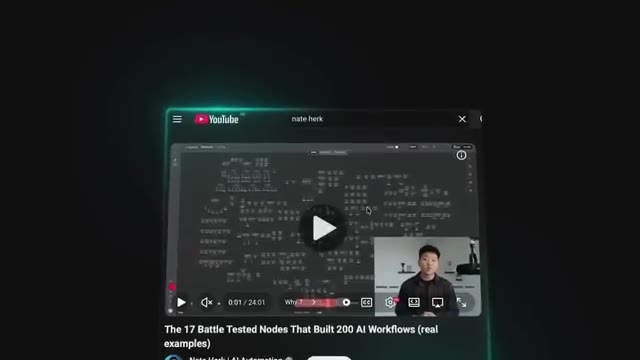
*⏱️ 00:12:08 — Capture d'écran YouTube montrant le présentateur Nate Herk et un diagramme de flux de travail complexe en arrière-plan.*

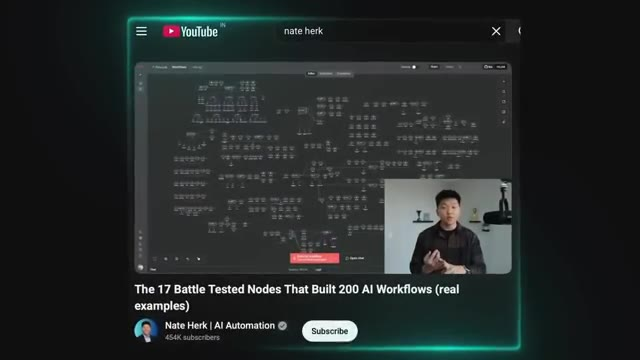
*⏱️ 00:12:13 — Capture d'écran YouTube similaire montrant le flux de travail des nœuds d'IA et la vidéo du présentateur en bas à droite.*

---

### ⏱️ `[00:12:22 - 00:12:56]` | Segment #32

**🔊 Audio (Transcription Intégrale Mot pour Mot en Français) :**
> Et ensuite, quand vous le corrigez, assurez-vous de comprendre pourquoi ce que vous avez fait a fait disparaître l'erreur. De cette façon, quand elle réapparaîtra, parce qu'elle réapparaîtra, croyez-moi, vous saurez exactement où regarder et comment rendre le flux de travail vert à nouveau. Et à chaque fois que ces schémas se présentent, vous devenez simplement plus rapide. Évitez donc l'enfer des tutoriels et faites vos répétitions. Plus vous construisez, meilleur vous devenez. Et lorsque vous atteignez enfin ce point où vous construisez avec une réelle confiance, la prochaine étape logique est de transformer ce que vous avez appris en quelque chose que vous pouvez réellement vendre. Donc, si votre objectif est de construire une entreprise avec l'automatisation, alors vous devez apprendre à construire des systèmes pour lesquels les gens paieront réellement. Et la clé pour cela, c'est d'apprendre à parler en termes de ROI, ou retour sur investissement, et non en termes de technologie. Les clients se fichent de tout le jargon technique, du JSON, des nœuds, ou de l'ingéniosité de votre flux de travail. Ils s'en moquent vraiment

**👁️ Analyse Visuelle d'Écran (gemini-3.5-flash-lite) :**
**Interface & Outils** : Interface de conception de workflow (type n8n ou plateforme similaire d'automatisation d'agents IA)

**Contenu textuel & Code** : Nœuds de workflow étiquetés 'Bad Agent', 'Get a record in Airtable' et 'Log Error' avec des indicateurs d'erreur.

**Action / Démonstration** : Présentation visuelle d'un schéma de flux de travail montrant la gestion des erreurs d'un agent IA.

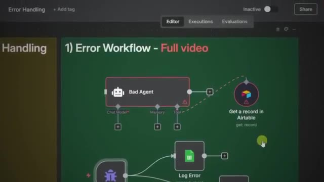
*⏱️ 00:12:31 — Capture d'écran montrant un diagramme de flux de travail (workflow) avec des icônes d'agent IA et d'intégration Airtable, illustrant la gestion des erreurs.*

---

### ⏱️ `[00:12:56 - 00:13:16]` | Segment #33

**🔊 Audio (Transcription Intégrale Mot pour Mot en Français) :**
> se soucient de trois choses : le temps économisé, l'argent économisé et un travail de meilleure qualité. Et parfois je dis aussi la concentration, mais cela se combine un peu avec tous les autres. Gardez donc les choses simples. Commencez par des MVP qui résolvent réellement un problème clair. Avant de parler d'agents IA ou d'agents vocaux, assurez-vous de pouvoir construire quelque chose de prévisible qui apporte une valeur mesurable. Vous comprenez la valeur parce que vous construisez dans ce domaine depuis un moment, mais vos clients ne sont pas dans ce monde tous les jours.

**👁️ Analyse Visuelle d'Écran (gemini-3.5-flash-lite) :**
**Interface & Outils** : n8n ou Make (diagramme de workflow)

**Contenu textuel & Code** : Nœuds de workflow : Gmail Trigger, Text Classifier, Customer Support Agent. Texte superposé : "YOU CAN BUILD SOMETHING PREDICTABLE THAT DELIVERS MEASURABLE VALUE".

**Action / Démonstration** : Affichage d'un diagramme de workflow d'automatisation illustrant la création de processus prédictifs à valeur mesurable.

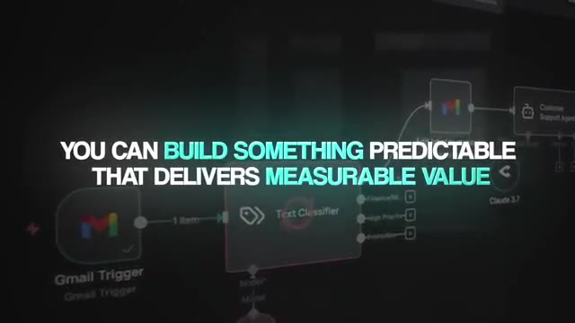
*⏱️ 00:13:11 — Aperçu d'un workflow d'automatisation (type Make/n8n) avec des nœuds Gmail et Text Classifier, sur lequel s'affiche du texte.*

---

### ⏱️ `[00:13:16 - 00:13:50]` | Segment #34

**🔊 Audio (Transcription Intégrale Mot pour Mot en Français) :**
> C'est votre travail de leur expliquer la valeur d'une manière qui a du sens pour eux. Et cela commence avant même que vous ne construisiez un seul nœud. Vous devez être capable de communiquer clairement l'impact commercial de n'importe quel système. Le temps qu'il fait gagner, le coût de main-d'œuvre qu'il élimine, les erreurs qu'il réduit, l'échelle que cela débloque. Et lorsque vous pouvez réellement parler en ces termes, les gens comprennent pourquoi l'automatisation est importante. Et ensuite, super important, une fois que le système est en ligne, vous devez collecter des données. Vous devez suivre la fréquence à laquelle il s'exécute, le temps qu'il fait gagner et le résultat qu'il produit. Parce qu'après quelques mois, vous pouvez alors leur montrer de vrais chiffres. Et c'est ainsi que vous bâtissez la confiance. C'est ainsi que vous gagnez des relations à long terme. Vous devez également utiliser toutes ces données pour vos études de cas. Donc, si vous ne les suivez pas, vous passez à côté de tonnes de nouvelles opportunités commerciales. Et je voulais juste insister sur ce point

**👁️ Analyse Visuelle d'Écran (gemini-3.5-flash-lite) :**
**Interface & Outils** : Aucune interface logicielle visible (simple plan de présentation).

**Contenu textuel & Code** : Aucun code source, terminal ou prompt visible, uniquement des sous-titres textuels.

**Action / Démonstration** : Aucune manipulation technique ou démonstration logicielle en cours.

---

### ⏱️ `[00:13:50 - 00:14:16]` | Segment #35

**🔊 Audio (Transcription Intégrale Mot pour Mot en Français) :**
> plus de temps. Votre rôle n'est pas seulement de concevoir des systèmes qui fonctionnent. Votre rôle est également de communiquer clairement la valeur et de prouver cette valeur au fil du temps. Et c'est ainsi que vous passez du statut de simple créateur ou développeur à celui de partenaire commercial à long term. Et si vous suivez cette feuille de route, vous éviterez des années d'essais et erreurs et passerez de la création de flux de travail simples au lancement de systèmes d'IA complets pour lesquels les gens paieront volontiers. Quoi qu'il en soit, c'est tout pour celui-ci. Si vous avez aimé ou si vous avez appris quelque chose de nouveau, veuillez laisser un pouce bleu. Cela m'aide vraiment énormément. Et comme toujours, je vous remercie d'être arrivés jusqu'à la fin de la vidéo. Je vous vois dans la prochaine.

**👁️ Analyse Visuelle d'Écran (gemini-3.5-flash-lite) :**
**Interface & Outils** : AUCUNE

**Contenu textuel & Code** : AUCUNE

**Action / Démonstration** : AUCUNE

---

### ⏱️ `[00:14:17 - 00:14:17]` | Segment #36

**🔊 Audio (Transcription Intégrale Mot pour Mot en Français) :**
> Merci à tous.

**👁️ Analyse Visuelle d'Écran (gemini-3.5-flash-lite) :**
**Interface & Outils** : Aucun

**Contenu textuel & Code** : Aucun

**Action / Démonstration** : Le présentateur salue les spectateurs pour conclure la vidéo.

---

