# 🎬 n8n's New Chat Hub Release: What You Need to Know

> **Chaîne** : [Nate Herk | AI Automation](https://www.youtube.com/@nateherk/featured)  
> **Lien YouTube** : [https://www.youtube.com/watch?v=jx-yvSRLKrA](https://www.youtube.com/watch?v=jx-yvSRLKrA)  
> **Date de publication** : 20251215  
> **Durée** : 00:10:05  
> **Identifiant vidéo** : `jx-yvSRLKrA`  
> **Transcription & Analyse** : `whisper-v3-large-turbo+gemini-3.5-flash-lite`  

---

## 📌 Synthèse Exécutive & Outils

### 💡 Résumé

La vidéo de la chaîne Nate Herk | AI Automation présente le « Chat Hub » de n8n, une nouvelle interface centralisée accessible directement depuis l'instance de développement, symbolisée par une icône de bulle de discussion. Cet outil unifié permet aux ingénieurs et développeurs d'interagir de manière transparente avec une vaste gamme de grands modèles de langage (LLM) tout en conservant un historique de conversation contextuel, même lors de changements dynamiques de modèles à la volée. Au-delà des interactions textuelles classiques avec des modèles de premier plan, le Chat Hub intègre des fonctionnalités multimédias et de recherche web en temps réel grâce à l'intégration d'outils tiers comme Jina AI, permettant ainsi la consultation d'URL et l'extraction de données live.

L'une des fonctionnalités les plus puissantes démontrées dans cette session est la capacité native du Chat Hub à se connecter directement aux agents IA et aux flux de travail n8n personnalisés. Nate Herk illustre concrètement cette synergie en interrogeant un agent analyste de données capable d'analyser des tables internes (contenant des journaux d'exécution de flux de travail, des tokens consommés et des outils appelés) pour répondre à des requêtes complexes en langage naturel. Les vérifications croisées effectuées démontrent la fiabilité de l'agent, qui extrait avec précision des métriques chiffrées sans hallucination, qu'il s'agisse de compter des occurrences d'exécution ou de sommer des volumes de tokens.

Enfin, la vidéo détaille le processus méthodologique exact pour concevoir et exposer un agent personnalisé dans le Chat Hub. De la configuration initiale d'un nœud de déclencheur de chat (Chat Trigger) à l'injection d'un prompt système strict pour définir la personnalité du modèle, en passant par l'activation explicite de la disponibilité dans le chat n8n et la publication obligatoire du flux de travail, chaque étape technique est passée en revue. Cette approche permet aux équipes d'ingénierie logicielle d'itérer rapidement, de tester le comportement de leurs agents dans un environnement unifié et d'optimiser l'automatisation des processus par l'IA.

### 🛠️ Outils, Modèles & Logiciels Présentés

* **n8n Chat Hub** : Nouvelle interface centralisée au sein de n8n permettant de dialoguer avec divers LLM, d'interroger des agents personnalisés et de conserver un fil de discussion contextuel unifié.
* **Claude Haiku 4.5 (Anthropic)** : Modèle de chat léger et rapide utilisé pour amorcer les démonstrations textuelles et les requêtes simples.
* **GPT-5 mini (OpenAI)** : Modèle de chat compact et performant, sélectionné à la volée pour démontrer la flexibilité de bascule de modèle dans un même fil.
* **Google Gemini 2.5 Pro (via OpenRouter)** : Modèle de pointe accessible via OpenRouter, illustrant l'interopérabilité multi-fournisseurs du hub n8n.
* **Jina AI** : Outil de recherche web et de lecture de contenu d'URL, connecté via une clé API gratuite, permettant aux modèles d'accéder à des données en direct.
* **Agents IA n8n (Custom Agents)** : Flux de travail automatisés dotés de déclencheurs de chat et de prompts système, capables d'analyser des tables de données internes et d'exécuter des calculs complexes.

### 🔑 Points Clés & Enseignements Stratégiques

* **Centralisation des interactions** : Le Chat Hub élimine le besoin de jongler entre différentes applications de chat en regroupant tous les LLM et agents IA dans une interface unique au sein de n8n.
* **Persistance du contexte multi-modèle** : Le système conserve l'historique complet d'un fil de discussion, permettant à l'utilisateur de changer de modèle en cours de route (de Claude à GPT ou Gemini) sans perdre la mémoire contextuelle.
* **Recherche web augmentée** : L'intégration d'outils externes comme Jina AI confère aux modèles et agents la capacité de réaliser des recherches sur le web en temps réel et d'analyser le contenu d'URL spécifiques.
* **Exploitation de données tabulaires** : Les agents IA connectés au Chat Hub peuvent servir d'analystes de données autonomes pour interroger des tables internes, automatiser l'audit des exécutions et extraire des métriques précises.
* **Fiabilité et prévention des hallucinations** : Les démonstrations prouvent qu'un agent bien configuré peut sommer des volumes de tokens ou compter des occurrences de flux de travail avec une exactitude mathématique vérifiable par rapport aux ensembles de données brutes.
* **Personnalisation comportementale** : L'utilisation de prompts système stricts (ex: ton sarcastique, neutre ou analytique) permet d'ajuster précisément la personnalité et le positionnement éditorial des agents exposés dans le hub.
* **Processus de publication obligatoire** : Pour qu'un flux de travail apparaisse dans le Chat Hub, il ne suffit pas de le sauvegarder ; il est impératif d'activer l'option de disponibilité dans le déclencheur de chat et de publier officiellement le workflow.
* **Paramétrage des métadonnées** : Le nœud Chat Trigger permet de définir explicitement le nom et la description d'un agent, facilitant ainsi son identification et son utilisation dans l'interface centralisée.
* **Traçabilité des exécutions** : Chaque interaction menée depuis le Chat Hub vers un agent déclenche une exécution traçable dans l'historique n8n, garantissant une observabilité complète du comportement de l'IA.
* **Itération rapide en ingénierie IA** : La possibilité de basculer instantanément d'un modèle standard à un agent personnalisé offre aux développeurs un environnement de test et de prototypage extrêmement agile.

---

## ⏱️ Chronologie & Transcription Complète Audio & Visuelle (Mot pour Mot)

### ⏱️ `[00:00:00 - 00:00:35]` | Segment #01

**🔊 Audio (Transcription Intégrale Mot pour Mot en Français) :**
> NWh vient de sortir son nouveau hub de discussion, qui vous permet de parler à tous les différents modèles de chat que vous connaissez et aimez déjà en un seul endroit. Et cela vous permet également de parler à vos agents IA NWh et de les déclencher. Donc dans la vidéo d'aujourd'hui, je vais parler de ce qu'est le hub de discussion et de la manière dont vous pouvez commencer à l'utiliser tout de suite. Nous voici donc dans mon NWh et nous sommes dans le nouveau hub de discussion qui, comme vous pouvez le voir, ressemble un peu à une interface ChatGPT ou Claude classique où vous avez les conversations passées sur la gauche et vous pouvez démarrer une nouvelle conversation juste ici au milieu. Si vous vous demandez comment je suis arrivé ici. Dans votre environnement NWh habituel, vous pouvez voir qu'il y a une petite bulle de discussion en bas à gauche. Et si vous ne voyez pas cela ici en bas, c'est probablement que vous devez simplement mettre à jour votre instance NWh.

**👁️ Analyse Visuelle d'Écran (gemini-3.5-flash-lite) :**
**Interface & Outils** : Interface web de chat / application d'agents IA (avec un encart vidéo du présentateur en bas à droite).

**Contenu textuel & Code** : Texte de salutation "Hello, Nate!" et barre de message "Message Get Agent Logs Tool...".

**Action / Démonstration** : Présentation de l'interface du hub de discussion permettant d'interagir avec les différents modèles de chat et agents IA.

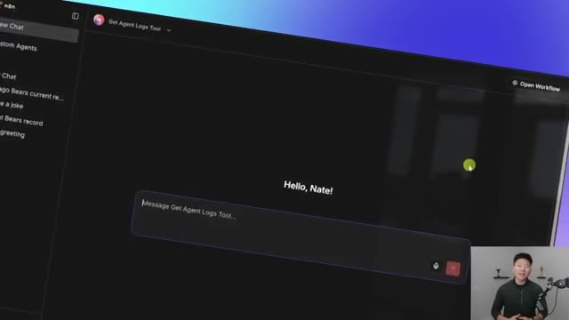
*⏱️ 00:00:09 — Interface web du hub de discussion avec le panneau latéral de navigation et la zone de saisie du chat affichant "Hello, Nate!" et le champ "Message Get Agent Logs Tool...".*

---

### ⏱️ `[00:00:35 - 00:01:12]` | Segment #02

**🔊 Audio (Transcription Intégrale Mot pour Mot en Français) :**
> Il y a donc quelques éléments que je voulais détailler une fois que vous êtes dans cet environnement. Donc ici, vous pouvez voir que je parle à Claude Haiku 4.5. Je peux donc simplement continuer et dire, raconte-moi une blague. Et ce qu'il va faire, c'est qu'il va utiliser ce modèle de chat afin de nous dire réellement quelque chose. Et la façon dont j'ai pu me connecter à Claude était ici. J'ai simplement, pour l'essentiel, entré ma clé API Anthropic. Et si vous avez déjà cette information d'identification configurée dans votre N8N, elle sera alors déjà là. Mais ce qui est cool, c'est que maintenant que nous sommes déjà au milieu d'une conversation, je peux continuer et changer de modèle si je le voulais. Donc, comme vous pouvez le voir, je viens de basculer sur GPT-5 mini, et je peux dire, super drôle, raconte-m'en une autre. Et maintenant, il a changé de modèle.

**👁️ Analyse Visuelle d'Écran (gemini-3.5-flash-lite) :**
**Interface & Outils** : Interface web n8n / Chat Claude Haiku 4.5

**Contenu textuel & Code** : "tell me a jo..." saisi dans la boîte de dialogue de l'assistant IA

**Action / Démonstration** : Le présentateur tape un message pour interagir avec le modèle de chat Claude Haiku 4.5.

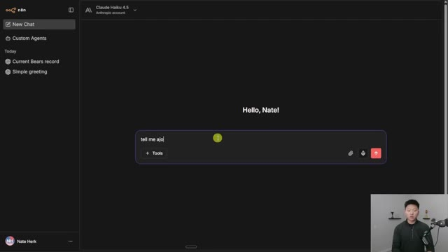
*⏱️ 00:00:44 — Interface de chat avec Claude Haiku 4.5 sur n8n, montrant la zone de saisie du prompt en cours d'utilisation par le présentateur.*

---

### ⏱️ `[00:01:12 - 00:01:46]` | Segment #03

**🔊 Audio (Transcription Intégrale Mot pour Mot en Français) :**
> à un modèle OpenAI. Et bien sûr, vous pouvez aussi aller de l'avant et vous connecter à OpenRouter, qui intègre déjà fondamentalement tous ces autres modèles. Donc je viens de passer à Google Gemini 2.5 Pro depuis OpenRouter, et maintenant vous pouvez voir qu'il a changé le modèle avec succès ici en bas. Mais ce que je voulais vous montrer, les gars, c'est la mémoire, fondamentalement, de cette fenêtre de contexte. Donc comme vous pouvez le voir, même si nous avons changé de modèles à chaque fois, quel que soit le modèle auquel vous parlez actuellement, il sera capable de lire la conversation que vous avez déjà eue dans ce fil de discussion. Et c'est pourquoi il est enregistré ici en tant que fil de discussion « raconte-moi une blague ». Il y a donc quelques autres choses que vous pouvez faire ici. Vous pouvez voir que sous chacun de ces petits éléments, nous avons la possibilité de copier,

**👁️ Analyse Visuelle d'Écran (gemini-3.5-flash-lite) :**
**Interface & Outils** : Interface web n8n (panneau latéral de chat, zone de discussion principale avec historique des messages).

**Contenu textuel & Code** : Historique de discussion incluant des requêtes sur des blagues (« tell me a joke », « super funny tell me another one ») et la sélection du modèle « google/gemini-2.5-pro ».

**Action / Démonstration** : Saisie d'une nouvelle question dans le champ de texte en bas de l'écran (« what jokes have you told me »).

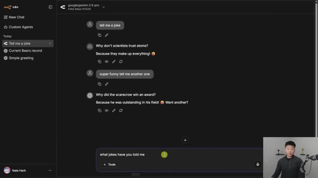
*⏱️ 00:01:20 — Interface de chat web avec n8n affichant une conversation active et le modèle Google Gemini sélectionné en haut.*

---

### ⏱️ `[00:01:46 - 00:02:09]` | Segment #04

**🔊 Audio (Transcription Intégrale Mot pour Mot en Français) :**
> nous avons la capacité de lire à voix haute. Et puis, pour une raison quelconque, nous pouvons également modifier la réponse de l'IA. Je ne sais pas exactement quel est le cas d'utilisation ici, mais si je voulais changer ce que l'IA a dit, je le pourrais. Et puis nous pourrions aussi simplement régénérer une nouvelle réponse si nous ne l'aimions pas. Donc, lorsque vous prononcez la réponse de l'IA à haute voix, elle la prononce simplement. Je vais montrer ça très vite. Bien sûr. Jusqu'à présent dans notre conversation, je vous ai raconté ces deux blagues.

**👁️ Analyse Visuelle d'Écran (gemini-3.5-flash-lite) :**
**Interface & Outils** : Interface web de chat (n8n / modèle google/gemini-2.5-pro)

**Contenu textuel & Code** : Historique de discussion de blagues avec l'IA et boutons d'action (copier, lire à voix haute, éditer, régénérer) sous les réponses.

**Action / Démonstration** : Survol ou clic sur le bouton "Edit" (éditer) d'une réponse de l'IA pour en modifier le contenu.

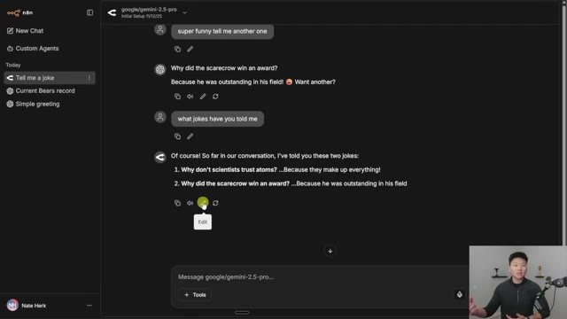
*⏱️ 00:01:52 — Interface de chat avec l'historique d'une conversation montrant les options d'interaction sous les messages de l'IA, avec le curseur sur le bouton d'édition.*

---

### ⏱️ `[00:02:09 - 00:02:45]` | Segment #05

**🔊 Audio (Transcription Intégrale Mot pour Mot en Français) :**
> D'accord. Donc ça n'a pas vraiment un super son. Ce n'est pas comme ElevenLabs ou un très bon modèle de voix, mais ça va le lire à haute voix. Donc je suis sûr que vous vous demandez aussi en bas, vous pouvez voir qu'il y a une section d'outils. Et pour l'instant, notre seul outil est Jina AI, mais cela vous permet essentiellement d'accéder au web, d'accéder à des URL et de faire des recherches sur le web. Donc voici à quoi ressemble Jina.ai. Et ensuite, tout ce que j'ai fait, c'est d'aller en haut à droite et de me créer un compte. Et quand j'ai fait ça, ça m'a donné cette clé API gratuite qui me donne un million de tokens pour faire des tests avant de devoir recharger. J'ai donc pris cette clé API, je suis venu dans n8n et j'ai simplement créé de nouveaux identifiants Jina et j'ai collé ma clé API directement là-dedans.

**👁️ Analyse Visuelle d'Écran (gemini-3.5-flash-lite) :**
**Interface & Outils** : Interface web de chat (type interface n8n ou plateforme d'agent IA)

**Contenu textuel & Code** : Historique de conversation avec les prompts "tell me a joke", "super funny tell me another one", "what jokes have you told me" et les réponses de l'IA. Un bouton "+ Tools" est visible dans la zone de saisie.

**Action / Démonstration** : Le curseur survole le bouton d'outils (« Tools ») sous la zone de saisie du message.

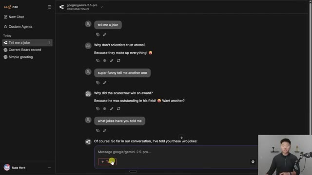
*⏱️ 00:02:18 — Interface de chat avec un modèle d'IA affichant une conversation comprenant des blagues et un bouton d'outils en bas.*

---

### ⏱️ `[00:02:45 - 00:03:05]` | Segment #06

**🔊 Audio (Transcription Intégrale Mot pour Mot en Français) :**
> Maintenant, si je voulais ouvrir un nouveau flux de travail et utiliser réellement l'outil, je pourrais me connecter à mon identifiant GINA et maintenant je pourrais faire de la vraie recherche web. Et maintenant que j'ai l'outil de recherche web activé, je pourrais aller de l'avant et demander, quel est le bilan actuel des Chicago Bears ? Et il doit réellement aller chercher sur le web afin de ramener cette information en direct. Nous avons donc cette petite première ligne qui indique fondamentalement qu'il a été capable d'appeler un outil et de fonctionner.

**👁️ Analyse Visuelle d'Écran (gemini-3.5-flash-lite) :**
**Interface & Outils** : Interface n8n / Chat avec un modèle d'IA (gpt-5-mini)

**Contenu textuel & Code** : Configuration des outils Jina AI et prompt utilisateur "what is the chicago bears current record?"

**Action / Démonstration** : Activation de l'outil de recherche web Jina AI puis envoi d'une requête dans le chat.

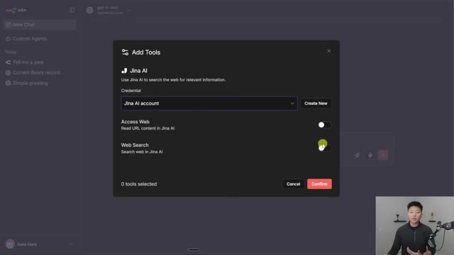
*⏱️ 00:02:50 — Fenêtre modale "Add Tools" montrant l'intégration de Jina AI avec les options "Access Web" et "Web Search".*

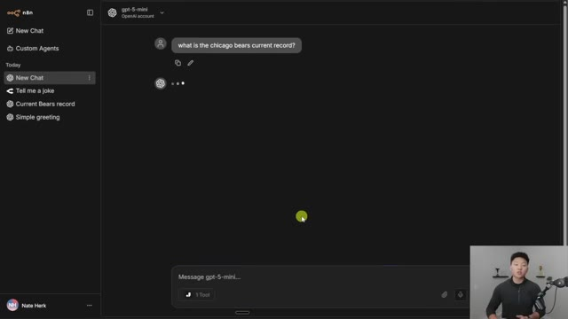
*⏱️ 00:02:55 — Interface de chat avec une question posée sur le score actuel des Chicago Bears, montrant un outil Jina AI activé.*

---

### ⏱️ `[00:03:06 - 00:03:29]` | Segment #07

**🔊 Audio (Transcription Intégrale Mot pour Mot en Français) :**
> Et maintenant le modèle nous répond. Donc, comme vous pouvez le voir, en date du 11 décembre 2025, qui est aujourd'hui, les Bears sont de neuf et quatre. Mais ce qui s'est passé, c'est que je lui ai demandé de résumer cet article et je lui ai donné une URL, et il n'a pas été capable de le faire. Et c'est parce que nous n'avions pas activé l'outil qui permet à Gina de lire le contenu des URL. Mais maintenant que j'ai activé l'outil qui nous permet réellement de lire les URL, il peut maintenant examiner cela pour moi.

**👁️ Analyse Visuelle d'Écran (gemini-3.5-flash-lite) :**
**Interface & Outils** : Interface web de chat (similaire à ChatGPT / n8n) avec un panneau latéral de navigation.

**Contenu textuel & Code** : Prompt utilisateur "what is the chicago bears current record?" et réponse du modèle indiquant que le score est de 9-4 au 11 décembre 2025.

**Action / Démonstration** : Affichage de la réponse du modèle d'intelligence artificielle dans l'interface de discussion.

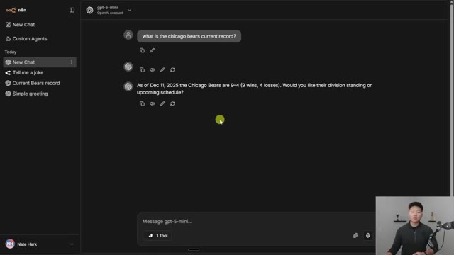
*⏱️ 00:03:11 — Interface de chat avec le modèle gpt-5-mini affichant la réponse concernant le score des Chicago Bears.*

---

### ⏱️ `[00:03:29 - 00:03:48]` | Segment #08

**🔊 Audio (Transcription Intégrale Mot pour Mot en Français) :**
> Très bien, donc c'est fondamentalement la même chose à laquelle vous êtes déjà habitués avec vos grands modèles de langage typiques comme Gemini, Claude, ChatGPT, peu importe. Mais maintenant, vous pouvez aussi voir que nous avons la possibilité de parler à nos agents personnalisés. Et vous pouvez voir que j'en ai un ici appelé Get Agent Logs Tool. Je pourrais aussi descendre ici et cliquer sur Agents personnalisés et nous pourrions voir tous les flux de travail Enidin que nous avons réellement configurés.

**👁️ Analyse Visuelle d'Écran (gemini-3.5-flash-lite) :**
**Interface & Outils** : Interface web n8n (Chat et Custom Agents)

**Contenu textuel & Code** : URL d'un article Ars Technica, résumé généré de GPT-5.2, liste des agents personnalisés.

**Action / Démonstration** : Navigation et présentation des fonctionnalités de chat et d'agents personnalisés dans l'interface de n8n.

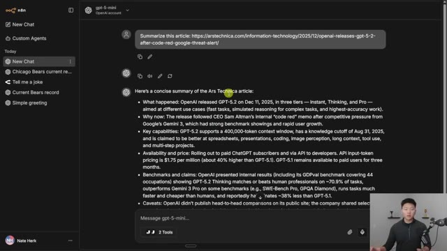
*⏱️ 00:03:34 — Interface de chat d'une application (n8n) affichant un résumé textuel généré par le modèle gpt-5-mini à partir d'un lien d'article.*

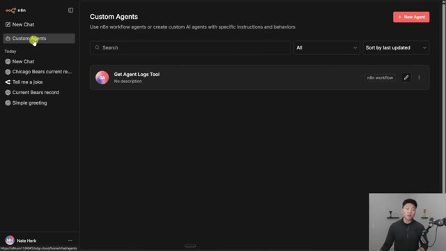
*⏱️ 00:03:44 — Interface de gestion des « Custom Agents » dans n8n montrant un agent existant nommé « Get Agent Logs Tool ».*

---

### ⏱️ `[00:03:48 - 00:04:09]` | Segment #09

**🔊 Audio (Transcription Intégrale Mot pour Mot en Français) :**
> Maintenant, vous pourriez aussi essentiellement créer un GPT personnalisé ou un projet ici aussi. Ça n'a pas besoin d'être un flux de travail Enidin parce que je pourrais cliquer sur nouvel agent, je le nommerais et lui donnerais une invite système, je choisirais un modèle, et ensuite je pourrais autoriser les mêmes outils GINA ici également. Donc essentiellement un GPT personnalisé. Mais bien sûr, comme je l'ai dit, vous pouvez connecter des flux de travail Enidin et si je cliquais sur celui-ci, vous pouvez voir qu'il s'agit en fait d'un agent IA NNN que j'obtiens.

**👁️ Analyse Visuelle d'Écran (gemini-3.5-flash-lite) :**
**Interface & Outils** : Interface web n8n (section Custom Agents).

**Contenu textuel & Code** : Formulaire de configuration d'agent IA : champs 'Name', 'Description', 'System Prompt', sélection du modèle et ajout d'outils.

**Action / Démonstration** : Configuration et création d'un nouvel agent IA personnalisé en renseignant ses paramètres dans n8n.

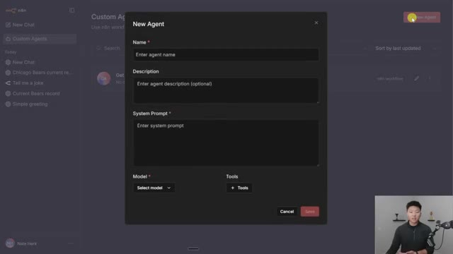
*⏱️ 00:03:54 — Interface n8n affichant la fenêtre modale de création d'un nouvel agent personnalisé avec les champs Nom, Description, Invite système, Modèle et Outils.*

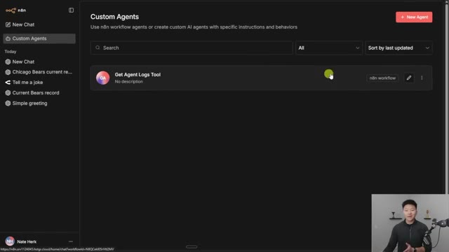
*⏱️ 00:04:04 — Tableau de bord 'Custom Agents' sur l'interface n8n montrant un agent existant nommé 'Get Agent Logs Tool'.*

---

### ⏱️ `[00:04:09 - 00:04:32]` | Segment #10

**🔊 Audio (Transcription Intégrale Mot pour Mot en Français) :**
> Donc je vais vous montrer comment nous pouvons lui parler et ce qu'il peut faire. Donc dans cet exemple particulier, nous avons un agent IA que j'appelle un analyste de données. Et il est essentiellement capable de parcourir notre propre table de données n8n, qui contient des exécutions de flux de travail. Il s'agit évidemment de données fictives, mais vous pouvez voir que nous avons une date, un nom de flux de travail, l'entrée, les outils appelés, les jetons utilisés, puis la sortie finale.

**👁️ Analyse Visuelle d'Écran (gemini-3.5-flash-lite) :**
**Interface & Outils** : Interface web de n8n (éditeur de workflow et table de données).

**Contenu textuel & Code** : Nœuds de workflow (AI Agent, Model, Memory, Tools) et lignes de données de logs d'agents (Date, Workflow_Name, Input, Tools_Called, Tokens_Used).

**Action / Démonstration** : Navigation et présentation du workflow d'un agent IA et de sa table de données associée.

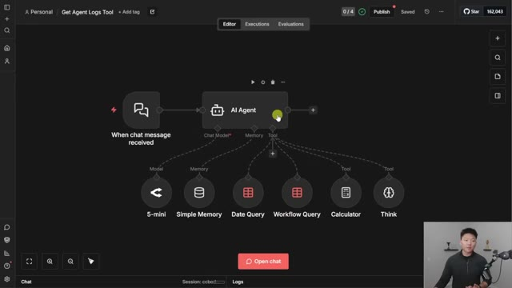
*⏱️ 00:04:15 — Vue d'ensemble d'un workflow n8n montrant un agent IA connecté à différents outils et sources de données.*

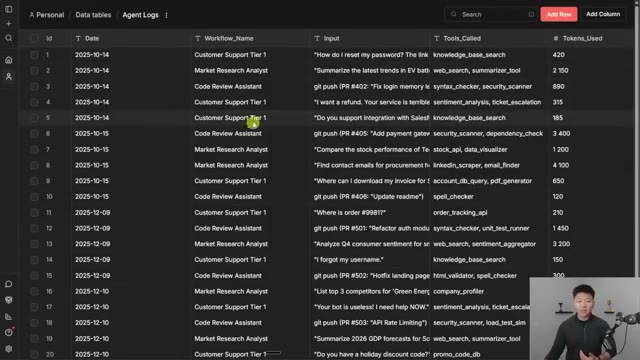
*⏱️ 00:04:26 — Affichage d'une table de données n8n contenant les journaux et exécutions de flux (Agent Logs).*

---

### ⏱️ `[00:04:32 - 00:05:05]` | Segment #11

**🔊 Audio (Transcription Intégrale Mot pour Mot en Français) :**
> Donc en gros, disons simplement que vous avez toutes ces exécutions de flux de travail qui s'exécutent. Maintenant, vous avez cette interface de chat simple dans NNN où vous pouvez lui parler et essentiellement obtenir des informations et des analyses de ces journaux d'exécution. Donc je viens de lancer combien de fois le flux de travail du service client s'est-il exécuté en octobre ? Et donc cet agent ici a pratiquement reçu ce message. Il va utiliser ses outils et peut-être sa calculatrice pour rechercher les informations, puis il va nous répondre dans l'interface de chat réelle juste ici. Donc de toute façon, vous pouvez voir qu'il a fait quelques appels d'outils ici. C'est pourquoi nous obtenons ces différentes lignes. Mais ensuite, ce qui s'est passé, c'est qu'il nous donne une réponse concise, qui est que le flux de travail du service client s'est exécuté quatre fois en octobre.

**👁️ Analyse Visuelle d'Écran (gemini-3.5-flash-lite) :**
**Interface & Outils** : n8n (Interface de chat / Agent de workflow)

**Contenu textuel & Code** : Historique des discussions à gauche ("New Chat", "Chicago Bears current re...", "Tell me a joke", etc.), et au centre un message d'accueil "Hello, Nate!" avec une zone de texte "Message Get Agent Logs Tool...".

**Action / Démonstration** : Présentation de l'interface de chat n8n permettant d'interagir avec les logs d'exécution des workflows.

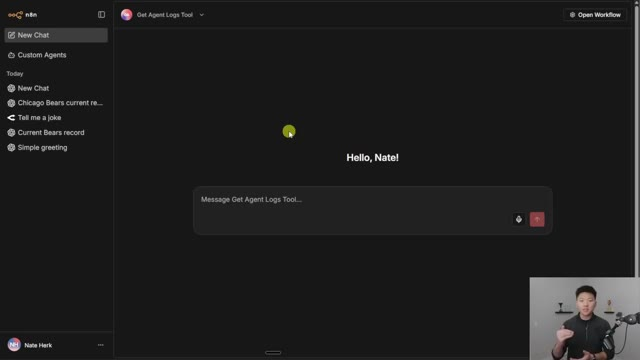
*⏱️ 00:04:40 — Interface de chat n8n affichant un outil de récupération des logs d'agents IA, avec un panneau latéral montrant l'historique des discussions et une zone de saisie pour interagir avec l'agent.*

---

### ⏱️ `[00:05:06 - 00:05:39]` | Segment #12

**🔊 Audio (Transcription Intégrale Mot pour Mot en Français) :**
> Et ensuite je lui ai dit de nous donner une ventilation détaillée afin que nous puissions réellement valider qu'il est correct et qu'il ne hallucine pas. Donc si je bascule sur l'ensemble de données, nous devrions être capables de voir qu'en octobre, qui correspond à toutes ces exécutions ici, le flux de travail du support client a été appelé quatre fois, ce qui, comme vous pouvez le voir, s'est bien exécuté quatre fois en octobre. Donc maintenant je demande combien de jetons au total nous avons dépensés avec notre agent de révision de code ? Et il devrait être assez intelligent pour comprendre que nous parlons du flux de travail de l'Assistant de Révision de Code. Et ce qu'il va faire, c'est qu'il va trouver toutes ces exécutions réelles et ensuite totaliser tous les jetons. Et il va nous expliquer comment

**👁️ Analyse Visuelle d'Écran (gemini-3.5-flash-lite) :**
**Interface & Outils** : Application de gestion de base de données ou tableau de bord analytique.

**Contenu textuel & Code** : Lignes de données structurées avec des dates de 2025 (octobre et décembre), des noms de workflows (Customer Support Tier 1, Market Research Analyst, Code Review Assistant), des entrées de prompts, des outils appelés et le nombre de tokens utilisés.

**Action / Démonstration** : Le présentateur bascule vers l'affichage de l'ensemble des données pour valider les exécutions et éviter les hallucinations.

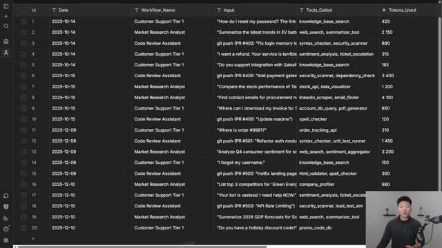
*⏱️ 00:05:14 — Un tableau de données détaillé affichant des logs d'exécution avec les colonnes id, Date, Workflow_Name, Input, Tools_Called et Tokens_Used, tandis que le présentateur apparaît en bas à droite.*

---

### ⏱️ `[00:05:39 - 00:06:12]` | Segment #13

**🔊 Audio (Transcription Intégrale Mot pour Mot en Français) :**
> c'est effectivement arrivé là. Alors c'est parti. L'assistant de révision de code a utilisé un total de 10 260 jetons pour l'ensemble des entrées de journal récupérées. Ensuite, encore une fois, il nous donne une ventilation détaillée et il a fondamentalement juste eu à sommer toutes ces exécutions. 890 plus 3 400 plus 120 plus 1 450. Et c'est comme ça qu'on est arrivés à 10 260. Et comme vous pouvez le voir dans le jeu de données, j'ai moi-même sommé toutes ces lignes et nous avons bien obtenu 10 260. Il a donc fait correctement son travail. Maintenant, ce que je veux faire très rapidement, c'est vous montrer qu'il a effectivement appelé ce flux de travail. C'est donc l'agent à qui nous venions de parler. Si je vais sur

**👁️ Analyse Visuelle d'Écran (gemini-3.5-flash-lite) :**
**Interface & Outils** : Plateforme d'automatisation n8n (interface de chat et vue base de données/logs).

**Contenu textuel & Code** : Analyse des données : calcul de 10 260 jetons, liste des requêtes git push (PR #402, #405, #406) et tableau récapitulatif des exécutions des agents.

**Action / Démonstration** : L'agent effectue une requête, somme les valeurs de la colonne "Tokens_Used" et affiche les résultats détaillés dans l'interface de chat.

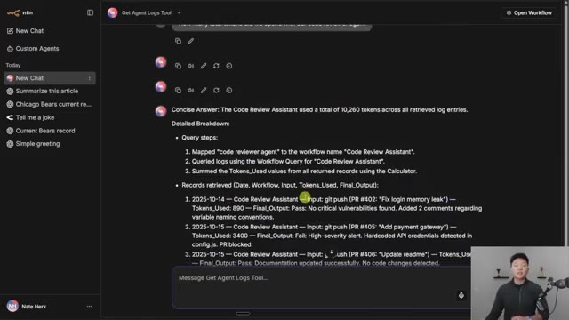
*⏱️ 00:05:48 — Interface de chat n8n affichant une réponse détaillée du modèle IA concernant le calcul du nombre total de jetons pour le "Code Review Assistant".*

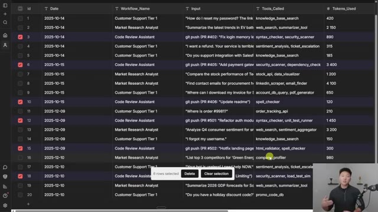
*⏱️ 00:06:04 — Vue tabulaire dans n8n listant les logs d'exécution des agents avec les colonnes Date, Nom du workflow, Input, Outils utilisés et nombre de jetons.*

---

### ⏱️ `[00:06:12 - 00:06:44]` | Segment #14

**🔊 Audio (Transcription Intégrale Mot pour Mot en Français) :**
> exécutions, vous pouvez voir que les deux exécutions les plus récentes, la première que nous avons demandée concernait le flux de support client. Donc, combien de fois le flux de support client s'est-il exécuté en octobre ? Et ensuite, il nous a donné la réponse que nous avons vue dans cette interface de chat. Et la seconde était de savoir combien de jetons au total nous avons utilisés sur l'agent de révision de code, comme vous pouvez le voir juste ici. Donc la question maintenant est de savoir comment créer réellement un flux de travail modifié et ensuite vous permettre de lui parler via cette interface ? Parce que lorsque vous cliquez sur les agents personnalisés, c'est ce que vous voyez. Je vais donc retourner à mes flux de travail et en ouvrir un nouveau. Et fondamentalement, tout ce que vous avez à faire est d'avoir un flux de travail

**👁️ Analyse Visuelle d'Écran (gemini-3.5-flash-lite) :**
**Interface & Outils** : n8n (éditeur de workflows d'automatisation) et interface de chat de l'agent IA.

**Contenu textuel & Code** : Question posée dans le chat : 'How many times did the customer support workflow run in october?' et interface de discussion gpt-5-mini.

**Action / Démonstration** : Consultation des entrées/sorties du nœud de chat et présentation de l'interface de test de l'agent n8n.

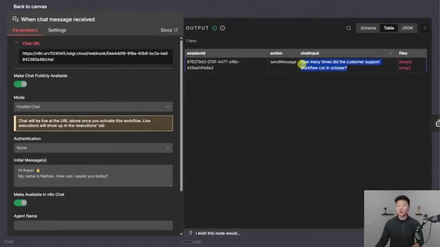
*⏱️ 00:06:20 — Interface n8n montrant les paramètres du nœud 'When chat message received' avec l'historique des requêtes et la question posée sur le support client.*

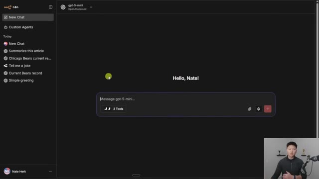
*⏱️ 00:06:36 — Interface de chat de l'assistant IA propulsé par gpt-5-mini avec l'historique des discussions sur le panneau latéral gauche.*

---

### ⏱️ `[00:06:44 - 00:07:12]` | Segment #15

**🔊 Audio (Transcription Intégrale Mot pour Mot en Français) :**
> que vous contactez ou qui est déclenché par le déclencheur de chat. Donc, si j'ouvre un agent IA ici même, et que j'obtiens fondamentalement par défaut le nœud déclencheur de chat connecté. Je vais ajouter rapidement un modèle de chat, donc nous allons simplement opter pour le 4.1 mini de base d'OpenRouter, et tout ce que je vais faire ici, c'est juste ajouter un message système qui dit vous êtes super méchant, grossier et sarcastique, et c'est donc ainsi que nous pourrons fondamentalement valider qu'il communique bien avec ce flux de travail.

**👁️ Analyse Visuelle d'Écran (gemini-3.5-flash-lite) :**
**Interface & Outils** : n8n (Interface de création de workflows d'automatisation IA)

**Contenu textuel & Code** : Nœuds de workflow n8n : 'When chat message received' relié à 'AI Agent' avec des paramètres de configuration et un message système personnalisé.

**Action / Démonstration** : Création et configuration d'un agent IA connecté à un déclencheur de chat dans l'interface de n8n.

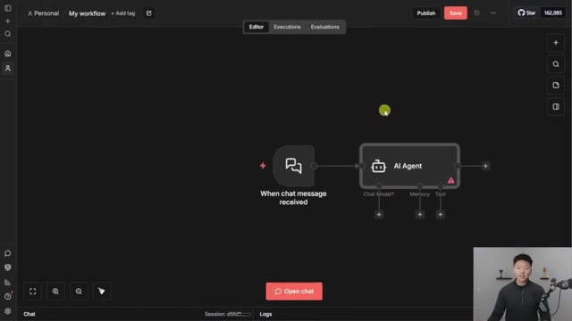
*⏱️ 00:06:51 — Vue d'ensemble d'un workflow n8n montrant un nœud déclencheur de chat connecté à un nœud d'agent IA.*

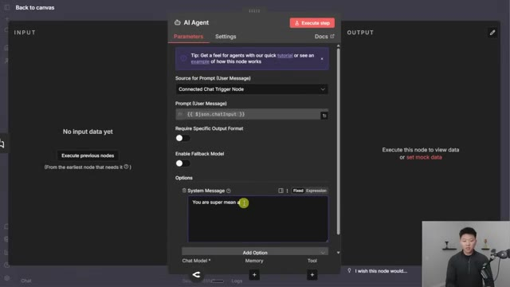
*⏱️ 00:07:05 — Panneau de configuration détaillé du nœud 'AI Agent' dans n8n, affichant les paramètres du prompt et le message système.*

---

### ⏱️ `[00:07:12 - 00:07:47]` | Segment #16

**🔊 Audio (Transcription Intégrale Mot pour Mot en Français) :**
> Maintenant, ce qui s'est passé, c'est que j'ai sauvegardé ceci, mais ce que vous remarquerez, c'est que si je retourne dans le chat, on ne voit rien ici. Même si j'actualise, on ne voit pas ce workflow. Il y a donc deux ou trois choses que vous devez faire. La première, c'est que vous devez aller dans le déclencheur de chat et le rendre disponible dans le chat n8n. Comme vous pouvez le voir, il est indiqué s'il faut rendre l'agent disponible dans le chat n8n. Et c'est ici que vous pouvez lui donner un nom et une description. Et donc, l'autre chose que vous devez faire avant qu'il ne puisse apparaître, c'est que vous devez publier votre workflow. Je vais donc remonter et cliquer sur publier. Je vais juste appeler ça version un. Et maintenant qu'il s'agit réellement d'un workflow publié et actif, nous devrions pouvoir retourner dans le chat. Et si je fais juste une rapide actualisation,

**👁️ Analyse Visuelle d'Écran (gemini-3.5-flash-lite) :**
**Interface & Outils** : Interface web de n8n (outil d'automatisation de workflows et d'agents IA)

**Contenu textuel & Code** : Noms d'agents (« Get Agent Logs Tool »), paramètres de chat activés et boîte de dialogue de version de workflow (« Version fbf63bda »)

**Action / Démonstration** : Navigation dans l'interface d'administration des agents personnalisés et configuration des paramètres de visibilité du chat dans n8n

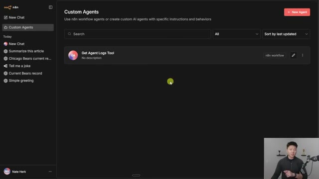
*⏱️ 00:07:21 — Vue d'ensemble de la section 'Custom Agents' dans l'interface de n8n, montrant la liste des agents configurés.*

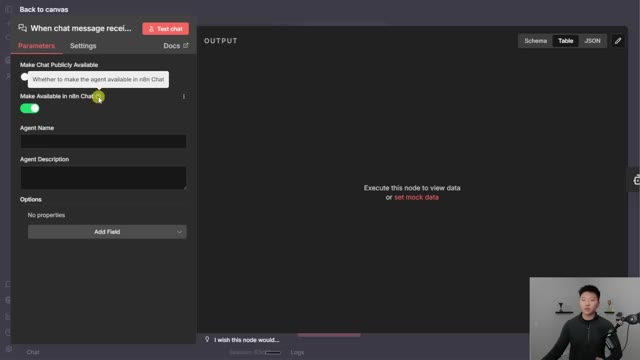
*⏱️ 00:07:30 — Panneau des paramètres de configuration du nœud de chat dans n8n, affichant les options pour rendre le workflow disponible dans le chat.*

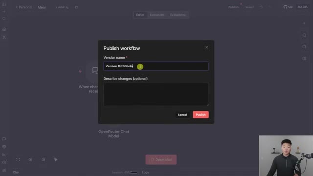
*⏱️ 00:07:39 — Fenêtre modale de publication d'un workflow dans n8n, avec un champ pour nommer la version avant de publier.*

---

### ⏱️ `[00:07:48 - 00:08:14]` | Segment #17

**🔊 Audio (Transcription Intégrale Mot pour Mot en Français) :**
> Nous devrions voir ce workflow principal maintenant, et je peux directement discuter avec lui. Donc je vais cliquer dessus et je vais juste dire : « Hé, je me sens triste. » Et maintenant, cela devrait passer par cet agent principal. « Oh, ouin-ouin. Bienvenue au club, rayon de soleil. Tout le monde se sent triste parfois. Tu veux une médaille ou juste un peu de sympathie mielleuse ? Remets-toi-en. » Donc c'était plutôt impoli. Mais si j'ouvre le workflow et que je vais dans les exécutions, nous verrons bien sûr que c'est le chat qui vient tout juste de déclencher ce workflow n8n.

**👁️ Analyse Visuelle d'Écran (gemini-3.5-flash-lite) :**
**Interface & Outils** : Plateforme n8n (interface de chat agentique).

**Contenu textuel & Code** : Zone de texte avec le prompt "Hey!", historique des conversations à gauche (New Chat, Summarize this article, etc.).

**Action / Démonstration** : L'utilisateur s'apprête à interagir avec l'agent principal pour tester sa réponse émotionnelle.

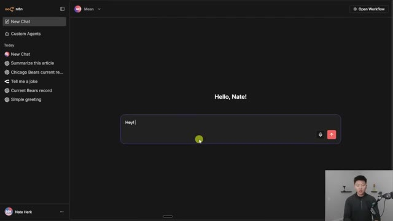
*⏱️ 00:07:54 — L'interface de chat de n8n montrant la zone de saisie principale avec le message "Hey!" prêt à être envoyé par l'utilisateur.*

---

### ⏱️ `[00:08:14 - 00:08:36]` | Segment #18

**🔊 Audio (Transcription Intégrale Mot pour Mot en Français) :**
> J'espère donc que vous commencez à avoir quelques idées de différents workflows que vous avez dans NNN. Ce serait vraiment sympa si vous pouviez en quelque sorte les utiliser directement ici, surtout si vous êtes capable de basculer entre tous ces différents modèles de chat dans les autres threads. Maintenant, une chose que j'espère vraiment, vraiment voir arriver bientôt ici, c'est de pouvoir appeler le MCP au niveau de l'instance de NNN directement ici. Si vous n'avez pas regardé ma vidéo à ce sujet, je vais la mettre en lien juste ici au-dessus.

**👁️ Analyse Visuelle d'Écran (gemini-3.5-flash-lite) :**
**Interface & Outils** : Interface web n8n (mode chat)

**Contenu textuel & Code** : Historique de discussion comprenant un message utilisateur "Hey! I am feeling sad" et une réponse de l'assistant "Oh, boohoo. Welcome to the club, sunshine...".

**Action / Démonstration** : Interaction avec le chatbot n8n et navigation dans le panneau latéral des différents threads de discussion.

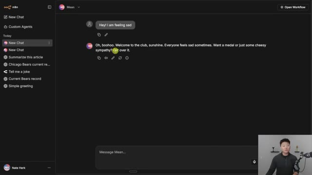
*⏱️ 00:08:20 — Interface de chat n8n affichant une conversation textuelle avec un agent IA sarcastique.*

---

### ⏱️ `[00:08:36 - 00:09:04]` | Segment #19

**🔊 Audio (Transcription Intégrale Mot pour Mot en Français) :**
> mais dans cette vidéo, j'ai montré comment je pouvais l'utiliser dans mon propre ChatGPT ou Claude. Comme vous pouvez le voir ici, j'ai ces outils juste ici qui nous permettent de chercher des workflows, d'obtenir les détails des workflows et d'exécuter ces workflows. Je peux donc toujours rester dans mon environnement Claude si je travaille sur un projet et simplement dire : « Hé, utilise n8n pour aller faire ça » ou « Va faire ceci dans n8n ». Et ce serait vraiment cool si on pouvait avoir ça connecté ici, afin que, pendant qu'on échange ces messages avec n'importe quels modèles de chat qu'on voulait dans n8n, on puisse dire : « Oh d'accord, j'ai un agent pour ça » ou « J'ai un workflow qui fait ça, va juste le trouver et va l'exécuter pour moi ».

**👁️ Analyse Visuelle d'Écran (gemini-3.5-flash-lite) :**
**Interface & Outils** : Interface web de chatbot personnalisée (potentiellement via n8n ou plateforme d'agents IA).

**Contenu textuel & Code** : Menu d'outils : "Execute Workflow", "Get Workflow Details", "Search Workflows" (Image 1) ; Indicateur "2 Tools" et "gpt-5-mini" (Image 2).

**Action / Démonstration** : Sélection et activation/désactivation d'outils d'automatisation au sein d'une interface conversationnelle assistée par IA.

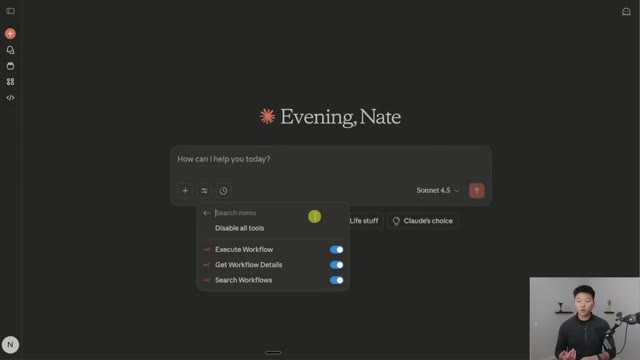
*⏱️ 00:08:43 — Interface d'un chatbot (type interface Claude) affichant un menu contextuel ouvert avec des outils d'automatisation de workflows activés.*

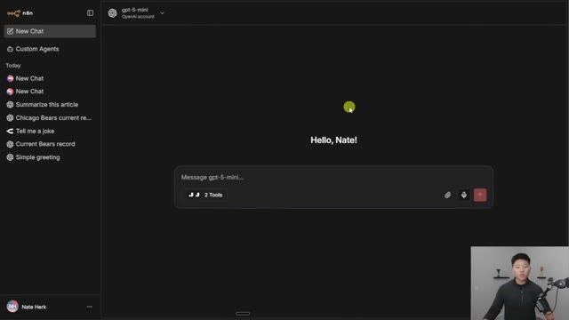
*⏱️ 00:08:57 — Interface de chat (n8n ou similaire) personnalisée pour Nate Herk, affichant une zone de saisie avec deux outils ("2 Tools") connectés à "gpt-5-mini".*

---

### ⏱️ `[00:09:05 - 00:09:23]` | Segment #20

**🔊 Audio (Transcription Intégrale Mot pour Mot en Français) :**
> Et j'imagine donc que ce sera super facile. Et au moment où vous regardez cette vidéo, c'est peut-être déjà là, car tout ce que vous avez à faire, c'est essentiellement de donner au client cette URL de serveur. Et nous pourrions donc facilement simplement brancher cela ici, ou parce qu'il s'agit d'un produit n8n au sein de votre propre environnement, il devrait pouvoir simplement tout voir de toute façon et les exécuter.

**👁️ Analyse Visuelle d'Écran (gemini-3.5-flash-lite) :**
**Interface & Outils** : Interface web de n8n (paramètres "MCP Access").

**Contenu textuel & Code** : URL du serveur MCP : https://n8n.srv1124045.hstgr.cloud/mcp-server/http, options de connexion OAuth et Access Token.

**Action / Démonstration** : Configuration des paramètres d'accès MCP pour l'instance n8n.

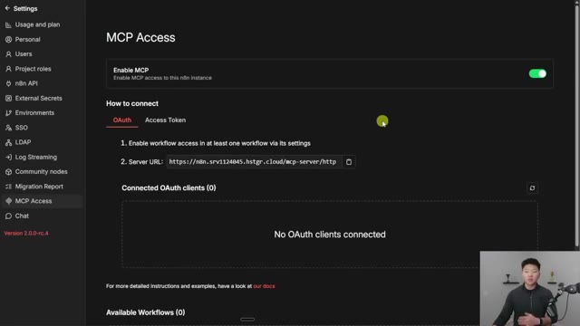
*⏱️ 00:09:09 — Capture d'écran montrant l'interface des paramètres d'accès MCP dans n8n, avec une URL de serveur affichée.*

---

### ⏱️ `[00:09:23 - 00:09:45]` | Segment #21

**🔊 Audio (Transcription Intégrale Mot pour Mot en Français) :**
> Mais de toute façon, c'est tout pour aujourd'hui. Je sais que ça a été très rapide, mais je voulais vous tenir au courant de cette nouvelle fonctionnalité de ChatHub. Et j'aimerais voir certains des cas d'utilisation auxquels vous pensez pour intégrer directement vos flux de travail dans cet environnement sur n8n. Si vous cherchez à en savoir plus sur l'automatisation de l'IA et sur n8n, alors consultez absolument ma communauté "plus". Le lien se trouve dans la description. Nous avons une super communauté de membres qui construisent avec n8n et qui bâtissent des entreprises chaque jour avec n8n.

**👁️ Analyse Visuelle d'Écran (gemini-3.5-flash-lite) :**
**Interface & Outils** : Interface web de chat IA (ChatHub / n8n) et plateforme communautaire Skool (AIS+).

**Contenu textuel & Code** : Historique des discussions, sélection du modèle gpt-5-mini, et publications de membres de la communauté sur l'automatisation IA.

**Action / Démonstration** : Navigation dans l'interface de l'application de chat et affichage des fonctionnalités d'interaction textuelle.

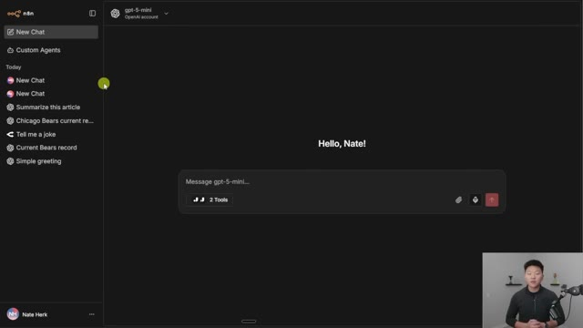
*⏱️ 00:09:29 — Capture d'écran montrant l'interface utilisateur de chat d'un agent IA avec un panneau latéral de navigation et un champ de saisie de message.*

---

### ⏱️ `[00:09:46 - 00:10:04]` | Segment #22

**🔊 Audio (Transcription Intégrale Mot pour Mot en Français) :**
> Et nous célébrons de superbes victoires ici, comme vous pouvez le voir. C'est donc un endroit formidable pour être entouré de personnes partageant les mêmes idées. Mais bref, j'adorerais vous voir dans les appels en direct ici. J'adorerais vous voir dans la communauté, mais c'est tout pour aujourd'hui. Alors si vous avez aimé la vidéo ou si vous avez appris quelque chose de nouveau, n'hésitez pas à lui donner un pouce bleu. Ça m'aide vraiment énormément. Et comme toujours, je vous remercie d'être arrivés jusqu'à la fin de la vidéo. Je vous vois dans la prochaine. Merci tout le monde.

**👁️ Analyse Visuelle d'Écran (gemini-3.5-flash-lite) :**
**Interface & Outils** : Navigateur web affichant la plateforme Skool (Image 1) et une interface de chat avec un modèle IA (Image 2).

**Contenu textuel & Code** : Publications de la communauté avec des réussites ("Signed My First Client!", "MCP Resources for Beginners") et interface de messagerie avec un LLM.
[DESC_IMAGE_2] Navigation dans la communauté en ligne et présentation de l'interface de chat IA.

**Action / Démonstration** : Explications face caméra et démonstration conceptuelle.

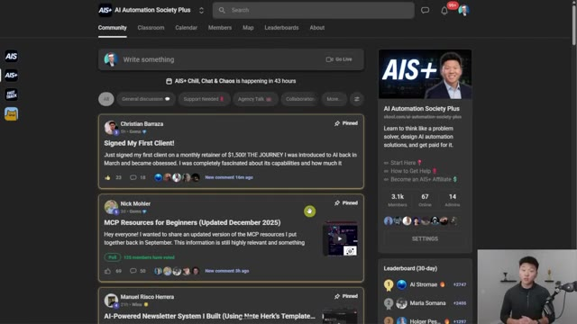
*⏱️ 00:09:50 — Capture d'écran montrant l'interface de la communauté Skool "AI Automation Society Plus" avec des publications épinglées sur les réussites des membres.*

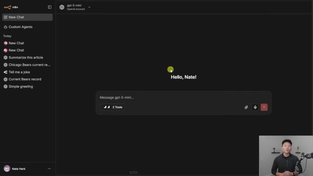
*⏱️ 00:09:55 — Capture d'écran montrant une interface de chat IA personnalisée avec le modèle "gpt-5-mini" et le message "Hello, Nate!".*

---

