# 🎬 I built an AI Agent in 2 hours (and got paid $2600)

> **Chaîne** : [Nate Herk | AI Automation](https://www.youtube.com/@nateherk/featured)  
> **Lien YouTube** : [https://www.youtube.com/watch?v=bxGE_LXPyAU](https://www.youtube.com/watch?v=bxGE_LXPyAU)  
> **Date de publication** : 20251217  
> **Durée** : 00:27:34  
> **Identifiant vidéo** : `bxGE_LXPyAU`  
> **Transcription & Analyse** : `whisper-v3-large-turbo+gemini-3.5-flash-lite`  

---

## 📌 Synthèse Exécutive & Outils

### 💡 Résumé

Dans cette vidéo, Nate Herk démontre comment la combinaison d'une architecture d'automatisation bien pensée et d'une IA ciblée permet de concevoir, valider et vendre un agent IA complet en seulement deux heures pour la somme de 2 600 dollars. L'étude de cas présentée repose sur un système d'intégration (onboarding) et de relance d'étudiants pour une académie en ligne, conçu pour éliminer les interventions manuelles superflues tout en garantissant un suivi client irréprochable. La démonstration technique met en lumière la puissance d'une approche hybride : l'immense majorité du système s'appuie sur des flux d'automatisation traditionnels robustes et déterministes, tandis que l'intelligence artificielle est réservée à des tâches à haute valeur ajoutée, comme la rédaction d'e-mails de bienvenue hautement personnalisés dès la création effective du compte.

Au-delà de la simple construction sur la plateforme d'automatisation, Nate Herk dévoile sa méthodologie de vente et de prototypage, en insistant sur l'importance cruciale du *wireframing* en amont pour aligner les attentes du client avant d'écrire la moindre ligne de configuration. À travers une mise en situation pratique utilisant Postman, des webhooks, des services de messagerie et des feuilles de calcul comme CRM, la vidéo prouve qu'il n'est pas nécessaire de maîtriser des architectures de réseaux de neurones complexes pour monétiser des compétences en automatisation d'agents IA, ouvrant ainsi la voie à une approche pragmatique et ultra-rentable pour les créateurs et développeurs indépendants.

---

### 🛠️ Outils, Modèles & Logiciels Présentés

* **n8n** : La plateforme d'automatisation principale utilisée pour concevoir les différents flux logiques, gérer les webhooks et orchestrer l'ensemble du système d'onboarding.
* **Postman** : L'outil de test d'API utilisé pour simuler des charges utiles (*payloads*) de paiement et déclencher les webhooks n8n en phase de développement.
* **Gmail** : Le service de messagerie intégré via des nœuds dédiés pour automatiser l'envoi d'e-mails de bienvenue personnalisés aux nouveaux étudiants.
* **Slack** : L'application de messagerie professionnelle utilisée pour envoyer des notifications internes en temps réel aux équipes lors des paiements ou des escalades.
* **Google Sheets** : L'outil utilisé comme CRM léger et sophistiqué pour stocker les données des étudiants, suivre les statuts et gérer les cycles de relance.

---

### 🔑 Points Clés & Enseignements Stratégiques

* **La simplicité comme levier de rentabilité :** Un système n'a pas besoin d'être excessivement complexe pour générer de la valeur financière ; un agent facturé 2 600 dollars a été construit en seulement deux heures grâce à une logique épurée.
* **L'approche d'automatisation hybride :** Réserver l'utilisation de l'IA à des moments précis (comme l'e-mail de bienvenue personnalisé) tout en maintenant des flux déterministes et non-IA pour les tâches répétitives garantit la robustesse globale du système.
* **Le rôle fondamental du *wireframing* :** Valider l'architecture visuelle du système avec le client en amont permet non seulement d'aligner les attentes, mais aussi d'accélérer drastiquement la phase de construction dans n8n.
* **L'utilisation stratégique des webhooks :** Les webhooks constituent la passerelle idéale et universelle pour connecter des processeurs de paiement tiers aux flux d'automatisation n8n en temps réel.
* **L'automatisation du suivi sans friction :** Mettre en place des flux de vérification quotidiens pour identifier les utilisateurs n'ayant pas créé leur compte évite d'avoir à relancer manuellement les clients.
* **L'escalade humaine programmée :** Structurer des flux conditionnels pour alerter l'équipe en interne (Slack) après un certain nombre de jours sans action de l'utilisateur garantit qu'aucun prospect ne passe entre les mailles du net.
* **Le nettoyage des métadonnées d'automatisation :** Désactiver les attributions automatiques d'expéditeur et les liens de workflow dans les e-mails et messages Slack confère un rendu professionnel et invisible aux automatisations.
* **La gestion granulaire des statuts CRM :** Utiliser des états précis dans le CRM (création de compte, premier suivi envoyé, humain notifié, compte créé) permet de filtrer efficacement les déclencheurs des flux futurs.
* **L'optimisation du temps de développement :** L'expérience montre qu'en maîtrisant la méthodologie, un tel système peut être répliqué en une trentaine de minutes, maximisant ainsi le taux horaire effectif du développeur.
* **La transparence sur les capacités de l'IA :** Ne pas surcharger un système d'IA inutilement réduit le temps de *prompt engineering*, de test et de débogage, rendant la maintenance du projet beaucoup plus pérenne.

---

## ⏱️ Chronologie & Transcription Complète Audio & Visuelle (Mot pour Mot)

### ⏱️ `[00:00:00 - 00:00:36]` | Segment #01

**🔊 Audio (Transcription Intégrale Mot pour Mot en Français) :**
> Donc, j'ai construit un autre agent IA en seulement deux heures et quelqu'un m'a effectivement payé 2 600 dollars pour celui-ci. Pas 1 200 dollars, 2 600 dollars. Ce n'était vraiment rien de trop complexe ou de trop avancé. En fait, je l'ai construit avec très peu d'expérience en N&M. Et honnêtement, si je le reconstruisais aujourd'hui, cela me prendrait probablement 30 minutes maximum. Et ce qui est fou, c'est que je suis presque sûr que vous tous, vous pourriez construire quelque chose exactement comme ça aussi. Donc, dans cette vidéo, je vais non seulement le construire devant vous, mais je vais aussi vous expliquer ce que fait l'agent, pourquoi quelqu'un m'a payé pour cela, ce que cela signifie pour quiconque essaie de se lancer, et comment je vendrais mon si j'ai mon premier agent IA si je commençais aujourd'hui à partir de zéro. Alors, quel était l'agent que j'ai fini par vendre et comment nous y prenons-nous pour le construire ? Eh bien, c'est en fait le schéma exact que j'ai présenté au client lorsque nous avons

**👁️ Analyse Visuelle d'Écran (gemini-3.5-flash-lite) :**
**Interface & Outils** : Logiciel de création de workflows / diagrammes d'automatisation

**Contenu textuel & Code** : Nœuds de workflow connectés et flux de données graphiques

**Action / Démonstration** : Navigation et conception d'un agent IA sur double écran

*⏱️ 00:00:09 — Un plan large montrant le présentateur de dos devant deux grands écrans affichant un diagramme de workflow d'automatisation.*

---

### ⏱️ `[00:00:36 - 00:01:07]` | Segment #02

**🔊 Audio (Transcription Intégrale Mot pour Mot en Français) :**
> Nous parlons de la façon dont le système fonctionnerait. Vous pouvez donc voir que c'est vraiment simple et qu'il y a quatre éléments principaux. Et ensuite, nous allons réellement plonger dans NNN et je vais construire ceci directement devant vous les gars. Mais passons en revue ce que fait réellement le système. Donc le premier élément est de créer l'entrée du CRM. Donc ceci se déclenche lorsque l'étudiant effectue un paiement. Il recevrait automatiquement un e-mail de bienvenue avec un lien pour aller créer son compte. Cela enverrait une notification interne sur Slack à l'équipe. Et ensuite, nous irions de l'avant pour créer cette entrée CRM pour cet étudiant. Maintenant, les deuxième et troisième éléments, nous vérifions simplement si cet étudiant a réellement créé un compte ou non, parce que vous ne voulez pas courir après les gens manuellement.

**👁️ Analyse Visuelle d'Écran (gemini-3.5-flash-lite) :**
**Interface & Outils** : Logiciel de tableau blanc ou d'organigramme (type Excalidraw ou Miro)

**Contenu textuel & Code** : Schéma d'onboarding avec 4 flux (Create CRM Entry, Follow up 1, Human escalation, Personalized kickoff) détaillant les étapes (Payment, Welcome email, Internal notification, CRM entry, etc.)

**Action / Démonstration** : Le présentateur explique les quatre éléments principaux du système d'automatisation en pointant le diagramme.

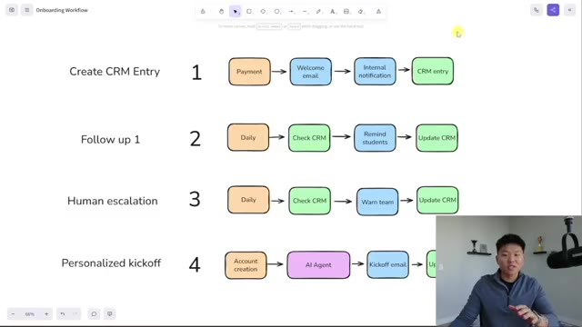
*⏱️ 00:00:44 — Vue d'ensemble du diagramme d'onboarding avec quatre flux de travail principaux affichés à l'écran, tandis que le présentateur apparaît en bas à droite.*

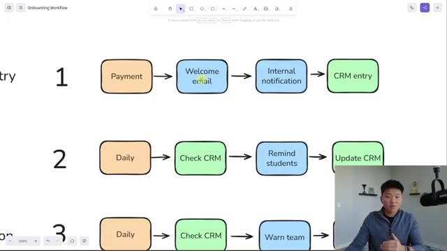
*⏱️ 00:00:51 — Zoom sur le diagramme de workflow montrant plus en détail les étapes numérotées des processus automatisés.*

---

### ⏱️ `[00:01:07 - 00:01:39]` | Segment #03

**🔊 Audio (Transcription Intégrale Mot pour Mot en Français) :**
> Donc pour le deuxième flux, c'était le premier suivi. Chaque jour, celui-ci se déclenchait et il allait vérifier le CRM pour voir si l'un de ces étudiants qui avait payé n'avait pas encore créé son compte. Si c'était le cas, il allait leur envoyer un e-mail de rappel, puis il mettait à jour le CRM pour dire en gros, hé, nous avons relancé cette personne une fois. Maintenant, le flux numéro trois est assez similaire, mais celui-ci est pour une escalade humaine. Donc chaque jour, celui-ci se déclenchait, il vérifiait le CRM pour voir si quelqu'un avait déjà reçu un suivi. Et si c'était le cas, il allait prévenir l'équipe en interne sur Slack pour dire, hé, cette personne, cela fait cinq jours. Elle n'a pas créé son compte. Veuillez aller la relancer manuellement. Et puis encore une fois,

**👁️ Analyse Visuelle d'Écran (gemini-3.5-flash-lite) :**
**Interface & Outils** : Tableau blanc interactif (outil de mindmapping ou diagramme de workflow type Miro / Excalidraw).

**Contenu textuel & Code** : Schéma d'automatisation étape par étape du processus d'onboarding client (flux numérotés 1 à 4 avec des blocs textuels colorés).
[DESC_IMAGE_1]

**Action / Démonstration** : Le présentateur explique et commente le deuxième flux d'automatisation lié au suivi des paiements et des rappels clients.

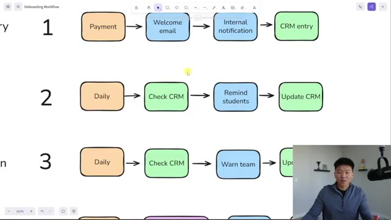
*⏱️ 00:01:15 — Vue d'ensemble du diagramme de flux d'onboarding avec le workflow numéro 2 en surbrillance (Daily -> Check CRM -> Remind students -> Update CRM).*

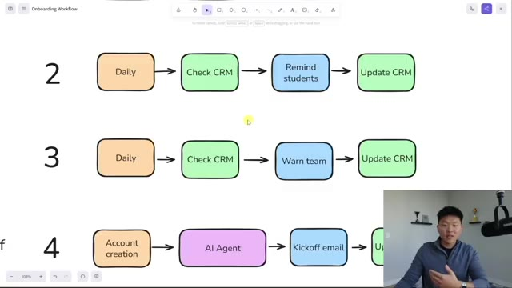
*⏱️ 00:01:31 — Défilement du diagramme montrant le workflow numéro 2 centré à l'écran, ainsi que les workflows 3 et 4 en dessous.*

---

### ⏱️ `[00:01:39 - 00:01:57]` | Segment #04

**🔊 Audio (Transcription Intégrale Mot pour Mot en Français) :**
> nous mettrions à jour le CRM pour nous assurer que tous les étudiants ont des tags et des statuts précis. Et puis le dernier flux ici pour le numéro quatre était le lancement personnalisé proprement dit. Et ce que vous remarquerez, c'est que c'est en fait la seule fois dans tout ce système que nous utilisons l'IA. Et je ne veux pas être irréaliste quant aux résultats. C'est pourquoi j'ai pu construire ceci en deux heures et être payé pour cela.

**👁️ Analyse Visuelle d'Écran (gemini-3.5-flash-lite) :**
**Interface & Outils** : Outil de diagramme ou tableau blanc virtuel (type Miro, Whimsical ou Canva)

**Contenu textuel & Code** : Diagramme avec 4 flux de processus : 1. Create CRM Entry, 2. Follow up 1, 3. Human escalation, 4. Personalized kickoff.

**Action / Démonstration** : Le présentateur explique les différents flux d'automatisation du système d'onboarding des étudiants.

*⏱️ 00:01:44 — Un diagramme de workflow d'onboarding avec les flux 2, 3 et 4 illustrant les étapes d'automatisation.*

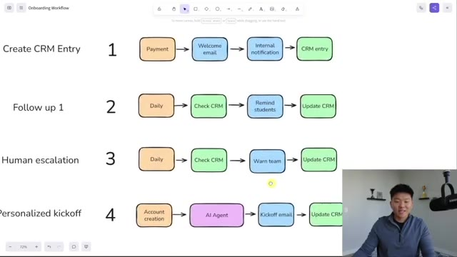
*⏱️ 00:01:48 — Le diagramme de workflow complet affichant les quatre flux numérotés avec leurs étiquettes respectives à gauche.*

---

### ⏱️ `[00:01:57 - 00:02:19]` | Segment #05

**🔊 Audio (Transcription Intégrale Mot pour Mot en Français) :**
> Parce que lorsque vous avez vraiment besoin de passer plus de temps sur un système, de l'affiner, de l'ajuster, de le prompter et de le tester, c'est lorsque vous avez beaucoup d'IA. Mais en raison de la façon dont j'avais configuré ces trois flux sans IA, juste comme une automatisation de base, nous avons su tout de suite qu'il était extrêmement robuste. Quoi qu'il en soit, dès que l'étudiant créait réellement son compte, c'est à ce moment-là que ce quatrième flux se déclenchait. Il envoyait les détails de son compte à un agent IA qui écrivait un e-mail de bienvenue personnalisé et chaleureux.

**👁️ Analyse Visuelle d'Écran (gemini-3.5-flash-lite) :**
**Interface & Outils** : Outil de diagramme de flux / tableau blanc en ligne (type Miro ou équivalent)

**Contenu textuel & Code** : Quatre flux nommés : 1. Create CRM Entry (Payment -> Welcome email -> Internal notification -> CRM entry), 2. Follow up 1 (Daily -> Check CRM -> Remind students -> Update CRM), 3. Human escalation (Daily -> Check CRM -> Warn team -> Update CRM), 4. Personalized kickoff (Account creation -> AI Agent -> Kickoff email -> Update CRM)

**Action / Démonstration** : Présentation visuelle des différents scénarios d'automatisation et de flux de travail.

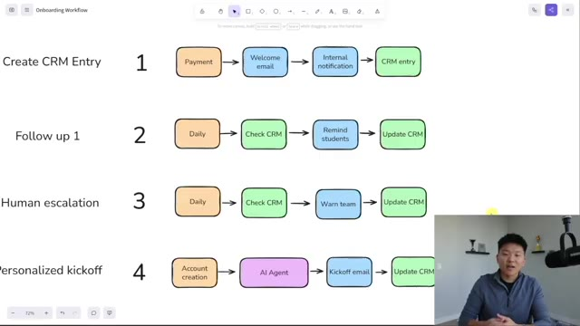
*⏱️ 00:02:03 — Schéma de workflow d'onboarding montrant quatre processus séquentiels sous forme de blocs colorés, avec le présentateur en médaillon dans le coin inférieur droit.*

---

### ⏱️ `[00:02:19 - 00:02:39]` | Segment #06

**🔊 Audio (Transcription Intégrale Mot pour Mot en Français) :**
> Cela leur envoyait un message, puis cela mettait à jour le CRM avec leur statut exact et envoyait une notification à l'équipe pour dire, en gros, hé, l'étudiant A a été entièrement intégré. Il a payé. Il a créé son compte. Il est prêt à démarrer. Donc, dans les grandes lignes, c'est comme ça que le système fonctionne. Je suis sûr que vous vous demandez peut-être comment nous avons réellement vérifié certains statuts et comment nous nous sommes assurés que rien ne passait entre les mailles du filet ? Alors allons dans N8N, et je vais simplement construire ceci devant vous.

**👁️ Analyse Visuelle d'Écran (gemini-3.5-flash-lite) :**
**Interface & Outils** : Tableau blanc numérique / outil de diagramme.

**Contenu textuel & Code** : Diagrammes numérotés de 1 à 4 représentant des étapes d'automatisation (Payment, Welcome email, Internal notification, CRM entry, AI Agent, etc.).

**Action / Démonstration** : Le présentateur explique les différentes étapes des flux d'automatisation et de gestion du CRM.

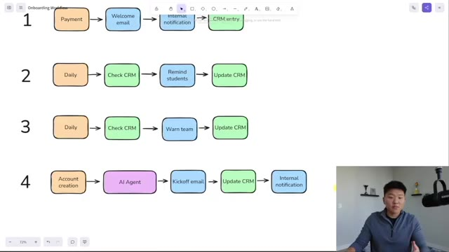
*⏱️ 00:02:24 — Schéma de flux de travail illustrant plusieurs scénarios d'intégration avec le présentateur en médaillon en bas à droite.*

---

### ⏱️ `[00:02:39 - 00:02:59]` | Segment #07

**🔊 Audio (Transcription Intégrale Mot pour Mot en Français) :**
> Le wireframing est donc super important. Cela vous aide à vous aligner avec le client, et cela vous aide également à sauter dans NNN et à commencer à construire des choses immédiatement parce que vous savez déjà à quoi cela va ressembler. Et c'est en fait quelque chose que j'enseigne en profondeur dans mon programme. Donc si vous voulez y jeter un coup d'œil, le lien pour cela sera en bas dans la description. Quoi qu'il en soit, nous savons que le premier flux va être déclenché lorsque l'étudiant soumet un paiement. Donc pour cela, ce que j'ai fait dans la construction réelle, c'est que nous avons utilisé un webhook.

**👁️ Analyse Visuelle d'Écran (gemini-3.5-flash-lite) :**
**Interface & Outils** : Interface web d'automatisation et plateforme de cours en ligne (AIS+).

**Contenu textuel & Code** : Menus de navigation de cours, sections 'Wireframing', options de création de flux ('Add first step', 'Build with AI').
[DESC_IMAGE_3] Navigation et exploration de l'interface de création de flux de travail.

**Action / Démonstration** : Explications face caméra et démonstration conceptuelle.

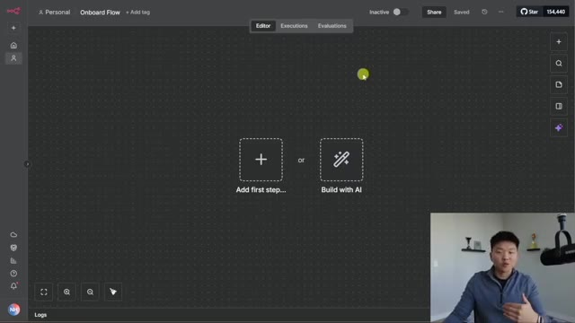
*⏱️ 00:02:44 — Vue d'une interface de workflow vide avec les boutons 'Add first step' et 'Build with AI'.*

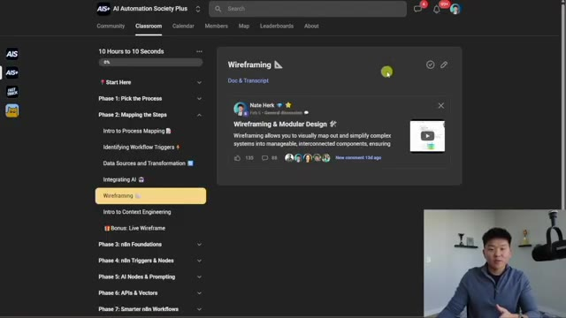
*⏱️ 00:02:49 — Interface de la plateforme de formation affichant le module 'Wireframing' dans le menu latéral.*

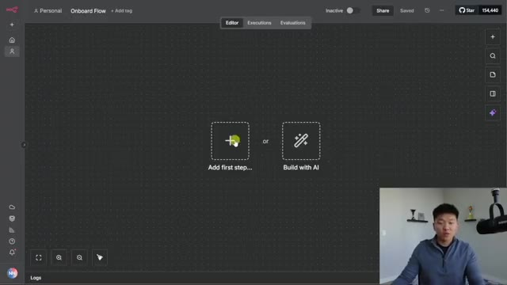
*⏱️ 00:02:54 — Gros plan sur l'interface de workflow montrant le curseur survolant le bouton 'Add first step'.*

---

### ⏱️ `[00:02:59 - 00:03:22]` | Segment #08

**🔊 Audio (Transcription Intégrale Mot pour Mot en Français) :**
> Et nous avons fondamentalement fait en sorte que le processeur de paiement envoie une notification à ce webhook NNN afin qu'il déclenche le flux de travail lorsque quelqu'un a payé. Je vais aller de l'avant et utiliser un outil appelé Postman pour envoyer une charge utile fictive à ce webhook. Je vais donc aller dans le webhook, choisir post comme méthode. Je vais copier cette URL de test ici, et je vais aller de l'avant et exécuter le flux de travail. Donc maintenant, il écoute. Je vais aller dans Postman. Nous allons faire une requête post vers cette URL de webhook.

**👁️ Analyse Visuelle d'Écran (gemini-3.5-flash-lite) :**
**Interface & Outils** : Application web n8n (éditeur de workflow)

**Contenu textuel & Code** : Un nœud unique nommé "Webhook" configuré en méthode GET, lié à un bouton "Execute workflow".

**Action / Démonstration** : Le présentateur explique la configuration du webhook n8n et se prépare à tester le déclenchement du flux avec Postman.

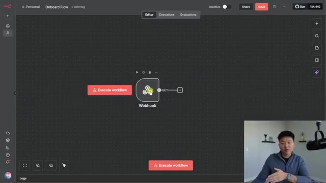
*⏱️ 00:03:05 — Interface d'automatisation n8n montrant un nœud Webhook avec un bouton d'exécution de workflow, avec la vidéo du présentateur en incrustation en bas à droite.*

---

### ⏱️ `[00:03:23 - 00:03:41]` | Segment #09

**🔊 Audio (Transcription Intégrale Mot pour Mot en Français) :**
> Et nous avons juste besoin d'envoyer quelques éléments dans le corps. Donc nous envoyons ici le prénom, le nom, l'e-mail et le numéro de téléphone. Je vais donc cliquer sur envoyer. Et si nous retournons dans NNN, nous devrions voir que nous venons de recevoir ces données. Et vous pouvez voir juste ici sur ce côté droit, nous avons capturé cette charge utile du corps que nous venions de configurer. Je vais donc épingler ces données et nous allons continuer avec le reste du flux.

**👁️ Analyse Visuelle d'Écran (gemini-3.5-flash-lite) :**
**Interface & Outils** : Postman et n8n (interface web de workflow)

**Contenu textuel & Code** : Requête POST avec les champs firstName (Nate), lastName (Herk), email (nate@example.com), phoneNumber (555-5555) et l'URL du webhook n8n.

**Action / Démonstration** : Envoi d'une requête HTTP POST de test vers un webhook n8n pour vérifier la réception des données.

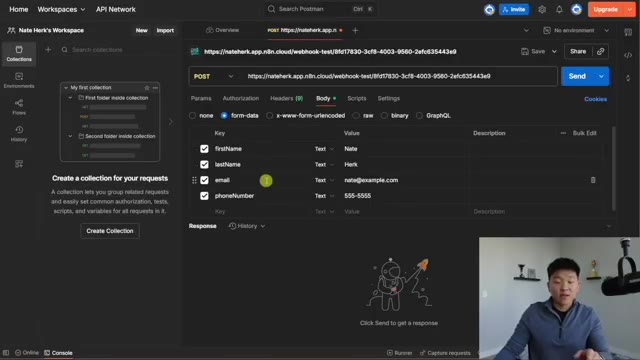
*⏱️ 00:03:27 — Interface Postman montrant une requête HTTP POST avec des données de test (prénom, nom, email, téléphone) dans le corps.*

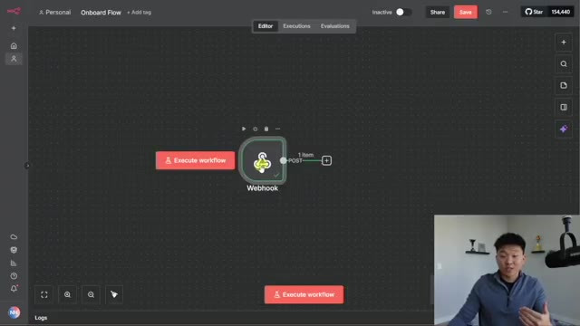
*⏱️ 00:03:32 — Interface n8n affichant un workflow d'automatisation avec un nœud Webhook actif.*

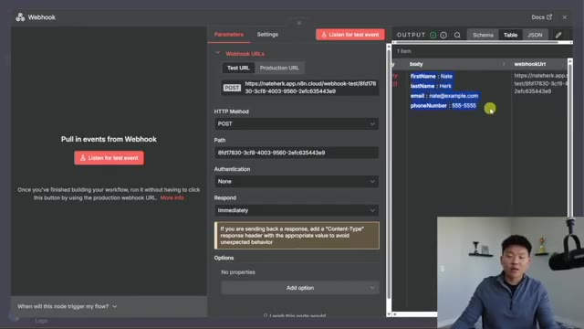
*⏱️ 00:03:36 — Panneau de configuration du nœud Webhook dans n8n affichant les données reçues dans l'onglet de sortie.*

---

### ⏱️ `[00:03:41 - 00:04:00]` | Segment #10

**🔊 Audio (Transcription Intégrale Mot pour Mot en Français) :**
> Donc l'étape suivante est de leur envoyer un e-mail de bienvenue. Donc je vais aller ajouter un nœud Gmail. Nous allons utiliser une opération d'envoi de message. Et je vais glisser l'e-mail que nous avons reçu d'eux afin de leur envoyer cela. Pour l'objet, j'ai dit, bienvenue à l'Académie AIS. Et nous allons le rendre un peu plus personnalisé en glissant leur prénom juste ici. Donc maintenant, cela arriverait sous la forme : bienvenue à l'Académie AIS, Nate.

**👁️ Analyse Visuelle d'Écran (gemini-3.5-flash-lite) :**
**Interface & Outils** : Outil d'automatisation de workflow (n8n)

**Contenu textuel & Code** : Paramètres du nœud Gmail (Credential, Resource: Message, Operation: Send, To: {{ $json.body.email }}, Subject: Hello World!) et données JSON du Webhook en entrée (firstName, lastName, email, phoneNumber).

**Action / Démonstration** : Sélection et configuration d'un nœud Gmail pour envoyer un message automatisé basé sur les données reçues du webhook.

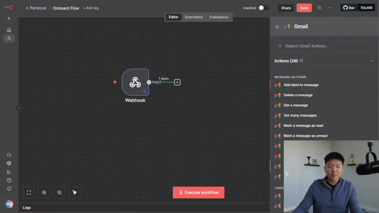
*⏱️ 00:03:45 — Interface d'un outil de workflow affichant un nœud Webhook et un panneau latéral de sélection d'actions Gmail.*

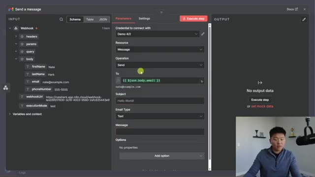
*⏱️ 00:03:50 — Configuration du nœud Gmail "Send a message" avec les paramètres de destinataire, d'objet et les données d'entrée du webhook.*

---

### ⏱️ `[00:04:00 - 00:04:35]` | Segment #11

**🔊 Audio (Transcription Intégrale Mot pour Mot en Français) :**
> Et ensuite, j'ai simplement inséré un message dans le corps du texte. Et si vous l'ouvrez, vous pouvez voir qu'il est écrit : « Hé, Nate, bienvenue à bord. Cliquez ci-dessous pour créer votre compte étudiant et commencer à apprendre. » Et c'est là que vous inséreriez simplement une sorte de lien vers l'endroit où ils iraient réellement créer leur compte. Maintenant, la dernière chose que j'aime faire est d'aller dans les options, de désactiver l'attribution de l'expéditeur NNN. De cette façon, l'e-mail n'arrive pas en disant que cet e-mail a été généré automatiquement par NNN. Je vais donc lancer l'envoi et nous pourrons aller jeter un coup d'œil rapide à ce à quoi cela ressemble. Et voilà. C'est à quoi ressemble l'e-mail. Bienvenue à l'Académie AIS, Nate. Bienvenue à bord. Et ensuite, je cliquerais là-dessus et je créerais fondamentalement mon compte. Donc, après cela, ce que nous voulons faire, c'est avertir l'équipe interne que quelqu'un vient de payer. Je vais donc le faire

**👁️ Analyse Visuelle d'Écran (gemini-3.5-flash-lite) :**
**Interface & Outils** : n8n, Gmail

**Contenu textuel & Code** : Modèle d'e-mail avec variable JavaScript (`{{ $json.body.firstName }}`) et texte de bienvenue « Welcome aboard! »

**Action / Démonstration** : Le présentateur montre la configuration du corps de l'e-mail dans le workflow n8n puis le résultat reçu dans Gmail.

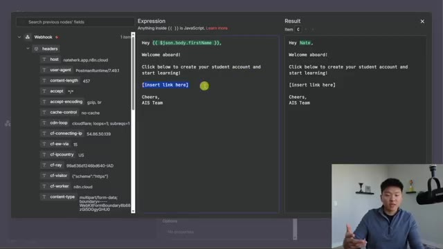
*⏱️ 00:04:09 — L'éditeur d'expressions de n8n affichant le corps du message e-mail avec des variables dynamiques et un espace réservé pour le lien.*

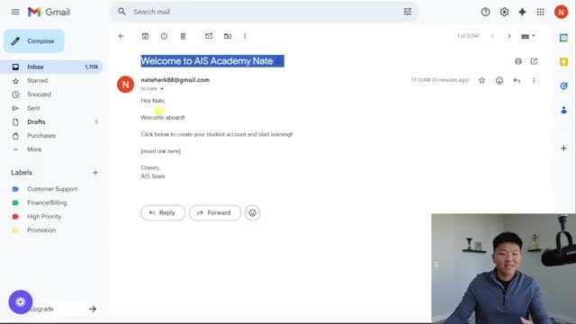
*⏱️ 00:04:27 — Une boîte de réception Gmail affichant l'e-mail reçu avec le message de bienvenue et le lien d'inscription.*

---

### ⏱️ `[00:04:35 - 00:05:11]` | Segment #12

**🔊 Audio (Transcription Intégrale Mot pour Mot en Français) :**
> une opération Slack. Nous allons descendre tout en bas ici pour envoyer un message. Je vais simplement choisir le canal sur lequel je veux l'envoyer. Dans ce cas, je vais l'envoyer sur un canal appelé YouTube testing. Et ensuite, nous devons simplement configurer le message réel que nous envoyons. D'accord, voici ce que j'ai imaginé. J'ai un nouvel étudiant a payé le et ensuite j'ai inséré la fonction pour la date du jour. Sur le côté droit, vous pouvez voir qu'elle apparaît comme étant la date du jour et aussi l'heure exacte. Et ensuite, j'ai fondamentalement juste glissé depuis le webhook, je suis allé tout en bas jusqu'au payload que nous avons reçu plus tôt, et j'ai glissé le prénom et le nom. Donc maintenant, il est écrit Nate Herc est en cours d'intégration maintenant. Et ensuite, juste pour garder cela propre dans Slack, j'ai inséré, vous savez, des trucs de lignes ondulées. Et quand j'envoie cela dans Slack, vous verrez pourquoi j'ai fait ça.

**👁️ Analyse Visuelle d'Écran (gemini-3.5-flash-lite) :**
**Interface & Outils** : n8n (éditeur de workflow d'automatisation)

**Contenu textuel & Code** : Paramètres du nœud Slack : Credential (AIS Slack), Resource (Message), Operation (Send), Send Message To (Channel), Channel (youtube-testing), Message Type (Simple Text Message).

**Action / Démonstration** : Configuration des paramètres du nœud pour envoyer un message Slack dans le canal de test.

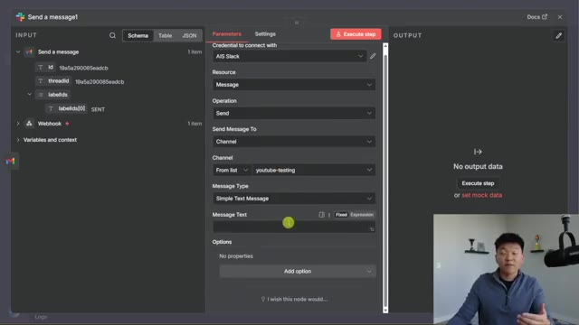
*⏱️ 00:04:44 — Interface d'un nœud de workflow montrant la configuration d'une action Slack avec le choix du canal 'youtube-testing' et le champ du texte du message.*

---

### ⏱️ `[00:05:11 - 00:05:36]` | Segment #13

**🔊 Audio (Transcription Intégrale Mot pour Mot en Français) :**
> Mais avant d'envoyer tout ça, j'aime aussi aller de l'avant et ajouter une option appelée inclure le lien vers le flux de travail et la désactiver. Et cela consiste simplement à supprimer le message dans Slack qui dirait, hé, ceci a été généré par ce flux de travail n8n. Je vais donc procéder à l'exécution de cette étape. Nous pouvons voir qu'il a été envoyé. Et si je vais sur mon Slack, vous pouvez voir qu'il est écrit qu'un nouvel étudiant a payé à cette date, à cette heure. Et ensuite, Nate Herc est en cours d'intégration maintenant. Et puis la ligne ici est simplement là pour garder tous ces messages séparés au fur et à mesure qu'ils commencent à s'accumuler.

**👁️ Analyse Visuelle d'Écran (gemini-3.5-flash-lite) :**
**Interface & Outils** : n8n et Slack

**Contenu textuel & Code** : Expression n8n pour formater un message Slack avec des variables dynamiques (nom, prénom) et canal #youtube-testing.

**Action / Démonstration** : Configuration d'un nœud d'envoi de message Slack dans n8n et vérification du résultat visuel dans le canal Slack.

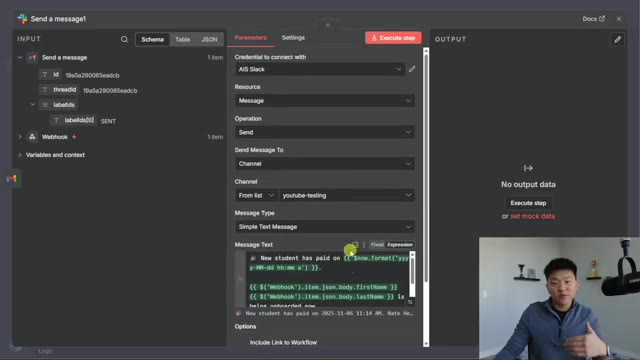
*⏱️ 00:05:18 — Interface n8n montrant les paramètres du nœud Send a message avec le champ Message Text et l'option Include Link to Workflow.*

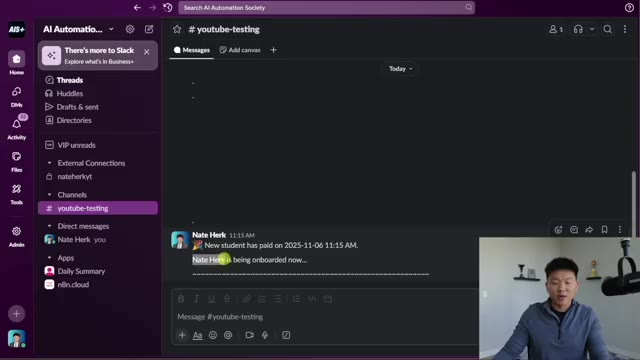
*⏱️ 00:05:30 — Application Slack affichant un message de test envoyé dans le canal #youtube-testing avec le texte généré par le flux.*

---

### ⏱️ `[00:05:36 - 00:06:10]` | Segment #14

**🔊 Audio (Transcription Intégrale Mot pour Mot en Français) :**
> Très bien, maintenant la dernière étape est de les créer comme une entrée dans le CRM. Et pour cela, nous utilisons un Google Sheet très sophistiqué où nous avons des informations comme leur nom complet, leur e-mail, leur numéro de téléphone, leur statut, la date de paiement, le premier suivi, la prise de contrôle humaine, puis d'autres données démographiques que nous obtenons d'eux plus tard lorsqu'ils créent réellement leur compte. Donc ce que nous allons faire, c'est retourner dans n8n et nous allons ajouter un nœud Google Sheet. Ce que nous voulons faire, c'est ajouter une nouvelle ligne dans le Sheet, ce qui s'appelle "Append Row in Sheet" (Ajouter une ligne dans le Sheet). Donc une fois que je choisis ce sheet, il me demande des valeurs à envoyer vers ce Google Sheet. Et donc ce que nous allons faire, c'est retourner au webhook qui a déclenché ce flux. Nous allons glisser le prénom juste ici pour le nom complet. Je vais

**👁️ Analyse Visuelle d'Écran (gemini-3.5-flash-lite) :**
**Interface & Outils** : Google Sheets, n8n (outil d'automatisation de workflows).

**Contenu textuel & Code** : En-têtes de colonnes d'un CRM sur Google Sheets et paramètres de mapping de données (champs de saisie pour Full Name, Email, Phone, Status, Payment Date, etc.) dans n8n.

**Action / Démonstration** : Présentation du modèle de CRM sur Google Sheet puis configuration du mapping des champs pour l'automatisation d'ajout de ligne via n8n.

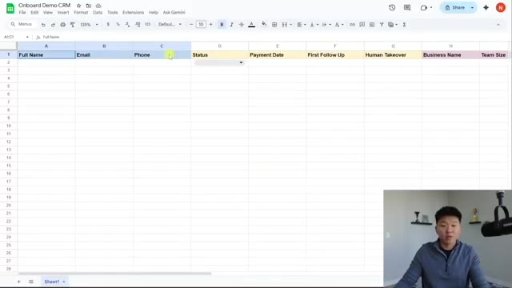
*⏱️ 00:05:45 — Un tableau Google Sheets nommé "Onboard Demo CRM" affichant les en-têtes de colonnes tels que Full Name, Email, Phone, Status, Payment Date, First Follow Up, Human Takeover, Business Name et Team Size.*

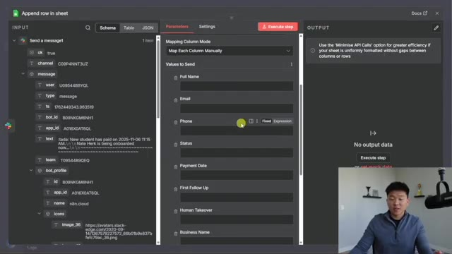
*⏱️ 00:06:02 — L'interface de configuration d'un nœud dans n8n pour l'action "Append row in sheet", montrant le mapping des colonnes du CRM (Full Name, Email, Phone, etc.) avec les données d'entrée.*

---

### ⏱️ `[00:06:10 - 00:06:32]` | Segment #15

**🔊 Audio (Transcription Intégrale Mot pour Mot en Français) :**
> ajoutez un espace et nous allons glisser ici, le nom de famille juste là. Et si vous le vouliez, vous pourriez diviser cela dans votre CRM en une colonne pour le prénom et une colonne pour le nom de famille. Mais pour l'instant, nous allons simplement faire ceci pour faire simple. Ensuite, je ferais simplement glisser leur e-mail, leur numéro de téléphone. Et c'est là que ça devient intéressant, c'est avec le statut. Donc dans le CRM, j'ai quatre statuts. Nous avons la création de compte. Nous avons le premier suivi envoyé. Nous avons l'humain notifié. Et puis nous avons le compte créé. Et c'est ainsi que nous nous assurons de les filtrer plus tard.

**👁️ Analyse Visuelle d'Écran (gemini-3.5-flash-lite) :**
**Interface & Outils** : n8n, Google Sheets

**Contenu textuel & Code** : Expressions n8n pour fusionner les champs prénom et nom (`{{ $('Webhook').item.json.body.firstName }} {{ $('Webhook').item.json.body.lastName }}`)

**Action / Démonstration** : Le créateur montre comment mapper et combiner les champs prénom et nom de famille dans l'automatisation n8n pour alimenter la colonne Full Name du CRM.

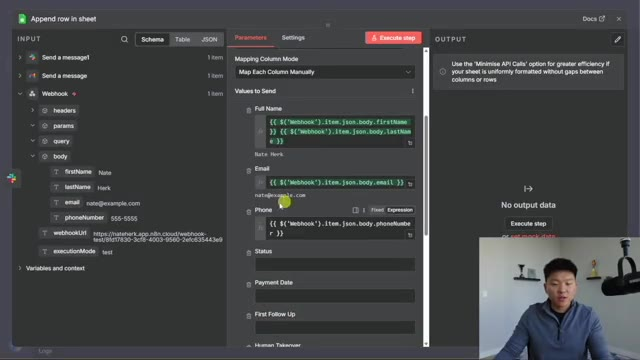
*⏱️ 00:06:21 — L'interface de configuration du nœud n8n "Append row in sheet" montrant le mapping des données Full Name combinant firstName et lastName.*

---

### ⏱️ `[00:06:32 - 00:06:52]` | Segment #16

**🔊 Audio (Transcription Intégrale Mot pour Mot en Français) :**
> s'ils ne se qualifient pas pour un suivi ou une notification humaine. Donc ce qu'on veut faire maintenant, c'est simplement les mettre dans le CRM avec leurs informations, et nous voulons les étiqueter comme création de compte, ce qui signifie simplement que nous attendons qu'ils créent leur compte. Donc en fin de compte, ce que je dis, c'est que lorsque nous créons cette ligne, nous allons définir le statut sur création de compte. Et maintenant, nous devons ajouter trois autres choses, qui concernent la date de paiement, le premier suivi, et la reprise humaine.

**👁️ Analyse Visuelle d'Écran (gemini-3.5-flash-lite) :**
**Interface & Outils** : Google Sheets, n8n

**Contenu textuel & Code** : Champs de mapping de données (firstName, lastName, email, phoneNumber) et configuration du statut 'Account Creation' dans n8n lié au CRM Google Sheets.

**Action / Démonstration** : Configuration des paramètres d'un nœud d'automatisation pour ajouter des données de prospects dans le CRM Google Sheets avec le statut 'Account Creation'.

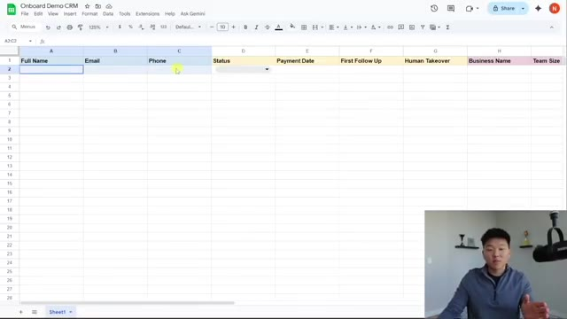
*⏱️ 00:06:37 — Vue d'un tableur Google Sheets nommé 'Onboard Demo CRM' montrant les en-têtes de colonnes tels que Full Name, Email, Phone, Status, Payment Date, etc.*

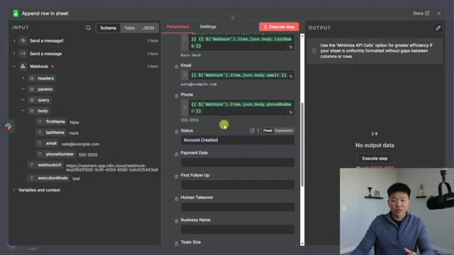
*⏱️ 00:06:47 — Interface d'un nœud d'automatisation n8n configurant l'action 'Append row in sheet' avec le paramètre Status défini sur 'Account Creation'.*

---

### ⏱️ `[00:06:52 - 00:07:10]` | Segment #17

**🔊 Audio (Transcription Intégrale Mot pour Mot en Français) :**
> Donc, ce que j'ai fait pour la date de paiement, c'est que je vais ajouter la date d'aujourd'hui, que je peux obtenir en faisant deux accolades, en tapant le signe dollar « now », et ensuite je vais simplement faire un point format, ce qui va essentiellement nous donner cette année à huit chiffres. Et maintenant, ce que je veux faire pour le premier suivi et la prise de relais humaine, c'est que le premier suivi ait lieu trois jours après leur paiement, et ensuite que la prise de relais humaine ait lieu cinq jours après leur paiement.

**👁️ Analyse Visuelle d'Écran (gemini-3.5-flash-lite) :**
**Interface & Outils** : n8n (interface web)

**Contenu textuel & Code** : Formulaire de paramétrage avec des expressions JavaScript entre doubles accolades (ex: `{{ $json }}`) et un menu déroulant suggérant des variables comme `$json` et `$now`.

**Action / Démonstration** : Le présentateur configure le champ de paiement en saisissant du code JavaScript pour insérer dynamiquement la date courante.

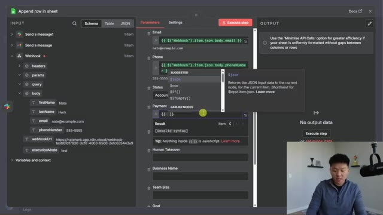
*⏱️ 00:06:57 — Interface de l'outil d'automatisation n8n montrant la configuration d'un nœud « Append row in sheet » avec un menu contextuel d'autocomplétion sur le champ Payment.*

---

### ⏱️ `[00:07:11 - 00:07:32]` | Segment #18

**🔊 Audio (Transcription Intégrale Mot pour Mot en Français) :**
> Donc la façon dont nous pouvons y arriver est que je peux copier cette expression et la mettre dans le premier suivi, et ensuite j'ai juste besoin de faire en sorte que ce soit trois jours plus tard. Donc je peux aller de l'avant et coller cette super fonction, qui dit essentiellement juste plus jours égale trois. Et donc maintenant vous pouvez voir qu'ils ont payé le 6 novembre, et la première date de suivi est le 9 novembre. Et puis vous l'avez deviné, je peux faire exactement la même chose en bas pour la reprise humaine, sauf qu'au lieu de trois, je vais juste ajouter cinq jours.

**👁️ Analyse Visuelle d'Écran (gemini-3.5-flash-lite) :**
**Interface & Outils** : n8n (outil d'automatisation de flux de travail)

**Contenu textuel & Code** : Expressions de date JavaScript (`{{ $now.format('yyyy-MM-dd') }}`) pour configurer les champs 'Payment Date' et 'First Follow Up'.

**Action / Démonstration** : Configuration des paramètres d'un nœud de workflow pour insérer des données formatées dans un tableur.

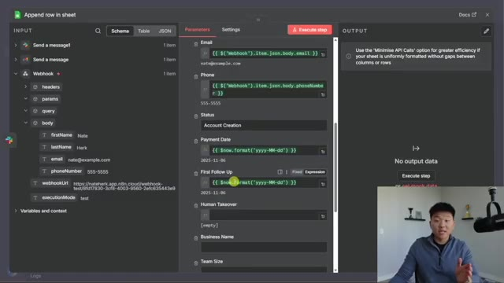
*⏱️ 00:07:16 — Interface de configuration d'un nœud dans n8n, montrant les paramètres de mappage des champs avec des expressions pour la date.*

---

### ⏱️ `[00:07:32 - 00:07:51]` | Segment #19

**🔊 Audio (Transcription Intégrale Mot pour Mot en Français) :**
> Et maintenant nous avons le 6 novembre, le 9 novembre et le 11 novembre. Et c'est en fait tout ce que nous devons faire pour l'instant parce que nous allons obtenir ces informations plus tard lorsqu'ils créeront réellement leur compte. Je peux donc simplement supprimer ces paramètres pour garder les choses propres. Et quand je m'apprête à exécuter cette étape et que nous retournons dans nos Google Sheets, vous pouvez voir que cela va insérer ces données juste là. Nous avons l'entrée CRM créée pour Nate Herc.

**👁️ Analyse Visuelle d'Écran (gemini-3.5-flash-lite) :**
**Interface & Outils** : n8n (éditeur de workflow) et Google Sheets.

**Contenu textuel & Code** : Formules de dates dynamiques n8n (ex: $now.plus...) et en-têtes de colonnes d'un tableau CRM Google Sheets.

**Action / Démonstration** : Configuration des paramètres de mappage des données dans le workflow d'automatisation et visualisation du tableau cible.

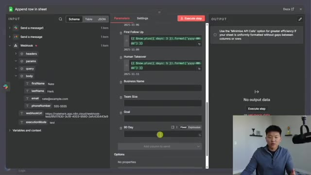
*⏱️ 00:07:37 — Interface n8n montrant les paramètres de configuration d'un nœud « Append row in sheet » avec des champs de date.*

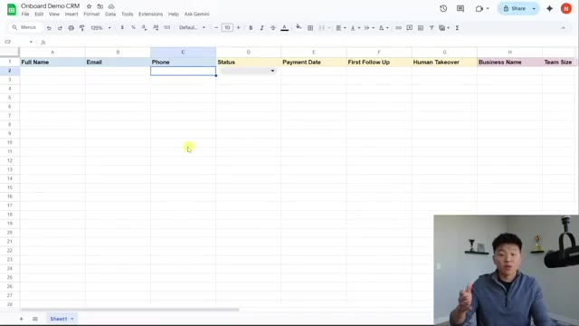
*⏱️ 00:07:46 — Fichier Google Sheets intitulé « Onboard Demo CRM » avec des colonnes telles que Full Name, Email, Phone, Status, etc.*

---

### ⏱️ `[00:07:51 - 00:08:17]` | Segment #20

**🔊 Audio (Transcription Intégrale Mot pour Mot en Français) :**
> Nous avons le statut et nous avons ces dates que nous devons relancer ou marquer pour une reprise par un humain. Très bien, donc ça, c'était la première phase. Maintenant, la deuxième phase, c'est que nous devons effectuer notre relance. Nous savons donc que cela se déclenche tous les jours. Je vais donc ajouter un déclencheur planifié et je vais faire en sorte que cela s'exécute tous les jours l'après-midi, disons à 14 heures. Donc, après l'exécution, ce que nous devons faire, c'est aller vérifier dans le CRM s'il y a quelqu'un dont le statut est toujours création de compte et dont le premier jour de relance est aujourd'hui.

**👁️ Analyse Visuelle d'Écran (gemini-3.5-flash-lite) :**
**Interface & Outils** : Interface web de type outil d'automatisation de type n8n.

**Contenu textuel & Code** : Diagramme de flux comprenant les nœuds "Webhook", "Send a message" (Gmail), "Send a message1" (Slack) et "Append row in sheet" (Google Sheets).

**Action / Démonstration** : Visualisation du workflow d'automatisation avec un bouton rouge "Execute workflow" en bas.

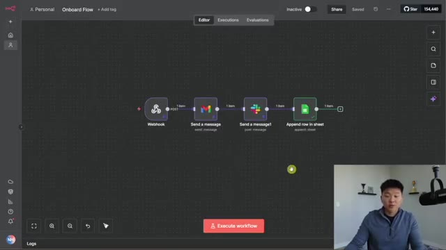
*⏱️ 00:07:58 — Capture d'écran montrant l'éditeur de workflow avec une suite de nœuds connectés (Webhook, Gmail, Slack, Google Sheets).*

---

### ⏱️ `[00:08:17 - 00:08:39]` | Segment #21

**🔊 Audio (Transcription Intégrale Mot pour Mot en Français) :**
> Je vais donc retourner dans le workflow. Je vais ajouter un nœud de feuille et nous allons effectuer une opération d'obtention de lignes d'une feuille. Et une fois que j'aurai choisi cette feuille que nous regardons, nous devons ajouter deux filtres. Le premier filtre consistera à s'assurer que la colonne de statut est égale à création de compte. Parce que si la colonne de statut est égale à n'importe laquelle de ces autres, alors elle n'est pas éligible pour un suivi.

**👁️ Analyse Visuelle d'Écran (gemini-3.5-flash-lite) :**
**Interface & Outils** : Interface web d'automatisation de workflow (type n8n / Make).

**Contenu textuel & Code** : Nœuds Google Sheets, paramètres d'action "Get Row(s)" et options de filtrage.

**Action / Démonstration** : Sélection d'une action Google Sheets et configuration des filtres pour le nœud.

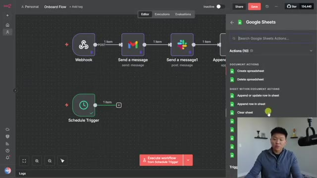
*⏱️ 00:08:23 — Vue d'un éditeur de workflow avec le panneau latéral Google Sheets affichant les actions disponibles.*

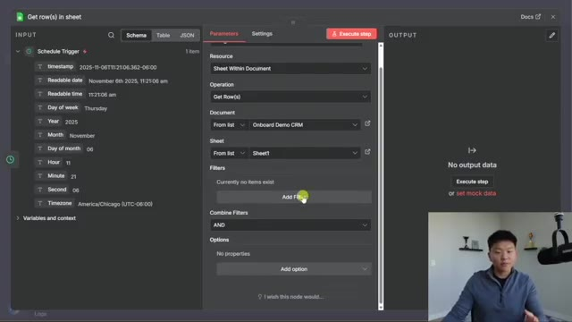
*⏱️ 00:08:28 — Configuration détaillée d'un nœud d'automatisation Google Sheets avec les paramètres de filtre.*

---

### ⏱️ `[00:08:39 - 00:08:59]` | Segment #22

**🔊 Audio (Transcription Intégrale Mot pour Mot en Français) :**
> Donc nous devons nous assurer que la création de compte est le statut. Et ensuite nous devons aussi vérifier et voir si la première date de relance est aujourd'hui. Parce que nous voulons seulement envoyer une relance et nous voulons seulement que ce soit trois jours après qu'ils ont payé. Et donc en production, ce que vous feriez c'est que vous viendriez ici et feriez simplement la fonction $now pour que ce soit la date d'aujourd'hui. Mais pour l'instant nous sommes juste en train de simuler que c'est trois jours après qu'ils ont payé. J'ajoute donc le plus trois jours.

**👁️ Analyse Visuelle d'Écran (gemini-3.5-flash-lite) :**
**Interface & Outils** : n8n (Interface de workflow d'automatisation)

**Contenu textuel & Code** : Paramètres de filtrage pour Google Sheets : Document "Onboard Demo CRM", sélection de la colonne "First Follow Up" dans le menu déroulant des filtres.

**Action / Démonstration** : Sélection d'une colonne spécifique ("First Follow Up") pour configurer les conditions de filtrage des lignes du CRM.

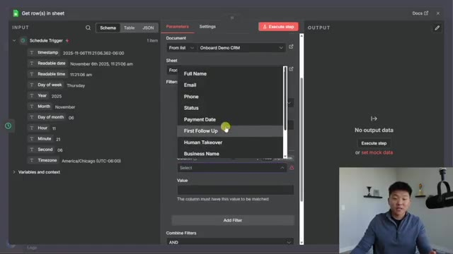
*⏱️ 00:08:44 — Configuration d'un nœud de récupération de données Google Sheets (Get row(s) in sheet) dans n8n, avec un menu déroulant affichant les colonnes du CRM (Full Name, Email, Status, Payment Date, First Follow Up) et le présentateur visible en incrustation.*

---

### ⏱️ `[00:08:59 - 00:09:18]` | Segment #23

**🔊 Audio (Transcription Intégrale Mot pour Mot en Français) :**
> Et maintenant, nous avons ces deux filtres où, si j'exécute l'étape, cela ne récupérera que les lignes qui ont payé il y a trois jours et qui nécessitent un suivi maintenant. C'est génial. Donc, à partir de là, nous devons fondamentalement rappeler à ces personnes qu'elles doivent créer leur compte. Je vais donc continuer et je vais leur envoyer un e-mail une fois de plus. Nous allons faire une opération d'envoi de message et nous allons simplement configurer nos paramètres. Donc, évidemment, nous voulons l'envoyer à cette personne.

**👁️ Analyse Visuelle d'Écran (gemini-3.5-flash-lite) :**
**Interface & Outils** : n8n (éditeur de workflow d'automatisation)

**Contenu textuel & Code** : Nœud configuré avec des filtres sur "Status" et "First Follow Up" utilisant une expression de date.

**Action / Démonstration** : Exécution d'une étape de récupération de lignes basée sur des critères temporels.

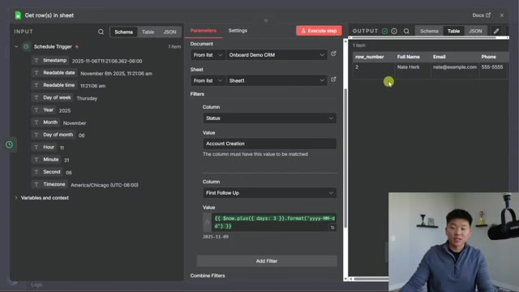
*⏱️ 00:09:04 — L'interface de configuration d'un nœud d'automatisation montrant des filtres basés sur des colonnes et des dates.*

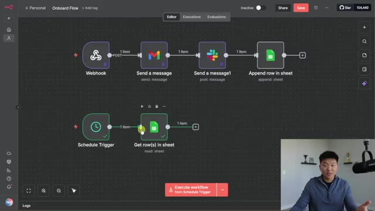
*⏱️ 00:09:08 — La vue d'ensemble du workflow d'automatisation montrant deux branches distinctes connectées à des déclencheurs et des actions.*

---

### ⏱️ `[00:09:18 - 00:09:52]` | Segment #24

**🔊 Audio (Transcription Intégrale Mot pour Mot en Français) :**
> Et même s'il y a, vous savez, quatre entrées ici ou sept ou dix, ce sera exactement la pareille et ça va simplement l'envoyer en masse à ces dix personnes. Très bien, donc nous avons leur e-mail. Nous avons l'objet, qui dit, n'oubliez pas de créer votre compte. Nous avons le texte. Et puis nous avons tout le corps du message, qui dit, hé, Nate Herc, nous avons remarqué que vous n'avez pas créé votre compte après avoir payé. Assurez-vous de régler ça pour pouvoir démarrer sur les chapeaux de roues. Voici le lien à nouveau. Et ensuite, vous mettriez simplement ce lien puis vous diriez, à la vôtre. Donc je vais l'envoyer et nous irons jeter un œil pour nous assurer que tout est bien arrivé correctement. Très bien, donc voici ce message que nous avons reçu. N'oubliez pas de créer votre compte. Hé, Nate Herc, bla, bla, bla. Voilà le lien. Et maintenant, ils ont reçu un rappel trois jours plus tard sans aucune intervention humaine nécessaire. Mais nous n'avons pas terminé car nous devons mettre à jour

**👁️ Analyse Visuelle d'Écran (gemini-3.5-flash-lite) :**
**Interface & Outils** : n8n (interface de workflow d'automatisation) et Gmail (interface web de messagerie).

**Contenu textuel & Code** : Paramètres de configuration d'un e-mail : destinataire (`{{ $json.Email }}`), objet (« Don't forget to create your account! ») et contenu du message avec variables dynamiques.

**Action / Démonstration** : Présentation de la configuration d'un nœud d'envoi d'e-mail dans n8n et vérification du résultat reçu dans l'interface Gmail.

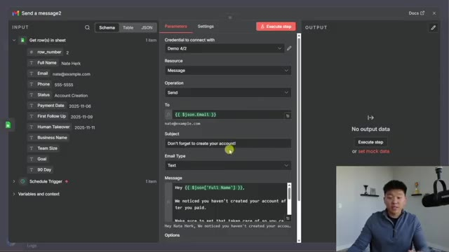
*⏱️ 00:09:26 — Vue rapprochée de l'interface n8n montrant la configuration d'un nœud d'envoi d'e-mail avec l'objet « Don't forget to create your account! » et un champ de message personnalisé.*

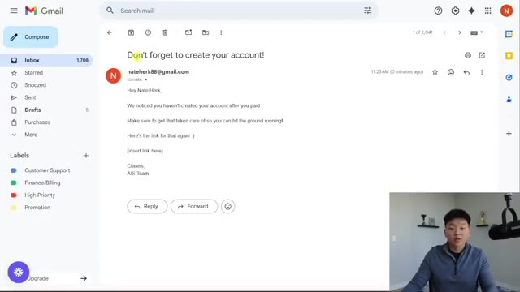
*⏱️ 00:09:44 — Interface de messagerie Gmail affichant un e-mail reçu avec l'objet « Don't forget to create your account! » et le corps du message configuré précédemment.*

---

### ⏱️ `[00:09:52 - 00:10:17]` | Segment #25

**🔊 Audio (Transcription Intégrale Mot pour Mot en Français) :**
> le CRM pour en gros dire que nous les avons contactés automatiquement. Donc je vais aller chercher une feuille. Nous allons faire une mise à jour de ligne plutôt qu'un ajout de ligne. Et ensuite, nous allons choisir notre document. Maintenant, ce que cela veut dire, c'est que nous devons faire une correspondance sur un certain type de colonne. Cela nous demande quelle ligne vous voulez réellement aller mettre à jour ? Et donc nous allons faire une correspondance sur l'e-mail ou le téléphone parce que c'est comme un identifiant unique. Donc nous faisons une correspondance sur l'e-mail. Et tout ce que j'ai à faire, c'est de récupérer l'e-mail de la personne qui a déclenché ce flux de travail. Nous avons donc nate@example.com.

**👁️ Analyse Visuelle d'Écran (gemini-3.5-flash-lite) :**
**Interface & Outils** : Interface web de workflow (type Make/n8n) avec panneau de configuration de nœuds Google Sheets.

**Contenu textuel & Code** : Nœuds de workflow connectés (Webhook, Gmail, Slack, Google Sheets) et paramètres de mise à jour de ligne Google Sheets (Document, Sheet, Mapping Column Mode, Column to match on).

**Action / Démonstration** : Sélection d'une action Google Sheets pour configurer la mise à jour d'une ligne dans le workflow.

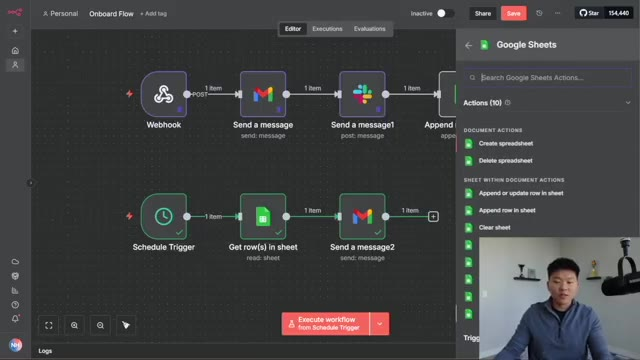
*⏱️ 00:09:58 — Vue d'ensemble de l'interface du créateur de workflows avec le panneau latéral Google Sheets ouvert à droite.*

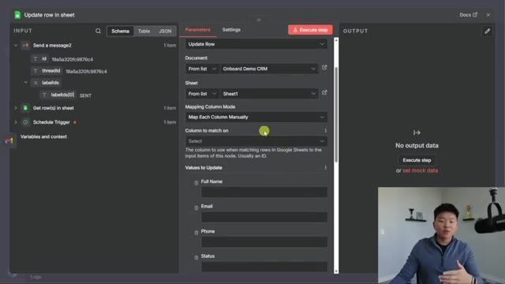
*⏱️ 00:10:04 — Configuration détaillée d'un nœud Google Sheets 'Update row in sheet' montrant les paramètres de document et de correspondance de colonnes.*

---

### ⏱️ `[00:10:17 - 00:10:52]` | Segment #26

**🔊 Audio (Transcription Intégrale Mot pour Mot en Français) :**
> Et rappelez-vous, tout ce que nous devons faire, c'est mettre à jour certaines lignes. Nous n'avons pas besoin de mettre à jour leur nom complet, leur téléphone, nous devons par contre mettre à jour leur statut. Nous n'avons pas besoin de mettre à jour leur date de paiement, mais nous voulons mettre à jour le premier suivi. Je peux donc me débarrasser de tout le reste, à l'exception du statut et du premier suivi. Parce que pour le statut, ce que nous voulons faire, c'est essentiellement le définir comme étant le statut pour indiquer que le premier suivi a été envoyé. Et ensuite, pour la colonne du premier suivi, nous n'avons plus besoin de cette date. Je vais donc simplement la marquer comme N/A. Donc maintenant, vous pouvez voir que ça va mettre à jour la ligne où l'e-mail est égal à ceci, et ça va changer le statut pour cela, et ça va changer le premier suivi pour cela. Je clique donc sur exécuter l'étape. Nous allons aller dans le tableur et nous allons essentiellement regarder cela se produire. Boum, ça a été modifié ici et ça a été modifié là. Vous pouvez donc imaginer que si vous avez

**👁️ Analyse Visuelle d'Écran (gemini-3.5-flash-lite) :**
**Interface & Outils** : n8n, Google Sheets

**Contenu textuel & Code** : Nœud n8n « Update row in sheet », correspondance par e-mail, mise à jour des champs Status (« 1st FU Sent ») et First Follow Up, tableur Google Sheets avec colonnes Full Name, Email, Phone, Status, Payment Date, First Follow Up.

**Action / Démonstration** : Configuration des paramètres de mise à jour d'une ligne spécifique dans un tableau de données via un flux d'automatisation n8n.

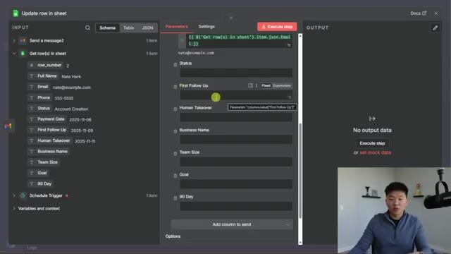
*⏱️ 00:10:25 — Image montrant l'interface d'un outil d'automatisation (n8n) avec un nœud « Update row in sheet » affichant les données d'entrée à gauche et les paramètres du champ statut et des options de mise à jour au centre.*

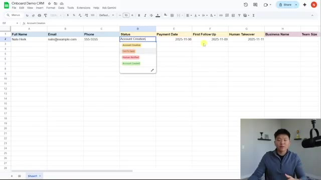
*⏱️ 00:10:34 — Image montrant un tableur Google Sheets nommé « Onboard Demo CRM » avec les données d'un client (Nate Herk) et le menu déroulant du statut ouvert en cellule D2 (« Account Creation »).*

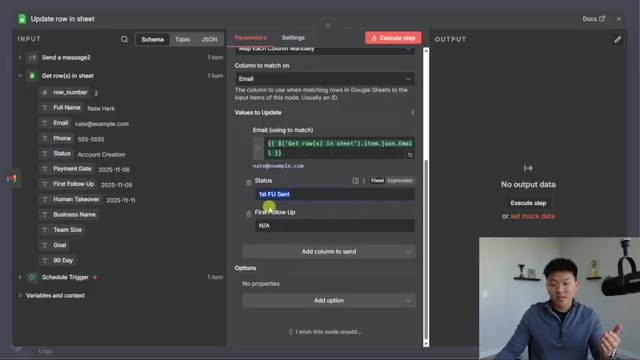
*⏱️ 00:10:43 — Image montrant à nouveau l'interface du nœud « Update row in sheet » dans n8n, avec la mise à jour des valeurs du champ « Status » définie sur « 1st FU Sent ».*

---

### ⏱️ `[00:10:52 - 00:11:24]` | Segment #27

**🔊 Audio (Transcription Intégrale Mot pour Mot en Français) :**
> 20 lignes de plus dans le CRM, vous pourriez voir vraiment très facilement, en fonction du statut, où en est tout le monde. Très bien, donc ce sont les deux premières phases. La troisième est très similaire à cette deuxième juste ici. Donc je vais en fait simplement copier ce déclencheur ici en bas et nous allons faire un petit test rapide. Mais ce que cela fait, c'est que ça vérifie si quelqu'un a déjà reçu cet e-mail et que deux jours après cela, ils n'ont toujours pas créé leur compte. Donc nous allons aller chercher un nœud Google Sheets une fois de plus, qui va être un nœud pour récupérer des lignes dans une feuille. Et cette fois, nos filtres sont juste un tout petit peu différents. Donc le premier filtre va être, nous vérifions si la colonne de statut est égale à premier suivi envoyé, parce que vous auriez uniquement besoin d'un suivi humain pour

**👁️ Analyse Visuelle d'Écran (gemini-3.5-flash-lite) :**
**Interface & Outils** : Interface web de construction de workflow (style n8n ou équivalent).

**Contenu textuel & Code** : Nœuds de workflow : déclencheur planifié, lecture de lignes de tableur, envoi de message Gmail, mise à jour de ligne.

**Action / Démonstration** : Sélection d'une zone autour des nœuds du workflow pour les copier ou les manipuler.

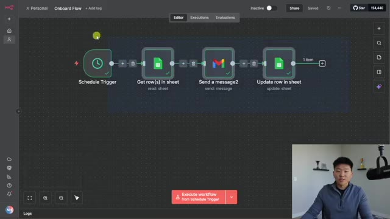
*⏱️ 00:11:00 — Un éditeur de workflow avec quatre nœuds connectés (Schedule Trigger, Get row(s) in sheet, Send a message2, Update row in sheet) et le présentateur visible en bas à droite.*

---

### ⏱️ `[00:11:24 - 00:11:57]` | Segment #28

**🔊 Audio (Transcription Intégrale Mot pour Mot en Français) :**
> quelqu'un qui a déjà reçu ce premier suivi automatique. Et puis le deuxième sert simplement à vérifier si la date de suivi humain est égale à aujourd'hui, encore une fois. Nous avons donc la date de prise en charge humaine, et nous voulons qu'elle soit égale à aujourd'hui, ce qui correspondrait à cinq jours après leur paiement, c'est pourquoi dans cet environnement simulé, je fais maintenant plus cinq jours. Je vais donc lancer le test, et nous devrions récupérer cet enregistrement car il correspond aux deux filtres que nous avions configurés, comme vous pouvez le voir. Très bien. Cette fois, selon le schéma conceptuel, au lieu de leur envoyer un rappel, nous voulons effectuer une escalade humaine et nous allons avertir l'équipe en interne via Slack. Je vais donc continuer et nous allons ajouter un nœud Slack et nous allons

**👁️ Analyse Visuelle d'Écran (gemini-3.5-flash-lite) :**
**Interface & Outils** : Outil d'automatisation de type n8n/Make (Image 1) et outil de diagramme/workflow (Image 2).

**Contenu textuel & Code** : Filtres configurés avec les colonnes 'Status', '1st FU Sent' et 'Human Takeover' (Image 1) ; diagramme des étapes du workflow d'onboarding (Image 2).

**Action / Démonstration** : Configuration des paramètres de filtrage des données CRM dans l'outil d'automatisation.

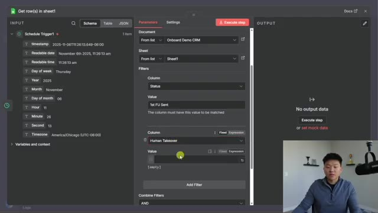
*⏱️ 00:11:32 — Interface d'un outil d'automatisation montrant la configuration des filtres pour récupérer des lignes dans Google Sheets.*

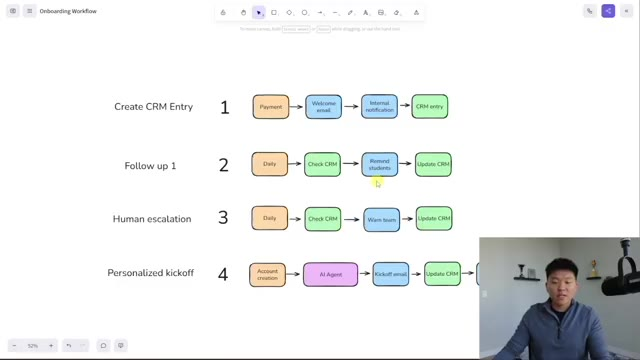
*⏱️ 00:11:49 — Schéma de workflow sur tableau blanc montrant quatre flux différents : Create CRM Entry, Follow up 1, Human escalation, et Personalized kickoff.*

---

### ⏱️ `[00:11:57 - 00:12:15]` | Segment #29

**🔊 Audio (Transcription Intégrale Mot pour Mot en Français) :**
> pour faire une opération d'envoi de message. Maintenant, encore une fois, je vais choisir exactement ce même canal. Donc c'est peut-être un canal spécifique que vous avez pour l'accueil ou peu importe ce que c'est. Et donc pour le texte du message, ce que j'ai imaginé, c'est : cela fait cinq jours que le nom complet a payé. Donc depuis que Nate Herc a payé et qu'ils n'ont pas encore créé de compte, veuillez intervenir pour aider. et ensuite nous faisons la même chose avec les accolades.

**👁️ Analyse Visuelle d'Écran (gemini-3.5-flash-lite) :**
**Interface & Outils** : n8n

**Contenu textuel & Code** : Paramètres du nœud "Send a message3" avec liste déroulante des canaux Slack (automation-logs, general, nateherkyt, resources, testimonials, watercooler, youtube-testing) et panneau des données d'entrée (Get row(s) in sheet1).

**Action / Démonstration** : Sélection d'un canal spécifique dans la liste déroulante pour configurer l'envoi du message Slack.

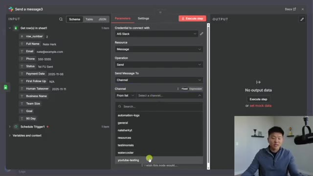
*⏱️ 00:12:01 — Interface de configuration du nœud Slack dans n8n avec la sélection du canal de message.*

---

### ⏱️ `[00:12:15 - 00:12:34]` | Segment #30

**🔊 Audio (Transcription Intégrale Mot pour Mot en Français) :**
> Donc je vais m'empresser d'envoyer ceci. Nous allons aller sur Slack et nous pouvons voir que nous venons de recevoir ce nouveau message. Cela fait cinq jours que Nate Herk n'a pas payé. Maintenant, la dernière chose à faire ici est encore une fois, de mettre à jour ce CRM. Je vais donc aller chercher une feuille. Ça va être une ligne de mise à jour et nous allons faire exactement la même chose en ce qui concerne la correspondance. Nous allons donc faire correspondre par e-mail. Encore une fois, cela pourrait être un numéro de téléphone. Ça doit juste être un identifiant unique.

**👁️ Analyse Visuelle d'Écran (gemini-3.5-flash-lite) :**
**Interface & Outils** : Slack, n8n (éditeur de workflow)

**Contenu textuel & Code** : Messages Slack affichant "It has been 5 days since Nate Herk paid", et interface de configuration de n8n pour les colonnes du CRM.

**Action / Démonstration** : Navigation de Slack vers l'éditeur n8n pour configurer la dernière étape de mise à jour du CRM.

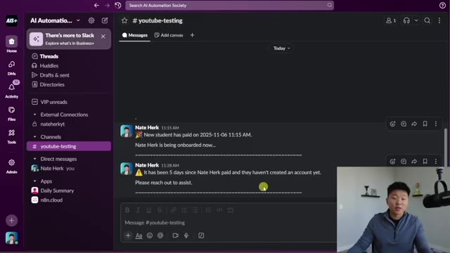
*⏱️ 00:12:20 — Image de l'interface Slack montrant les messages automatisés du bot concernant le statut de paiement de Nate Herk.*

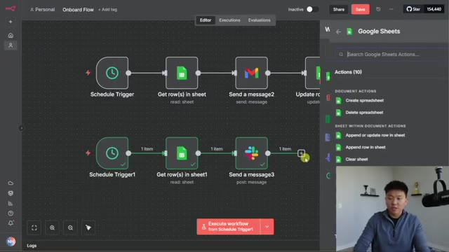
*⏱️ 00:12:24 — Vue d'ensemble du workflow sur n8n avec les nœuds de déclenchement, Google Sheets, Gmail et Slack.*

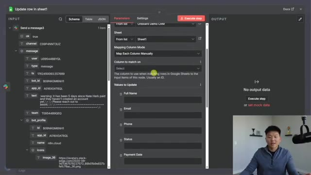
*⏱️ 00:12:29 — Panneau de configuration d'un nœud dans n8n pour la mise à jour d'une ligne dans Google Sheets (CRM).*

---

### ⏱️ `[00:12:34 - 00:12:53]` | Segment #31

**🔊 Audio (Transcription Intégrale Mot pour Mot en Français) :**
> Donc vous voudriez probablement faire attention si vous faites une correspondance sur le nom complet. Cela fonctionnerait probablement la majorité du temps, mais et si vous avez deux personnes avec le même nom complet ? Alors cela s'embrouillerait. Donc je vais aller de l'avant et récupérer l'e-mail de cette personne pour faire la correspondance. Et puis la seule chose que nous devons mettre à jour encore une fois, c'est le statut et la date de prise en charge humaine. Donc le prochain statut serait humain notifié. C'est donc exactement ce que je vais taper ici même.

**👁️ Analyse Visuelle d'Écran (gemini-3.5-flash-lite) :**
**Interface & Outils** : n8n (éditeur de workflow d'automatisation)

**Contenu textuel & Code** : Paramètres du nœud "Update row in sheet1" avec sélection de la colonne de correspondance définie sur "Email" et champs à mettre à jour (Email, Full Name, Phone, Status, Payment Date).

**Action / Démonstration** : Configuration et sélection du champ de correspondance par e-mail dans l'interface de l'outil d'automatisation.

*⏱️ 00:12:39 — Configuration d'un nœud de mise à jour Google Sheets dans un outil d'automatisation, avec le panneau de paramètres ouvert au milieu et le présentateur visible en bas à droite.*

---

### ⏱️ `[00:12:53 - 00:13:11]` | Segment #32

**🔊 Audio (Transcription Intégrale Mot pour Mot en Français) :**
> Et ensuite, pour la reprise humaine, je vais faire la même chose. Je vais simplement mettre N/A. Je vais juste écrire "escaladé". Donc maintenant, nous pouvons vérifier le CRM pour savoir que quelqu'un a fondamentalement été notifié à ce sujet. Donc je vais exécuter cette étape. Nous allons revenir sur la feuille et nous allons regarder la magie opérer. Boum. Le statut a été mis a jour et la reprise humaine est passée à "escaladé". Très bien. Les trois premiers workflows sont donc déjà terminés.

**👁️ Analyse Visuelle d'Écran (gemini-3.5-flash-lite) :**
**Interface & Outils** : n8n (éditeur de workflow) et Google Sheets.

**Contenu textuel & Code** : Paramètres de mise à jour de ligne : statut "Human Notified" et reprise humaine "Escalated".

**Action / Démonstration** : Modification des paramètres de la node de mise à jour et vérification du résultat dans le tableur CRM.

*⏱️ 00:12:57 — Configuration du nœud de mise à jour Google Sheets dans n8n, avec la saisie de la valeur "Escalated" dans le champ "Human Takeover".*

*⏱️ 00:13:06 — Affichage du tableau Google Sheets (CRM) mis à jour, montrant la colonne "Human Takeover" avec la valeur "Escalated".*

---

### ⏱️ `[00:13:11 - 00:13:31]` | Segment #33

**🔊 Audio (Transcription Intégrale Mot pour Mot en Français) :**
> Et vous pouvez voir qu'il n'y a vraiment pas beaucoup de marge d'erreur ici. Vous pourriez simplement vouloir vous assurer que vous pouvez tester différentes exécutions réelles et voir que rien ne passe à travers les mailles du filet. Mais il n'y a pas d'IA ici, ce qui est ce qui nous rend très, très confiants dans cette automatisation. Maintenant, cette dernière, bien sûr, va utiliser l'IA. Et c'est un peu plus complexe, mais ce n'est toujours pas trop mal du tout. Nous savons donc que la dernière doit être déclenchée lorsque le compte est réellement créé.

**👁️ Analyse Visuelle d'Écran (gemini-3.5-flash-lite) :**
**Interface & Outils** : Interface web d'automatisation de workflows (style n8n ou Make) et caméra du présentateur.

**Contenu textuel & Code** : Diagrammes de flux avec nœuds : Webhook, Send a message (Gmail/Slack), Append row in sheet, Schedule Trigger, Get row(s) in sheet. Un bouton rouge "Execute workflow" est visible en bas.

**Action / Démonstration** : Visualisation d'un workflow d'intégration complexe sans IA, prêt à être exécuté ou testé.

*⏱️ 00:13:16 — Capture d'écran montrant l'interface d'un outil d'automatisation de type workflow avec plusieurs flux connectant des services (Webhook, Gmail, Slack, Google Sheets). Le présentateur apparaît dans un encadré en bas à droite.*

---

### ⏱️ `[00:13:31 - 00:13:50]` | Segment #34

**🔊 Audio (Transcription Intégrale Mot pour Mot en Français) :**
> Donc, peu importe à quoi cela ressemble de votre côté, c'est peut-être un autre webhook. C'est peut-être un enregistrement dans un autre type de CRM de votre plateforme. Pour les besoins de l'exemple, allons-y et utilisons un déclencheur de formulaire n8n. Donc, cela nous permet essentiellement de faire apparaître un formulaire n8n. Et laissez-moi configurer rapidement certains de ces détails. Très bien, j'ai configuré le formulaire. Il s'appelle création de compte AIS.

**👁️ Analyse Visuelle d'Écran (gemini-3.5-flash-lite) :**
**Interface & Outils** : n8n (éditeur de workflow web)

**Contenu textuel & Code** : Deux flux de travail visibles : le premier avec Schedule Trigger, Google Sheets ("Get row(s) in sheet"), Gmail ("Send a message2"), et Google Sheets ("Update row in sheet") ; le second avec Schedule Trigger1, Google Sheets, Slack ("Send a message3"), et Google Sheets.

**Action / Démonstration** : Le présentateur explique la configuration des différents blocs et déclencheurs au sein de l'interface graphique de n8n.

*⏱️ 00:13:36 — Interface n8n affichant un éditeur de workflow avec deux flux automatisés distincts utilisant des déclencheurs planifiés et diverses intégrations, tandis que le présentateur apparaît en incrustation vidéo en bas à droite.*

---

### ⏱️ `[00:13:50 - 00:14:37]` | Segment #35

**🔊 Audio (Transcription Intégrale Mot pour Mot en Français) :**
> Il est écrit de remplir les détails ci-dessous pour configurer votre compte. Et maintenant, laissez-moi juste vous montrer, les gars, quels champs ils remplissent réellement. Nous avons le prénom. Nous avons le nom. Nous voulions également inclure l'adresse e-mail une fois de plus, parce que nous devons faire correspondre ces données dans le CRM. Et encore une fois, vous pourriez faire correspondre sur le prénom et le nom. Mais juste au cas où, si vous faites correspondre sur l'adresse e-mail, vous savez que celle-ci sera unique. Donc tout cela est requis. Nous avons le nom de l'entreprise, nous avons la taille de l'équipe, et ce sera un menu déroulant. Donc toutes ces options pour la taille de l'équipe, nous avons l'objectif principal pour rejoindre et nous avons le résultat souhaité en 90 jours. Et donc toutes ces informations vont être utilisées pour personnaliser cet e-mail de lancement et potentiellement même les faire correspondre avec un mentor ou un coach de vente ou peu importe l'offre réelle. Et vous pouvez également voir que nous pouvons accéder à ce formulaire par une URL. Donc cela pourrait être l'URL que vous envoyez dans ces e-mails de lancement de tout à l'heure. Mais de toute façon, quand je procède à l'exécution de cette étape, cela va afficher le formulaire réel.

**👁️ Analyse Visuelle d'Écran (gemini-3.5-flash-lite) :**
**Interface & Outils** : n8n (outil d'automatisation de workflows)

**Contenu textuel & Code** : Configuration des champs d'un formulaire (Field Name: Email Address, Business Name, etc.)

**Action / Démonstration** : Configuration des paramètres d'un nœud de soumission de formulaire dans le workflow.

*⏱️ 00:14:02 — Interface d'un outil d'automatisation de type n8n montrant la configuration des champs d'un formulaire, avec le présentateur en médaillon en bas à droite.*

---

### ⏱️ `[00:14:37 - 00:14:58]` | Segment #36

**🔊 Audio (Transcription Intégrale Mot pour Mot en Français) :**
> Donc, laissez-moi remplir de faux détails très rapidement afin que nous puissions continuer à avancer dans le reste du processus. Très bien. Donc, je viens de remplir quelques informations. Je vais procéder à l'envoi. Et vous pouvez voir que nous venons de capturer ces données ici. Donc, encore une fois, ce serait fondamentalement le déclencheur du moment où quelqu'un procède réellement et crée ce compte. Très bien. Donc, la prochaine étape que nous devons faire, c'est que nous allons injecter ces données dans un agent IA. Qui va fondamentalement juste leur souhaiter la bienvenue dans le programme ou le cours ou peu importe ce que l'offre est.

**👁️ Analyse Visuelle d'Écran (gemini-3.5-flash-lite) :**
**Interface & Outils** : n8n (éditeur de workflow et formulaire web)

**Contenu textuel & Code** : Champs du formulaire : Business Name, Team Size, Main goal, Desired outcome, et un nœud de workflow 'On form submission'.

**Action / Démonstration** : Soumission du formulaire web pour tester et capturer les données dans le workflow n8n.

*⏱️ 00:14:42 — Un formulaire en ligne rempli avec de faux détails sur l'interface n8n, avec le curseur sur le bouton 'Submit'.*

*⏱️ 00:14:47 — L'interface du workflow n8n montrant un événement 'On form submission' capturé avec un élément réussi (1 item).*

---

### ⏱️ `[00:14:58 - 00:15:18]` | Segment #37

**🔊 Audio (Transcription Intégrale Mot pour Mot en Français) :**
> Gardez donc à l'esprit, pendant que nous construisons ceci, qu'il vous faut évidemment une bonne compréhension du processus d'intégration spécifique que vous aidez à automatiser. Donc une partie de tout cela pourrait être similaire avec, par exemple, un certain rythme de suivi, mais une grande partie de cela devra simplement être modifiée pour s'adapter à votre cas d'utilisation ou au cas d'utilisation de votre client. Quoi qu'il en soit, je vais aller chercher un agent IA juste ici et nous devons faire quelques choses. La première chose est de configurer ce que l'agent regarde réellement.

**👁️ Analyse Visuelle d'Écran (gemini-3.5-flash-lite) :**
**Interface & Outils** : Interface web de l'outil d'automatisation n8n.

**Contenu textuel & Code** : Nœuds de workflow (Webhook, Send a message, Append row in sheet, Schedule Trigger) et paramètres de l'agent IA (Source for Prompt, Prompt, Chat Model).

**Action / Démonstration** : Présentation de la structure globale d'un flux d'intégration, puis configuration détaillée des paramètres d'un nœud d'agent IA.

*⏱️ 00:15:03 — Vue d'ensemble d'un éditeur de workflow (type n8n) nommé "Onboard Flow" montrant plusieurs flux d'automatisation connectés par des nœuds.*

*⏱️ 00:15:13 — Gros plan sur les paramètres d'un nœud "AI Agent" dans l'interface, affichant les options de configuration du prompt utilisateur, du modèle de chat et des variables d'entrée.*

---

### ⏱️ `[00:15:18 - 00:15:52]` | Segment #38

**🔊 Audio (Transcription Intégrale Mot pour Mot en Français) :**
> Et pour faire ça, nous allons modifier le message utilisateur pour qu'il se définisse ci-dessous. Je vais transformer ceci en expression et je vais l'ouvrir. Et fondamentalement, tout ce que je fais ici, c'est que je tape, ok, voici l'étudiant et je glisse le prénom, le nom de l'entreprise et la taille. Je glisse le nom de l'entreprise et la taille de l'équipe. Objectif, je glisse l'objectif et c'est la même chose pour le résultat souhaité en 90 jours. Et vous pouvez voir sur le côté droit, toutes ces variables apparaissent avec tout ce que la personne a soumis lorsqu'elle a soumis ce formulaire et créé son compte. Et c'est ce que l'agent IA va examiner pour créer cet e-mail de bienvenue. Et pour qu'il sache comment créer cet e-mail de bienvenue, nous devons lui donner un message système. Je vais donc descendre ici. Je vais transformer ceci en expression et l'ouvrir

**👁️ Analyse Visuelle d'Écran (gemini-3.5-flash-lite) :**
**Interface & Outils** : Interface web n8n (éditeur d'expressions).

**Contenu textuel & Code** : `Student: {{ $json['First Name'] }}` / `Business Name / Size: {{ $json['Business Name'] }} / {{ $json['Team Size'] }}` / `Goal: {{ $json['Main goal for joining'] }}` / `Desired Outcome in 90 Days: {{ $json['Desired outcome in 90 days'] }}`.

**Action / Démonstration** : Glisser-déposer et configuration des champs dynamiques JSON dans une expression n8n pour formater le message destiné à l'IA.

*⏱️ 00:15:26 — Interface n8n montrant la configuration d'une expression JavaScript avec les données d'un formulaire pour structurer un message utilisateur (Student, Business Name, Goal).*

---

### ⏱️ `[00:15:52 - 00:16:25]` | Segment #39

**🔊 Audio (Transcription Intégrale Mot pour Mot en Français) :**
> le configurer. Et laissez-moi insérer un message système très rapidement. Très bien. Donc j'ai dit : vous êtes Monsieur Amical et Gentil, un agent d'intégration par IA dont le travail est d'accueillir chaleureusement les nouveaux étudiants qui viennent de rejoindre le programme et de créer leur compte. On vous fournira des informations sur l'étudiant et votre tâche est de générer un e-mail de bienvenue convivial formaté sous forme d'objet JSON avec deux champs, le sujet et le corps. Et la raison pour laquelle nous allons faire cela, c'est que si vous repensez à tout à l'heure, lorsque nous devions envoyer un message, nous envoyions un sujet comme un champ et un message comme un champ séparé. Nous voulons donc que l'agent génère un sujet personnalisé ainsi qu'un message personnalisé. Et ceux-ci doivent simplement se trouver dans deux champs différents. Vous verrez donc exactement ce

**👁️ Analyse Visuelle d'Écran (gemini-3.5-flash-lite) :**
**Interface & Outils** : Interface web de type n8n ou outil d'automatisation d'IA.

**Contenu textuel & Code** : Prompt système pour l'agent d'intégration nommé "Mr. Friendly and Nice" définissant son rôle, ses objectifs et le format de sortie JSON attendu.

**Action / Démonstration** : Configuration et configuration du prompt d'un nœud d'agent IA dans le workflow.

*⏱️ 00:16:00 — Interface d'un éditeur de workflow montrant les données d'un formulaire à gauche et le prompt de configuration du système au centre.*

---

### ⏱️ `[00:16:25 - 00:16:44]` | Segment #40

**🔊 Audio (Transcription Intégrale Mot pour Mot en Français) :**
> Je veux dire, après avoir fait cela. Nous poursuivons ensuite en disant que votre objectif est de saluer l'étudiant par son nom, de faire une petite blague légère et amusante qui le complimente ou complimente son entreprise, d'exprimer de l'enthousiasme pour son parcours et de réaffirmer que s'il y met du travail et utilise les ressources du programme, il peut atteindre son objectif en 90 jours et de terminer par une note de motivation enjouée. Donc, avant de pouvoir réellement exécuter cet agent et le tester, nous devons ajouter deux choses.

**👁️ Analyse Visuelle d'Écran (gemini-3.5-flash-lite) :**
**Interface & Outils** : Interface utilisateur web d'un outil d'automatisation ou d'IA (type n8n ou plateforme similaire).

**Contenu textuel & Code** : Un prompt textuel définissant le rôle d'un agent IA (« You are Mr. Friendly and Nice ») avec des instructions précises sur les objectifs (saluer par son nom, faire une blague, exprimer de l'enthousiasme) et le format de sortie JSON attendu.

**Action / Démonstration** : Le présentateur explique et détaille le contenu du prompt configuré pour l'agent IA de bienvenue.

*⏱️ 00:16:29 — Interface d'un éditeur de workflow ou de prompt montrant un prompt détaillé pour un agent IA d'intégration (« Mr. Friendly and Nice ») avec les détails de soumission de formulaire à gauche.*

---

### ⏱️ `[00:16:44 - 00:17:13]` | Segment #41

**🔊 Audio (Transcription Intégrale Mot pour Mot en Français) :**
> La première chose, c'est qu'on doit en fait lui donner un cerveau d'IA. Donc je vais y aller et je vais prendre un modèle de chat Open Router. Et pour ça, je vais y aller et choisir Claude Sonnet 4.5 juste parce que je trouve qu'il est génial. Et on a aussi parlé du fait qu'il doit générer un objet et un message. Donc je vais aller ici et cliquer sur exiger un format de sortie spécifique, ce qui nous donne la possibilité de connecter un analyseur de sortie. Donc je vais prendre un analyseur de sortie structurée. On va changer ça pour définir en utilisant un schéma JSON. Et ensuite, je vais juste coller ce schéma ici, ce qui permettra à l'agent de générer un objet et un corps de texte comme deux champs indépendants. Très bien.

**👁️ Analyse Visuelle d'Écran (gemini-3.5-flash-lite) :**
**Interface & Outils** : Interface de workflow d'automatisation (style Make ou n8n) avec un panneau de configuration de modèle OpenRouter.

**Contenu textuel & Code** : Liste des modèles disponibles comprenant anthropic/claude-3.5-sonnet, anthropic/claude-opus-4 et anthropic/claude-sonnet-4.5.

**Action / Démonstration** : Sélection d'un modèle d'intelligence artificielle dans la liste déroulante pour configurer le cerveau de l'agent.

*⏱️ 00:16:51 — Configuration d'un nœud de chat OpenRouter dans un outil de workflow montrant la liste déroulante des modèles Anthropic Claude.*

---

### ⏱️ `[00:17:13 - 00:17:42]` | Segment #42

**🔊 Audio (Transcription Intégrale Mot pour Mot en Français) :**
> Donc maintenant, si je lance cet agent, nous pourrons voir à quoi ressemble cet e-mail de bienvenue. Très bien. C'est donc terminé. Nous pouvons voir que nous avons un objet. Bienvenue dans le groupe, Nate. Il est temps de passer à la vitesse supérieure avec Up It AI, ce qui est plutôt malin puisque le nom de cette entreprise ici s'présente comme Up It AI. Et puis nous avons le corps du texte proprement dit, que je ne vais pas lire en entier maintenant, mais il parle essentiellement de nos objectifs à 90 jours. Il se termine également par une jolie note de motivation ici en bas avec un P.S. Épinglons donc rapidement ces données pour ne pas les perdre. Et vous pouvez voir ici, nous avons un objet et un corps de texte. Et c'est toute l'importance d'avoir notre analyseur de sortie structurée.

**👁️ Analyse Visuelle d'Écran (gemini-3.5-flash-lite) :**
**Interface & Outils** : Interface n8n de création de workflows d'automatisation.

**Contenu textuel & Code** : Configuration d'un agent IA d'onboarding traitant les données de soumission d'un formulaire (nom, entreprise, taille d'équipe) pour générer un e-mail de bienvenue personnalisé.

**Action / Démonstration** : Exécution d'un nœud d'agent IA dans le workflow n8n et visualisation de l'e-mail personnalisé généré dans le panneau de sortie.

*⏱️ 00:17:20 — Interface détaillée de configuration d'un agent IA avec les données d'entrée, les paramètres du prompt et le résultat généré affiché sur le panneau de droite.*

*⏱️ 00:17:35 — Vue d'ensemble du workflow graphique montrant le nœud 'On form submission' connecté à l'agent IA.*

---

### ⏱️ `[00:17:42 - 00:18:16]` | Segment #43

**🔊 Audio (Transcription Intégrale Mot pour Mot en Français) :**
> Et vous comprendrez exactement ce que je veux dire quand nous passerons à cette prochaine étape, qui consiste à envoyer cela à l'étudiant. Je vais donc procéder et, une fois de plus, envoyer un message dans Gmail. Vous pouvez voir maintenant qu'il est super facile pour nous d'glisser l'objet juste là, puis d'glisser le corps du texte juste là. Et nous sommes déjà prêts à y aller. Je vais changer le type d'e-mail en texte. Et je vais retourner à la soumission du formulaire pour récupérer leur adresse e-mail juste là. Et maintenant, nous devrions être pratiquement prêts à envoyer tout ça. Laisse-moi donc faire ça. Et ensuite, nous irons vérifier à quoi cela ressemble dans Gmail. Très bien. Le voici donc. Bienvenue dans le programme, Nate. Il est temps de passer au niveau supérieur. Salut, Nate. Bienvenue dans le programme. Je n'ai pas pu m'empêcher de remarquer que le nom de votre entreprise est Up At AI. Et honnêtement, avec des objectifs comme les vôtres, vous êtes sur le point de prendre ce nom au pied de la lettre.

**👁️ Analyse Visuelle d'Écran (gemini-3.5-flash-lite) :**
**Interface & Outils** : n8n (outil d'automatisation) et Gmail

**Contenu textuel & Code** : Paramètres de configuration d'un message Gmail (sujet, corps du message HTML contenant le texte personnalisé de l'IA) et aperçu du mail reçu.

**Action / Démonstration** : Configuration d'un champ de sujet dans un nœud d'automatisation et visualisation du résultat dans l'interface Gmail.

*⏱️ 00:17:51 — Interface d'un nœud d'automatisation (type n8n) configurant l'envoi d'un message via Gmail avec l'objet généré par l'agent IA.*

*⏱️ 00:18:07 — Boîte de réception Gmail montrant un e-mail reçu avec l'objet et le corps générés automatiquement par le workflow IA.*

---

### ⏱️ `[00:18:16 - 00:18:52]` | Segment #44

**🔊 Audio (Transcription Intégrale Mot pour Mot en Français) :**
> Je veux dire, faire x3 sur le chiffre d'affaires en 90 jours, blabla, blabla. Ça parle de la taille de notre équipe. Ça parle de nos objectifs. Et puis, bien sûr, ça se termine par « Monsieur Aimable et Gentil ». Et ensuite, nous avons un petit P.S. ici en bas. C'est donc évidemment là que vous vous assurez qu'ils sont au courant, vous savez, de la manière de profiter du programme ou de planifier leur premier appel de vente ou tout ce que votre programme propose lorsque vous avez ces informations d'intégration. C'est là que vous les mettez un peu à jour. Mais nous n'avons pas encore fini. Nous devons faire deux choses de plus. Mettre à jour le CRM une fois de plus, et puis simplement faire savoir à l'équipe que cette personne a créé son compte et qu'elle est tout à fait prête à démarrer. Je vais donc ajouter une feuille Google Sheets une fois de plus. Nous allons faire une mise à jour de ligne dans Sheets, et nous allons faire la même chose en faisant correspondre une adresse e-mail.

**👁️ Analyse Visuelle d'Écran (gemini-3.5-flash-lite) :**
**Interface & Outils** : Gmail, Interface de workflow d'automatisation (type n8n)

**Contenu textuel & Code** : E-mail de bienvenue avec objectifs de chiffre d'affaires et diagramme de workflow d'automatisation connectant un formulaire, un agent IA et Gmail.

**Action / Démonstration** : Présentation d'un e-mail automatisé généré par l'IA et explication de la structure du workflow d'onboarding associé.

*⏱️ 00:18:25 — Vue d'une interface Gmail affichant un e-mail personnalisé de bienvenue avec des objectifs de croissance et la signature « Mr. Friendly and Nice ».*

*⏱️ 00:18:43 — Vue d'un éditeur de workflow d'automatisation montrant un parcours d'onboarding avec des nœuds de déclenchement, un agent IA et l'envoi d'un message Gmail.*

---

### ⏱️ `[00:18:52 - 00:19:12]` | Segment #45

**🔊 Audio (Transcription Intégrale Mot pour Mot en Français) :**
> Donc maintenant vous pouvez voir pourquoi il était important dans ce flux que, lors de la création du compte, nous leur demandions également leur adresse e-mail. Ainsi je peux l'utiliser juste là pour faire correspondre. Et puis en ce qui concerne la mise à jour, nous voulons nous débarrasser du nom complet, du téléphone. Nous voulons bien mettre à jour le statut. Nous n'avons pas besoin de mettre à jour la date de paiement. Maintenant, ce que vous pourriez faire pour le premier suivi, c'est que vous pourriez aussi mettre les deux à A, parce que s'ils ont déjà créé leur compte, alors les deux n'auront même plus d'importance.

**👁️ Analyse Visuelle d'Écran (gemini-3.5-flash-lite) :**
**Interface & Outils** : Make / n8n (outil d'automatisation de flux de travail)

**Contenu textuel & Code** : Paramètres du nœud de mise à jour Google Sheets, sélection du document 'Onboard Demo CRM', feuille 'Sheet1', et correspondance basée sur la colonne 'Email' avec les données de formulaire associées (First Name, Last Name, Email Address, etc.).

**Action / Démonstration** : Configuration du mappage des colonnes et de la condition de correspondance pour mettre à jour une ligne dans Google Sheets en utilisant l'adresse e-mail.

*⏱️ 00:18:57 — Interface d'un outil d'automatisation montrant les paramètres du nœud 'Update Row' avec les données d'entrée issues d'une soumission de formulaire, incluant l'adresse e-mail pour faire correspondre les enregistrements.*

---

### ⏱️ `[00:19:13 - 00:19:32]` | Segment #46

**🔊 Audio (Transcription Intégrale Mot pour Mot en Français) :**
> Et ensuite, nous allons également intégrer leur nom d'entreprise, la taille de leur équipe, leur objectif pour rejoindre, ainsi que leur résultat souhaité à 90 jours. Et le statut que nous allons attribuer est simplement "compte créé", qui est le dernier dans nos Google Sheets. Je vais donc procéder à l'envoi. Nous allons revenir en arrière et regarder tout cela se mettre à jour juste là. Nous avons le statut "compte créé" de NANA. Et ensuite, nous avons les informations de l'entreprise juste ici.

**👁️ Analyse Visuelle d'Écran (gemini-3.5-flash-lite) :**
**Interface & Outils** : Interface n8n et Google Sheets.

**Contenu textuel & Code** : Expressions pour mapper les champs Business Name, Team Size et Goal à partir des données de soumission d'un formulaire.

**Action / Démonstration** : Configuration des variables dans l'outil d'automatisation pour mettre à jour les lignes d'un tableau Google Sheets.

*⏱️ 00:19:17 — Interface d'un outil d'automatisation (n8n) montrant les paramètres du nœud pour mapper les données d'un formulaire vers un Google Sheet.*

*⏱️ 00:19:27 — Un tableau Google Sheets nommé 'Onboard Demo CRM' affichant les données clients enregistrées avec la colonne de statut réglée sur 'Account Created'.*

---

### ⏱️ `[00:19:32 - 00:19:50]` | Segment #47

**🔊 Audio (Transcription Intégrale Mot pour Mot en Français) :**
> Et encore une fois, ça correspondait à l'e-mail parce que c'est l'identifiant unique. Donc on a Presque terminé. La dernière étape consiste simplement à faire une notification interne à l'équipe. Leur dire qu'on vient enfin d'intégrer complètement quelqu'un et qu'on a créé son compte. Je vais donc envoyer ce message dans exactement le même canal. Encore une fois, nous allons faire un simple message texte et laissez-moi juste insérer ça rapidement. Très bien, alors voici mon message.

**👁️ Analyse Visuelle d'Écran (gemini-3.5-flash-lite) :**
**Interface & Outils** : Interface web d'automatisation de workflows (n8n).

**Contenu textuel & Code** : Nœuds de workflow : Schedule Trigger, Get row(s) in sheet, Send a message, Update row, On form submission, AI Agent, OpenRouter Chat Model, Structured Output Parser. Paramètres du nœud Slack (Credential, Resource, Operation, Message Type, Message Text).

**Action / Démonstration** : Navigation et configuration des étapes d'un workflow d'automatisation, avec la configuration détaillée d'un nœud d'envoi de message Slack.

*⏱️ 00:19:37 — Vue d'ensemble du workflow d'onboarding sur n8n, montrant plusieurs nœuds connectés, incluant des déclencheurs, un agent IA et des mises à jour de feuilles de calcul.*

*⏱️ 00:19:41 — Fenêtre de configuration du nœud Slack ("Send a message5") dans n8n, permettant de paramétrer les identifiants, le type de message et le texte à envoyer.*

---

### ⏱️ `[00:19:50 - 00:20:10]` | Segment #48

**🔊 Audio (Transcription Intégrale Mot pour Mot en Français) :**
> Si nous ouvrons ceci, vous pouvez voir qu'il est écrit nouveau client intégré. Voici leur nom. Voici le nom de leur entreprise et sa taille. Voici leur objectif. Et qu'un e-mail de bienvenue a été envoyé avec les prochaines étapes. Et vous pouvez voir les variables apparaître ici avec toutes ces informations réelles. Donc je vais lancer ça. Nous allons aller dans Slack et nous pouvons voir que nous venons de recevoir ce message, nouveau client intégré avec toutes ces informations correctes. Et maintenant, j'espère que vous comprenez pourquoi je voulais ajouter ces accolades.

**👁️ Analyse Visuelle d'Écran (gemini-3.5-flash-lite) :**
**Interface & Outils** : n8n et Slack

**Contenu textuel & Code** : Variables JSON et expressions pour extraire le nom, l'entreprise et les objectifs du client dans n8n, affichées ensuite dans un canal Slack.

**Action / Démonstration** : Visualisation des données d'un flux d'automatisation d'onboarding client et de sa sortie dans Slack.

*⏱️ 00:19:55 — Interface n8n montrant un panneau d'expression avec des variables JSON pour l'onboarding d'un nouveau client.*

*⏱️ 00:20:05 — Interface Slack montrant un canal de test avec des messages de notification d'automatisation, incluant les détails d'un nouveau client.*

---

### ⏱️ `[00:20:11 - 00:20:37]` | Segment #49

**🔊 Audio (Transcription Intégrale Mot pour Mot en Français) :**
> Cela aide simplement à garder chacun de ces messages un petit peu plus séparés. Mais c'est fondamentalement tout. Vous pouvez voir que nous avons exactement ce flux et nous l'avons pratiquement construit ensemble en environ 30 minutes. Donc, quand j'étais assez nouveau sur N8N et que je testais des choses un peu plus solidement et que je travaillais avec un CRM et avec différents webhooks, j'espère que vous pouvez comprendre pourquoi cela m'a pris seulement environ deux heures. Et bien sûr, ce qui est vraiment cool, c'est que parce que nous avons fait les wireframes d'abord, nous sommes entrés dans N8N et avons pu simplement construire rapidement parce que nous savions exactement ce qui se passait. Et vous pouvez voir que ces wireframes et les flux N8N réels sont à peu près identiques.

**👁️ Analyse Visuelle d'Écran (gemini-3.5-flash-lite) :**
**Interface & Outils** : n8n et application de tableau blanc / schéma en ligne

**Contenu textuel & Code** : Quatre flux d'automatisation distincts comprenant des déclencheurs (Webhook, Schedule Trigger), des nœuds d'IA (AI Agent) et des intégrations d'applications.

**Action / Démonstration** : Le présentateur explique la structure globale et les différents scénarios de l'automatisation construite.

*⏱️ 00:20:17 — Vue d'ensemble de l'interface n8n montrant quatre flux de travail différents sur le canevas.*

*⏱️ 00:20:31 — Écran partagé affichant le workflow n8n à gauche et un diagramme explicatif numéroté à droite.*

---

### ⏱️ `[00:20:37 - 00:21:11]` | Segment #50

**🔊 Audio (Transcription Intégrale Mot pour Mot en Français) :**
> Donc ce client particulier est bien venu vers moi grâce à ma chaîne YouTube, mais elle était vraiment petite à l'époque et je n'étais pas le seul à construire et à publier. Alors, pourquoi ce propriétaire d'entreprise m'a-t-il payé 2 600 dollars pour un travail de deux heures ? À l'époque, je ne me positionnais même pas comme un expert. Je construisais juste des trucs pour le plaisir sur A&M et je publiais simplement des démos de flux de travail et des tutoriels sur YouTube. Je pense que l'une des clés là-dedans, c'est que je n'essayais rien de vendre. Bref, les gens ont commencé à tendre la main. Ils disaient des choses comme, hé, j'ai vu ce flux de travail que tu as construit. Penses-tu qu'une chose comme ça pourrait marcher pour mon entreprise ? Et donc je n'essayais de pitcher personne. Je sautais juste sur des appels. Je parlais de ce qu'ils voulaient automatiser et j'aidais à valider si cette idée était seulement possible. J'avais honnêtement l'impression de me faire des amis avec des gens qui étaient intéressés.

**👁️ Analyse Visuelle d'Écran (gemini-3.5-flash-lite) :**
**Interface & Outils** : YouTube

**Contenu textuel & Code** : Page de lecture d'une vidéo YouTube intitulée 'The 17 Battle Tested Nodes That Built 200 AI Workflows (real examples)' par Nate Herk | AI Automation.

**Action / Démonstration** : Navigation et affichage d'une vidéo YouTube montrant un workflow d'automatisation.

*⏱️ 00:20:54 — Une capture d'écran du lecteur YouTube montrant une vidéo de Nate Herk avec un diagramme de workflow complexe en arrière-plan.*

---

### ⏱️ `[00:21:11 - 00:21:39]` | Segment #51

**🔊 Audio (Transcription Intégrale Mot pour Mot en Français) :**
> dans l'automatisation par IA. Et beaucoup de ces gens voulaient juste en quelque sorte profiter de mon expertise. Et c'est exactement ce qui s'est passé ici. Le client a contacté. Ils m'ont dit que leur processus d'intégration était désordonné et qu'ils voulaient faire quelque chose de plus fiable. Et puis nous avons juste commencé à faire du brainstorming. Et je pense qu'il a réalisé que je savais vraiment de quoi je parlais en matière d'automatisation. Je me souviens même lui avoir dit lors de cet appel, honnêtement, je ne pense pas que cela me prendrait très longtemps à construire, mais ils s'en fichaient. Ils ne payaient pas pour mon temps ou pour le nombre de nœuds que j'utilisais. Ils payaient pour le résultat parce qu'il avait un problème et il pouvait voir que je savais comment l'aider à le résoudre. Ils payaient donc pour le fait qu'ils n'auraient plus jamais à intégrer manuellement un client.

**👁️ Analyse Visuelle d'Écran (gemini-3.5-flash-lite) :**
**Interface & Outils** : Éditeur de workflow d'automatisation (type n8n ou Make)

**Contenu textuel & Code** : Blocs de nœuds d'automatisation connectés en chaîne avec le texte 'OUTCOMES' au premier plan.

**Action / Démonstration** : Affichage d'un diagramme de workflow d'automatisation illustrant les résultats obtenus.

*⏱️ 00:21:32 — Capture d'un éditeur de workflow d'automatisation avec un texte vert superposé 'OUTCOMES' et le bouton 'Execute workflow'.*

---

### ⏱️ `[00:21:39 - 00:21:58]` | Segment #52

**🔊 Audio (Transcription Intégrale Mot pour Mot en Français) :**
> Leurs clients auraient une expérience professionnelle fluide et leur équipe aurait l'esprit tranquille en sachant que tout était suivi et pris en charge. Donc, ce résultat est ce qui a valu 2 600 $ pour eux, et non les deux heures qu'il m'a fallu pour le construire. Maintenant, je sais ce que beaucoup d'entre vous pensent en ce moment, c'est : eh bien, comment êtes-vous arrivé à ce prix de 2 600 $ ? Décomposons donc réellement la valeur ici, car c'est ce que je veux vraiment que vous compreniez.

**👁️ Analyse Visuelle d'Écran (gemini-3.5-flash-lite) :**
**Interface & Outils** : n8n

**Contenu textuel & Code** : Workflow n8n avec nœuds Webhook, Send a message, Schedule Trigger et Get rows.

**Action / Démonstration** : Affichage comparatif de la valeur générée et du temps de développement.

*⏱️ 00:21:49 — Interface de n8n avec superposition graphique montrant les valeurs '$2600' en vert et '2 HOURS' en rouge.*

---

### ⏱️ `[00:21:58 - 00:22:18]` | Segment #53

**🔊 Audio (Transcription Intégrale Mot pour Mot en Français) :**
> Très bien. Disons donc que l'entreprise obtient cinq nouveaux clients par semaine et que chacun de ces parcours d'intégration prend environ 30 minutes. Cela représente deux heures et demie par semaine de travail manuel et répétitif. Et honnêtement, c'est une estimation prudente. Donc, si le temps de cet employé vaut 50 dollars de l'heure, cela fait environ 125 dollars par semaine ou 500 dollars par mois. Sur toute une année, cela représente 6 000 dollars économisés, et ce, rien qu'en coûts de temps directs.

**👁️ Analyse Visuelle d'Écran (gemini-3.5-flash-lite) :**
**Interface & Outils** : Graphiques animés et infographies explicatives.

**Contenu textuel & Code** : Texte et icônes illustrant le temps d'intégration des clients et les coûts associés.

**Action / Démonstration** : Animation graphique illustrant le calcul du temps et du coût du travail manuel d'intégration.

---

### ⏱️ `[00:22:18 - 00:22:36]` | Segment #54

**🔊 Audio (Transcription Intégrale Mot pour Mot en Français) :**
> Cela n'inclut même pas le retour sur investissement indirect ou ce que certains appellent des avantages intangibles, qui pourraient être des clients plus heureux, une intégration plus rapide, une meilleure expérience, moins d'erreurs. Et ces quatre choses que je viens de mentionner se traduisent généralement par des avantages tangibles en raison de tout ce que cela entraîne. Une meilleure rétention, une valeur vie client plus élevée, plus de capacité à vendre, moins de demandes de remboursement, plus de recommandations. Et je pense que vous voyez où je veux en venir.

**👁️ Analyse Visuelle d'Écran (gemini-3.5-flash-lite) :**
**Interface & Outils** : Présentation vidéo avec incrustations graphiques et sous-titres animés.

**Contenu textuel & Code** : Texte graphique "HAPPIER CLIENTS" et "HIGHER LTV" sur fond de présentation.

**Action / Démonstration** : Le présentateur explique les avantages intangibles du retour sur investissement.

---

### ⏱️ `[00:22:36 - 00:23:01]` | Segment #55

**🔊 Audio (Transcription Intégrale Mot pour Mot en Français) :**
> Et honnêtement, ma partie préférée dans un système de ce genre, c'est qu'il crée sa propre sorte de dynamique et qu'il devient extrêmement évolutif. Donc voici ce que je veux dire par là. Quand le système est mis en production et qu'il commence à être utilisé, les employés récupèrent immédiatement une partie de ce temps. Ils peuvent ensuite utiliser ce temps pour faire davantage d'activités génératrices de revenus ou des activités qui amènent réellement plus de clients. Et à mesure que de nouveaux clients sont amenés et intégrés, le système est davantage utilisé, ce qui le rend intrinsèquement plus précieux parce qu'il est réellement capable d'économiser plus de temps et d'argent.

**👁️ Analyse Visuelle d'Écran (gemini-3.5-flash-lite) :**
**Interface & Outils** : Aucun éditeur ou interface logicielle réelle (uniquement des graphiques animés de montage vidéo).

**Contenu textuel & Code** : Texte et icônes conceptuels illustrant le fonctionnement d'un système automatisé.

**Action / Démonstration** : Explication théorique du concept de flywheel et de dynamique de système par le présentateur.

---

### ⏱️ `[00:23:01 - 00:23:20]` | Segment #56

**🔊 Audio (Transcription Intégrale Mot pour Mot en Français) :**
> Et ils peuvent utiliser cela pour attirer plus de clients. Donc cela crée cette boucle où ça s'aide littéralement tout seul. C'est juste ce cercle vertueux sans fin ou un cône de glace qui se lèche tout seul. Donc si vous repensez à notre calcul de ROI initial de l'exemple, qui était de 6 000 dollars économisés par an, de manière réaliste, nous y sommes arrivés en regardant 125 dollars économisés par semaine. Mais ces économies hebdomadaires vont augmenter au cours de l'année.

**👁️ Analyse Visuelle d'Écran (gemini-3.5-flash-lite) :**
**Interface & Outils** : Graphismes animés superposés à la vidéo (incrustations de texte et diagramme).
[CONTENTU] "$6000 / YEAR" et "$125 / WEEK" affichés dans des encarts de calcul du retour sur investissement (ROI).

**Contenu textuel & Code** : Explications orales et mise en contexte méthodologique.

**Action / Démonstration** : Le présentateur illustre les chiffres du ROI calculé dans l'exemple précédent tout en parlant à la caméra.

*⏱️ 00:23:05 — Schéma graphique circulaire représentant une boucle de rétroaction avec des icônes interconnectées.*

*⏱️ 00:23:15 — Le présentateur s'exprime face caméra avec l'affichage graphique de deux encarts de ROI : 6000 $ / an et 125 $ / semaine.*

---

### ⏱️ `[00:23:20 - 00:23:38]` | Segment #57

**🔊 Audio (Transcription Intégrale Mot pour Mot en Français) :**
> Donc les économies hebdomadaires pourraient passer de 125 dollars pour commencer, à 200, à 350, à 600 dollars économisés par semaine. J'espère donc que maintenant, c'est super clair pourquoi ils ne payaient pas seulement pour ces deux heures de travail. Ils payaient pour la tranquillité d'esprit et pour cette croissance. Et c'est la partie que la plupart des gens comprennent mal, selon moi. Ils pensent que les clients paient pour du code, des nœuds ou de l'IA. Ce n'est pas le cas. Vous avez pu voir aussi dans mon flux de travail, il n'y avait qu'une seule étape d'IA.

**👁️ Analyse Visuelle d'Écran (gemini-3.5-flash-lite) :**
**Interface & Outils** : AUCUNE

**Contenu textuel & Code** : AUCUNE

**Action / Démonstration** : AUCUNE

---

### ⏱️ `[00:23:38 - 00:24:02]` | Segment #58

**🔊 Audio (Transcription Intégrale Mot pour Mot en Français) :**
> Donc, ils paient pour des résultats. Ils veulent du temps gagné, de l'argent économisé et une meilleure expérience. Cette automatisation était extrêmement simple. Une automatisation très, très standard. Et c'était le genre d'automatisation qui existe probablement depuis des années et des années. En fait, c'était très similaire à ce que je faisais quand je travaillais encore à temps plein pour Goldman en tant qu'analyste en intelligence d'affaires. Quoi qu'il en soit, en gros, ma règle empirique en matière de tarification est que vous devriez toujours être capable de montrer clairement comment le système que vous voulez leur donner apporte un retour sur investissement multiplié par 10 par rapport à ce qu'ils vous paient.

**👁️ Analyse Visuelle d'Écran (gemini-3.5-flash-lite) :**
**Interface & Outils** : Interface de type éditeur de workflows d'automatisation (façon Make/n8n) affichée sur l'écran de l'ordinateur portable.

**Contenu textuel & Code** : Diagramme de workflow montrant un Webhook connectant des services via des blocs fonctionnels.

**Action / Démonstration** : Présentation visuelle d'un schéma d'automatisation standard de type webhook.

*⏱️ 00:23:44 — Un ordinateur portable ouvert sur un bureau affichant un diagramme de workflow d'automatisation avec des nœuds connectés.*

---

### ⏱️ `[00:24:02 - 00:24:21]` | Segment #59

**🔊 Audio (Transcription Intégrale Mot pour Mot en Français) :**
> Et c'est ainsi que ça devient une évidence. Donc si je vous disais maintenant, hé, donnez-moi 1 000 dollars maintenant et je vous en rendrai 10 000 dans un mois. Je suis sûr que c'est un marché que presque tous nous ferions. Si votre portefeuille d'investissement avait progressé de 10 fois sur le ഒരു d'une année, vous seriez vraiment heureux. C'est exactement ainsi que les entreprises perçoivent l'automation. Ce n'est pas un pari sur une nouvelle technologie. Ce n'est pas un risque pour sauver une entreprise moribonde. C'est un investissement avec un retour mesurable.

**👁️ Analyse Visuelle d'Écran (gemini-3.5-flash-lite) :**
**Interface & Outils** : AUCUNE

**Contenu textuel & Code** : AUCUN

**Action / Démonstration** : AUCUNE

---

### ⏱️ `[00:24:21 - 00:24:40]` | Segment #60

**🔊 Audio (Transcription Intégrale Mot pour Mot en Français) :**
> Et vous devez vous assurer qu'ils le voient comme ça. Donc, la raison pour laquelle je vous dis tout ça, c'est parce que je sais que beaucoup d'entre vous construisent en ce moment. Mais vous avez du mal à croire que quelqu'un va réellement vous payer cher pour vos agents ou vos flux de travail. C'est donc la preuve qu'ils le feront réellement. Vous n'avez pas besoin d'être un programmeur. Vous n'avez pas besoin d'être un génie. Vous n'avez pas besoin d'être un expert. Je ne viens pas d'un milieu de programmation formel, mais quand j'ai commencé à faire des vidéos YouTube et même sans me positionner comme un expert, les gens ont simplement commencé à me contacter.

**👁️ Analyse Visuelle d'Écran (gemini-3.5-flash-lite) :**
**Interface & Outils** : AUCUNE

**Contenu textuel & Code** : AUCUN

**Action / Démonstration** : AUCUNE

---

### ⏱️ `[00:24:40 - 00:25:00]` | Segment #61

**🔊 Audio (Transcription Intégrale Mot pour Mot en Français) :**
> Même si, honnêtement, j'avais l'air plutôt timide devant la caméra, ce n'est pas ce qui comptait. Ce qui comptait, c'est que je montrais ce que j'apprenais et que j'étais accessible à tous ceux qui s'intéressaient à l'automatisation par l'IA. Et je pense que cette transparence et cette accessibilité sont ce qui a instauré la confiance. En fin de compte, il s'agit de comprendre comment les chefs d'entreprise pensent, d'être capable de parler leur langue, de repérer leurs difficultés et de leur montrer un système qui résout directement ces difficultés.

**👁️ Analyse Visuelle d'Écran (gemini-3.5-flash-lite) :**
**Interface & Outils** : AUCUNE

**Contenu textuel & Code** : AUCUNE

**Action / Démonstration** : AUCUNE

---

### ⏱️ `[00:25:00 - 00:25:23]` | Segment #62

**🔊 Audio (Transcription Intégrale Mot pour Mot en Français) :**
> C'est tout. C'est essentiellement tout le jeu. Vous n'avez pas besoin d'aller vendre des agents IA sophistiqués ou d'utiliser tous ces mots à la mode. Montrez simplement de vrais propriétaires d'entreprise comment vous pouvez leur faire gagner du temps, de l'argent et de la concentration. Et si vous pouvez faire cela, nous serons payés. Vous pourriez commencer par créer quelques agents d'exemple et les publier sur LinkedIn ou YouTube. Vous pourriez créer des choses comme une simple automatisation de prospection qui personnalise les messages, un agent de support client qui répond aux FAQ, un agent de productivité personnelle qui résume les réunions, ou même un assistant de recherche qui collecte des données automatiquement.

**👁️ Analyse Visuelle d'Écran (gemini-3.5-flash-lite) :**
**Interface & Outils** : Vapi (plateforme d'assistant vocal IA) et interface de workflow d'automatisation (n8n/Make).
[DESC_IMAGE_3] Code source, commandes terminal, prompts ou données affichés à l'écran : Configuration du prompt système pour un assistant IA de réceptionniste nommé Kylie, et diagramme de workflow avec des actions de CRM et de prise de rendez-vous.

**Contenu textuel & Code** : Explications orales et mise en contexte méthodologique.

**Action / Démonstration** : Configuration des paramètres de l'assistant IA et visualisation des nœuds d'intégration d'un serveur MCP (Model Context Protocol).

*⏱️ 00:25:11 — Interface de configuration d'un assistant IA (Vapi) montrant les paramètres du modèle GPT-4.1 et le prompt système.*

*⏱️ 00:25:17 — Diagramme de workflow de type n8n ou Make avec un déclencheur MCP Server Trigger et des nœuds d'outils reliés (Client Lookup, New Client CRM, etc.).*

---

### ⏱️ `[00:25:24 - 00:25:43]` | Segment #63

**🔊 Audio (Transcription Intégrale Mot pour Mot en Français) :**
> Chacun d'eux résout un point de douleur professionnel. Et même si vous n'êtes pas capable de prendre ce modèle et de l'intégrer directement pour une entreprise, vous prouvez que vous savez de quoi vous parlez et que vous savez comment personnaliser les choses pour générer de la valeur. Alors, comment ferais-je cela à nouveau à partir de zéro ? Eh bien, si je devais recommencer aujourd'hui, voici exactement ce que je ferais. La première étape consiste à identifier le problème. Je parlerais à des amis, à des membres de ma famille, à des propriétaires d'entreprise, et je ferais des recherches.

**👁️ Analyse Visuelle d'Écran (gemini-3.5-flash-lite) :**
**Interface & Outils** : Studio vidéo et graphiques animés d'incrustation.

**Contenu textuel & Code** : Texte et diagrammes conceptuels génériques sur l'automatisation et le business.
[N/A] Le présentateur parle directement à la caméra sans effectuer de manipulation technique.

**Action / Démonstration** : Explications face caméra et démonstration conceptuelle.

---

### ⏱️ `[00:25:43 - 00:26:03]` | Segment #64

**🔊 Audio (Transcription Intégrale Mot pour Mot en Français) :**
> J'essaye de comprendre où du temps est perdu chaque semaine dans différentes industries, en cherchant des schémas, en cherchant des goulots d'étranglement récurrents, des tâches manuelles, des processus de saisie de données. C'est là que vit l'automatisation. La deuxième étape est de choisir les bons outils. Personnellement, j'utiliserais NNN. C'est incroyablement personnalisable et ça ne demande pas de savoir coder. C'est un peu intimidant au début, je sais, mais une fois qu'on y est, c'est super puissant. Et je pense que c'est assez facile à apprendre.

**👁️ Analyse Visuelle d'Écran (gemini-3.5-flash-lite) :**
**Interface & Outils** : Interface graphique de type n8n ou outil de workflow visuel.

**Contenu textuel & Code** : Nœuds de workflow : Filter, Executive summary, Split Out departments, Loop Over departments, AI Agent, Edit Fields, HTML, OpenAI Chat, Think, Wikipedia, Brave web search.

**Action / Démonstration** : Visualisation d'un schéma d'architecture d'automatisation avec des branches conditionnelles et des appels à des modèles d'IA.

*⏱️ 00:25:58 — Interface de workflow d'automatisation montrant des nœuds connectés incluant des agents IA, du filtrage et du code HTML.*

---

### ⏱️ `[00:26:03 - 00:26:37]` | Segment #65

**🔊 Audio (Transcription Intégrale Mot pour Mot en Français) :**
> Et je pense que c'est un excellent outil à apprendre en ce moment. L'étape trois consiste à prototyper rapidement. Ne réfléchissez pas trop. Votre objectif n'est pas de construire un système parfait tout de suite. Il s'agit simplement de montrer que vous savez ce que vous faites. Et plus vite vous pourrez présenter une vraie démo et expliquer la valeur de ce système, plus vite les gens vous aiment et vous font confiance. Alors construisez quelque chose de simple, enregistrez une courte démo Loom, et utilisez-la comme portfolio numérique. L'étape quatre, c'est qu'il faut simplement commencer à parler aux gens, tendre la main, publier en ligne, avoir des conversations ouvertes. Vous n'avez pas besoin d'essayer d'être vendeur ou d'y aller avec l'état d'esprit que vous leur vendez quelque chose. Découvrez simplement leur problème et montrez-leur ce qui est possible, puis fixez le prix en fonction du temps et de l'argent économisés. Rappelez-vous simplement que vous devez ancrer tout dans le retour sur investissement, car lorsque vous pouvez montrer en toute confiance un retour x10 sur ce que vous facturez, c'est

**👁️ Analyse Visuelle d'Écran (gemini-3.5-flash-lite) :**
**Interface & Outils** : Vapi MCP Server (interface de workflow d'automatisation)

**Contenu textuel & Code** : Nœuds de workflow : "MCP Server Trigger", "Call 'Client Lookup'", "Call 'New Client CRM'", "Call 'Check Availability'", "Call 'Update Appointment'".

**Action / Démonstration** : Affichage et navigation dans un workflow d'agent conversationnel.

*⏱️ 00:26:28 — Capture d'écran montrant une interface de workflow visuel avec des nœuds connectés pour "Vapi MCP Server".*

---

### ⏱️ `[00:26:37 - 00:26:55]` | Segment #66

**🔊 Audio (Transcription Intégrale Mot pour Mot en Français) :**
> comment vous en faites une évidence. Et la vérité, c'est que ce n'est pas super facile d'aller parler aux gens, de gagner leur confiance et de leur faire vous donner de l'argent. Je me rappelle qu'à l'époque, quand j'ai commencé à faire des appels de découverte, j'en ai sans doute fait quelque chose comme 25 avant même qu'une première personne n'envisage l'idée de me donner de l'argent. Mais tout est question de répétitions. Plus vous le faites, plus vous comprenez comment parler aux gens et ce qu'ils recherchent réellement.

**👁️ Analyse Visuelle d'Écran (gemini-3.5-flash-lite) :**
**Interface & Outils** : Interface graphique animée de visioconférence ou d'appel.

**Contenu textuel & Code** : Texte "CALL #25", "ME", et "CLIENT".

**Action / Démonstration** : Animation d'une fenêtre de simulation d'appel illustrant les appels de découverte mentionnés dans l'audio.

*⏱️ 00:26:46 — Animation graphique d'une interface d'appel vidéo intitulée "CALL #25" montrant "ME" avec la photo du présentateur et "CLIENT" avec une icône générique.*

---

### ⏱️ `[00:26:55 - 00:27:17]` | Segment #67

**🔊 Audio (Transcription Intégrale Mot pour Mot en Français) :**
> Et plus important encore, vous vous sentez plus à l'aise. Et je pense que c'est à ce moment-là que vous parvenez à vous affranchir de vos propres barrières, à mettre le syndrome de l'imposteur de côté, et à parler simplement de ce que vous savez. Bref, je sais que nous avons abordé énormément d'informations aujourd'hui. Donc ce que j'ai fait, c'est que j'ai rassemblé tout cela dans un guide de ressources que vous pourrez consulter chaque fois que vous en aurez besoin. Vous pouvez l'obtenir gratuitement dans ma communauté School gratuite. Le lien pour cela se trouvera dans la description. Et si vous souhaitez aller plus loin et entrer en contact avec plus de 2 500 membres qui construisent des entreprises exactement comme celle-ci avec NNN, alors jetez un coup d'œil à ma communauté Plus.

**👁️ Analyse Visuelle d'Écran (gemini-3.5-flash-lite) :**
**Interface & Outils** : Document textuel/article de blog, Interface de classement communautaire (Leaderboard).

**Contenu textuel & Code** : Titre d'article : "How I Built a $2,600 AI Agent in 2 Hours", sections sur le "Story Behind the Agent" et "Why the Client Paid $2,600". Classement affichant des noms (Michael Wacht, Usman Moha, etc.) avec des scores chiffrés.

**Action / Démonstration** : Présentation de cas d'étude (storytelling) et affichage des résultats/performances de la communauté via un tableau de bord.

*⏱️ 00:27:06 — Une capture d'écran d'un article ou d'un document intitulé "How I Built a $2,600 AI Agent in 2 Hours" est incrustée à gauche de l'écran, détaillant les points clés du projet.*

*⏱️ 00:27:12 — Une interface de type "Leaderboard" (classement) est affichée, présentant les noms d'utilisateurs et leurs scores sur une période de 7 jours.*

---

### ⏱️ `[00:27:17 - 00:27:34]` | Segment #68

**🔊 Audio (Transcription Intégrale Mot pour Mot en Français) :**
> Le lien pour cela sera également dans la description. J'y ai aussi inclus un cours complet pour nos membres premium où je parle d'étude de marché, de découvertes, de propositions, de tarification, ce genre de choses. Donc c'est tout pour aujourd'hui. Si vous avez aimé ou si vous avez appris quelque chose de nouveau, veuillez mettre un pouce bleu. Ça m'aide vraiment énormément. Et comme toujours, je vous remercie d'être arrivés jusqu'à la fin de la vidéo. Je vous vois dans la prochaine. Merci à tous.

**👁️ Analyse Visuelle d'Écran (gemini-3.5-flash-lite) :**
**Interface & Outils** : AUCUNE

**Contenu textuel & Code** : AUCUNE

**Action / Démonstration** : AUCUNE

---

