# 🎬 AI Agents Are Overused. Here’s What to Build Instead

> **Chaîne** : [Nate Herk | AI Automation](https://www.youtube.com/@nateherk/featured)  
> **Lien YouTube** : [https://www.youtube.com/watch?v=4OOS96i2gfI](https://www.youtube.com/watch?v=4OOS96i2gfI)  
> **Date de publication** : 20251219  
> **Durée** : 00:10:37  
> **Identifiant vidéo** : `4OOS96i2gfI`  
> **Transcription & Analyse** : `whisper-v3-large-turbo+gemini-3.5-flash-lite`  

---

## 📌 Synthèse Exécutive & Outils

### 💡 Résumé

Fort d'une expérience approfondie dans la conception de centaines d'architectures d'intelligence artificielle et de processus automatisés, Nate Herk propose une démystification salutaire de l'ingénierie des agents IA. L'erreur la plus fréquente commise par les développeurs et les entreprises consiste à sur-ingénierer leurs solutions en déployant systématiquement des agents autonomes là où des structures plus simples suffisent amplement. Pour cartographier ces solutions, il introduit la « pyramide des systèmes d'IA », une hiérarchie à quatre niveaux qui classe les architectures selon leur complexité, leur coût et leur maintenance : des assistants conversationnels de base jusqu'aux agents autonomes hautement adaptatifs.

À travers des cas d'usage concrets — comme la génération automatisée de guides de configuration pour des tutoriels YouTube, le routage intelligent de e-mails de support ou la coordination d'une équipe marketing virtuelle sous Telegram —, la vidéo démontre l'importance cruciale de la pragmaticité en ingénierie logicielle. Le rôle de l'architecte IA n'est pas de céder à l'effet de mode en empilant des couches d'autonomie superflues, mais d'identifier la racine du problème pour concevoir la solution la plus simple, la plus prévisible et la plus économique possible. 

Enfin, la vidéo fournit un arbre de décision algorithmique précieux permettant d'arbitrer rationnellement entre intervention humaine, logique déterministe pure, flux de travail assisté par IA et agentivité complète. Cette approche méthodique garantit non seulement une réduction drastique des coûts d'exploitation et des taux d'erreur, mais elle pose également les bases d'une automatisation industrielle robuste, scalable et pérenne.

### 🛠️ Outils, Modèles & Logiciels Présentés

* **GPTs personnalisés / Projets cloud / Gems** : Assistants IA conversationnels préconfigurés avec des instructions système spécifiques, des bases de connaissances ciblées et un ton de voix personnalisé pour des tâches réactives.
* **Flux de travail traditionnels (sans IA)** : Séquences d'automatisations déterministes basées sur une logique conditionnelle pure de type "si-alors", s'exécutant en arrière-plan de manière totalement prévisible.
* **Flux de travail hybrides en IA** : Pipelines séquentiels fixes intégrant des briques d'intelligence artificielle pour des tâches chirurgicales de raisonnement, de rédaction ou de classification contextuelle (comme le routage d'e-mails).
* **Agents IA autonomes** : Systèmes avancés capables de percevoir leur environnement, de planifier, d'évaluer dynamiquement des boucles d'action et d'appeler de manière autonome des outils pour atteindre un objectif global.
* **Canaux de communication et bases de données** : Outils d'intégration et d'interaction (tels que Telegram) utilisés comme interfaces de commande et de supervision pour déclencher des flux de travail complexes.

### 🔑 Points Clés & Enseignements Stratégiques

* **Le piège de la sur-ingénierie** : Construire systématiquement des agents IA complexes pour des tâches simples augmente inutilement les coûts, la maintenance et le taux d'échec opérationnel.
* **Le rôle de l'ingénieur** : Un bon développeur ou architecte en IA ne cherche pas à placer de l'IA partout, mais agit avant tout comme un résolveur de problèmes pragmatique visant l'efficacité immédiate.
* **La pyramide des systèmes d'IA** : Structurer l'approche par paliers (GPTs personnalisés, automatisations simples, flux de travail IA, agents IA) permet de maîtriser la complexité croissante des architectures.
* **La puissance de la base (Couche 1)** : Les GPTs personnalisés ou projets cloud agissent comme des "stagiaires virtuels" ultra-réactifs et suffisent pour la majorité des tâches itératives nécessitant une supervision humaine constante.
* **La valeur du déterminisme pur (Couche 2)** : Environ 50 % des automatisations d'entreprise ne nécessitent aucune IA ; une logique séquentielle déterministe "si-alors" garantit un résultat 100 % prévisible et sans coût de calcul cognitif.
* **L'IA chirurgicale (Couche 3)** : L'intégration de l'IA dans un flux de travail séquentiel fixe (comme le tri sémantique d'e-mails) combine la rigueur structurelle et la puissance de compréhension contextuelle.
* **L'autonomie sous contrainte (Couche 4)** : Les agents IA tirent leur épingle du jeu lorsqu'un objectif nécessite une exploration dynamique, une prise de décision itérative et l'orchestration multi-outils sans intervention humaine.
* **Hybridation des agents et des flux** : Pour maximiser la performance des agents IA, il est recommandé de les faire piloter des sous-outils structurés sous forme de flux de travail déterministes, combinant ainsi flexibilité globale et fiabilité locale.
* **L'arbre de décision d'architecture** : Utiliser un questionnaire séquentiel (l'humain doit-il être dans la boucle ? La logique est-elle binaire ? L'ordre des opérations est-il fixe ?) permet de déterminer mathématiquement la couche technologique idéale à construire.
* **Prioriser les victoires rapides (*quick wins*)** : Commencer par des solutions simples à déployer génère des gains de productivité massifs et immédiats pour les équipes avant d'envisager des architectures autonomes lourdes.

---

## ⏱️ Chronologie & Transcription Complète Audio & Visuelle (Mot pour Mot)

### ⏱️ `[00:00:00 - 00:00:21]` | Segment #01

**🔊 Audio (Transcription Intégrale Mot pour Mot en Français) :**
> J'ai donc construit des centaines d'agents IA et de flux de travail IA, ce qui signifie que j'ai fait des centaines d'erreurs en construisant mes agents IA et mes flux de travail IA. Donc dans cette vidéo, je vais parler des quatre couches différentes de la pyramide des systèmes d'IA. Et pour chaque couche, je parlerai du moment où vous l'utiliseriez réellement et d'un exemple concret que j'utilise ou que j'ai construit par le passé. J'enseigne et coache également des milliers de personnes qui construisent des systèmes d'IA pour les entreprises.

**👁️ Analyse Visuelle d'Écran (gemini-3.5-flash-lite) :**
**Interface & Outils** : Interface graphique de construction de workflows et d'agents IA.

**Contenu textuel & Code** : Nœuds de flux de travail (Telegram Trigger, Transcribe Audio, Smarty Pants, Response) et connexions vers divers outils et agents.
[DESC_IMAGE_3] Visualisation et configuration d'un agent IA central avec ses outils et modules de mémoire associés.

**Action / Démonstration** : Explications face caméra et démonstration conceptuelle.

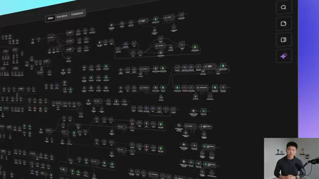
*⏱️ 00:00:05 — Vue d'ensemble d'un diagramme de flux de travail IA complexe et interconnecté sur fond noir.*

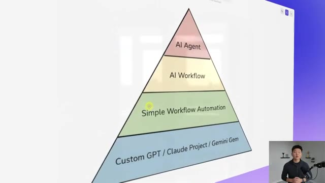
*⏱️ 00:00:11 — Schéma en pyramide colorée montrant les quatre couches des systèmes d'IA (Custom GPT/Claude Project/Gemini Gem, Simple Workflow Automation, AI Workflow, AI Agent).*

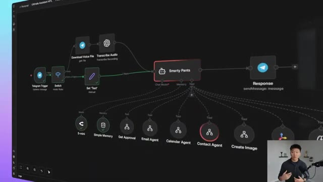
*⏱️ 00:00:16 — Interface de conception d'un agent IA nommé Smarty Pants avec des nœuds connectés pour Telegram, la transcription audio, et des sous-agents spécialisés (Email, Calendar, Contact, etc.).*

---

### ⏱️ `[00:00:21 - 00:00:54]` | Segment #02

**🔊 Audio (Transcription Intégrale Mot pour Mot en Français) :**
> Donc ce n'est pas juste une intuition. C'est réellement ce que je vois dans ce domaine comme l'un des problèmes les plus courants. Donc je ne veux pas perdre de temps. Entrons directement dans le vif du sujet. Voici donc la pyramide à laquelle je faisais référence, où vous pouvez voir que nous avons quatre couches différentes. Nous avons les GPTs personnalisés ou les projets cloud ou des choses similaires à ceux-ci en bas comme fondation, et nous allons jusqu'en haut avec nos agents IA. Et à mesure que nous montons dans la pyramide, nous augmentons en complexité, en coût et en maintenance. Nous avons donc les GPTs personnalisés, nous avons une automatisation de flux de travail simple sans IA, nous avons des flux de travail IA, et ensuite nous avons des agents IA tout en haut.

**👁️ Analyse Visuelle d'Écran (gemini-3.5-flash-lite) :**
**Interface & Outils** : Outil de dessin et de diagramme en ligne (type Excalidraw) avec un tableau de bord d'automatisation en arrière-plan.

**Contenu textuel & Code** : Texte du schéma pyramidal : "AI Agent" (sommet), "AI Workflow", "Simple Workflow Automation", et "Custom GPT / Claude Project / Gemini Gem" (base).

**Action / Démonstration** : Le présentateur introduit et détaille le concept de la pyramide d'automatisation par l'IA à l'aide d'un schéma explicatif.

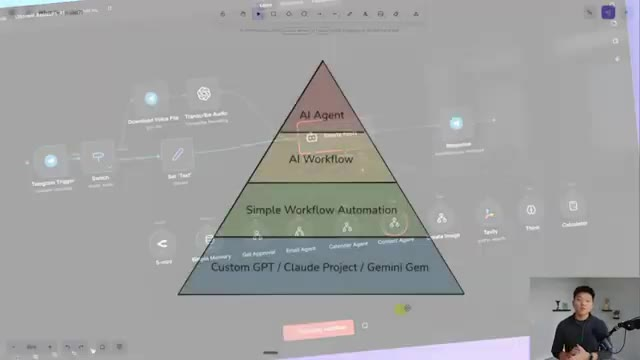
*⏱️ 00:00:29 — Superposition transparente d'un diagramme de workflow d'automatisation en arrière-plan et d'un schéma en pyramide au premier plan.*

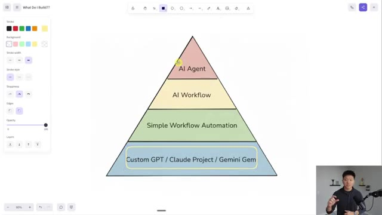
*⏱️ 00:00:38 — Schéma en pyramide présentant 4 niveaux d'automatisation IA, du niveau de base (Custom GPT / Claude Project / Gemini Gem) jusqu'au sommet (AI Agent).*

---

### ⏱️ `[00:00:54 - 00:01:30]` | Segment #03

**🔊 Audio (Transcription Intégrale Mot pour Mot en Français) :**
> Et vraiment la chose la plus importante à comprendre est que tout cela est formidable et qu'ils ont leurs cas d'utilisation. Mais cela revient simplement à cette idée de devenir un résolveur de problèmes, et non un créateur d'agents IA. Et c'est quelque chose dont je parle beaucoup dans ma communauté Plus. Si vous voulez y jeter un œil, le lien se trouve dans la description. Souvent, les gens viennent vous voir et ils pensent qu'ils ont besoin d'IA ou ils savent qu'ils doivent commencer à utiliser l'IA, mais ils ne savent pas exactement comment. Et ils vous racontent ce qui se passe. Mais votre travail n'est pas de dire, voici ce que je vais faire avec l'IA. Votre travail est de dire, d'accord, comprenons réellement la racine de ce problème. Et quelle est la solution la plus efficace que nous pouvons mettre en œuvre immédiatement et qui vous donnera une victoire rapide qui,

**👁️ Analyse Visuelle d'Écran (gemini-3.5-flash-lite) :**
**Interface & Outils** : Tableau blanc ou application de mind mapping/diagramme en ligne.

**Contenu textuel & Code** : Texte de présentation illustrant la philosophie de résolution de problèmes par rapport à la création d'agents, et pyramide des niveaux d'IA.

**Action / Démonstration** : Présentation conceptuelle et explication des différents niveaux d'automatisation et d'IA par le présentateur en incrustation vidéo.

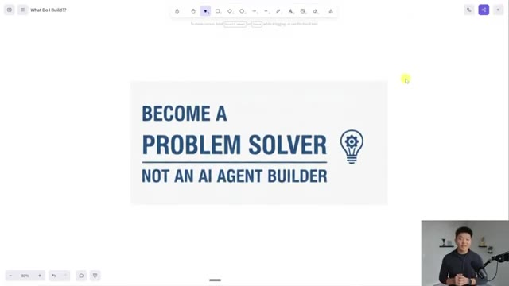
*⏱️ 00:01:03 — Une diapositive affichant le texte "BECOME A PROBLEM SOLVER NOT AN AI AGENT BUILDER" avec une icône d'ampoule.*

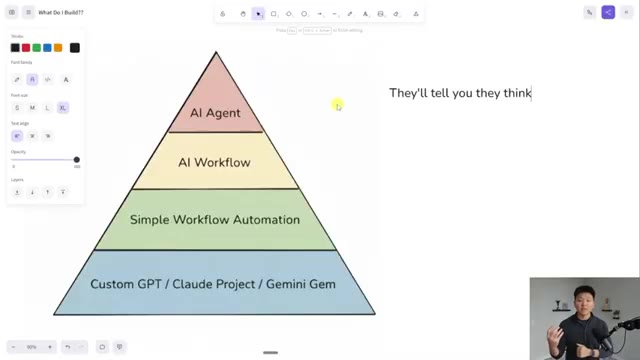
*⏱️ 00:01:12 — Un diagramme en pyramide montrant les différents niveaux d'IA : Custom GPT/Claude Project/Gemini Gem en bas, suivi de Simple Workflow Automation, AI Workflow, et AI Agent au sommet.*

---

### ⏱️ `[00:01:30 - 00:02:06]` | Segment #04

**🔊 Audio (Transcription Intégrale Mot pour Mot en Français) :**
> tu sais, garder tes coûts bas et garder tout simple. Et souvent, la réponse pourrait simplement être une simple automatisation ou un projet cloud ou peut-être un produit SaaS qui existe déjà là-hour. Très bien, alors allons-y et commençons par cette couche inférieure. Qu'est-ce que c'est réellement, cette couche inférieure ? Eh bien, un GPT personnalisé, ou projet, ou gem, est un assistant IA conversationnel que tu peux préconfigurer avec tes propres instructions spécifiques, ta base de connaissances et ta voix. Tu peux donc presque le considérer comme un stagiaire qui connaît ton entreprise parce que tu lui donnes un prompt, tu lui donnes des données, et ensuite tu lui demandes de t'aider avec des choses. Et la caractéristique déterminante ici, c'est qu'il est

**👁️ Analyse Visuelle d'Écran (gemini-3.5-flash-lite) :**
**Interface & Outils** : Tableau blanc interactif (outil de mind mapping ou de présentation) avec le présentateur en incrustation vidéo en bas à droite.

**Contenu textuel & Code** : Schéma de la pyramide d'IA (Custom GPT, Simple Workflow Automation, AI Workflow, AI Agent), texte explicatif sur la résolution de problèmes et les assistants conversationnels, exemples d'outils (n8n Sticky Notes, Setup Guide).

**Action / Démonstration** : Le présentateur explique et détaille les différentes couches de la pyramide d'automatisation IA, en commençant par la couche inférieure des Custom GPTs.

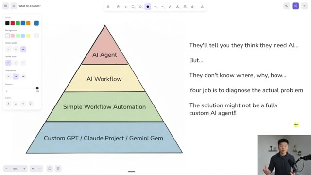
*⏱️ 00:01:39 — Une pyramide conceptuelle affichée à l'écran, détaillant les niveaux d'automatisation IA, du niveau de base 'Custom GPT' jusqu'au niveau supérieur 'AI Agent', avec du texte explicatif sur la droite.*

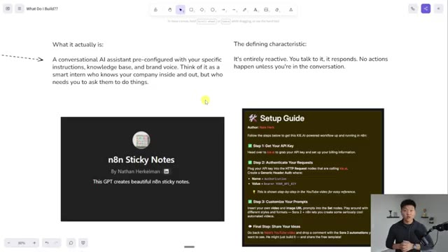
*⏱️ 00:01:48 — Une vue détaillée de la couche de base avec des explications textuelles et des exemples visuels comme le projet 'n8n Sticky Notes' et un guide de configuration.*

---

### ⏱️ `[00:02:06 - 00:02:41]` | Segment #05

**🔊 Audio (Transcription Intégrale Mot pour Mot en Français) :**
> entièrement réactif, ce qui signifie que ça ne s'adapte pas énormément parce que ça ne fonctionne réellement que lorsque vous le déclenchez ou lorsque vous initiez une conversation avec lui. Et donc il y a beaucoup de cas d'utilisation où les gens me parlent de la façon dont ils font quelque chose manuellement, et généralement ils sont déclenchés par un certain événement et ils ont besoin de faire quelque chose et ils ont peut-être besoin d'une sorte de boucle de va-et-vient ou de la capacité d'itérer. Donc par exemple, avec moi, à chaque fois que je fais un tutoriel YouTube NNN, si vous avez vu ceux-là par le passé, et que je dépose mes templates dans la communauté, j'ai généralement un post-it là-dedans qui est comme un guide de configuration. Et c'est un processus super répétitif parce que ça arrive à chaque fois que je poste une vidéo YouTube. J'ai donc eu besoin de faire une sorte

**👁️ Analyse Visuelle d'Écran (gemini-3.5-flash-lite) :**
**Interface & Outils** : Tableau blanc interactif (interface web de type Miro/Excalidraw)

**Contenu textuel & Code** : Texte explicatif : "What it actually is: A conversational AI assistant...", "The defining characteristic: It's entirely reactive. You talk to it, it responds." et un guide de configuration n8n.

**Action / Démonstration** : Présentation des caractéristiques principales de l'assistant IA et de son fonctionnement réactif.

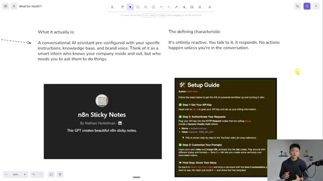
*⏱️ 00:02:15 — Capture d'écran montrant un tableau blanc virtuel avec du texte explicatif sur un assistant IA conversationnel et des blocs de configuration n8n, avec le présentateur en bas à droite.*

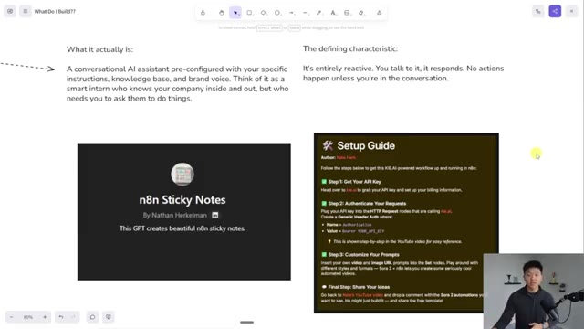
*⏱️ 00:02:32 — Capture d'écran similaire à la précédente affichant le guide de configuration et la définition d'un assistant entièrement réactif.*

---

### ⏱️ `[00:02:41 - 00:03:01]` | Segment #06

**🔊 Audio (Transcription Intégrale Mot pour Mot en Français) :**
> de système pour m'aider à faire cela plus rapidement. Mais si j'avais créé une automatisation pour cela, cela aurait pu faire la même chose, mais je finirais quand même par faire beaucoup de révisions et ce serait peut-être plus manuel que si je configurais simplement un GPT personnalisé et que je lui donnais des instructions sur la façon de faire le guide de configuration et les différents liens que j'aime utiliser et des choses comme ça. Et puis, si j'ai besoin de révisions, je suis déjà dans cette interface et je peux simplement faire des ajustements jusqu'à ce que j'obtienne quelque chose.

**👁️ Analyse Visuelle d'Écran (gemini-3.5-flash-lite) :**
**Interface & Outils** : Application de tableau blanc / interface web de documentation

**Contenu textuel & Code** : Texte explicatif sur les assistants IA conversationnels, capture de l'interface d'un GPT personnalisé 'n8n Sticky Notes' et instructions d'un guide de configuration (Setup Guide).

**Action / Démonstration** : Présentation visuelle des concepts de GPT personnalisés et de documentation de workflows.

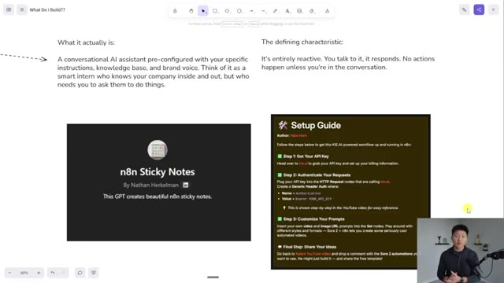
*⏱️ 00:02:46 — Capture d'écran montrant un tableau blanc ou un document explicatif avec le titre 'What It Actually Is' et une section sur un GPT personnalisé nommé 'n8n Sticky Notes' par Nathan Herkelman, ainsi qu'un guide de configuration.*

---

### ⏱️ `[00:03:01 - 00:03:36]` | Segment #07

**🔊 Audio (Transcription Intégrale Mot pour Mot en Français) :**
> Et maintenant, ce processus est pour moi super rapide et facile. Très bien, passons à la deuxième couche. Il s'agit d'une simple automatisation de flux de travail. C'est donc lorsque vous avez une série d'étapes connectées ensemble qui s'exécutent automatiquement sur une sorte de déclencheur qui suit une logique conditionnelle pure, de type si-alors, sans aucune intelligence artificielle. La caractéristique déterminante ici, c'est que c'est complètement prévisible. Il y a le même déclencheur. Il y a la même séquence et vous avez fondamentalement le même résultat. C'est donc un flux très déterministe avec une entrée prévisible et une séquence d'étapes prévisible, puis un résultat prévisible. Maintenant, cela ne veut pas dire que nous ne pouvons pas y inclure quelque chose d'intelligent comme le sondage.

**👁️ Analyse Visuelle d'Écran (gemini-3.5-flash-lite) :**
**Interface & Outils** : Interface de tableau blanc ou d'outil de schématisation.

**Contenu textuel & Code** : Texte explicatif : "What it actually is: A series of connected steps that run automatically when triggered..." et un schéma de workflow contenant des blocs "Input", "Download File URL", "Create AI Image", "Polling" et "Output".

**Action / Démonstration** : Présentation visuelle de la structure d'une automatisation de flux de travail.

*⏱️ 00:03:10 — Un schéma de workflow montrant les différentes étapes d'une automatisation, avec du texte explicatif sur la gauche et la droite.*

---

### ⏱️ `[00:03:36 - 00:04:11]` | Segment #08

**🔊 Audio (Transcription Intégrale Mot pour Mot en Français) :**
> Mais encore une fois, cette vérification par scrutation juste ici est basée sur le fait que ça a réussi ou que ça a échoué, et c'est tout ou rien. Il n'y a aucun élément de raisonnement là-dedans. Et ceux-ci représentent un niveau supérieur par rapport à un GPT personnalisé, car ils peuvent s'exécuter en arrière-plan pendant que vous dormez. Ils peuvent être déclenchés lorsqu'un enregistrement de réunion est terminé, ou bien ils peuvent être déclenchés tous les matins à 6 heures. Des choses de ce genre. Maintenant, juste un niveau supérieur à cela, c'est un flux de travail en IA, qui repose fondamentalement sur le même principe d'un nombre défini d'étapes ou d'une séquence définie d'étapes dans le même ordre à chaque fois, mais maintenant nous sommes capables d'y utiliser l'IA pour un tout petit peu de raisonnement ou de production.

**👁️ Analyse Visuelle d'Écran (gemini-3.5-flash-lite) :**
**Interface & Outils** : Application de tableau blanc / diagramme de workflow interactif

**Contenu textuel & Code** : Diagrammes de flux montrant des étapes connectées (Input, Download File URL, Create AI Image, Output) et des agents IA (Planning Agent, Research, Section Writer, Editor Agent).

**Action / Démonstration** : Présentation visuelle et explication des différences entre les workflows d'automatisation traditionnels et ceux améliorés par l'intelligence artificielle.

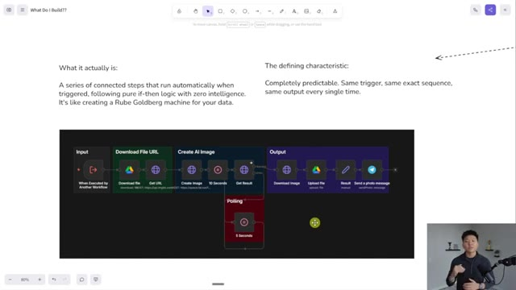
*⏱️ 00:03:44 — Un diagramme de workflow séquentiel avec des blocs d'entrée, de téléchargement, de création d'image par IA et de sortie, accompagné de texte explicatif.*

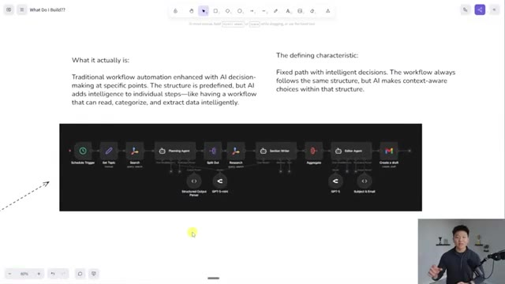
*⏱️ 00:04:02 — Un diagramme de workflow d'automatisation plus avancé intégrant des agents d'intelligence artificielle, un parseur de sortie structurée et des modèles comme GPT-4o-mini et GPT-4.*

---

### ⏱️ `[00:04:12 - 00:04:39]` | Segment #09

**🔊 Audio (Transcription Intégrale Mot pour Mot en Français) :**
> Donc, même s'il y a de l'intelligence artificielle pour faire un peu de planification et pour faire de la rédaction et de l'édition, cela se produit toujours dans le même ordre où ça fait 1, 2, 3, 4, 5, 6, 7, 8, 9, 10. Maintenant, un autre cas d'utilisation de l'ajout d'intelligence artificielle dans un flux de travail, c'est peut-être que vous avez besoin de l'intelligence artificielle pour comprendre dans quelle direction aiguiller. Donc, comme dans cet exemple, et voici un autre petit guide de configuration rapide, vous pouvez voir que l'intelligence artificielle juste ici classe l'e-mail entrant et décide s'il va s'agir du support, ou des finances, ou d'une priorité, ou d'une promotion.

**👁️ Analyse Visuelle d'Écran (gemini-3.5-flash-lite) :**
**Interface & Outils** : Tableau blanc collaboratif (type Miro) et interface de plateforme d'automatisation de workflows d'agents IA.

**Contenu textuel & Code** : Diagrammes de flux connectant des déclencheurs (Schedule Trigger, Gmail Trigger), des agents de traitement (Planning Agent, Customer Support Agent, Text Classifier) et des modèles d'IA (GPT-5, Claude 3.7, GPT-4.1-mini).

**Action / Démonstration** : Présentation et explication visuelle de la structure séquentielle d'un workflow automatisé enrichi par l'intelligence artificielle.

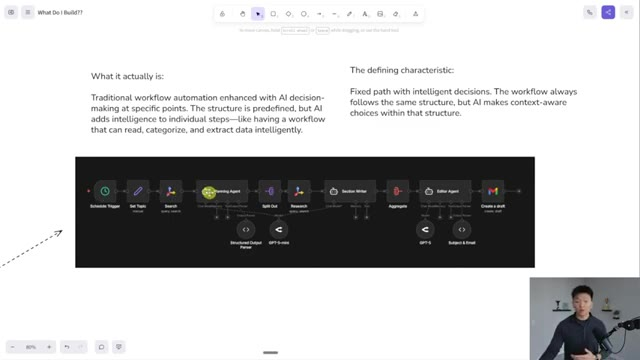
*⏱️ 00:04:19 — Un tableau blanc interactif affichant un diagramme de workflow linéaire intégrant des agents IA (Planning Agent, Section Writer, Editor Agent) et des modèles (GPT-5, GPT-5-mini), avec des explications textuelles sur l'automatisation.*

*⏱️ 00:04:32 — Une interface de plateforme d'automatisation montrant un workflow de classification d'e-mails (Gmail Trigger, Text Classifier avec GPT-4.1-mini) qui route les messages vers différentes branches (Support, Finance, Priority, Promotion) connectées à des agents et des actions Gmail.*

---

### ⏱️ `[00:04:39 - 00:05:01]` | Segment #10

**🔊 Audio (Transcription Intégrale Mot pour Mot en Français) :**
> Et c'est parce qu'il serait vraiment difficile pour la logique traditionnelle ou le code d'être capable de lire le corps d'un e-mail et l'objet, puis de le pousser dans l'un de ces chemins. Il ne pourrait vraiment le faire que s'il cherchait un mot-clé spécifique pour le déclencher. Mais dans ce cas, nous avons réellement besoin que l'intelligence artificielle lise et comprenne, puis l'envoie dans la bonne direction. Mais il s'agit toujours d'un flux de travail car il n'y a pas d'autonomie complète ni de prise de décision.

**👁️ Analyse Visuelle d'Écran (gemini-3.5-flash-lite) :**
**Interface & Outils** : Interface web de construction de workflows d'agents IA (type Flowise ou plateforme similaire)

**Contenu textuel & Code** : Workflow complet intitulé "From Zero to Inbox Agent" comprenant : un composant Gmail Trigger relié à un Text Classifier (utilisant GPT-4.1-mini), qui route vers différentes actions (Support, Finance, Priority, Promotion) connectées à des agents de support client, Claude 3.7, et des actions Gmail.

**Action / Démonstration** : Visualisation et explication du flux d'automatisation des e-mails par le présentateur visible en incrustation vidéo en bas à droite.

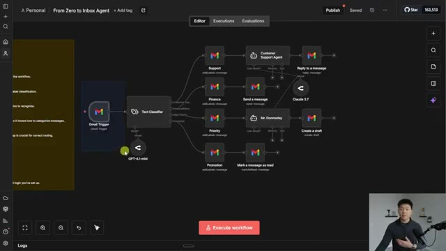
*⏱️ 00:04:45 — Capture d'écran montrant un diagramme de workflow d'automatisation sur une interface web, avec un déclencheur Gmail, un classificateur de texte et plusieurs branches de traitement par des agents IA.*

---

### ⏱️ `[00:05:02 - 00:05:27]` | Segment #11

**🔊 Audio (Transcription Intégrale Mot pour Mot en Français) :**
> C'est fondamentalement juste un cas d'usage très précis de l'IA. Et ensuite, nous retournons directement à notre séquence traditionnelle d'étapes. Donc la caractéristique déterminante ici est un chemin fixe avec des décisions intelligentes. Le flux de travail suit toujours la même structure, mais l'IA fait des choix adaptés au contexte au sein de cette structure. Et en fait, ce que j'ai vu lorsque nous avons travaillé avec des entreprises et lorsque nous avons aidé des gens à travailler avec des entreprises, c'est que la majorité des automatisations peuvent être simples et n'ont même pas besoin d'IA.

**👁️ Analyse Visuelle d'Écran (gemini-3.5-flash-lite) :**
**Interface & Outils** : Interface web de conception de workflows (type éditeur de diagrammes/automatisations).

**Contenu textuel & Code** : Schémas d'architecture de workflows d'automatisation avec des blocs d'IA (GPT-4.1-mini, Claude 3.7) et texte descriptif sur les workflows.

**Action / Démonstration** : Présentation visuelle et explication des structures de workflows d'IA et de leurs caractéristiques déterminantes.

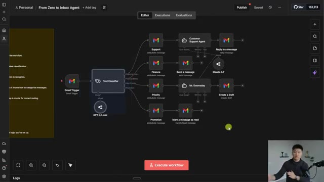
*⏱️ 00:05:08 — Interface d'un éditeur de workflow montrant un diagramme avec un déclencheur Gmail, un classifieur de texte et plusieurs branches conditionnelles utilisant des modèles d'IA.*

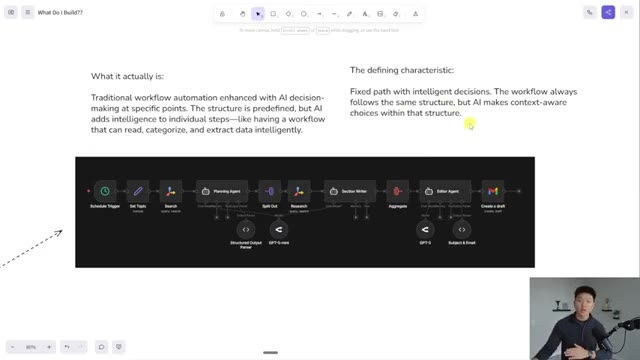
*⏱️ 00:05:14 — Page web de documentation présentant du texte explicatif sur les workflows d'IA et un diagramme de flux linéaire comportant divers agents et déclencheurs.*

---

### ⏱️ `[00:05:28 - 00:05:46]` | Segment #12

**🔊 Audio (Transcription Intégrale Mot pour Mot en Français) :**
> Et je parle genre de 50 % des automatisations que vous pouvez aller créer pour une entreprise immédiatement. Mais ensuite, vous commencez à devenir un peu plus complexe ou peut-être que sur vos automatisations traditionnelles, vous voulez les rendre un peu plus, vous savez, augmenter la fonctionnalité. Et c'est là que vous pourriez juste avoir besoin d'ajouter une petite étape d'IA à la fin ou au début ou quelque chose comme ça.

**👁️ Analyse Visuelle d'Écran (gemini-3.5-flash-lite) :**
**Interface & Outils** : Outil de tableau blanc / diagramme en ligne (ex. Excalidraw ou équivalent)

**Contenu textuel & Code** : Pyramide comportant 4 sections étiquetées : « Custom GPT / Claude Project / Gemini Gem » (base), « Simple Workflow Automation », « AI Workflow », et « AI Agent » (sommet).

**Action / Démonstration** : Présentation visuelle des niveaux de complexité des automatisations IA par le présentateur.

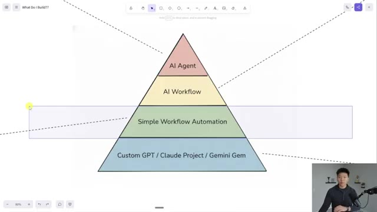
*⏱️ 00:05:32 — Schéma en forme de pyramide à 4 niveaux illustrant les différents types d'automatisations et d'intelligences artificielles, du niveau de base au niveau avancé (Custom GPT, Simple Workflow Automation, AI Workflow, AI Agent).*

---

### ⏱️ `[00:05:46 - 00:06:05]` | Segment #13

**🔊 Audio (Transcription Intégrale Mot pour Mot en Français) :**
> Mais quand vous débutez tout juste avec une entreprise et que vous l'aidez à se préparer davantage à l'automatisation, l'agent IA n'est presque jamais le bon choix pour commencer tout de suite. Et même le simple fait d'aider les équipes à intégrer des GPT personnalisés, des Gemini Gems et des choses de ce genre dans leur flux de travail quotidien générera également énormément d'efficacité. Donc enfin, jetons un œil à un exemple d'agent IA.

**👁️ Analyse Visuelle d'Écran (gemini-3.5-flash-lite) :**
**Interface & Outils** : Outil de tableau blanc (Whiteboard) ou de mind mapping.

**Contenu textuel & Code** : Pyramide divisée en quatre niveaux : 'AI Agent' (sommet), 'AI Workflow', 'Simple Workflow Automation', et 'Custom GPT / Claude Project / Gemini Gem' (base).

**Action / Démonstration** : Le présentateur explique la hiérarchie des niveaux d'automatisation en montrant le diagramme à l'écran.

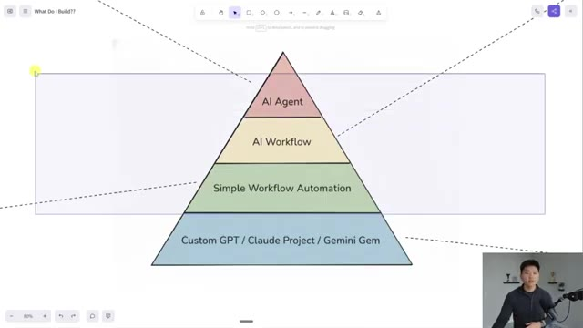
*⏱️ 00:05:51 — Un diagramme en forme de pyramide illustrant les niveaux d'automatisation et d'IA, avec le présentateur visible en incrustation dans le coin inférieur droit.*

---

### ⏱️ `[00:06:05 - 00:06:26]` | Segment #14

**🔊 Audio (Transcription Intégrale Mot pour Mot en Français) :**
> Donc ce que c'est réellement, c'est un système autonome qui peut travailler vers un objectif en percevant son environnement, en prenant des décisions, en appelant des outils, en gérant les exceptions et en adaptant son approche parce qu'il est fondamentalement totalement autonome ici. Donc comme vous pouvez le voir avec la caractéristique déterminante, la véritable agentivité et autonomie, vous lui donnez un objectif et il comprend, j'ai ces cinq outils, lesquels est-ce que j'utilise ?

**👁️ Analyse Visuelle d'Écran (gemini-3.5-flash-lite) :**
**Interface & Outils** : Outil de tableau blanc / canevas visuel (type canvas / mindmap)

**Contenu textuel & Code** : Texte explicatif en anglais (« What it actually is: An autonomous system... », « The defining characteristic: True agency and autonomy... ») et un diagramme de workflow structuré en sections (Trigger, Voice or Text, Marketing Team, Response, Brain, Content Creation, Image Creation, Image Database) avec des connexions pointillées vers un agent central.

**Action / Démonstration** : Présentation visuelle et explication des composants d'un système d'agent IA autonome à l'aide d'un diagramme de flux.

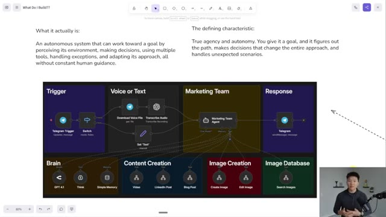
*⏱️ 00:06:10 — Capture d'écran montrant un canevas de présentation avec du texte explicatif en haut et un diagramme de workflow d'agent IA complexe au centre, tandis que le présentateur apparaît en médaillon dans le coin inférieur droit.*

---

### ⏱️ `[00:06:26 - 00:06:44]` | Segment #15

**🔊 Audio (Transcription Intégrale Mot pour Mot en Français) :**
> Et dans quel ordre est-ce que je les utilise pour atteindre ledit objectif ? Donc dans ce cas, c'était une équipe marketing que j'ai faite pour une vidéo YouTube. Et vous pouvez voir qu'elle a reçu une requête d'un humain via Telegram et elle a utilisé son cerveau pour comprendre, ok, j'ai ces trois outils de création de contenu. J'ai ces deux outils de création d'images et j'ai cet outil de base de données. Lesquels est-ce que j'ai besoin d'utiliser ?

**👁️ Analyse Visuelle d'Écran (gemini-3.5-flash-lite) :**
**Interface & Outils** : Application de tableau blanc ou d'automatisation de type diagramme (ex. n8n ou canvas personnalisé) avec le présentateur en médaillon vidéo en bas à droite.

**Contenu textuel & Code** : Schéma d'architecture avec des blocs nommés "Trigger", "Voice or Text", "Marketing Team", "Response", "Brain", "Content Creation", "Image Creation", et "Image Database".

**Action / Démonstration** : Présentation et explication visuelle du diagramme de l'agent d'équipe marketing déclenché par Telegram.

*⏱️ 00:06:31 — Un diagramme de workflow interactif montrant l'architecture d'une équipe marketing pilotée par un agent IA, avec des sections pour le déclencheur Telegram, le traitement des messages vocaux/texte, le cerveau (GPT-4.1), la création de contenu et la base de données d'images.*

---

### ⏱️ `[00:06:44 - 00:07:10]` | Segment #16

**🔊 Audio (Transcription Intégrale Mot pour Mot en Français) :**
> Et il avait une autonomie complète, basée sur ses instructions système et ses données d'entrée, pour l'aider à progresser vers son objectif final. Mais c'est en fait intéressant. Si vous faisiez attention, cet outil de création d'images, ou c'était peut-être l'outil de modification d'images, est en fait celui-ci, juste ici, où nous l'avons configuré pour appeler cet outil. Et la raison pour laquelle je dis que c'est intéressant, c'est que même si nous donnons à l'agent l'autonomie d'appeler ses outils, une fois qu'il a choisi la bonne voie, nous voulions fondamentalement qu'il reste super prévisible.

**👁️ Analyse Visuelle d'Écran (gemini-3.5-flash-lite) :**
**Interface & Outils** : Interface de type tableau blanc ou éditeur de diagramme (canvas) montrant des workflows d'automatisation.

**Contenu textuel & Code** : Blocs fonctionnels d'automatisation, nœuds de traitement (Telegram Trigger, GPT 4.1, Create Image, Edit Image) et textes explicatifs sur l'autonomie et les agents.

**Action / Démonstration** : Le présentateur compare visuellement un système autonome intelligent à un workflow linéaire classique (machine de Rube Goldberg).

*⏱️ 00:06:51 — Un diagramme d'architecture d'agent IA montrant différentes sections comme Trigger, Voice or Text, Marketing Team, Brain, Content Creation, Image Creation et Image Database.*

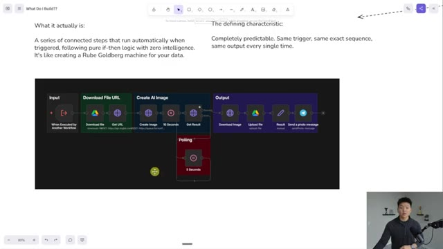
*⏱️ 00:06:57 — Un diagramme de workflow linéaire (type if-then) avec des étapes pour Input, Download File URL, Create AI Image, Polling et Output.*

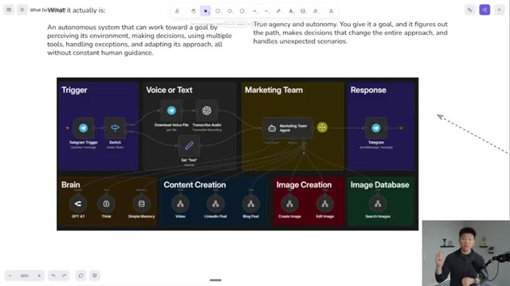
*⏱️ 00:07:03 — Le même diagramme d'architecture d'agent IA détaillé avec des connexions pointillées vers divers outils de génération de contenu et de gestion d'images.*

---

### ⏱️ `[00:07:10 - 00:07:28]` | Segment #17

**🔊 Audio (Transcription Intégrale Mot pour Mot en Français) :**
> Et cela a beaucoup plus aidé la performance de l'agent parce que ses outils sont des flux de travail ou des flux de travail IA. La façon dont j'ai architecturé cela pour que tout cela soit fixe, cela donne presque l'impression d'un flux de travail IA ici, où l'IA fait le raisonnement et l'envoie ensuite sur un chemin fixe. Mais la seule différence, c'est qu'après qu'il soit descendu sur ce chemin, c'est terminé.

**👁️ Analyse Visuelle d'Écran (gemini-3.5-flash-lite) :**
**Interface & Outils** : Navigateur web, outil de diagramme et plateforme de flux de travail d'agents IA (éditeur type n8n ou plateforme similaire).

**Contenu textuel & Code** : Schéma d'architecture d'agent avec des modules : Trigger, Voice or Text, Marketing Team, Response, Brain, Content Creation, Image Creation, Image Database, et interface de flux d'e-mails (Gmail Trigger, Text Classifier, Support, Finance, Priority, Promotion).

**Action / Démonstration** : Le présentateur explique l'architecture d'un agent IA combinant des flux de travail structurés et des prises de décision par l'IA.

*⏱️ 00:07:15 — Un schéma de flux de travail d'agent IA présenté sur une page web, avec des sections pour le déclencheur, la voix/texte, le cerveau et la création de contenu.*

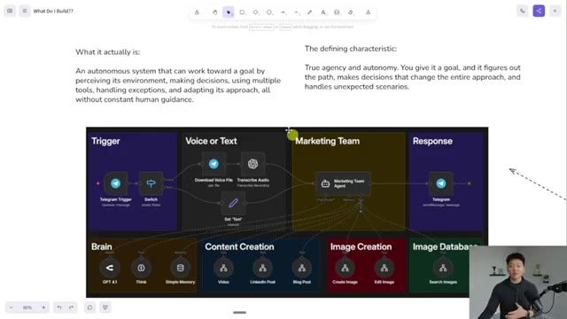
*⏱️ 00:07:19 — Une vue légèrement différente du même schéma de flux de travail d'agent IA montrant l'architecture globale du système.*

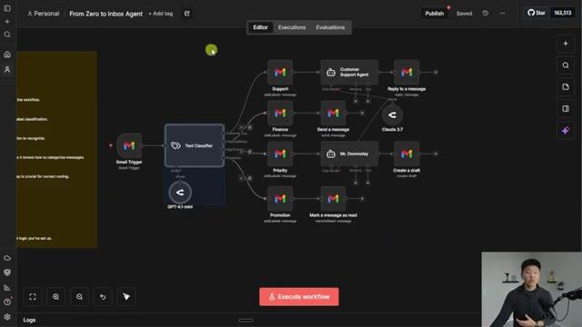
*⏱️ 00:07:24 — Une interface d'éditeur de flux de travail montrant un agent de gestion de boîte de réception Gmail avec un classificateur de texte et des branches de routage.*

---

### ⏱️ `[00:07:29 - 00:07:47]` | Segment #18

**🔊 Audio (Transcription Intégrale Mot pour Mot en Français) :**
> Mais dans cet exemple, il pourrait faire des allers-retours autant de fois qu'il le voudrait. Je sais donc que cela peut être un peu décourageant. J'ai donc fait ce diagramme très simple pour vous aider à comprendre ce que vous devriez réellement chercher à construire en fonction du problème auquel vous faites face. La première question serait donc : dois-je être dans la boucle à chaque fois ? Si oui, un GPT personnalisé est la réponse.

**👁️ Analyse Visuelle d'Écran (gemini-3.5-flash-lite) :**
**Interface & Outils** : Outil de tableau blanc en ligne (type Excalidraw ou similaire).

**Contenu textuel & Code** : Arbre de décision avec trois questions principales : "Question 1: Do I need to be in the loop every time?" (branches Yes -> Custom GPT, No -> Question 2), "Question 2: Are the steps 100% logic based?" (Yes -> Workflow, No -> Question 3), et "Question 3: Is the order of operations fixed? Predictable?" (Yes -> AI Workflow, No -> AI Agent).

**Action / Démonstration** : Le présentateur explique le diagramme décisionnel pour guider le choix du type d'architecture d'automatisation à construire.

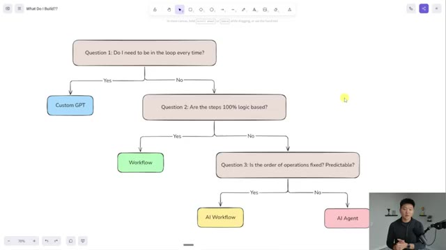
*⏱️ 00:07:33 — Un organigramme décisionnel illustrant comment choisir entre un Custom GPT, un Workflow, un AI Workflow et un AI Agent.*

---

### ⏱️ `[00:07:47 - 00:08:14]` | Segment #19

**🔊 Audio (Transcription Intégrale Mot pour Mot en Français) :**
> Si non, passez à la question numéro deux, qui est : est-ce que les étapes sont basées à 100 % sur la logique ? C'est-à-dire, est-ce que je pourrais utiliser un filtre simple ou un code simple ? Ou bien y a-t-il un élément très explicite, tout blanc ou tout noir, qui m'indique quelle direction prendre ? Si oui, créez un flux de travail. Si non, descendez à la question numéro trois, qui est : est-ce que l'ordre des opérations est fixe ? Est-il prévisible ? Si oui, vous allez opter pour un flux de travail IA. Si non, si vous avez besoin de plus d'autonomie, de prise de décision et de flexibilité, alors vous devez vous tourner vers un agent IA.

**👁️ Analyse Visuelle d'Écran (gemini-3.5-flash-lite) :**
**Interface & Outils** : Application de tableau blanc / diagramme en ligne (ex: Excalidraw ou similaire).

**Contenu textuel & Code** : Texte des questions : 'Question 1: Do I need to be in the loop every time?', 'Question 2: Are the steps 100% logic based?', et 'Question 3: Is the order of operations fixed? Predictable?', avec des branches 'Yes' et 'No' menant à différentes solutions.

**Action / Démonstration** : Le présentateur explique l'organigramme et met en évidence la 'Question 2' pendant que le diagramme est affiché à l'écran.

*⏱️ 00:07:54 — Un organigramme décisionnel illustrant les questions à se poser pour choisir entre un Custom GPT, un Workflow, un AI Workflow ou un AI Agent.*

---

### ⏱️ `[00:08:14 - 00:08:34]` | Segment #20

**🔊 Audio (Transcription Intégrale Mot pour Mot en Français) :**
> Maintenant, je voulais terminer avec un exemple d'un moment où vous pourriez arriver à la question trois et où votre réponse serait oui, mais où vous pourriez quand même vouloir un agent IA à la place. Et voici donc un exemple très simple où nous avons un agent de support client ou un flux de support client. Et ce qui se passe, c'est qu'il reçoit un e-mail et il doit utiliser son cerveau pour comprendre, d'accord, voici l'e-mail que j'ai.

**👁️ Analyse Visuelle d'Écran (gemini-3.5-flash-lite) :**
**Interface & Outils** : Outil de diagramme en ligne (ex: Miro/Excalidraw) et interface d'automatisation de type workflow/agent IA.

**Contenu textuel & Code** : Diagramme avec des questions logiques (Question 1, Question 2, Question 3) et schémas d'agents de support client avec des déclencheurs Gmail, Pinecone et modèles d'IA.

**Action / Démonstration** : Navigation dans l'organigramme décisionnel puis présentation d'un exemple concret de flux de support client.

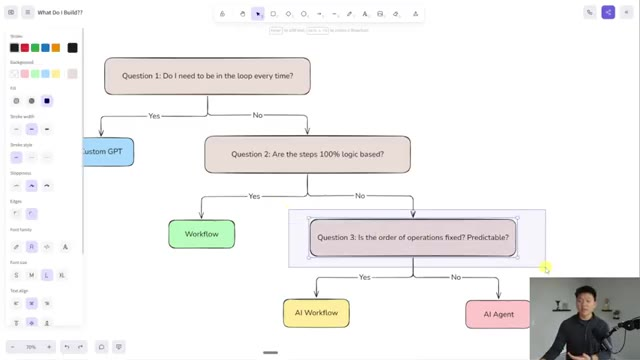
*⏱️ 00:08:19 — Un organigramme décisionnel interactif affichant les critères de choix entre Custom GPT, Workflow, AI Workflow et AI Agent.*

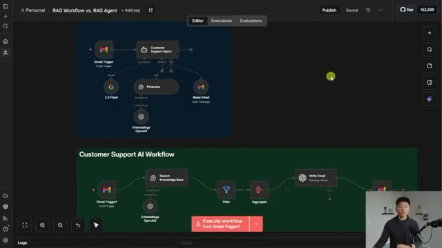
*⏱️ 00:08:24 — Une interface d'automatisation montrant deux flux : un "Customer Support Agent" et un "Customer Support AI Workflow".*

---

### ⏱️ `[00:08:34 - 00:09:06]` | Segment #21

**🔊 Audio (Transcription Intégrale Mot pour Mot en Français) :**
> J'ai une base de données que je peux consulter et ensuite je dois répondre à l'e-mail entrant avec des informations précises. Et donc, quand je pense à ce processus, à la manière dont je ferais cela manuellement : je dois un, lire l'e-mail, je dois deux, vérifier la base de connaissances et enfin je dois trois, rédiger une réponse. Et cela devrait vraiment se faire dans cet ordre à chaque fois, ce qui explique pourquoi cela pourrait aussi être un flux de travail où l'on lit l'e-mail, on fait une recherche dans la base de connaissances, on fait même quelque chose d'assez sophistiqué ici en filtrant pour ne garder que les meilleures réponses. Mais de toute façon, ensuite nous rédigeons l'e-mail et puis nous y répondons. Mais la différence ici, c'est que parfois vous n'avez pas besoin de faire de recherche dans la base de connaissances.

**👁️ Analyse Visuelle d'Écran (gemini-3.5-flash-lite) :**
**Interface & Outils** : Interface web de type constructeur de workflow (type Langflow ou équivalent).

**Contenu textuel & Code** : Deux diagrammes : le premier avec un déclencheur Gmail, un agent, Pinecone, Embeddings OpenAI et un envoi d'e-mail ; le second avec un déclencheur Gmail, une recherche dans la base de connaissances, un filtre, un agrégat, l'écriture d'un e-mail et une réponse Gmail.

**Action / Démonstration** : Le présentateur explique et compare visuellement l'architecture d'un agent RAG par rapport à un workflow RAG traditionnel.

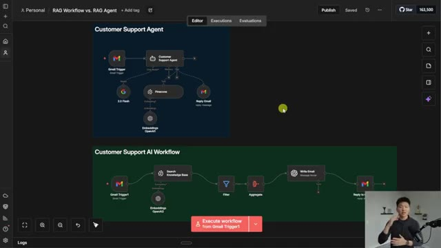
*⏱️ 00:08:42 — Capture d'écran montrant l'interface d'un outil de création de workflows avec deux schémas comparatifs : un "Customer Support Agent" basé sur un agent autonome et un "Customer Support AI Workflow" séquentiel.*

---

### ⏱️ `[00:09:06 - 00:09:40]` | Segment #22

**🔊 Audio (Transcription Intégrale Mot pour Mot en Français) :**
> Dans ce cas, vous seriez simplement en train de perdre du temps et des jetons alors que vous pourriez simplement répondre tout de suite. Ou parfois, vous avez besoin d'interroger la base de connaissances trois, quatre ou cinq fois avant d'être sûr. Et dans ce cas, l'agent ici présent serait également préférable. Le point que j'essaie de faire valoir, c'est que ce n'est jamais juste un organigramme logique clair, tout blanc ou tout noir, comme celui-ci. Cela dépend de la situation et cela dépend de la façon dont vous voudriez que le processus manuel soit effectué. Et puis l'autre pilule difficile à avaler parfois, c'est simplement le fait que vous ne savez pas ce que vous ne savez pas. Parfois, tous les signes peuvent indiquer qu'il faut utiliser un GPT personnalisé, mais vous devrez peut-être simplement passer à l'échelle supérieure après

**👁️ Analyse Visuelle d'Écran (gemini-3.5-flash-lite) :**
**Interface & Outils** : Interface web d'automatisation (type Flowise ou équivalent) et application de mind-mapping/diagramme.

**Contenu textuel & Code** : Diagrammes de flux avec des nœuds de déclenchement (Gmail Trigger), de recherche de base de connaissances (Pinecone) et des questions de décision conditionnelles.

**Action / Démonstration** : Présentation comparative visuelle des architectures d'agents IA et de workflows automatisés.

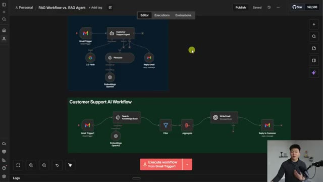
*⏱️ 00:09:15 — Interface d'un éditeur de workflow montrant un diagramme de RAG Agent en haut et un Customer Support AI Workflow en bas.*

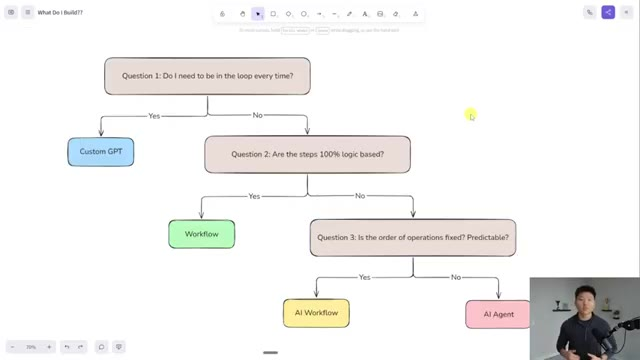
*⏱️ 00:09:23 — Arbre de décision sous forme de diagramme pour choisir entre Custom GPT, Workflow, AI Workflow et AI Agent.*

---

### ⏱️ `[00:09:40 - 00:10:03]` | Segment #23

**🔊 Audio (Transcription Intégrale Mot pour Mot en Français) :**
> quelques mois d'utilisation à un flux de travail d'IA. Ou vous pourriez avoir un agent IA et puis réaliser plus tard que vous devez le réduire après avoir effectivement eu le temps de le laisser faire quelques exécutions et de recueillir des commentaires. Mais encore une fois, si vous avez cet état d'esprit de résolution de problèmes, cela ne devrait pas être un problème. Et si vous aimez penser à résoudre des problèmes et vouloir comprendre quelles sont les meilleures manières de résoudre ces problèmes, alors comme je l'ai dit, je parle de ce genre de choses souvent dans ma communauté Plus.

**👁️ Analyse Visuelle d'Écran (gemini-3.5-flash-lite) :**
**Interface & Outils** : Outil de tableau blanc numérique / Mind mapping (type Excalidraw ou Miro)

**Contenu textuel & Code** : Texte dans la pyramide : 'AI Agent' au sommet, 'AI Workflow' au milieu, 'Simple Workflow Automation' en dessous, et 'Custom GPT / Claude Project / Gemini Gem' à la base.

**Action / Démonstration** : Le présentateur explique les différents niveaux d'intégration de l'IA en se basant sur le diagramme pyramidal.

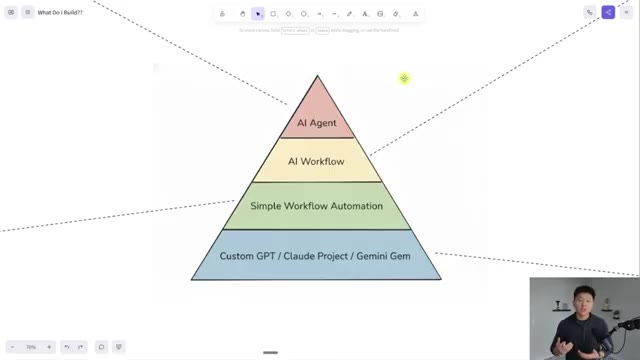
*⏱️ 00:09:46 — Un diagramme en forme de pyramide illustrant les différents niveaux d'automatisation et d'IA, allant de la base (Custom GPT / Claude Project / Gemini Gem) au sommet (AI Agent).*

---

### ⏱️ `[00:10:03 - 00:10:21]` | Segment #24

**🔊 Audio (Transcription Intégrale Mot pour Mot en Français) :**
> Le lien pour cela se trouve dans la description. Nous avons une super communauté de plus de 3 000 membres qui construisent des entreprises et des automatisations avec N8N chaque jour. Et nous avons une section de cours où nous décomposons plein d'autres choses. Agent zéro, 10 heures en 10 secondes, cours d'agence unipersonnelle. Nous avons beaucoup de projets ici, qui sont comme des constructions N8N en direct et des choses comme ça.

**👁️ Analyse Visuelle d'Écran (gemini-3.5-flash-lite) :**
**Interface & Outils** : Interface web de la plateforme communautaire AIS+ (AI Automation Society Plus).

**Contenu textuel & Code** : Noms de modules de formation ("Start Here", "Agent Zero", "10 Hours to 10 Seconds", "One Person AI Agency", "Subs to Sales", "n8n Projects") et fils de discussion de la communauté.

**Action / Démonstration** : Navigation sur la plateforme web de la communauté pour présenter les différentes sections et modules de cours disponibles.

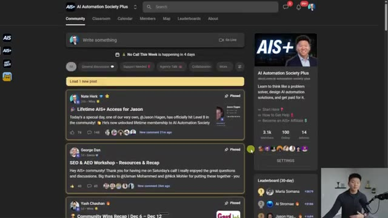
*⏱️ 00:10:07 — Capture d'écran montrant l'interface de la communauté en ligne "AI Automation Society Plus" (AIS+), avec un fil d'actualité, des publications épinglées et le présentateur visible en incrustation dans le coin inférieur droit.*

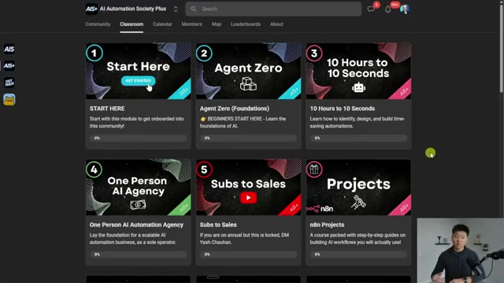
*⏱️ 00:10:17 — Capture d'écran montrant la section des cours ("Classroom") de la plateforme AIS+, affichant plusieurs modules de formation dont "Agent Zero" et "10 Hours to 10 Seconds", avec le présentateur en incrustation.*

---

### ⏱️ `[00:10:22 - 00:10:37]` | Segment #25

**🔊 Audio (Transcription Intégrale Mot pour Mot en Français) :**
> Et nous faisons également un appel en direct par semaine. Donc j'adorerais vous voir dans ces appels au sein de la communauté, mais c'est tout pour aujourd'hui. Alors si vous avez apprécié la vidéo ou si vous avez appris quelque chose de nouveau, veuillez s'il vous plaît lui donner un j'aime. Ça m'aide vraiment énormément, et comme toujours, je vous remercie d'être arrivés jusqu'à la fin de la vidéo. Je vous vois dans la prochaine. Merci à tous.

**👁️ Analyse Visuelle d'Écran (gemini-3.5-flash-lite) :**
**Interface & Outils** : Interface web Skool (AI Automation Society Plus) et outil de tableau blanc / mindmapping.

**Contenu textuel & Code** : Publications de la communauté, statistiques de membres (3.1k membres, 100 en ligne) et niveaux d'une pyramide d'automatisation par l'IA.

**Action / Démonstration** : Navigation et présentation de la communauté Skool et du concept de hiérarchie des automatisations IA.

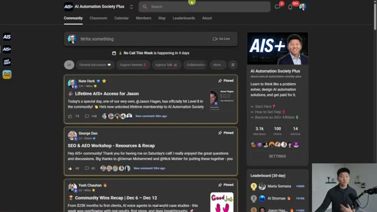
*⏱️ 00:10:26 — Capture d'écran montrant l'interface sombre de la communauté Skool "AI Automation Society Plus" avec des publications et un encadré vidéo du présentateur en bas à droite.*

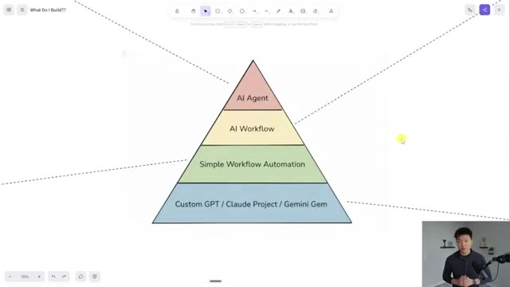
*⏱️ 00:10:29 — Capture d'écran montrant un diagramme en forme de pyramide divisée en quatre niveaux d'automatisation IA (Custom GPT, Simple Workflow, AI Workflow, AI Agent) avec le présentateur en bas à droite.*

---

