# 🎬 How to Actually Deliver AI Projects (APIs, Hosting & Handover Explained)

> **Chaîne** : [Nate Herk | AI Automation](https://www.youtube.com/@nateherk/featured)  
> **Lien YouTube** : [https://www.youtube.com/watch?v=xxARTGo_Oqg](https://www.youtube.com/watch?v=xxARTGo_Oqg)  
> **Date de publication** : 20251227  
> **Durée** : 00:21:49  
> **Identifiant vidéo** : `xxARTGo_Oqg`  
> **Transcription & Analyse** : `whisper-v3-large-turbo+gemini-3.5-flash-lite`  

---

## 📌 Synthèse Exécutive & Outils

### 💡 Résumé

Cette vidéo de la chaîne *Nate Herk | AI Automation* aborde les aspects cruciaux et souvent négligés de la réalisation des projets d'IA et d'automatisation après la phase de vente. Elle s'adresse aux ingénieurs, développeurs et agences souhaitant industrialiser leurs livraisons sans compromettre la sécurité, la conformité légale ou la rentabilité. L'analyse met en lumière la distinction fondamentale entre le développement sur mesure pour un client et l'édition de logiciels, en prenant le framework d'automatisation n8n comme cas d'étude central pour illustrer les contraintes liées aux licences logicielles.

Au-delà de l'hébergement, la vidéo détaille méthodiquement les exigences de sécurité inhérentes au déploiement d'agents IA et de flux de travail en production. Elle expose les meilleures pratiques pour le chiffrement des données au repos et en mémoire, le renforcement des webhooks par validation de signatures, ainsi que le respect des réglementations sur la protection des données (telles que le RGPD). L'objectif est d'offrir une feuille de route claire pour assurer une passation fluide, sécurisée et pérenne entre le prestataire et son client final.

### 🛠️ Outils, Modèles & Logiciels Présentés

* **n8n** : Moteur d'automatisation et d'orchestration open-source/fair-code, central dans la gestion des flux de travail et soumis à des règles de licence strictes selon son mode d'hébergement.
* **Opus 5.5** : Modèle de pointe mentionné dans le contexte de l'ingénierie d'agents IA avancés et de la génération de code.
* **Claude Code** : Environnement de développement et assistant de codage d'Anthropic utilisé pour accélérer l'implémentation technique des solutions logicielles.
* **Anthropic** : Fournisseur de modèles d'intelligence artificielle de premier plan pour alimenter les agents décisionnels et les flux conversationnels.
* **Stripe** : Passerelle de paiement externe nécessitant une validation rigoureuse des webhooks et des signatures cryptographiques pour sécuriser les transactions automatisées.
* **Loom** : Outil de capture vidéo utilisé pour enregistrer les guides de configuration et documenter la passation des flux de travail auprès des clients.

### 🔑 Points Clés & Enseignements Stratégiques

* **Conformité des licences n8n** : La licence de n8n dicte l'architecture légale du projet ; elle interdit l'utilisation de la version gratuite ou standard pour créer un produit SaaS ou héberger des instances mutualisées pour le compte de plusieurs clients sans accord commercial spécifique.
* **Modèle d'hébergement recommandé (Option 1)** : Privilégier systématiquement l'hébergement par le client sur sa propre instance cloud ou locale (où il paie directement son infrastructure) pour garantir une conformité totale et un modèle similaire à Zapier.
* **Hébergement interne pour l'agence (Option 2)** : Réserver l'hébergement sur les serveurs de l'agence exclusivement pour les automatisations internes, la prospection ou le routage de leads, sans jamais y connecter directement des clients tiers.
* **Monétisation sous forme de SaaS (Option 3)** : Comprendre qu'un modèle d'abonnement ou de plateforme centralisée pilotée par n8n exige impérativement une licence commerciale ou d'entreprise auprès de l'éditeur, sous peine de violation des conditions d'utilisation.
* **Chiffrement et isolation des secrets** : Les identifiants et clés API dans n8n sont chiffrés au repos et déchiffrés dynamiquement en mémoire uniquement lors de l'exécution, empêchant leur exposition aux utilisateurs non autorisés disposant d'un accès restreint à l'espace de travail.
* **Sécurisation robuste des webhooks** : Traiter les points d'entrée des webhooks comme des passerelles critiques en exigeant le protocole HTTPS, la validation des signatures cryptographiques (via Stripe, GitHub, etc.) et l'interdiction stricte de véhiculer des données sensibles dans les URL.
* **Protection contre les abus et l'injection** : Mettre en place des limites de débit (*rate limiting*) et des barrières de protection (*guardrails*) pour contrer les attaques par force brute, le spam et les tentatives d'injection d'instructions malveillantes ciblant les agents IA.
* **Minimisation des données personnelles** : Appliquer les principes de minimisation des flux de données en ne transmettant que les champs strictement nécessaires pour accomplir la tâche métier, réduisant ainsi la surface de risque en cas d'audit de conformité.
* **Respect du RGPD et sous-traitance** : Identifier clairement le rôle de sous-traitant des données lors de l'automatisation de processus clients, ce qui nécessite souvent un accord de traitement des données (*DPA*) formalisé.
* **Traçabilité pour les droits des personnes** : Concevoir l'architecture des flux de manière à ce que le client puisse facilement exécuter ses obligations légales de rectification, d'accès ou de suppression définitive des données personnelles enregistrées dans les workflows.
* **Méthodologie de passation documentée** : Assurer un transfert de compétences professionnel en combinant la transmission de fichiers JSON propres, la documentation vidéo sur Loom et l'intégration explicite des configurations d'API.

---

## ⏱️ Chronologie & Transcription Complète Audio & Visuelle (Mot pour Mot)

### ⏱️ `[00:00:00 - 00:00:33]` | Segment #01

**🔊 Audio (Transcription Intégrale Mot pour Mot en Français) :**
> Donc, vous me demandez toujours : Nate, comment est-ce que j'héberge des flux de travail ? À quoi ressemble le processus de passation ? Est-ce que je dois héberger un flux de travail ou est-ce que c'est le client qui doit le faire ? Qu'en est-il de la sécurité ? Ce genre de questions revient tout le temps. Et comme il n'y a littéralement aucune bonne vidéo qui couvre tout cela, je me suis dit que j'allais en faire une. Donc dans cette vidéo, je vais vous guider à travers tout le processus de réalisation d'un flux de travail ou d'un agent d'intelligence artificielle après qu'un client vous a payé, étape par étape. Et à la fin, je vous montrerai un exemple réel provenant de l'un des premiers flux de travail d'intelligence artificielle que j'ai jamais vendus. Entrons dans le vif du sujet. Donc, avant de construire quoi que ce soit, la première question à laquelle vous devez répondre est simple. Qui va héberger le flux de travail ? Je reçois cette question constamment. Et comme la plupart d'entre vous utilisent n8n, je vais formuler cette réponse autour de la façon dont n8n fonctionne réellement, car sa licence est en fait

**👁️ Analyse Visuelle d'Écran (gemini-3.5-flash-lite) :**
**Interface & Outils** : AUCUNE

**Contenu textuel & Code** : AUCUNE

**Action / Démonstration** : AUCUNE

---

### ⏱️ `[00:00:33 - 00:01:06]` | Segment #02

**🔊 Audio (Transcription Intégrale Mot pour Mot en Français) :**
> ce qui détermine en quelque sorte ce que vous pouvez et ne pouvez pas faire. J'ai également travaillé avec une tonne de clients différents et je leur ai livré des flux de travail de plein de manières différentes. Je facture donc essentiellement le fichier JSON, que je leur transmets ensuite ainsi qu'un guide de configuration Loom expliquant son fonctionnement. Je les ai eus qui m'invitaient sur leur propre compte n8n et je développais directement dans leur propre environnement. J'ai développé le flux de travail dans mon propre environnement, puis ils me donnaient leurs identifiants de connexion et je me connectais, j'importais tout, puis je me déconnectais. Et j'ai également aidé des personnes à lancer leur propre instance de n8n, puis ils m'invitaient une fois qu'ils avaient le compte en tant que membre de l'équipe. Donc je dis tout cela pour dire qu'il y a beaucoup de façons différentes de le faire. Laissez-moi donc vous parler des principales options et de ce que je recommande. Donc la règle clé

**👁️ Analyse Visuelle d'Écran (gemini-3.5-flash-lite) :**
**Interface & Outils** : Graphiques animés de présentation (schémas conceptuels de workflow).

**Contenu textuel & Code** : Icônes illustrant un fichier JSON, un symbole de facturation ($), et l'interface n8n avec les rôles 'Client' et 'Me'.

**Action / Démonstration** : Présentation visuelle des différentes méthodes de facturation et de livraison de flux de travail aux clients.

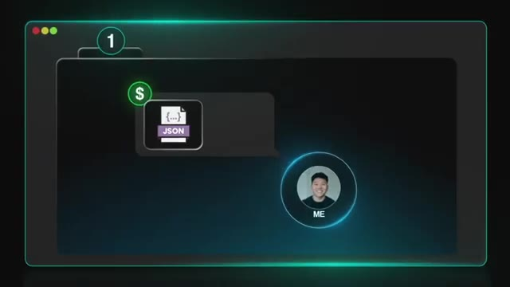
*⏱️ 00:00:41 — Schéma explicatif montrant le mode de facturation basé sur la transmission d'un fichier JSON au client, avec une icône dollar.*

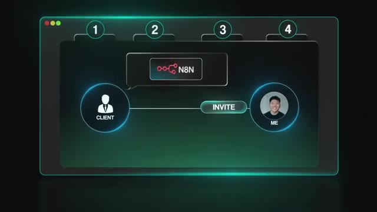
*⏱️ 00:00:58 — Schéma explicatif illustrant une méthode de travail collaborative où le client envoie une invitation sur n8n au créateur (Me).*

---

### ⏱️ `[00:01:06 - 00:01:26]` | Segment #03

**🔊 Audio (Transcription Intégrale Mot pour Mot en Français) :**
> que vous devez savoir, c'est que vous ne pouvez utiliser NNN que pour votre propre entreprise en interne, à moins d'avoir une licence commerciale ou d'entreprise payante si vous l'hébergez. Vous êtes autorisé à vendre des services autour de NNN, mais vous n'avez pas le droit de transformer NNN en votre propre produit. Donc, tout ce qui concerne l'hébergement se résume à une seule chose : cette instance de NNN est-elle utilisée par une seule entreprise en interne, ou l'exposez-vous en tant que plateforme à d'autres personnes ?

**👁️ Analyse Visuelle d'Écran (gemini-3.5-flash-lite) :**
**Interface & Outils** : AUCUNE

**Contenu textuel & Code** : AUCUNE

**Action / Démonstration** : AUCUNE

---

### ⏱️ `[00:01:26 - 00:01:46]` | Segment #04

**🔊 Audio (Transcription Intégrale Mot pour Mot en Français) :**
> Donc maintenant que nous avons examiné cette règle, nous avons trois options pour héberger des flux de travail. Et honnêtement, je choisirais presque toujours la première option, et c'est ce que je vous recommande à tous. Mais je vais quand même aborder les deux autres, car il reste important de comprendre la différence. Très bien, alors la première option est celle où le client héberge N8N. C'est le modèle le plus sûr et le plus propre pour presque tout le monde. Cela signifie que chaque client avec lequel vous travaillez aurait sa propre instance de N8N et vous travaillez simplement à l'intérieur.

**👁️ Analyse Visuelle d'Écran (gemini-3.5-flash-lite) :**
**Interface & Outils** : Graphique de présentation vidéo.

**Contenu textuel & Code** : Texte flouté indiquant des options d'hébergement.

**Action / Démonstration** : Présentation visuelle des options d'hébergement de flux de travail.

---

### ⏱️ `[00:01:46 - 00:02:10]` | Segment #05

**🔊 Audio (Transcription Intégrale Mot pour Mot en Français) :**
> Donc ce que cela signifie, c'est que le client achète soit son propre cloud n8n et vous invite en tant qu'utilisateur, soit il s'inscrit sur une instance auto-hébergée ou hébergée localement, et ensuite il vous y donne accès. Maintenant, je sais en tant que prestataire de services, vous voulez rendre leur expérience aussi fluide que possible. Donc ce que vous pouvez faire, c'est les aider à le configurer. Vous pouvez les aider à configurer leur serveur ou même à leur allouer un compte, mais ensuite ils doivent le posséder et ils doivent le payer parce que vous ne pouvez pas marger sur l'hébergement ni essentiellement facturer l'accès à n8n.

**👁️ Analyse Visuelle d'Écran (gemini-3.5-flash-lite) :**
**Interface & Outils** : n8n (interface web de création de workflows)

**Contenu textuel & Code** : Workflow "Email Agent Demo" avec "Execute Workflow Trigger", "Email Agent", "OpenAI Chat Model" et "Send Email"

**Action / Démonstration** : Visualisation d'un diagramme de workflow d'agent d'e-mail dans n8n

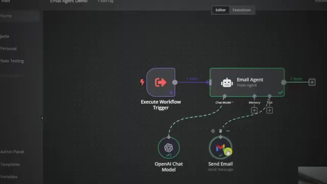
*⏱️ 00:02:04 — Interface du logiciel n8n montrant un workflow avec un déclencheur, un agent d'e-mail, un modèle OpenAI et un nœud Gmail.*

---

### ⏱️ `[00:02:10 - 00:02:30]` | Segment #06

**🔊 Audio (Transcription Intégrale Mot pour Mot en Français) :**
> Cela vous aide à rester en conformité parce que NNN est utilisé pour les processus métiers internes de cette entreprise. Vous fournissez simplement du conseil et du développement de flux de travail, ce qui est totalement autorisé et vous ne donnez pas à plusieurs clients accès à la même instance. C'est fondamentalement le modèle de Zapier où chaque client a sa propre place et vous êtes le bâtisseur. Donc si vous faites du travail pour des clients, c'est ce que je recommande presque tout le temps. La deuxième option est d'héberger NNN, mais uniquement pour votre propre agence.

**👁️ Analyse Visuelle d'Écran (gemini-3.5-flash-lite) :**
**Interface & Outils** : AUCUNE

**Contenu textuel & Code** : AUCUNE

**Action / Démonstration** : AUCUNE

---

### ⏱️ `[00:02:30 - 00:02:50]` | Segment #07

**🔊 Audio (Transcription Intégrale Mot pour Mot en Français) :**
> Donc, dans cette configuration, vous faites tourner n8n sur votre propre serveur, mais personne d'autre ne le voit à part votre entreprise. Et c'est pour vos propres automatisations internes comme le routage des leads, les flux de travail de contenu, les agents IA internes, ou tout autre cas où le client ne touche jamais directement à n8n ou n'en a jamais besoin. Maintenant, vous pouvez également fournir un service en utilisant n8n exécuté sur votre propre infrastructure tant que les clients ne se connectent pas, ne connectent pas leurs propres clés API, des choses comme ça.

**👁️ Analyse Visuelle d'Écran (gemini-3.5-flash-lite) :**
**Interface & Outils** : Présentation vidéo avec incrustation graphique animée (infographie de texte).

**Contenu textuel & Code** : Liste à puces des automatisations internes (« Lead routing », « Content workflows », « Internal AI agents »).

**Action / Démonstration** : Affichage progressif d'une liste de points clés illustrant les cas d'usage décrits par l'orateur.

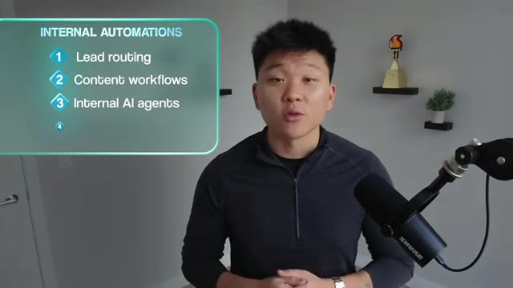
*⏱️ 00:02:40 — Le présentateur apparaît à droite, tandis qu'un encadré graphique à gauche liste les cas d'usage des automatisations internes (« Internal Automations » : Lead routing, Content workflows, Internal AI agents).*

---

### ⏱️ `[00:02:50 - 00:03:12]` | Segment #08

**🔊 Audio (Transcription Intégrale Mot pour Mot en Français) :**
> C'est conforme parce que N&N alimente uniquement vos propres opérations. Vous ne l'exposez pas en tant que plateforme hébergée et vous ne donnez pas accès aux clients. Considérez-le donc simplement comme votre propre moteur interne. Et un exemple de cela pourrait être si vous envoyiez à un client quelque chose comme un rapport automatisé ou des recherches et que, comme service pour eux, c'est ce que vous livrez fondamentalement. Même si votre propre automatisation interne alimente cela sur votre propre N&N hébergé, c'est très bien parce qu'ils paient juste pour ce livrable.

**👁️ Analyse Visuelle d'Écran (gemini-3.5-flash-lite) :**
**Interface & Outils** : Présentation vidéo avec incrustation de graphiques animés.

**Contenu textuel & Code** : Texte 'Not exposing it as a hosted platform' et 'EXAMPLE' avec deux boîtes 'YOU' et 'CLIENT'.

**Action / Démonstration** : Explication orale du présentateur illustrée par des infographies textuelles et schématiques.

---

### ⏱️ `[00:03:12 - 00:03:36]` | Segment #09

**🔊 Audio (Transcription Intégrale Mot pour Mot en Français) :**
> Et l'option trois, c'est lorsque vous hébergez n8n en tant que produit. Et c'est là que vous auriez besoin d'une licence de type commercial ou entreprise. C'est la ligne à ne pas franchir avec la licence gratuite ou d'utilisation durable. Donc essentiellement, vous ne pouvez pas créer un produit SaaS, un produit de logiciel en tant que service, où n8n est la valeur. Même si le client ne voit jamais l'interface utilisateur de n8n, si votre offre consiste fondamentalement à me donner vos identifiants et j'exécuterai vos automatisations sur mon serveur n8n, cela n'est pas autorisé sans accord commercial.

**👁️ Analyse Visuelle d'Écran (gemini-3.5-flash-lite) :**
**Interface & Outils** : Interface graphique de présentation (diapositive animée).

**Contenu textuel & Code** : Texte : #1 CLIENT HOSTS N8N, #2 YOU HOST N8N, #3 YOU HOST N8N AS A PRODUCT, Need a commercial or enterprise type of license.

**Action / Démonstration** : Affichage des options de licences et d'hébergement pour n8n.

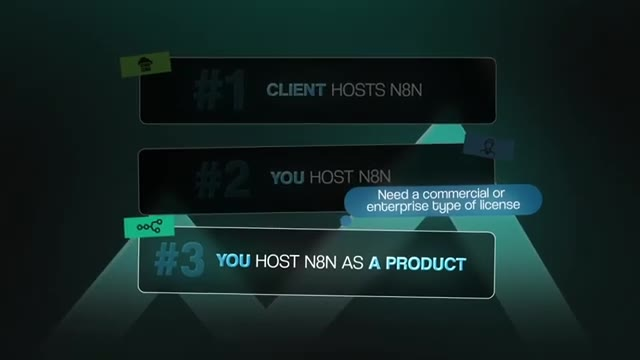
*⏱️ 00:03:18 — Graphique présentant les trois options d'hébergement pour n8n, avec un accent mis sur l'option 3 (« YOU HOST N8N AS A PRODUCT ») et la nécessité d'une licence commerciale ou entreprise.*

---

### ⏱️ `[00:03:36 - 00:03:54]` | Segment #10

**🔊 Audio (Transcription Intégrale Mot pour Mot en Français) :**
> Et ce modèle n'a vraiment de sens que si vous développez un SaaS ou si vous vendez de l'automatisation sous forme d'abonnement où NNN est clairement le moteur. Si c'est le cas, vous voulez absolument parler aux ventes de NNN et obtenir une licence commerciale ou d'entreprise, et je dois dire que ces choses ne sont pas bon marché. Donc, la version courte est simple. Si vous créez des flux de travail pour des clients, laissez-les l'héberger. Si vous exécutez des automatisations pour votre propre entreprise, hébergez-le vous-même.

**👁️ Analyse Visuelle d'Écran (gemini-3.5-flash-lite) :**
**Interface & Outils** : Navigateur web affichant la page de tarification et les graphiques de présentation de n8n.

**Contenu textuel & Code** : Tarifs des forfaits Starter, Pro et Enterprise, ainsi que les options de déploiement et de monétisation de n8n.
[DESC_IMAGE_3] Présentation des différents modèles commerciaux et d'hébergement liés à l'utilisation de n8n.

**Action / Démonstration** : Explications face caméra et démonstration conceptuelle.

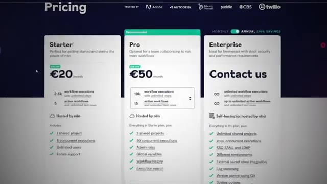
*⏱️ 00:03:45 — Page web de tarification (Pricing) présentant les offres Starter (€20/mois), Pro (€50/mois) et Enterprise de n8n.*

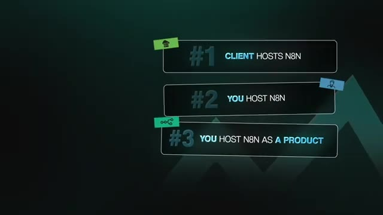
*⏱️ 00:03:50 — Schéma textuel listant trois modèles d'hébergement et de monétisation pour n8n (#1 Client hosts n8n, #2 You host n8n, #3 You host n8n as a product).*

---

### ⏱️ `[00:03:54 - 00:04:15]` | Segment #11

**🔊 Audio (Transcription Intégrale Mot pour Mot en Français) :**
> Et si vous voulez créer un SaaS ou une plateforme, vous avez besoin d'une licence commerciale. Et une fois que vous avez décidé où l'automatisation va réellement résider, vous pouvez passer à la planification de la construction, à la structuration des données et à la préparation du transfert. Donc ensuite, penchons-nous sur la sécurité et la protection des données. Une fois que vous avez construit le flux de travail, votre rôle est de vous assurer que les données qui y transitent restent sécurisées. Cela signifie aucune fuite d'informations sensibles, aucune exposition de données personnelles, et aucune violation des lois sur la protection de la vie privée comme le RGPD.

**👁️ Analyse Visuelle d'Écran (gemini-3.5-flash-lite) :**
**Interface & Outils** : Aucune interface logicielle ou outil technique n'est affiché.

**Contenu textuel & Code** : Aucun code source, commande ou prompt visible.

**Action / Démonstration** : Aucune action technique ou manipulation n'est effectuée.

---

### ⏱️ `[00:04:15 - 00:04:34]` | Segment #12

**🔊 Audio (Transcription Intégrale Mot pour Mot en Français) :**
> Donc, passons en revue la façon dont NNN gère la sécurité et la manière dont vous pouvez l'expliquer clairement à vos clients. Et dans quelques minutes, je parlerai plus précisément de la gestion des clés API et de la facturation, puisque cela mérite aussi sa propre section. La première chose à comprendre, c'est la façon dont NNN protège les champs sensibles à l'intérieur de vos automations. Les identifiants dans NNN sont chiffrés au repos, et ils sont déchiffrés en mémoire au moment où le flux de travail s'exécute.

**👁️ Analyse Visuelle d'Écran (gemini-3.5-flash-lite) :**
**Interface & Outils** : n8n (outil d'automatisation de workflows).

**Contenu textuel & Code** : Workflow n8n incluant des nœuds pour OpenAI, l'extraction de données de factures, la validation et le stockage dans Airtable.

**Action / Démonstration** : Visualisation du fonctionnement technique d'un workflow n8n et indication de l'emplacement des identifiants (credentials) au sein de la plateforme.

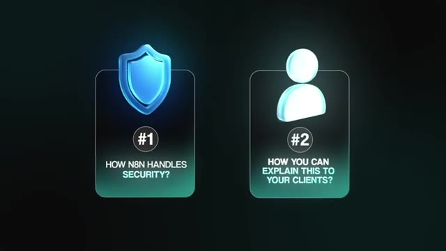
*⏱️ 00:04:20 — Une infographie présente deux points clés : le premier concernant la gestion de la sécurité par n8n (avec une icône de bouclier) et le second sur la manière d'expliquer ces concepts aux clients (avec une icône d'utilisateur).*

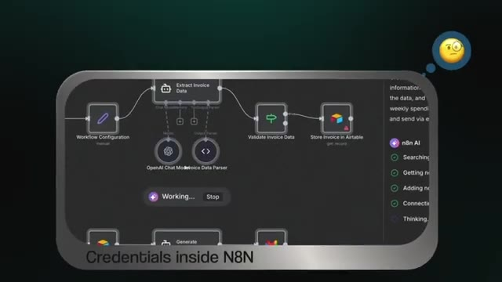
*⏱️ 00:04:29 — Une vue de l'interface de workflow n8n montrant des nœuds connectés (Extract Invoice Data, Validate Invoice Data, Store Invoice in Airtable) avec un panneau latéral "n8n AI" actif. Le texte "Credentials inside N8N" est affiché en bas.*

---

### ⏱️ `[00:04:34 - 00:04:52]` | Segment #13

**🔊 Audio (Transcription Intégrale Mot pour Mot en Français) :**
> Donc ces nœuds avec vos identifiants dedans font simplement référence aux identifiants par leur nom. Et si un coéquipier ou un client n'a pas la permission d'accéder à cet espace de travail qui contient ces identifiants, il ne pourra pas voir les valeurs brutes, les clés API, les mots de passe, ou peu importe comment vous voulez les appeler. C'est pourquoi la transmission d'un flux de travail est sûre lorsqu'elle est faite correctement, parce que vous n'exposez pas de champs sensibles à l'intérieur des nœuds et vous ne stockez rien en texte clair.

**👁️ Analyse Visuelle d'Écran (gemini-3.5-flash-lite) :**
**Interface & Outils** : AUCUNE

**Contenu textuel & Code** : AUCUN

**Action / Démonstration** : AUCUNE

---

### ⏱️ `[00:04:53 - 00:05:17]` | Segment #14

**🔊 Audio (Transcription Intégrale Mot pour Mot en Français) :**
> La plateforme est conçue pour garder les secrets bien cachés afin que seul le moteur d'automatisation puisse y accéder quand il en a besoin. Un autre aspect important de la sécurité est le renforcement des webhooks. Donc un webhook, c'est en gros comme une porte publique menant à un flux de travail, ce qui signifie que vous devez le traiter avec le même sérieux que n'importe quelle requête entrante vers une application. Donc cela implique peut-être d'utiliser HTTPS pour que les données soient chiffrées en transit, ou de signer des secrets ou des jetons de vérification pour des services comme Stripe, GitHub, ou tout fournisseur prenant en charge la validation de signature.

**👁️ Analyse Visuelle d'Écran (gemini-3.5-flash-lite) :**
**Interface & Outils** : Interface graphique de présentation et séquence vidéo illustratrice.

**Contenu textuel & Code** : Textes explicatifs sur le renforcement des webhooks et l'utilisation de jetons de vérification de signature.

**Action / Démonstration** : Présentation des concepts de sécurité liés aux webhooks et au chiffrement.

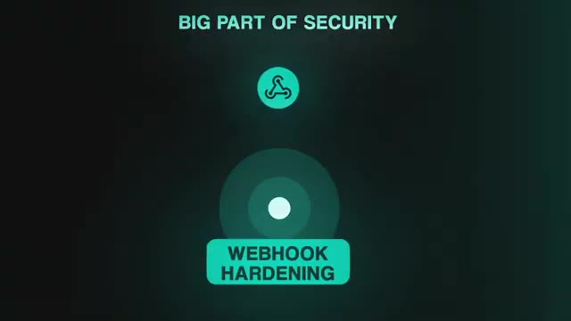
*⏱️ 00:04:59 — Un graphique montrant le titre 'BIG PART OF SECURITY' avec une icône et le texte 'WEBHOOK HARDENING'.*

*⏱️ 00:05:11 — Une incrustation vidéo montrant une personne tapant sur un ordinateur portable avec le texte 'SIGNING VERIFICATION TOKENS'.*

---

### ⏱️ `[00:05:17 - 00:05:36]` | Segment #15

**🔊 Audio (Transcription Intégrale Mot pour Mot en Français) :**
> Ce que vous pouvez faire, c'est faire vérifier cette signature par NIDN avant qu'il ne fasse réellement confiance à la charge utile et ne la laisse entrer dans le flux de travail, et ne jamais mettre de données sensibles à l'intérieur de l'URL d'un webhook. Et si vous voulez vraiment aller plus loin et être un peu plus technique ici, si le cas d'usage le nécessitait, vous pourriez mettre en place des choses comme des limites de débit ou des vérifications d'authentification supplémentaires pour prévenir le spam, la force brute ou les abus automatisés. Ainsi, la façon dont j'expliquerais cela aux clients est simple.

**👁️ Analyse Visuelle d'Écran (gemini-3.5-flash-lite) :**
**Interface & Outils** : Aucune interface logicielle ou éditeur de code visible (vidéo de type parlant face caméra).

**Contenu textuel & Code** : Aucun code source, terminal ou prompt affiché.

**Action / Démonstration** : Le présentateur explique des concepts de sécurité et de vérification des charges utiles de webhooks.

---

### ⏱️ `[00:05:36 - 00:05:59]` | Segment #16

**🔊 Audio (Transcription Intégrale Mot pour Mot en Français) :**
> Chaque déclencheur externe qui atteint votre automatisation doit être authentifié afin que seuls les systèmes approuvés puissent communiquer avec ce flux de travail, ce qui signifie que des personnes aléatoires ne peuvent pas deviner l'URL et commencer à solliciter votre CRM ou vos systèmes internes pour obtenir des données. Et pendant que nous sommes sur ce sujet, il vaut également la peine de songer à intégrer des barrières de protection et à construire un système afin que les gens ne puissent pas contourner les sécurités ou injecter des instructions à vos agents IA. Maintenant, une autre grande responsabilité est la gestion des données CRM, de paiement ou d'autres données personnelles, car ces informations sont souvent réglementées.

**👁️ Analyse Visuelle d'Écran (gemini-3.5-flash-lite) :**
**Interface & Outils** : Graphismes animés et incrustations vidéo.

**Contenu textuel & Code** : Texte 'AUTOMATION' et icône de sécurité 'Authenticated', puis 'GUARDRAILS'.

**Action / Démonstration** : Présentation des concepts de sécurité et d'authentification des déclencheurs externes.

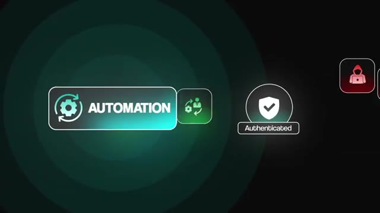
*⏱️ 00:05:42 — Animation graphique illustrant le concept d'automatisation sécurisée et authentifiée.*

---

### ⏱️ `[00:05:59 - 00:06:21]` | Segment #17

**🔊 Audio (Transcription Intégrale Mot pour Mot en Français) :**
> En vertu du RGPD et des lois similaires, tout ce qui pourrait identifier une personne est protégé. Ceci n'est donc pas un conseil juridique. Cependant, il existe quelques bonnes pratiques de base à suivre, mais vous devriez toujours consulter des professionnels en fonction de votre secteur d'activité et des lois qui vous régissent, vous et vos clients. Mais vous pourriez faire des choses comme utiliser la minimisation des données, ce qui signifie n'importer que les champs dont vous avez réellement besoin. Vous pourriez limiter qui peut voir les exécutions des workflows afin que seules les bonnes personnes aient accès aux journaux et aux charges utiles.

**👁️ Analyse Visuelle d'Écran (gemini-3.5-flash-lite) :**
**Interface & Outils** : Aucune interface logicielle ou de programmation n'est présentée.

**Contenu textuel & Code** : Texte affiché à l'écran : "DATA MINIMIZATION" avec le sous-titre "Which means only bringing in the fields that you".

**Action / Démonstration** : Le présentateur explique une notion de bonnes pratiques liées à la protection des données (RGPD) en affichant un encart informatif.

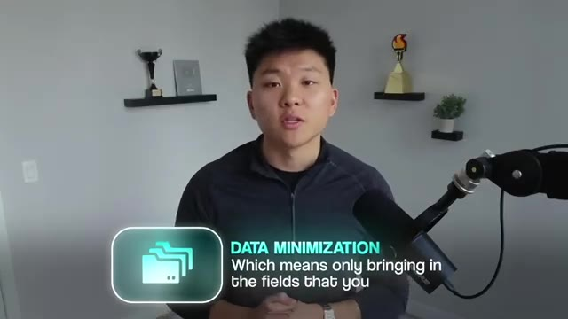
*⏱️ 00:06:16 — Le présentateur est face caméra, avec un encart graphique animé en bas à gauche affichant le texte "DATA MINIMIZATION" accompagné d'une icône de dossiers.*

---

### ⏱️ `[00:06:21 - 00:06:40]` | Segment #18

**🔊 Audio (Transcription Intégrale Mot pour Mot en Français) :**
> Vous devez également comprendre qu'un client doit disposer d'une base légale pour collecter et traiter les données qu'il transmet dans le workflow. Et si vous traitez des données pour le compte du client, vous agissez généralement en tant que sous-traitant des données, ce qui signifie que vous pourriez avoir besoin d'un accord de traitement des données en place. Vous devez également vous assurer que vos automatisations ne rendent pas impossible pour le client d'honorer des demandes telles que la suppression de données, la rectification de données ou les demandes d'accès.

**👁️ Analyse Visuelle d'Écran (gemini-3.5-flash-lite) :**
**Interface & Outils** : Graphique personnalisé (UI de présentation).

**Contenu textuel & Code** : Texte affiché : "CLIENT", "LEGAL BASIS", "Collecting", "Processing".

**Action / Démonstration** : Illustration visuelle du concept de conformité légale dans le cadre du traitement de données.

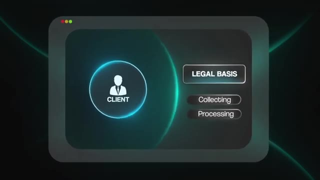
*⏱️ 00:06:26 — Schéma graphique illustrant les responsabilités légales d'un client, avec une icône "Client" centrale et des indicateurs "Legal Basis", "Collecting" et "Processing".*

---

### ⏱️ `[00:06:40 - 00:07:01]` | Segment #19

**🔊 Audio (Transcription Intégrale Mot pour Mot en Français) :**
> En gros, ce que cela signifie, c'est que vous devriez savoir exactement où circulent les données afin qu'elles puissent être supprimées ou mises à jour si nécessaire. Et Enidin aide à cela parce que vous pouvez purger les exécutions, réduire les journaux et limiter la quantité de données que le système stocke au fil du temps. Et l'un des plus grands avantages d'Enidin est que son code source est disponible, ce qui est essentiellement mieux connu sous le nom d'open source, ce qui signifie qu'il peut être entièrement auto-hébergé, ce qui donne au client l'option de conserver toutes ses données de flux de travail dans son propre environnement.

**👁️ Analyse Visuelle d'Écran (gemini-3.5-flash-lite) :**
**Interface & Outils** : Interface de configuration ou éditeur de code.

**Contenu textuel & Code** : Options de configuration de code (Mode, Language: JavaScript).

**Action / Démonstration** : Visualisation des paramètres de configuration et d'optimisation des flux de données.

*⏱️ 00:06:46 — Gros plan sur une interface logicielle montrant des paramètres de code (options Mode et Language).*

---

### ⏱️ `[00:07:01 - 00:07:35]` | Segment #20

**🔊 Audio (Transcription Intégrale Mot pour Mot en Français) :**
> Vous pouvez donc exécuter Enidin sur leur infrastructure, le connecter uniquement aux outils qu’ils approuvent et en lesquels ils ont confiance, et même utiliser des modèles d'IA locaux ou auto-hébergés au lieu d'envoyer des données à OpenAI ou à d'autres modèles propriétaires fermés. Cela offre une véritable souveraineté des données. Le client choisit où se trouve le serveur, comment il est sécurisé et qui y a accès. C'est donc un argument de vente majeur pour les clients sensibles à la confidentialité. Au lieu de faire transiter des données sensibles par des services cloud aléatoires, vous pouvez exécuter l'ensemble du moteur d'automatisation dans leur propre pièce sécurisée, que ce soit sur site ou dans un VPS privé. Et c'est la base de la sécurité et de la confidentialité des données. Votre travail consiste à créer des flux de travail qui déplacent les données en toute sécurité, protègent les informations sensibles et donnent aux clients l'assurance que rien ne fuite.

**👁️ Analyse Visuelle d'Écran (gemini-3.5-flash-lite) :**
**Interface & Outils** : Outil de workflow visuel (type n8n ou flow-based automation) pour l'image 1 ; Éditeur de code (VS Code ou environnement de développement) pour l'image 3.

**Contenu textuel & Code** : Champs de configuration "Your Channel ID" et "YouTube API Key" pour l'image 1 ; Syntaxe de code non identifiée précisément (flou) pour l'image 3.

**Action / Démonstration** : Configuration d'une intégration d'API YouTube dans un pipeline automatisé pour l'image 1 ; Programmation active sur une machine locale pour l'image 3.

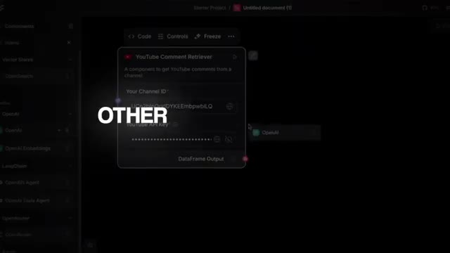
*⏱️ 00:07:10 — Interface d'édition de workflow de type "no-code/low-code" montrant un composant "YouTube Comment Retriever" avec des champs pour l'ID de chaîne et la clé API.*

*⏱️ 00:07:26 — Vue en plongée sur les mains d'un utilisateur tapant du code sur un ordinateur portable, illustrant une manipulation technique directe.*

---

### ⏱️ `[00:07:35 - 00:07:54]` | Segment #21

**🔊 Audio (Transcription Intégrale Mot pour Mot en Français) :**
> Et maintenant que vous comprenez l'aspect de la sécurité, la prochaine section que je vais vous présenter concerne la gestion des clés API et la facturation, car c'est un autre domaine où je reçois énormément de questions. Les principales que je reçois sont : qui possède les clés API et qui paie pour l'utilisation. Et la réponse la plus claire que je puisse vous donner est que le client doit toujours payer pour ses propres clés API et son utilisation. Cela permet de garder tout transparent, prévisible, et cela évite pas mal de maux de tête par la suite.

**👁️ Analyse Visuelle d'Écran (gemini-3.5-flash-lite) :**
**Interface & Outils** : Graphismes animés de présentation vidéo (motion design)

**Contenu textuel & Code** : Titre textuel 'API KEY MANAGEMENT AND BILLING' et icône de facturation/dollar.

**Action / Démonstration** : Animation de transition introduisant la section sur la gestion des clés API et la facturation.

---

### ⏱️ `[00:07:54 - 00:08:21]` | Segment #22

**🔊 Audio (Transcription Intégrale Mot pour Mot en Français) :**
> Donc, la configuration idéale est de faire en sorte que le client s'inscrive lui-même à l'outil, entre ses informations de facturation, génère la clé API et la colle directement dans N8N. Lorsque vous procédez ainsi, la clé n'est jamais envoyée par Internet vers vous, et le client garde le contrôle total de son compte. Il peut voir l'utilisation, il peut voir les frais, il peut la désactiver s'il le souhaite, et rien de l'automatisation ne lui est caché. C'est tout simplement une relation de travail beaucoup plus saine. Maintenant, la meilleure façon de faire cela, puisque comme je l'ai dit, vous voulez éliminer autant de friction que possible, est de lui envoyer une vidéo Loom le guidant exactement sur l'endroit où cliquer, comment créer cette clé et où la coller dans N8N.

**👁️ Analyse Visuelle d'Écran (gemini-3.5-flash-lite) :**
**Interface & Outils** : Interface web d'OpenAI (page des clés API).

**Contenu textuel & Code** : Texte de l'interface OpenAI concernant la génération de clés API ("Verify your phone number to create an API key").

**Action / Démonstration** : Visualisation des paramètres de sécurité et de génération de clés sur la plateforme OpenAI.

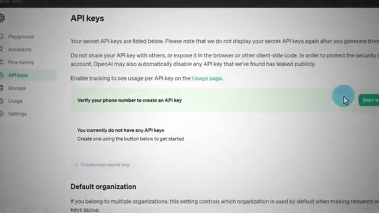
*⏱️ 00:08:00 — Capture d'écran montrant l'interface des clés API d'OpenAI avec un message de vérification du numéro de téléphone.*

---

### ⏱️ `[00:08:21 - 00:08:42]` | Segment #23

**🔊 Audio (Transcription Intégrale Mot pour Mot en Français) :**
> Gardez les choses extrêmement simples pour eux. Vous pouvez même les guider pas à pas lors d'un appel Zoom s'ils préfèrent. Maintenant, pourriez-vous configurer les comptes d'API de votre côté et simplement les configurer pour eux plus tard ? Oui, vous le pourriez. Il n'y a rien de non conforme là-dedans, mais cela pourrait créer toutes sortes de problèmes parce qu'ils ne voient pas l'utilisation. Ils ne comprennent pas où va leur argent. Et si vous majorez l'utilisation ou si vous facturez un tarif fixe, cela peut vite devenir déroutant à mesure que l'automatisation monte en charge ou si quelque chose tombe en panne ou subit un pic.

**👁️ Analyse Visuelle d'Écran (gemini-3.5-flash-lite) :**
**Interface & Outils** : Aucune interface logicielle ou outil technique affiché (présentation parlée uniquement).

**Contenu textuel & Code** : Texte des encarts graphiques uniquement.
[DESC_IMAGE_1] [DESC_IMAGE_2] [DESC_IMAGE_3] Aucun code ni terminal présenté, simple plan parlant avec des infographies textuelles.

**Action / Démonstration** : Explications face caméra et démonstration conceptuelle.

---

### ⏱️ `[00:08:42 - 00:09:06]` | Segment #24

**🔊 Audio (Transcription Intégrale Mot pour Mot en Français) :**
> Même si cela semble plus facile sur le moment parce que le client n'a en fait rien à faire, cela peut clairement à long terme créer plus de questions que de réponses. Donc, les laisser gérer et payer garde tout bien carré. Maintenant, si un client est intimidé par ce processus et veut que vous gériez la clé directement, vous voulez quand même vous assurer de la transférer de manière sécurisée. Donc, envoyez-la simplement via Slack, ClickUp, par SMS ou par e-mail, faites-la-leur déposer dans une sorte de coffre-fort sécurisé comme 1Password ou tout autre outil de partage de secrets chiffré où ils peuvent générer un lien à usage unique.

**👁️ Analyse Visuelle d'Écran (gemini-3.5-flash-lite) :**
**Interface & Outils** : Gmail (interface web)

**Contenu textuel & Code** : Logo et interface de messagerie Gmail avec le bouton "Compose"

**Action / Démonstration** : Affichage d'une interface de messagerie pour illustrer la gestion des clients ou des communications.

*⏱️ 00:09:00 — Gros plan sur le logo et l'interface de Gmail avec le bouton Composer visible en bas.*

---

### ⏱️ `[00:09:06 - 00:09:28]` | Segment #25

**🔊 Audio (Transcription Intégrale Mot pour Mot en Français) :**
> Ensuite, vous pouvez copier vous-même cette clé dans NNN, et ce lien peut expirer ou quelque chose de ce genre afin que personne d'autre ne puisse jamais accéder à ce coffre-fort. Comme petite fonctionnalité bonus, vous pouvez même envisager de leur offrir un tableau de bord qui affiche toutes leurs clés API et toute la facturation en un seul endroit. Cela leur donne de la visibilité et cela vous confère de la crédibilité parce que vous les aidez à gérer leur système comme un véritable élément d'infrastructure. La règle simple est donc que les clients possèdent leurs clés API, les clients paient pour leur consommation, et vous leur simplifiez la tâche au maximum.

**👁️ Analyse Visuelle d'Écran (gemini-3.5-flash-lite) :**
**Interface & Outils** : Animation graphique 3D (boîte et icônes d'API/dashboard).

**Contenu textuel & Code** : Icônes graphiques représentant des API, des listes et un tableau de bord.
[DESC_ACTION_VISUELLE] Illustration visuelle du concept de tableau de bord et d'API sortant d'un coffre/boîte.

**Action / Démonstration** : Explications face caméra et démonstration conceptuelle.

*⏱️ 00:09:17 — Animation 3D montrant une boîte ouverte avec des icônes d'API flottantes et un bloc étiqueté "DASHBOARD".*

---

### ⏱️ `[00:09:28 - 00:09:47]` | Segment #26

**🔊 Audio (Transcription Intégrale Mot pour Mot en Français) :**
> Cela permet de garder tout bien clair, sécurisé et évolutif à mesure que la pile d'automatisation grandit et que votre relation professionnelle mûrit. Maintenant, une fois que tout cela a été décidé et que vous commencez réellement à penser à confier le projet, vous devez vous assurer qu'il a été entièrement testé de la bonne manière avant de l'envoyer pour de bon. Si vous ne faites pas attention, le flux de travail peut comporter des bugs que vous n'aviez pas remarqués auparavant, et cela peut nuire à votre réputation et à votre relation avec le client.

**👁️ Analyse Visuelle d'Écran (gemini-3.5-flash-lite) :**
**Interface & Outils** : n8n (Interface de conception de workflows)

**Contenu textuel & Code** : Nœud "Telegram Trigger" avec l'option "Updates: message" et un bouton d'exécution de workflow en bas.

**Action / Démonstration** : Visualisation d'un nœud de déclenchement Telegram au sein d'un workflow d'automatisation.

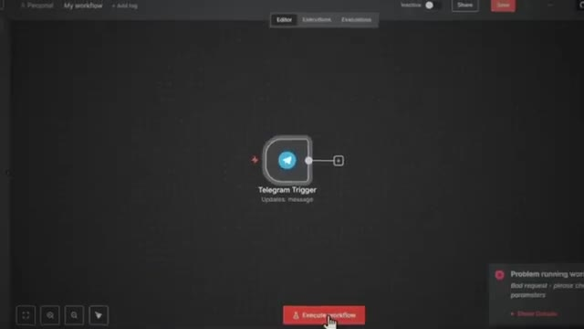
*⏱️ 00:09:42 — Capture d'écran montrant l'interface d'un outil d'automatisation de type n8n avec un nœud Telegram Trigger.*

---

### ⏱️ `[00:09:47 - 00:10:10]` | Segment #27

**🔊 Audio (Transcription Intégrale Mot pour Mot en Français) :**
> Donc, la première étape consiste à planifier vos données de test avec le client. Vous ne voulez pas tester avec des exemples inventés qui n'ont rien à voir avec leur activité. Dès le début, demandez-leur un petit jeu d'échantillons qui ressemble à une utilisation réelle. Je fais généralement cela avant que nous signions le contrat afin qu'ils sachent ce qu'on attend d'eux. Parce que s'ils tardent à vous fournir toutes ces données d'échantillon, cela retardera également votre processus. Il peut donc s'agir d'e-mails, de tickets de support, de transcriptions, d'enregistrements CRM, bref, tout ce qui correspond réellement au flux de travail lorsqu'il est en production.

**👁️ Analyse Visuelle d'Écran (gemini-3.5-flash-lite) :**
**Interface & Outils** : Document papier (jeu d'échantillons de test).

**Contenu textuel & Code** : Texte sur la feuille : 'Sample set (real usage): Customer submits a message via website...' avec des détails sur l'automatisation des emails et CRM.
[DESC_IMAGE_3] Le présentateur présente visuellement un exemple concret de données de test client sur papier pour illustrer son propos.

**Action / Démonstration** : Explications face caméra et démonstration conceptuelle.

*⏱️ 00:09:58 — Vue de dos du présentateur tenant une feuille de papier avec le titre 'Sample set (real usage)'.*

---

### ⏱️ `[00:10:10 - 00:10:34]` | Segment #28

**🔊 Audio (Transcription Intégrale Mot pour Mot en Français) :**
> Et bien sûr, si nécessaire, ils peuvent l'anonymiser. Ensuite, vous pouvez vous mettre d'accord sur ce à quoi ressemble le succès, sur ce qu'est un bon résultat et sur ce qui ne doit jamais se produire. Des choses comme de mauvais tags, des liens brisés, des fuites d'informations, ou l'envoi de la mauvaise personne au mauvais message. Vous pouvez donc l'expliquer très simplement. Avant de lancer, nous allons passer vos vrais exemples dans le système pour que vous puissiez voir exactement comment il se comporte. Et ensuite, dans le cadre de vos propres tests, vous voulez penser moins comme un développeur qui clique dans chaque nœud et regarde la configuration, et penser davantage comme un ingénieur qui planifie l'échec.

**👁️ Analyse Visuelle d'Écran (gemini-3.5-flash-lite) :**
**Interface & Outils** : Interface de création de workflow d'agents IA (type Builder / Langflow / Flowise)

**Contenu textuel & Code** : Diagramme étiqueté "Old Way" montrant les flux de données entre "When chat message received", "AI Agent", "OpenAI Chat Model", "Perplexity", et "Supabase Vector Store".

**Action / Démonstration** : Visualisation d'un schéma d'architecture d'agent conversationnel.

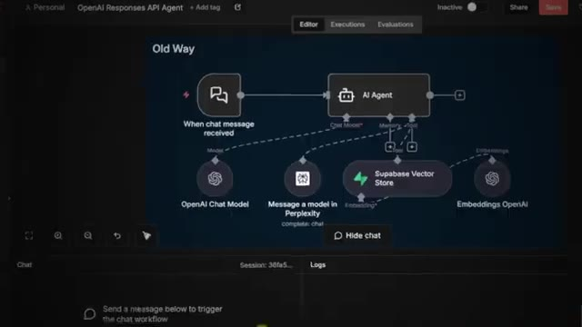
*⏱️ 00:10:22 — Un diagramme de workflow d'agent IA montrant l'ancienne méthode avec des blocs interconnectés (OpenAI Chat Model, Perplexity, Supabase Vector Store).*

---

### ⏱️ `[00:10:34 - 00:10:53]` | Segment #29

**🔊 Audio (Transcription Intégrale Mot pour Mot en Français) :**
> Donc avec les automatisations, surtout lorsqu'elles intègrent de l'IA, vous devez accepter que vous ne savez pas ce que vous ne savez pas. Et une fois que le système passe en production, les vrais utilisateurs et les vraies données révéleront toujours des cas limites auxquels vous n'aviez pas pensé. Donc pendant les tests, vous devez intentionnellement chercher les pires scénarios et vous demander ce qui se passe si ceci, ce qui se passe si cela. De mauvaises données, pas de données, des données en double, ou même quelque chose de complètement inattendu.

**👁️ Analyse Visuelle d'Écran (gemini-3.5-flash-lite) :**
**Interface & Outils** : Aucune interface logicielle ou de démonstration technique.

**Contenu textuel & Code** : Aucun code, terminal ou donnée affiché à l'écran.

**Action / Démonstration** : Le présentateur s'exprime et gesticule pour illustrer ses propos sur les automatisations et l'IA.

---

### ⏱️ `[00:10:53 - 00:11:14]` | Segment #30

**🔊 Audio (Transcription Intégrale Mot pour Mot en Français) :**
> Au lieu de supposer que le flux de travail fonctionnera sans problème pour toujours, vous voulez intégrer des mesures de protection. Peut-être que le flux de travail peut expirer en douceur pour que rien ne se passe. Peut-être que vous configurez un flux de travail d'erreur qui alerte l'équipe. Peut-être que vous enregistrez toutes les pannes dans une feuille Google Sheet afin de pouvoir suivre les tendances au fil du temps. L'idée n'est pas d'éliminer chaque problème possible parce que vous ne le pouvez pas, mais de vous assurer que lorsque quelque chose se brise, cela se brise en toute sécurité et discrètement et d'une manière qui vous donne assez d'informations pour aller le réparer rapidement.

**👁️ Analyse Visuelle d'Écran (gemini-3.5-flash-lite) :**
**Interface & Outils** : Outil d'automatisation de workflow (type n8n ou similaire) et tableur (Google Sheets).

**Contenu textuel & Code** : Schéma de workflow : "Execute Workflow Trigger", "Email Agent", "OpenAI Chat Model", "Send Email", "Get Messages". Texte sur les erreurs : "The workflow can timeout", "You set up an error workflow that alerts the team", "Log all failures into a Google sheet".

**Action / Démonstration** : Illustration visuelle des concepts de résilience et de gestion des erreurs dans l'automatisation des agents IA.

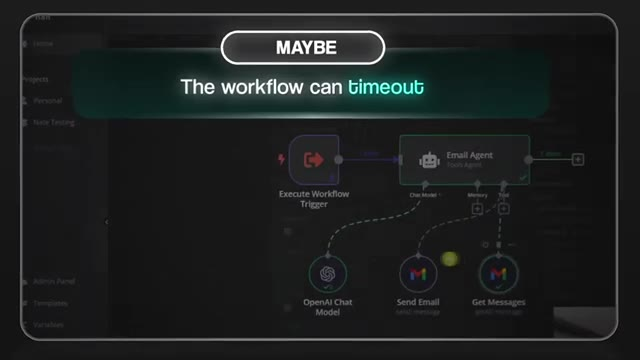
*⏱️ 00:10:59 — Une capture d'écran montrant un diagramme de flux de travail (workflow) automatisé avec un nœud "Email Agent" connecté à divers outils.*

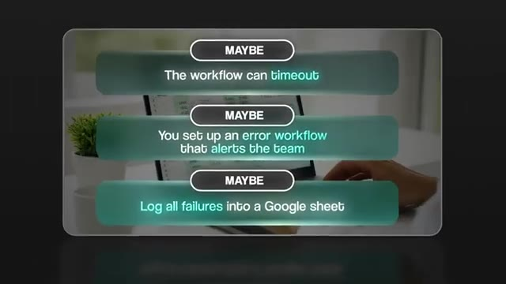
*⏱️ 00:11:04 — Une vue partielle montrant un écran d'ordinateur avec une feuille de calcul Google Sheets en arrière-plan, sur laquelle sont superposés des encadrés textuels listant des stratégies de gestion d'erreurs (timeout, alertes, logging).*

---

### ⏱️ `[00:11:14 - 00:11:34]` | Segment #31

**🔊 Audio (Transcription Intégrale Mot pour Mot en Français) :**
> Donc, une fois que cela fonctionne, vous prenez du recul et vous traitez l'ensemble du flux de travail comme une boîte noire. Vous y injectez un grand nombre d'exemples, pas seulement un ou deux, idéalement des dizaines, voire des centaines d'exemples d'entrées si vous pouvez vous les procurer. Et ensuite, pour chacun d'eux, vous consignez ce qui est entré, ce qui s'est passé au milieu et quel a été le résultat final. Puis, vous comparez ces résultats aux critères de réussite sur lesquels vous vous êtes mis d'accord avec le client. Vous signalez les échecs, les cas limites bizarres et les résultats ambigus dont vous voulez discuter avec lui.

**👁️ Analyse Visuelle d'Écran (gemini-3.5-flash-lite) :**
**Interface & Outils** : Graphismes animés et illustration vidéo explicative.

**Contenu textuel & Code** : Texte schématique sur les flux de travail et les exemples d'utilisation réelle.
[DESC_IMAGE_2] Illustration conceptuelle du traitement d'un ensemble d'exemples d'entrées pour le système.

**Action / Démonstration** : Explications face caméra et démonstration conceptuelle.

---

### ⏱️ `[00:11:34 - 00:11:54]` | Segment #32

**🔊 Audio (Transcription Intégrale Mot pour Mot en Français) :**
> Et ceci est votre contrôle qualité interne ou étape d'assurance qualité. L'objectif est d'attraper le plus de choses possible avant même que le client ne l'essaie. Et je ferais un contrôle qualité interne pendant au moins quelques jours avant de les laisser y entrer et de fournir le moindre retour. Maintenant, l'IA ajoute une couche supplémentaire par-dessus cela, car vous ne vérifiez pas seulement que le nœud d'IA s'exécute, vous vérifiez la qualité de ce qu'il dit. Donc, pour les débutants, concentrez-vous sur quelques vérifications simples comme la pertinence et l'exactitude.

**👁️ Analyse Visuelle d'Écran (gemini-3.5-flash-lite) :**
**Interface & Outils** : AUCUNE

**Contenu textuel & Code** : AUCUN

**Action / Démonstration** : AUCUNE

---

### ⏱️ `[00:11:54 - 00:12:15]` | Segment #33

**🔊 Audio (Transcription Intégrale Mot pour Mot en Français) :**
> Est-ce que la réponse répond réellement à la demande avec des informations précises ? Une autre chose concerne le ton et la sécurité. Elle ne doit pas être toxique, hors de l'image de marque, ni divulguer des instructions système cachées et des informations privées. Et ensuite, vous avez l'élément de cohérence. Donc, si vous envoyez les 10 mêmes entrées, obtenez-vous à peu près les 10 mêmes réponses à chaque fois ? Et en coulisses, vous pouvez exécuter des tests A/B simples et des évaluations où vous essayez différents prompts et différents modèles sur le même ensemble de données et suivez ceux qui vous donnent les meilleurs résultats.

**👁️ Analyse Visuelle d'Écran (gemini-3.5-flash-lite) :**
**Interface & Outils** : Présentation vidéo avec des infographies textuelles animées.

**Contenu textuel & Code** : Texte affichant les critères d'évaluation des LLM : Relevance and Correctness, Tone and Safety, Element of Consistency, A/B Tests and Evaluations.

**Action / Démonstration** : Défilement visuel à travers les quatre points clés d'évaluation des réponses d'IA.

---

### ⏱️ `[00:12:15 - 00:12:39]` | Segment #34

**🔊 Audio (Transcription Intégrale Mot pour Mot en Français) :**
> Et pour le client, vous pouvez présenter les choses ainsi : nous avons testé plusieurs prompts et modèles sur vos exemples réels et avons conservé celui qui a atteint la plus haute qualité et le plus de cohérence. Voici les données d'évaluation que nous avons exécutées, et vous pourriez même utiliser la fonction d'évaluation intégrée de N&N. Bien sûr, vous devez être capable de montrer tout cela, et c'est là qu'intervient la journalisation. Et la journalisation est ce qui fait que tout cela ne ressemble pas à de la magie. Parce que j'aime que mon flux de travail stocke l'historique d'exécution dans une feuille Google Sheet, où il suit toutes les entrées, toutes les sorties, les appels d'outils, les erreurs et les jetons.

**👁️ Analyse Visuelle d'Écran (gemini-3.5-flash-lite) :**
**Interface & Outils** : Application de messagerie mobile (mockup)

**Contenu textuel & Code** : Texte de message simulant une communication avec un client sur les tests de prompts et l'évaluation n8n.

**Action / Démonstration** : Affichage d'une simulation de conversation textuelle sur smartphone.

---

### ⏱️ `[00:12:39 - 00:12:59]` | Segment #35

**🔊 Audio (Transcription Intégrale Mot pour Mot en Français) :**
> pour que vous puissiez réellement parcourir ce journal et identifier des schémas, des types d'erreurs courants, des entrées erronées récurrentes, ou des points faibles dans votre choix de prompt ou de modèle. Ce même journal devient votre preuve lorsque vous parlez au client et que vous pouvez lui montrer ce que vous avez testé et pourquoi vous avez pris certaines décisions ou apporté des améliorations. Et après avoir été satisfait en interne du système, vous pouvez passer au contrôle qualité destiné au client, où vous lui donnez un moyen clair de tester le système.

**👁️ Analyse Visuelle d'Écran (gemini-3.5-flash-lite) :**
**Interface & Outils** : Interface graphique de présentation (fenêtre logicielle stylisée).

**Contenu textuel & Code** : Mention textuelle et graphique 'INTERNAL QA' avec un badge numéroté '#1'.

**Action / Démonstration** : Animation ou affichage d'un diagramme ou d'un élément de workflow illustrant le processus de contrôle qualité interne.

*⏱️ 00:12:54 — Une interface graphique animée montrant une fenêtre avec un encadré labellisé '#1 INTERNAL QA' et une icône de document validé.*

---

### ⏱️ `[00:12:59 - 00:13:25]` | Segment #36

**🔊 Audio (Transcription Intégrale Mot pour Mot en Français) :**
> Cela pourrait être une boîte de discussion, un formulaire ou une interface utilisateur simple. Faites au plus simple. Vous ne voulez pas qu'ils aient réellement à entrer dans NNN et à regarder tout ce désordre. Ensuite, vous leur demandez de vous dire ce qu'ils pensent du système, des résultats, du ton, du formatage, ou de tout autre élément de ce genre. Et bien souvent à ce stade, si vous avez tout fait correctement, vous ne ferez que de petits ajustements de consignes et de modèles. Et puis pour conclure, vous pouvez enregistrer une courte vidéo de mise à jour, montrer une ou deux exécutions complètes, de l'entrée au flux de travail jusqu'à la sortie, pointer les journaux et expliquer comment le système a géré ces exemples réels.

**👁️ Analyse Visuelle d'Écran (gemini-3.5-flash-lite) :**
**Interface & Outils** : n8n (workflow automation platform)

**Contenu textuel & Code** : JSON (headers, query params), configuration de nœud "Respond to Webhook", expression JavaScript `{{ $json.query['hub.challenge'] }}`.

**Action / Démonstration** : Configuration et paramétrage d'une réponse de Webhook dans le workflow n8n.

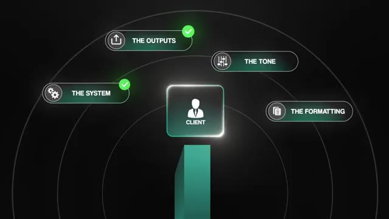
*⏱️ 00:13:12 — Un schéma animé illustre l'interaction entre un client et des paramètres clés (Système, Outputs, Ton, Formatage).*

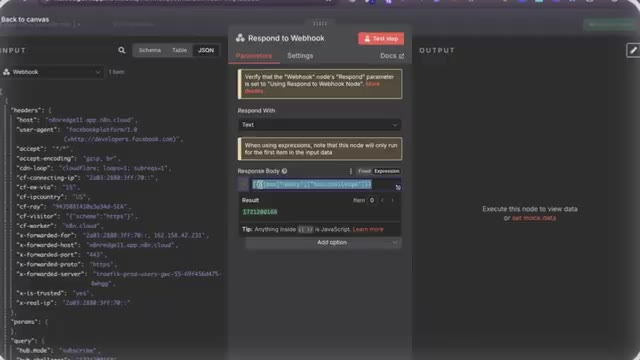
*⏱️ 00:13:19 — Capture d'écran de l'interface n8n montrant un nœud de configuration "Respond to Webhook" avec du code JSON.*

---

### ⏱️ `[00:13:25 - 00:13:46]` | Segment #37

**🔊 Audio (Transcription Intégrale Mot pour Mot en Français) :**
> Et c'est ce genre de contrôle qualité ou d'assurance qualité qui instaure la confiance et donne envie aux clients de travailler à nouveau avec vous. Désormais, une fois que vous avez testé le workflow avec succès, il est temps de commencer le processus de transmission. C'est la phase de livraison et elle se présente un peu différemment selon votre situation actuelle. Donc, la première chose qui pourrait affecter la transmission est de savoir si vous avez construit le workflow directement dans leur environnement ou non. Parce que si c'est le cas, la transmission est beaucoup plus facile car tout est déjà configuré, leurs identifiants et tout ce genre de choses.

**👁️ Analyse Visuelle d'Écran (gemini-3.5-flash-lite) :**
**Interface & Outils** : Graphique animé de présentation (type infographie).

**Contenu textuel & Code** : Texte affiché : "HANDOVER IMPACT FACTOR" et "1. You built the workflow directly in their environment".

**Action / Démonstration** : Affichage d'une infographie animée structurant les facteurs d'impact lors de la phase de livraison (handover).

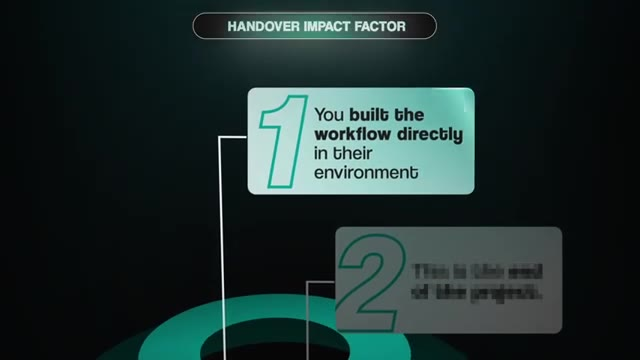
*⏱️ 00:13:41 — Un diagramme graphique sur fond sombre présente le titre "HANDOVER IMPACT FACTOR" avec des blocs numérotés expliquant les étapes du processus de transmission.*

---

### ⏱️ `[00:13:47 - 00:14:05]` | Segment #38

**🔊 Audio (Transcription Intégrale Mot pour Mot en Français) :**
> Mais si vous ne l'avez pas fait, vous aurez alors un processus de transfert plus important au cours duquel vous les aiderez réellement à transférer leurs identifiants et vous devrez recréer certaines de ces connexions. La deuxième chose qui peut affecter votre passage de relais est de savoir s'il s'agit ou non de la fin du projet ou si vous avez déjà défini d'autres travaux ou une sorte de contrat de maintenance continue. Si vous restez dans le coin, vous pourriez garder une partie de l'infrastructure de test en place. Mais si ce n'est pas le cas, votre passage de relais doit alors être plus définitif et complet.

**👁️ Analyse Visuelle d'Écran (gemini-3.5-flash-lite) :**
**Interface & Outils** : AUCUNE

**Contenu textuel & Code** : Texte animé présentant les étapes d'un workflow de transfert ("You built the workflow directly in their environment", "This is the end of the project.")

**Action / Démonstration** : Présentation conceptuelle des étapes du transfert de projet à un client.

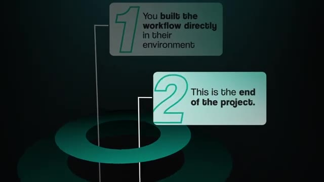
*⏱️ 00:13:56 — Animation graphique 3D sur fond sombre détaillant deux points clés : "1. You built the workflow directly in their environment" et "2. This is the end of the project."*

---

### ⏱️ `[00:14:05 - 00:14:28]` | Segment #39

**🔊 Audio (Transcription Intégrale Mot pour Mot en Français) :**
> Il y a quelques étapes clés que vous voulez suivre dans tous les cas. Tout d'abord, vous voulez dupliquer le workflow. Gardez donc une version quelque part comme sauvegarde ou version de test, puis poussez la version propre en production. C'est exactement comme cela que fonctionnent les équipes de développement logiciel. Vous avez en quelque sorte un environnement de test dans lequel vous expérimentez et itérez, puis vous avez un environnement de production où seule réside une version stable. Ainsi, chaque fois que vous devez apporter des modifications ou des mises à jour, vous le faites d'abord sur la version de test, vous confirmez que tout fonctionne toujours, puis vous pouvez passer cette version en production.

**👁️ Analyse Visuelle d'Écran (gemini-3.5-flash-lite) :**
**Interface & Outils** : Interface graphique de type n8n (diagramme de workflow) intégrée dans des encadrés de présentation.

**Contenu textuel & Code** : Schémas de workflows d'automatisation avec des nœuds connectés.

**Action / Démonstration** : Présentation conceptuelle de la séparation entre l'environnement de test et l'environnement de production.

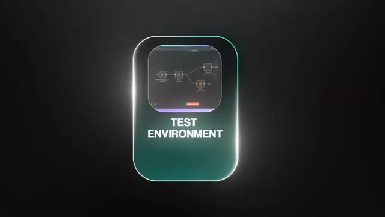
*⏱️ 00:14:17 — Graphique animé illustrant un environnement de test ("TEST ENVIRONMENT") avec un aperçu de workflow de type n8n.*

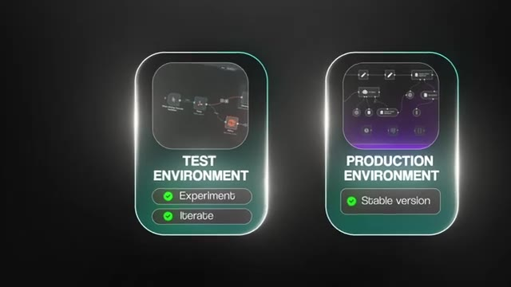
*⏱️ 00:14:22 — Comparaison visuelle entre un environnement de test (avec les tags "Experiment" et "Iterate") et un environnement de production (avec le tag "Stable version").*

---

### ⏱️ `[00:14:28 - 00:14:48]` | Segment #40

**🔊 Audio (Transcription Intégrale Mot pour Mot en Français) :**
> Et cette même idée peut s'appliquer lorsque N8N lui-même publie des mises à jour ou lorsque les outils ou les intégrations changent. Vous ne voulez jamais mettre à jour votre environnement de production à l'aveugle. Vous voulez d'abord mettre à jour la configuration de test, charger le flux de travail, vous assurer que toutes les fonctionnalités sont toujours intactes. Et une sur laquelle vous savez qu'il se comporte toujours comme il se doit, alors vous pouvez mettre à jour la version sur laquelle le client compterait réellement. Cela évite les pannes, les automatisations cassées et beaucoup de stress inutile.

**👁️ Analyse Visuelle d'Écran (gemini-3.5-flash-lite) :**
**Interface & Outils** : Aucune interface logicielle montrée (vue caméra du présentateur).

**Contenu textuel & Code** : Texte incrusté à l'écran : "UPDATE TEST SETUP".

**Action / Démonstration** : Le présentateur parle des bonnes pratiques de mise à jour des environnements de test et de production.

*⏱️ 00:14:38 — Le présentateur s'exprime face caméra avec un encadré graphique affichant le texte 'UPDATE TEST SETUP' en bas à gauche.*

---

### ⏱️ `[00:14:48 - 00:15:06]` | Segment #41

**🔊 Audio (Transcription Intégrale Mot pour Mot en Français) :**
> En plus de cela, vous voulez toujours sauvegarder vos flux de travail. Vous pouvez donc stocker le JSON exporté sur GitHub, Google Drive, ou même un simple Google Sheet. Ainsi, vous avez toujours des versions précédentes vers lesquelles vous pouvez revenir si nécessaire. Et si vous voulez aller plus loin, vous pouvez créer un processus de sauvegarde automatisé en utilisant NNN lui-même afin qu'il exporte et sauvegarde périodiquement les flux de travail ailleurs. La prochaine chose à faire concerne l'hygiène des flux de travail.

**👁️ Analyse Visuelle d'Écran (gemini-3.5-flash-lite) :**
**Interface & Outils** : Navigateur web

**Contenu textuel & Code** : Icônes de Google Drive et Gmail

**Action / Démonstration** : Navigation et présentation des options de stockage de flux de travail

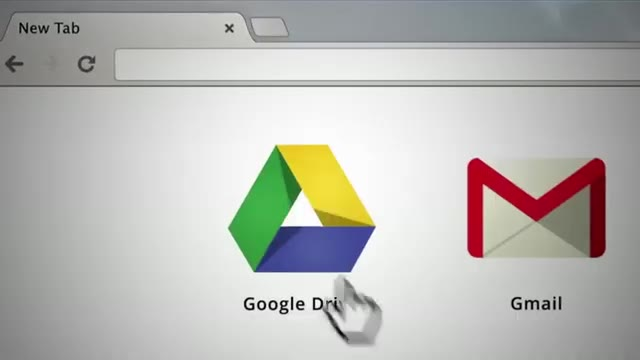
*⏱️ 00:14:53 — Capture d'écran montrant un navigateur web avec des icônes pour Google Drive et Gmail.*

---

### ⏱️ `[00:15:06 - 00:15:27]` | Segment #42

**🔊 Audio (Transcription Intégrale Mot pour Mot en Français) :**
> Donc, vous voulez vous assurer que c'est propre et facile à comprendre. Utilisez des noms clairs à chaque étape, étiquetez chaque étape, placez des notes adhésives autour du flux de travail pour expliquer ce qu'il fait et pourquoi vous l'avez construit ainsi. L'objectif est que n'importe qui de leur équipe ou de votre équipe puisse plus tard ouvrir ce flux de travail ou disposer d'un PDF de ce flux de travail et en voir et comprendre la logique immédiatement. Vous voulez également vérifier à deux reprises qu'il n'y a pas de clés ou de jetons sensibles n'importe où dans le flux de travail avant de le transmettre.

**👁️ Analyse Visuelle d'Écran (gemini-3.5-flash-lite) :**
**Interface & Outils** : Interface de gestion de flux de travail / éditeur de notes.

**Contenu textuel & Code** : "Sticky Notes - Comments For a Developer", étapes étiquetées "Step 1" et "Step 2".

**Action / Démonstration** : Présentation visuelle de bonnes pratiques pour documenter les flux de travail avec des notes adhésives.

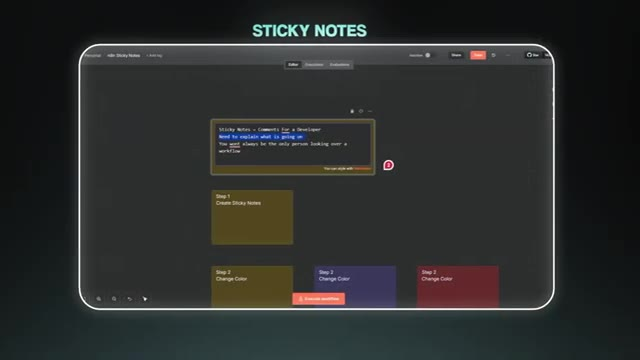
*⏱️ 00:15:12 — Capture d'écran montrant l'interface d'un outil de flux de travail avec des notes adhésives et des étapes étiquetées.*

---

### ⏱️ `[00:15:27 - 00:15:46]` | Segment #43

**🔊 Audio (Transcription Intégrale Mot pour Mot en Français) :**
> parce que vous voulez une transition propre où le client sait exactement où vont ses clés API et comment les configurer sur son propre compte. Donc, dans cet ensemble de livrables, il pourrait aussi y avoir une vidéo explicative Loom, qui est une vidéo rapide d'une ou deux minutes où vous montrez comment le système fonctionne, comment le configurer et quoi faire si certains éléments doivent être mis à jour. Parce qu'il n'y a jamais une seule solution exacte pour un processus en ce qui concerne la manière de l'automatiser.

**👁️ Analyse Visuelle d'Écran (gemini-3.5-flash-lite) :**
**Interface & Outils** : Interface de workflow (n8n), enregistreur Loom

**Contenu textuel & Code** : Nœuds de workflow comprenant Telegram Trigger, AI Agent, OpenAI Chat Model et Window Buffer Memory.

**Action / Démonstration** : Démonstration et explication d'un workflow d'automatisation via une vidéo de type Loom.

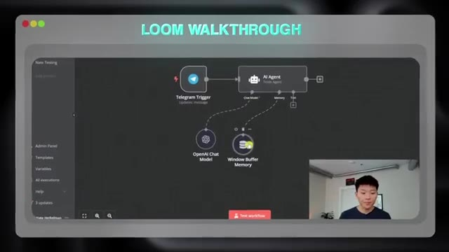
*⏱️ 00:15:36 — Capture d'écran d'une vidéo Loom montrant l'interface d'un workflow de type n8n avec un déclencheur Telegram et un agent IA, et une vignette vidéo du présentateur dans le coin inférieur droit.*

*⏱️ 00:15:41 — Vue de dos d'un utilisateur face à un écran d'ordinateur affichant un diagramme de workflow interactif avec des nœuds lumineux verts.*

---

### ⏱️ `[00:15:46 - 00:16:10]` | Segment #44

**🔊 Audio (Transcription Intégrale Mot pour Mot en Français) :**
> Et le cerveau de tout le monde fonctionne un tout petit peu différemment. Donc si vous pouvez leur expliquer ce que vous pensiez au moment où vous l'avez construit, ça va être vraiment utile. Et que ce soit le seul projet que vous faites pour eux ou que vous restiez en contrat de maintenance, une bonne documentation est toujours précieuse. Parce que comme je l'ai dit, si quelqu'un de leur équipe le reprend plus tard, ou si vous faites venir un développeur plus tard pour aider à maintenir le compte, tout est super clair et personne n'a à deviner ce qui a été construit ou pourquoi. Et cela protège vraiment les deux parties parce que cela aide le client à se sentir soutenu et en confiance, et cela vous aide à éviter d'être le goulot d'étranglement chaque fois que quelque chose doit changer.

**👁️ Analyse Visuelle d'Écran (gemini-3.5-flash-lite) :**
**Interface & Outils** : Outil d'automatisation de type workflow graphique.

**Contenu textuel & Code** : Nœuds de workflow connectés pour la génération d'idées et de publications LinkedIn.

**Action / Démonstration** : Présentation visuelle d'un workflow automatisé pour illustrer la création de projets clients.

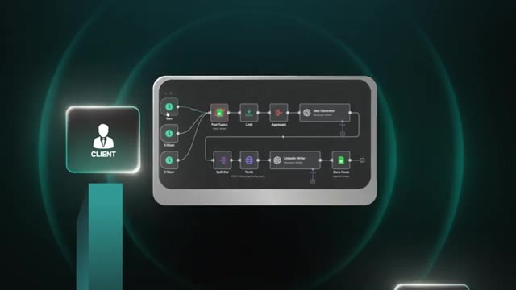
*⏱️ 00:15:58 — Un schéma de workflow d'automatisation avec des nœuds connectés et l'icône 'Client' à gauche.*

---

### ⏱️ `[00:16:10 - 00:16:29]` | Segment #45

**🔊 Audio (Transcription Intégrale Mot pour Mot en Français) :**
> Et c'est ainsi que vous livrez des workflows de manière professionnelle et que vous vous préparez pour une relation à long terme au lieu de projets uniques. Maintenant, c'est la partie dont les gens ne parlent jamais vraiment en ligne, et c'est le côté juridique et financier des choses. Après avoir remis le workflow, il y a quelques points sur lesquels vous voulez vous assurer qu'ils sont convenus à l'avance. Et le premier, c'est la facturation. Vous voulez être extrêmement clair à ce sujet. D'abord, vous clôturez le projet en cours et vous êtes payé pour ce que vous venez de construire.

**👁️ Analyse Visuelle d'Écran (gemini-3.5-flash-lite) :**
**Interface & Outils** : Aucune interface logicielle ou de programmation affichée (simple vidéo de présentation face caméra).

**Contenu textuel & Code** : Aucun code source, terminal ou prompt affiché.

**Action / Démonstration** : Le présentateur s'adresse directement à la caméra pour expliquer les aspects juridiques et financiers.

---

### ⏱️ `[00:16:29 - 00:16:47]` | Segment #46

**🔊 Audio (Transcription Intégrale Mot pour Mot en Français) :**
> Ensuite, vous décidez s'il y aura une relation payante continue pour garder le tout en bonne santé au fil du temps grâce à un contrat de maintenance. Avant toute chose, vous voulez réexaminer la portée des travaux sur laquelle vous vous êtes tous les deux mis d'accord au début. La portée des travaux de votre prestataire devrait déjà indiquer ce que signifie "terminé", quels flux de travail vous avez promis de construire, à quels systèmes ils se connectent, à quoi ressemble le succès, essentiellement quelle est la définition de ce qui est fait.

**👁️ Analyse Visuelle d'Écran (gemini-3.5-flash-lite) :**
**Interface & Outils** : Interface de visioconférence et graphiques de présentation animés.

**Contenu textuel & Code** : Texte affiché : « CONTRACT », « WHAT FINISHED MEANS », « WHICH WORKFLOWS YOU PROMISE TO BUILD », « WHICH SYSTEMS THEY WOULD CONNECT TO ».

**Action / Démonstration** : Animation graphique illustrant les éléments clés d'un contrat de prestation lors d'une visioconférence.

---

### ⏱️ `[00:16:48 - 00:17:09]` | Segment #47

**🔊 Audio (Transcription Intégrale Mot pour Mot en Français) :**
> Parce qu'au moment de la passation, vous voulez passer en revue chaque élément et confirmer que tout fonctionne de la manière dont vous avez convenu. Et une fois que le client confirme que le projet est terminé, vous envoyez la facture finale. Vous pouvez formuler cela tout simplement : le projet se termine lorsque les flux de travail convenus sont en ligne, testés, documentés et acceptés, et ensuite la facture du projet est due. L'élément suivant consiste à décider si vous souhaitez proposer un contrat de maintenance. Un contrat de maintenance est un accord continu séparé par lequel le client vous paie pour maintenir le système opérationnel.

**👁️ Analyse Visuelle d'Écran (gemini-3.5-flash-lite) :**
**Interface & Outils** : Aucune interface visible.

**Contenu textuel & Code** : Aucun code, terminal ou donnée affiché.

**Action / Démonstration** : Le présentateur s'adresse directement aux spectateurs en parlant de la gestion de projet et de la facturation.

---

### ⏱️ `[00:17:09 - 00:17:28]` | Segment #48

**🔊 Audio (Transcription Intégrale Mot pour Mot en Français) :**
> Cela couvre généralement des choses comme la correction de bugs, les petits ajustements, les mises à jour, les changements de dépendances, la surveillance et les contrôles de sécurité de base. Cela ne couvre pas les nouvelles fonctionnalités, les nouveaux flux de travail ou les changements majeurs de périmètre. Ceux-ci devraient faire l'objet d'un projet séparé. Vous pouvez également définir des niveaux de service de base afin que les clients sachent à quoi s'attendre. Par exemple, une panne critique peut obtenir une réponse en quelques heures. Les requêtes mineures peuvent être traitées en quelques jours.

**👁️ Analyse Visuelle d'Écran (gemini-3.5-flash-lite) :**
**Interface & Outils** : n8n (interface de workflow d'automatisation)

**Contenu textuel & Code** : Texte à l'écran "BASIC SECURITY CHEKS" et questions de configuration d'authentification.

**Action / Démonstration** : Présentation de la section sur les contrôles de sécurité de base pour les automatisations.

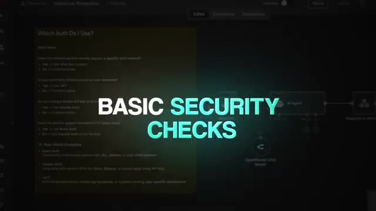
*⏱️ 00:17:14 — Capture montrant l'interface d'un workflow n8n en arrière-plan avec le texte superposé "BASIC SECURITY CHEKS".*

---

### ⏱️ `[00:17:28 - 00:17:46]` | Segment #49

**🔊 Audio (Transcription Intégrale Mot pour Mot en Français) :**
> Ce n'est pas obligé d'être compliqué, mais les attentes doivent y être claires. Et vous voulez aussi obtenir de la clarté sur la propriété et la propriété intellectuelle. De nombreux contrats de conseil stipulent que le client est propriétaire du produit du travail une fois payé, mais vous devez quand même vous protéger afin de pouvoir conserver le droit de réutiliser des modèles ou des composants génériques qui ne sont pas spécifiques à leur entreprise, comme, comme je l'ai dit, des outils réutilisables, des sous-flux de travail ou des modèles de base.

**👁️ Analyse Visuelle d'Écran (gemini-3.5-flash-lite) :**
**Interface & Outils** : AUCUNE

**Contenu textuel & Code** : AUCUN

**Action / Démonstration** : AUCUNE

---

### ⏱️ `[00:17:46 - 00:18:08]` | Segment #50

**🔊 Audio (Transcription Intégrale Mot pour Mot en Français) :**
> Cela aide également à définir le processus de sortie. Ainsi, si le client souhaite un jour se passer de vos services, vous devez définir ce que vous allez lui transmettre. Cela peut inclure des flux de travail exportés, de la documentation et un appel de passation, ainsi que ce qui est inclus et ce qui est facturable. Une explication simple de ceci est qu'une fois le produit payé, le client a le droit d'utiliser et d'exécuter ces flux de travail dans son entreprise. S'il souhaite plus tard changer de prestataire, vous l'aiderez à gérer la transition de manière structurée.

**👁️ Analyse Visuelle d'Écran (gemini-3.5-flash-lite) :**
**Interface & Outils** : Environnement de développement et terminal de commandes

**Contenu textuel & Code** : Commandes d'installation et barres de progression de packages (pip, python)

**Action / Démonstration** : Exécution de tâches de configuration et installation de paquets logiciels dans un terminal

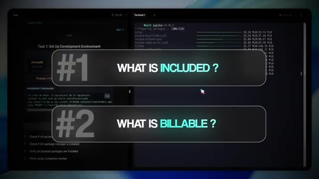
*⏱️ 00:17:57 — Interface d'un environnement de développement divisé en deux volets, affichant un terminal en cours d'exécution et des directives, avec des encarts textuels superposés "#1 WHAT IS INCLUDED ?" et "#2 WHAT IS BILLABLE ?".*

---

### ⏱️ `[00:18:08 - 00:18:29]` | Segment #51

**🔊 Audio (Transcription Intégrale Mot pour Mot en Français) :**
> Pour les débutants, l'essentiel est simple. Arrêtez de faire tout cela de manière informelle. Mettez la portée, la définition du fini, le paiement, la maintenance, les niveaux de service, les bugs par rapport aux modifications, la propriété et les conditions de sortie dans un accord écrit clair. Lorsque les deux parties savent ce qu'elles achètent et ce qui se passe après la mise en ligne, les projets se déroulent plus harmonieusement et vous évitez les malentendus. Alors maintenant que vous savez quoi faire en théorie, jetons un œil à un exemple concret d'un flux de travail que j'ai vendu et au processus que j'ai suivi lors de sa transmission.

**👁️ Analyse Visuelle d'Écran (gemini-3.5-flash-lite) :**
**Interface & Outils** : Aucune interface logicielle ou de programmation affichée.

**Contenu textuel & Code** : Texte à l'écran listant les éléments clés : 1. Put Scope, 2. Definition of Done, 3. Payment, 4. Maintenance.

**Action / Démonstration** : Le présentateur explique les éléments essentiels à inclure dans un accord écrit pour les débutants.

---

### ⏱️ `[00:18:29 - 00:18:48]` | Segment #52

**🔊 Audio (Transcription Intégrale Mot pour Mot en Français) :**
> Donc celui-ci était un flux de travail d'assistant personnel et l'un des tout premiers que j'aie jamais livrés. Et le client n'avait en fait jamais entendu parler de N&M. Il avait juste regardé ma vidéo YouTube sur l'assistant ultime, puis il a contacté et dit qu'il voulait quelque chose comme ça. Donc après la découverte et après avoir signé le contrat, nous avons eu un appel de lancement. Et lors de cet appel, j'avais toutes ces choses dont j'avais besoin de sa part, qui étaient répertoriées dans une sorte de partie sur les attentes du client du contrat.

**👁️ Analyse Visuelle d'Écran (gemini-3.5-flash-lite) :**
**Interface & Outils** : Interface de visioconférence / application de réunion en ligne.

**Contenu textuel & Code** : Message texte dans une bulle de discussion : "Hey, can you let me know your particular expectations so I can align?".

**Action / Démonstration** : Simulation ou illustration d'un échange vidéo avec un client lors de la mise en place d'un assistant personnel.

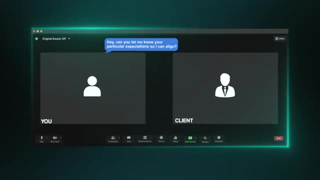
*⏱️ 00:18:44 — Une interface de visioconférence (type Zoom ou Meet) avec deux participants (« YOU » et « CLIENT ») et une bulle de dialogue affichant un message textuel.*

---

### ⏱️ `[00:18:49 - 00:19:08]` | Segment #53

**🔊 Audio (Transcription Intégrale Mot pour Mot en Français) :**
> Donc je l'ai guidé exactement sur ce que nous devions obtenir, et je l'ai aidé à aller chercher ces clés API, à s'inscrire sur un compte end-in-in, des choses comme ça. Et ensuite, je lui ai montré comment m'inviter sur cette instance end-in. Directement pendant l'appel, nous avons connecté son CRM, son calendrier, son e-mail et les sources de données qu'il voulait que l'assistant puisse utiliser. À partir de là, j'ai pu simplement insérer quelques-uns de mes propres identifiants à des fins de test, et ensuite j'ai pu me lancer directement.

**👁️ Analyse Visuelle d'Écran (gemini-3.5-flash-lite) :**
**Interface & Outils** : Logiciel de visioconférence (type Zoom ou Google Meet)

**Contenu textuel & Code** : Interface d'appel vidéo avec vignettes des participants "YOU" et "CLIENT" et barre de contrôle en bas.

**Action / Démonstration** : Simulation visuelle d'un appel en visioconférence avec un client pour le guidage technique.

*⏱️ 00:18:58 — Une interface de visioconférence montrant deux participants, étiquetés "YOU" et "CLIENT", illustrant l'appel mentionné.*

---

### ⏱️ `[00:19:08 - 00:19:30]` | Segment #54

**🔊 Audio (Transcription Intégrale Mot pour Mot en Français) :**
> Et le meilleur dans tout ça, c'est qu'à la fin, la passation a été presque instantanée, car tout ce que j'avais à faire, c'était d'échanger quelques-uns de ses identifiants contre les miens. Et ensuite, il pouvait tout simplement commencer à l'utiliser immédiatement et me donner des retours. Maintenant, avec quelque chose comme un assistant personnel qui est super autonome, le contrôle qualité peut être intense, car c'est super conversationnel et il y a beaucoup d'outils différents qu'il peut appeler. Il est également en contact direct avec les clients. Il a de la mémoire. Il a du ton. Il a beaucoup de choses dont vous devez réellement vous assurer pour que le client soit satisfait.

**👁️ Analyse Visuelle d'Écran (gemini-3.5-flash-lite) :**
**Interface & Outils** : Graphique animé / Infographie

**Contenu textuel & Code** : Schéma d'architecture ou de critères QA ("Conversational", "Different tools", "Client facing") émergeant d'un dossier QA.

**Action / Démonstration** : Animation graphique illustrant les différents aspects de l'assurance qualité (QA) discutés.

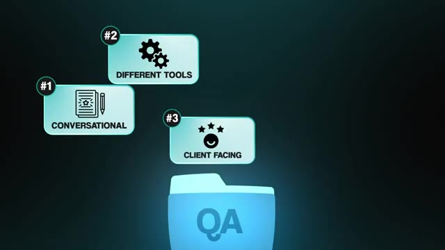
*⏱️ 00:19:25 — Schéma graphique animé illustrant un dossier QA avec trois éléments numérotés : #1 Conversational, #2 Different tools, et #3 Client facing.*

---

### ⏱️ `[00:19:30 - 00:20:03]` | Segment #55

**🔊 Audio (Transcription Intégrale Mot pour Mot en Français) :**
> Il y a donc eu beaucoup d'allers-retours. Il y a eu beaucoup de retouches, de raffinements et particulièrement avec le prompt système. Et c'est tout à fait normal. Mais tout au long de ce processus, il a commencé à demander des fonctionnalités plus importantes, de nouvelles intégrations. Et à ce moment-là, je devais protéger le périmètre du projet parce que c'est super important de s'assurer qu'on n'ajoute pas toutes ces choses pour lesquelles vous n'êtes pas payé. Je lui ai donc dit lesquelles de ces demandes entreraient dans la version 1 et lesquelles devraient être ajoutées au carnet de commandes pour une phase future. Et une fois que la version 1 serait terminée et acceptée, nous définirions le périmètre d'un nouveau projet autour de ces fonctionnalités supplémentaires. Rien que cela m'a évité de faire une tonne de travail non payé. Et la dernière leçon ici nous ramène aux clés API. Au début, j'avais l'habitude d'essayer de

**👁️ Analyse Visuelle d'Écran (gemini-3.5-flash-lite) :**
**Interface & Outils** : Interface web de création de workflows (type n8n).

**Contenu textuel & Code** : Nœuds de workflow affichant des services d'API comme Tavily et ElevenLabs, accompagnés d'un bandeau textuel "BIGGER FEATURES".

**Action / Démonstration** : Visualisation d'un diagramme de workflow intégrant de nouveaux nœuds d'API.

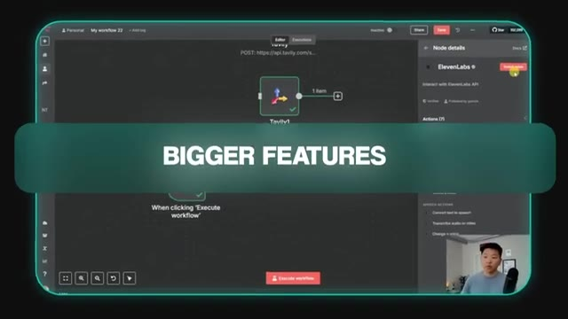
*⏱️ 00:19:38 — Interface d'un éditeur de workflow avec des nœuds connectés (Tavily, ElevenLabs) et un encart vidéo du présentateur en bas à droite.*

---

### ⏱️ `[00:20:03 - 00:20:27]` | Segment #56

**🔊 Audio (Transcription Intégrale Mot pour Mot en Français) :**
> rendre les choses faciles pour les clients en gérant tout sous ma propre facturation et en leur envoyant simplement une facture à la fin du mois. Maintenant, ça a l'air bien en théorie, mais en réalité, ça devient vite compliqué. Comme je l'mentionnait plus tôt, les clients veulent des coûts prévisibles et l'utilisation des jetons est impossible à estimer parfaitement. Vous pourriez aussi avoir à faire à des factures en retard ou à de la confusion sur ce qu'ils paient réellement. Et tout cela ramène toujours à la même règle. C'est tellement plus propre, plus simple et tellement plus évolutif s'ils possèdent ces comptes et leurs clés dès le départ. Cela rend le transfert plus facile.

**👁️ Analyse Visuelle d'Écran (gemini-3.5-flash-lite) :**
**Interface & Outils** : Graphique animé de présentation (motion graphics) sur fond noir.

**Contenu textuel & Code** : Texte "PREDICTABLE COSTS" et badge d'alerte "Token usage".

**Action / Démonstration** : Animation visuelle illustrant les difficultés liées aux coûts imprévisibles des tokens lors de la facturation aux clients.

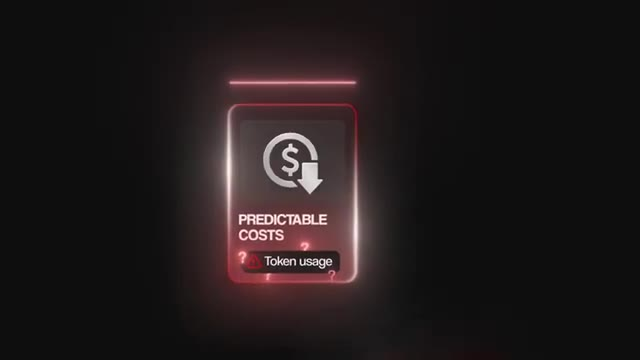
*⏱️ 00:20:15 — Un graphique stylisé en néon rouge représentant les coûts prévisibles (Predictable Costs) avec une alerte sur l'utilisation des tokens (Token usage).*

---

### ⏱️ `[00:20:27 - 00:21:00]` | Segment #57

**🔊 Audio (Transcription Intégrale Mot pour Mot en Français) :**
> Cela rend la maintenance plus facile et vous évite le rôle de gardien de la facturation. J'espère donc qu'en voyant un exemple réel, vous aurez une meilleure idée de la façon dont tous les éléments s'assemblent dans un projet client en direct. C'est ainsi que vous construisez, hébergez, testez, transmettez et maintenez des flux de travail d'IA sans vous créer de maux de tête, ni à vous, ni au client. C'est donc tout le processus. D'abord, vous décidez où le flux de travail va résider. Je recommande toujours que les clients hébergent tout eux-mêmes, que ce soit sur un cloud, un VPS, ou quelque chose en local, et vous les aidez simplement à le configurer. Avant de livrer quoi que ce soit, vous vous assurez que la sécurité et la confidentialité des données sont gérées de la bonne manière. Ensuite, vous determinez qui possède quoi avec les clés d'API et comment ces clés entrent dans le système sans créer de désordre. Après

**👁️ Analyse Visuelle d'Écran (gemini-3.5-flash-lite) :**
**Interface & Outils** : AUCUNE

**Contenu textuel & Code** : AUCUNE

**Action / Démonstration** : AUCUNE

---

### ⏱️ `[00:21:00 - 00:21:34]` | Segment #58

**🔊 Audio (Transcription Intégrale Mot pour Mot en Français) :**
> que vous effectuez vos tests et votre assurance qualité afin de savoir que le flux de travail est fiable, sûr et produit les bons résultats. Ensuite, vous passez à la passation proprement dite, c'est-à-dire la manière dont vous livrez le système, fixez les attentes et leur fournissez la documentation. Et enfin, vous clôturez le projet sur le plan juridique et de la facturation et décidez s'il y aura une maintenance continue après le lancement. C'est tout le cycle de vie de la création et de la livraison de flux de travail d'IA de la bonne manière. Je sais donc que nous avons couvert beaucoup d'informations dans cette vidéo. J'ai donc tout rassemblé dans un guide de ressources complet auquel vous pouvez accéder entièrement gratuitement. Il vous suffit de rejoindre ma communauté School gratuite. Le lien pour cela se trouve dans la description. Si vous avez aimé celle-ci et que vous souhaitez aller encore plus loin, consultez absolument ma communauté Plus. Nous avons plus de 3000 membres

**👁️ Analyse Visuelle d'Écran (gemini-3.5-flash-lite) :**
**Interface & Outils** : Graphique textuel animé et incrustation visuelle.

**Contenu textuel & Code** : Texte énumérant les étapes d'assurance qualité et de livraison du système d'automatisation.

**Action / Démonstration** : Présentation visuelle des étapes du workflow d'automatisation par IA.

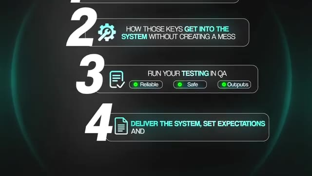
*⏱️ 00:21:09 — Un graphique textuel affichant les étapes clés du processus d'automatisation IA, notamment le test en QA et la livraison du système.*

---

### ⏱️ `[00:21:34 - 00:21:49]` | Segment #59

**🔊 Audio (Transcription Intégrale Mot pour Mot en Français) :**
> là-dedans qui bâtissent des entreprises avec NNN chaque jour. C'est donc un excellent environnement pour vous entourer de personnes partageant les mêmes idées. C'est donc tout pour cette fois. Si vous avez appris quelque chose de nouveau, veuillez mettre un pouce bleu et vous abonner. Ça m'aide vraiment énormément. Et dites-moi dans les commentaires ce que vous voulez voir d'autre. Comme toujours, je vous remercie d'être arrivés jusqu'à la fin de la vidéo. Je vous vois dans la prochaine. Merci à tous.

**👁️ Analyse Visuelle d'Écran (gemini-3.5-flash-lite) :**
**Interface & Outils** : AUCUNE

**Contenu textuel & Code** : AUCUNE

**Action / Démonstration** : AUCUNE

---

