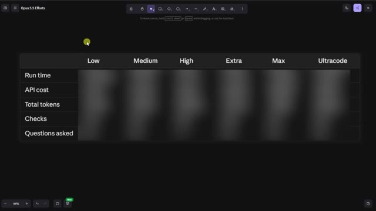
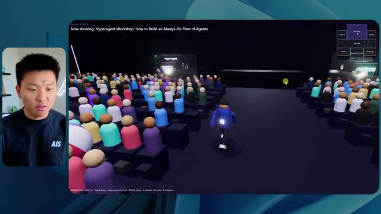
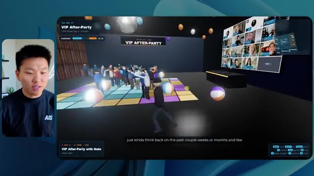
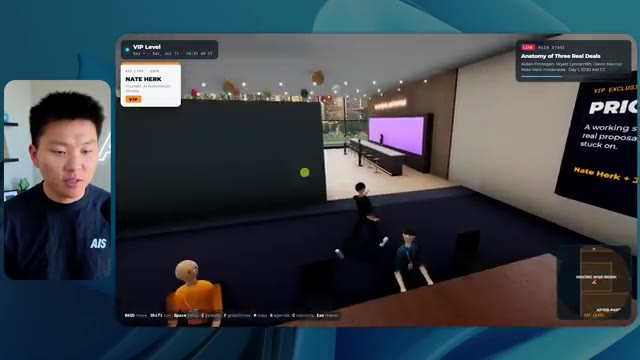
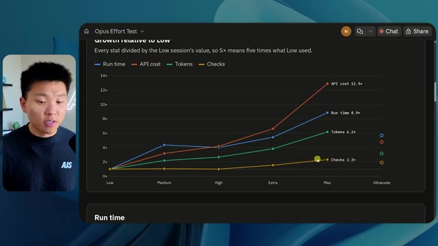
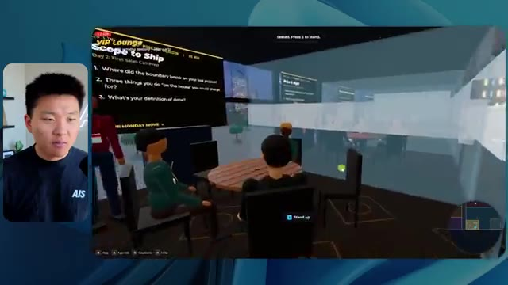

# 🎬 AI Agents Just Became Multiplayer. Here's How to Build Them.

> **Chaîne** : [Nate Herk | AI Automation](https://www.youtube.com/@nateherk/featured)  
> **Lien YouTube** : [https://www.youtube.com/watch?v=saxdE-U_YS8](https://www.youtube.com/watch?v=saxdE-U_YS8)  
> **Date de publication** : 20260101  
> **Durée** : 00:00:00  
> **Identifiant vidéo** : `saxdE-U_YS8`  
> **Transcription & Analyse** : `whisper-v3-large-turbo+gemini-3.5-flash-lite`  

---

## 📌 Synthèse Exécutive & Outils

### 💡 Résumé

La vidéo de la chaîne Nate Herk | AI Automation explore l'impact des différents niveaux d'effort (« effort levels ») du modèle d'IA Anthropic Opus 5.5 sur la génération de code et la création d'applications complexes. Le test consiste à soumettre un prompt unique et exigeant à l'agent IA : concevoir un monde virtuel 3D multijoueur et explorable, simulant une conférence tech réaliste à partir de 105 gigaoctets d'enregistrements vidéo bruts issus d'un événement virtuel (AIS Live), intégrés au système d'exploitation IA personnel de l'auteur (projet Herc 2). 

L'expérimentation compare l'exécution du prompt à travers plusieurs paliers progressifs (du mode bas jusqu'aux modes avancés). Les résultats mettent en évidence des écarts spectaculaires en termes de qualité visuelle, de fidélité à la marque, de gestion de la physique, de réactivité des PNJ (personnages non-joueurs) et de performances globales. Alors que le niveau bas produit un rendu instable, peu personnalisé et truffé de bugs visuels (éléments fantômes et images statiques), le niveau moyen franchit un cap qualitatif majeur en intégrant la charte graphique de la marque, des flux vidéo en direct fonctionnels, des PNJ interactifs et une navigation fluide entre les différentes zones (hall d'exposition, salon VIP, scène principale).

L'analyse minutieuse des métriques d'exécution (temps de calcul, coûts API estimés, volume de tokens, nombre de vérifications autonomes dans le navigateur et sollicitations de l'utilisateur) démontre que l'ajustement du niveau d'effort ne modifie pas seulement la complexité du code généré, mais transforme radicalement l'autonomie et la profondeur architecturale de l'agent. Cette démonstration illustre concrètement l'évolution des agents IA vers des environnements immersifs et interactifs, tout en soulignant la nécessité de combler le fossé entre le prototypage local et le déploiement en production.

### 🛠️ Outils, Modèles & Logiciels Présentés

* **Opus 5.5** : Modèle d'intelligence artificielle avancé développé par Anthropic, salué pour son intelligence, son coût abordable et ses performances de pointe en génération de code et d'agents.
* **Claude Code** : Environnement de développement et outil de programmation assisté par IA utilisé pour orchestrer la création d'applications et de mondes virtuels complexes.
* **Frame.io** : Plateforme de collaboration et de stockage cloud utilisée pour héberger et analyser le dossier de 105 Go d'enregistrements vidéo de l'événement AIS Live.
* **key.ai** : Outil de génération d'images et de vidéos par IA mobilisé par l'agent pour créer des éléments graphiques contextuels au sein du monde 3D.
* **Projet Herc 2** : Système d'exploitation IA personnalisé de l'auteur servant de base de données et d'infrastructure pour alimenter l'agent en scripts et ressources.
* **Hostinger** : Solution d'hébergement web et sponsor de la vidéo, proposant une extension gratuite pour éditeur de code afin de faciliter le déploiement en ligne des projets générés.

### 🔑 Points Clés & Enseignements Stratégiques

* **Impact direct du niveau d'effort sur la qualité architecturale** : Ajuster le paramètre d'effort d'Opus 5.5 modifie profondément la robustesse du code, transformant un prototype grossier et instable en une application 3D riche, structurée et fonctionnelle.
* **Autonomie totale des agents** : Quel que soit le niveau d'effort testé (bas ou moyen), l'agent a exécuté l'intégralité du prompt sans poser la moindre question de clarification, démontrant une excellente autonomie de compréhension contextuelle.
* **Évolution de la complexité temporelle et financière** : Le passage du niveau bas au niveau moyen s'accompagne d'une augmentation significative des ressources de calcul (le temps d'exécution passe de 16 minutes à 1 heure 13, et le coût API estimé passe de 3,91 $ à 12,44 $ pour 490 000 tokens).
* **Validation visuelle autonome** : L'agent utilise sa capacité à ouvrir de manière autonome un navigateur (effectuant 22 à 23 vérifications distinctes) pour auto-auditer son travail et s'assurer du bon rendu graphique en cours de développement.
* **Fidélité contextuelle et respect de la marque** : Les modes supérieurs exploitent efficacement les directives de design et les palettes de couleurs de la marque (AIS Live), contrairement au mode bas qui génère une identité générique et non personnalisée.
* **Immersion et interactivité dynamique** : Les agents les plus performants intègrent une physique de déplacement, des PNJ dotés de comportements réactifs (mouvements de bras, interactions) et des flux vidéo dynamiques plutôt que de simples images statiques.
* **Gestion des volumétries massives** : L'agent démontre une capacité remarquable à ingérer et trier intelligemment des métadonnées issues d'un répertoire massif de 105 Go pour recréer fidèlement le programme chronologique d'un événement sur deux jours.
* **La recommandation officielle d'Anthropic** : Pour les tâches de génération d'agents complexes, il est recommandé de débuter au niveau d'effort moyen, puis d'ajuster le curseur à la hausse ou à la baisse en fonction des besoins spécifiques de performance et de budget.
* **Le goulet d'étranglement du déploiement** : La création automatisée d'applications complexes par IA génère rapidement des prototypes finis en local, créant un besoin critique d'outils de publication rapide (tels que les connecteurs d'hébergement intégrés) pour passer de la machine de l'développeur au web.

---

## ⏱️ Chronologie & Transcription Complète Audio & Visuelle (Mot pour Mot)

### ⏱️ `[00:00:00 - 00:00:20]` | Segment #01

**🔊 Audio (Transcription Intégrale Mot pour Mot en Français) :**
> Opus 5.5, Opus 5.5, Opus 5.5, Opus 5.5, Opus 5.5. Ce modèle est littéralement partout et pour de très bonnes raisons. Il est intelligent, il est bon marché, il a un goût extraordinaire, c'est un modèle d'IA incroyable. Mais avec chaque modèle d'IA, vous avez le choix de l'effort, que ce soit faible, moyen, élevé, extra, max ou code ultra.

**👁️ Analyse Visuelle d'Écran (gemini-3.5-flash-lite) :**
**Interface & Outils** : Interface du réseau social X (Twitter) avec un post contenant une vidéo intégrée.

**Contenu textuel & Code** : Publication sur X avec texte sur l'expérimentation de l'IA et une capture vidéo montrant un environnement 3D tropical.

**Action / Démonstration** : Affichage à l'écran d'une publication externe pour illustrer les capacités et l'impact des modèles d'IA récents.

*⏱️ 00:00:05 — Capture d'écran d'un tweet sur X (anciennement Twitter) montrant une vidéo de paysage tropical généré par IA et un commentaire sur l'impact de l'IA sur les créatifs.*

---

### ⏱️ `[00:00:20 - 00:00:38]` | Segment #02

**🔊 Audio (Transcription Intégrale Mot pour Mot en Français) :**
> Donc, dans cette vidéo, j'ai donné exactement le même prompt à Opus 5.5 et je l'ai exécuté sur chaque niveau d'effort, et nous allons comparer les résultats. Nous examinerons la qualité de tous les différents résultats réels, mais nous examinerons également combien de temps chacun d'eux a pris pour s'exécuter, combien cela nous a coûté si c'était une facturation par API, le nombre total de tokens, combien de vérifications ils ont exécutées, et combien de questions ils m'ont réellement posées tout au long du processus.

**👁️ Analyse Visuelle d'Écran (gemini-3.5-flash-lite) :**
**Interface & Outils** : Application web de tableau comparatif.

**Contenu textuel & Code** : Tableau avec en-têtes de niveaux d'effort (Low, Medium, High, Extra, Max, Ultracode) et lignes de métriques (Run time, API cost, Total tokens, Checks, Questions asked).

**Action / Démonstration** : Présentation du tableau comparatif des différents niveaux d'effort d'Opus 5.5.

*⏱️ 00:00:29 — Tableau comparatif sombre intitulé 'Opus 5.5 Efforts' montrant les niveaux Low, Medium, High, Extra, Max et Ultracode avec des métriques floutées (Run time, API cost, etc.).*

---

### ⏱️ `[00:00:39 - 00:00:58]` | Segment #03

**🔊 Audio (Transcription Intégrale Mot pour Mot en Français) :**
> Et les résultats que nous avons obtenus ne sont pas du tout ce à quoi je m'attends, donc j'ai hâte de partager cela avec vous les gars. Ne perdons pas de temps et allons directement à celui-ci. D'accord, alors plongeons directement dans celui-ci. Je veux commencer simplement en vous montrant le prompt réel que nous avons utilisé, que nous avons donné à chacun de ces différents agents. Je vais aller dans les fichiers ici, et nous allons ouvrir ce fichier markdown de prompt, et je vais vous montrer ce que nous avons obtenu. Voici donc le slash objectif que j'ai fourni.

**👁️ Analyse Visuelle d'Écran (gemini-3.5-flash-lite) :**
**Interface & Outils** : Interface de l'éditeur de code / assistant IA avec panneau latéral de gestion de projets et zone de chat.

**Contenu textuel & Code** : Message de l'assistant IA demandant confirmation pour démarrer la tâche : « Hi Nate. This worktree has the effort-test task queued in PROMPT.md : build a walkable third-person 3D world... »

**Action / Démonstration** : Présentation de l'interface de développement et lecture du prompt initial par le présentateur.

*⏱️ 00:00:48 — Interface d'un assistant de code IA (type Cursor ou éditeur avancé) avec une incrustation vidéo du présentateur sur le côté gauche.*

---

### ⏱️ `[00:00:58 - 00:01:34]` | Segment #04

**🔊 Audio (Transcription Intégrale Mot pour Mot en Français) :**
> J'ai dit, tu dois me créer un monde en 3D qui est une conférence tech réaliste dans laquelle je peux me promener en vue à la troisième personne. Tu vas regarder ce dossier, qui contient mes éléments d'enregistrement d'événements provenant d'AIS Live. Et ce dossier est un dossier Frame.io de 105 gigaoctets d'enregistrements vidéo. C'était un événement entièrement virtuel. Tout a été enregistré et tous les enregistrements sont juste ici. J'ai dit, ton objectif est de prendre cet événement et de le transformer en un monde 3D explorable qui me donne l'impression d'être réellement allé à une vraie conférence en personne avec différentes salles, différentes pistes, différentes scènes, bla, bla, bla. N'hésite pas à utiliser key.ai si tu as besoin de générer des images ou des vidéos. Et tu peux aussi utiliser n'importe quoi d'autre à l'intérieur de mon projet Herc 2, qui est comme mon système d'exploitation IA. J'ai dit,

**👁️ Analyse Visuelle d'Écran (gemini-3.5-flash-lite) :**
**Interface & Outils** : Éditeur de code (type VS Code) et interface de stockage cloud (Frame.io)

**Contenu textuel & Code** : Fichier Markdown contenant le prompt détaillant la création d'une conférence tech 3D à partir d'enregistrements virtuels de 105 Go.

**Action / Démonstration** : Présentation du prompt de configuration et des fichiers sources sur Frame.io pour alimenter l'agent de génération 3D.

*⏱️ 00:01:07 — Un éditeur de texte affichant un fichier PROMPT.md avec les instructions de création d'un monde 3D interactif et le lien Frame.io.*

*⏱️ 00:01:16 — Une interface web Frame.io montrant un dossier d'enregistrements d'événements AIS Live d'une taille totale de 105,69 Go.*

*⏱️ 00:01:25 — Vue rapprochée de l'éditeur affichant le prompt complet détaillant les exigences de design et de physique pour le monde 3D.*

---

### ⏱️ `[00:01:34 - 00:02:08]` | Segment #05

**🔊 Audio (Transcription Intégrale Mot pour Mot en Français) :**
> vous serez jugé sur la créativité, le design, la physique et la sensation générale lorsque j'explorerai le monde 3D que vous avez construit. Et c'était fondamentalement la fin des instructions. Donc, comme vous pouvez le voir sur ce côté gauche, j'ai exécuté ceci à travers tous les différents niveaux d'effort. Commençons par le niveau bas et remontons jusqu'à ultra code. Très bien. Donc ici, nous avons le résultat du niveau bas. Ouvrons ceci et jetons un œil. Nous avons donc AIS Live, le sommet des services IA enfin en personne, et nous avons pu cliquer partout. Tout d'abord, cela ne fait pas très personnalisé. Genre, ce n'est pas le logo d'IS Live. Ce n'est même pas nos couleurs. Donc je n'aimes pas trop ça, mais entrons ici. D'accord. C'est beaucoup trop lumineux. Euh, nous avons une carte en haut à droite, nous avons une ville ici en arrière-plan, je ne peux pas dire quelle ville c'est

**👁️ Analyse Visuelle d'Écran (gemini-3.5-flash-lite) :**
**Interface & Outils** : Interface web d'un assistant de code ou d'agent IA avec panneau de navigation latéral.

**Contenu textuel & Code** : Texte du prompt demandant de construire un monde 3D en vue à la troisième personne pour la conférence AIS Live, avec des salles, des pistes et des scènes distinctes.

**Action / Démonstration** : Le présentateur navigue à travers les différents niveaux de test d'effort affichés dans la barre latérale gauche.

*⏱️ 00:01:42 — Interface d'une application d'assistant IA avec le présentateur incrusté à gauche, montrant un panneau latéral avec différents niveaux de test d'effort et une zone de discussion principale.*

---

### ⏱️ `[00:02:08 - 00:02:40]` | Segment #06

**🔊 Audio (Transcription Intégrale Mot pour Mot en Français) :**
> C'est. D'accord. C'est Chicago, ce qui est plutôt cool parce que vous savez, je vis à Chicago, mais bref, en haut à droite, nous pouvons voir une carte. Nous avons un hall d'accueil. Nous avons un hall d'exposition. Nous avons le salon VIP, la scène principale. De plus, la carte montre où se trouve chaque autre personne et cela se synchronise en direct. Nous pouvons donc voir l'enregistrement. Nous pouvons voir le premier jour, la keynote de l'hyper agent, le débriefing en direct. Cool. Donc ça connaît réellement le programme et puis il y a le deuxième jour. Donc il a trouvé ça, c'est bien. Nous avons ces petites boules ici que je peux espérer botter. D'accord. Le visage, oh, regardez ça. Si je vais par ici, toutes les personnes disparaissent tout simplement. Très mauvais. Très mauvais. D'accord. Alors voyons voir. Est-ce que je peux sprinter ? D'accord.

**👁️ Analyse Visuelle d'Écran (gemini-3.5-flash-lite) :**
**Interface & Outils** : Application ou plateforme virtuelle 3D (espace événementiel en ligne)

**Contenu textuel & Code** : Carte de navigation, noms des différentes zones (Lobby, Expo Hall, Main Stage, VIP Lounge), programme de la conférence "DAY 1"

**Action / Démonstration** : Navigation et exploration des différents espaces virtuels de la conférence par le présentateur

*⏱️ 00:02:16 — Vue dans un espace virtuel 3D montrant un avatar près d'une zone de retrait des badges avec une mini-carte en haut à droite.*

*⏱️ 00:02:24 — Vue du hall d'accueil virtuel affichant le programme du premier jour sur un panneau interactif.*

*⏱️ 00:02:32 — Vue de l'Expo Hall virtuel avec des avatars et une installation lumineuse centrale, illustrant les espaces de la conférence.*

---

### ⏱️ `[00:02:40 - 00:03:04]` | Segment #07

**🔊 Audio (Transcription Intégrale Mot pour Mot en Français) :**
> Je peux avancer un peu plus vite. Je vais d'abord aller par ici. Il y a des produits promotionnels, euh, certifiés AIS plus glido. D'accord. Donc il y a les vrais stands qu'on avait lors de l'événement virtuel. On avait des stands. Donc c'est plutôt cool. Un petit endroit pour prendre des photos. Salle C. En ce moment, nous avons Tangy Frederick qui anime un atelier. D'accord. Mais ce n'est pas une vidéo. Comme vous pouvez le voir, c'est juste une image. Elle ne bouge pas. C'est donc juste une image. Ces gens sont en train de disparaître. Ce doivent être des fantômes. Allons par ici dans la salle A.

**👁️ Analyse Visuelle d'Écran (gemini-3.5-flash-lite) :**
**Interface & Outils** : Environnement virtuel 3D interactif (jeu ou métavers d'événement en ligne).

**Contenu textuel & Code** : Textes explicatifs d'API et tutoriels affichés sur des écrans virtuels dans le métavers.

**Action / Démonstration** : Navigation et exploration de l'espace virtuel par le présentateur contrôlant son avatar.

---

### ⏱️ `[00:03:04 - 00:03:30]` | Segment #08

**🔊 Audio (Transcription Intégrale Mot pour Mot en Français) :**
> Nous avons Liberty White. D'accord. Très cool. Vos 30 premiers jours en automatisation. Encore une fois, ce n'est qu'une image fixe et les gens ont des bugs. Donc ce n'est pas très bon ici. Je vais aller sur la scène principale et voir ce que nous avons. D'accord, cool. Nous avons donc une scène qui a l'air principale. Les gens ont des bugs. Vraiment grave. Ce n'est vraiment pas bon du tout. Notre vidéo est en train de bouger. Genre, j'ai vu mon visage ici et j'ai vu celui de Devin, mais maintenant ils ont disparu. Donc je ne sais pas ce qui s'est passé. D'accord. On dirait que c'est plutôt un diaporama. Rien n'est vraiment diffusé pour l'instant. Quoi qu'il en soit, entrons ici.

**👁️ Analyse Visuelle d'Écran (gemini-3.5-flash-lite) :**
**Interface & Outils** : Environnement virtuel 3D interactif (similaire à une plateforme de conférence virtuelle ou métavers).

**Contenu textuel & Code** : Textes d'indication de salle, écrans de présentation de l'événement AI Services Summit et avatar utilisateur.

**Action / Démonstration** : Navigation et déplacement de l'avatar dans l'espace virtuel pour explorer différentes salles et scènes.

*⏱️ 00:03:11 — Vue d'une salle virtuelle (Workshop Room A - Foundation track) avec un avatar naviguant dans un espace 3D interactif.*

*⏱️ 00:03:17 — Vue de la scène principale (Main Stage) de l'événement virtuel montrant un amphithéâtre rempli d'avatars virtuels.*

*⏱️ 00:03:24 — Vue face à l'écran géant affichant "AIS LIVE AI Services Summit" dans l'environnement virtuel 3D.*

---

### ⏱️ `[00:03:30 - 00:03:58]` | Segment #09

**🔊 Audio (Transcription Intégrale Mot pour Mot en Français) :**
> Nous avons d'autres stands. Nous avons hyper agent. Nous avons Claude Code. Nous avons plus de cadeaux publicitaires. La salle B, c'est Dave Ebelor. Je suppose que c'est exactement la même chose. Nous avons du café. Et puis, je suppose que le salon VIP, c'est accès VIP uniquement. C'est plutôt cool, mais il n'y a vraiment rien qui se passe ici. Cet écran est bien trop lumineux. D'accord. Donc, je pense que vous comprenez l'ambiance qu'on obtient ici avec Opus 5.5 en effort faible. Et c'est là que les choses deviennent intéressantes. Combien de temps pensez-vous que cela a duré ? Combien de temps ? Celui-ci a duré 16 minutes et 43 secondes. Combien pensez-vous que cela a coûté ?

**👁️ Analyse Visuelle d'Écran (gemini-3.5-flash-lite) :**
**Interface & Outils** : Interface de tableau blanc ou canevas interactif (Opus 5.5 Efforts).

**Contenu textuel & Code** : Tableau avec des colonnes de niveau d'effort (Low, Medium, High, Extra, Max, Ultracode) et des lignes de métriques (Run time, API cost, Total tokens, Checks, Questions asked).

**Action / Démonstration** : Présentation des différents niveaux d'effort et de leurs coûts/performances associés.

*⏱️ 00:03:51 — Tableau comparatif des niveaux d'effort (Low, Medium, High, Extra, Max, Ultracode) avec métriques de performance.*

---

### ⏱️ `[00:03:58 - 00:04:26]` | Segment #10

**🔊 Audio (Transcription Intégrale Mot pour Mot en Français) :**
> 3,91 dollars si c'était une facturation par API. J'utilise évidemment mon abonnement ici, mais nous allons juste calculer cela en facturation par API. Le total des jetons était de 191 000. Il a effectué 22 vérifications. Donc la vérification, 22 fois il a ouvert le navigateur et a exécuté différentes sortes de vérifications. Donc 22 catégories de vérifications. Et combien de questions m'a-t-il posées ? Il m'a posé un total de zéro question tout au long de cette invite de commande d'objectif. D'accord. Alors, ouvrons l'effort moyen et voyons ce que nous avons. D'accord, c'est parti. Effort moyen. Nous avons Nate Herc. Nous avons mon badge. C'est aux couleurs de la marque AI's Life.

**👁️ Analyse Visuelle d'Écran (gemini-3.5-flash-lite) :**
**Interface & Outils** : Tableau blanc ou application de notes visuelles (type Miro ou Excalidraw) avec un tableau de données.

**Contenu textuel & Code** : Tableau avec des lignes : Run time (16m 43s), API cost ($3.91), Total tokens (191.3K), Checks, Questions asked. Colonnes : Low, Medium, High, Ex.

**Action / Démonstration** : Le présentateur explique les coûts d'API et l'utilisation des jetons affichés dans le tableau.

*⏱️ 00:04:05 — Un tableau comparatif montrant les métriques de performance et de coût pour différents niveaux d'effort, avec le présentateur visible dans un encadré à gauche.*

---

### ⏱️ `[00:04:26 - 00:04:46]` | Segment #11

**🔊 Audio (Transcription Intégrale Mot pour Mot en Français) :**
> Alors, ça commence déjà à avoir l'air un peu mieux. On dirait nos palettes de couleurs qui ont utilisé nos directives de marque. Premier jour de construction, deuxième jour de gain, VIP. Cool. D'accord. Je vais entrer dans le lieu. D'accord. Waouh. Donc, une ambiance un peu similaire. C'est en arrière-plan. Ça ne ressemble pas à Chicago, n'est-ce pas ? Non, ça ressemble à un, honnêtement, ça ressemble à une ville inventée. Quoi qu'il en soit, c'est drôle qu'ils aient décidé de faire ça. Voyons si je peux me déplacer un peu plus vite. Oh, waouh.

**👁️ Analyse Visuelle d'Écran (gemini-3.5-flash-lite) :**
**Interface & Outils** : Application web interactive en 3D / Interface utilisateur d'un espace virtuel événementiel.

**Contenu textuel & Code** : Texte d'accueil 'Welcome to AIS Live', commandes clavier affichées (WASD, Shift, Espace, etc.), et badge avec les options Day 1 Build, Day 2 Earn, VIP.

**Action / Démonstration** : Le présentateur clique sur 'ENTER THE VENUE' pour entrer dans l'environnement virtuel 3D.

*⏱️ 00:04:31 — Écran de bienvenue de l'application 'AIS Live' avec un badge nominatif virtuel pour 'Nate Herk' et un bouton pour entrer dans le lieu virtuel.*

*⏱️ 00:04:41 — Vue à la première ou troisième personne à l'intérieur du monde virtuel 3D montrant des avatars et une vue sur une ville la nuit à travers de grandes baies vitrées.*

---

### ⏱️ `[00:04:46 - 00:05:21]` | Segment #12

**🔊 Audio (Transcription Intégrale Mot pour Mot en Français) :**
> Les gens interagissent avec moi. Regardez. Si je m'approche de ce type, il vient de lever le bras. Bon, maintenant il ne veut plus du tout avoir affaire à moi. Mais tous ces petits robots ici doivent prendre des décisions. Je ne sais pas s'ils utilisent Jev. C'est sûr que non. Je ne le lui ai pas dit. En fait, ma clé Jev est à l'arrière. Je ne sais pas. Peut-être qu'il l'a utilisée. Quoi qu'il en soit, nous pouvons voir ici que nous avons la salle d'atelier C, le laboratoire des agents. Sympa. Donc celui-ci est réellement en train de tourner. Vous pouvez voir qu'il s'agit d'une vraie vidéo diffusée par Tangy. Tout le monde ici est en train de travailler sur un ordinateur portable. Ils ne buguent pas. C'est plutôt cool. De plus, mon badge est sur ma poitrine, ce qui est plutôt cool. Je peux venir par ici. Nous avons une carte en haut à droite, comme vous pouvez le voir, mais je peux venir par ici. Nous avons un

**👁️ Analyse Visuelle d'Écran (gemini-3.5-flash-lite) :**
**Interface & Outils** : Application de monde virtuel / simulation 3D en ligne.

**Contenu textuel & Code** : Environnement virtuel 3D multi-utilisateurs ou de simulation d'agents avec interface HUD et mini-carte.

**Action / Démonstration** : Navigation et exploration du monde virtuel en 3D par l'avatar du présentateur.

---

### ⏱️ `[00:05:21 - 00:05:47]` | Segment #13

**🔊 Audio (Transcription Intégrale Mot pour Mot en Français) :**
> hall d'exposition. C'est là que nous avons le stand Glido. Et ça diffuse en ce moment. Oui, ça diffuse la vidéo de nous parlant de Glido. Ça diffuse la vidéo d'Ed et moi parlant de notre programme de certification. Nous avons le logo AIS Plus juste ici, qui est un peu mal placé. Ce sont les diapositives des conférenciers et les points clés. Alors wow, ce sont toutes les ressources que nous avons distribuées après l'événement. Elles sont toutes là aussi. Nous pouvons voir que nous avons un coup de projecteur sur la communauté. C'est donc Aiden qui parle de son contrat qu'il a décroché et c'est diffusé en direct. Ces gens regardent.

**👁️ Analyse Visuelle d'Écran (gemini-3.5-flash-lite) :**
**Interface & Outils** : Environnement virtuel 3D de type salon d'exposition (plateforme de métavers ou événement virtuel).

**Contenu textuel & Code** : Affiches, diapositives de présentation et panneaux d'information virtuels.

**Action / Démonstration** : Navigation et visite guidée de l'espace d'exposition virtuel par le présentateur.

---

### ⏱️ `[00:05:47 - 00:06:21]` | Segment #14

**🔊 Audio (Transcription Intégrale Mot pour Mot en Français) :**
> Ils sont plutôt engagés. On a un hyper agent. C'était, c'est ce que je voulais dire. Si vous avez vu ces gens lever les bras en disant salut, c'était plutôt marrant. Regardez, regardez, le voilà qui recommence. Bref. Bon. Où est-ce que je suis maintenant ? Maintenant je suis dans le hall principal. On a un bar à café. On a un grand logo, qui est le vrai logo. C'est trop lumineux, mais on a le logo. On peut voir si on peut entrer ici dans le parcours des fondations. On a Sabrina Romanov et Liberty White. Donc différentes formations juste là. On peut entrer dans cette salle. C'est le parcours avancé. Alors qu'est-ce qui se passe ici. On a Dave Ebelar et Saman qui parlent de différentes choses là-dedans. Et maintenant allons jeter un œil à la scène principale. Oh, attendez, il y a une vidéo de moi là-haut. C'est genre un VIP

**👁️ Analyse Visuelle d'Écran (gemini-3.5-flash-lite) :**
**Interface & Outils** : Application virtuelle 3D / Metavers de conférence en ligne

**Contenu textuel & Code** : Environnement virtuel 3D avec interface de navigation et mini-carte

**Action / Démonstration** : Exploration de l'espace virtuel et déplacement des avatars dans le hall et les salles

*⏱️ 00:05:55 — Vue dans le hall principal d'une application virtuelle interactive avec des avatars en 3D.*

*⏱️ 00:06:04 — Navigation vers une salle de conférence virtuelle au sein de l'environnement 3D.*

*⏱️ 00:06:12 — Vue d'ensemble montrant plusieurs avatars interactifs regroupés dans l'espace virtuel.*

---

### ⏱️ `[00:06:21 - 00:06:50]` | Segment #15

**🔊 Audio (Transcription Intégrale Mot pour Mot en Français) :**
> section ? Ouais, on ira voir ça dans une minute. Mais bref, voici la scène principale. Ça a l'air très, très bien. On a une grande scène. On a genre quatre personnes assises ici. On a les trois écrans d'Alex là-haut avec Hyper Agent. Est-ce que j'ai le droit de monter sur scène ? Oh, et me laisse monter sur scène. D'accord. C'est plutôt sympa. Bon les gars, prenons un selfie. Laissez-moi prendre tout le monde en arrière-plan. Venez par ici. Bref, c'est vraiment, vraiment cool. Par contre, toutes les places ne sont pas occupées. Donc il faut qu'on travaille là-dessus. Mais bref, je vais y retourner en courant pour voir ce que c'était que cette section VIP. D'accord. Le salon VIP. J'ai l'impression que c'est comme un aéroport ou un truc comme ça.

**👁️ Analyse Visuelle d'Écran (gemini-3.5-flash-lite) :**
**Interface & Outils** : Application de conférence virtuelle (Hyper Agent)

**Contenu textuel & Code** : Interface utilisateur affichant les détails de la keynote (Hyperagent Keynote - Alex McDonnell) et les options de navigation

**Action / Démonstration** : Navigation et exploration de l'espace virtuel de conférence par le présentateur

---

### ⏱️ `[00:06:51 - 00:07:14]` | Segment #16

**🔊 Audio (Transcription Intégrale Mot pour Mot en Français) :**
> D'accord, super. Donc maintenant nous avons les sessions VIP ici. Une session VIP de questions-réponses avec Nate, une lecture vidéo en direct juste ici. Très, très cool. Et nous avons comme un bar ou quelque chose comme ça. Génial. Je dirais que c'est un très bon résultat. Maintenant, en ce qui concerne les statistiques ici, celle-ci a pris une heure et 13 minutes à s'exécuter. Cela nous aurait coûté 12 dollars et 44 cents. Elle a utilisé 490 000 jetons et elle a effectué 23 vérifications.

**👁️ Analyse Visuelle d'Écran (gemini-3.5-flash-lite) :**
**Interface & Outils** : Espace virtuel 3D interactif et tableau de bord d'analyse de données (Opus 5.5 Efforts).

**Contenu textuel & Code** : Affichage d'une session VIP en direct avec un écran géant et métriques d'exécution d'API (Run time: 16m 43s, API cost: $3.91, Total tokens: 191.3K).

**Action / Démonstration** : Navigation et présentation d'une plateforme virtuelle interactive et de statistiques de coût d'API.

*⏱️ 00:06:56 — Capture montrant un espace virtuel en 3D avec un écran géant affichant une session vidéo en direct et un bar en arrière-plan.*

*⏱️ 00:07:02 — Capture montrant un tableau de bord ou une interface de suivi de performance avec des métriques telles que 'Run time', 'API cost' et 'Total tokens'.*

---

### ⏱️ `[00:07:14 - 00:07:48]` | Segment #17

**🔊 Audio (Transcription Intégrale Mot pour Mot en Français) :**
> Et il nous a posé un total de zéro question une fois de plus. Très bien, passons au niveau élevé. C'était déjà un résultat plutôt correct et Anthropic eux-mêmes dans leur vidéo de comment prompter Opus 5.5, ou désolé, pas une vidéo, un article. Ils ont dit de commencer simplement par le niveau moyen et de l'ajuster à la hausse ou à la baisse si nécessaire. C'était donc un résultat moyen. Passons au niveau élevé et voyons ce que nous avons obtenu. Très rapidement, les gars, je dois prendre un moment pour vous parler du sponsor de la vidéo d'aujourd'hui, Hostinger. Donc ces deux modèles viennent de me créer une version fonctionnelle de la même chose. Et maintenant, je me retrouve exactement là où je finis toujours, avec un projet terminé sur mon ordinateur portable et aucun moyen rapide de le mettre en ligne. Et c'est précisément le fossé que comble le connecteur d'Hostinger. C'est une extension gratuite.

**👁️ Analyse Visuelle d'Écran (gemini-3.5-flash-lite) :**
**Interface & Outils** : Tableau comparatif type tableau blanc/note (Image 1) et éditeur de code ou interface de développement d'agent IA avec panneau partagé (Image 2).

**Contenu textuel & Code** : Métriques de performance (temps d'exécution, coût API, nombre de tokens) pour les niveaux "Low" et "Medium" (Image 1) ; instructions de prompt pour un calculateur ROI et logs d'exécution (Image 2).

**Action / Démonstration** : Analyse comparative des coûts et des performances d'exécution des différents niveaux d'effort de l'IA.

*⏱️ 00:07:22 — Un tableau comparatif des performances de l'IA (Run time, API cost, Total tokens, Checks, Questions asked) selon différents niveaux d'effort (Low, Medium, High, Extra), avec le présentateur incrusté à gauche.*

*⏱️ 00:07:39 — Une interface de développement avec deux panneaux divisés affichant des logs d'exécution, des étapes de réflexion de l'IA et un panneau de chat montrant le prompt pour créer un calculateur ROI Northwind.*

---

### ⏱️ `[00:07:48 - 00:08:23]` | Segment #18

**🔊 Audio (Transcription Intégrale Mot pour Mot en Français) :**
> pour votre éditeur qui intègre votre compte Hostinger dans l'outil de programmation que vous utilisez déjà. Que ce soit VS Code, Cursor, Cloud Code, Codex, et j'en passe. Vous vous connectez une seule fois en un clic, et à partir de là, votre agent peut déployer le site, y associer un domaine, configurer les enregistrements DNS, et vérifier votre VPS sans jamais avoir à quitter l'éditeur. Ainsi, quel que soit celui que vous finissez par préférer, ce qu'il a construit n'est qu'à quelques minutes d'une vraie URL sur un hébergement géré. L'extension Connector est gratuite avec chaque forfait d'hébergement, donc si vous avez toujours besoin de l'hébergement sous-jacent, profitez du forfait illimité avec le lien dans la description et utilisez le code NATEHERK pour 10 % de réduction. Cela inclut également un domaine gratuit et un e-mail professionnel pour l'année. Et c'est toujours le moyen le moins cher que j'ai trouvé pour obtenir quelque chose

**👁️ Analyse Visuelle d'Écran (gemini-3.5-flash-lite) :**
**Interface & Outils** : Interface web Hostinger, Claude Code, IDE

**Contenu textuel & Code** : "Manage Hostinger from your IDE", statut "Connected VIA OAUTH", Node.js 24.13.0, liste des outils avec cases à cocher ("Websites", "Domains", "Subscriptions & Payments", "Email Marketing")

**Action / Démonstration** : Connexion unique du compte Hostinger dans l'IDE pour permettre à l'agent de gérer les sites et domaines.

*⏱️ 00:07:57 — Interface montrant l'intégration de Hostinger dans l'IDE avec le statut connecté via OAuth et la liste des outils disponibles (Websites, Domains, Subscriptions, Email Marketing), ainsi qu'une fenêtre Claude Code à droite et le présentateur en médaillon.*

---

### ⏱️ `[00:08:23 - 00:08:47]` | Segment #19

**🔊 Audio (Transcription Intégrale Mot pour Mot en Français) :**
> vous avez construit sur une vraie URL. Donc revenons à la vidéo. D'accord. Encore une fois, très, très marqué par la marque. C'est un écran de chargement encore meilleur que le précédent. Nous avons ce petit effet sympa en arrière-plan. Nous avons le logo. Nous allons entrer dans le lieu. D'accord. Nous y voilà. Ça a l'air plutôt bien. Nous commençons à l'extérieur et vous pouvez voir que nous avons ces drapeaux pour tous les intervenants, Wyatt, Casper, Alex, Ed, Aiden, Sabrina, Liberty. C'est plutôt cool. Nous avons des blocs en direct ici.

**👁️ Analyse Visuelle d'Écran (gemini-3.5-flash-lite) :**
**Interface & Outils** : Application web 3D interactive (environnement virtuel d'événement).

**Contenu textuel & Code** : Interface utilisateur avec mini-carte, indicateur de passeport, instructions de déplacement (WASD, espace, etc.) et bannières informatives.

**Action / Démonstration** : Navigation et exploration de l'environnement virtuel 3D par l'utilisateur (entrée dans le lieu).

*⏱️ 00:08:29 — Écran de chargement et d'accueil de la plateforme virtuelle 'AIS LIVE', affichant le logo, les dates de l'événement et les instructions de contrôle clavier.*

*⏱️ 00:08:35 — Vue dans l'espace virtuel 3D de 'AIS Live Plaza', montrant un avatar de joueur au milieu d'une place publique avec des bâtiments et des arbres en arrière-plan.*

*⏱️ 00:08:41 — Continuation de la navigation dans la place virtuelle 3D, montrant des bannières verticales avec des noms de conférenciers et un petit robot sphérique au sol.*

---

### ⏱️ `[00:08:47 - 00:09:23]` | Segment #20

**🔊 Audio (Transcription Intégrale Mot pour Mot en Français) :**
> Il a pris cette photo de moi, votre hôte, Nate Herc, John, Dave, Nate Herc. Voilà. OK. Les portes. Génial. Ce sont des portes coulissantes automatiques en verre. J'adore ça. Nous pouvons voir l'enregistrement VIP. Nous pouvons voir l'admission générale. Nous pouvons venir ici et nous pouvons découvrir l'expo avec différents stands, le projecteur sur la communauté. Vous pouvez également voir qu'en haut à gauche, j'ai un passeport. Donc c'est comme, il montrera combien d'endroits j'ai visités. Tout cela est une vraie lecture. Nous avons un mur de ressources avec tous les différents conférenciers. Ils ont aussi une session de réseautage ici. Donc je vais venir très vite et voir de quoi il s'agit. Nous avons donc le bar à cold brew AIS. Nous avons différents membres de la communauté qui ont été mis en avant ou mis en lumière.

**👁️ Analyse Visuelle d'Écran (gemini-3.5-flash-lite) :**
**Interface & Outils** : Environnement virtuel 3D interactif (plateforme d'événement virtuel)

**Contenu textuel & Code** : Interface utilisateur affichant 'Registration Concourse', 'VIP Check-In' et des bannières d'événements 3D

**Action / Démonstration** : Navigation et exploration de l'espace virtuel par le présentateur contrôlant un avatar 3D

*⏱️ 00:08:56 — Vue d'un espace virtuel 3D de type salon ou conférence avec un avatar de joueur, un comptoir 'Registration GA' et 'VIP Check-In', et le présentateur dans une incrustation vidéo.*

*⏱️ 00:09:05 — Navigation dans un hall d'exposition virtuel 3D avec des stands et des avatars, présentant l'interface utilisateur d'un événement virtuel en ligne.*

*⏱️ 00:09:14 — Vue à la troisième personne d'un avatar se déplaçant dans un hall virtuel 3D de type centre de congrès avec d'autres avatars en mouvement.*

---

### ⏱️ `[00:09:23 - 00:09:56]` | Segment #21

**🔊 Audio (Transcription Intégrale Mot pour Mot en Français) :**
> Nous avons l'aile VIP. Attends, quoi ? Récupère un bracelet. Oh, je dois vraiment aller chercher le bracelet. D'accord. Laisse-moi m'enregistrer rapidement. Le bracelet est déjà mis. Attends, quoi ? D'accord. Oh, d'accord. Maintenant, les portes se sont ouvertes pour moi. Cool. Je peux entrer ici. Oh, ça mène juste à la scène principale. Salon VIP. Il y a une séance de questions-réponses en cours. Ça a l'air très cool. Je veux dire, je suis très impressionné par la façon dont il est capable de faire ça. Waouh. D'accord. Donc c'est vraiment bien. Ce qu'on a fait, c'est qu'on a eu des salles de discussion VIP avec différentes personnes. Tu peux voir qu'il y a différentes salles, différents membres de l'équipe AIS qui vont dans des trucs. C'est vraiment cool. C'est très cool. C'est un VIP bien meilleur

**👁️ Analyse Visuelle d'Écran (gemini-3.5-flash-lite) :**
**Interface & Outils** : Environnement virtuel 3D en ligne (type metaverse / plateforme d'événements virtuels)

**Contenu textuel & Code** : Interface utilisateur avec mini-carte, indicateurs de statut, liste des participants et commandes de navigation à l'écran.

**Action / Démonstration** : Navigation et exploration de différentes zones et salles d'un événement virtuel par l'avatar du présentateur.

*⏱️ 00:09:32 — L'avatar du présentateur se déplace dans un espace virtuel d'accueil étiqueté 'Registration Concourse' avec des panneaux d'information et un accès à l'aile VIP.*

*⏱️ 00:09:40 — L'avatar se trouve dans le salon 'VIP Lounge' où un écran affiche une discussion en direct avec le présentateur, et les sous-titres indiquent que les évaluations sont très importantes.*

*⏱️ 00:09:48 — L'avatar se déplace dans la section 'VIP Working Sessions' avec plusieurs salles thématiques comme 'Price It Right', 'Turn Your Expertise into a Service' et 'Land Your First Paying Client'.*

---

### ⏱️ `[00:09:56 - 00:10:30]` | Segment #22

**🔊 Audio (Transcription Intégrale Mot pour Mot en Français) :**
> expérience que ce qui a été montré dans la première partie. D'accord. After party VIP. Regardez ça. On a une piste de danse. On a tous ces éléments ici. On a la lecture de l'after party VIP juste ici. Et il y a une estrade de DJ. C'est tellement marrant. Il y a un petit bug ici, un petit glitch par là, mais c'est génial. Oh, chouette. Donc quand je suis ici sur la scène principale, on a des sous-titres. Vous pouvez voir juste ici en bas de mon écran, on a ces sous-titres de Wyatt qui est en train de parler là-haut. On a des lumières. On a le panel. Très sympa. Jolie scène principale. Je vais aller par ici, on peut aller à la fondation,

**👁️ Analyse Visuelle d'Écran (gemini-3.5-flash-lite) :**
**Interface & Outils** : Environnement virtuel 3D interactif (plateforme d'événement virtuel)

**Contenu textuel & Code** : Interface utilisateur de la plateforme virtuelle avec indications de navigation, panneau d'information "VIP After-Party" et flux vidéo en direct.

**Action / Démonstration** : Navigation et exploration de l'espace virtuel 3D par le présentateur.

*⏱️ 00:10:04 — Vue d'un espace virtuel 3D représentant une after-party VIP avec des avatars qui dansent, une piste lumineuse, des ballons et un écran affichant des participants en visio.*

*⏱️ 00:10:13 — Vue de la piste de danse virtuelle de l'after-party VIP sous un autre angle, montrant l'ambiance et les éléments graphiques 3D.*

*⏱️ 00:10:21 — Vue de la scène principale ("Main Stage") dans l'espace virtuel 3D, avec des avatars assis dans le public face à une estrade et un grand écran vidéo.*

---

### ⏱️ `[00:10:30 - 00:11:06]` | Segment #23

**🔊 Audio (Transcription Intégrale Mot pour Mot en Français) :**
> avancé, et les parcours d'entreprise par ici. Alors voyons voir. Nous avons l'anatomie de trois vraies transactions. Nous avons l'hyper agent. Nous avons les évaluations avec Nate et Ed ici. Nous avons Dave qui intervient dans les trucs avancés. C'est vraiment bien. Je veux dire, évidemment, chacun, chacun de ces résultats jusqu'à présent, faible était correct. Moyen était mieux. Élevé a été encore mieux. Voyons si cette tendance se poursuit et allons voir ce que cela nous a coûté. Donc, élevé a tourné pendant une heure et sept minutes. Donc un peu plus rapide que moyen, cela nous aurait coûté 16 dollars et 31 cents. Il a utilisé un demi-million de tokens, 509 000. Il a fait 22 vérifications. Et il nous a aussi demandé, enfin, non, je me suis trompé. Ce

**👁️ Analyse Visuelle d'Écran (gemini-3.5-flash-lite) :**
**Interface & Outils** : Application de tableau blanc / outil de visualisation de données (style Excalidraw / Miro).

**Contenu textuel & Code** : Tableau de données comparatif : Run time (16m 43s, 1h 13m, 1h 7m), API cost ($3.91, $12.44, $16.31), Total tokens (191.3K, 419.2K), Checks (22, 23), Questions asked (0, 0).

**Action / Démonstration** : Sélection ou mise en évidence d'une cellule du tableau comparatif des coûts et performances d'un agent IA selon différents niveaux d'effort.

*⏱️ 00:10:57 — Image 3 : Tableau comparatif dans une application de type tableau blanc affichant les métriques (temps d'exécution, coût API, tokens, vérifications) pour différents niveaux d'effort (Low, Medium, High, Extra).*

---

### ⏱️ `[00:11:06 - 00:11:25]` | Segment #24

**🔊 Audio (Transcription Intégrale Mot pour Mot en Français) :**
> l'un m'a posé une question et, divulgâcheur, c'était le seul qui nous a posé une question pendant tout ça. Donc voyons voir, il nous en reste trois : Extra, Max et Ultra Code. Laissez-moi ouvrir Extra et nous verrons ce que nous avons. D'accord. Donc celui-ci a l'air plutôt bien. Je dirais honnêtement que jusqu'à présent, l'écran de chargement haut était le meilleur. Celui qu'on vient juste de voir, mais bref, entrons dans AIS live.

**👁️ Analyse Visuelle d'Écran (gemini-3.5-flash-lite) :**
**Interface & Outils** : Application web de tableau ou de canevas interactif (intitulé 'Opus 5.5 Efforts').

**Contenu textuel & Code** : Tableau comparatif avec des données chiffrées : Run time (16m 43s, 1h 13m, 1h 7m), API cost ($3.91, $12.44, $16.31), Total tokens, Checks, et Questions asked (0 pour Low et Medium, 1 pour High).

**Action / Démonstration** : Le présentateur examine et commente le tableau de bord comparatif des différents niveaux d'effort.

*⏱️ 00:11:11 — Un tableau comparatif montrant les métriques de performance de différents modes ('Low', 'Medium', 'High', 'Extra') avec les lignes Run time, API cost, Total tokens, Checks et Questions asked, tandis que le présentateur apparaît en médaillon à gauche.*

---

### ⏱️ `[00:11:26 - 00:11:51]` | Segment #25

**🔊 Audio (Transcription Intégrale Mot pour Mot en Français) :**
> Whoa. D'accord. Donc on a comme de petits extraits sonores. Je peux discuter avec des gens. Le panneau sur la guerre des outils a réglé quelques débats pour moi. Sympa. Bonne perspective là-bas. On est dehors à nouveau. On a ces différentes bannières, bien qu'elles soient toutes les mêmes. Elles n'affichent pas de noms de personnes différents. Donc grand logo AIS Live. L'aile des ateliers est par ici. Et traversons les portes coulissantes en verre pour voir ce qu'on a. Donc on a le café AIS. La carte est en bas à droite, et elle n'est pas très descriptive.

**👁️ Analyse Visuelle d'Écran (gemini-3.5-flash-lite) :**
**Interface & Outils** : Application ou monde virtuel en 3D avec interface de type jeu vidéo/metaverse.

**Contenu textuel & Code** : Environnement 3D interactif avec avatars, bannières publicitaires et minimap.

**Action / Démonstration** : Exploration et déplacement d'un avatar dans l'espace virtuel du métaverse.

*⏱️ 00:11:32 — Vue d'un monde virtuel 3D avec un avatar se déplaçant sur une place extérieure, montrant des bannières et des PNJ.*

*⏱️ 00:11:38 — L'avatar continue sa progression dans l'environnement virtuel en extérieur près d'une zone arborée et de bâtiments illuminés.*

*⏱️ 00:11:45 — L'avatar s'approche de l'entrée principale couverte du centre de convention virtuel.*

---

### ⏱️ `[00:11:51 - 00:12:26]` | Segment #26

**🔊 Audio (Transcription Intégrale Mot pour Mot en Français) :**
> J'aime bien comment les autres cartes nous ont dit quoi, genre où se trouvaient les choses, mais celle-ci a l'air très professionnelle. On peut voir ici c'est la scène principale. Allons y faire un saut rapidement. Ils ont tous ces ballons qui volent partout, ce qui je trouve est plutôt marrant. Les ballons de plage AIS. On me voit là-haut en train de parler. Je crois que j'étais en train de présenter l'un des jours. Continuons à avancer ici vers la salle d'atelier sur ce côté gauche. OK. Donc ici nous avons le théâtre Hyper Agent. Nous avons cette session sponsorisée ici par Hyper Agent, mais ça nous montre aussi ce qui va s'y passer. C'est vraiment marrant qu'on puisse discuter avec des gens. Salmon a créé un représentant commercial vocal en direct. La salle "Le Juste Prix" était comble. Avez-vous pris le guide d'accompagnement VIP ? C'est tellement marrant. Nous avons la piste avancée dans

**👁️ Analyse Visuelle d'Écran (gemini-3.5-flash-lite) :**
**Interface & Outils** : Application web de métaverse ou plateforme d'événement virtuel 3D.

**Contenu textuel & Code** : Environnement virtuel interactif avec avatars, interface de chat et mini-carte de navigation.

**Action / Démonstration** : Navigation et exploration de différents espaces virtuels (scène principale, hall et couloirs) de la plateforme.

*⏱️ 00:12:00 — Vue principale de l'auditorium virtuel montrant un avatar sur scène avec un écran géant diffusant une vidéo de présentation.*

*⏱️ 00:12:09 — Navigation dans le grand hall virtuel (Grand Lobby) d'une plateforme d'événement en ligne avec des avatars d'utilisateurs.*

*⏱️ 00:12:17 — Déplacement d'un avatar dans un couloir virtuel d'un espace de conférence interactif.*

---

### ⏱️ `[00:12:26 - 00:12:58]` | Segment #27

**🔊 Audio (Transcription Intégrale Mot pour Mot en Français) :**
> ici. Encore une fois, nous avons la lecture en direct. Est-ce que c'est la lecture en direct ? Oh, d'accord. Ça a commencé une fois que je suis entré, mais je peux m'asseoir. Oh la la. Je peux regarder ça. Je peux me lever. Je veux m'asseoir au premier rang. C'est plutôt cool. C'est très bien. J'aime bien ça. Et vous savez ce que j'ai remarqué jusqu'à présent ? Le personnage que j'incarne me ressemble un peu. Je pense qu'il a été modélisé à partir de mes photos de profil ou quelque chose comme ça. Bref, nous avons Sabrina ici, l'animatrice de la salle ici, prenez n'importe quel siège libre. D'accord, cool. Et j'ai vraiment aimé la fonctionnalité pour s'asseoir. C'est plutôt marrant. Genre, on pourrait vraiment assister à cet atelier et participer. Bref, ça nous montre les intervenants. Ça nous montre les

**👁️ Analyse Visuelle d'Écran (gemini-3.5-flash-lite) :**
**Interface & Outils** : Application de métavers ou de salle de classe virtuelle 3D (type Gather Town ou équivalent en réalité virtuelle/web 3D).

**Contenu textuel & Code** : Interface utilisateur affichant "Workshop Block 2 - Foundations: Build Your First AI Content Engine" sur écran partagé.

**Action / Démonstration** : Exploration d'un espace virtuel interactif de conférence en direct, navigation entre les différents ateliers thématiques.

*⏱️ 00:12:34 — Vue d'un espace virtuel interactif (type salon de conférence en ligne) montrant un auditorium avec des avatars et un présentateur sur écran géant.*

*⏱️ 00:12:42 — Navigation dans la salle virtuelle du "Foundation Track" montrant d'autres participants sous forme d'avatars assis ou debout.*

*⏱️ 00:12:50 — Déplacement dans l'environnement virtuel 3D avec un grand écran de présentation affichant un atelier d'IA.*

---

### ⏱️ `[00:12:58 - 00:13:31]` | Segment #28

**🔊 Audio (Transcription Intégrale Mot pour Mot en Français) :**
> programme. Il y a un petit tapis rouge ici pour prendre des photos. On peut prendre la pose. Oh, waouh. C'est plutôt cool. Bibliothèque de ressources, obtenez la certification AIS Plus, Glido, Hyper Agent, AIS Plus, trois vraies offres. Génial. Je veux dire, je dirais vraiment qu'jusqu'à présent, chacune est meilleure. Et on n'a même pas encore regardé la section VIP, le salon VIP. Montons ici très vite. J'espère que je pourrai entrer. Sympa. On a le réinitialisation des outils. Ce sont les différentes salles dans lesquelles nous pourrions aller. Donc encore une fois, je pourrais prendre la feuille de calcul et je pourrais essayer de comprendre comment tarifer mes trucs. C'est tellement cool. C'est vraiment mieux que le précédent où on a juste un peu

**👁️ Analyse Visuelle d'Écran (gemini-3.5-flash-lite) :**
**Interface & Outils** : Application de métavers / espace virtuel 3D en ligne

**Contenu textuel & Code** : Environnement virtuel 3D interactif avec des stands, des affichages textuels et des avatars d'utilisateurs

**Action / Démonstration** : Navigation et exploration d'un monde virtuel représentant une conférence ou un salon professionnel

---

### ⏱️ `[00:13:31 - 00:13:59]` | Segment #29

**🔊 Audio (Transcription Intégrale Mot pour Mot en Français) :**
> genre j'ai regardé des trucs. Génial. Je peux aller derrière le bar et venir ici. C'est très bien. Bon. Alors, en ce qui concerne les statistiques, celui-ci a tourné pendant une heure et demie. Il a coûté 25,92 dollars. Je ne sais pas pourquoi je dis point 25, 92 cents. Il y a eu 733 000 jetons et 34 vérifications. C'est donc de loin le plus grand nombre de vérifications jusqu'à présent. Et il nous a posé zéro question. J'ai hâte de voir ce qu'on a obtenu ici de max et ultra code. Bon. Voici les écrans de chargement de max, ennuyeux, mais c'est dans l'esprit de la marque et il y a notre logo.

**👁️ Analyse Visuelle d'Écran (gemini-3.5-flash-lite) :**
**Interface & Outils** : Outil de tableau de bord ou application de notes/visualisation avec un panneau de configuration des styles sur le côté gauche.

**Contenu textuel & Code** : Colonnes 'Medium' (1h 13m, $12.44, 419.2K, 23, 0), 'High' (1h 7m, $16.31, 509.3K, 22, 1), 'Extra' (1h 31m) avec des graphiques à barres bleues.

**Action / Démonstration** : Le présentateur commente et analyse les statistiques de durée, de coût et de jetons affichées à l'écran.

*⏱️ 00:13:38 — Tableau comparatif sous forme de tableau de bord ou d'outil de visualisation montrant les statistiques de performance de différents niveaux d'effort (Medium, High, Extra, Max, Ultracode) avec des durées, des coûts et d'autres métriques.*

---

### ⏱️ `[00:14:00 - 00:14:35]` | Segment #30

**🔊 Audio (Transcription Intégrale Mot pour Mot en Français) :**
> Donc c'était bien. J'aime bien ça. On va continuer et entrer dans AIS live. Oh, une jolie petite animation ici qui nous fait entrer. Encore une fois, le personnage me ressemble. Ils m'ont tous ressemblé. Enfin, en quelque sorte, nous avons en arrière-plan. Ça ressemble à Chicago. Comme je l'ai mentionné plus tôt, beaucoup de ces éléments jouent des sons et je n'inclura cela parce que ce serait très perturbant pour vous d'essayer d'écouter ce qui se passe en même temps que je parle. Il y a donc une légère musique dans tout cela. Je déteste la façon dont il marche. Cette façon de marcher est vraiment, vraiment mauvaise. Je veux dire, la marche, ouais, je n'aime pas du tout ça. Donc ce n'est pas génial. Mais à part ça, allons explorer. Remarquez ces ombres quand j'entre, elles changent vraiment, je ne sais pas trop pourquoi.

**👁️ Analyse Visuelle d'Écran (gemini-3.5-flash-lite) :**
**Interface & Outils** : Interface web d'un univers virtuel 3D (metaverse/plateforme événementielle).

**Contenu textuel & Code** : Environnement virtuel 3D représentant une place urbaine avec des avatars et des panneaux informatifs.

**Action / Démonstration** : Navigation d'un avatar dans l'espace 3D virtuel de la plateforme AIS live.

*⏱️ 00:14:08 — Vue en perspective d'un monde virtuel 3D avec un avatar et des bâtiments en arrière-plan (Arrival Plaza).*

*⏱️ 00:14:17 — Progression de l'avatar vers l'entrée d'un bâtiment dans l'environnement virtuel 3D.*

*⏱️ 00:14:26 — L'avatar s'approche de l'entrée principale du bâtiment moderne "AIS".*

---

### ⏱️ `[00:14:35 - 00:15:11]` | Segment #31

**🔊 Audio (Transcription Intégrale Mot pour Mot en Français) :**
> Mais de toute façon, on peut discuter avec des gens ici aussi. Le stand de Hyperagent est juste là où on entre dans l'exposition. Tout va bien. Bon, super. Je peux continuer à appuyer sur E pour changer ce qu'ils disent. On a les conférenciers juste ici. Ça a l'air plutôt bien. Même si on avait vraiment la photo de profil de tout le monde. Donc je ne sais pas trop pourquoi ce n'est pas inclus là. On voit des gens prendre des photos juste ici. J'adore ça. Et ça enregistre une petite photo. D'accord. La carte n'est pas super non plus, genre elle ne m'explique pas vraiment ce qui se passe, mais j'aime bien ces stands. Ils sont cool. Je pense que ces stands sont les meilleurs que j'aie vus jusqu'à présent. Genre, ils ont juste une belle apparence. Ils ont des représentants. Il y a de superbes diapos derrière eux. Ouais. Ces stands sont cool. D'accord. On a un petit théâtre mis en avant.

**👁️ Analyse Visuelle d'Écran (gemini-3.5-flash-lite) :**
**Interface & Outils** : Application web de métaverse ou salon virtuel 3D (type Gather Town / espace virtuel interactif).

**Contenu textuel & Code** : Environnement virtuel 3D interactif avec interface de navigation (commandes clavier en bas, mini-carte en bas à droite).

**Action / Démonstration** : Navigation et exploration en temps réel d'un salon virtuel 3D avec des avatars par le créateur.

*⏱️ 00:14:44 — Vue d'un espace de réception virtuel en 3D avec des avatars d'utilisateurs et des panneaux d'affichage des conférenciers, piloté par le présentateur.*

*⏱️ 00:14:53 — Le présentateur navigue virtuellement vers une zone de discussion avec d'autres avatars, avec une incrustation photo montrant le stand.*

*⏱️ 00:15:02 — Entrée dans la halle d'exposition virtuelle (Expo Hall) montrant divers stands thématiques (« Evals Lab », « Enterprise AI ») et des avatars.*

---

### ⏱️ `[00:15:11 - 00:15:35]` | Segment #32

**🔊 Audio (Transcription Intégrale Mot pour Mot en Français) :**
> qui se passe par ici. C'est Casper. Bien que, pourquoi est-ce que ça ne se lit pas ? J'ai l'impression que ça devrait se lire, non ? Comme dans les autres, ils étaient toujours en train de jouer. On peut parler à d'autres personnes par ici. Le café est gratuit. Blah, blah, blah. Amy Simpson, Matt Wolf. Sympa. D'accord. C'est juste la zone de networking où nous sommes en ce moment, mais on peut voir en haut à droite. On peut aussi voir ce qui est en direct sur la scène principale en ce moment. C'est un panel sur la guerre des outils. Alors allons par ici. Nous avons Devin, Cole, Dave et Russ qui discutent ici. Nous avons en quelque sorte de l'audiovisuel, des trucs de lumière qui se passent par ici.

**👁️ Analyse Visuelle d'Écran (gemini-3.5-flash-lite) :**
**Interface & Outils** : Application web ou plateforme de métaverse/conférence virtuelle 3D.

**Contenu textuel & Code** : Aucun code source, terminal ou prompt visible. Affichage d'un environnement 3D avec des statistiques de projets et des avatars.

**Action / Démonstration** : Navigation et exploration d'un événement ou salon virtuel en 3D.

---

### ⏱️ `[00:15:36 - 00:15:55]` | Segment #33

**🔊 Audio (Transcription Intégrale Mot pour Mot en Français) :**
> Basculer la scène principale vers ce qui compte vraiment en ce moment. Je peux donc changer de sujet. Cool. Je viens de basculer sur moi et Matt. On peut passer à l'anatomie de trois vraies transactions. C'est plutôt cool. La scène a l'air bien. On a un petit panneau sympa ici. Je peux monter sur la scène ? Sympa. Sympa. Bon, je ne peux pas aller trop loin, en fait. Bon, tout le monde, laissez-moi prendre le selfie. Tout le monde vient là-dedans. Je peux aussi m'asseoir dans ce public là-bas et profiter simplement de la session.

**👁️ Analyse Visuelle d'Écran (gemini-3.5-flash-lite) :**
**Interface & Outils** : Monde virtuel 3D / Interface de conférence en ligne

**Contenu textuel & Code** : Environnement virtuel interactif avec avatars, écrans de diffusion et commandes de navigation textuelles (WASD).

**Action / Démonstration** : Navigation et déplacement d'un avatar dans l'espace virtuel de conférence.

---

### ⏱️ `[00:15:55 - 00:16:14]` | Segment #34

**🔊 Audio (Transcription Intégrale Mot pour Mot en Français) :**
> Très cool, très cool. OK, allons par ici. Je vois une section à l'étage. C'est marrant comme ils choisissent tous de mettre la section VIP à l'étage. Je veux dire, je ne déteste pas ça. Oh la la, ils ont un escalator. Pas possible. Je vais discuter avec ce type sur l'escalator. Glenn a 15 ans d'expérience en agence. Ses trucs de "land and expand" étaient en or. Du beau travail, Glenn. Cool, donc je vais, je n'arrive même pas à passer devant ce type en fait.

**👁️ Analyse Visuelle d'Écran (gemini-3.5-flash-lite) :**
**Interface & Outils** : Application virtuelle 3D de type espace virtuel / métavers de conférence.

**Contenu textuel & Code** : Interface de navigation virtuelle avec mini-carte, indicateurs de touches (WASD), et bulles de discussion textuelles au-dessus des avatars.

**Action / Démonstration** : Exploration d'un espace virtuel 3D et interaction textuelle avec un autre avatar sur un escalator.

*⏱️ 00:16:00 — Le présentateur navigue dans une application virtuelle 3D représentant un espace de réception moderne.*

*⏱️ 00:16:04 — L'avatar approche d'un escalator menant au niveau VIP dans l'environnement virtuel.*

*⏱️ 00:16:09 — L'avatar monte sur l'escalator derrière un autre utilisateur virtuel, avec une bulle de dialogue affichant des informations sur Glenn.*

---

### ⏱️ `[00:16:14 - 00:16:48]` | Segment #35

**🔊 Audio (Transcription Intégrale Mot pour Mot en Français) :**
> Oh, j'ai dû sauter par-dessus lui. D'accord, niveau VIP, badge requis. Oh la vache. Tu te moques de moi ? Je dois aller chercher mon badge. D'accord, cool. Maintenant, ça montre que je suis un vrai VIP et je peux aller ici dans la section VIP. On a de superbes petites sessions de travail là-bas, qu'on peut rejoindre. Je me demande si ça va me laisser m'asseoir ici. Je peux juste discuter. Je peux participer ? Ça ne me laisse pas m'asseoir et participer. C'est pas grave. On a la "War Room" sur les prix. Oh, ça pourrait être l'after-party. Allons voir ce qui se passe par ici. Ou peut-être que je dois juste entrer par ici. D'accord. C'est bizarre. Je devais juste entrer par ici. Cet after-party n'est pas aussi cool que l'autre. Mais bref, allons voir ce qui se passe par ici.

**👁️ Analyse Visuelle d'Écran (gemini-3.5-flash-lite) :**
**Interface & Outils** : Application web / monde virtuel 3D en ligne

**Contenu textuel & Code** : Interface utilisateur de metaverse avec badges VIP, mini-carte et sessions de travail en direct

**Action / Démonstration** : Navigation et exploration d'un environnement virtuel 3D par le présentateur

*⏱️ 00:16:23 — Vue d'un monde virtuel 3D (metaverse ou plateforme d'événement virtuel) avec le présentateur à gauche et son avatar dans le hall d'accueil.*

*⏱️ 00:16:31 — Vue de l'avatar dans une salle de réunion VIP du monde virtuel, avec des participants autour d'une table et des diapositives affichées.*

*⏱️ 00:16:39 — Vue de l'avatar naviguant dans un espace de type salon ou bar au sein de la plateforme virtuelle 3D.*

---

### ⏱️ `[00:16:48 - 00:17:07]` | Segment #36

**🔊 Audio (Transcription Intégrale Mot pour Mot en Français) :**
> dans les ateliers. D'accord. Ce n'était pas bien. Regardez ça. On peut tout voir et j'ai juste bugué et maintenant boum. Donc ce n'est pas bon. Je dirais qu'globalement, je veux dire, vous captez l'ambiance de comment ça fonctionne, mais je dirais que celui d'avant, qui était, je crois, élevé, j'aimais mieux celui-là. Je ne peux pas m'asseoir dans ces chaises non plus. Ouais. Donc je n'aime pas la marche dans celui-ci.

**👁️ Analyse Visuelle d'Écran (gemini-3.5-flash-lite) :**
**Interface & Outils** : Application de métavers ou plateforme de conférence virtuelle 3D interactive (semblable à Gather ou plateformes similaires).

**Contenu textuel & Code** : Environnement virtuel 3D interactif avec interface de navigation, mini-carte et affichage d'ateliers et de présentations en direct.

**Action / Démonstration** : Navigation et exploration d'un espace de conférence virtuel 3D par le présentateur.

*⏱️ 00:16:53 — Vue d'un avatar virtuel explorant un couloir de conférence 3D ("Workshop Wing") avec le présentateur en incrustation.*

*⏱️ 00:16:57 — L'avatar s'approche de l'entrée de la salle "Room C - HyperAgent Lab" dans l'environnement virtuel.*

*⏱️ 00:17:02 — L'avatar entre dans la salle de conférence virtuelle où se déroule l'atelier "HyperAgent Workshop" avec des participants assis.*

---

### ⏱️ `[00:17:07 - 00:17:43]` | Segment #37

**🔊 Audio (Transcription Intégrale Mot pour Mot en Français) :**
> Je n'aime pas trop l'ambiance et il y a quelques bugs. Donc, jusqu'à présent, si nous voulons regarder notre liste, j'aime bien Extra Extra, c'était celui que j'aimais le plus jusqu'à présent. Mais de toute façon, celui-ci était au maximum. Celui-ci était au maximum juste ici. Voyons donc combien de temps cela a duré : deux heures et 28 minutes. Ça a donc duré longtemps, 50 dollars et 38 cents, 1,18 million de jetons. Il a donc effectivement atteint un seuil de compaction et a dû s'auto-compacter. Et puis il a fait 51 vérifications. L'a-t-il vraiment fait, cependant ? Parce qu'il y avait beaucoup de bugs là-dedans. Et de toute façon, celui-ci ne nous a posé zéro question. Donc, jusqu'à présent, chaque fois, c'est pratiquement devenu plus cher et ça a pris plus de temps, à part ici. Mais ceux-ci fondamentalement

**👁️ Analyse Visuelle d'Écran (gemini-3.5-flash-lite) :**
**Interface & Outils** : Application de tableau de bord ou d'analyse comparative (style interface web ou outil d'évaluation de modèles).

**Contenu textuel & Code** : Tableau avec les colonnes Medium, High, Extra, Max, Ultracode et des lignes de données (durées comme 1h 13m, coûts comme $12.44, nombres de tokens, etc.).

**Action / Démonstration** : Le présentateur commente les différentes options et compare les résultats affichés dans le tableau.

*⏱️ 00:17:16 — Un tableau comparatif affichant différentes configurations (Medium, High, Extra, Max, Ultracode) avec des métriques de temps, de coûts et de performances, avec le présentateur incrusté à gauche.*

---

### ⏱️ `[00:17:43 - 00:18:17]` | Segment #38

**🔊 Audio (Transcription Intégrale Mot pour Mot en Français) :**
> a pris à peu près le même temps, mais à chaque fois, il utilise plus de tokens parce qu'ils ont plus réfléchi. Et puis, vous savez, ces tokens vont coûter plus cher. Mais bref, passons au dernier, qui est ultra code. Donc, on espère vraiment que celui-ci est le meilleur. Alors, allons sur ce localhost et voyons ce qu'on a. Ok, super. Regardez ce badge. C'est un joli badge "host all access". On a un petit visuel sympa juste ici. On va aller de l'avant et entrer "AIS Live". Super. Ok. Bienvenue, Nate. J'aime bien la marche. Ça a l'air réaliste. J'aime le logo, même s'il lui manque le petit point rouge qui donne l'air d'un direct. La carte en haut à droite

**👁️ Analyse Visuelle d'Écran (gemini-3.5-flash-lite) :**
**Interface & Outils** : Tableau de bord analytique et interface web en local (localhost) représentant une application 3D.

**Contenu textuel & Code** : Tableau de comparatif de performance et de coûts en tokens ; application web interactive 3D « AIS LIVE » avec avatars.

**Action / Démonstration** : Présentation des résultats comparatifs des différents modes de génération puis navigation sur l'application hébergée en local.

*⏱️ 00:17:52 — Tableau comparatif affichant les métriques (temps, coût en dollars, nombre de tokens, etc.) pour différents niveaux de réglages, dont 'High', 'Extra', 'Max' et 'Ultracode'.*

*⏱️ 00:18:09 — Interface graphique d'une application web en local (« localhost ») montrant un espace virtuel 3D intitulé 'AIS LIVE'.*

---

### ⏱️ `[00:18:17 - 00:18:49]` | Segment #39

**🔊 Audio (Transcription Intégrale Mot pour Mot en Français) :**
> est un tout petit peu mieux étiqueté, donc je peux voir ce qui se passe. Je vais venir ici et récupérer mon bracelet VIP très rapidement. D'accord, sympa. Ça me dit aussi quoi faire. Donc en haut à gauche, il est écrit de badger à l'entrée VIP au mur est du hall. Donc je crois que l'est serait par là, non ? Never eat soggy waffles. Oui. Ailes VIP, badger le bracelet. D'accord, super. Maintenant, je suis dans la section VIP. Je peux voir ces différentes pièces. La réinitialisation des outils. Une vidéo en direct est diffusée. Je peux voir les sous-titres juste là de ce dont on parle. Ça diffuse aussi les sons, mais je ne diffuse tout simplement pas l'audio pour vous les gars parce que je ne veux pas saturer.

**👁️ Analyse Visuelle d'Écran (gemini-3.5-flash-lite) :**
**Interface & Outils** : Environnement virtuel 3D / jeu vidéo de simulation d'événement en ligne.

**Contenu textuel & Code** : Interface d'un espace virtuel avec des indications textuelles d'objectifs de quête ou d'orientation ("VIP Wing", "Tooling Reset").

**Action / Démonstration** : Navigation et déplacement d'un avatar à l'intérieur d'un monde virtuel interactif.

---

### ⏱️ `[00:18:50 - 00:19:08]` | Segment #40

**🔊 Audio (Transcription Intégrale Mot pour Mot en Français) :**
> Encore une fois, celui-ci fonctionne avec Cody et Mustafa là-dedans. C'est génial. Vidéo en direct. La vidéo ne se lance pas tant qu'on n'entre pas, par contre. Donc, honnêtement, je trouve que c'est un bon choix. Dès que j'entre, par contre, la vidéo commence. Sympathique. Belle attention. Toutes ces pièces. Génial. Ouais. Je veux dire, ça fait très haut de gamme. Voici la salle de crise pour les prix. Entrons ici. Moi et John là-dedans.

**👁️ Analyse Visuelle d'Écran (gemini-3.5-flash-lite) :**
**Interface & Outils** : Application web interactive / metaverse 3D avec affichage vidéo en direct intégré.

**Contenu textuel & Code** : Environnement virtuel 3D avec des panneaux indicateurs, des salles de réunion et des flux vidéo en direct (Cody et Mustafa).

**Action / Démonstration** : Navigation d'un avatar dans l'espace virtuel et interaction avec les zones de réunion.

*⏱️ 00:18:54 — Un espace virtuel 3D (metaverse ou plateforme interactive) montrant un avatar se déplaçant dans une zone nommée 'VIP Wing' avec une salle de réunion en direct.*

---

### ⏱️ `[00:19:08 - 00:19:42]` | Segment #41

**🔊 Audio (Transcription Intégrale Mot pour Mot en Français) :**
> Et ensuite nous avons l'after-party sympa. Cet after-party n'est pas encore aussi animé. Et nous avons plus de ballons de plage pour une raison quelconque, mais cet after-party est cool. Je veux dire, ça nous donne une bonne ambiance et il y a la rediffusion juste ici de notre questions-réponses de l'after-party, tout cela est en direct aussi. Génial. Ok. Dirigeons-nous vers la scène principale. Cela m'invite aussi à prendre une place côté allée à la scène principale, qui est tout droit en traversant l'expo. Donc en fait, allons d'abord à travers l'expo. Qu'est-ce que vous construisez ? Il y a beaucoup de gens qui parlent de différentes choses par ici. Wow. Il y a aussi comme un petit truc de basket. Est-ce que je peux le lancer ? Je peux. Est-ce que je dois regarder en haut pour le lancer ? Ok.

**👁️ Analyse Visuelle d'Écran (gemini-3.5-flash-lite) :**
**Interface & Outils** : Environnement virtuel 3D interactif (type Meta Spatial / Gather)

**Contenu textuel & Code** : Scène virtuelle 3D montrant un after-party avec des avatars et des écrans de retransmission.

**Action / Démonstration** : Navigation et visite guidée de l'espace virtuel par le présentateur.

*⏱️ 00:19:17 — Vue d'un espace virtuel en 3D avec des avatars d'utilisateurs sur une piste de danse (VIP Lounge & After-Party).*

---

### ⏱️ `[00:19:42 - 00:20:08]` | Segment #42

**🔊 Audio (Transcription Intégrale Mot pour Mot en Français) :**
> Eh bien, pas terrible. Mais bref, nous avons un stand AIS plus. Nous avons le stand Glido. Est-ce que ça diffuse en direct ? Ouais, ça diffuse définitivement en direct. Sympa. Nous avons le stand de l'hyper agent. Nous avons d'autres trucs par ici. Ok, cool. Je vais aller sur la scène principale et voir si on peut trouver une place côté allée. Dès qu'on entre, tout commence à diffuser. On a une très belle ambiance de scène. Comment faire pour trouver une place côté allée par contre. Voilà. Il a fallu que je trouve la bonne. Trouver la place côté allée. Il n'y a personne sur la scène, ce qui est bizarre. J'aimais bien quand il y avait du monde sur la scène dans les versions précédentes.

**👁️ Analyse Visuelle d'Écran (gemini-3.5-flash-lite) :**
**Interface & Outils** : Environnement virtuel 3D en ligne (plateforme de type événement virtuel)

**Contenu textuel & Code** : Interface utilisateur de la plateforme de conférence virtuelle avec mini-carte et sous-titres.

**Action / Démonstration** : Navigation et exploration d'un espace de conférence virtuel 3D.

---

### ⏱️ `[00:20:08 - 00:20:31]` | Segment #43

**🔊 Audio (Transcription Intégrale Mot pour Mot en Français) :**
> Prenons un petit selfie. Bref, il y a Pat et moi là-haut. Pat est habillé comme un ouvrier du bâtiment. Comme vous pouvez le voir, nous faisions un petit appel de découverte simulé dans cet exemple. Je vais revenir par l'expo et nous allons aller ici dans l'aile de l'atelier et simplement vérifier si ces chambres sont fondamentalement exactement les mêmes qu'elles devraient l'être. Maintenant, je ne peux pas vraiment discuter avec les gens. Je le pouvais avant, dans les versions précédentes, discuter avec les gens, ce que je trouvais être une très belle touche. Et nous avons l'atelier d'une piste de base. Est-ce que je peux m'asseoir ?

**👁️ Analyse Visuelle d'Écran (gemini-3.5-flash-lite) :**
**Interface & Outils** : Application ou plateforme virtuelle 3D (environnement virtuel en ligne type metaverse).

**Contenu textuel & Code** : Environnement virtuel interactif montrant l'Expo Hall et le Workshop Wing avec mini-carte et sous-titres.

**Action / Démonstration** : Navigation et déplacement du présentateur virtuel dans l'espace 3D vers l'aile de l'atelier.

*⏱️ 00:20:20 — Vue de l'Expo Hall virtuel où le présentateur navigue pour rejoindre l'aile de l'atelier.*

*⏱️ 00:20:25 — Vue de l'intérieur de l'aile de l'atelier (« Workshop Wing ») avec des avatars virtuels.*

---

### ⏱️ `[00:20:32 - 00:21:04]` | Segment #44

**🔊 Audio (Transcription Intégrale Mot pour Mot en Français) :**
> Je ne peux pas m'asseoir. Je ne sais pas. Nous avons Liberty qui parle en ce moment même et elle est en train de parler et nous pouvons l'entendre. Donc c'est bien, mais ça ne me laisse pas m'asseoir. Et regardez ça. Je deviens assez buggé juste ici. Ça buggait de la façon dont je marchais. Ça ne voulait pour ainsi dire pas me laisser marcher. Ce n'est pas bon. Pareil. Nous avons cette piste avancée là-dedans. Génial. Donc dans l'ensemble, ils ont une ambiance très similaire. Je dirai que je suis impressionné par la façon dont ils ont pu raconter une histoire à partir de ce que nous faisions. Bibliothèque de points clés des intervenants. D'accord. C'est cool. Je ne pense pas que nous ayons vu cela depuis différents endroits, mais ce sont comme les ressources et ça montre des choses cool. Oh, waouh. Je

**👁️ Analyse Visuelle d'Écran (gemini-3.5-flash-lite) :**
**Interface & Outils** : Application virtuelle 3D interactive (environnement virtuel d'apprentissage ou de conférence).

**Contenu textuel & Code** : Textes descriptifs des ateliers et éléments d'interface utilisateur en incrustation (HUD).
[DESC_IMAGE_3] Navigation et exploration de différentes salles thématiques au sein de l'environnement virtuel.

**Action / Démonstration** : Explications face caméra et démonstration conceptuelle.

*⏱️ 00:20:40 — Le présentateur navigue dans une application virtuelle interactive montrant l'atelier 'Workshop A - Foundation Track'.*

*⏱️ 00:20:48 — Le présentateur explore une autre section de l'espace virtuel intitulée 'Workshop B - Advanced Track'.*

*⏱️ 00:20:56 — Vue de l'espace virtuel 'Speaker Takeaways Library' avec des avatars et des panneaux d'affichage.*

---

### ⏱️ `[00:21:04 - 00:21:41]` | Segment #45

**🔊 Audio (Transcription Intégrale Mot pour Mot en Français) :**
> peut en fait ouvrir toutes ces choses et nous pouvons prendre des photos ici même aussi. Super. Prendre une photo. Je peux aussi l'enregistrer. Genre, je peux vraiment télécharger ceci. Et maintenant nous avons cette photo que nous venons de prendre à cet événement en direct d'AIS. Très bien. Eh bien, je pense qu'il est temps pour moi de tirer quelques conclusions, mais voyons d'abord ce que cette exécution nous a coûté. Cela a pris une heure et 35 minutes. C'était donc beaucoup plus rapide que max. Cela n'a coûté que 18 dollars et 69 cents. Waouh. C'était donc un peu plus cher que high, moins cher que extra et beaucoup moins cher que max. Cela a également consommé 606 000 jetons et 42 vérifications avec zéro question. Maintenant, une autre chose intéressante à noter est que tout

**👁️ Analyse Visuelle d'Écran (gemini-3.5-flash-lite) :**
**Interface & Outils** : Visionneuse d'images Windows et outil de diagramme/tableau blanc.

**Contenu textuel & Code** : Photo de l'événement AIS LIVE avec des avatars, et un tableau de données analytiques.

**Action / Démonstration** : Visualisation de la photo téléchargée prise pendant l'événement en direct.

*⏱️ 00:21:13 — Visionneuse d'images affichant une photo prise lors de l'événement en direct d'AIS montrant deux avatars virtuels sur un tapis rouge.*

---

### ⏱️ `[00:21:41 - 00:22:13]` | Segment #46

**🔊 Audio (Transcription Intégrale Mot pour Mot en Français) :**
> ces exécutions, aucune d'entre elles n'a utilisé de sous-agent. J'ai vérifié et je me suis assuré qu'aucune d'elles n'avait utilisé de sous-agents. Elles ne voulaient déléguer aucun travail, ce qui était intéressant. Donc ces jetons sont ce qui a été reflété à l'intérieur de cette session. Évidemment, comme je l'ai dit, celle-ci a dépassé, vous savez, 950 000, donc, ou peu importe quelle est la fenêtre de compaction. Je ne la laisse généralement jamais monter aussi haut, mais comme c'était un objectif global et que je n'étais pas impliqué, celle-ci a dû se compacter, mais les autres ont simplement tourné dans cette seule session. Et ce sont les statistiques globales. Et aussi, très rapidement concernant les trucs UltraCode, les gars, je ne sais pas si vous l'avez remarqué, mais quand j'ai fait tourner UltraCode ces derniers temps, ça a juste fait bizarre. Ça a semblé un peu buggé. Moi, à quelques reprises, je l'ai fait tourner

**👁️ Analyse Visuelle d'Écran (gemini-3.5-flash-lite) :**
**Interface & Outils** : Application web ou tableau de bord de type interface de notes/présentation (avec incrustation vidéo du présentateur en bas à gauche).

**Contenu textuel & Code** : Tableau de données : Run time (16m 43s à 2h 28m), API cost ($3.91 à $50.38), Total tokens (191.3K à 1.18M), Checks (22 à 51), Questions asked (0 ou 1).

**Action / Démonstration** : Présentation et analyse des résultats comparatifs des différentes sessions d'exécution de l'agent.

*⏱️ 00:21:49 — Un tableau comparatif montrant les performances et les coûts selon différents niveaux d'effort (Low, Medium, High, Extra, Max, Ultracode) avec des métriques telles que le temps d'exécution, le coût API, le nombre de jetons, les vérifications et les questions posées.*

---

### ⏱️ `[00:22:13 - 00:22:34]` | Segment #47

**🔊 Audio (Transcription Intégrale Mot pour Mot en Français) :**
> et je me suis dit, est-ce que ça tourne vraiment sous UltraCode ? Ça a fait pas mal de vérifications de plus que ces autres-là, mais pour une raison quelconque, ça ne me semblait pas correct, car essentiellement, ce qu'est UltraCode, c'est un effort supplémentaire, et ensuite c'est juste comme utiliser des flux de travail plus dynamiques afin de faire les choses. Et donc à travers toutes mes recherches dans les journaux de session et même quand je regardais cette chose se construire dans UltraCode, ça ne lançait aucun de ces flux de travail dynamiques et j'ai essayé cela plusieurs fois.

**👁️ Analyse Visuelle d'Écran (gemini-3.5-flash-lite) :**
**Interface & Outils** : Application web ou tableau de bord d'analyse de performance (titre « Opus 5.5 Efforts »).

**Contenu textuel & Code** : Un tableau de données comparant plusieurs métriques d'exécution (Run time, API cost, Total tokens, Checks, Questions asked) selon différents modes d'effort de l'IA.

**Action / Démonstration** : Le présentateur commente les résultats et les métriques affichées dans le tableau comparatif, en particulier les vérifications et le mode Ultracode.

*⏱️ 00:22:18 — Tableau comparatif des performances de différents niveaux d'effort (« Low », « Medium », « High », « Extra », « Max », « Ultracode ») affichant le temps d'exécution, le coût de l'API, le nombre total de jetons, les vérifications et les questions posées.*

---

### ⏱️ `[00:22:35 - 00:23:00]` | Segment #48

**🔊 Audio (Transcription Intégrale Mot pour Mot en Français) :**
> Donc je ne sais pas si c'est un bug actuellement dans le harnais de CloudCode ou si c'est juste avec Opus 5.5, c'est un tout petit peu pire avec UltraCode en ce moment ou quelque chose comme ça, mais de toute façon, ce sont les véritables niveaux d'effort en masse et tout cela semble tout à fait logique quand on examine la façon dont ils progressent. Alors jetons un coup d'œil à ceci. Coût maximum par rapport au coût minimum, nous avons eu 12,9 fois sur l'exécution la moins chère par rapport à l'exécution la plus chère, ce qui, je crois, allait de 3,98 $ à 50,38 $.

**👁️ Analyse Visuelle d'Écran (gemini-3.5-flash-lite) :**
**Interface & Outils** : Application web ou tableau de bord avec une interface sombre de type tableur ou note.

**Contenu textuel & Code** : Tableau comparatif des niveaux d'effort (Low, Medium, High, Extra, Max, Ultracode) avec des données de performance (Run time, API cost, Total tokens, Checks, Questions asked).

**Action / Démonstration** : Présentation et analyse des résultats de performance des différents niveaux d'effort affichés dans le tableau.

*⏱️ 00:22:41 — Un tableau comparatif montrant les performances de différents niveaux d'effort (Low, Medium, High, Extra, Max, Ultracode) avec des métriques telles que le temps d'exécution (Run time), le coût API (API cost), le nombre total de tokens, les vérifications (Checks) et les questions posées (Questions asked), avec la vidéo du présentateur incrustée à gauche.*

---

### ⏱️ `[00:23:01 - 00:23:19]` | Segment #49

**🔊 Audio (Transcription Intégrale Mot pour Mot en Français) :**
> Donc c'était le minimum et le maximum. En ce qui concerne les vérifications maximales par rapport au minimum, nous avons eu un multiple de 2,3. Le total pour les six était de 127 dollars et ultra code était de 18,69 dollars. Examinons la vitesse par rapport au coût ici. Laissez-moi donc dézoomer un peu pour que nous puissions voir tout cela. Sur l'axe des X, nous avons le temps d'exécution. Sur l'axe des Y, nous avons le coût.

**👁️ Analyse Visuelle d'Écran (gemini-3.5-flash-lite) :**
**Interface & Outils** : Interface web de tableau de bord d'analyse de données (Opus Effort Test).

**Contenu textuel & Code** : Métriques affichées : '12.9x Max cost vs Low', '2.3x Max checks vs Low', '$18.69 Ultracode cost, 42 checks', '$127.65 Total across all six', ainsi qu'un texte descriptif sur les sessions de test.

**Action / Démonstration** : Présentation des résultats comparatifs entre différents niveaux d'effort (du minimum au maximum) et des coûts associés pour les sessions de test.

*⏱️ 00:23:05 — Capture d'écran montrant le présentateur Nate Herk à gauche et une interface web de tableau de bord présentant des statistiques de tests d'effort Opus avec des métriques de coût et de performance.*

---

### ⏱️ `[00:23:19 - 00:23:42]` | Segment #50

**🔊 Audio (Transcription Intégrale Mot pour Mot en Français) :**
> Donc j'ai l'impression que le mieux serait en bas à gauche, mais pas vraiment. Donc de toute façon, vous pouvez voir que low était bon marché et rapide. Max était lent et cher. Mais ce genre de graphique a généralement du sens. Plus vous augmentez l'effort, plus ça va coûter cher et plus ça va prendre un peu plus de temps. C'est logique. Maintenant, voyons la croissance par rapport à low. Nous avons donc le temps d'exécution en bleu, les coûts de l'API en orange, les jetons en vert, et les vérifications en or jaunâtre, moutarde.

**👁️ Analyse Visuelle d'Écran (gemini-3.5-flash-lite) :**
**Interface & Outils** : Application web de test de performance avec graphique à dispersion (scatter plot)

**Contenu textuel & Code** : Graphique comparant la vitesse (Run time) et le coût (API cost) pour différents niveaux d'effort (Low, Medium, High, Extra, Ultracode, Max). Un infobulle affiche les détails pour 'Low' : 16m 43s - $3.91 - 191.3K tokens - 22 checks.

**Action / Démonstration** : Présentation et analyse visuelle du graphique comparant les coûts et les temps d'exécution selon les niveaux d'effort de l'IA.

*⏱️ 00:23:25 — Capture d'écran montrant le présentateur à gauche et un graphique de résultats d'un test de performance intitulé 'Speed vs cost' (Opus Effort Test) sur l'écran principal.*

---

### ⏱️ `[00:23:42 - 00:24:01]` | Segment #51

**🔊 Audio (Transcription Intégrale Mot pour Mot en Français) :**
> Et d'ailleurs, la raison pour laquelle UltraCode apparaît comme ça, c'est parce qu'il utilise réellement un niveau d'effort supplémentaire. Il est simplement incité et il utilise plutôt des flux de travail dynamiques et des choses comme ça, ce qui fait que, vous savez, c'est logique parce qu'en gros, il utilisait un supplément sous le capot. C'est aussi pourquoi Claude l'a étiqueté ici en orange. Quoi qu'il en soit, si on continue par ici, c'est généralement logique, n'est-ce pas ?

**👁️ Analyse Visuelle d'Écran (gemini-3.5-flash-lite) :**
**Interface & Outils** : Interface de tableau de bord d'analyse de données (type outil de reporting ou navigateur web).

**Contenu textuel & Code** : Graphique montrant les courbes de performance pour les niveaux d'effort Low, Medium, High, Extra, Max et Ultracode, avec des annotations spécifiques pour le niveau "Extra" (ex: "Checks: 1.5x Low").

**Action / Démonstration** : Analyse comparative des performances et des coûts associés aux différents niveaux d'effort des agents IA.

*⏱️ 00:23:47 — Un graphique linéaire comparatif intitulé "Opus Effort Test" illustrant la croissance relative de différents paramètres (Run time, API cost, Tokens, Checks) par rapport au niveau "Low".*

---

### ⏱️ `[00:24:02 - 00:24:21]` | Segment #52

**🔊 Audio (Transcription Intégrale Mot pour Mot en Français) :**
> Au fur et à mesure que le niveau d'effort augmente, encore une fois, ces métriques vont augmenter. Temps d'exécution, coûts d'API, jetons et vérifications. Même chose ici avec le temps d'exécution. Ça nous donne juste en quelque sorte plus de graphiques linéaires individuels maintenant pour chacune de ces différentes métriques, comme le coût de l'API, les vérifications, le total des jetons, le coût par vérification, et tous les chiffres au même endroit. Donc des données plutôt cool.

**👁️ Analyse Visuelle d'Écran (gemini-3.5-flash-lite) :**
**Interface & Outils** : Interface web de tableau de bord ou d'analyse.

**Contenu textuel & Code** : Graphique "Growth relative to Low" avec des courbes pour Run time, API cost, Tokens et Checks sur différents niveaux (Low, Medium, High, Extra, Max, Ultracode).

**Action / Démonstration** : Le présentateur commente l'augmentation des différentes métriques selon le niveau d'effort.

*⏱️ 00:24:06 — Un graphique linéaire montrant l'évolution des métriques (coût API, temps d'exécution, jetons et vérifications) en fonction du niveau d'effort, avec le présentateur à gauche.*

---

### ⏱️ `[00:24:21 - 00:24:40]` | Segment #53

**🔊 Audio (Transcription Intégrale Mot pour Mot en Français) :**
> Je dirais que rien ici n'est trop choquant. Ce qui a été le plus choquant pour moi, ce sont ces résultats. Mes deux principaux concurrents étaient High, qui est celui-ci, et Extra, qui est celui-ci. Je dois donc retourner ici et me rappeler ce que j'ai pensé d'eux. J'ai vraiment aimé cette sensation. Celui-ci donne aussi simplement l'impression d'être le plus fluide. La physique était agréable. La porte coulissante en verre était agréable. Je n'ai pas vraiment remarqué beaucoup de bugs dans celui-ci, ce qui est ce que j'ai vraiment aimé.

**👁️ Analyse Visuelle d'Écran (gemini-3.5-flash-lite) :**
**Interface & Outils** : Application web 3D immersive (plateforme virtuelle AIS Live).

**Contenu textuel & Code** : Interface utilisateur affichant des indications de navigation, un compteur de passeport et les commandes de déplacement (ZQSD/WASD, Souris, Espace).

**Action / Démonstration** : Exploration d'un monde virtuel interactif en 3D représentant un salon ou une conférence en ligne.

*⏱️ 00:24:26 — Écran d'accueil de l'événement virtuel 'AIS LIVE' avec un bouton 'Enter the venue' et des instructions de contrôle clavier.*

*⏱️ 00:24:31 — Vue de la place virtuelle 'AIS Live Plaza' avec des avatars de participants et un mini-carte en haut à droite.*

*⏱️ 00:24:35 — Navigation de l'avatar dans la place virtuelle 'AIS Live Plaza' en direction de l'entrée principale du bâtiment.*

---

### ⏱️ `[00:24:40 - 00:25:13]` | Segment #54

**🔊 Audio (Transcription Intégrale Mot pour Mot en Français) :**
> Je ne me rappelle pas si celui-ci était un de ceux où, oh, je ne pouvais pas parler aux gens en revanche. Je pouvais juste passer à travers eux. Je ne pouvais pas m'asseoir dans celui-ci non plus. Voici un autre petit truc visuel où je passe fondamentalement juste à travers ce mur. Donc je n'aime pas trop ça. Mais je pense, est-ce que c'était celui où je pouvais m'asseoir dans ces sessions ? Non. D'accord. Donc je ne pense pas que c'était mon gagnant alors. Celui-ci est super haut. Je pense que c'est le gagnant. Ouais. Je pense que c'était celui que j'aimais le plus. J'adorais toute cette ambiance. J'adorais le fait de pouvoir discuter avec les gens. C'était définitivement celui où on pouvait venir ici et on pouvait s'asseoir où on voulait, prendre une place, se lever. Je pouvais lire ces trois offres et je pouvais discuter avec eux. J'ai aussi réalisé qu'il y avait de petites sections pour simuler des appels de découverte ici aussi.

**👁️ Analyse Visuelle d'Écran (gemini-3.5-flash-lite) :**
**Interface & Outils** : Application web 3D immersive "AIS Live"

**Contenu textuel & Code** : Interface utilisateur virtuelle d'un événement virtuel avec commandes de déplacement et affichage de la scène principale.

**Action / Démonstration** : Exploration d'un monde virtuel 3D interactif et navigation à travers les différentes zones de la conférence.

*⏱️ 00:24:48 — Vue d'un espace virtuel 3D avec des avatars (Main Stage) montrant l'interface d'un événement en ligne AIS Live.*

*⏱️ 00:25:05 — Navigation d'un avatar dans un grand hall virtuel 3D avec un écran géant affichant une retransmission vidéo.*

---

### ⏱️ `[00:25:13 - 00:25:51]` | Segment #55

**🔊 Audio (Transcription Intégrale Mot pour Mot en Français) :**
> Nous avons des goodies et des sacs cabas, ce qui est de la vraie physique. J'aime bien ça. C'était celui où on pouvait s'asseoir partout. Oui, j'ai vraiment, vraiment aimé celui-là. Bien que je pense que le seul inconvénient de celui-ci, c'était qu'il n'y avait pas genre d'after-party VIP, parce que je pense que c'était le salon. Et je pense que c'était la seule partie de la section VIP, qui consistait à avoir différentes pièces où l'on pouvait entrer et s'asseoir. Mais à part ça, il n'offrait pas une super expérience VIP comparé à certains des autres qu'on a vus. Donc mon gagnant ici va définitivement être Extra. Extra a fait un travail phénoménal. C'était environ la moitié de la durée et la moitié du coût de Max. Donc Max, je pense, c'était tout simplement beaucoup trop pour pas assez de bien. Je pense que les points forts étaient corrects. Ça aurait pu,

**👁️ Analyse Visuelle d'Écran (gemini-3.5-flash-lite) :**
**Interface & Outils** : Application virtuelle 3D / Navigateur web, et tableau de bord/interface de données Opus 5.5 Efforts.

**Contenu textuel & Code** : Métriques de performance, coûts API, temps d'exécution, nombre de tokens et questions pour différents niveaux de modèles.

**Action / Démonstration** : Navigation dans un monde virtuel 3D et sélection/surbrillance d'une colonne dans un tableau comparatif de données.

*⏱️ 00:25:23 — Vue d'un espace virtuel en 3D représentant un couloir de conférence, avec un avatar de personnage au premier plan et la vidéo du présentateur à gauche.*

*⏱️ 00:25:32 — Vue d'un salon virtuel (VIP Lounge) avec des avatars assis autour d'une table et des écrans affichant des consignes et questions.*

*⏱️ 00:25:42 — Tableau comparatif de performances (Opus 5.5 Efforts) affichant des métriques par niveau (Low, Medium, High, Extra, Max, Ultracode) incluant Run time, API cost, Total tokens, etc.*

---

### ⏱️ `[00:25:51 - 00:26:25]` | Segment #56

**🔊 Audio (Transcription Intégrale Mot pour Mot en Français) :**
> avec peut-être un ou deux prompts de plus, arrivé là où je l'aimais vraiment. Mais pour un objectif de niveau slash, Extra a fourni un résultat incroyable ici. Je n'ai pas adoré Medium. Et pour une grande partie de mon travail de réflexion et de ce que je fais, Medium fonctionne très bien. Mais pour cette tâche précisément, j'avais besoin de beaucoup de raisonnement. Il devait passer par des tonnes de choses. Il devait passer par des tonnes de vidéos. Il devait trouver beaucoup de choses à l'intérieur de mes projets. Il devait créer une expérience et raconter une histoire à partir de tout. Je pense qu'Extra a fait un travail phénoménale. En général, cependant, j'ai aimé beaucoup de ces résultats, mais Extra est celui avec lequel je voudrais commencer dès maintenant. Si je voulais vraiment en faire une application et un univers super, super polis et cool, je commencerais par le résultat d'Extra et probablement

**👁️ Analyse Visuelle d'Écran (gemini-3.5-flash-lite) :**
**Interface & Outils** : Tableau de bord d'analyse ou interface de comparaison de modèles (style tableau interactif sombre).

**Contenu textuel & Code** : Tableau avec les colonnes : Low, Medium, High, Extra, Max, Ultracode, et les lignes : Run time, API cost, Total tokens, Checks, Questions asked.

**Action / Démonstration** : Le présentateur commente les résultats comparatifs entre les différents niveaux d'effort affichés dans le tableau.

*⏱️ 00:26:00 — Un tableau comparatif montrant les performances de différents niveaux d'effort (Low, Medium, High, Extra, Max, Ultracode) avec des métriques comme le temps d'exécution, le coût API, le total des tokens, les vérifications et les questions posées.*

---

### ⏱️ `[00:26:25 - 00:26:37]` | Segment #57

**🔊 Audio (Transcription Intégrale Mot pour Mot en Français) :**
> continuez à itérer avec Extra. Donc de toute façon, les gars, c'était ça l'expérience. J'espère que vous avez trouvé cela instructif. J'espère que vous avez appris quelque chose de nouveau. Et si c'est le cas, veuillez mettre un pouce bleu. Ça m'aide énormément. Et comme toujours, je vous remercie d'être arrivés jusqu'à la fin de la vidéo, et je vous dis à la prochaine. Merci à tous.

**👁️ Analyse Visuelle d'Écran (gemini-3.5-flash-lite) :**
**Interface & Outils** : Caméra fixe (aucun logiciel ou outil affiché).

**Contenu textuel & Code** : Aucun code, terminal ou interface technique visible.

**Action / Démonstration** : Le présentateur s'adresse aux spectateurs pour conclure la vidéo.

---

