# 🎬 Once You Know This, Building RAG Agents Becomes Easy in n8n

> **Chaîne** : [Nate Herk | AI Automation](https://www.youtube.com/@nateherk/featured)  
> **Lien YouTube** : [https://www.youtube.com/watch?v=kOKavHnlPik](https://www.youtube.com/watch?v=kOKavHnlPik)  
> **Date de publication** : 20260105  
> **Durée** : 00:18:08  
> **Identifiant vidéo** : `kOKavHnlPik`  
> **Transcription & Analyse** : `whisper-v3-large-turbo+gemini-3.5-flash-lite`  

---

## 📌 Synthèse Exécutive & Outils

### 💡 Résumé

Dans cette vidéo de la chaîne *Nate Herk | AI Automation*, l'expert en ingénierie IA analyse l'un des problèmes les plus fréquents en automatisation : pourquoi les agents RAG (Retrieval-Augmented Generation) échouent ou fournissent des réponses erronées. Loin d'être un problème magique, l'optimisation des agents repose sur un choix méthodologique rigoureux de la méthode de récupération des données en fonction de l'objectif final et du type de données manipulées (textuelles ou tabulaires). Nate Herk démontre pourquoi se jeter immédiatement sur une base de données vectorielle est souvent une erreur stratégique, notamment pour les données tabulaires où la recherche par segments (chunks) détruit le contexte global nécessaire aux calculs d'agrégation, de moyennes ou de maximums.

Pour illustrer ces propos, la vidéo explore quatre méthodes différentes de RAG, en se concentrant particulièrement sur l'utilisation de filtres simples au sein de la plateforme d'automatisation n8n. À travers un exemple concret de données de ventes, l'auteur montre comment un agent IA peut interroger une base de données structurée en combinant des critères précis (nom de produit et date) pour exécuter un filtrage syntaxique strict avant de déléguer le calcul à un outil de calcul (calculatrice). Cette approche hybride permet de limiter drastiquement la consommation de jetons, de réduire les risques d'hallucination et d'abaisser les coûts opérationnels par rapport à une ingestion massive de données brutes.

Enfin, l'analyse aborde la transition vers des architectures plus complexes, telles que les agents de requêtes SQL. L'ingénieur met en lumière l'importance cruciale de la conception des prompts système, où l'agent doit recevoir explicitement les métadonnées valides, les formats de date et le schéma de la base de données (via des outils d'introspection de schéma) pour garantir la fiabilité des requêtes. Ce tutoriel offre ainsi une feuille de route pragmatique pour concevoir des flux d'automatisation robustes, performants et adaptés aux réalités des environnements de production d'entreprise.

### 🛠️ Outils, Modèles & Logiciels Présentés

* **n8n** : Plateforme d'automatisation des flux de travail (workflows) utilisée pour orchestrer les agents IA, connecter les bases de données et exécuter la logique conditionnelle.
* **Opus 5.5** : Modèle de langage de pointe (mentionné dans le contexte global de la chaîne) exploité pour alimenter le raisonnement complexe et l'exécution des agents.
* **Anthropic** : Fournisseur de modèles d'intelligence artificielle (famille Claude) utilisés pour propulser les agents conversationnels et décisionnels.
* **Claude Code** : Outil de développement assisté par IA d'Anthropic pour l'ingénierie logicielle et l'automatisation technique.
* **Bases de données vectorielles** : Solution d'indexation sémantique par segments (chunks) présentée avec ses limites structurelles pour le traitement des données tabulaires.
* **Agents SQL** : Agents autonomes configurés pour interroger des bases de données relationnelles à l'aide de requêtes dynamiques et d'outils de consultation de schéma.

### 🔑 Points Clés & Enseignements Stratégiques

* **Définir l'objectif final en amont** : Avant de concevoir un agent RAG, il est impératif de cartographier la nature des questions qui seront posées et les sources de données exactes que l'agent doit consulter pour y répondre avec précision.
* **Les limites de la récupération par segments (chunks)** : Le découpage de grands documents en morceaux vectorisés accélère la recherche sémantique, mais entraîne une perte critique de contexte global, rendant difficile l'analyse de documents intégraux ou de rapports de réunion complets.
* **Inadéquation des bases de données vectorielles pour le tabulaire** : Pour des données de ventes ou des tableaux chiffrés, la recherche par segments extrait des blocs isolés, ce qui fausse radicalement les calculs d'agrégation (maximums, moyennes, totaux) en ignorant les lignes situées en dehors du fragment récupéré.
* **L'efficacité des filtres structurés dans n8n** : Pour les données tabulaires (lignes et colonnes), l'utilisation de filtres de base de données stricts permet à l'agent d'isoler uniquement les enregistrements pertinents avant d'effectuer les calculs, imitant la logique humaine dans un tableur.
* **Réduction drastique des coûts et des tokens** : Limiter la quantité de données injectées dans le contexte de l'agent grâce à des filtres précis réduit le nombre de jetons consommés, diminue la facture API et minimise les risques d'hallucination.
* **Règle empirique du choix technologique** : Si un être humain utiliserait des filtres dans un tableur pour résoudre un problème donné, l'architecture de l'agent dans n8n doit privilégier des filtres de base de données plutôt qu'une recherche sémantique vectorielle.
* **Rigoureuse configuration des prompts système** : Les filtres textuels ne faisant pas de recherche sémantique mais des correspondances exactes, le prompt système doit définir explicitement les valeurs valides (ex. : orthographe exacte des noms de produits et formats de date normalisés).
* **Gestion des formats et des majuscules** : Puisque les requêtes de filtrage reposent sur des égalités strictes (ex. *produit = X*), toute erreur d'orthographe ou de casse de la part de l'agent dans le prompt ou l'outil provoquera l'échec de la requête.
* **Évolution vers des requêtes SQL dynamiques** : Lorsque les ensembles de données deviennent trop volumineux ou nécessitent des calculs complexes et multi-tables, les agents de requêtes SQL s'imposent comme l'évolution naturelle des filtres basiques.
* **Introspection de schéma pour les agents SQL** : Pour qu'un agent SQL fonctionne de manière autonome et dynamique, il est indispensable de lui fournir un outil lui permettant de consulter le schéma de la base de données (colonnes, types, relations) avant de rédiger sa requête.

---

## ⏱️ Chronologie & Transcription Complète Audio & Visuelle (Mot pour Mot)

### ⏱️ `[00:00:00 - 00:00:25]` | Segment #01

**🔊 Audio (Transcription Intégrale Mot pour Mot en Français) :**
> L'une des questions les plus courantes que l'on me pose est fondamentalement sous une forme ou une autre : hé Nate, mon agent ne me répond pas correctement, comment est-ce que je règle ça ? Et je prends généralement une grande respiration et je dis : oh la la, j'ai beaucoup de questions. Il y a tellement de leviers différents à actionner, et il y a tellement de façons différentes d'optimiser les agents pour faire différentes choses, et tout commence fondamentalement par avoir cet objectif final en tête. Et vous devez vraiment réfléchir au type de questions qui seront posées, et à ce qu'il doit consulter afin de répondre avec précision.

**👁️ Analyse Visuelle d'Écran (gemini-3.5-flash-lite) :**
**Interface & Outils** : Interface web de construction de workflows d'agents IA (type plateforme d'automatisation ou constructeur visuel de RAG).

**Contenu textuel & Code** : Nœuds de workflow ("When chat message received", "AI Agent", "SQL Agent", modèle "GPT-5-mini"), prompts, et logs d'exécution en temps réel.

**Action / Démonstration** : Exécution d'un flux de travail d'agent IA affichant les logs et le statut "Executing workflow".

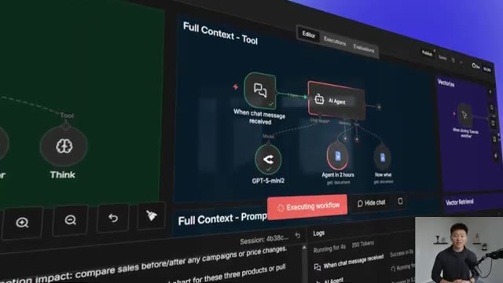
*⏱️ 00:00:06 — Vue d'un tableau de bord de conception d'agents IA montrant un workflow "Full Context - Tool" en cours d'exécution.*

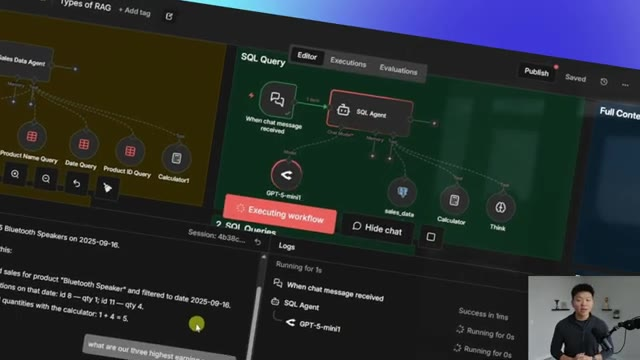
*⏱️ 00:00:12 — Vue d'un autre workflow "SQL Query" avec un agent SQL, des requêtes de base de données et des logs d'exécution en bas.*

---

### ⏱️ `[00:00:25 - 00:01:00]` | Segment #02

**🔊 Audio (Transcription Intégrale Mot pour Mot en Français) :**
> Donc, dans la vidéo d'aujourd'hui, je vais passer en revue quatre méthodes différentes de RAG et amener vos agents à consulter des éléments afin de répondre. Et je vais analyser de vrais exemples de son fonctionnement et du moment où vous devriez choisir ce type spécifique de RAG. Voici donc le flux de travail que nous allons examiner aujourd'hui. Nous avons, comme je l'ai dit, différents exemples. Nous en avons un où nous utilisons des filtres. Nous en avons un où nous faisons une requête SQL. Nous en avons quelques-uns avec un contexte complet. Et puis nous avons le dernier, qui utilise une base de données vectorielle. Et le truc, c'est que je pense que lorsque les gens réalisent que leur agent a besoin de données ou d'informations externes, ils se jettent immédiatement sur une base de données vectorielle comme solution. Mais il y a

**👁️ Analyse Visuelle d'Écran (gemini-3.5-flash-lite) :**
**Interface & Outils** : Interface web d'un outil de construction de workflows d'IA et d'automatisation.

**Contenu textuel & Code** : Diagrammes de flux avec nœuds "When chat message received", "AI Agent", et notes textuelles décrivant "Simple Database Filters" et "SQL Queries".

**Action / Démonstration** : Exécution d'un workflow de test et navigation dans l'interface de conception.

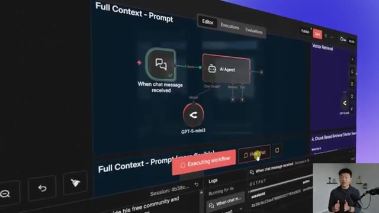
*⏱️ 00:00:34 — Gros plan sur un workflow d'agent IA montrant un déclencheur de chat connecté à un agent IA et un modèle GPT.*

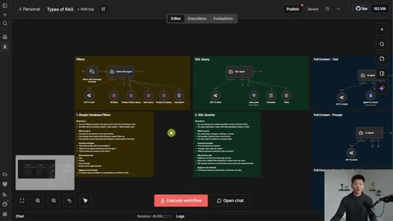
*⏱️ 00:00:43 — Vue d'ensemble du projet "Types of RAG" montrant plusieurs sections de workflows et de notes explicatives sur différentes méthodes de RAG.*

---

### ⏱️ `[00:01:00 - 00:01:22]` | Segment #03

**🔊 Audio (Transcription Intégrale Mot pour Mot en Français) :**
> il y a des tonnes de problèmes avec ça. Donc, avant de nous plonger réellement dans ces quatre exemples, allons à mon tableau blanc juste ici et parlons très, très rapidement de la récupération basée sur des segments. Donc, la récupération basée sur des segments, c'est lorsque de grands documents sont découpés en morceaux gérables qui peuvent être recherchés et récupérés plus efficacement. Et c'est génial pour plein de raisons. Ça rend essentiellement notre recherche moins chère et plus rapide. Et je vais vous montrer exactement ce que je veux dire par là plus tard avec un exemple concret.

**👁️ Analyse Visuelle d'Écran (gemini-3.5-flash-lite) :**
**Interface & Outils** : Tableau blanc numérique en ligne (type Miro ou Excalidraw)

**Contenu textuel & Code** : Titre 'Chunk Based Retrieval' et texte explicatif sur la découpe des documents pour les agents IA.

**Action / Démonstration** : Le présentateur explique les concepts théoriques de la récupération basée sur des segments en s'appuyant sur son tableau blanc.

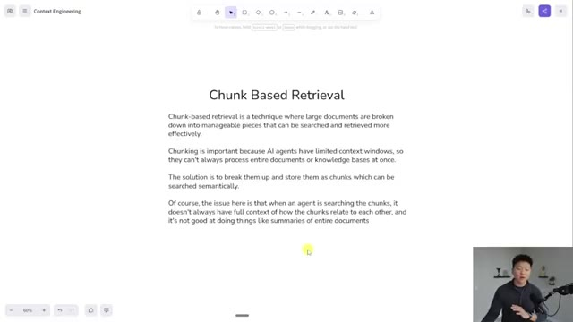
*⏱️ 00:01:06 — Un tableau blanc numérique affichant le titre 'Chunk Based Retrieval' ainsi que des paragraphes explicatifs sur la technique, avec le présentateur visible en incrustation dans le coin inférieur droit.*

---

### ⏱️ `[00:01:22 - 00:01:55]` | Segment #04

**🔊 Audio (Transcription Intégrale Mot pour Mot en Français) :**
> Mais le problème est que nous recherchons à travers les segments de manière sémantique ou non, nous, les agents, recherchons à travers les segments de manière sémantique. Ce qui signifie qu'on perd beaucoup de contexte d'un document global. Donc en gros, voici à quoi cela ressemble dans une visualisation simple. Disons que nous avons un PDF de 20 pages et qu'il est divisé en tonnes de segments différents. Tous ces segments sont intégrés dans la base de données vectorielle sous forme de ces petits points qui sont les vecteurs, et chacun des vecteurs représente un tout petit segment dans tout le document. Donc ce que cela signifie, c' suppose que nous ayons pris trois transcriptions de vidéos YouTube comme documents et que nous les ayons intégrées.

**👁️ Analyse Visuelle d'Écran (gemini-3.5-flash-lite) :**
**Interface & Outils** : Application web de prise de notes ou de schéma type canvas.

**Contenu textuel & Code** : Texte en anglais expliquant le 'Chunk Based Retrieval' : la technique consistant à découper de grands documents en morceaux, les limites de la fenêtre de contexte des agents IA, et le problème de la perte de contexte global lors des recherches sémantiques.

**Action / Démonstration** : Le présentateur explique visuellement le concept de découpage par morceaux ('chunking') et la perte de contexte global associée.

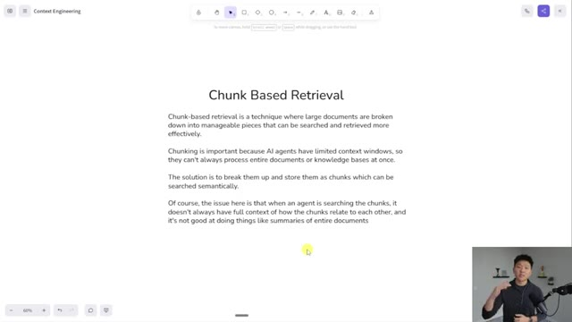
*⏱️ 00:01:30 — Capture d'écran montrant un tableau blanc ou une application de notes (Context Engineering) avec du texte explicatif sur la récupération par morceaux (Chunk Based Retrieval).*

---

### ⏱️ `[00:01:55 - 00:02:22]` | Segment #05

**🔊 Audio (Transcription Intégrale Mot pour Mot en Français) :**
> Et il y avait plusieurs morceaux ou vecteurs pour chacun d'entre eux. Maintenant, lorsque nous récupérons ces morceaux, nous ne saurions pas vraiment de quelle vidéo YouTube ils proviennent, quelle était l'URL, ni même l'horodatage de ce morceau dans la vidéo A juste ici. Nous pourrions faire cela avec des choses comme le balisage de métadonnées, et c'est un tout autre sujet, sur lequel j'ai également fait quelques vidéos. Mais fondamentalement, ce que j'essaie de dire, c'est que si vous aviez une vidéo YouTube vectorisée et que vous demandiez un résumé de la vidéo entière, l'agent ne serait probablement pas en train de regarder cette vidéo entière.

**👁️ Analyse Visuelle d'Écran (gemini-3.5-flash-lite) :**
**Interface & Outils** : Outil de tableau blanc numérique / diagramme en ligne (ex: Excalidraw, Miro)

**Contenu textuel & Code** : Schéma montrant les documents A, B, C convertis en vecteurs (points colorés) dans un espace à trois dimensions, reliés à des métadonnées (Title, URL, Timestamp).

**Action / Démonstration** : Le présentateur explique visuellement le concept de découpage de documents en vecteurs et l'association des métadonnées de traçabilité.

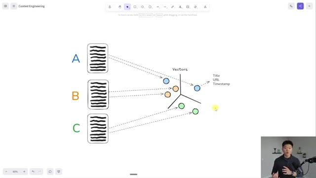
*⏱️ 00:02:02 — Schéma explicatif sur fond blanc illustrant la vectorisation de documents (A, B, C) vers un espace vectoriel avec des métadonnées associées (Title, URL, Timestamp).*

---

### ⏱️ `[00:02:23 - 00:02:44]` | Segment #06

**🔊 Audio (Transcription Intégrale Mot pour Mot en Français) :**
> Cela vous donnerait un résumé des segments qu'il a trouvés. Comme je l'ai dit ici, si vous demandez un résumé d'une réunion, il recherchera le résumé de la réunion du 5 mars et il résumera seulement les segments dont il dispose, ce qui, parfois, n'est pas le pire. Mais encore une fois, vous devez réfléchir à ce qu'il devrait regarder et au type de questions que cet agent va recevoir. Et lorsque vous passez aux données tabulaires, c'est là que vous rencontrez beaucoup de problèmes avec la recherche basée sur les segments.

**👁️ Analyse Visuelle d'Écran (gemini-3.5-flash-lite) :**
**Interface & Outils** : Outil de tableau blanc numérique de type Excalidraw ou similaire.

**Contenu textuel & Code** : Texte "Vector DB RAG", boîte verte "Summarize the meeting on March 5th", illustration d'un robot, texte "March 5th Meeting Summary" et blocs intitulés "Chunks".

**Action / Démonstration** : Présentation visuelle et explication du fonctionnement d'une base de données vectorielle et du RAG.

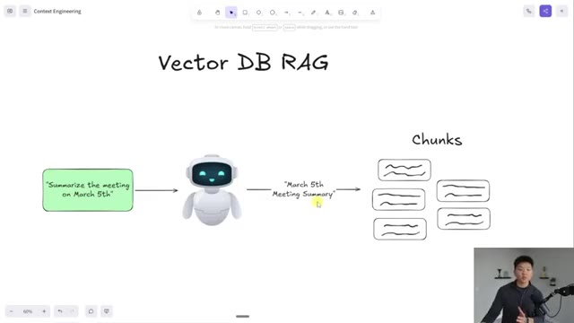
*⏱️ 00:02:28 — Schéma explicatif intitulé "Vector DB RAG" montrant le traitement d'une requête utilisateur par un assistant virtuel vers des morceaux de texte (chunks).*

---

### ⏱️ `[00:02:44 - 00:03:10]` | Segment #07

**🔊 Audio (Transcription Intégrale Mot pour Mot en Français) :**
> Parce que disons que nous avons des données de ventes et que nous demandons à notre agent : quelle semaine avons-nous eu les ventes les plus élevées ? Il effectuerait une recherche dans la base de connaissances avec les ventes les plus élevées. Et disons qu'il ramène un seul bloc, qui correspond à ces, je ne sais pas combien de lignes cela fait, mais disons que ce sont ces lignes. Donc ce qu'il va faire, c'est qu'il va prendre ce bloc en noir et il va fondamentalement choisir dans ce bloc laquelle de ces semaines nous avons eu le total des ventes le plus élevé, qui était la semaine numéro six juste ici, 15 583.

**👁️ Analyse Visuelle d'Écran (gemini-3.5-flash-lite) :**
**Interface & Outils** : Application de tableau blanc en ligne (type Miro ou Excalidraw) avec incrustation vidéo du présentateur en bas à droite.

**Contenu textuel & Code** : Texte de la question "Which week did we have the highest sales?", illustration d'un robot, flèche avec le texte "Highest sales", et tableau de données tabulaires (semaines et ventes).

**Action / Démonstration** : Le schéma illustre le processus de recherche d'un agent IA dans des données tabulaires suite à une question sur les ventes les plus élevées.

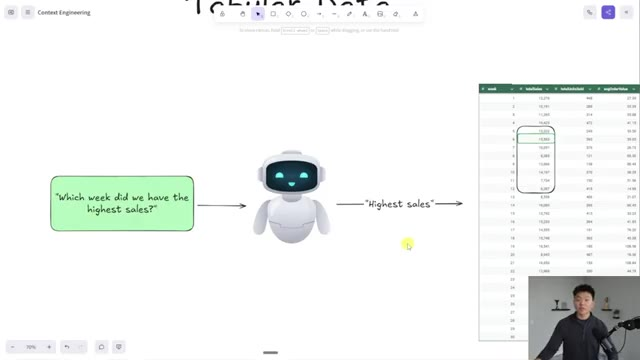
*⏱️ 00:02:51 — Schéma explicatif sur tableau blanc montrant une question posée à un agent IA ("Which week did we have the highest sales?") qui cherche dans un tableau de données tabulaires (Excel/CSV) affiché à droite.*

---

### ⏱️ `[00:03:10 - 00:03:46]` | Segment #08

**🔊 Audio (Transcription Intégrale Mot pour Mot en Français) :**
> Mais ce que vous remarquerez, c'est qu'à la semaine quatre, nous avons en fait eu des ventes plus élevées. Et c'est aussi le cas à la semaine 14. Et c'est aussi le cas à la semaine 19. Et donc, parce que nous avons fait une récupération basée sur des segments ici, cela ne nous donne pas une image globale de tout le contexte dont nous avons besoin. C'est la même chose si nous demandions quelque chose comme la moyenne, quelle est notre valeur de commande moyenne, il chercherait la moyenne, disons qu'il a extrait ce segment ici en noir, et il prendrait une moyenne des commandes uniquement dans ce segment, plutôt que de calculer toutes les semaines et de prendre la moyenne de ces chiffres. Très bien, c'est assez pour mon cours magistral. Passons aux vrais exemples pour que vous puissiez réellement contextualiser tout ce blabla que je viens de dire.

**👁️ Analyse Visuelle d'Écran (gemini-3.5-flash-lite) :**
**Interface & Outils** : Application de tableau blanc ou de prise de notes interactive (type canvas) affichant un tableau de données tabulaires.

**Contenu textuel & Code** : Tableau avec des colonnes telles que #week, totalSales, totalUnitsSold, avgOrderValue, uniqueCustomers, repeatCustomers, avec des données chiffrées par semaine et des annotations dessinées à la main.

**Action / Démonstration** : Le présentateur explique l'analyse des ventes par semaine en soulignant visuellement les écarts et les valeurs aberrantes sur le tableau.

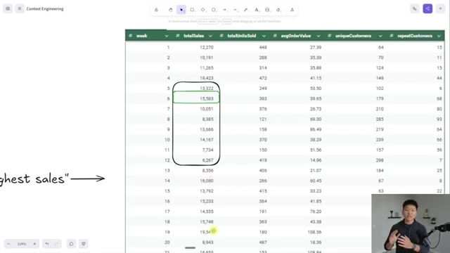
*⏱️ 00:03:19 — Un tableau de données affichant les ventes par semaine avec des annotations manuscrites entourant des lignes spécifiques et pointant vers les ventes les plus élevées.*

---

### ⏱️ `[00:03:46 - 00:04:13]` | Segment #09

**🔊 Audio (Transcription Intégrale Mot pour Mot en Français) :**
> Je viens de le dire. Donc, le premier exemple que nous avons, ce sont les filtres. Et ce que nous avons ici, c'est une table de données dans NNN, qui ressemble à ceci. Elle contient des données de ventes. Nous avons 20 lignes où nous avons le nom du produit, la date à laquelle il a été vendu, le prix et la quantité, ainsi que l'identifiant du produit. Et donc, ce que nous pouvons faire ici, c'est parler à cet agent et lui faire configurer des filtres afin qu'il puisse parcourir et rechercher des filtres pour seulement certains produits que nous avons vendus, ou seulement à certaines dates et des choses de ce genre.

**👁️ Analyse Visuelle d'Écran (gemini-3.5-flash-lite) :**
**Interface & Outils** : Interface web n8n (table de données et éditeur de workflows).

**Contenu textuel & Code** : Données tabulaires de ventes (Wireless Headphones, Bluetooth Speaker, Phone Case) et diagramme de workflow n8n avec Sales Data Agent.

**Action / Démonstration** : Présentation d'un exemple concret de table de données et de l'architecture d'un workflow n8n utilisant des filtres.

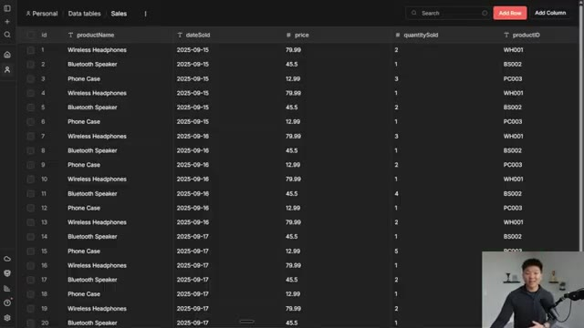
*⏱️ 00:03:53 — Table de données de ventes dans n8n avec 20 lignes contenant le nom du produit, la date, le prix, la quantité et l'identifiant.*

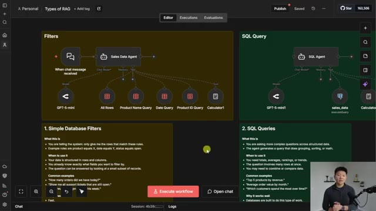
*⏱️ 00:04:06 — Interface n8n montrant un workflow d'agent IA pour le traitement de requêtes de données de ventes avec des blocs de filtres et de requêtes SQL.*

---

### ⏱️ `[00:04:13 - 00:04:51]` | Segment #10

**🔊 Audio (Transcription Intégrale Mot pour Mot en Français) :**
> Donc, si j'envoie cette requête à l'agent qui dit : combien de haut-parleurs Bluetooth avons-nous vendus le 16 septembre de cette année ? Ce qu'il va faire, c'est utiliser sa requête de nom de produit, très probablement, afin de filtrer chaque ligne de la base de données qui n'a pas pour nom de produit égal à haut-parleurs Bluetooth. Et ensuite, ce qu'il a fait, c'est une requête de date pour s'assurer qu'il filtre également toutes ces lignes où la date n'est pas le 16 septembre. Donc ça vient juste de se terminer et ça a dit : vous avez vendu cinq haut-parleurs Bluetooth le 16 septembre. Comment j'ai obtenu ceci ? J'ai interrogé les ventes pour le produit haut-parleur Bluetooth, puis j'ai filtré la date au 16 septembre et ensuite j'ai additionné tout ça. Donc, si nous

**👁️ Analyse Visuelle d'Écran (gemini-3.5-flash-lite) :**
**Interface & Outils** : Interface web de construction de workflows d'agents IA (type Flowise ou outil similaire).

**Contenu textuel & Code** : Workflow "1. Simple Database Filter" avec l'agent "Sales Data Agent" connecté aux outils GPT-5-mini, All Rows, Product Name Query, Date Query, Product ID Query, Calculator1, et le prompt utilisateur dans le chat : "How many bluetooth speakers did we sell on September 16th this year?".

**Action / Démonstration** : Exécution du workflow et activation de l'outil "Product Name Query" par l'agent suite à la requête de l'utilisateur.

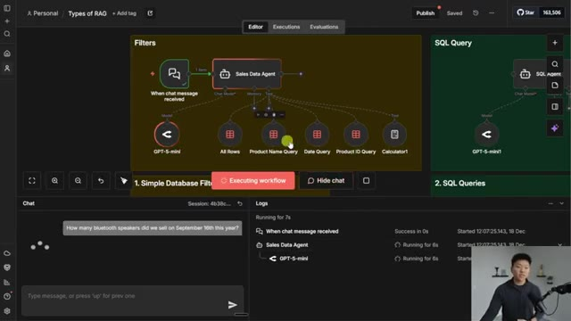
*⏱️ 00:04:23 — Interface d'un éditeur de workflow montrant un "Sales Data Agent" relié à plusieurs outils de filtrage (All Rows, Product Name Query, Date Query, etc.) et le chat en bas à gauche affichant la requête sur les haut-parleurs Bluetooth.*

---

### ⏱️ `[00:04:51 - 00:05:13]` | Segment #11

**🔊 Audio (Transcription Intégrale Mot pour Mot en Français) :**
> allez dans la base de données réelle et nous faisons cela manuellement et vous y pensez, n'est-ce pas ? Si vous étiez humain et que quelqu'un disait, hé, combien de haut-parleurs Bluetooth avons-nous vendus le 16 septembre ? Vous auriez fait la même chose. Vous auriez d'abord regardé peut-être le 16 septembre et ensuite, à partir du 16 septembre, vous auriez dit, d'accord, nous avons vendu un haut-parleur Bluetooth ici et nous avons vendu un haut-parleur Bluetooth ici. Et ensuite, vous auriez additionné la quantité, qui était un plus quatre, ce qui fait cinq.

**👁️ Analyse Visuelle d'Écran (gemini-3.5-flash-lite) :**
**Interface & Outils** : Application web de base de données (type tableur ou interface de gestion de données).

**Contenu textuel & Code** : Données de ventes incluant des produits comme "Bluetooth Speaker" vendus à différentes dates (ex. 2025-09-16).

**Action / Démonstration** : Consultation manuelle des enregistrements de la base de données pour retrouver les ventes du 16 septembre.

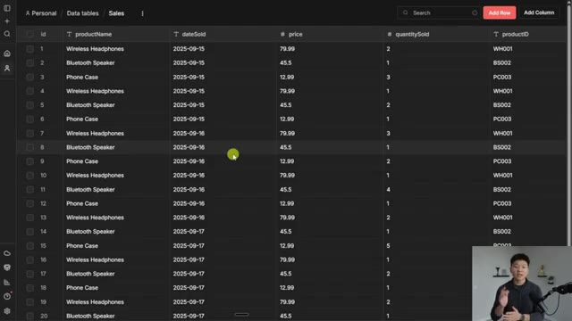
*⏱️ 00:04:56 — Une base de données affichant un tableau de ventes avec des colonnes id, productName, dateSold, price, quantitySold et productID.*

---

### ⏱️ `[00:05:13 - 00:05:33]` | Segment #12

**🔊 Audio (Transcription Intégrale Mot pour Mot en Français) :**
> Et encore une fois, vous pouvez voir que si nous regardons les outils réels, si je clique sur celui-ci, il a fait une requête nom du produit égale haut-parleur Bluetooth et il a récupéré ces lignes. Et puis il a fait une requête de date où la date de vente est égale au 16 septembre et il a récupéré ces lignes. Et ensuite, il a juste eu besoin d'utiliser sa calculatrice afin de faire ce calcul pour nous donner la réponse de cinq.

**👁️ Analyse Visuelle d'Écran (gemini-3.5-flash-lite) :**
**Interface & Outils** : Application web d'automatisation / outil d'agent IA (type n8n ou similaire).

**Contenu textuel & Code** : Paramètres de requête de données : table "Sales", condition sur la colonne "productName (string)" avec l'opérateur "Equals" et la valeur générée par le modèle "Bluetooth Speaker". En sortie : objets JSON contenant les détails des ventes ("productName", "price", "quantitySold", "productID", "totalRevenue", "dateSold").

**Action / Démonstration** : Le présentateur commente les détails de la requête de données sur le nom du produit et les résultats obtenus dans le panneau de sortie.

*⏱️ 00:05:18 — Interface d'un outil d'automatisation ou d'agent IA montrant les paramètres d'une requête sur un tableau de données de ventes ("Sales"), avec les conditions filtrant par nom de produit ("productName") égal à "Bluetooth Speaker", et le panneau de sortie affichant les résultats JSON correspondants.*

---

### ⏱️ `[00:05:33 - 00:05:58]` | Segment #13

**🔊 Audio (Transcription Intégrale Mot pour Mot en Français) :**
> Donc, en utilisant un filtre de base de données simple, qu'est-ce que cela signifie réellement et quand utiliseriez-vous cela ? Vous dites fondamentalement au système : donnez-moi seulement les lignes qui correspondent à ces critères ou à ces règles. Donc, produit égal à X, date égale à X, ou date égale à Y, comme nous venons de le voir. Vous voulez utiliser ce type de requête lorsque vos données sont structurées en lignes et en colonnes, donc qu'elles sont tabulaires, lorsque vous savez déjà exactement quels champs vous voulez filtrer, et lorsque la question peut trouver une réponse en regardant un petit sous-ensemble d'enregistrements.

**👁️ Analyse Visuelle d'Écran (gemini-3.5-flash-lite) :**
**Interface & Outils** : Interface web (n8n ou application similaire) avec un panneau de présentation textuel.

**Contenu textuel & Code** : Texte listant les définitions, cas d'utilisation, exemples courants ("How many orders did we have today?"), avantages et règle empirique des filtres de bases de données.

**Action / Démonstration** : Le présentateur explique les concepts théoriques liés aux filtres de bases de données simples illustrés à l'écran.

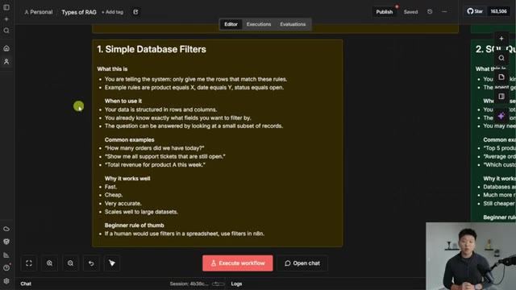
*⏱️ 00:05:39 — Une diapositive explicative sur les filtres de base de données simples ("1. Simple Database Filters") affichée dans une interface de type n8n ou éditeur web, avec le présentateur en médaillon vidéo en bas à droite.*

---

### ⏱️ `[00:05:58 - 00:06:17]` | Segment #14

**🔊 Audio (Transcription Intégrale Mot pour Mot en Français) :**
> Et pourquoi est-ce que ça fonctionne bien ? Eh bien, c'est vraiment rapide, c'est bon marché, et c'est précis, et ça s'adapte bien aux grands ensembles de données dans une certaine mesure. Et la règle empirique du débutant ici, c'est que si un humain utilisait des filtres dans un tableur, alors utilisez des filtres dans NNN. Parce que réfléchissez-y, ce qu'on pourrait faire, c'est simplement demander à l'agent de regarder les 20 lignes, et il serait quand même capable d'obtenir cette réponse.

**👁️ Analyse Visuelle d'Écran (gemini-3.5-flash-lite) :**
**Interface & Outils** : Interface web n8n (éditeur de workflow)

**Contenu textuel & Code** : Texte explicatif listant la définition, les cas d'utilisation, les exemples, les avantages ('Fast', 'Cheap', 'Very accurate', 'Scales well to large datasets') et une règle empirique pour les débutants concernant les filtres de bases de données.

**Action / Démonstration** : Présentation théorique d'un concept d'automatisation et de RAG via une note textuelle intégrée dans l'interface n8n.

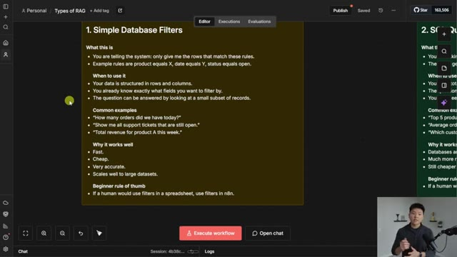
*⏱️ 00:06:03 — Capture d'écran montrant l'interface n8n avec une note explicative détaillée sur les types de RAG, spécifiquement le point '1. Simple Database Filters', ainsi qu'une vue en médaillon du présentateur en bas à droite.*

---

### ⏱️ `[00:06:17 - 00:06:39]` | Segment #15

**🔊 Audio (Transcription Intégrale Mot pour Mot en Français) :**
> Mais ce qu'il ferait dans ce cas-là, c'est traiter plus de jetons parce qu'il extrait plus de données dans NNN. Et il y a aussi simplement un plus grand risque d'hallucination parce qu'il y a beaucoup plus de jetons qu'il examine, ce qui le rend aussi plus coûteux. Donc, l'objectif est d'avoir un énorme ensemble de données d'un côté et un agent NNN d'un côté. Comment faire en sorte que l'agent n'extraie que ce dont il a besoin et limite la quantité de données qui arrive réellement dans NNN ?

**👁️ Analyse Visuelle d'Écran (gemini-3.5-flash-lite) :**
**Interface & Outils** : Éditeur de workflow de type n8n ou plateforme d'automatisation d'agents IA

**Contenu textuel & Code** : Schéma de workflow avec des nœuds : "When chat message received", "Sales Data Agent", "GPT-5-mini", "All Rows", "Product Name Query", "Date Query", "Product ID Query", et "Calculator1".

**Action / Démonstration** : Visualisation et configuration d'un agent IA et de ses outils de requête de base de données.

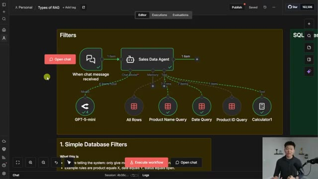
*⏱️ 00:06:22 — Interface d'un éditeur de workflow montrant un agent de données de vente (Sales Data Agent) connecté à différents outils et sources de données.*

---

### ⏱️ `[00:06:39 - 00:07:02]` | Segment #16

**🔊 Audio (Transcription Intégrale Mot pour Mot en Français) :**
> Et donc, la plupart du temps, le filtre sera la réponse, vous savez, comme les bases de données de contacts ou de ventes et des choses de ce genre. Mais comme je l'ai dit, jusqu'à un certain point. Et une fois que ça devient trop volumineux et qu'il faut faire un peu plus de calculs ou des requêtes plus complexes, c'est là que vous pourriez envisager de faire une véritable requête SQL. Et d'ailleurs, avant de passer à l'agent de requêtes SQL, je voulais montrer le prompt système de cet agent de données de ventes.

**👁️ Analyse Visuelle d'Écran (gemini-3.5-flash-lite) :**
**Interface & Outils** : Interface web de construction de workflows / agents IA.

**Contenu textuel & Code** : Diagramme de workflow nommé 'Types of RAG' avec un bloc 'Filters' détaillant '1. Simple Database Filters' et les connexions vers le modèle et les outils de bases de données.

**Action / Démonstration** : Présentation du workflow d'agent conversationnel utilisant des filtres de bases de données et des outils de calcul.

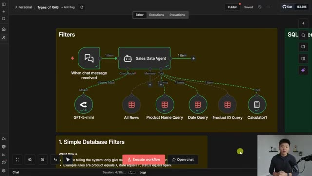
*⏱️ 00:06:45 — Capture d'écran montrant un éditeur de workflow de type RAG avec un nœud 'Sales Data Agent' connecté à plusieurs outils de requêtes de bases de données (All Rows, Product Name Query, Date Query, Product ID Query, Calculator1) et au modèle GPT-5-mini.*

---

### ⏱️ `[00:07:02 - 00:07:21]` | Segment #17

**🔊 Audio (Transcription Intégrale Mot pour Mot en Français) :**
> Et je ne vais pas lire chaque ligne, mais vous pouvez mettre sur pause si vous voulez. Tout ce flux de travail sera également disponible au téléchargement, avec un lien dans ma communauté School gratuite. Mais la raison pour laquelle je voulais souligner cela, c'est parce que j'ai dû indiquer à l'agent les différentes options parmi lesquelles il devait choisir lorsqu'il créait ces filtres. Donc ici, vous pouvez voir que j'ai dit que les noms de produits valides sont écouteurs sans fil, haut-parleur Bluetooth, coque de téléphone.

**👁️ Analyse Visuelle d'Écran (gemini-3.5-flash-lite) :**
**Interface & Outils** : Interface de type n8n ou plateforme d'automatisation avec un panneau d'expressions JavaScript et un aperçu des résultats.

**Contenu textuel & Code** : Un prompt système en Markdown définissant le rôle de l'IA ('Master Sales Data Analyst AI') ainsi que ses outils disponibles (AllRows, ProductNameQuery, DateQuery, ProductIDQuery, Calculator) et ses instructions principales.

**Action / Démonstration** : Affichage et configuration des instructions et des outils d'un nœud d'agent conversationnel ou d'IA.

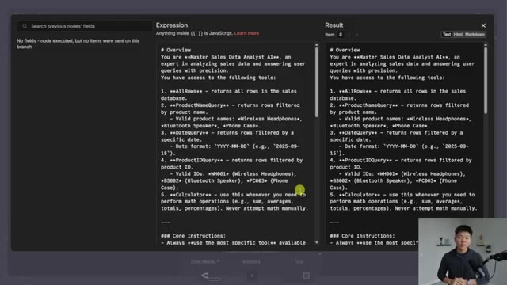
*⏱️ 00:07:07 — Interface d'un éditeur de flux de travail montrant les panneaux 'Expression' et 'Result' avec un prompt système définissant un agent d'analyse de données de vente.*

---

### ⏱️ `[00:07:22 - 00:07:40]` | Segment #18

**🔊 Audio (Transcription Intégrale Mot pour Mot en Français) :**
> Et ceux-là avaient des majuscules pour commencer chacun de ces mots, parce que si j'avais juste dit étui de téléphone et qu'ensuite il l'avait mal orthographié, notre filtre n'aurait pas vraiment fonctionné parce qu'il ne fait pas de recherche sémantique. Il fait des filtres explicites du type est-ce que X est égal à Y. Et c'est la même chose pour la date. Je devais m'assurer qu'il envoyait toujours ce format de date. Et donc je voulais vous montrer ça parce que ce n'est pas de la magie.

**👁️ Analyse Visuelle d'Écran (gemini-3.5-flash-lite) :**
**Interface & Outils** : n8n (outil d'automatisation de workflow)

**Contenu textuel & Code** : Prompt système de l'agent IA incluant la liste des outils ('AllRows', 'ProductNameQuery', 'DateQuery', 'ProductIDQuery') et les noms de produits valides (ex: 'Wireless Headphones', 'Phone Case').

**Action / Démonstration** : Configuration et édition des instructions système de l'agent pour définir les capacités de filtrage de données basées sur des noms de produits précis.

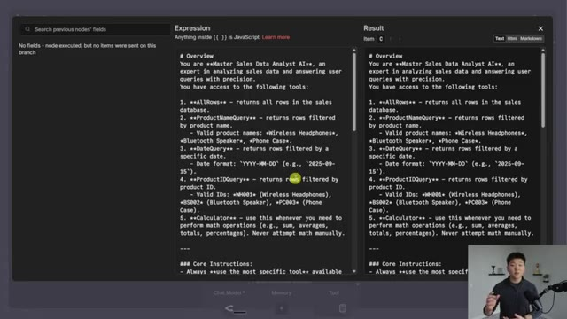
*⏱️ 00:07:26 — Une interface de workflow n8n affichant un éditeur d'expression avec deux colonnes (Expression et Result) montrant une configuration de "Master Sales Data Analyst AI" avec des instructions spécifiques pour le filtrage de produits comme 'Phone Case'.*

---

### ⏱️ `[00:07:40 - 00:08:13]` | Segment #19

**🔊 Audio (Transcription Intégrale Mot pour Mot en Français) :**
> Et si vous ajoutiez une nouvelle catégorie de produits ou si vous ajoutiez un format de date différent, vous devriez vous assurer que votre agent comprend cela. Mais il est également important de savoir que quelque chose de similaire se produit généralement par ici avec un agent SQL. La seule façon pour qu'il soit un peu plus dynamique, c'est de donner également à l'agent un outil pour consulter le schéma avant qu'il ne fasse sa requête. Et je ne veux pas vraiment entrer dans les détails de ce que je voulais dire par là ni montrer un exemple, je ne veux pas vous embrouiller les gars, mais gardez simplement à l'esprit que même avec l'agent SQL aussi, je lui donne toujours les différents détails de la table comme la colonne ID de commande, la colonne nom du client, la colonne produit.

**👁️ Analyse Visuelle d'Écran (gemini-3.5-flash-lite) :**
**Interface & Outils** : Flowise (plateforme d'orchestration pour applications LLM).

**Contenu textuel & Code** : Diagramme de flux comprenant un agent central ("Sales Data Agent") relié à des nœuds spécifiques : "All Rows", "Product Name Query", "Date Query", "Product ID Query" et "Calculator1", utilisant le modèle GPT-3.5-mini.

**Action / Démonstration** : Visualisation de la configuration logique d'un agent SQL permettant le filtrage de données structurées.

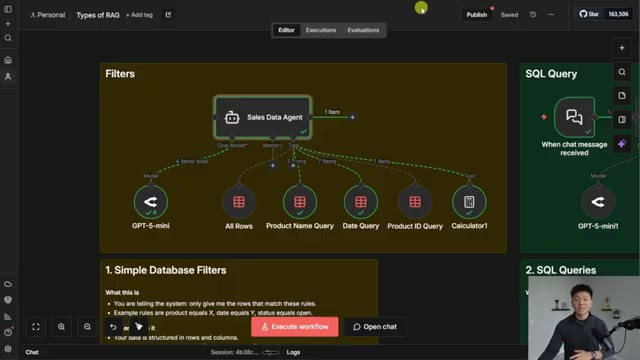
*⏱️ 00:07:48 — Interface de conception de workflow dans Flowise montrant un "Sales Data Agent" connecté à plusieurs nœuds de requêtes SQL et de modèles.*

---

### ⏱️ `[00:08:13 - 00:08:47]` | Segment #20

**🔊 Audio (Transcription Intégrale Mot pour Mot en Français) :**
> Et je lui donne toujours les exemples comme vous pouvez le voir, mais bref, jetons un œil à la façon dont celui-ci fonctionne. Donc cette fois, notre base de données est hébergée dans Postgres avec Supabase et ce sont des données de ventes. Donc un type de table similaire, mais ce sont des champs et des exemples différents, et de plus, celle-ci comporte 50 lignes au lieu de seulement 20, juste pour l'exemple avec un autre cas de figure. Maintenant, j'ai aussi ces données de ventes dans un fichier Excel et j'ai fait un tableau croisé dynamique rapide pour montrer que cela va réellement nous donner les bonnes réponses. Ce sont donc différents produits qui ont été vendus, et voici combien d'argent a été gagné grâce à chacun de ces produits, classés par ordre décroissant. Donc en gros, ces trois-là étaient les

**👁️ Analyse Visuelle d'Écran (gemini-3.5-flash-lite) :**
**Interface & Outils** : Supabase, Microsoft Excel, interface de présentation web.

**Contenu textuel & Code** : Données tabulaires de ventes (commandes, clients, produits, quantités, prix et dates).

**Action / Démonstration** : Présentation et exploration de la base de données de ventes hébergée sur Supabase et d'un tableur Excel associé.

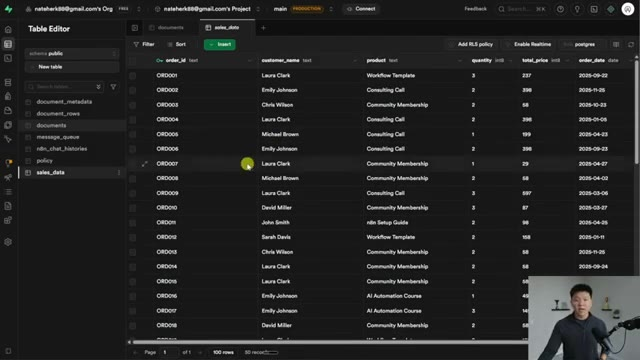
*⏱️ 00:08:22 — Interface Supabase affichant l'éditeur de table avec des données de ventes (order_id, customer_name, product, quantity, total_price, order_date).*

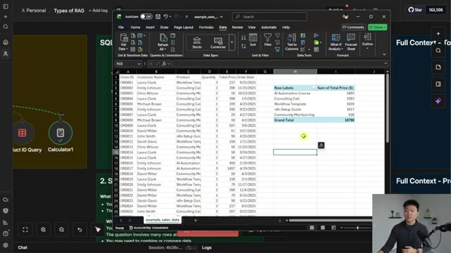
*⏱️ 00:08:39 — Feuille de calcul Excel ouverte par-dessus un diagramme, montrant des données de ventes et un tableau croisé dynamique avec la somme des prix totaux.*

---

### ⏱️ `[00:08:47 - 00:09:23]` | Segment #21

**🔊 Audio (Transcription Intégrale Mot pour Mot en Français) :**
> les produits les plus rentables. Donc je vais poser exactement cette question à l'agent. Donc je lui envoie : quels sont nos trois produits qui rapportent le plus. Et encore une fois, il devrait être capable d'utiliser son cerveau pour faire cette requête SQL. Il vient d'exécuter cette fonction très rapidement. Et maintenant, il n'aura probablement même pas à utiliser l'outil de calcul comme celui-ci l'a fait juste ici, parce que la requête SQL qu'il est en train de construire fait en réalité le calcul, le tri et la synthèse. Oh, je rectifie. Il a effectivement utilisé l'outil de calcul, mais c'est généralement l'avantage des requêtes SQL de pouvoir effectuer une grande partie des calculs directement dans la requête. Très bien. Donc il a fini par utiliser

**👁️ Analyse Visuelle d'Écran (gemini-3.5-flash-lite) :**
**Interface & Outils** : Interface web de développement d'agents IA (type plateforme de workflow visuel).

**Contenu textuel & Code** : Le prompt de chat "what are our three highest earning products", les logs d'exécution du workflow et les nœuds de l'agent connectés à GPT-5-mini.

**Action / Démonstration** : Exécution en cours d'un workflow d'agent IA pour répondre à une requête SQL sur les produits les plus rentables.

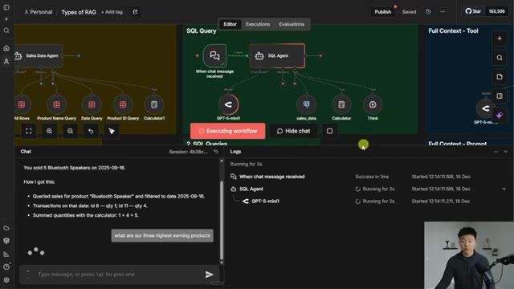
*⏱️ 00:08:56 — Un tableau de bord de workflow d'agent IA montrant un agent SQL en cours d'exécution avec un panneau de chat en bas à gauche affichant la question sur les produits les plus rentables.*

---

### ⏱️ `[00:09:23 - 00:09:55]` | Segment #22

**🔊 Audio (Transcription Intégrale Mot pour Mot en Français) :**
> calculateur quatre fois, mais assurons-nous simplement qu'il a bien compris. Donc, il a dit qu'il a exécuté les trois meilleurs produits par chiffre d'affaires, puis qu'il a obtenu le chiffre d'affaires total en additionnant le tout. Et ses résultats étaient : cours d'automatisation de l'IA, 3493, qui est juste ici. Appel de conseil, 33383, juste ici. Et ensuite le modèle de flux de travail 16,59, qui est juste là. Et il nous a également donné des pourcentages de notre chiffre d'affaires total, ce qui est plutôt cool. Vous pouvez également voir qu'il nous a donné quelques notes et hypothèses et quelques suggestions de prochaines étapes. Mais je voulais juste vous prouver, les gars, qu'il effectuait en fait des requêtes SQL.

**👁️ Analyse Visuelle d'Écran (gemini-3.5-flash-lite) :**
**Interface & Outils** : Microsoft Excel et interface web d'un agent conversationnel.

**Contenu textuel & Code** : Tableau Excel avec les colonnes Quantité, Total Prix, Date de commande et un tableau croisé dynamique affichant les ventes par produit (AI Automation Course : 3493, Consulting Call : 3383, etc.).

**Action / Démonstration** : Présentation des résultats de calcul du chiffre d'affaires par produit.

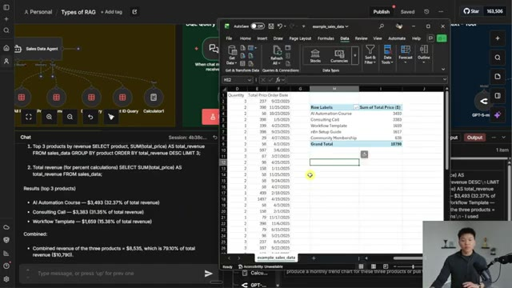
*⏱️ 00:09:31 — Capture d'écran montrant un tableau Excel avec des données de vente par produit et des requêtes SQL affichées dans une interface de chat à gauche.*

---

### ⏱️ `[00:09:56 - 00:10:17]` | Segment #23

**🔊 Audio (Transcription Intégrale Mot pour Mot en Français) :**
> Et si je clique ici, ce que vous pouvez voir qui se produit, c'est que nous faisons en sorte que l'IA construise cette requête SQL et elle la crée juste ici. Et ensuite, elle l'envoie à Postgres. Donc, la première fois, elle a basically dit, je veux sélectionner des produits. Je veux sommer le prix total en tant que revenu total. Et je veux faire cela à partir de la table sales underscore data, ce qui, si nous retournons dans Supabase, vous pouvez voir que c'est comme ça qu'elle s'appelle juste ici.

**👁️ Analyse Visuelle d'Écran (gemini-3.5-flash-lite) :**
**Interface & Outils** : Plateforme d'automatisation de workflow (type n8n).

**Contenu textuel & Code** : On peut voir en entrée ("INPUT") la requête générée par l'IA : "SELECT SUM(total_price) AS total_revenue FROM sales_data;". Le panneau central affiche la configuration "Execute Query" utilisant une variable dynamique {{ $fromAI('sql_query') }}. Le panneau de sortie ("OUTPUT") affiche le résultat : "total_revenue 10790".

**Action / Démonstration** : Le workflow exécute une requête SQL générée dynamiquement par une IA pour extraire le chiffre d'affaires total à partir d'une table "sales_data".

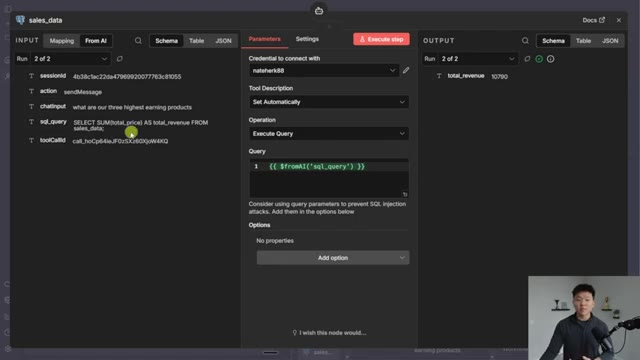
*⏱️ 00:10:01 — Interface d'un workflow d'automatisation montrant la configuration d'un nœud de base de données où l'IA génère et exécute une requête SQL.*

---

### ⏱️ `[00:10:17 - 00:10:37]` | Segment #24

**🔊 Audio (Transcription Intégrale Mot pour Mot en Français) :**
> Ensuite, il a dit, je veux regrouper par produit et je veux trier par chiffre d'affaires total par ordre décroissant. Et je veux en garder seulement trois. Donc, si vous lisez réellement des requêtes SQL en langage naturel, vous pouvez en quelque sorte comprendre ce qu'ils essaient de faire. Donc, vous vous souvenez quand j'ai dit qu'il n'allait pas avoir besoin d'utiliser la calculatrice ? Eh bien, la raison pour laquelle il a utilisé la calculatrice, ce qui est plutôt cool, c'est qu'il faisait des mathématiques pour calculer les pourcentages de tous.

**👁️ Analyse Visuelle d'Écran (gemini-3.5-flash-lite) :**
**Interface & Outils** : Interface web d'automatisation (similaire à n8n ou make) avec un volet de configuration de nœud.

**Contenu textuel & Code** : Entrée : `chatInput: what are our three highest earning products` et `sql_query: SELECT product, SUM(total_price) AS total_revenue FROM sales_data GROUP BY product ORDER BY total_revenue DESC LIMIT 3;`. Sortie : `product: AI Automation Course`, `total_revenue: 3493`.

**Action / Démonstration** : Visualisation et explication de la requête SQL générée par l'IA pour extraire les trois produits générant le plus de chiffre d'affaires.

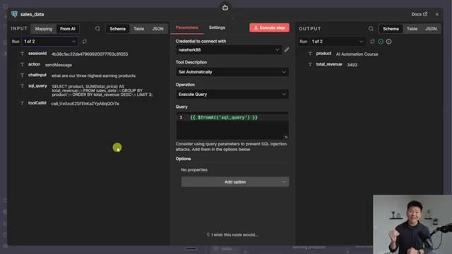
*⏱️ 00:10:22 — Capture d'écran montrant une interface de type outil d'automatisation avec un panneau d'entrée (Input) affichant une requête SQL générée, un panneau central de configuration et de paramètres, et un panneau de sortie (Output) montrant les résultats.*

---

### ⏱️ `[00:10:37 - 00:11:02]` | Segment #25

**🔊 Audio (Transcription Intégrale Mot pour Mot en Français) :**
> Donc c'était le premier pourcentage, c'était le deuxième, et ensuite après qu'il ait obtenu les trois, il a additionné ceux-ci et trouvé le pourcentage total de nos trois meilleurs produits. Donc en gros, nos trois meilleurs produits représentent 80 % de tout le chiffre d'affaires, c'est ce qu'il a trouvé. Donc de toute façon, j'espère que vous comprenez comment fonctionnent les requêtes SQL et quand vous les utiliseriez, ce serait si vous avez besoin de totaux, de moyennes, de classements ou de tendances, si la question implique de nombreuses lignes, ou si vous avez besoin de combiner ou de comparer des données.

**👁️ Analyse Visuelle d'Écran (gemini-3.5-flash-lite) :**
**Interface & Outils** : Interface web de workflow / d'automatisation d'agent IA.

**Contenu textuel & Code** : Données d'entrée et de sortie d'un calcul de pourcentage (`8535/10790 * 100` avec une réponse de `79.101...`).

**Action / Démonstration** : Visualisation des résultats d'exécution d'un nœud de calcul au sein d'un workflow automatisé.

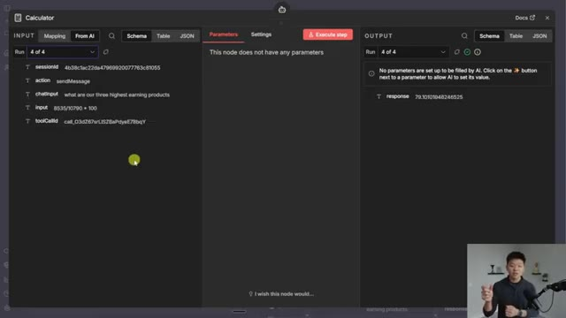
*⏱️ 00:10:44 — Interface d'un nœud "Calculator" montrant les données d'entrée (input de calcul de pourcentage) et de sortie (output) dans un workflow d'agent IA.*

---

### ⏱️ `[00:11:02 - 00:11:22]` | Segment #26

**🔊 Audio (Transcription Intégrale Mot pour Mot en Français) :**
> Et ça fonctionne bien parce que ces bases de données sont conçues pour faire ce genre de travail. Elles sont beaucoup plus fiables que de demander à l'IA d'examiner toutes les lignes ou de simplement configurer quelques filtres de base. Et c'est toujours moins cher et plus précis que de faire une recherche vectorielle pour des données structurées. Donc, la règle empirique pour débutants ici, c'est que si un humain utilisait un tableau croisé dynamique ou des formules, il faut utiliser SQL. Bon, passons donc à la méthode du contexte complet.

**👁️ Analyse Visuelle d'Écran (gemini-3.5-flash-lite) :**
**Interface & Outils** : Interface web de présentation avec un encadré vert de texte et le présentateur visible en incrustation vidéo dans le coin inférieur droit.

**Contenu textuel & Code** : Texte explicatif sur les requêtes SQL : '2. SQL Queries', 'What this is', 'When to use it', 'Common examples' ('Top 5 products by revenue', etc.), 'Why it works well' et une règle empirique pour débutants.

**Action / Démonstration** : Le présentateur explique les avantages d'utiliser des bases de données structurées et des requêtes SQL plutôt que de faire raisonner l'IA sur des lignes brutes.

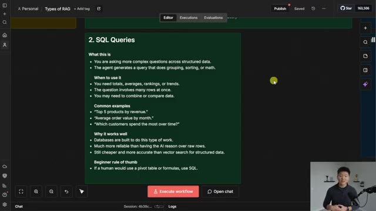
*⏱️ 00:11:07 — Une diapositive de présentation sombre détaillant l'utilisation des requêtes SQL dans le contexte du RAG et des bases de données structurées.*

---

### ⏱️ `[00:11:22 - 00:11:42]` | Segment #27

**🔊 Audio (Transcription Intégrale Mot pour Mot en Français) :**
> Donc, disons que nous avons ces deux documents que nous voulons que notre agent lise. Et typiquement, nous pourrions simplement découper cela en morceaux et le jeter dans une base de données vectorielle. Mais nous savons tous ce qui peut arriver quand on fait ça. Donc cette méthode est simplement l'idée de laisser l'agent lire le document en entier à chaque fois, plutôt que de simplement chercher un morceau spécifique dont il a besoin. Alors, tout de suite, quels sont les pour et les contre ?

**👁️ Analyse Visuelle d'Écran (gemini-3.5-flash-lite) :**
**Interface & Outils** : Interface web de workflow / plateforme d'automatisation (style n8n ou équivalent).

**Contenu textuel & Code** : Workflow divisé en sections "Vectorize" (avec déclencheur, documents "2 hours1" et "Now what2", Embeddings OpenAI, Supabase Vector Store) et "Vector Retrieval" (avec AI Agent3).

**Action / Démonstration** : Visualisation et explication du flux de vectorisation et de récupération des documents pour un agent IA.

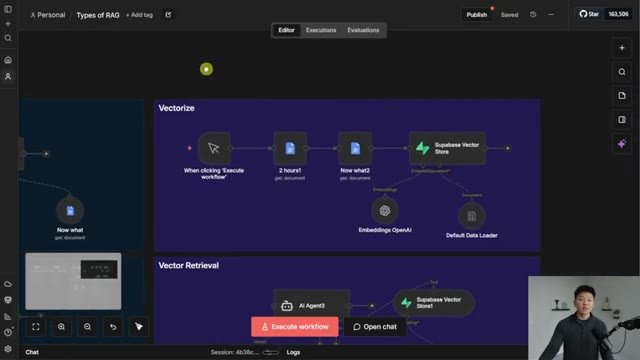
*⏱️ 00:11:27 — Interface d'un constructeur de workflow montrant un diagramme de RAG vectoriel avec des nœuds de documents, d'embeddings OpenAI et de base de données vectorielle Supabase.*

---

### ⏱️ `[00:11:42 - 00:12:06]` | Segment #28

**🔊 Audio (Transcription Intégrale Mot pour Mot en Français) :**
> Eh bien, l'avantage, c'est que l'on obtient un contexte complet et que cela répondra probablement avec plus de précision. L'inconvénient, c'est que cela peut prendre plus de temps et que ce sera plus coûteux parce que cela traite plus de jetons. L'autre inconvénient, c'est que vous risquez d'atteindre une limite avec la fenêtre de contexte, mais je vais vous montrer combien de jetons nous traitons ici. Et avec les modèles qui, chaque jour, augmentent les limites de leur fenêtre de contexte, ce n'est plus vraiment un problème pour le moment.

**👁️ Analyse Visuelle d'Écran (gemini-3.5-flash-lite) :**
**Interface & Outils** : Flowise (plateforme de construction de flux pour LLM).

**Contenu textuel & Code** : Diagrammes de flux connectant des nœuds "AI Agent" à des sources de documents et des modèles comme GPT-4o-mini, incluant des nœuds de type "Calculator" et "Think".

**Action / Démonstration** : Navigation et présentation des différentes configurations de workflow pour la gestion du contexte et des vecteurs dans un agent IA.

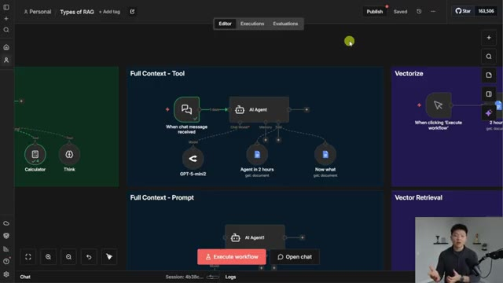
*⏱️ 00:11:48 — Une interface de workflow visuel (Flowise) illustrant différents types de stratégies de RAG (Full Context - Tool, Vectorize, Full Context - Prompt).*

---

### ⏱️ `[00:12:06 - 00:12:25]` | Segment #29

**🔊 Audio (Transcription Intégrale Mot pour Mot en Français) :**
> Et bien sûr, il y a des choses sympas que vous pouvez faire avec, comme du contexte hybride, des morceaux hybrides, mais de toute façon, entrons directement dans l'exemple. Donc ici, j'ai deux transcriptions de vidéos YouTube. J'en ai une qui s'appelle, j'ai construit un agent en deux heures, et j'ai la transcription complète, qui est un document de cinq pages, un document de quatre pages. Et puis j'en ai une autre, alors vous construisez avec l'IA, et maintenant quoi ? Et c'est aussi un document de quatre pages et demie.

**👁️ Analyse Visuelle d'Écran (gemini-3.5-flash-lite) :**
**Interface & Outils** : Flowise (ou plateforme similaire de création d'agents IA) et Google Docs.

**Contenu textuel & Code** : Nœuds de workflow ("AI Agent", "GPT-4-mini", "Agent in 2 hours") et texte de transcription détaillé.

**Action / Démonstration** : Visualisation de la structure logique d'un agent IA suivie de la lecture du script associé.

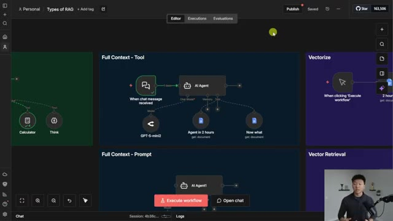
*⏱️ 00:12:11 — Interface de conception de workflow (type Low-Code/No-Code) montrant un agent IA connecté à des sources de documents.*

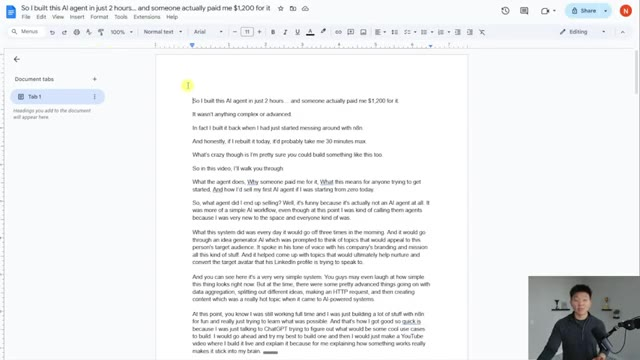
*⏱️ 00:12:16 — Document Google Docs affichant la transcription textuelle de la vidéo "So I built this AI agent in just 2 hours...".*

---

### ⏱️ `[00:12:25 - 00:12:47]` | Segment #30

**🔊 Audio (Transcription Intégrale Mot pour Mot en Français) :**
> Donc je vais vous montrer combien de tokens ces choses consomment une fois que nous aurons exécuté ces exemples. D'accord, donc je demande à cet agent de me donner une ventilation chronologique de l'agent dans une vidéo de deux heures, ce que, si nous avions fait cela avec une méthode de recherche basée sur des segments, nous aurions dû lui donner en quelque sorte des pourcentages, des horodatages et des choses de ce genre pour qu'il comprenne s'il regardait toute la vidéo ou non.

**👁️ Analyse Visuelle d'Écran (gemini-3.5-flash-lite) :**
**Interface & Outils** : Plateforme d'automatisation d'agents IA (interface basée sur un navigateur).

**Contenu textuel & Code** : Workflow visuel comprenant des nœuds comme "AI Agent", "GPT-5-mini", "Calculator" et des outils de lecture de documents. Dans le chat, le prompt "give me a chronological breakdown of the agent in 2 hours video" est visible.

**Action / Démonstration** : Le workflow est en cours de préparation pour être exécuté afin de démontrer la consommation de tokens et la capacité d'analyse d'une vidéo longue.

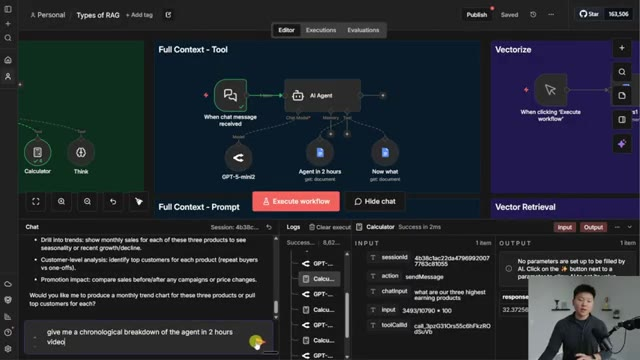
*⏱️ 00:12:31 — Une interface de plateforme d'automatisation IA (type LangFlow ou similaire) montrant un workflow graphique, une fenêtre de chat active et un panneau de logs/calculateur détaillant les interactions de l'agent.*

---

### ⏱️ `[00:12:47 - 00:13:20]` | Segment #31

**🔊 Audio (Transcription Intégrale Mot pour Mot en Français) :**
> Mais dans ce cas, il lit simplement toute cette transcription. Il nous a donc donné notre accroche de départ, ce que j'ai fait, la stack technique, le contexte personnel, la génération de leads, le moment de vente, tout ce genre de choses. Et il a fait cela dans l'ordre parce que, comme je l'ai dit, il a tout lu. Et lorsqu'on clique sur l'agent IA, on peut voir que cela n'a pris que 4 000 tokens sur la limite de fenêtre de contexte de 400 000 de GPT-5 mini. C'est donc une façon d'avoir un contexte complet : vous leur donnez les outils entre lesquels choisir. Parce que de cette façon, si je dis que je veux seulement les données d'une vidéo, il peut choisir juste celle-là. Si je dis que je veux les deux, il peut choisir les deux. Ou si nous voulons

**👁️ Analyse Visuelle d'Écran (gemini-3.5-flash-lite) :**
**Interface & Outils** : Interface web d'automatisation de type Low-Code/No-Code (workflow d'agent IA) avec panneau de chat et de logs.

**Contenu textuel & Code** : Diagramme de workflow nommé "Full Context - Tool" / "Full Context - Prompt" avec des nœuds connectés (When chat message received, AI Agent, GPT-5-mini2, documents Google Docs) et des logs d'exécution sur le panneau droit.

**Action / Démonstration** : Visualisation du workflow d'automatisation et de l'historique d'exécution dans les logs avec affichage du chat en bas à gauche.

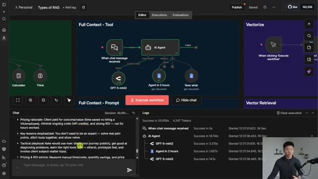
*⏱️ 00:12:55 — Interface d'un éditeur de workflow d'agent IA montrant un diagramme avec un nœud déclencheur de chat, un agent IA utilisant GPT-5-mini, et des documents connectés.*

---

### ⏱️ `[00:13:20 - 00:13:53]` | Segment #32

**🔊 Audio (Transcription Intégrale Mot pour Mot en Français) :**
> Si on enlève cette flexibilité, on pourrait juste mettre l'intégralité du contexte dans le prompt. Donc dans ce prompt précis, j'ai dit : hé, tu as ces deux vidéos au choix. Donc voici la première : « Vous construisez avec l'IA. Et maintenant ? ». Et ensuite, si je descends tout en bas — je l'ai peut-être déjà dépassée en faisant défiler — voici la deuxième : « J'ai donc construit cet agent en deux heures, bla bla bla ». Et donc maintenant, il va lire tout ce contexte, quoi qu'il arrive, ce qui est parfois très bien. Mais évidemment, le problème c'est que si vous n'avez pas besoin de l'une d'entre elles, ou si vous n'avez besoin ni de l'une ni de l'autre, il va traiter tous ces tokens à chaque fois, ce qui sera plus cher. Laissez-moi donc juste vous montrer combien de tokens ça consomme réellement, je vais simplement lancer la même requête et ça devrait à peu près

**👁️ Analyse Visuelle d'Écran (gemini-3.5-flash-lite) :**
**Interface & Outils** : Interface web de type n8n / éditeur de workflows d'automatisation IA.

**Contenu textuel & Code** : Configuration d'un prompt d'agent IA intégrant des transcriptions de vidéos (« You are an AI Agent designed to provide clear... ») et structure de blocs de flux de données.

**Action / Démonstration** : Navigation et explication des différents flux de travail pour la gestion du contexte des agents IA (Full Context - Tool vs Full Context - Prompt).

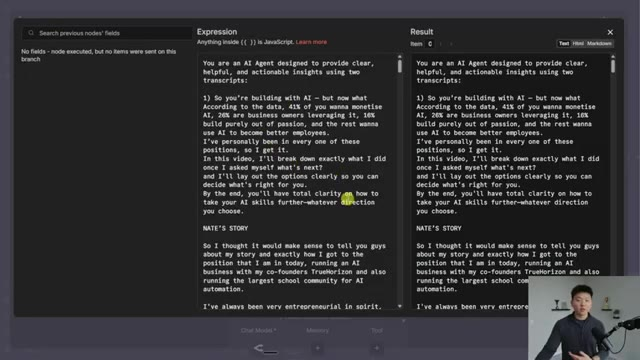
*⏱️ 00:13:28 — Vue détaillée d'un panneau de configuration ou d'une expression dans une interface de workflow, affichant le prompt système et le texte des transcripts de vidéos pour un agent IA.*

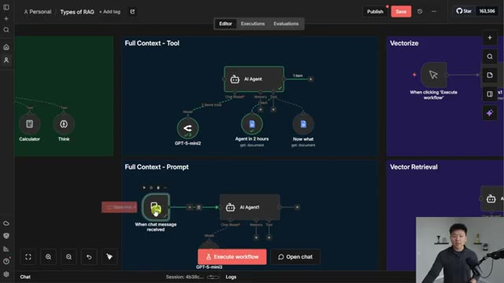
*⏱️ 00:13:45 — Vue d'ensemble d'un éditeur de workflow (style n8n) nommé « Types of RAG », montrant plusieurs blocs d'agents IA connectés (« Full Context - Tool », « Full Context - Prompt »).*

---

### ⏱️ `[00:13:53 - 00:14:21]` | Segment #33

**🔊 Audio (Transcription Intégrale Mot pour Mot en Français) :**
> Répond de la même manière. Mais cette fois, ce sera probablement le double, si ce n'est plus du double, de la quantité de tokens de l'exécution précédente. Donc ce que vous remarquerez, c'est que c'était plus rapide parce qu'il n'a pas eu à appeler d'outil, mais bien sûr, 6 577 tokens, ce qui est plus cher que ce qu'on vient de faire ci-dessus. Et donc cette dernière méthode est à peu près exactement la même chose, mais elle est un peu plus flexible parce que ce qui se passe, c'est que dans ce prompt système, si jamais vous changez ces sources de vérité, vous devriez venir le changer dans l'agent.

**👁️ Analyse Visuelle d'Écran (gemini-3.5-flash-lite) :**
**Interface & Outils** : Interface web de workflow IA (type constructeur visuel d'agents)

**Contenu textuel & Code** : Nœuds de workflow, flux de messages, logs d'exécution (6 577 tokens) et fenêtres de chat

**Action / Démonstration** : Exécution d'un workflow d'agent IA et analyse des résultats dans les logs

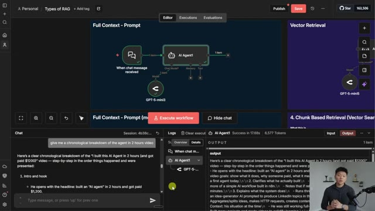
*⏱️ 00:14:00 — Interface d'un constructeur de workflow IA montrant les résultats d'exécution, le panneau de chat et les logs de l'agent 1.*

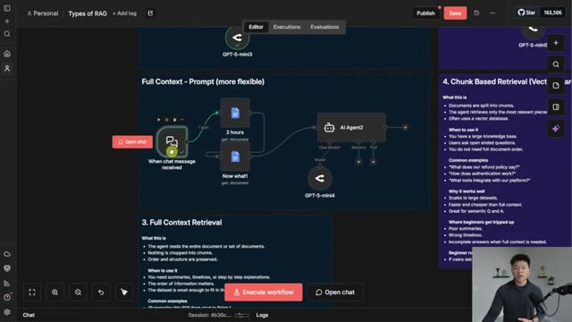
*⏱️ 00:14:14 — Vue d'ensemble du workflow "Full Context - Prompt (more flexible)" avec les nœuds de documents et l'agent IA 2.*

---

### ⏱️ `[00:14:21 - 00:14:42]` | Segment #34

**🔊 Audio (Transcription Intégrale Mot pour Mot en Français) :**
> Mais ce que vous pourriez faire, c'est de faire en sorte qu'ils soient transmis dynamiquement à chaque fois. Où, en gros, chaque fois que l'on pose une question à cet agent, il va récupérer le premier doc, il va récupérer le deuxième doc, puis il les transmet à l'agent sous forme de variables. Donc ici, vous pouvez voir que j'ai en gros simplement ces variables dynamiques, mais à chaque fois, il examinera le contenu du doc. C'est donc une autre façon dont vous pourriez appliquer la méthode du prompt système.

**👁️ Analyse Visuelle d'Écran (gemini-3.5-flash-lite) :**
**Interface & Outils** : Interface web de n8n (outil d'automatisation de flux de travail avec IA).

**Contenu textuel & Code** : Expressions JavaScript et variables de n8n pour injecter dynamiquement le contenu de documents (transcriptions) dans le prompt système d'un agent IA.

**Action / Démonstration** : Configuration des variables dynamiques et du prompt système pour transmettre plusieurs documents sous forme de variables contextuelles à l'agent.

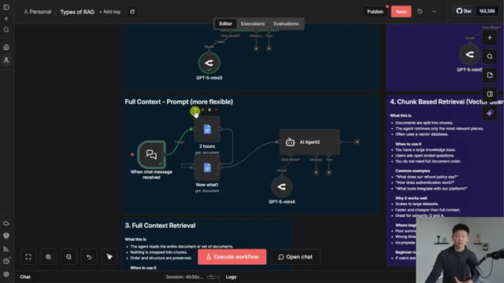
*⏱️ 00:14:26 — Vue d'ensemble d'un workflow de RAG sur une plateforme d'automatisation d'IA, montrant un déclencheur de chat connecté à des documents et un agent IA.*

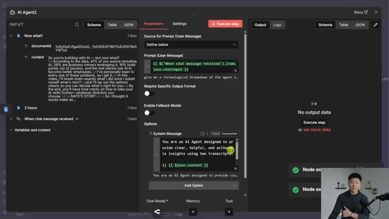
*⏱️ 00:14:32 — Configuration détaillée des paramètres d'un agent IA (« AI Agent2 ») avec la saisie de messages et un champ « System Message » intégrant du contenu dynamique.*

*⏱️ 00:14:37 — Fenêtre d'édition d'expression montrant l'injection de variables de transcription (`{{ $json.content }}`) directement dans le prompt système de l'agent.*

---

### ⏱️ `[00:14:42 - 00:15:01]` | Segment #35

**🔊 Audio (Transcription Intégrale Mot pour Mot en Français) :**
> Cela ne le rend ni moins cher ni plus cher que cette méthode, mais cela le rend plus dynamique et plus flexible. Alors, quand voudriez-vous utiliser la méthode de récupération du contexte complet ? Lorsque vous avez besoin de résumés, de chronologies ou d'explications étape par étape, si l'ordre des informations a vraiment de l'importance, ou si l'ensemble de données est suffisamment petit pour tenir simplement dans le modèle, alors balancez-le dedans.

**👁️ Analyse Visuelle d'Écran (gemini-3.5-flash-lite) :**
**Interface & Outils** : Interface web d'une plateforme d'automatisation et de workflow IA (type Make ou n8n)

**Contenu textuel & Code** : Schéma d'automatisation avec des blocs : "When chat message received", "2 hours", "Now what1", "AI Agent2", et un modèle "GPT-5-mini4"

**Action / Démonstration** : Affichage et explication du schéma d'un workflow de récupération de contexte complet pour un agent IA

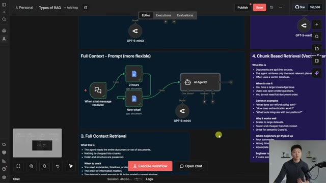
*⏱️ 00:14:47 — Un diagramme de workflow illustrant la méthode de récupération du contexte complet ("Full Context - Prompt") dans une application de type plateforme d'automatisation IA, avec le présentateur en médaillon dans le coin inférieur droit.*

---

### ⏱️ `[00:15:01 - 00:15:22]` | Segment #36

**🔊 Audio (Transcription Intégrale Mot pour Mot en Français) :**
> C'est exactement ce que j'ai fait dans l'arène agentique, si vous avez vu ça, pour le défi RAG. J'ai fini par simplement prendre tous les PDF et les balancer directement dans le prompt système de l'agent IA, surtout parce qu'on était un peu pressés par le temps. Mais ça marche, surtout avec ces modèles qui s'améliorent de plus en plus pour trouver l'aiguille dans la botte de foin, où ils ont des tonnes et des tonnes de texte à analyser, et ils parviennent quand même à trouver exactement ce qu'ils cherchent.

**👁️ Analyse Visuelle d'Écran (gemini-3.5-flash-lite) :**
**Interface & Outils** : n8n / Navigateur web

**Contenu textuel & Code** : Texte décrivant les rôles d'un agent IA ("Expert Trivia Answer Bot") et les méthodes de récupération de contexte complet ("Full Context Retrieval").

**Action / Démonstration** : Configuration d'un prompt système pour un agent IA et explication visuelle des types de RAG.

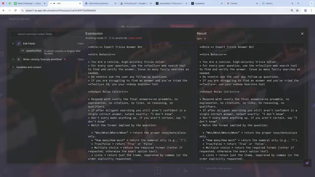
*⏱️ 00:15:06 — Interface n8n affichant un éditeur d'expressions avec les règles d'un agent IA expert en questions-réponses.*

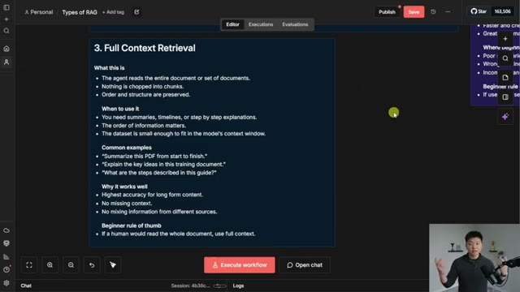
*⏱️ 00:15:17 — Interface utilisateur présentant le concept de "Full Context Retrieval" avec des explications textuelles sur l'utilisation des documents entiers dans le prompt.*

---

### ⏱️ `[00:15:22 - 00:15:46]` | Segment #37

**🔊 Audio (Transcription Intégrale Mot pour Mot en Français) :**
> La règle empirique de base ici est que si un humain lisait tout le document avant de répondre, alors vous devriez faire lire tout le document à l'agent avant qu'il ne réponde. Donc, par exemple, si un humain intègre quelqu'un, il aurait besoin de lire l'ensemble du processus. Mais si un humain répond à une question de support et qu'il peut simplement trouver une FAQ parmi les 100, il a seulement besoin de regarder cette unique FAQ. Et cela s'enchaîne parfaitement avec la dernière, bien sûr, qui est notre recherche par morceaux avec recherche vectorielle.

**👁️ Analyse Visuelle d'Écran (gemini-3.5-flash-lite) :**
**Interface & Outils** : Application web de gestion de workflows / notes (type Notion, Obsidian ou interface d'agent IA).

**Contenu textuel & Code** : Texte explicatif sur les types de RAG détaillant 'What this is', 'When to use it', 'Common examples', 'Why it works well', et 'Beginner rule of thumb'.

**Action / Démonstration** : Le présentateur explique les concepts de RAG tout en présentant les notes textuelles à l'écran.

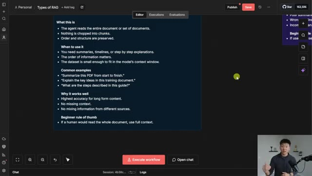
*⏱️ 00:15:28 — Interface d'une application présentant des notes structurées sur les 'Types de RAG', avec le présentateur visible en incrustation dans le coin inférieur droit.*

---

### ⏱️ `[00:15:46 - 00:16:18]` | Segment #38

**🔊 Audio (Transcription Intégrale Mot pour Mot en Français) :**
> Et donc ce que j'ai déjà fait, c'est que j'ai mis ces deux documents, les mêmes que nous venions juste de regarder ici, dans Supabase. Comme vous pouvez le voir ici, ce sont nos vecteurs provenant de ces deux transcriptions. Et maintenant, nous allons parler à l'agent et nous allons voir essentiellement la différence dans la façon dont il répond, mais aussi à quel point c'est moins cher et plus rapide. Donc, si tout d'abord je lui pose cette même question, qui était de me donner une ventilation chronologique de la vidéo de deux heures sur l'agent, nous allons remarquer que c'est plus rapide et moins cher, mais nous allons aussi bien sûr remarquer que ce n'est pas aussi précis parce qu'il ne comprend pas l'ordre pour l'instant.

**👁️ Analyse Visuelle d'Écran (gemini-3.5-flash-lite) :**
**Interface & Outils** : Supabase (Table Editor) et interface de workflow d'IA (ex: Flowise ou outil similaire).

**Contenu textuel & Code** : Lignes de données textuelles découpées avec métadonnées JSON et vecteurs numériques (embeddings), ainsi que des schémas de workflows d'agents connectés à des vector stores.

**Action / Démonstration** : Présentation de la structure des données vectorielles stockées et de l'architecture des workflows d'agents RAG.

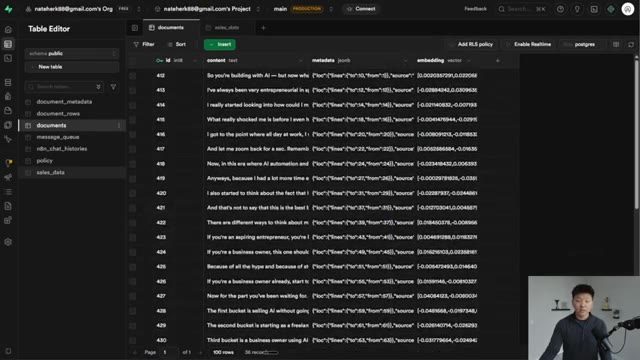
*⏱️ 00:15:54 — Vue de l'interface Supabase montrant la table 'documents' avec le contenu textuel et les vecteurs d'embedding correspondants.*

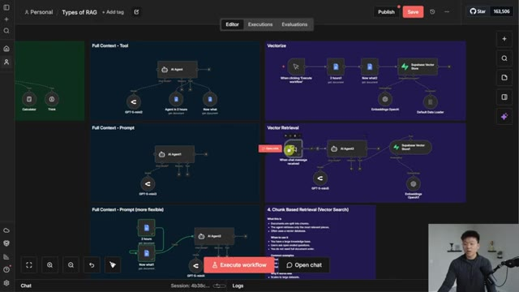
*⏱️ 00:16:02 — Vue d'ensemble d'un tableau de bord de workflow visuel de type n8n ou Flowise montrant différents types de structures RAG et d'agents IA.*

---

### ⏱️ `[00:16:19 - 00:16:37]` | Segment #39

**🔊 Audio (Transcription Intégrale Mot pour Mot en Français) :**
> Vous pouvez donc voir qu'il a trouvé l'introduction et l'accroche. Il a trouvé ce qu'était réellement l'agent, pourquoi quelqu'un a payé. Et ensuite, j'ai présenté la solution, l'étude de cas, des choses comme ça. Et il fait donc du bon travail en utilisant son cerveau d'intelligence artificielle pour comprendre, d'accord, j'ai ce nombre de fragments qui sont revenus. Maintenant, je peux les remettre dans un ordre qui me semble logique. Nous pouvons aussi jouer avec cela en faisant des choses comme augmenter la limite.

**👁️ Analyse Visuelle d'Écran (gemini-3.5-flash-lite) :**
**Interface & Outils** : Interface web d'automatisation n8n (éditeur de workflow visuel).

**Contenu textuel & Code** : Schéma de workflow de RAG vectoriel, requêtes de chat structurées sur la structure de la vidéo et logs d'exécution des nœuds.

**Action / Démonstration** : Navigation et explication du fonctionnement d'un agent IA basé sur un RAG vectoriel et sa sortie textuelle.

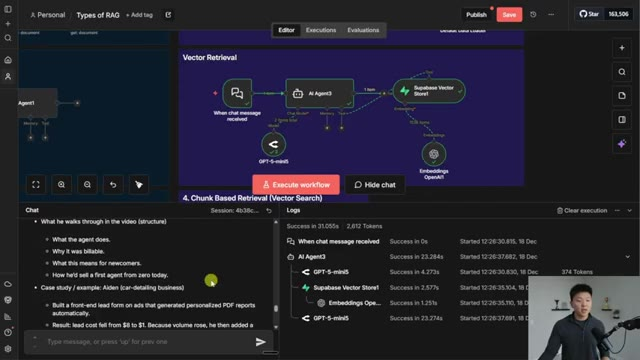
*⏱️ 00:16:23 — Interface n8n montrant un workflow de RAG avec un agent IA, un panneau de chat interactif et les logs d'exécution.*

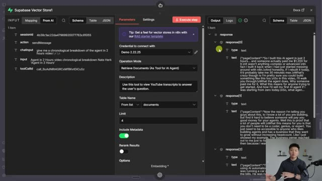
*⏱️ 00:16:33 — Configuration détaillée d'un nœud Supabase Vector Store dans n8n avec les entrées et sorties JSON affichées.*

---

### ⏱️ `[00:16:37 - 00:17:00]` | Segment #40

**🔊 Audio (Transcription Intégrale Mot pour Mot en Français) :**
> Donc, au lieu de lui donner seulement quatre morceaux à récupérer, nous pourrions lui dire d'en récupérer 20, ce qui aiderait. Mais ce sur quoi je voulais que vous fassiez attention ici, c'est que cet agent n'a consommé que 2 600 jetons, ce qui représente à ce stade environ la moitié de ce qu'il a fait plus tôt lorsqu'il a lu tout le contexte. Mais gardez à l'esprit que cet écart deviendrait de manière exponentielle plus grand lorsque nous aurons de plus en plus de données dans la base de données réelle.

**👁️ Analyse Visuelle d'Écran (gemini-3.5-flash-lite) :**
**Interface & Outils** : Interface web de type Low-code / Workflow d'automatisation (style Flowise ou similaire) avec panneau de chat et de logs intégrés.

**Contenu textuel & Code** : Diagramme de workflow montrant les nœuds "When chat message received", "AI Agent3", "GPT-5-mini", et "Supabase Vector Store1", ainsi que des panneaux de logs affichant les inputs (sessionId, action, chatInput) et outputs de l'agent.

**Action / Démonstration** : Présentation et analyse du flux d'exécution d'un agent IA et de sa consommation de ressources dans le workflow.

*⏱️ 00:16:43 — Un éditeur de workflow d'IA montrant un diagramme de RAG (Vector Retrieval) avec des nœuds pour un agent conversationnel, un modèle LLM (GPT-5-mini) et Supabase Vector Store, accompagné d'une interface de chat et de logs d'exécution détaillant les entrées et sorties.*

---

### ⏱️ `[00:17:01 - 00:17:20]` | Segment #41

**🔊 Audio (Transcription Intégrale Mot pour Mot en Français) :**
> Donc de toute façon, comme je l'ai dit plus tôt, tout cela ramène en quelque sorte à l'idée d'ingénierie du contexte. Et c'est vraiment, vraiment très important de penser à ces cinq choses différentes, qui sont de commencer avec la fin en esprit, de concevoir votre pipeline de données, d'assurer l'exactitude des données, d'optimiser les fenêtres de contexte, et d'adopter la spécialisation de l'IA.

**👁️ Analyse Visuelle d'Écran (gemini-3.5-flash-lite) :**
**Interface & Outils** : Application de prise de notes ou tableau blanc virtuel (type Canvas).

**Contenu textuel & Code** : Texte listant 5 points : 1) Begin with the end in mind, 2) Design your data pipeline, 3) Ensure data accuracy, 4) Optimize context windows, 5) Embrace AI specialization.

**Action / Démonstration** : Présentation des cinq points clés de l'état d'esprit à adopter pour l'ingénierie du contexte.

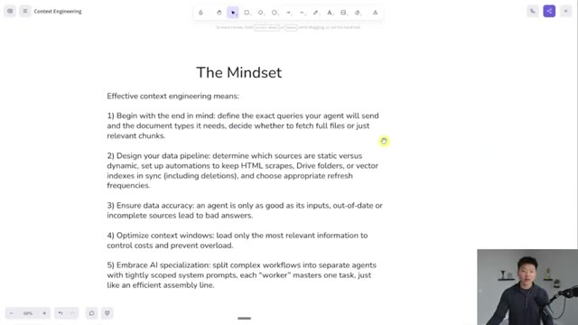
*⏱️ 00:17:06 — Une page de notes textuelles titrée 'The Mindset' listant cinq principes d'ingénierie du contexte, avec la vidéo du présentateur incrustée en bas à droite.*

---

### ⏱️ `[00:17:21 - 00:17:54]` | Segment #42

**🔊 Audio (Transcription Intégrale Mot pour Mot en Français) :**
> Donc je ne vais pas tout lire tout de suite. Je ne veux pas que cette vidéo dure trop longtemps, mais si vous souhaitez approfondir l'ingénierie du contexte, et c'est une chose super importante à comprendre parce que l'IA n'est intelligente que grâce au contexte et aux données que vous lui donnez, alors allez absolument voir ma communauté Plus. Le lien pour cela se trouve dans la description. Nous avons plus de 3 000 membres ici qui construisent avec N8N chaque jour et construisent des entreprises avec N8N chaque jour. Nous avons aussi des cours ici. Nous avons Agent Zero, de 10 heures à 10 secondes, l'agence IA d'une seule personne, des abonnements aux ventes, et nous avons des tonnes de projets N8N ici, qui sont juste comme des projets en direct étape par étape que vous pouvez reproduire pour vous-même. Je fais aussi une foire aux questions en direct

**👁️ Analyse Visuelle d'Écran (gemini-3.5-flash-lite) :**
**Interface & Outils** : Application de prise de notes / tableau blanc en ligne (Image 1) ; plateforme communautaire Skool (Images 2 et 3)

**Contenu textuel & Code** : Texte listant les 5 points clés de l'ingénierie du contexte (Begin with the end in mind, Design your data pipeline, Ensure data accuracy, Optimize context windows, Embrace AI specialization)

**Action / Démonstration** : Présentation théorique des concepts d'ingénierie du contexte et navigation sur la plateforme de la communauté.

*⏱️ 00:17:29 — Une page de notes textuelles titrée "The Mindset" détaillant les 5 principes de l'ingénierie du contexte.*

---

### ⏱️ `[00:17:54 - 00:18:08]` | Segment #43

**🔊 Audio (Transcription Intégrale Mot pour Mot en Français) :**
> chaque semaine, qui sont super amusants. Donc j'adorerais vous voir dans ces appels au sein de la communauté, mais c'est tout pour aujourd'hui. Alors si vous avez apprécié ou si vous avez appris quelque chose de nouveau, n'hésitez pas à laisser un pouce bleu. Ça m'aide énormément. Et comme toujours, je vous remercie d'être arrivés jusqu'à la fin de la vidéo. Je vous vois dans la prochaine. Merci beaucoup à tous, tout le monde.

**👁️ Analyse Visuelle d'Écran (gemini-3.5-flash-lite) :**
**Interface & Outils** : Interface web de workflow visuel / plateforme de construction d'agents IA.

**Contenu textuel & Code** : Diagrammes de workflows pour différents types de RAG (Filters, SQL Query, Full Context, Vectorize, Vector Retrieval, Chunk Based Retrieval), avec des blocs de description et des nœuds d'agents.

**Action / Démonstration** : Navigation et présentation des différents types de workflows RAG à l'écran.

*⏱️ 00:18:01 — Capture d'écran montrant une interface de workflow visuel ("Types of RAG") avec plusieurs schémas d'agents IA, boîtes de texte explicatives et un bouton "Execute workflow" en bas.*

---

