# 🎬 I Built a New AI System in 3 Hours (and got paid $1650)

> **Chaîne** : [Nate Herk | AI Automation](https://www.youtube.com/@nateherk/featured)  
> **Lien YouTube** : [https://www.youtube.com/watch?v=Q4iEslmyMyM](https://www.youtube.com/watch?v=Q4iEslmyMyM)  
> **Date de publication** : 20260107  
> **Durée** : 00:29:38  
> **Identifiant vidéo** : `Q4iEslmyMyM`  
> **Transcription & Analyse** : `whisper-v3-large-turbo+gemini-3.5-flash-lite`  

---

## 📌 Synthèse Exécutive & Outils

### 💡 Résumé

Dans cette vidéo, Nate Herk démontre la conception et le déploiement rapide d'un système d'automatisation par agent IA, réalisé en seulement trois heures et facturé 1 650 dollars à un client. À travers l'utilisation de N8N, l'architecte met en lumière la simplicité avec laquelle il est possible de concevoir des solutions à forte valeur ajoutée pour répondre à des besoins de gestion de boîte de réception de plus en plus complexes. La solution présentée s'articule autour d'un routeur d'e-mails automatisé (filtrant les messages internes vers Slack et classant les autres dans un tableur) et d'un assistant conversationnel intelligent intégré directement dans Slack.

La démonstration technique se concentre particulièrement sur la configuration de l'assistant de messagerie personnel. En connectant un modèle de chat à l'outil Gmail de N8N, Nate configure dynamiquement des filtres temporels et d'expéditeurs en langage naturel. Il met également en évidence une subtilité critique de paramétrage : la désactivation de l'option « simplifier » pour éviter la troncature des e-mails et garantir la récupération du corps complet des messages. L'ensemble illustre la puissance des agents autonomes capables d'interpréter des requêtes conversationnelles pour manipuler des API tierces avec précision.

Enfin, la vidéo aborde l'architecture par sous-flux pour la rédaction de messages, permettant d'isoler la logique de génération et d'injecter un contexte et un ton spécifiques. Cet aperçu démontre qu'avec une maîtrise de base des outils low-code comme N8N et une bonne structuration des prompts systèmes, les ingénieurs et créateurs d'IA peuvent monétiser très rapidement leurs compétences en automatisation auprès d'entreprises en quête de productivité.

### 🛠️ Outils, Modèles & Logiciels Présentés

* **N8N** : Plateforme d'automatisation de flux de travail (workflow automation) low-code utilisée pour orchestrer l'agent IA, les déclencheurs et les intégrations d'API.
* **Slack** : Application de messagerie d'équipe utilisée comme interface utilisateur conversationnelle (chat interface) pour dialoguer avec l'agent IA (HerkBot).
* **Gmail** : Service de messagerie de Google interconnecté via un outil dédié dans N8N pour la recherche, le filtrage et la récupération des e-mails.
* **Google Contacts** : Carnet d'adresses exploité par l'agent pour récupérer les coordonnées et adresses e-mail des interlocuteurs.
* **Modèle de Chat (LLM)** : Composant de traitement du langage naturel sous-jacent à l'agent IA, chargé d'interpréter les requêtes textuelles et de renseigner les paramètres des outils.
* **Mémoire Simple (Simple Memory)** : Composant N8N permettant de conserver l'historique conversationnel de l'agent pour assurer des interactions fluides et contextuelles.

### 🔑 Points Clés & Enseignements Stratégiques

* **Rentabilité et rapidité d'exécution** : Un système d'IA fonctionnel peut être conçu en seulement quelques heures et générer un retour sur investissement immédiat, illustré ici par une facturation de 1 650 dollars pour une construction initiale de trois heures.
* **Architecture en deux parties** : Séparer le système en un routeur d'e-mails automatisé en arrière-plan (classification et journalisation) et un assistant conversationnel interactif permet de répondre à des besoins utilisateurs variés sans alourdir la logique d'un seul flux.
* **Interface utilisateur familière** : Utiliser Slack comme interface de commande pour l'assistant d'e-mails réduit la courbe d'apprentissage pour le client final, qui interagit avec l'IA comme s'il s'adressait à un collègue.
* **Exploitation des filtres dynamiques** : L'agent IA est capable d'analyser une demande en langage naturel (ex. : « mes e-mails de la semaine dernière ») et de traduire automatiquement cette intention en paramètres structurés pour l'outil Gmail (reçu après/avant).
* **Piège technique de la troncature des données** : Désactiver l'option « simplifier » dans les outils de récupération de messages est impératif pour s'assurer que l'agent accède au contenu complet des e-mails et non à de simples extraits tronqués.
* **Architecture par sous-flux (Sub-workflows)** : Déleguer la rédaction des e-mails à un agent spécialisé dans un sous-flux permet d'isoler la logique complexe, d'injecter des consignes de ton et de style très riches, et de décharger l'agent principal.
* **Injection systématique du contexte temporel** : Intégrer explicitement la date et l'heure actuelles dans les consignes système (system prompts) de chaque agent garantit la fiabilité des requêtes temporelles relatives aux e-mails.
* **Évolution rapide des compétences low-code** : La courbe d'apprentissage sur des plateformes comme N8N est abrupte mais rapide ; un flux initialement construit en trois heures peut être optimisé et reproduit en trente minutes avec de l'expérience.
* **Adaptabilité des paramètres optionnels** : La configuration de filtres multiples (expéditeur, date de début, date de fin) offre une grande souplesse, permettant à l'agent d'exécuter des recherches même si certains critères sont laissés vides par l'utilisateur.
* **Validation itérative par les tests** : Valider le comportement de l'agent étape par étape — d'abord en vérifiant la bonne réception de messages génériques, puis en testant l'utilisation précise des outils — sécurise le développement avant l'ajout des consignes finales.

---

## ⏱️ Chronologie & Transcription Complète Audio & Visuelle (Mot pour Mot)

### ⏱️ `[00:00:00 - 00:00:34]` | Segment #01

**🔊 Audio (Transcription Intégrale Mot pour Mot en Français) :**
> J'ai donc construit un flux de travail d'IA en seulement trois heures et quelqu'un m'a réellement payé 1 650 dollars pour cela. Ce n'était rien de trop complexe ou avancé. En fait, j'ai construit cela avec très peu d'expérience dans N8N. Et honnêtement, si je le reconstruisais aujourd'hui, cela me prendrait probablement 30 minutes maximum. Donc dans cette vidéo, je vais non seulement le construire devant vous, mais nous allons aussi examiner ce que fait l'agent, pourquoi quelqu'un m'a payé pour cela, ce que je ferais différemment aujourd'hui, et comment je vendrais mon premier flux de travail d'IA si je partais de zéro aujourd'hui. Alors, quel flux de travail ai-je fini par vendre et comment procédons-nous pour le construire ? Eh bien, c'était en fait l'une des demandes les plus courantes que je recevais lorsque j'ai commencé à utiliser N8N, qui était une sorte de système d'e-mails, parce que tout le monde aime gérer sa boîte de réception d'une manière un peu différente, mais c'est super important.

**👁️ Analyse Visuelle d'Écran (gemini-3.5-flash-lite) :**
**Interface & Outils** : Graphique animé 3D d'introduction de chapitre.

**Contenu textuel & Code** : Texte 'WHAT THE AGENT DOES?' sur une carte avec une icône de support client.

**Action / Démonstration** : Présentation des étapes clés du sujet abordé dans la vidéo.

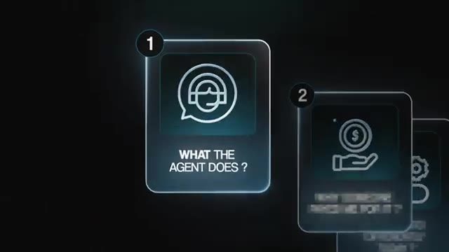
*⏱️ 00:00:17 — Un graphique animé en 3D sur fond sombre présente des cartes numérotées, la première étant intitulée 'WHAT THE AGENT DOES?'.*

---

### ⏱️ `[00:00:34 - 00:00:57]` | Segment #02

**🔊 Audio (Transcription Intégrale Mot pour Mot en Français) :**
> Donc j'ai un Excalibur ici, et nous allons passer en revue d'une manière assez globale ce que fait le système, et ensuite nous irons sur NNN pour voir concrètement comment il fonctionne. C'était donc en quelque sorte un système en deux parties. Le premier élément sur ce côté gauche était votre genre d'agent de routage de boîte de réception typique. Il était donc déclenché chaque fois que le client recevait un nouvel e-mail dans sa boîte de réception, comme vous pouvez le voir. Et avant même d'utiliser NEAI, nous avons simplement fait une vérification très simple pour voir si l'expéditeur de l'e-mail était un e-mail interne.

**👁️ Analyse Visuelle d'Écran (gemini-3.5-flash-lite) :**
**Interface & Outils** : Application de tableau blanc virtuel / mindmapping ("Inbox Manager").

**Contenu textuel & Code** : Diagramme d'architecture du système : à gauche, un flux partant de "New email" vers "Classification AI" (Finance, Opportunities, Sales) et Slack DM ; à droite, un bloc "AI Agent" connecté à plusieurs sous-processus et outils.

**Action / Démonstration** : Le présentateur explique les grandes lignes de l'architecture du système en pointant le schéma du côté gauche.

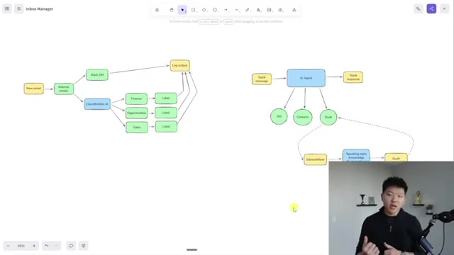
*⏱️ 00:00:40 — Schéma conceptuel divisé en deux parties sur un tableau blanc virtuel, montrant un flux de gestion d'e-mails à gauche et un agent IA à droite, avec le présentateur incrusté en bas à droite.*

---

### ⏱️ `[00:00:58 - 00:01:21]` | Segment #03

**🔊 Audio (Transcription Intégrale Mot pour Mot en Français) :**
> Et si c'était le cas, ça lui enverrait automatiquement un message direct sur Slack et ça lui transmettrait ça directement dans son Slack. Mais si c'était n'importe quel autre type d'e-mail, ça descendrait ici vers un nœud d'intelligence artificielle, qui classifierait le type d'e-mail en fonction des finances, des opportunités, ou des ventes, et de quelques autres catégories. Mais je voulais juste simplifier un tout petit peu les choses dans ce schéma fonctionnel. Donc en fait, tout ce que ça ferait, c'est que ça étetterait l'e-mail, et ensuite ça enregistrerait tous ces résultats dans un beau tableur bien propre qu'il pourrait consulter pour voir et pour assurer un vrai suivi des e-mails qui arrivent.

**👁️ Analyse Visuelle d'Écran (gemini-3.5-flash-lite) :**
**Interface & Outils** : Application de tableau blanc / diagramme en ligne (style Excalidraw ou similaire) avec une incrustation vidéo du présentateur en bas à droite.

**Contenu textuel & Code** : Blocs de workflow : New email, Internal emails, Slack DM, Classification AI, Finance, Opportunities, Sales, Label, Log output.

**Action / Démonstration** : Le curseur de la souris survole le nœud "Classification AI" pour illustrer le processus de routage et de classification des e-mails.

*⏱️ 00:01:04 — Schéma de workflow pour la gestion des e-mails montrant un point de départ "New email", une bifurcation vers "Slack DM" pour les e-mails internes et vers un nœud "Classification AI" pour les autres, qui catégorise ensuite les messages en "Finance", "Opportunities" et "Sales".*

---

### ⏱️ `[00:01:22 - 00:01:40]` | Segment #04

**🔊 Audio (Transcription Intégrale Mot pour Mot en Français) :**
> Et donc cette partie était super facile, assez déterministe, et pas trop difficile à construire. Et ensuite, nous passons ici à la deuxième partie, qui était plus ou moins une sorte d'assistant de messagerie personnel, avec lequel il pouvait communiquer sur Slack. Il pouvait récupérer ses e-mails et il pouvait aussi rédiger des e-mails pour lui en consultant ses contacts. Et ce qui était vraiment important, c'est que tous les brouillons qui étaient créés ici lui ressemblaient.

**👁️ Analyse Visuelle d'Écran (gemini-3.5-flash-lite) :**
**Interface & Outils** : Outil de tableau blanc / diagramme en ligne (type Excalidraw ou similaire) avec une vidéo du présentateur en bas à droite.

**Contenu textuel & Code** : Blocs de workflow : "New email", "Internal emails", "Slack DM", "Classification AI" avec des branches "Finance", "Opportunities", "Sales" menant à des étiquettes et "Log output".

**Action / Démonstration** : Le présentateur explique le fonctionnement du flux de traitement des e-mails et des notifications Slack.

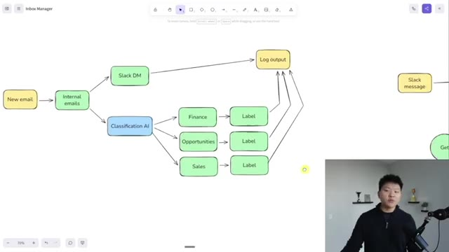
*⏱️ 00:01:26 — Un diagramme de workflow sur un tableau blanc virtuel montrant le traitement des e-mails avec des blocs connectés, incluant l'envoi de messages Slack et la classification par IA.*

---

### ⏱️ `[00:01:40 - 00:02:06]` | Segment #05

**🔊 Audio (Transcription Intégrale Mot pour Mot en Français) :**
> Donc, ce que nous avons réellement fait, c'est que nous avions deux outils, puis un sous-flux de travail. Donc, l'outil de récupération d'e-mails pouvait fondamentalement juste effectuer des recherches dans ses e-mails et filtrer par date ou par expéditeur, des choses comme ça. Nous avions, bien sûr, les contacts. Dans ce cas, il a utilisé les contacts Google afin de récupérer les adresses e-mail des personnes à qui il veut envoyer un e-mail, ou s'il veut récupérer des e-mails afin de pouvoir rechercher des e-mails provenant de ces personnes. Et ensuite, pour l'agent de rédaction, ce que nous avons fait, c'est que nous avions en réalité un sous-flux de travail qui capturait fondamentalement les informations dans le sens où, hé, rédige un e-mail à ce sujet pour cette personne.

**👁️ Analyse Visuelle d'Écran (gemini-3.5-flash-lite) :**
**Interface & Outils** : Outil de diagramme/schéma en ligne (type Excalidraw)

**Contenu textuel & Code** : Schéma d'architecture d'automatisation avec des blocs interconnectés (AI Agent, outils de récupération d'e-mails et sous-flux de travail).

**Action / Démonstration** : Le présentateur explique la structure du système d'automatisation et les interactions entre les différents outils et flux de travail.

*⏱️ 00:01:46 — Un diagramme de workflow interactif (type Excalidraw ou similaire) intitulé 'Inbox Manager' montrant l'architecture d'un agent IA avec des nœuds pour 'Slack message', 'AI Agent', 'Get', 'Contacts', 'Draft' et 'Subworkflow', tandis que le présentateur apparaît en incrustation vidéo dans le coin inférieur droit.*

---

### ⏱️ `[00:02:06 - 00:02:25]` | Segment #06

**🔊 Audio (Transcription Intégrale Mot pour Mot en Français) :**
> Et nous avons transmis cela à un agent d'IA spécialisé dans le sous-flux, car nous pouvions ainsi injecter beaucoup de contexte, du genre : voici qui tu es, voici comment tu parles, c'est le type de langage que tu utilises, puis envoyer le brouillon réel au lieu de laisser cet agent principal s'occuper de tout cela. Et je vais expliquer cela un peu plus en profondeur quand nous aborderons End and End, ce que nous allons faire, et expliquer pourquoi j'ai décidé de concevoir l'architecture de la solution de cette manière.

**👁️ Analyse Visuelle d'Écran (gemini-3.5-flash-lite) :**
**Interface & Outils** : Application de tableau blanc / diagramme en ligne (type Excalidraw)

**Contenu textuel & Code** : Diagramme avec des boîtes étiquetées "Slack message", "AI Agent", "Slack response", "Get", "Contacts", "Draft", "Subworkflow", "Speaking style Knowledge Best practices".

**Action / Démonstration** : Présentation visuelle de l'architecture du workflow et du sous-flux par le présentateur.

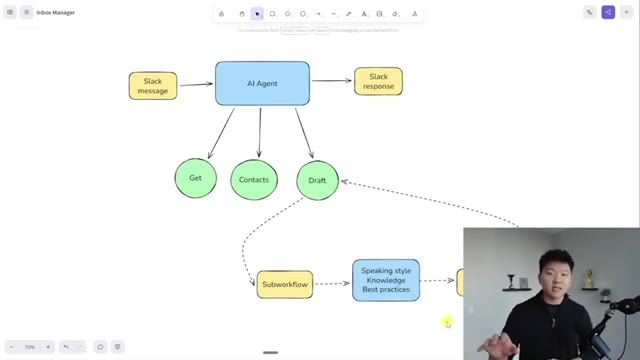
*⏱️ 00:02:11 — Schéma de workflow montrant un agent IA principal connecté à des actions (Slack message, Slack response, Get, Contacts, Draft) et un sous-flux avec des blocs de style de communication.*

---

### ⏱️ `[00:02:25 - 00:02:44]` | Segment #07

**🔊 Audio (Transcription Intégrale Mot pour Mot en Français) :**
> Bon, alors je ne vais pas vraiment construire la partie gestionnaire de boîte de réception parce que c'est une construction plutôt ennuyeuse et j'ai déjà fait une formation complète dessus, ce qui est à peu près ce qu'on regarde ici. Donc si ça vous intéresse de voir comment vous pouvez faire cette partie, alors je mettrai un lien vers la vidéo complète juste ici et vous pourrez aller la regarder puis revenir ici et nous allons maintenant construire la partie assistant de la boîte de réception où nous lui parlons dans Slack.

**👁️ Analyse Visuelle d'Écran (gemini-3.5-flash-lite) :**
**Interface & Outils** : Interface web de création de workflow (éditeur visuel de type no-code / agents IA).

**Contenu textuel & Code** : Un "Setup Guide" détaillé listant les étapes de configuration (connexion Gmail, identifiants OpenRouter, étiquettes, classificateur de texte) et un diagramme de flux avec un déclencheur Gmail, un classificateur de texte, et plusieurs branches de traitement par agents (Support, Finance, Priority, Promotion).

**Action / Démonstration** : Présentation globale du flux de travail d'automatisation des e-mails par le présentateur visible en incrustation vidéo en bas à droite.

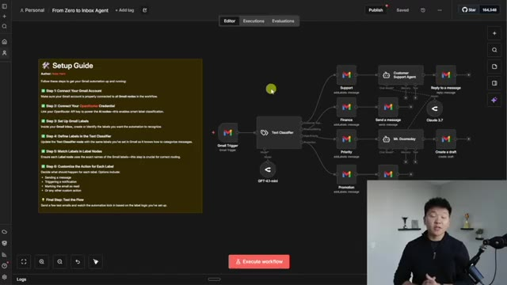
*⏱️ 00:02:30 — Interface d'un éditeur de workflow avec un guide de configuration à gauche et un schéma de traitement des e-mails Gmail à droite.*

---

### ⏱️ `[00:02:44 - 00:03:07]` | Segment #08

**🔊 Audio (Transcription Intégrale Mot pour Mot en Français) :**
> J'ai donc déjà réglé les formalités ennuyeuses. J'ai configuré le déclencheur Slack entrant et j'ai configuré la réponse renvoyée à Slack, et vous pouvez voir que nous venons de tester cela en demandant à l'agent IA : « raconte-moi une histoire sur un garçon qui est tombé malade parce qu'il avait mangé trop de crème glacée ». Et nous avons obtenu la réponse dans Slack. Et si je bascule par ici, vous pouvez voir que nous avons pour ainsi dire dit : hé, at HerkBot, raconte-moi une histoire. Et ensuite HerkBot répond avec cette information. C'est donc un peu de cette manière que nous allons parler à NNN et faire en sorte que NNN nous réponde ici dans Slack comme interface.

**👁️ Analyse Visuelle d'Écran (gemini-3.5-flash-lite) :**
**Interface & Outils** : n8n et Slack

**Contenu textuel & Code** : Workflow d'automatisation n8n et messages textuels dans Slack (récit généré par l'IA).

**Action / Démonstration** : Présentation de la configuration du workflow d'automatisation et du test réussi de l'agent IA sur Slack.

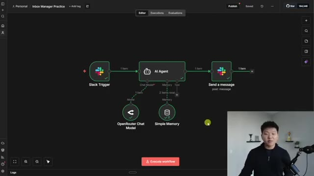
*⏱️ 00:02:49 — Vue d'ensemble du workflow n8n montrant le déclencheur Slack, l'agent IA, le modèle de chat OpenRouter et la mémoire simple.*

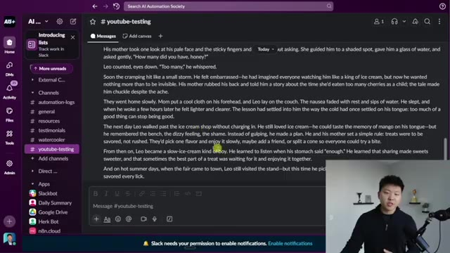
*⏱️ 00:03:01 — Interface Slack affichant un canal de test avec la réponse générée par l'agent IA sous forme d'histoire.*

---

### ⏱️ `[00:03:07 - 00:03:25]` | Segment #09

**🔊 Audio (Transcription Intégrale Mot pour Mot en Français) :**
> Très bien, alors commençons directement avec l'outil Gmail. Donc à ce stade, nous avons déjà notre modèle de chat, nous avons notre mémoire, et nous avons le genre d'interface réelle. Mais vous pouvez voir qu'il n'y a pas encore de consignes système ici. Donc ce que je vais faire, c'est que je vais ajouter un outil, nous allons prendre un outil Gmail. Et ce que nous voulons faire ici, c'est modifier l'opération et la ressource parce que nous n'envoyons pas de message.

**👁️ Analyse Visuelle d'Écran (gemini-3.5-flash-lite) :**
**Interface & Outils** : Interface web de type n8n / plateforme d'automatisation de flux de travail.

**Contenu textuel & Code** : Workflow composé d'un "Slack Trigger", d'un "AI Agent", d'un "OpenRouter Chat Model", d'une "Simple Memory" et d'une action "Send a message".

**Action / Démonstration** : Navigation et explication des composants du workflow et des paramètres de l'agent IA par le présentateur.

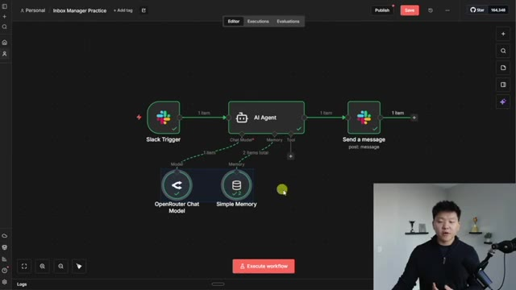
*⏱️ 00:03:12 — Vue d'ensemble d'un workflow de type n8n montrant un déclencheur Slack, un agent IA, un modèle OpenRouter et une mémoire simple, avec le présentateur en bas à droite.*

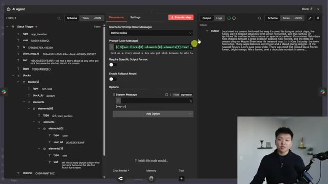
*⏱️ 00:03:16 — Gros plan sur les paramètres de l'agent IA affichant les panneaux d'entrée, de configuration des prompts et de sortie avec les résultats de l'exécution.*

---

### ⏱️ `[00:03:25 - 00:03:46]` | Segment #10

**🔊 Audio (Transcription Intégrale Mot pour Mot en Français) :**
> Ce que nous voulons faire, c'est récupérer de nombreux messages, mais nous ne voulons pas simplement tous les renvoyer. Nous voulons configurer certains filtres. C'est donc vraiment, vraiment facile. Tout ce que j'ai à faire, c'est de cliquer sur ajouter un filtre, et ensuite nous pouvons choisir les différents filtres que nous voulons inclure dans cet outil. Le client a donc dit qu'il aimerait beaucoup avoir la possibilité de dire : hé, laisse-moi juste jeter un œil à tous mes e-mails d'aujourd'hui, ou tous mes e-mails du 19 décembre, ou tous mes e-mails des deux dernières semaines de Nate, ou peu importe ce que c'est.

**👁️ Analyse Visuelle d'Écran (gemini-3.5-flash-lite) :**
**Interface & Outils** : n8n (éditeur de workflow d'automatisation)

**Contenu textuel & Code** : Paramètres du nœud de récupération de messages, affichant les champs 'Credential', 'Resource', 'Operation' (Get Many), 'Limit' (50), et la section 'Filters' avec le bouton 'Add Filter'.

**Action / Démonstration** : Le présentateur s'apprête à cliquer sur le bouton 'Add Filter' pour configurer des filtres sur les messages récupérés.

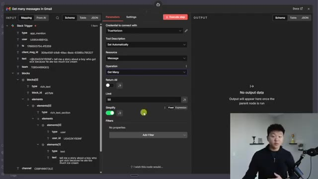
*⏱️ 00:03:31 — Vue rapprochée de l'éditeur de nœud n8n avec les paramètres de configuration pour récupérer les messages, incluant la section des filtres et le bouton 'Add Filter'.*

---

### ⏱️ `[00:03:46 - 00:04:05]` | Segment #11

**🔊 Audio (Transcription Intégrale Mot pour Mot en Français) :**
> Donc les trois filtres que nous avons faits ici étaient "reçu après". Nous avons fait "reçu avant" afin de pouvoir spécifier une période. Et ensuite, nous avons aussi fait "expéditeur". Et l'expéditeur pouvait être soit l'adresse e-mail, soit une partie du nom de l'expéditeur. C'est donc un peu dynamique ici. Et ce qui est bien aussi, c'est que nous n'avons pas besoin de remplir réellement ces trois champs. Donc si nous faisons simplement une recherche pour les e-mails de la semaine dernière et que nous laissons l'expéditeur vide, cela fonctionnerait quand même.

**👁️ Analyse Visuelle d'Écran (gemini-3.5-flash-lite) :**
**Interface & Outils** : n8n (outil d'automatisation de flux de travail)

**Contenu textuel & Code** : Paramètres du nœud 'Get Many messages in Gmail' avec les options 'Received After', 'Received Before', et le bouton 'Add Filter'.

**Action / Démonstration** : Configuration des filtres de date et de l'expéditeur dans le nœud Gmail au sein du workflow d'automatisation.

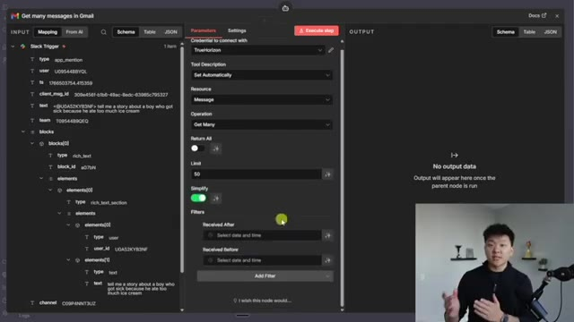
*⏱️ 00:03:51 — Interface d'un nœud d'automatisation n8n montrant les paramètres de configuration pour l'action 'Get Many' de Gmail, incluant les options de filtres de date et le présentateur dans l'encadré en bas à droite.*

---

### ⏱️ `[00:04:05 - 00:04:25]` | Segment #12

**🔊 Audio (Transcription Intégrale Mot pour Mot en Français) :**
> Donc de toute façon, à partir d'ici, ce que je fais est vraiment, vraiment simple. Je clique simplement sur ce bouton trois fois. Donc bam, bam, bam. Et cela signifie essentiellement, d'accord, c'est l'agent IA qui va décider de ce que sont ces paramètres. Donc, en fonction de notre demande en langage naturel, il remplira ces paramètres par lui-même. Laissez-moi donc vous montrer ce que je veux dire par là. Donc avant même de donner à cet agent un prompt système, vous pouvez voir qu'il n'y a rien ici et nous n'avons même pas changé le nom de cet outil.

**👁️ Analyse Visuelle d'Écran (gemini-3.5-flash-lite) :**
**Interface & Outils** : n8n (outil d'automatisation de workflows visuels).

**Contenu textuel & Code** : Paramètres de configuration des nœuds et liens entre l'agent IA, Slack, Gmail et le modèle de langage.

**Action / Démonstration** : Configuration des paramètres d'un nœud pour qu'ils soient définis automatiquement par le modèle d'IA.

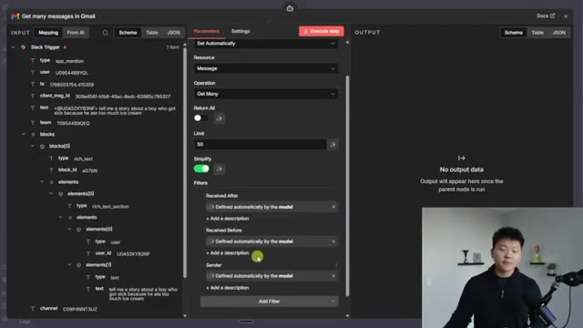
*⏱️ 00:04:10 — Interface de configuration d'un nœud dans n8n, montrant les paramètres réglés automatiquement par le modèle IA.*

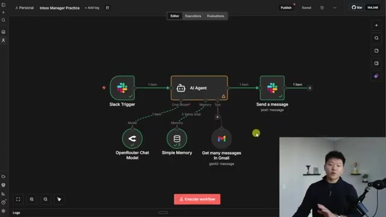
*⏱️ 00:04:20 — Vue d'ensemble d'un workflow n8n montrant un Agent IA connecté à Slack, Gmail et un modèle OpenRouter.*

---

### ⏱️ `[00:04:25 - 00:04:49]` | Segment #13

**🔊 Audio (Transcription Intégrale Mot pour Mot en Français) :**
> Voyons s'il est assez intelligent pour utiliser réellement ces paramètres dès maintenant. Donc, si je viens dans Slack et que je m'adresse au bot Herc et que je dis, hé, est-ce que tu peux récupérer mes emails de la semaine dernière ? On va envoyer ça. Nous allons regarder l'agent NNN saisir ce message, commencer à comprendre et à réfléchir à travers son modèle de chat, et ensuite, espérons-le, interroger l'outil. Gardez à l'esprit qu'il n'y a pas de consignes système là-dedans, que nous ajouterons dans un instant. Mais je voulais juste vous montrer comment l'agent est capable de remplir intelligemment ces paramètres dans cet outil de récupération de nombreux messages dans Gmail.

**👁️ Analyse Visuelle d'Écran (gemini-3.5-flash-lite) :**
**Interface & Outils** : Slack, n8n (éditeur de workflow), OpenRouter.

**Contenu textuel & Code** : Le prompt "@Herk Bot get my emails from the past week" dans Slack et le schéma de workflow d'automatisation d'agent IA dans n8n.

**Action / Démonstration** : Le présentateur saisit un message interpellant le bot dans Slack, puis l'écran bascule sur l'éditeur n8n montrant l'exécution du workflow par l'agent IA.

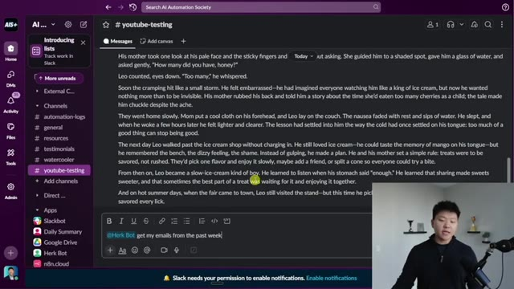
*⏱️ 00:04:31 — Interface Slack montrant le canal #youtube-testing avec le message "@Herk Bot get my emails from the past week" saisi dans le champ de texte.*

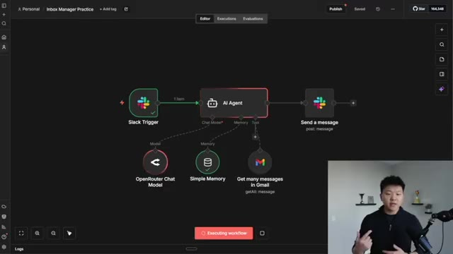
*⏱️ 00:04:37 — Interface n8n affichant un workflow de gestion d'e-mails avec un déclencheur Slack, un agent IA connecté à OpenRouter, une mémoire simple et l'outil Gmail.*

---

### ⏱️ `[00:04:49 - 00:05:08]` | Segment #14

**🔊 Audio (Transcription Intégrale Mot pour Mot en Français) :**
> D'accord, donc ça vient juste de se terminer. Vous pouvez voir qu'on a récupéré 50 éléments de cet outil. On a reçu le message dans Slack. Donc si je retourne dans Slack, on peut voir que le HurtBot a dit : j'ai extrait vos messages de la semaine dernière. Voici ci-dessous les éléments les plus récents que j'ai pu trouver. Et ensuite, il fait fondamentalement juste un résumé vraiment, vraiment rapide de tous ces éléments. Donc on a vérifié qu'il comprend comment utiliser l'outil. Mais maintenant, nous devons l'examiner d'un peu plus près.

**👁️ Analyse Visuelle d'Écran (gemini-3.5-flash-lite) :**
**Interface & Outils** : Slack (application de messagerie professionnelle)

**Contenu textuel & Code** : Réponse du bot listant les e-mails de la semaine précédente (alertes de sécurité, réunions) avec résumé et options d'action.

**Action / Démonstration** : Présentation de la notification Slack et des résultats de l'automatisation par le bot.

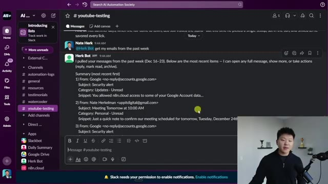
*⏱️ 00:04:53 — Interface Slack affichant un message de Herk Bot listant les e-mails récents extraits avec l'expéditeur, le sujet, la catégorie et un extrait, en présence du présentateur dans un encadré en bas à droite.*

---

### ⏱️ `[00:05:08 - 00:05:43]` | Segment #15

**🔊 Audio (Transcription Intégrale Mot pour Mot en Français) :**
> Donc, si je clique dans l'outil, vous pouvez voir que plusieurs choses se produisent. La première chose, c'est que sur le côté gauche, nous pouvons voir la façon dont il a rempli les paramètres. Donc, juste ici, nous pouvons voir que « reçu après » était le 2025-12-16, ce qui était il y a une semaine, et ensuite « reçu avant » était le 2025-12-24, ce qui est demain. Donc, il dit essentiellement tous les e-mails d'aujourd'hui et en remontant jusqu'à il y a une semaine. Et il a laissé l'expéditeur vide parce que nous n'avions pas de paramètre d'expéditeur. C'est donc ainsi que cet outil fonctionne. Maintenant, une chose que je veux vraiment vous montrer, les gars, c'est que pour l'instant, nous avons cette option appelée « simplifier » qui est activée, et ce n'est pas bon, car si nous allons réellement examiner l'un des e-mails, par exemple ce premier, vous pouvez voir qu'il nous donne un extrait d'e-mail. Donc l'e-mail est coupé

**👁️ Analyse Visuelle d'Écran (gemini-3.5-flash-lite) :**
**Interface & Outils** : n8n (interface web d'automatisation)

**Contenu textuel & Code** : Paramètres du nœud « Get many messages in Gmail », affichant les champs « Received After » défini sur « 2025-12-16 » et les données de sortie JSON.

**Action / Démonstration** : Le présentateur explique les paramètres générés automatiquement par le modèle d'IA dans l'outil d'automatisation.

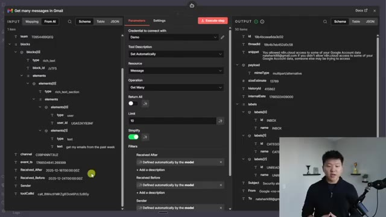
*⏱️ 00:05:17 — Interface d'un outil d'automatisation montrant les paramètres remplis automatiquement pour récupérer des messages Gmail, avec le présentateur en médaillon dans le coin inférieur droit.*

---

### ⏱️ `[00:05:43 - 00:06:15]` | Segment #16

**🔊 Audio (Transcription Intégrale Mot pour Mot en Français) :**
> coupé après un certain nombre de caractères, ce qui n'est pas bon parce que si nous voulions réellement résumer un e-mail ou obtenir, vous savez, le contenu complet d'un e-mail récupéré, nous ne verrions qu'un extrait. Nous allons donc désactiver cette option qui s'appelle simplifier. Je vais enregistrer ce flux de travail. Et maintenant, je vais demander un e-mail spécifique et voir s'il peut récupérer tout le contenu. De retour dans Slack, je vais demander au bot Herc de récupérer mon e-mail d'aujourd'hui de la part de Nate. Et je vais juste dire, Nate, je ne lui donne pas d'adresse e-mail. Je ne donne pas le nom complet. Et j'espère qu'il va chercher dans cet outil Gmail pour la date d'aujourd'hui. Et il va chercher un expéditeur nommé Nate. Et nous devrions être capables de récupérer le contenu complet du corps du message.

**👁️ Analyse Visuelle d'Écran (gemini-3.5-flash-lite) :**
**Interface & Outils** : n8n (éditeur de workflow) et application Slack

**Contenu textuel & Code** : Nœuds de workflow connectant Slack et Gmail à un agent IA piloté par OpenRouter.

**Action / Démonstration** : Configuration et test d'un agent d'automatisation de boîte de réception connectant Gmail à Slack.

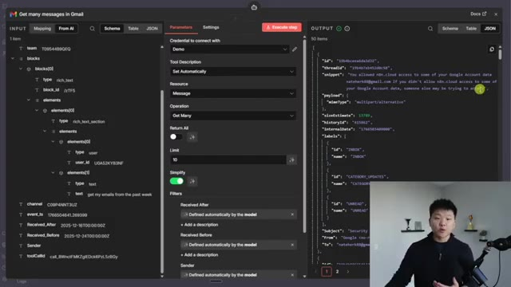
*⏱️ 00:05:51 — Interface de configuration d'un nœud d'intégration Gmail montrant les paramètres de récupération des messages.*

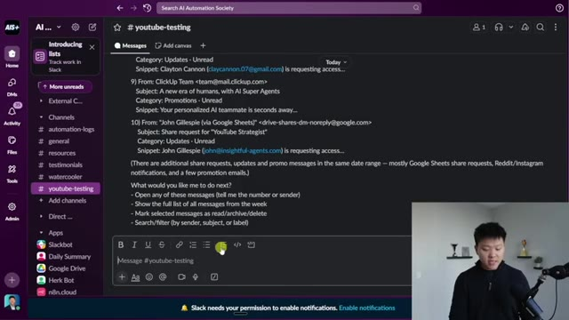
*⏱️ 00:05:59 — Interface de Slack affichant un canal de test avec les résultats formatés d'une liste d'e-mails et des options d'action.*

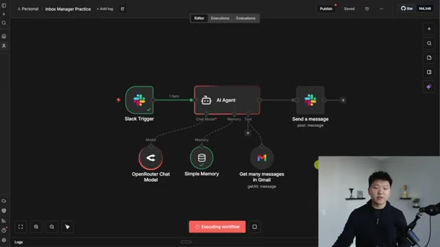
*⏱️ 00:06:07 — Vue d'ensemble d'un workflow d'automatisation n8n combinant un déclencheur Slack, un agent IA et un outil Gmail.*

---

### ⏱️ `[00:06:15 - 00:06:48]` | Segment #17

**🔊 Audio (Transcription Intégrale Mot pour Mot en Français) :**
> de l'e-mail. Bon, voilà, ça vient de se terminer. On va retourner sur Slack et on peut voir qu'on a reçu l'e-mail de Nate Herkelman. Voici l'objet, voici la date. Et puis, et c'est la date d'aujourd'hui, d'ailleurs. Et ensuite, on a obtenu l'intégralité du texte du corps du message au lieu d'un simple extrait. Donc maintenant, on sait que cet outil fonctionne à nouveau, même sans system prompt, mais maintenant on va ajouter le system prompt et on va ajouter l'outil d'obtention de contact. Bon. Donc c'est vraiment intéressant parce que je viens de réaliser qu'on n'avait pas de system prompt là-dedans. Donc avant, il ne connaissait pas vraiment la date et l'heure actuelles, ou je ne sais pas exactement comment il a su ça. Je pense qu'il avait peut-être une sorte de mémoire intégrée grâce à notre mémoire simple.

**👁️ Analyse Visuelle d'Écran (gemini-3.5-flash-lite) :**
**Interface & Outils** : Slack, n8n (AI Agent workflow)

**Contenu textuel & Code** : Message Slack de Herk Bot affichant les détails d'un e-mail ; configuration du nœud AI Agent dans n8n avec les données JSON d'entrée et de sortie.

**Action / Démonstration** : Présentation du résultat final de l'automatisation dans Slack, puis bascule vers l'interface n8n pour montrer la structure des données traitées par l'agent IA.

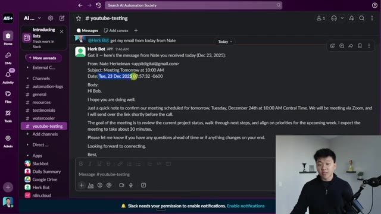
*⏱️ 00:06:24 — Vue de l'interface Slack montrant un message de Herk Bot contenant l'e-mail reçu de Nate Herkelman avec l'objet, la date et le corps du message complet.*

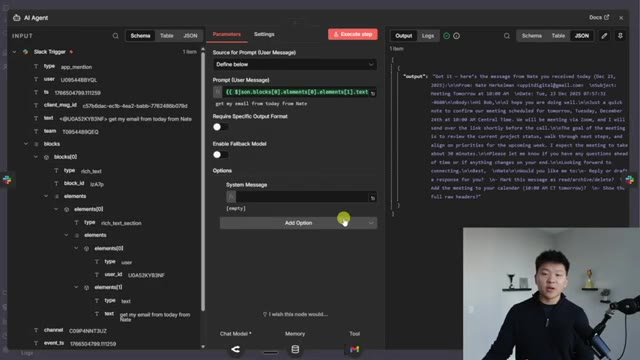
*⏱️ 00:06:32 — Interface de configuration d'un nœud d'agent IA dans n8n, affichant les paramètres d'entrée, le prompt utilisateur et le JSON de sortie du message.*

---

### ⏱️ `[00:06:48 - 00:07:18]` | Segment #18

**🔊 Audio (Transcription Intégrale Mot pour Mot en Français) :**
> outil. Et c'est pour ça qu'il savait en quelque sorte quelle était la date d'aujourd'hui. Mais de toute façon, je ne vais pas lire tout ce system prompt. Vous pouvez faire une pause et tout lire si vous voulez. Mais je vais simplement mentionner quelques-unes des choses que j'ai mises ici et qui sont, je pense, les plus importantes à comprendre. D'accord. Donc, évidemment, l'une des premières choses, c'est que pour chaque agent, je rajoute toujours à la fin : voici la date et l'heure actuelles, parce que pourquoi est-ce que vous ne voudriez pas que votre agent connaisse la date et l'heure actuelles ? Mais bref, au début, nous avons en quelque sorte la présentation générale. Vous êtes un agent IA de gestion de boîte de réception. Votre travail consiste à aider l'utilisateur à trouver des e-mails spécifiques à l'aide de l'outil de récupération d'e-mails et à rédiger des e-mails lorsqu'on vous le demande en faisant appel à l'outil agent rédacteur.

**👁️ Analyse Visuelle d'Écran (gemini-3.5-flash-lite) :**
**Interface & Outils** : Interface web d'un outil d'automatisation de workflow (type n8n)

**Contenu textuel & Code** : Texte de prompt système définissant les rôles d'un agent IA (Inbox Manager AI Agent), les outils disponibles (Get Emails, Get Contacts, Writer Agent) et les règles de gestion des dates.

**Action / Démonstration** : Le présentateur explique et commente le contenu du system prompt affiché à l'écran.

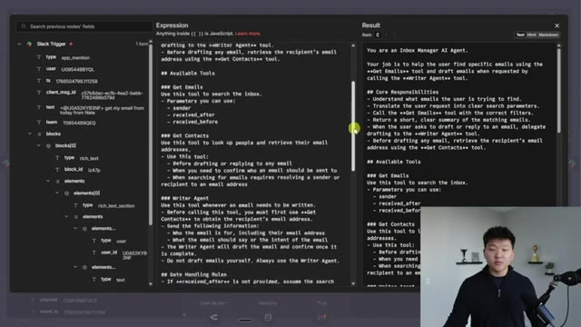
*⏱️ 00:06:55 — Capture d'écran montrant l'interface d'un outil d'automatisation avec un panneau d'expressions affichant un prompt système détaillé, ainsi qu'une vue en incrustation du présentateur dans le coin inférieur droit.*

---

### ⏱️ `[00:07:18 - 00:07:44]` | Segment #19

**🔊 Audio (Transcription Intégrale Mot pour Mot en Français) :**
> Vos responsabilités principales sont de comprendre quels e-mails l'utilisateur essaie de trouver, de traduire la requête en paramètres de recherche, d'appeler l'outil d'obtention des e-mails, et de renvoyer un résumé court et clair des e-mails correspondants. Et si l'utilisateur demande de rédiger ou de répondre à un e-mail, vous déléguez cela à l'agent rédacteur. Et avant de rédiger un e-mail, ou si vous avez besoin de trouver une adresse e-mail, utilisez l'outil d'obtention des contacts. Donc maintenant que vous comprenez un peu ces responsabilités principales, ajoutons réellement ces outils suivants. Donc tout d'abord, je vais simplement aller de l'avant puis renommer celui-ci, get emails, parce que c'est ainsi que nous l'avions appelé dans le prompt système.

**👁️ Analyse Visuelle d'Écran (gemini-3.5-flash-lite) :**
**Interface & Outils** : Interface web d'automatisation de workflow (type n8n) et éditeur de code/configuration interne.

**Contenu textuel & Code** : Instructions du système d'agent IA ("Inbox Manager AI Agent"), responsabilités, outils disponibles (Get Emails, Get Contacts) et schéma de workflow connectant Slack, AI Agent, OpenRouter, Simple Memory et Gmail.

**Action / Démonstration** : Le présentateur explique l'architecture d'un agent IA de gestion de e-mails configuré avec des outils de recherche de messages et de contacts.

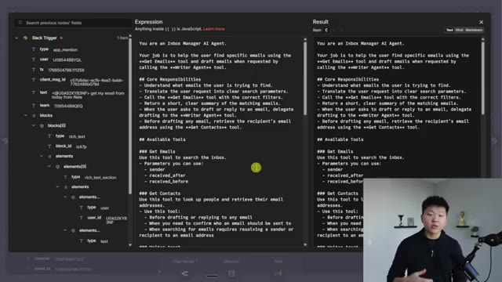
*⏱️ 00:07:24 — L'image 1 montre l'éditeur de configuration et les données JSON de test d'un nœud, avec les instructions textuelles pour l'agent IA de gestion de boîte de réception.*

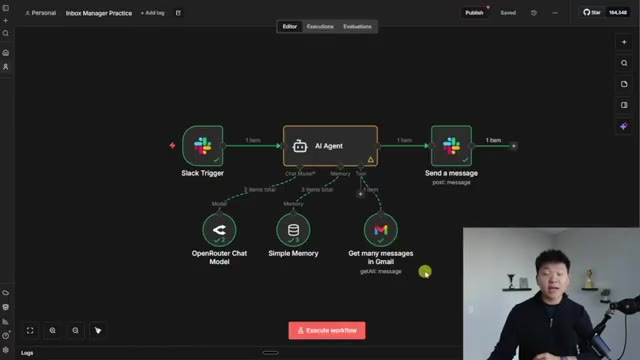
*⏱️ 00:07:37 — L'image 2 montre le tableau de bord principal d'un workflow d'automatisation (type n8n) reliant un déclencheur Slack à un agent IA connecté à un modèle OpenRouter, une mémoire et un outil Gmail.*

---

### ⏱️ `[00:07:44 - 00:08:03]` | Segment #20

**🔊 Audio (Transcription Intégrale Mot pour Mot en Français) :**
> La prochaine chose que je vais faire, c'est que nous allons ajouter un outil Google Contacts. Et c'est super simple. Vous pourrez pratiquement juste vous connecter et vous authentifier. Et ensuite, tout ce qu'on veut faire, c'est changer ceci pour obtenir de nombreux contacts. Et puis, au lieu de renvoyer tous les contacts ou une limite spécifique, nous allons utiliser une requête. Et nous allons également définir les champs sur les champs que vous voulez. Dans ce cas, nous avions juste besoin de récupérer les adresses e-mail.

**👁️ Analyse Visuelle d'Écran (gemini-3.5-flash-lite) :**
**Interface & Outils** : Interface web d'automatisation de workflow (type n8n).

**Contenu textuel & Code** : Panneau de configuration affichant les paramètres du nœud "Create a contact in Google Contacts" (Credential to connect with : Google Contacts account, Resource : Contact, Operation : Create). Le volet de gauche affiche les données d'entrée (Slack Trigger au format JSON).

**Action / Démonstration** : Le présentateur configure l'authentification et les paramètres pour ajouter l'outil Google Contacts au workflow d'automatisation.

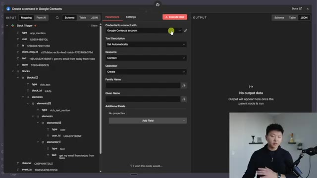
*⏱️ 00:07:49 — Capture d'écran montrant l'interface de configuration d'un nœud Google Contacts dans un outil d'automatisation de workflow (style n8n/Make).*

---

### ⏱️ `[00:08:04 - 00:08:23]` | Segment #21

**🔊 Audio (Transcription Intégrale Mot pour Mot en Français) :**
> Cela signifie fondamentalement que, une fois que je trouve un contact, que voulez-vous voir de sa part ? Et nous voulons simplement voir les adresses e-mail. Mais ensuite, pour la requête, c'est vraiment simple. Nous allons simplement rechercher le nom et ensuite nous obtiendrons l'adresse e-mail récupérée. Si je passe aux contacts Google réels que nous avons dans cet exemple, nous n'en avons que quatre. Nous avons donc Dexter Morgan, John Doe, Michael Scott et Nate Herc. Donc, ce que vous pourriez faire, c'est simplement faire en sorte que cet outil récupère tous les contacts à chaque fois.

**👁️ Analyse Visuelle d'Écran (gemini-3.5-flash-lite) :**
**Interface & Outils** : n8n (workflow automation platform)

**Contenu textuel & Code** : Paramètres de configuration du nœud Google Contacts (Resource: Contact, Operation: Get Many, Fields: Email Addresses, Use Query activé) et données JSON d'entrée d'un déclencheur Slack sur le panneau de gauche.

**Action / Démonstration** : Configuration des paramètres de recherche et des champs de sortie pour le nœud Google Contacts dans n8n.

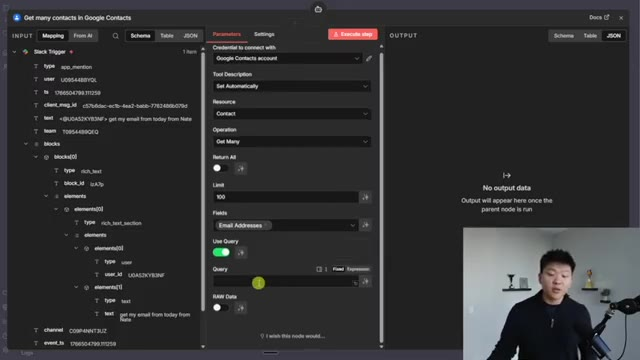
*⏱️ 00:08:09 — Capture d'écran montrant l'interface n8n avec les paramètres d'un nœud Google Contacts pour récupérer plusieurs contacts.*

---

### ⏱️ `[00:08:23 - 00:08:43]` | Segment #22

**🔊 Audio (Transcription Intégrale Mot pour Mot en Français) :**
> C'est très bien. Mais le seul problème, c'est qu'à mesure que votre base de données de contacts grandit, vous avez besoin d'un moyen plus intelligent pour les filtrer. C'est donc une solution un peu plus évolutive dès le premier jour. Et nous allons faire exactement la même chose. Nous allons laisser l'agent IA décider comment remplir ce paramètre. J'ai donc simplement dit, d'accord, le modèle peut comprendre, mais ce que vous pouvez aussi faire pour un peu plus de précision, c'est d'ajouter une description.

**👁️ Analyse Visuelle d'Écran (gemini-3.5-flash-lite) :**
**Interface & Outils** : n8n (interface web d'automatisation de workflows)

**Contenu textuel & Code** : Paramètres du nœud Google Contacts (Resource: Contact, Operation: Get Many, Return All activé, Limit: 100, Use Query activé) et données JSON d'un déclencheur Slack à gauche.

**Action / Démonstration** : Configuration des paramètres de filtrage et de requête pour récupérer les contacts de manière évolutive.

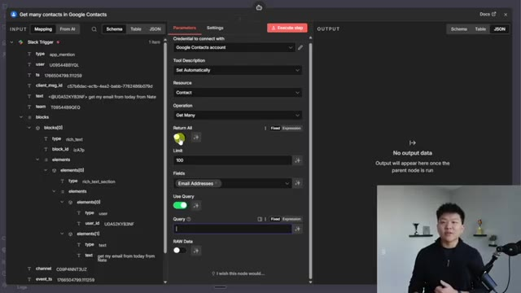
*⏱️ 00:08:28 — Interface d'un outil d'automatisation montrant la configuration d'un nœud Google Contacts ("Get many contacts") avec des options de requête et un panneau d'entrée JSON à gauche.*

---

### ⏱️ `[00:08:43 - 00:09:04]` | Segment #23

**🔊 Audio (Transcription Intégrale Mot pour Mot en Français) :**
> Donc je vais simplement ajouter une description et dire le nom du contact. Comme ça, l'agent sait exactement ce que fait cet outil. Je vais aussi renommer cet outil, récupérer les contacts. On va procéder à l'enregistrement. Et ensuite, on va tester dans Slack pour voir s'il peut réellement effectuer une recherche et nous renvoyer ces adresses e-mail. Très bien. Donc dans Slack, je demande si HercBot peut obtenir les adresses e-mail de Michael et Dexter.

**👁️ Analyse Visuelle d'Écran (gemini-3.5-flash-lite) :**
**Interface & Outils** : Interface web n8n (éditeur de workflow et configuration des nœuds).

**Contenu textuel & Code** : Paramètres du nœud "Get many contacts in Google Contacts" et schéma du workflow d'automatisation d'agent IA.

**Action / Démonstration** : Ajout d'une description textuelle pour l'outil Google Contacts afin de guider l'agent IA, puis visualisation globale du workflow.

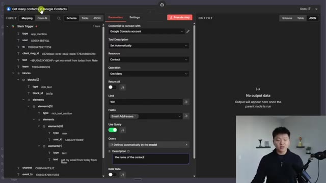
*⏱️ 00:08:48 — Configuration d'un nœud d'outil Google Contacts dans n8n, avec saisie de la description "the name of the contact".*

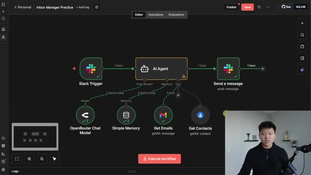
*⏱️ 00:08:53 — Vue d'ensemble d'un workflow n8n montrant un déclencheur Slack, un agent IA connecté à différents outils (OpenRouter, Simple Memory, Get Emails, Get Contacts) et une action d'envoi de message.*

---

### ⏱️ `[00:09:04 - 00:09:24]` | Segment #24

**🔊 Audio (Transcription Intégrale Mot pour Mot en Français) :**
> il vient tout juste de recevoir ce message et nous devrions le voir récupérer ces e-mails à partir de cet outil. Et si nous cliquons ici, nous pouvons voir qu'à la première exécution, si nous allons sur un sur un, il a rempli le nom de la requête par Michael en bas. Et puis si nous allons au numéro deux, il a rempli le nom de la requête par Dexter. Et c'est là que sur le côté droit, vous pouvez voir que la première fois nous avons récupéré Mike arobase dm.com et la deuxième fois nous avons récupéré Dexter arobase miami.com.

**👁️ Analyse Visuelle d'Écran (gemini-3.5-flash-lite) :**
**Interface & Outils** : n8n (Interface graphique de création de workflows d'automatisation)

**Contenu textuel & Code** : Nœuds de workflow n8n, structure JSON d'entrée, paramètres de configuration pour Google Contacts et OpenRouter.

**Action / Démonstration** : Navigation et explication d'une exécution de workflow n8n, montrant comment l'agent IA traite la requête "Michael" pour récupérer des contacts.

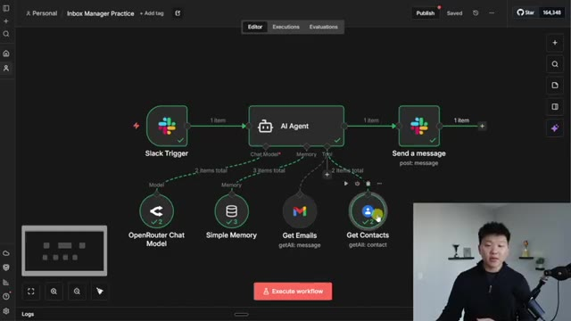
*⏱️ 00:09:09 — Vue d'ensemble d'un workflow n8n montrant un Agent IA relié à différents nœuds (Slack Trigger, OpenRouter Chat Model, Simple Memory, Get Emails, Get Contacts, Send a message).*

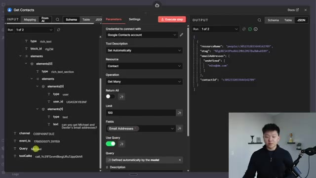
*⏱️ 00:09:14 — Panneau de configuration du nœud "Get Contacts" dans n8n, affichant les données d'entrée (input) avec la requête "Michael", les paramètres de l'outil et le résultat en JSON.*

---

### ⏱️ `[00:09:24 - 00:09:44]` | Segment #25

**🔊 Audio (Transcription Intégrale Mot pour Mot en Français) :**
> Et dans Slack, vous pouvez voir que c'est exactement ce que notre agent est capable de nous répondre. Très bien, donc maintenant nous avons vu comment l'outil Récupérer les contacts fonctionne. Nous avons vu comment l'outil Récupérer les e-mails fonctionne. Mais maintenant ce que nous devons voir, c'est comment nous pouvons réellement créer ce deuxième agent, ce sous-flux de travail pour rédiger des e-mails dans mon ton de voix ou le ton de voix du client ou le ton de voix de n'importe qui que vous voulez imiter ici. Très bien. Donc pour faire ça, je vais ouvrir un nouveau flux de travail.

**👁️ Analyse Visuelle d'Écran (gemini-3.5-flash-lite) :**
**Interface & Outils** : Interface web de type n8n / éditeur de workflows d'automatisation.

**Contenu textuel & Code** : Nœuds connectés : Slack Trigger, AI Agent, Send a message, OpenRouter Chat Model, Simple Memory, Get Emails, Get Contacts.

**Action / Démonstration** : Visualisation du workflow global d'automatisation géré par l'agent IA.

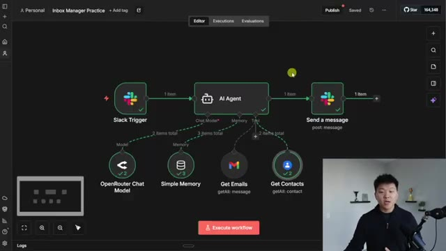
*⏱️ 00:09:29 — Vue d'ensemble d'un workflow d'agent IA dans une interface de type n8n, montrant un déclencheur Slack connecté à un nœud AI Agent qui utilise divers outils comme OpenRouter, Simple Memory, Get Emails et Get Contacts.*

---

### ⏱️ `[00:09:44 - 00:10:03]` | Segment #26

**🔊 Audio (Transcription Intégrale Mot pour Mot en Français) :**
> Nous allons repartir de zéro. Et ce que nous savons, c'est que ce flux de travail doit commencer par un déclencheur spécifique, qui est un « exécuté par un autre flux de travail ». Donc, exécuter le sous-flux de travail. Et ensuite, le déclencheur est « exécuté par un autre flux de travail ». Cette première partie sert donc à configurer quelles données ce sous-flux de travail va recevoir. Et tout ce dont nous avons réellement besoin, c'est d'un prompt concernant le sujet de l'e-mail.

**👁️ Analyse Visuelle d'Écran (gemini-3.5-flash-lite) :**
**Interface & Outils** : Interface web n8n (éditeur de workflow) et webcam du présentateur en bas à droite.

**Contenu textuel & Code** : Options « Add first step » et « Build with AI » sur un canevas vide.

**Action / Démonstration** : Préparation de la création d'un nouveau flux de travail à partir de zéro.

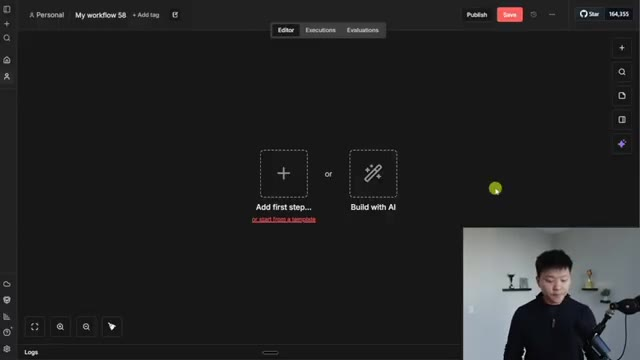
*⏱️ 00:09:49 — Interface d'édition de workflow n8n vide avec des options pour ajouter la première étape ou construire avec l'IA.*

---

### ⏱️ `[00:10:03 - 00:10:21]` | Segment #27

**🔊 Audio (Transcription Intégrale Mot pour Mot en Français) :**
> Et ensuite, nous avons besoin du contact, l'adresse e-mail à laquelle l'envoyer ou pour laquelle le rédiger. Donc dans ce nœud, ce que je vais faire, c'est définir en utilisant les champs ci-dessous. Et nous devons ajouter ces champs. Donc le premier champ que je vais ajouter est simplement, nous allons juste l'appeler prompt. Et puis le second champ que nous allons ajouter est contact ou destinataire ou tout ce qui est le plus intuitif pour vous. Nous allons faire prompt et contact.

**👁️ Analyse Visuelle d'Écran (gemini-3.5-flash-lite) :**
**Interface & Outils** : n8n (plateforme d'automatisation de workflows).

**Contenu textuel & Code** : Interface utilisateur de paramétrage de nœud, réglages de schéma d'entrée (Input data mode : "Define using fields below"), bouton "Add field".

**Action / Démonstration** : Le présentateur explique la configuration du nœud d'exécution de workflow et s'apprête à ajouter des champs de données (comme l'adresse e-mail) dans le schéma d'entrée.

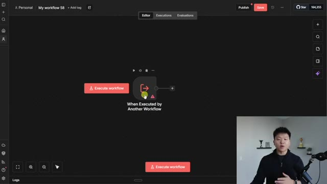
*⏱️ 00:10:07 — Vue d'ensemble de l'interface de travail n8n avec le nœud "When Executed by Another Workflow" affiché au centre de la zone d'édition.*

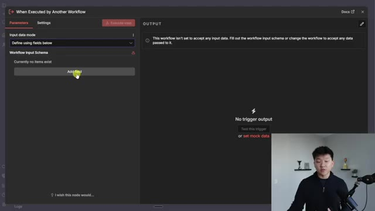
*⏱️ 00:10:12 — Fenêtre de configuration du nœud "When Executed by Another Workflow" montrant le réglage "Input data mode" configuré sur "Define using fields below" et le bouton "Add field".*

---

### ⏱️ `[00:10:22 - 00:10:43]` | Segment #28

**🔊 Audio (Transcription Intégrale Mot pour Mot en Français) :**
> Donc ce que j'aime faire dans ce cas-ci, c'est que j'aime remplir ceci avec des données fictives que nous pouvons utiliser pour faire avancer le reste du flux de travail et simplement tester les choses. Donc la façon dont je peux faire cela, c'est que je peux cliquer sur ce crayon et je peux fondamentalement juste personnaliser ce corps JSON pour nous donner ces champs que nous voulons. Donc nous examinerions le prompt, comme je l'ai dit, et le contact. OK, donc voici nos données fictives. Comme vous pouvez le voir, nous avons le prompt, qui consiste à écrire un email à Mike, lui faisant savoir que vous allez être en retard à une réunion.

**👁️ Analyse Visuelle d'Écran (gemini-3.5-flash-lite) :**
**Interface & Outils** : n8n (outil d'automatisation de workflow)

**Contenu textuel & Code** : Définition de schéma d'entrée : champs nommés "prompt" et "contact" avec le type "String". Section "Output" avec les options "Test this trigger" ou "set mock data".

**Action / Démonstration** : L'utilisateur configure les paramètres d'entrée du workflow et s'apprête à définir des données fictives pour tester le processus.

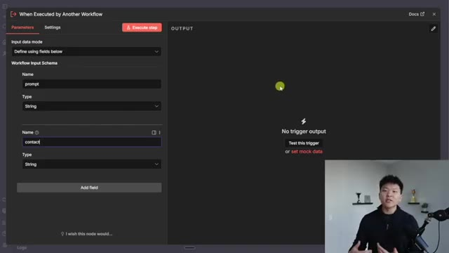
*⏱️ 00:10:27 — Interface de configuration d'un nœud "When Executed by Another Workflow" dans n8n, montrant la définition du schéma d'entrée avec les champs "prompt" et "contact".*

---

### ⏱️ `[00:10:43 - 00:11:04]` | Segment #29

**🔊 Audio (Transcription Intégrale Mot pour Mot en Français) :**
> Et puis le contact est Mike chez DM. Donc tout ce que j'ai fait ici, c'est juste simuler comme si ce workflow était appelé par un workflow parent, juste pour qu'on puisse tester et construire le reste de ce flux. Donc à partir d'ici, ce que je veux faire ensuite, c'est donner ces données à une IA pour qu'elle rédige vraiment ce message. Encore une fois, pour que ça sonne comme moi dans ce cas. Donc je vais ajouter une étape suivante et je vais ajouter un agent IA. Vous pourriez aussi utiliser simplement quelque chose comme un message, un modèle ou une chaîne de base.

**👁️ Analyse Visuelle d'Écran (gemini-3.5-flash-lite) :**
**Interface & Outils** : Interface web d'automatisation de workflow (type n8n).

**Contenu textuel & Code** : Configuration des paramètres d'entrée d'un workflow : champs "prompt" (de type String) et "contact" (de type String, valeur mike@dm.com), avec affichage du résultat de test dans le panneau de droite.
[DESC_IMAGE_2] Le présentateur explique la simulation d'un appel par un workflow parent et montre comment ajouter un nœud d'IA à la suite pour traiter ces données.

**Action / Démonstration** : Explications face caméra et démonstration conceptuelle.

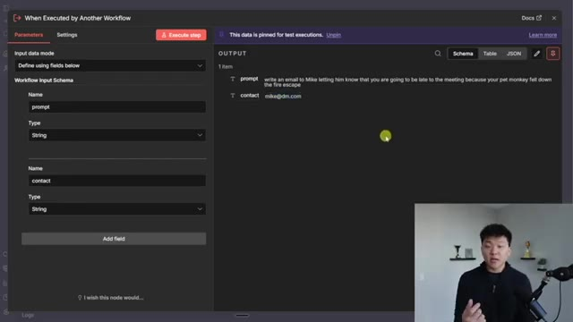
*⏱️ 00:10:49 — Vue détaillée des paramètres du nœud "When Executed by Another Workflow" montrant les champs d'entrée configurés (prompt et contact) ainsi que les données de sortie simulées.*

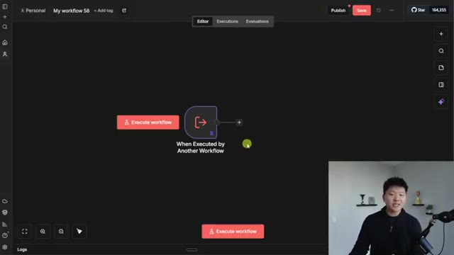
*⏱️ 00:10:54 — Vue globale de l'interface du générateur de workflows montrant le nœud de déclenchement "When Executed by Another Workflow" avec un point de connexion prêt à recevoir le prochain bloc.*

---

### ⏱️ `[00:11:04 - 00:11:30]` | Segment #30

**🔊 Audio (Transcription Intégrale Mot pour Mot en Français) :**
> Mais pour ce qui est de garder les choses cohérentes, j'aime tout simplement utiliser un agent IA. Ce que je vais faire, c'est que je vais prendre mon modèle préféré pour rédiger des e-mails ou rédiger du contenu, qui va être un modèle Claude Sonnet. Donc je vais prendre le 3.7 dans ce cas. On va simplement s'en tenir au 3.7. La première chose à laquelle il faut penser, c'est si on prend un peu d'avance et qu'on réfléchit à ce qui vient ensuite concernant la rédaction d'un e-mail, si je vais pour rédiger un message, ce qui revient à créer un brouillon juste ici, nous devons envoyer un objet et un message.

**👁️ Analyse Visuelle d'Écran (gemini-3.5-flash-lite) :**
**Interface & Outils** : n8n (plateforme d'automatisation de workflows low-code/no-code)

**Contenu textuel & Code** : Nœuds de workflow : « When Executed by Another Workflow », « AI Agent », et « OpenRouter Chat Model » configuré avec le modèle anthropic/claude-3.7-sonnet.

**Action / Démonstration** : Sélection et configuration du modèle d'IA Claude 3.7 Sonnet via OpenRouter pour l'intégrer au nœud agent IA du workflow n8n.

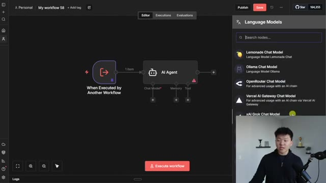
*⏱️ 00:11:11 — Vue d'ensemble de l'interface n8n montrant un workflow avec un nœud « AI Agent » et le panneau latéral de sélection des modèles de langage.*

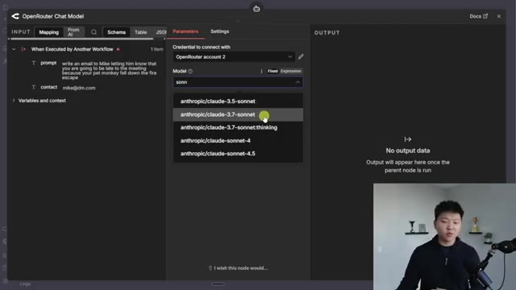
*⏱️ 00:11:17 — Gros plan sur le panneau de configuration du modèle OpenRouter Chat Model dans n8n, avec le menu déroulant affichant les différentes versions de Claude Sonnet.*

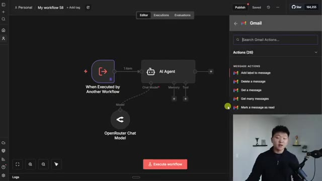
*⏱️ 00:11:24 — Workflow n8n mis à jour affichant le nœud « OpenRouter Chat Model » connecté au nœud principal « AI Agent », avec le panneau latéral Gmail ouvert à droite.*

---

### ⏱️ `[00:11:30 - 00:11:49]` | Segment #31

**🔊 Audio (Transcription Intégrale Mot pour Mot en Français) :**
> Donc, nous comprenons déjà en quelque sorte que cela va être divisé en deux champs. Donc, afin de s'assurer en quelque sorte que cela se produise, nous devons aller dans notre agent et nous devons exiger un format de sortie spécifique, ce qui a ouvert cette petite section supplémentaire appelée output parser. Et cela nous permet de connecter un output parser afin que l'agent ne sorte pas seulement un champ appelé output, mais que nous puissions contrôler le schéma qu'il produit.

**👁️ Analyse Visuelle d'Écran (gemini-3.5-flash-lite) :**
**Interface & Outils** : n8n (éditeur de workflow d'automatisation d'IA)

**Contenu textuel & Code** : Nœuds de workflow : déclencheur, AI Agent, OpenRouter Chat Model et nœud Gmail.

**Action / Démonstration** : Configuration d'un agent IA dans n8n pour exiger un format de sortie spécifique.

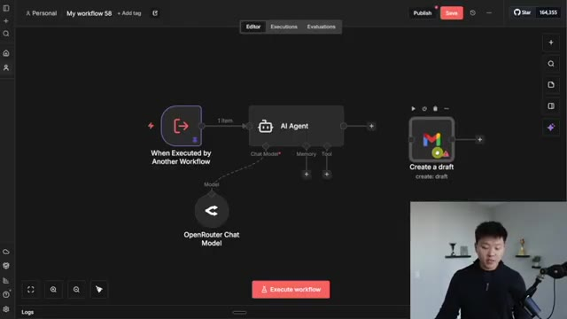
*⏱️ 00:11:35 — Vue générale du workflow sur n8n montrant un déclencheur, un nœud AI Agent et un nœud Gmail (Create a draft).*

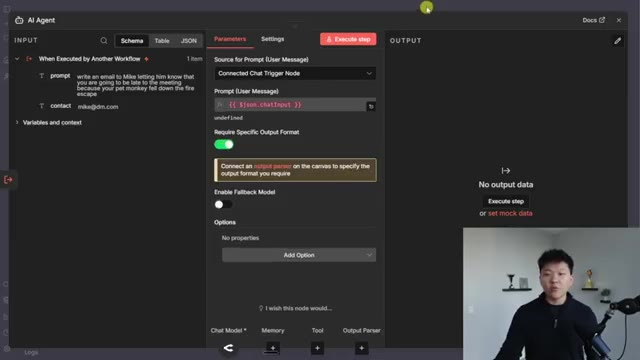
*⏱️ 00:11:39 — Panneau de configuration du nœud AI Agent avec l'option « Require Specific Output Format » activée.*

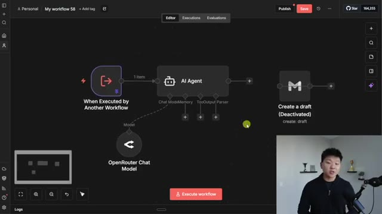
*⏱️ 00:11:44 — Retour à la vue du workflow sur n8n après activation du format de sortie spécifique sur l'agent IA.*

---

### ⏱️ `[00:11:49 - 00:12:09]` | Segment #32

**🔊 Audio (Transcription Intégrale Mot pour Mot en Français) :**
> Donc, ce que je vais faire très rapidement, c'est ajouter un parseur de sortie. Nous allons utiliser un parseur de sortie structuré. Et au lieu de générer à partir d'un exemple JSON, je vais définir en utilisant un schéma JSON. Et je vais coller ce schéma, qui indique fondamentalement que nous voulons que cet agent génère un objet avec deux propriétés, subject et email. Et subject est une chaîne de caractères. Cela signifie l'objet d'un e-mail. Et ensuite, email est également une chaîne de caractères. Et cela signifie le contenu du corps de l'e-mail.

**👁️ Analyse Visuelle d'Écran (gemini-3.5-flash-lite) :**
**Interface & Outils** : n8n (interface de workflow d'automatisation).

**Contenu textuel & Code** : Le panneau central affiche un menu déroulant "Schema Type" réglé sur "Generate From JSON Example" et un bloc de code JSON avec des exemples de données ("state", "cities").

**Action / Démonstration** : Le présentateur est en train de configurer le parseur de sortie pour passer d'un exemple JSON à une définition basée sur un schéma JSON.

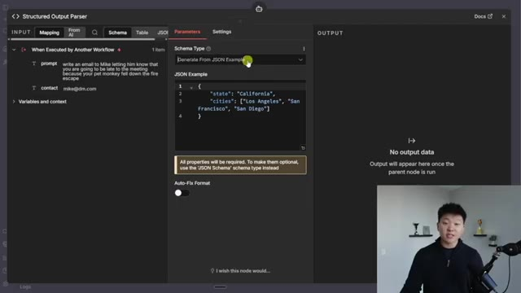
*⏱️ 00:11:54 — L'interface de configuration du nœud "Structured Output Parser" dans n8n, montrant les paramètres de schéma JSON en cours de modification.*

---

### ⏱️ `[00:12:09 - 00:12:28]` | Segment #33

**🔊 Audio (Transcription Intégrale Mot pour Mot en Français) :**
> Donc maintenant, notre agent va produire ces deux choses au lieu d'un seul corps. Ce n'est pas vraiment crucial que notre agent ait de la mémoire. Ce n'est pas vraiment important que l'agent ait des outils. Il va fondamentalement juste rédiger une sortie pour nous. D'accord, alors maintenant pour le prompt système réel de l'agent IA. Comment ai-je déterminé que je voulais utiliser le prompting système pour le style d'écriture plutôt que de lui donner accès à une grande base de données vectorielle d'e-mails ou quelque chose comme ça ?

**👁️ Analyse Visuelle d'Écran (gemini-3.5-flash-lite) :**
**Interface & Outils** : n8n (éditeur de workflow d'automatisation).

**Contenu textuel & Code** : - Image #1 : Nœuds connectés : "When Executed by Another Workflow" -> "AI Agent" -> "Structured Output Parser".
- Image #2 : Configuration de l'agent : prompt type "write an email to Mike...", switch activé pour "Require Specific Output Format".

**Action / Démonstration** : Le présentateur explique la structure du workflow et configure le nœud de l'agent IA pour forcer un format de sortie spécifique sans utiliser de mémoire ou d'outils complexes.

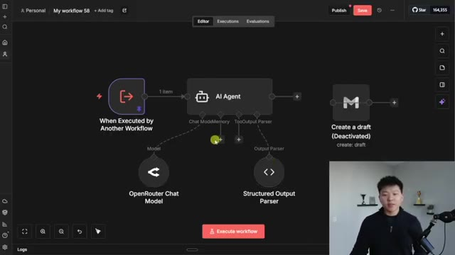
*⏱️ 00:12:14 — Interface de conception de workflow montrant un nœud "AI Agent" central connecté à un modèle "OpenRouter Chat" et un "Structured Output Parser".*

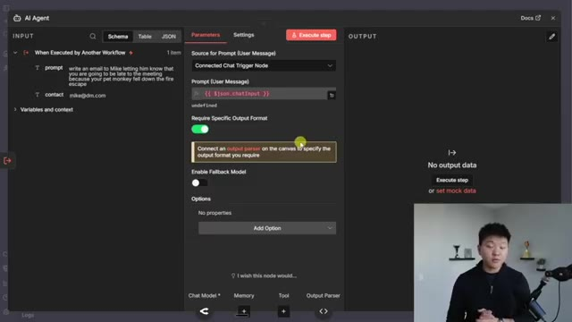
*⏱️ 00:12:23 — Vue détaillée de la configuration du nœud "AI Agent" dans l'éditeur, affichant les paramètres du prompt et l'option "Require Specific Output Format".*

---

### ⏱️ `[00:12:28 - 00:12:51]` | Segment #34

**🔊 Audio (Transcription Intégrale Mot pour Mot en Français) :**
> Donc, la façon dont je vois les choses, c'est que le prompt système sert à définir le comportement, à définir les instructions et le rôle. Les exemples et ce genre de choses servent à intégrer des informations supplémentaires dont vous pourriez avoir besoin. Si vous aviez des politiques et des choses de ce genre, ou, vous savez, vous pourriez avoir à écrire des e-mails concernant ce projet actuel ou mes tâches en cours, c'est là que vous voudriez avoir un outil capable de donner accès à votre espace ClickUp ou à votre CRM ou quelque chose comme ça, pour s'assurer que les e-mails sont enrichis de vraies informations.

**👁️ Analyse Visuelle d'Écran (gemini-3.5-flash-lite) :**
**Interface & Outils** : n8n (Interface de conception de workflow d'automatisation IA)

**Contenu textuel & Code** : Nœud AI Agent, configuration des paramètres, prompt utilisateur, connexions vers les modèles OpenRouter et Structured Output Parser.

**Action / Démonstration** : Navigation et configuration des nœuds de l'agent IA au sein du canvas n8n.

*⏱️ 00:12:34 — Gros plan sur la configuration détaillée d'un nœud AI Agent dans n8n, montrant les paramètres de prompt et le champ d'entrée.*

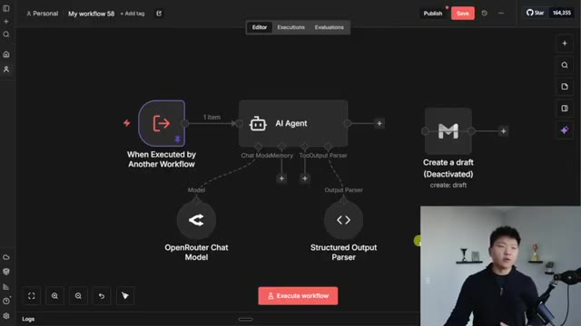
*⏱️ 00:12:39 — Vue d'ensemble du workflow n8n montrant un nœud déclencheur relié à un nœud AI Agent doté de sous-nœuds (modèle, parser).*

---

### ⏱️ `[00:12:51 - 00:13:10]` | Segment #35

**🔊 Audio (Transcription Intégrale Mot pour Mot en Français) :**
> Mais en ce qui concerne simplement le style d'écriture et le ton de la voix, je pense que ce genre de choses a sa place dans le prompt système. Et donc, la façon dont j'ai réellement fait cela en pratique, c'est que j'ai dit : « Hé, monsieur le client, est-ce que je pourrais s'il vous plaît avoir environ 50 à 100 de vos e-mails, juste des e-mails que vous avez écrits à des parties prenantes, à votre équipe interne, à n'importe qui d'autre ? » Et j'ai pu injecter tout cela dans un modèle d'IA et lui demander de créer un guide d'écriture.

**👁️ Analyse Visuelle d'Écran (gemini-3.5-flash-lite) :**
**Interface & Outils** : Interface web n8n (éditeur de workflow)

**Contenu textuel & Code** : Nœuds de workflow : "When Executed by Another Workflow", "AI Agent", "OpenRouter Chat Model", "Structured Output Parser" et "Create a draft (Deactivated)"

**Action / Démonstration** : Visualisation et explication de la structure d'un agent IA dans un workflow d'automatisation.

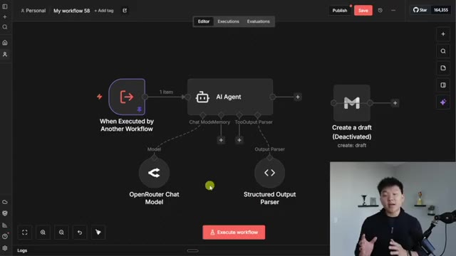
*⏱️ 00:12:56 — Un éditeur de workflow n8n affichant un nœud "AI Agent" connecté à un modèle OpenRouter et un "Structured Output Parser", avec la vidéo du présentateur en bas à droite.*

---

### ⏱️ `[00:13:10 - 00:13:32]` | Segment #36

**🔊 Audio (Transcription Intégrale Mot pour Mot en Français) :**
> Donc, il analyserait essentiellement les expressions courantes, le type de discours en ce qui concerne le niveau de professionnalisme, le type de mots, des choses comme ça. Et puis aussi un tas d'exemples dans le prompt système lui-même. Et c'est un très bon moyen de donner à l'agent une idée de la façon dont il doit écrire. Maintenant, il y a un élément de suivi et le fait de demander aux clients, vous savez, de parler beaucoup à cet agent et de lui faire rédiger un grand nombre de messages, puis de me donner des retours sur les choses que vous avez aimées ou que vous n'avez pas aimées.

**👁️ Analyse Visuelle d'Écran (gemini-3.5-flash-lite) :**
**Interface & Outils** : Interface web de type n8n ou plateforme similaire de gestion de workflows et d'agents IA.

**Contenu textuel & Code** : Workflow comprenant un déclencheur ('When Executed by Another Workflow'), un nœud central 'AI Agent', relié à un modèle 'OpenRouter Chat Model' et un 'Structured Output Parser', ainsi qu'un nœud désactivé 'Create a draft'.

**Action / Démonstration** : Présentation de la configuration des composants et des connexions au sein du workflow de l'agent IA.

*⏱️ 00:13:16 — Capture d'écran montrant l'interface d'un outil de création de workflows visuels avec un nœud d'agent IA connecté à un modèle OpenRouter et un analyseur de sortie structurée.*

---

### ⏱️ `[00:13:32 - 00:13:54]` | Segment #37

**🔊 Audio (Transcription Intégrale Mot pour Mot en Français) :**
> Et c'est évidemment un processus itératif. Mais je vois beaucoup de gens essayer de balancer genre des centaines d'e-mails dans une base de données vectorielle et s'attendre juste à ce que si l'agent est connecté à ça, il devrait être capable d'écrire genre tout ce qui se trouve dans la base de données. Et ça ne marche vraiment pas très bien. Les exemples sont super, mais vous avez besoin genre d'un guide de style et vous devez comprendre le ton. Alors laissez-moi juste coller cet exemple de guide de style que j'ai là, et nous pouvons simplement passer en revue quelques-uns des éléments qu'il me semble assez important d'examiner.

**👁️ Analyse Visuelle d'Écran (gemini-3.5-flash-lite) :**
**Interface & Outils** : n8n (interface de création de workflows d'automatisation IA)

**Contenu textuel & Code** : Nœuds de workflow : "When Executed by Another Workflow", "AI Agent", "OpenRouter Chat Model", "Structured Output Parser", et "Create a draft". Paramètres de prompt dans le panneau de l'agent IA.

**Action / Démonstration** : Navigation et configuration visuelle des nœuds d'un agent d'intelligence artificielle pour l'automatisation des e-mails.

*⏱️ 00:13:37 — Vue d'ensemble d'un workflow n8n montrant un nœud AI Agent connecté à un modèle OpenRouter Chat et à un parseur de sortie structurée.*

*⏱️ 00:13:48 — Panneau de configuration détaillé d'un nœud AI Agent dans n8n, affichant les paramètres de prompt et les options de configuration.*

---

### ⏱️ `[00:13:54 - 00:14:14]` | Segment #38

**🔊 Audio (Transcription Intégrale Mot pour Mot en Français) :**
> Donc, nous commençons ici avec : tu es l'agent du style d'écriture de Nate. Ton travail est de rédiger des e-mails qui ont exactement l'air d'avoir été écrits par Nate. Super clair. Tu as été entraîné sur des centaines de vrais e-mails de Nate, et ton rôle est de consolider ses schémas d'écriture, son ton, ses tournures de phrases, blabla, blabla. Donc, l'identité de base, nous avons donné l'identité ici. Le média va être l'e-mail. Nous avons un objectif et une posture par défaut. Nous passons en revue le ton général et peut-être quelques éléments à éviter.

**👁️ Analyse Visuelle d'Écran (gemini-3.5-flash-lite) :**
**Interface & Outils** : Interface utilisateur de workflow d'automatisation (type n8n)

**Contenu textuel & Code** : "You are the **Nate Writing Style Agent**. Your job is to draft emails that sound exactly like Nate wrote them."

**Action / Démonstration** : Visualisation du prompt et du contenu textuel de l'agent IA dans l'éditeur d'expressions.

*⏱️ 00:13:59 — Interface d'un éditeur de nœud de workflow montrant l'expression et le résultat d'un agent de style d'écriture d'e-mails, avec une vidéo incrustée du présentateur en bas à droite.*

---

### ⏱️ `[00:14:14 - 00:14:34]` | Segment #39

**🔊 Audio (Transcription Intégrale Mot pour Mot en Français) :**
> Nous passons en revue comment être concis. Nous passons en revue la structure typique des e-mails, les ouvertures courantes, les formulations courantes, les formules de politesse, des choses comme ça. Et ensuite, c'est là qu'en bas, vous pouvez également donner quelques exemples d'e-mails que vous aimez généralement écrire. Et peut-être que cela pourrait même varier selon que les e-mails vont être externes ou internes, et des choses comme ça aussi. Très bien, alors de toute façon, testons juste un résultat et voyons ce que nous obtenons.

**👁️ Analyse Visuelle d'Écran (gemini-3.5-flash-lite) :**
**Interface & Outils** : Outil d'automatisation de workflow (style n8n ou plateforme similaire)

**Contenu textuel & Code** : Éditeur d'expression contenant des directives sur le style d'écriture ("Common Phrasing Nate Uses", "Sign-Off Style"), ainsi qu'une fenêtre de résultat définissant l'identité de l'agent ("You are the Nate Writing Style Agent").

**Action / Démonstration** : Affichage et configuration des paramètres d'un agent d'intelligence artificielle spécialisé dans la rédaction d'e-mails.

*⏱️ 00:14:19 — Capture d'écran montrant l'interface d'un outil de workflow d'automatisation avec un éditeur de texte affichant les consignes du style d'écriture de Nate et, dans l'encadré de droite, les instructions données à l'agent IA.*

---

### ⏱️ `[00:14:34 - 00:14:53]` | Segment #40

**🔊 Audio (Transcription Intégrale Mot pour Mot en Français) :**
> Mais la première chose que vous remarquerez, c'est que l'agent ne regarde en fait rien du tout, car il cherche une instruction dans le nœud déclencheur de chat connecté qui, comme vous pouvez le voir, n'existe pas. Donc, ce que nous devons faire, c'est changer ceci pour « définir ci-dessous » et cela devient une boîte de paramètre fixe, et nous voulons changer cela pour une expression. Et nous voulons glisser l'instruction que le flux de travail parent nous envoie ici. Et nous mettons cela directement là-dedans.

**👁️ Analyse Visuelle d'Écran (gemini-3.5-flash-lite) :**
**Interface & Outils** : n8n (Interface de workflow d'automatisation)

**Contenu textuel & Code** : Source for Prompt (User Message) : Connected Chat Trigger Node, Prompt (User Message) : {{ $json.chatInput }} (valeur undefined), System Message configuré pour imiter le style d'écriture de Nate.

**Action / Démonstration** : Le curseur survole ou sélectionne le paramètre de source du prompt pour l'agent IA afin de modifier la source du message utilisateur.

*⏱️ 00:14:39 — Interface de configuration d'un agent IA dans n8n, montrant le panneau des paramètres avec le champ "Source for Prompt" configuré sur "Connected Chat Trigger Node".*

---

### ⏱️ `[00:14:53 - 00:15:13]` | Segment #41

**🔊 Audio (Transcription Intégrale Mot pour Mot en Français) :**
> Et maintenant qu'il peut voir cette variable dynamique et qu'il peut lire ses instructions système, allons-y et exécutons cette étape. Et voyons quel type d'e-mail nous obtenons en retour. Et j'espère qu'encore une fois, il doit être en deux morceaux. Comme vous pouvez le voir, nous avons l'objet et nous avons l'e-mail. Donc pour l'objet, nous avons : en retard pour notre réunion. Et pour l'e-mail, nous avons : salut Mike, je vais avoir environ 15 minutes de retard pour notre réunion. Mon singe de compagnie a réussi à tomber par l'escalier de secours et je dois régler cela rapidement.

**👁️ Analyse Visuelle d'Écran (gemini-3.5-flash-lite) :**
**Interface & Outils** : Interface web n8n (nœud AI Agent).

**Contenu textuel & Code** : Champ de prompt utilisateur configuré avec la variable dynamique `{{ $json.prompt }}`, message système définissant le rôle de l'agent ('Nate Writing Style Agent') et panneau de droite affichant 'Executing node...'.

**Action / Démonstration** : Exécution de l'étape du nœud AI Agent pour générer l'e-mail.

*⏱️ 00:14:58 — Interface d'un Agent IA dans n8n montrant la configuration des paramètres du prompt utilisateur, la variable dynamique et le message système en cours d'exécution.*

---

### ⏱️ `[00:15:13 - 00:15:35]` | Segment #42

**🔊 Audio (Transcription Intégrale Mot pour Mot en Français) :**
> Nous pouvons encore tout couvrir dans le temps qu'il nous reste ou je suis heureux de reprogrammer si cela vous convient le mieux. À la vôtre, Nate. Donc à partir de là, ce que nous ferions, c'est que nous connecterions ces sorties au nœud de création de brouillon et nous ferions fondamentalement glisser le sujet ici même. Nous ferions glisser l'e-mail là-bas. Et maintenant, nous devons utiliser le contact qui nous a été envoyé plus tôt. Donc la façon dont vous faites cela dans ce nœud est que vous allez fondamentalement ici en bas dans les options et vous ajoutez un e-mail destinataire.

**👁️ Analyse Visuelle d'Écran (gemini-3.5-flash-lite) :**
**Interface & Outils** : Interface web de l'outil d'automatisation de workflows n8n

**Contenu textuel & Code** : Nœuds de workflow connectés : déclencheur, Agent IA (AI Agent), OpenRouter Chat Model, Structured Output Parser et nœud Gmail 'Create a draft' avec ses paramètres de configuration (Subject, Message, Email Type).

**Action / Démonstration** : Le présentateur explique la configuration des connexions entre l'agent IA et le nœud de création de brouillon de courriel.

*⏱️ 00:15:18 — Vue d'ensemble d'un workflow n8n montrant un Agent IA connecté à un modèle OpenRouter et un parseur de sortie, avec un nœud 'Create a draft' désactivé en attente.*

*⏱️ 00:15:24 — Panneau de configuration détaillé du nœud Gmail 'Create a draft' dans n8n, affichant les paramètres de saisie pour le sujet et le message générés par l'IA.*

---

### ⏱️ `[00:15:35 - 00:16:09]` | Segment #43

**🔊 Audio (Transcription Intégrale Mot pour Mot en Français) :**
> Je ne sais pas exactement pourquoi. Sinon, ça mettrait juste un brouillon dans votre boîte de réception et il n'y aurait pas de destinataire, mais nous pouvons ajouter le destinataire en le glissant par-dessus. Vous pouvez voir qu'il y a d'autres options que nous pourrions ajouter, comme l'envoi de réponses à certaines personnes ou l'ajout d'un identifiant de fil de discussion pour que cela réponde ou rédige un brouillon dans un fil de message, des pièces jointes, une copie cachée, des choses comme ça. Mais c'est ainsi que nous avons fait simple dans cet exemple. Donc, après que l'agent a récupéré ces informations, rédigé l'e-mail, l'a envoyé sous forme de brouillon, et nous allons lancer la lecture de ceci. Ce que nous devons faire, c'est en gros configurer ce que le flux de travail principal voit ensuite ? Parce qu'en gros, il examine la sortie de ce dernier nœud. Donc ce que vous pourriez faire, c'est simplement lui donner cette sortie et c'est ce qu'il verrait. Mais ce que j'aime faire, c'est que j'aime

**👁️ Analyse Visuelle d'Écran (gemini-3.5-flash-lite) :**
**Interface & Outils** : n8n (interface web de création de workflows)

**Contenu textuel & Code** : Nœuds connectés : "When Executed by Another Workflow", "AI Agent" (relié à OpenRouter Chat Model et Structured Output Parser) et "Create a draft" (Gmail).

**Action / Démonstration** : Configuration des options du nœud Gmail et visualisation du diagramme global du workflow.

*⏱️ 00:15:44 — Gros plan sur le panneau de configuration d'un nœud Gmail montrant les paramètres et le menu déroulant des options additionnelles.*

*⏱️ 00:16:00 — Vue d'ensemble d'un workflow sur n8n connectant un déclencheur, un agent IA et un nœud Gmail.*

---

### ⏱️ `[00:16:09 - 00:16:43]` | Segment #44

**🔊 Audio (Transcription Intégrale Mot pour Mot en Français) :**
> pour simplement faire en sorte que nos agents se parlent un peu mieux entre eux. Je vais donc prendre un nœud de type "set". Et je vais fondamentalement juste renvoyer un message appelé "output" qui dit que le brouillon a été envoyé. Et c'est ce que le flux de travail parent principal verra chaque fois qu'il fera appel à ce sous-flux pour envoyer un brouillon et qu'il recevra ce message en retour. C'est donc beaucoup plus poli de cette façon. Très bien, alors allons-y pour détacher ces données, sauvegarder ce flux de travail. Nous devons le publier pour qu'il soit accessible à notre flux de travail principal. Je vais donc le publier rapidement. Très bien, maintenant que ce flux de travail est publié, connectons-le à notre agent parent ici. Je vais donc ajouter un outil et ce sera un outil d'appel de flux de travail. Et ce que nous devons faire, c'est choisir celui que nous venons de créer, qui était le sous-flux de brouillon d'e-mail.

**👁️ Analyse Visuelle d'Écran (gemini-3.5-flash-lite) :**
**Interface & Outils** : n8n (éditeur de flux de travail d'automatisation)

**Contenu textuel & Code** : Nœuds de workflow n8n : "When Executed by Another Workflow", "AI Agent", "Create a draft" (Gmail), et "Edit Fields" avec le champ "output" défini sur "the draft has been sent".

**Action / Démonstration** : Configuration d'un nœud "Edit Fields" pour renvoyer un message de confirmation de l'envoi du brouillon au flux de travail parent.

*⏱️ 00:16:17 — Interface de configuration d'un nœud "Edit Fields" dans l'application n8n, où l'utilisateur configure un champ de sortie nommé "output" avec la valeur textuelle indiquant que le brouillon a été envoyé.*

*⏱️ 00:16:26 — Vue d'ensemble du flux de travail (workflow) dans n8n montrant l'enchaînement des nœuds : déclencheur, agent IA, nœud Gmail "Create a draft", et le nœud "Edit Fields" configuré précédemment.*

---

### ⏱️ `[00:16:44 - 00:17:02]` | Segment #45

**🔊 Audio (Transcription Intégrale Mot pour Mot en Français) :**
> Et quand on clique dessus, vous pouvez voir que nous avons deux entrées à envoyer. Nous avons le prompt et nous avons le contact. Et encore une fois, ce que je vais faire, c'est simplement cliquer sur ces deux boutons pour que l'agent IA décide de la manière d'envoyer ces informations. Nous avons aussi l'option d'ajouter une description. Et j'aime généralement définir ce que sont ces entrées de flux de travail dans la description. Donc je vais juste dire, appeler cet outil pour rédiger un e-mail.

**👁️ Analyse Visuelle d'Écran (gemini-3.5-flash-lite) :**
**Interface & Outils** : Interface web d'un outil d'automatisation d'agents IA, avec incrustation vidéo du présentateur en bas à droite.

**Contenu textuel & Code** : Panneau de configuration affichant les entrées « prompt » et « contact » du flux, et un panneau latéral de données JSON issu d'un déclencheur Slack.

**Action / Démonstration** : Configuration des paramètres et des entrées d'un sous-flux appelé par un agent IA.

*⏱️ 00:16:48 — Interface d'automatisation montrant la configuration d'un sous-flux de travail (« Call 'Draft Email Sub Flow' ») avec ses entrées de données (prompt et contact).*

---

### ⏱️ `[00:17:02 - 00:17:22]` | Segment #46

**🔊 Audio (Transcription Intégrale Mot pour Mot en Français) :**
> Vous devez envoyer le prompt concernant le sujet de l'e-mail, ainsi que le contact, qui est l'adresse e-mail de la personne à qui nous rédigeons l'e-mail. Et maintenant que nous avons cette description, nous allons simplement lancer un essai complet pour voir s'il est capable de rédiger cet e-mail pour nous. Très bien. J'envoie donc un message qui dit : rédige un e-mail à Dexter pour lui dire de courir et de se cacher parce qu'ils sont sur ses traces.

**👁️ Analyse Visuelle d'Écran (gemini-3.5-flash-lite) :**
**Interface & Outils** : Outil d'automatisation de flux de travail et application Slack.

**Contenu textuel & Code** : Paramètres de configuration d'un sous-flux d'e-mail et messages de test dans Slack avec un bot IA.

**Action / Démonstration** : Configuration des entrées d'un sous-flux d'automatisation et test en conditions réelles de l'agent d'e-mail dans Slack.

*⏱️ 00:17:07 — Interface d'un outil d'automatisation (type n8n) montrant les paramètres du nœud 'Draft Email Sub Flow' avec les champs d'entrée 'prompt' et 'contact' définis automatiquement par le modèle.*

*⏱️ 00:17:17 — Interface de Slack sur le canal #youtube-testing montrant une conversation avec un bot qui a trouvé des contacts et un message utilisateur demandant de rédiger un e-mail à Dexter.*

---

### ⏱️ `[00:17:22 - 00:17:52]` | Segment #47

**🔊 Audio (Transcription Intégrale Mot pour Mot en Français) :**
> Voici donc l'e-mail qui arrive dans, ou désolé, voici le message qui arrive dans n8n. L'agent va l'examiner. Ce qu'on devrait voir se produire, c'est qu'il récupère les coordonnées de Dexter depuis l'outil, puis qu'il envoie cette adresse e-mail ainsi que le prompt. D'accord, donc on dirait qu'on a reçu un message en retour. Maintenant, ce que j'imagine qu'il s'est passé, c'est qu'il pose une question de clarification. D'accord. Eh bien, voilà ce que ça donne quand j'essaie de faire le drôle. On va en envoyer un autre qui dit : d'accord, très bien. Rédige un e-mail à John pour lui faire savoir qu'il y a une énorme promotion sur les bottes, 84 % de réduction. John est donc un grand fan de bottes. Mais ce qu'on a ici, c'est que maintenant il devrait chercher l'e-mail de John dans les contacts, comme vous pouvez le voir. Et ensuite, il va transmettre ça à l'agent de rédaction.

**👁️ Analyse Visuelle d'Écran (gemini-3.5-flash-lite) :**
**Interface & Outils** : n8n et Slack

**Contenu textuel & Code** : Workflow n8n (Slack Trigger, AI Agent, OpenRouter, Simple Memory, Get Emails, Get Contacts, Writer Agent) et messages de chat sur Slack.

**Action / Démonstration** : Exécution d'un workflow n8n pour traiter les requêtes d'un agent IA connectant Slack à divers outils.

*⏱️ 00:17:30 — Image #1 montre l'interface de n8n avec un workflow d'agent IA déclenché par Slack, en cours d'exécution.*

*⏱️ 00:17:37 — Image #2 montre une conversation sur Slack où l'utilisateur interagit avec le bot et reçoit des réponses de l'agent.*

*⏱️ 00:17:45 — Image #3 montre à nouveau le workflow n8n en cours d'exécution au moment où le message est traité.*

---

### ⏱️ `[00:17:52 - 00:18:25]` | Segment #48

**🔊 Audio (Transcription Intégrale Mot pour Mot en Français) :**
> Et j'espère que nous avons tout configuré correctement dans cet agent de rédaction. Et il devrait être capable d'envoyer réellement ce brouillon. Donc avant de regarder la réponse dans Slack, je voulais juste vous montrer, les gars, si je clique sur l'agent rédacteur, nous obtenons le résultat qui indique que le brouillon a été envoyé, exactement comme nous l'avons configuré. Et si nous allons à l'outil d'obtention des contacts, nous devrions voir ici même que nous avons obtenu john arobase example point com. Donc de retour dans Slack, nous pouvons voir c'est fait. J'ai trouvé l'e-mail de John, qui était john arobase example point com. Et j'ai fait envoyer un brouillon pour lui en lui parlant de la vente de bottes à 84 % de réduction. Donc voici l'exécution de ce sous-flux. Vous pouvez voir que ce qui a été envoyé était de rédiger un e-mail amical à John lui faisant savoir qu'il y a une vente sur les bottes en ce moment, signez avec mes meilleures salutations, Nate.

**👁️ Analyse Visuelle d'Écran (gemini-3.5-flash-lite) :**
**Interface & Outils** : n8n (Interface de conception de workflows d'automatisation)

**Contenu textuel & Code** : Nœuds de workflow n8n (Slack Trigger, AI Agent, OpenRouter Chat Model, Simple Memory, Get Emails, Get Contacts, Writer Agent) et structure JSON des données d'entrée/sortie.

**Action / Démonstration** : Présentation du workflow d'automatisation et inspection des paramètres et résultats d'un nœud spécifique de l'agent.

*⏱️ 00:18:01 — Vue d'ensemble d'un workflow n8n montrant un déclencheur Slack relié à un agent IA avec plusieurs outils connectés.*

*⏱️ 00:18:09 — Panneau de configuration détaillé d'un outil Google Contacts (Get Contacts) dans n8n, affichant les données d'entrée et de sortie.*

---

### ⏱️ `[00:18:25 - 00:18:58]` | Segment #49

**🔊 Audio (Transcription Intégrale Mot pour Mot en Français) :**
> nous avons récupéré le contact qui était john arobase example point com, il se dirige ici vers l'agent IA, et ensuite, il génère fondamentalement cet e-mail. Et après, nous envoyons ce brouillon ici dans notre Gmail. Et vous pouvez voir ici dans mes brouillons d'e-mails, nous avons celui-ci juste là, qui est une vente de garage, quatre-vingt-quatre pour cent de réduction. Salut John, je voulais juste t'informer à propos de la vente de garage. Et donc une chose en fait qui est assez intéressante à noter ici, c'est qu'il a signé avec Meilleur Nate. Et il a fait ça parce qu'ici, quand il a transmis ce prompt, il a dit, garde ça court et décontracté, signe avec Meilleur Nate, ce qui a en quelque sorte supplanté notre prompt système. Parce qu'ici, vous pouvez voir qu'en bas, je lui avais dit de toujours signer avec bien à toi, Nate.

**👁️ Analyse Visuelle d'Écran (gemini-3.5-flash-lite) :**
**Interface & Outils** : n8n workflow editor et Gmail

**Contenu textuel & Code** : Variables de workflow n8n (contact: john@example.com, prompt pour l'e-mail) et brouillon d'e-mail Gmail généré.

**Action / Démonstration** : Visualisation du transfert des données du contact vers l'agent IA, génération de l'e-mail et affichage du brouillon résultant dans Gmail.

*⏱️ 00:18:33 — Configuration d'un nœud de création de brouillon dans n8n avec les paramètres de messagerie et l'adresse e-mail de contact.*

*⏱️ 00:18:42 — Interface de Gmail montrant le brouillon d'e-mail généré automatiquement pour john@example.com avec l'offre de vente de bottes.*

*⏱️ 00:18:50 — Visualisation des données d'entrée/sortie du workflow n8n montrant le contact john@example.com et le prompt de l'agent.*

---

### ⏱️ `[00:18:58 - 00:19:16]` | Segment #50

**🔊 Audio (Transcription Intégrale Mot pour Mot en Français) :**
> Et ça dit, ne modifiez pas ceci à moins d'avis contraire explicite. C'est donc pour cela qu'il s'est en quelque sorte court-circuité là. Et cela montre bien que plus vous avez d'IA qui interagissent avec de l'IA, plus vous devez le prompter et plus vous devez comprendre qu'il y aura davantage d'aléa. Et bien sûr, il y a de nombreuses façons dont je voudrais ensuite développer et optimiser ce système.

**👁️ Analyse Visuelle d'Écran (gemini-3.5-flash-lite) :**
**Interface & Outils** : Interface web d'automatisation de type n8n ou similaire.

**Contenu textuel & Code** : Diagramme de workflow affichant les blocs 'When Executed by Another Workflow', 'AI Agent', 'OpenRouter Chat Model', 'Structured Output Parser', 'Create a draft' et 'Edit Fields', avec l'historique des exécutions sur le panneau de gauche.

**Action / Démonstration** : Visualisation et analyse d'un workflow d'agent IA montrant les interactions entre différents nœuds et modèles.

*⏱️ 00:19:02 — Capture d'écran montrant l'interface d'un workflow d'automatisation avec un agent IA et ses connexions, ainsi que la vidéo du présentateur en bas à droite.*

---

### ⏱️ `[00:19:16 - 00:19:39]` | Segment #51

**🔊 Audio (Transcription Intégrale Mot pour Mot en Français) :**
> Comme une chose que nous avons réellement mise en place après cette V1, c'est que nous avons ensuite décidé, ok, parfois il se trompe réellement de contact et ensuite il crée ce brouillon. Donc ce que j'adore faire, c'est d'ajouter une sorte de fonctionnalité d'humain dans la boucle pour qu'avant qu'il ne rédige quoi que ce soit ou ne choisisse un contact à qui rédiger un e-mail, nous allions de l'avant et disions, hé, voici ce que je vais envoyer. Est-ce que ça a l'air bien ? Et bien sûr, il n'y a toujours pas beaucoup de risques parce qu'un brouillon est un brouillon et je ne pousserais probablement jamais un système comme celui-ci en production qui enverrait des e-mails automatiquement.

**👁️ Analyse Visuelle d'Écran (gemini-3.5-flash-lite) :**
**Interface & Outils** : Interface web de construction de workflows (type n8n ou plateforme similaire).

**Contenu textuel & Code** : Nœuds connectés par des flèches : Slack Trigger -> AI Agent -> Send a message, avec des sous-nœuds pour le modèle, la mémoire et les outils (Get Emails, Get Contacts, Writer Agent).

**Action / Démonstration** : Le présentateur explique la structure du workflow et survole le nœud 'Get Contacts' utilisé par l'agent IA.

*⏱️ 00:19:22 — Un diagramme de workflow d'automatisation montrant un déclencheur Slack, un agent IA et divers outils connectés (OpenRouter Chat Model, Simple Memory, Get Emails, Get Contacts, Writer Agent).*

---

### ⏱️ `[00:19:39 - 00:20:02]` | Segment #52

**🔊 Audio (Transcription Intégrale Mot pour Mot en Français) :**
> Je pense que ce serait un petit peu risqué, comme je l'ai dit, avec l'IA. Mais il y a toujours des moyens, bien sûr, d'itérer sur votre flux de travail après l'avoir exposé à des commentaires et l'avoir réellement mis en place dans une sorte de flux de travail quotidien réel sur un certain temps. D'accord, alors il y a, très rapidement, quelques points que je voulais aborder concernant la construction réelle ici. Et c'est simplement le fait que si je commençais en ce moment et que je n'avais pas encore de clients, je ne pense pas que j'irais essayer de vendre cette solution.

**👁️ Analyse Visuelle d'Écran (gemini-3.5-flash-lite) :**
**Interface & Outils** : n8n et outil de diagramme visuel (whiteboard)

**Contenu textuel & Code** : Nœuds de flux d'automatisation n8n (Slack Trigger, AI Agent, outils de messagerie et de contacts) et schémas conceptuels.

**Action / Démonstration** : Présentation et explication de la structure et de l'itération des flux de travail automatisés.

*⏱️ 00:19:45 — Un flux de travail n8n sur fond sombre montrant un agent IA relié à Slack, OpenRouter, Simple Memory, Get Emails, Get Contacts et Writer Agent.*

*⏱️ 00:19:57 — Un diagramme conceptuel sur fond blanc représentant la structure logique d'un système de gestion de boîte mail et d'agent IA.*

---

### ⏱️ `[00:20:03 - 00:20:24]` | Segment #53

**🔊 Audio (Transcription Intégrale Mot pour Mot en Français) :**
> Et il y a plusieurs raisons à cela. La première est que Gmail, Outlook, tous ces principaux fournisseurs de messagerie, je pense qu'ils vont commencer à intégrer naturellement beaucoup de ces capacités d'IA directement au sein de la plateforme. Et donc, surtout si vous essayez de construire une sorte de, vous savez, logiciel en tant que service, ce n'est peut-être pas celui que vous voulez cibler, parce que vous devez penser à des choses comme ce qui sera toujours là et quels types de choses pourraient être remplacés.

**👁️ Analyse Visuelle d'Écran (gemini-3.5-flash-lite) :**
**Interface & Outils** : Outil de diagramme ou tableau blanc en ligne (type Miro ou Excalidraw) avec barre d'outils supérieure.

**Contenu textuel & Code** : Blocs fonctionnels reliés par des flèches : 'New email', 'Internal emails', 'Slack DM', 'Classification AI', 'Finance', 'Opportunities', 'Sales', 'AI Agent', 'Slack response', etc.

**Action / Démonstration** : Présentation visuelle et explication de l'architecture d'un agent IA de gestion d'e-mails et de flux de travail.

*⏱️ 00:20:08 — Un schéma conceptuel ou diagramme de flux illustrant un système de gestion de boîte de réception par IA ('Inbox Manager'), avec le présentateur incrusté en bas à droite.*

---

### ⏱️ `[00:20:24 - 00:20:47]` | Segment #54

**🔊 Audio (Transcription Intégrale Mot pour Mot en Français) :**
> Maintenant, bien sûr, il y a beaucoup de cet élément personnalisé ici, comme la façon dont le client pourrait aimer que les choses soient rédigées ou la façon dont il pourrait vouloir interagir avec ses e-mails. Et ce n'est pas trop mal. Mais au cours des huit derniers mois, entre le moment où j'ai construit la solution et là où nous en sommes maintenant, nous avons déjà vu beaucoup de progrès dans le domaine de l'automatisation des e-mails. Et la deuxième chose, et c'est honnêtement plus important pour moi en ce moment, c'est l'idée de victoires rapides et d'automations évolutives lorsque vous débutez avec un client.

**👁️ Analyse Visuelle d'Écran (gemini-3.5-flash-lite) :**
**Interface & Outils** : Application de schéma / mindmapping (ex: Excalidraw ou similaire) avec une barre d'outils latérale de dessin.

**Contenu textuel & Code** : Diagramme avec des blocs représentant des flux de données, des agents IA, des étiquettes (Finance, Opportunities, Sales) et des sous-workflows liés au style de communication.

**Action / Démonstration** : Le présentateur explique l'architecture d'automatisation des e-mails en pointant ou commentant le diagramme affiché.

*⏱️ 00:20:30 — Un schéma explicatif de workflow d'IA pour un gestionnaire de boîte de réception, affiché dans une application de dessin ou de mindmapping, avec le présentateur en médaillon dans le coin inférieur droit.*

---

### ⏱️ `[00:20:47 - 00:21:11]` | Segment #55

**🔊 Audio (Transcription Intégrale Mot pour Mot en Français) :**
> Et ce que je veux dire par là, c'est que lorsque je commençais avec un client, en fait, je préférais construire un système beaucoup moins dépendant de l'IA et quelque chose d'un peu plus évolutif. On a donc déjà vu cet élément où cet agent a envoyé un prompt qui a outrepassé cette IA. On a donc deux IA qui se parlent entre elles, ce qui augmente la probabilité d'une sorte d'erreur. Cela augmente aussi, bien sûr, le coût parce qu'à chaque fois que cet agent s'exécute, il lit son prompt système et il lit tous les e-mails, et cela coûte des tokens.

**👁️ Analyse Visuelle d'Écran (gemini-3.5-flash-lite) :**
**Interface & Outils** : Outil de diagramme en ligne (type Miro ou Excalidraw) avec incrustation vidéo du présentateur en bas à droite.

**Contenu textuel & Code** : Blocs fonctionnels : "Slack message", "AI Agent", "Slack response", "Get", "Contacts", "Draft", "Subworkflow", "Speaking style / Knowledge / Best practices".

**Action / Démonstration** : Le présentateur explique l'architecture d'un agent IA et ses connexions aux différents outils et sous-workflows.

*⏱️ 00:20:53 — Schéma explicatif d'un workflow avec un agent IA connectant Slack à différentes actions (Get, Contacts, Draft) et sous-workflows.*

---

### ⏱️ `[00:21:11 - 00:21:44]` | Segment #56

**🔊 Audio (Transcription Intégrale Mot pour Mot en Français) :**
> C'est pourquoi j'ai décidé de caser les trucs de style d'écriture dans un flux séparé, parce qu'ainsi je pouvais utiliser en quelque sorte différentes IA spécialisées. Et cela signifie que je n'ai pas besoin de faire traiter ce style d'écriture par cet agent à chaque fois, même si on lui demande simplement du genre « récupère cet e-mail pour moi », ou si on lui pose juste une question générale. On économise des jetons là. Mais quand je parle de la scalabilité, ce qui est vraiment important selon moi, pensez-y de cette façon. Si vous construisez un système comme un genre d'assistant personnel, il ne s'exécute en réalité qu'à chaque fois que vous lui envoyez un message. Donc, si vous lui envoyez un message 10 fois par jour, il va s'exécuter 10 fois dans cette journée. Maintenant, à mesure que votre entreprise grandit et que vous êtes de plus en plus occupé, est-ce que vous l'utilisez nécessairement plus, moins, ou la même chose ?

**👁️ Analyse Visuelle d'Écran (gemini-3.5-flash-lite) :**
**Interface & Outils** : Outil de création de diagrammes / Flowchart

**Contenu textuel & Code** : Blocs logiques : Slack message -> AI Agent -> Slack response, avec des branches vers Get, Contacts, Draft, et un sous-workflow pour 'Speaking style, Knowledge, Best practices'.

**Action / Démonstration** : Le présentateur explique l'architecture modulaire de son flux d'IA en pointant sur le diagramme.

*⏱️ 00:21:19 — Schéma de workflow montrant l'architecture d'un agent IA interagissant avec Slack, des sous-flux de contacts et de rédaction, et un module séparé pour le style d'écriture.*

---

### ⏱️ `[00:21:44 - 00:22:04]` | Segment #57

**🔊 Audio (Transcription Intégrale Mot pour Mot en Français) :**
> C'est difficile à dire. Ce que je peux vous dire avec certitude, c'est que la relation entre l'utilisation et la croissance de l'entreprise n'est pas de un pour un, ni même corrélée du tout. Si vous construisez des systèmes où cette croissance est effectivement corrélée à une augmentation du débit du système, ceux-ci sont super puissants et super évolutifs, et c'est là que les entreprises voient réellement un retour sur investissement beaucoup plus élevé. Donc, l'un des exemples les plus simples que j'aime utiliser est celui d'un agent commercial.

**👁️ Analyse Visuelle d'Écran (gemini-3.5-flash-lite) :**
**Interface & Outils** : Outil de diagramme/whiteboard (type Excalidraw) avec le présentateur incrusté en bas à droite.

**Contenu textuel & Code** : Schéma avec les blocs : "Slack message", "AI Agent", "Slack response", et des fonctions associées ("Get", "Contacts", "Draft", "Subworkflow").

**Action / Démonstration** : Le présentateur explique l'architecture du système d'automatisation et de l'agent IA.

*⏱️ 00:21:49 — Un diagramme explicatif montrant un workflow d'agent IA connecté à Slack et différentes fonctions.*

---

### ⏱️ `[00:22:04 - 00:22:39]` | Segment #58

**🔊 Audio (Transcription Intégrale Mot pour Mot en Français) :**
> À mesure que l'agent commercial est de plus en plus utilisé, votre entreprise obtient plus de clients. Et à mesure que vous obtenez plus de clients, vous vous développez davantage, ce qui alimente en quelque sorte cette première étape, car les humains peuvent alors se concentrer, vous savez, sur l'acquisition de plus de prospects et de plus de clients. Et à leur tour, le système de l'agent commercial est de plus en plus utilisé. Cela crée donc en quelque sorte une roue d'inertie où ils s'alimentent mutuellement. Et comme je l'ai dit, c'est simplement super évolutif. J'ai donc construit ce flux de travail pour aider à gérer la boîte de réception d'un client. Mais comment ai-je trouvé quelqu'un pour me l'acheter réellement ? À ce stade, je n'avais pas construit le flux de travail parce qu'un client l'avait demandé. Je l'ai construit parce que j'étais simplement en train d'expérimenter. J'apprenais de bout en bout, en construisant des choses que je trouvais intéressantes et en enregistrant des vidéos YouTube expliquant leur fonctionnement. C'était très simple. Et mes vidéos ne cartonnaient pas non plus.

**👁️ Analyse Visuelle d'Écran (gemini-3.5-flash-lite) :**
**Interface & Outils** : Application de tableau blanc / diagramme en ligne (ex: Miro, Excalidraw)

**Contenu textuel & Code** : Schéma d'architecture d'agent IA interactif avec des blocs "AI Agent", "Slack message", "Slack response", et des fonctions associées.

**Action / Démonstration** : Le présentateur explique le fonctionnement de l'agent commercial et son architecture à l'aide d'un diagramme.

*⏱️ 00:22:13 — Schéma de workflow montrant un agent IA relié à Slack et des sous-processus (Get, Contacts, Draft), avec le présentateur en encadré.*

---

### ⏱️ `[00:22:39 - 00:23:13]` | Segment #59

**🔊 Audio (Transcription Intégrale Mot pour Mot en Français) :**
> Ils obtenaient tout au plus quelques centaines de vues. Mais ce qui s'est passé était vraiment important. Les gens ont commencé à nous contacter et ils disaient des choses comme : « Hé, j'ai vu ce truc que tu as construit. Pourrais-tu construire quelque chose comme ça pour moi ? » Ou : « Je ne sais pas exactement ce dont j'ai besoin, mais je suis curieux de l'IA et je veux voir ce qui est possible. » Et c'est précisément là le point clé à retenir. Parce que si vous construisez quelque chose de véritablement utile et que vous l'expliquez clairement, les gens vous trouveront. Vous n'avez pas besoin d'obtenir des milliers de vues ou d'avoir une vidéo virale. N'importe qui de nos jours peut réellement obtenir quelques centaines de vues rien qu'en publiant de manière cohérente et en montrant une vraie valeur. Mais bien sûr, je n'étais pas le seul à publier du contenu à l'époque, ni maintenant. La question évidente est donc : pourquoi ce propriétaire d'entreprise m'a-t-il payé 1600 dollars pour un travail de trois heures au lieu d'aller voir quelqu'un d'autre ? Et la réponse est vraiment simple.

**👁️ Analyse Visuelle d'Écran (gemini-3.5-flash-lite) :**
**Interface & Outils** : Interface de messagerie mobile (Simulateur iPhone)

**Contenu textuel & Code** : Messages texte : 'Hey, I saw that thing that you built. Could you build something like that for me?'

**Action / Démonstration** : Affichage d'une conversation textuelle pour illustrer les retours clients suite à la publication des vidéos.

*⏱️ 00:22:48 — Un écran de smartphone affichant des messages texte illustrant les retours de clients.*

---

### ⏱️ `[00:23:13 - 00:23:46]` | Segment #60

**🔊 Audio (Transcription Intégrale Mot pour Mot en Français) :**
> Il n'a pas payé pour un modèle. Il a payé pour un résultat parce qu'en fait, nous avons fait un appel et je ne pense pas que c'était un appel commercial. On a juste commencé à discuter. C'était une conversation. Et il m'a dit qu'il aimait ce que je construisais et qu'il voulait comprendre comment quelque chose comme ça pouvait s'appliquer à son entreprise et à son flux de travail. Donc au lieu de sauter directement dans les fonctionnalités ou les outils, j'ai commencé à lui demander, du genre, où est-ce qu'il avait l'impression de perdre du temps et de l'énergie au quotidien ? Et l'une des choses qu'il a dites m'a immédiatement marqué parce qu'il m'a dit que son entreprise grandissait et qu'il aimerait vraiment avoir un assistant de direction, mais qu'il ne savait tout simplement pas où en trouver un en qui il pouvait avoir confiance. Quelqu'un qui pourrait juste l'aider à garder le contrôle sur tout sans qu'il ait constamment à changer de contexte. Et il m'a en fait demandé si c'était quelque chose pour lequel je pouvais l'aider et genre lui construire un

**👁️ Analyse Visuelle d'Écran (gemini-3.5-flash-lite) :**
**Interface & Outils** : Application de visioconférence (type Zoom/Meet) et interface de montage vidéo.

**Contenu textuel & Code** : Texte illustrant une conversation (« I like what you are building »).

**Action / Démonstration** : Le présentateur raconte une discussion informelle qu'il a eue lors d'un appel avec un client.

---

### ⏱️ `[00:23:46 - 00:24:19]` | Segment #61

**🔊 Audio (Transcription Intégrale Mot pour Mot en Français) :**
> assistant de direction. Mais je devais être honnête avec lui. J'ai dit oui, mais essayer d'automatiser tout le rôle d'un assistant de direction en une seule fois est un énorme projet. Alors au lieu d'essayer de bouillir l'océan, j'ai posé une meilleure question, à savoir quel est le premier endroit où vous vous déchargeriez en quelque sorte d'une partie du travail si vous aviez un assistant de direction. Et sans hésitation, il a dit mon e-mail. Et c'est donc là que nous avons en quelque sorte commencé à concevoir la façon dont ce flux de travail pouvait fonctionner pour lui. J'ai dit, super, commençons par là. Construisons un système de boîte de réception qui filtre tout le bruit, met en valeur ce qui compte réellement pour vous, et vous aide simplement à parcourir vos e-mails sans que cela draine votre concentration. Et c'est devenu en quelque sorte notre cahier des charges. Pas un grand agent IA, pas un système sophistiqué,

**👁️ Analyse Visuelle d'Écran (gemini-3.5-flash-lite) :**
**Interface & Outils** : Interface graphique animée (style visioconférence et schéma conceptuel)

**Contenu textuel & Code** : Texte des bulles de dialogue sur la visioconférence et schématisation de la gestion des e-mails ("Inbox System", "Filters out all the noise", "Highlights what actually matters to you").

**Action / Démonstration** : Présentation visuelle animée illustrant la stratégie d'automatisation des e-mails.

*⏱️ 00:24:03 — Capture simulant une visioconférence avec les bulles de dialogue "Where is the first place..." et "My Email".*

*⏱️ 00:24:11 — Schéma illustrant un système de boîte de réception Gmail qui filtre le bruit et met en avant l'essentiel.*

---

### ⏱️ `[00:24:19 - 00:24:53]` | Segment #62

**🔊 Audio (Transcription Intégrale Mot pour Mot en Français) :**
> juste une sorte de gestionnaire de boîte de réception qu'il pouvait utiliser pour, tu sais, étiqueter des choses et aussi simplement dialoguer avec sa boîte de réception. Et cela a résolu un problème bien réel pour lui sur le moment. Et c'est là que les choses ont commencé à faire tilt pour moi, parce que j'ai réalisé que la vraie valeur n'était pas seulement de créer des flux de travail, car des tonnes de gens sont doués pour ça et il y a des tonnes de flux de travail gratuits. Elle consiste en réalité à aider les gens à comprendre quoi construire et par où commencer. Et ce changement dans votre état d'esprit change tout. Parce qu'alors vous arrêtez d'être un pharmacien où les gens entreraient et diraient, hé, donne-moi juste ça. Et vous commencez réellement à agir comme un médecin ou ce que je prêche à mes étudiants depuis longtemps, c'est-à-dire devenir un consultant en IA. Et c'est là que vous diagnostiquez réellement le problème, vous posez de bonnes questions, et ensuite vous prescrivez la solution.

**👁️ Analyse Visuelle d'Écran (gemini-3.5-flash-lite) :**
**Interface & Outils** : AUCUNE

**Contenu textuel & Code** : AUCUN

**Action / Démonstration** : AUCUNE

---

### ⏱️ `[00:24:53 - 00:25:27]` | Segment #63

**🔊 Audio (Transcription Intégrale Mot pour Mot en Français) :**
> Et cela fait de vous un partenaire de réflexion, et pas seulement un constructeur ou un développeur. Et quand quelqu'un a vraiment l'impression que vous l'aidez et que vous réfléchissez à ses problèmes commerciaux, la confiance monte en flèche. Et c'est pourquoi il a payé 1 650 dollars sans hésitation. Il ne se souciait pas du temps que cela allait me prendre. Il a simplement vu la valeur de ce que nous faisions ensemble. Maintenant, je veux faire une pause d'une seconde et parler d'argent parce que, oui, dire trois heures de travail pour 1 600 dollars, ça a l'air fou et impressionnant en surface. Et oui, la construction initiale elle-même a pris environ trois heures. Mais ce n'est jamais toute l'histoire quand vous construisez des systèmes d'IA, surtout maintenant où il devient de plus en plus facile de lancer des choses en utilisant le langage naturel avec le code d'IA ou de meilleurs outils ou quoi que ce soit d'autre, la vraie valeur n'est pas

**👁️ Analyse Visuelle d'Écran (gemini-3.5-flash-lite) :**
**Interface & Outils** : Outil de diagramme ou d'automatisation de type workflow

**Contenu textuel & Code** : Schéma d'architecture de flux de travail interconnectés

**Action / Démonstration** : Présentation visuelle d'un processus de collaboration ou de conception de workflow technique

*⏱️ 00:25:01 — Illustration montrant deux hommes en réunion devant un écran affichant un diagramme de workflow technique.*

---

### ⏱️ `[00:25:27 - 00:26:02]` | Segment #64

**🔊 Audio (Transcription Intégrale Mot pour Mot en Français) :**
> juste dans la construction, mais c'est aussi dans ce qui vient après l'existence du système. Parce que lorsque vous livrez un système d'IA, vous ne vous contentez pas de le remettre et de disparaître. Vous devez le surveiller, vous devez l'évaluer, voir comment il est réellement utilisé, corriger ces cas limites, et faire de petites optimisations au fil du temps, comme nous en avons parlé dans la première partie de cette vidéo où j'étais en train de le construire pour vous les gars. Parce que c'est là qu'un système peut passer d'une simple démo sympa à quelque chose qui vit réellement dans l'écosystème d'une entreprise et apporte de la valeur commerciale au fil du temps. Donc il ne s'agissait pas seulement de trois heures puis nous sommes séparés, je devais encore rester dans les parages, m'assurer que tout fonctionnait sans problème, gérer les bugs lorsqu'ils survenaient, et aider à faire de petits changements au fur et à mesure que nous commencions à l'utiliser dans le monde réel. Et c'est quelque chose dont j'ai toujours parlé. Vous ne savez pas ce que vous

**👁️ Analyse Visuelle d'Écran (gemini-3.5-flash-lite) :**
**Interface & Outils** : Éditeur de workflow de type plateforme d'automatisation (n8n ou similaire).

**Contenu textuel & Code** : Nœuds de workflow, "AI Agent", "Telegram Trigger", base de connaissances et interface de chat latérale.

**Action / Démonstration** : Présentation visuelle d'un workflow d'agent d'IA en cours d'utilisation.

*⏱️ 00:25:36 — Capture d'écran montrant un diagramme de workflow d'agent IA avec le texte "HOW IT'S BEING USED *Quick Demo*" et une vue incrustée du présentateur en bas à droite.*

---

### ⏱️ `[00:26:02 - 00:26:37]` | Segment #65

**🔊 Audio (Transcription Intégrale Mot pour Mot en Français) :**
> je ne sais pas. C'est pourquoi une première livraison devrait toujours être considérée comme une itération un ou une preuve de concept. Et j'ai toujours cru que dans le domaine de l'automatisation par IA sur mesure, il n'y a pas de produit fini. Les entreprises changent, les flux de travail évoluent, les modèles d'IA s'améliorent, parfois ils empirent, et quelque chose qui fonctionnait parfaitement il y a un mois pourrait avoir besoin d'ajustements maintenant. Mais bien sûr, l'objectif est de construire quelque chose de solide puis de l'améliorer à mesure que vous en apprenez davantage sur la façon dont il se comporte réellement en production. Et voici quelque chose qui est aussi très important. Il ne se souciait pas du temps qu'il m'avait fallu pour construire la version initiale. C'était complètement hors de propos pour lui. Ce qui importait pour lui, c'était que cela ajoutait de la valeur à l'entreprise en raison de tout le temps qu'il passait à nettoyer, gérer et filtrer manuellement sa boîte de réception. Ou bien sûr, il aurait pu embaucher un assistant virtuel pour

**👁️ Analyse Visuelle d'Écran (gemini-3.5-flash-lite) :**
**Interface & Outils** : Outil de conception de workflow / d'agent d'e-mail.

**Contenu textuel & Code** : Diagramme de flux d'automatisation avec un agent e-mail, un modèle OpenAI, des actions d'envoi et de récupération de messages, et du texte incrusté à l'écran.

**Action / Démonstration** : Présentation visuelle d'un schéma d'automatisation d'e-mails par IA.

*⏱️ 00:26:11 — Capture d'écran montrant l'interface d'un outil de workflow d'agent d'e-mail avec un diagramme en arrière-plan et le présentateur en médaillon.*

---

### ⏱️ `[00:26:37 - 00:26:58]` | Segment #66

**🔊 Audio (Transcription Intégrale Mot pour Mot en Français) :**
> quelques centaines de dollars par mois pour faire quelque chose de similaire. Mais ce système était beaucoup plus durable, plus flexible, plus cohérent, et il a réduit une quantité massive de changement de contexte, qui est vraiment l'un des plus grands tueurs de productivité pour n'importe qui. Donc, une fois que nous avons montré comment le système fonctionnait et combien de temps il faisait gagner chaque semaine, les 1 650 dollars tout à fait du sens. Le retour sur investissement était évident. Et avec le temps, cet investissement s'est facilement transformé en un rendement multiplié par 10 rien qu'en temps gagné et en concentration.

**👁️ Analyse Visuelle d'Écran (gemini-3.5-flash-lite) :**
**Interface & Outils** : AUCUNE

**Contenu textuel & Code** : AUCUNE

**Action / Démonstration** : AUCUNE

---

### ⏱️ `[00:26:58 - 00:27:30]` | Segment #67

**🔊 Audio (Transcription Intégrale Mot pour Mot en Français) :**
> Et c'est donc la vraie leçon ici. Si vous savez comment résoudre un vrai problème, et surtout si vous pouvez clairement communiquer cette valeur commerciale, alors les gens paieront. Ils ne se soucient pas de la façon dont vous l'avez réparé. Ils se soucient généralement juste de ce que vous avez réparé. Et j'arrête pas d'insister là-dessus parce que je sais que beaucoup d'entre vous construisent, mais vous avez du mal à croire que quelqu'un va vous payer cher pour vos workflows. Eh bien, c'est la preuve qu'beaucoup de gens le feront. Alors, qu'est-ce que tout cela signifie réellement pour vous ? Donc, je dirais que la grande leçon, c'est que vous n'avez pas besoin d'être un programmeur ou un génie pour faire ce genre de choses. Vous n'avez pas besoin d'avoir un bagage technique complètement fou, insensé. Je ne l'avais certainement pas. Et beaucoup de mes étudiants ne l'ont pas non plus. Ce dont vous avez besoin, c'est d'être accessible aux gens qui aiment créer des workflows et de vraiment comprendre

**👁️ Analyse Visuelle d'Écran (gemini-3.5-flash-lite) :**
**Interface & Outils** : Écrans d'ordinateur et clavier de bureau

**Contenu textuel & Code** : Aucun code source ni prompt explicite visible, plan d'illustration du travail technique.

**Action / Démonstration** : Saisie sur clavier d'ordinateur sur fond sombre.

*⏱️ 00:27:22 — Gros plan sur un bureau sombre où des mains tapent sur un clavier d'ordinateur face à deux écrans, illustrant le travail de développement.*

---

### ⏱️ `[00:27:30 - 00:28:05]` | Segment #68

**🔊 Audio (Transcription Intégrale Mot pour Mot en Français) :**
> comment les entreprises fonctionnent, parce que votre véritable ensemble de compétences n'est pas de glisser des nœuds sur un canapé. C'est de comprendre les processus, d'identifier les goulets d'étranglement et de résoudre des problèmes. Parce que si vous pouvez voir où les choses se bloquent ou ralentissent et que vous pouvez réellement concevoir une solution, cela devient une compétence extrêmement précieuse. Et une façon vraiment simple d'y penser est d'utiliser les goulets d'étranglement. Disons donc que la personne à qui vous parlez veut une automatisation de la prospection. Cela peut sembler génial parce que vous pouvez imaginer comment cela va faire croître l'entreprise. Mais si leur contrainte est l'intégration, les opérations internes ou l'exécution, alors pourquoi automatiseriez-vous la prospection pour eux ? Cela n'a tout simplement aucun sens. Du moins pour l'instant, vous ne feriez qu'injecter davantage de demande dans un système brisé. À l'inverse, si l'entreprise a du mal à obtenir des leads parce qu'elle n'en a pas

**👁️ Analyse Visuelle d'Écran (gemini-3.5-flash-lite) :**
**Interface & Outils** : Aucune interface logicielle, éditeur de code ou tableau de bord d'agent IA actif.

**Contenu textuel & Code** : Aucun code source, terminal, prompt ou données textuelles pertinents.

**Action / Démonstration** : Aucune action technique, compilation ou manipulation d'agent n'est réalisée.

---

### ⏱️ `[00:28:05 - 00:28:37]` | Segment #69

**🔊 Audio (Transcription Intégrale Mot pour Mot en Français) :**
> de contenu ou pas de prospection, alors l'automatisation du support client ne devrait pas être la priorité. C'est là que vous feriez l'automatisation de la prospection. C'est pourquoi penser en termes de contraintes et de feuilles de route a vraiment de l'importance, car vous voulez résoudre le plus grand goulet d'étranglement en premier et démontrer cette valeur immédiatement en économisant du temps, de l'argent et de la concentration. Et si je devais refaire tout cela depuis le début, le processus serait super simple. Premièrement, j'identifierais un vrai problème, pas juste une idée sympa ou un agent tape-à-l'œil, mais un vrai point de friction qui coûte du temps ou de l'argent à quelqu'un. Deuxièmement, je choisirais le bon outil pour la tâche. Pour moi, cela a été de bout en bout parce que c'est super flexible, c'est essentiellement open source, et cela vous permet de créer des automatisations personnalisées qui s'intègrent dans presque

**👁️ Analyse Visuelle d'Écran (gemini-3.5-flash-lite) :**
**Interface & Outils** : AUCUNE

**Contenu textuel & Code** : AUCUNE

**Action / Démonstration** : AUCUNE

---

### ⏱️ `[00:28:37 - 00:29:10]` | Segment #70

**🔊 Audio (Transcription Intégrale Mot pour Mot en Français) :**
> n'importe quel flux de travail et peut s'intégrer à n'importe quoi. Troisièmement, je prototyperais rapidement. Ne réfléchissez pas trop. Il n'a pas besoin d'être le plus complexe ou d'être parfait. Obtenez simplement quelque chose qui fonctionne aussi rapidement que possible afin de pouvoir le tester, que le client puisse le tester, et ensuite vous pouvez l'exposer dans un environnement réel afin d'obtenir ces boucles de rétroaction rapides. Parce que plus vite vous obtenez ces boucles de rétroaction, meilleur vous devenez en tant que créateur et meilleur le système devient dans le monde réel. Et puis, une fois que vous avez une version fonctionnelle, c'est là que vous pouvez ancrer la valeur. Vous pouvez communiquer cela et vous pouvez communiquer le temps, l'argent et la concentration que cela économise, en particulier la façon dont cela va se cumuler au fil du temps. Et c'est ainsi que vous pensez à justifier votre tarification et à demander des recommandations ou à construire ces études de cas si

**👁️ Analyse Visuelle d'Écran (gemini-3.5-flash-lite) :**
**Interface & Outils** : Interface web n8n (éditeur de workflow)

**Contenu textuel & Code** : Nœud déclencheur (Execute Workflow Trigger) connecté à un Agent Email (Email Agent) avec des modules de modèle de chat et d'outils.

**Action / Démonstration** : Visualisation d'un diagramme de flux d'automatisation d'e-mails sur n8n.

*⏱️ 00:28:45 — Interface n8n montrant un workflow avec un agent e-mail et des nœuds connectés.*

---

### ⏱️ `[00:29:10 - 00:29:29]` | Segment #71

**🔊 Audio (Transcription Intégrale Mot pour Mot en Français) :**
> Vous pouvez constamment démontrer cette valeur. Donc je ne veux pas que cette vidéo dure trop longtemps et je sais que nous avons couvert beaucoup de choses. Donc ce que j'ai fait, c'est que j'ai condensé tout cela dans un guide de ressources auquel vous pouvez accéder tout à fait gratuitement en rejoignant ma communauté School gratuite. Le lien pour cela se trouve dans la description. Et si vous voulez en savoir plus sur mon parcours et sur la façon de gagner de l'argent en vendants de l'IA à l'approche de 2026, cliquez sur la vidéo à l'écran juste ici, je vous retrouve là-bas.

**👁️ Analyse Visuelle d'Écran (gemini-3.5-flash-lite) :**
**Interface & Outils** : Navigateur web (Skool)

**Contenu textuel & Code** : Page de la communauté Skool "AI Automation Society" (skool.com/ai-automation-society) avec publications, fils de discussion et en-tête "FREE SKOOL COMMUNITY".

**Action / Démonstration** : Présentation visuelle de la communauté Skool gratuite accessible aux spectateurs.

*⏱️ 00:29:20 — Capture d'écran d'une interface de navigateur web montrant une communauté Skool avec le titre "FREE SKOOL COMMUNITY" affiché au-dessus.*

---

### ⏱️ `[00:29:29 - 00:29:38]` | Segment #72

**🔊 Audio (Transcription Intégrale Mot pour Mot en Français) :**
> Mais si vous avez aimé et que vous avez appris quelque chose de nouveau, s'il vous plaît, mettez un j'aime. Ça m'aide vraiment énormément. Comme toujours, j'apprécie que vous soyez allés jusqu'à la fin de la vidéo. Je vous retrouve tous dans la prochaine. Merci à tous.

**👁️ Analyse Visuelle d'Écran (gemini-3.5-flash-lite) :**
**Interface & Outils** : YouTube (interface web de lecture vidéo)

**Contenu textuel & Code** : Titre de la vidéo "I Built an AI Workflow in 3 hours (and got paid $1650)" et boutons d'interaction YouTube.

**Action / Démonstration** : Conclusion de la vidéo avec appel à l'action pour aimer le contenu.

---

