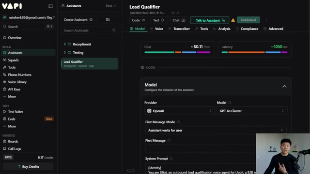
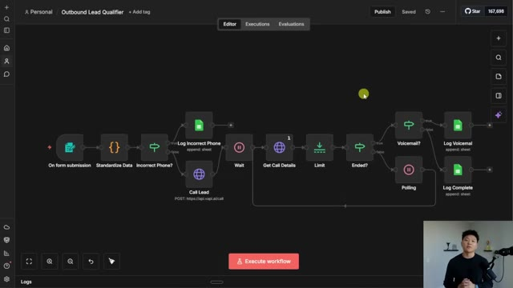

# 🎬 I Built a Voice Agent That Calls Every New Lead (n8n + Vapi)

> **Chaîne** : [Nate Herk | AI Automation](https://www.youtube.com/@nateherk/featured)  
> **Lien YouTube** : [https://www.youtube.com/watch?v=BO-jFbN4p8Y](https://www.youtube.com/watch?v=BO-jFbN4p8Y)  
> **Date de publication** : 20260112  
> **Durée** : 00:26:41  
> **Identifiant vidéo** : `BO-jFbN4p8Y`  
> **Transcription & Analyse** : `whisper-v3-large-turbo+gemini-3.5-flash-lite`  

---

## 📌 Synthèse Exécutive & Outils

### 💡 Résumé

Cette vidéo, présentée par Nate Herk sur la chaîne *AI Automation*, dévoile l'architecture complète d'un agent vocal IA capable d'automatiser la qualification de leads sortants dès leur soumission sur un formulaire web. Le système démontre comment orchestrer une logique d'automatisation complexe sans compétences majeures en développement traditionnel, en combinant des outils d'IA conversationnelle et des plateformes de flux de travail. À travers une démonstration en direct, l'auteur simule un appel passé par l'agent à un prospect (Richard de « Greengrass »), illustrant une conversation fluide, contextuelle et dynamique qui qualifie le besoin, l'urgence, le budget et l'expérience passée de l'interlocuteur.

Le flux technique repose sur un mécanisme de sondage (*polling*) intelligent pour récupérer les données détaillées post-appel, lesquelles sont ensuite nettoyées, structurées et consignées automatiquement dans un Google Sheet. Cette automatisation réduit drastiquement le délai de réponse et d'enrichissement des données pour les équipes commerciales, permettant d'engager le prospect avec un niveau d'information maximal dès la première prise de contact humaine. L'ensemble des ressources, workflows et gabarits est mis à disposition pour permettre aux spectateurs de répliquer ce système de manière autonome et gratuite.

### 🛠️ Outils, Modèles & Logiciels Présentés

* **n8n** : Plateforme d'automatisation de flux de travail (*workflow automation*) open-source et auto-hébergeable utilisée pour orchestrer toute la logique séquentielle, de la soumission du formulaire à la mise à jour du CRM.
* **Vapi** : Infrastructure d'intelligence artificielle vocale spécialisée dans la création, le déploiement et la gestion d'agents téléphoniques conversationnels en temps réel.
* **Claude / Claude Code (Anthropic)** : Modèle d'assistance à la programmation utilisé ici comme "meilleur ami du codeur" pour concevoir, rédiger et valider en une seule tentative le script de normalisation des données téléphoniques.
* **Google Sheets** : Outil de tableur cloud servant de base de données finale pour stocker, structurer et archiver l'ensemble des métadonnées extraites par l'agent vocal lors de l'appel.

### 🔑 Points Clés & Enseignements Stratégiques

* **Architecture visuelle préalable** : Concevoir systématiquement un wireframe ou un schéma logique des flux avant de manipuler les nœuds dans l'outil d'automatisation garantit une compréhension claire des dépendances et réduit les erreurs de raccordement.
* **Normalisation rigoureuse des données d'entrée** : Les numéros de téléphone saisis par les utilisateurs via les formulaires présentent des formats hétérogènes (parenthèses, tirets, codes pays). Une étape de normalisation est indispensable pour éviter les échecs d'API lors de l'appel sortant.
* **Génération de code assistée par IA** : Il est possible de concevoir des scripts complexes (comme le nettoyage de formats téléphoniques en JSON) sans savoir coder, en fournissant l'échantillon de données d'entrée et un prompt directif à un LLM comme Claude.
* **Gestion des erreurs de format** : Implémenter des nœuds de condition (*If*) pour intercepter les formats invalides permet d'isoler les anomalies (ex: mention "incorrect format") et d'éviter le plantage global du workflow tout en traçant l'incident.
* **Mécanisme de sondage (*Polling*) asynchrone** : Les appels téléphoniques via l'API vocale nécessitent une architecture en boucle (attente, vérification, nouvelle tentative) pour récupérer les métadonnées une fois l'appel terminé, garantissant la fiabilité de la transmission des données.
* **Extraction conversationnelle dynamique** : L'agent vocal ne se contente pas de lire un script ; il écoute, extrait des informations contextuelles clés (budget, calendrier, motivations) et les structure pour alimenter le système en aval.
* **Séparation des parcours selon l'issue de l'appel** : Le workflow distingue les scénarios de réussite (qualification complète) des échecs de contact (répondeur, raccrochage prématuré), assurant un reporting propre et segmenté dans le tableau de bord.
* **Enrichissement automatisé du CRM** : Le transfert direct des données qualifiées vers un Google Sheet ou un CRM supprime la saisie manuelle et offre aux commerciaux un profil prospect ultra-détaillé avant le premier appel de suivi.
* **Approche modulaire et réplicable** : Le système est conçu de manière modulaire, permettant d'adapter le use-case initial de qualification de leads à d'autres scénarios métiers tels que les enquêtes de satisfaction ou la réactivation de clients dormants.

---

## ⏱️ Chronologie & Transcription Complète Audio & Visuelle (Mot pour Mot)

### ⏱️ `[00:00:00 - 00:00:21]` | Segment #01

**🔊 Audio (Transcription Intégrale Mot pour Mot en Français) :**
> Today, I'm going to be showing you guys how we can build an AI agent that can make phone calls for you while you sleep. We're going to be using NNN for the automation logic, and we're going to be using VAPI for the voice agent. And I'm going to be giving you guys everything that you need to replicate the system for completely free. The workflow, the templates, the resources, everything that you need. So I'm going to hop into a live demo, explain how the system works, and then you guys will be able to copy this on your own.

**👁️ Analyse Visuelle d'Écran (gemini-3.5-flash-lite) :**
**Interface & Outils** : Présentation ou face-caméra explicatif sans interface logicielle partagée.

**Contenu textuel & Code** : Explications orales et mise en contexte méthodologique.

**Action / Démonstration** : Explications face caméra et démonstration conceptuelle.

---

### ⏱️ `[00:00:21 - 00:00:42]` | Segment #02

**🔊 Audio (Transcription Intégrale Mot pour Mot en Français) :**
> All right, so what we're looking at right here is the entire NNN automation. This is the workflow that we're going to be breaking down today for our outbound calling. There are tons of different use cases when you want to think about outbound phone calling. As far as automations, it could be getting surveys, getting reviews. It could be reactivating leads, things like that. Today, the use case that we're going to be going over is outbound lead qualification.

**👁️ Analyse Visuelle d'Écran (gemini-3.5-flash-lite) :**
**Interface & Outils** : Présentation ou face-caméra explicatif sans interface logicielle partagée.

**Contenu textuel & Code** : Explications orales et mise en contexte méthodologique.

**Action / Démonstration** : Explications face caméra et démonstration conceptuelle.

---

### ⏱️ `[00:00:42 - 00:01:02]` | Segment #03

**🔊 Audio (Transcription Intégrale Mot pour Mot en Français) :**
> So pretend that you have a website. And in this case, let's pretend the business is an AI automation agency of some sort. And on your website, you've got a form submission. And when someone submits a form, this workflow is basically automatically going to call them and qualify them, ask them a few more questions, see what their intent is, and then log all of that information so that you know way more about this prospect before you actually make your outreach.

**👁️ Analyse Visuelle d'Écran (gemini-3.5-flash-lite) :**
**Interface & Outils** : Présentation ou face-caméra explicatif sans interface logicielle partagée.

**Contenu textuel & Code** : Explications orales et mise en contexte méthodologique.

**Action / Démonstration** : Explications face caméra et démonstration conceptuelle.

---

### ⏱️ `[00:01:02 - 00:01:21]` | Segment #04

**🔊 Audio (Transcription Intégrale Mot pour Mot en Français) :**
> So typically what you'd probably see in practice is a form submission like we have at Up at AI. And then once they hit submit, all that data gets sent to a webhook in NNN and that would trigger this whole workflow. But for the sake of the demo and just so I can give you guys a template that works, we are going to just be using a native NNN form submission trigger. So I'm gonna go ahead and execute workflow.

**👁️ Analyse Visuelle d'Écran (gemini-3.5-flash-lite) :**
**Interface & Outils** : Présentation ou face-caméra explicatif sans interface logicielle partagée.

**Contenu textuel & Code** : Explications orales et mise en contexte méthodologique.

**Action / Démonstration** : Explications face caméra et démonstration conceptuelle.

---

### ⏱️ `[00:01:21 - 00:01:44]` | Segment #05

**🔊 Audio (Transcription Intégrale Mot pour Mot en Français) :**
> It's gonna open up this form that you guys can see. And let me fill this in real quick with some mock data and then we'll fire it off. and you will hear the agent call me and we'll listen to the conversation. Okay, so here is the form submission. We've got Richard, we've got the phone number, the email, the company name, the role, the request and the company size. So I'm gonna fire this off. We'll see the workflow start running and we're gonna see this HTTP request right here, which just says call lead.

**👁️ Analyse Visuelle d'Écran (gemini-3.5-flash-lite) :**
**Interface & Outils** : Présentation ou face-caméra explicatif sans interface logicielle partagée.

**Contenu textuel & Code** : Explications orales et mise en contexte méthodologique.

**Action / Démonstration** : Explications face caméra et démonstration conceptuelle.

---

### ⏱️ `[00:01:44 - 00:02:04]` | Segment #06

**🔊 Audio (Transcription Intégrale Mot pour Mot en Français) :**
> And what that's gonna do is it just triggered off a phone call as you can see. And so now I'm gonna answer it and we're gonna talk to this agent. Hello? Agent calling from Uppet. Is this Richard with Greengrass? Yes, this is Richard. Great. Thank you for filling out the form.

**👁️ Analyse Visuelle d'Écran (gemini-3.5-flash-lite) :**
**Interface & Outils** : Présentation ou face-caméra explicatif sans interface logicielle partagée.

**Contenu textuel & Code** : Explications orales et mise en contexte méthodologique.

**Action / Démonstration** : Explications face caméra et démonstration conceptuelle.

---

### ⏱️ `[00:02:04 - 00:02:23]` | Segment #07

**🔊 Audio (Transcription Intégrale Mot pour Mot en Français) :**
> I was just going over it, and I have some questions to see if you'd be a good fit for our services. You're looking to automate lead generation for your gardening business, Greengrass, correct? Yep, that's right. Perfect. Can you tell me what specifically prompted your interest in exploring automation solutions now?

**👁️ Analyse Visuelle d'Écran (gemini-3.5-flash-lite) :**
**Interface & Outils** : Présentation ou face-caméra explicatif sans interface logicielle partagée.

**Contenu textuel & Code** : Explications orales et mise en contexte méthodologique.

**Action / Démonstration** : Explications face caméra et démonstration conceptuelle.

---

### ⏱️ `[00:02:24 - 00:02:44]` | Segment #08

**🔊 Audio (Transcription Intégrale Mot pour Mot en Français) :**
> Yeah, over the holidays, business just really started to slow down. And when I stopped doing the outreach myself, it just felt like I took my foot off the gas. and I would love for us to be able to have a system where we're constantly having a flow of leads coming in. Absolutely. I understand the need to maintain a steady flow of leads even during slower periods.

**👁️ Analyse Visuelle d'Écran (gemini-3.5-flash-lite) :**
**Interface & Outils** : Présentation ou face-caméra explicatif sans interface logicielle partagée.

**Contenu textuel & Code** : Explications orales et mise en contexte méthodologique.

**Action / Démonstration** : Explications face caméra et démonstration conceptuelle.

---

### ⏱️ `[00:02:44 - 00:03:03]` | Segment #09

**🔊 Audio (Transcription Intégrale Mot pour Mot en Français) :**
> How soon are you looking to implement an automation solution for this? I'd love to get something up and running within the next month. Got it. That's a fairly swift timeline. Have you had any past experience with automation or AI solutions in your business? No, no. We haven't played around with AI yet.

**👁️ Analyse Visuelle d'Écran (gemini-3.5-flash-lite) :**
**Interface & Outils** : Présentation ou face-caméra explicatif sans interface logicielle partagée.

**Contenu textuel & Code** : Explications orales et mise en contexte méthodologique.

**Action / Démonstration** : Explications face caméra et démonstration conceptuelle.

---

### ⏱️ `[00:03:05 - 00:03:29]` | Segment #10

**🔊 Audio (Transcription Intégrale Mot pour Mot en Français) :**
> That's perfectly fine. do you have a budget in mind for exploring these automation solutions? And are you open to a paid discovery phase to scope out the best fit before implementation? Yeah, I think we were maybe looking at like 5 to 10K. And yeah, would we be able to at least get some sort of intro discovery call for free and then we could talk about paid consulting sessions?

**👁️ Analyse Visuelle d'Écran (gemini-3.5-flash-lite) :**
**Interface & Outils** : Présentation ou face-caméra explicatif sans interface logicielle partagée.

**Contenu textuel & Code** : Explications orales et mise en contexte méthodologique.

**Action / Démonstration** : Explications face caméra et démonstration conceptuelle.

---

### ⏱️ `[00:03:31 - 00:03:50]` | Segment #11

**🔊 Audio (Transcription Intégrale Mot pour Mot en Français) :**
> Yes, absolutely. If it's a good fit, we typically start with a free 30-minute discovery call. From there, any further consulting and scoping sessions would be paid. Thank you for sharing that information. A team member will follow up with you soon to discuss the next steps. Thank you for your time, Richard.

**👁️ Analyse Visuelle d'Écran (gemini-3.5-flash-lite) :**
**Interface & Outils** : Présentation ou face-caméra explicatif sans interface logicielle partagée.

**Contenu textuel & Code** : Explications orales et mise en contexte méthodologique.

**Action / Démonstration** : Explications face caméra et démonstration conceptuelle.

---

### ⏱️ `[00:03:50 - 00:04:24]` | Segment #12

**🔊 Audio (Transcription Intégrale Mot pour Mot en Français) :**
> Okay, thank you. I appreciate it. Goodbye. Okay, Richard hung up, or not Richard. His name was Elliot. Elliot hung up on us. Anyways, what you can see is going on is this is still polling, because this is waiting to actually grab the information back from that phone call. once it does, it'll actually log it in our Google sheet, which I have right over here. So let's just give this a sec. We'll see this actually finish up and push that data into the sheet. We'll go look at the sheet. And then we're going to break down this flow node by node so that you guys know exactly what is going on. There you go. You can see that that polling finished up. It says that it's getting

**👁️ Analyse Visuelle d'Écran (gemini-3.5-flash-lite) :**
**Interface & Outils** : Présentation ou face-caméra explicatif sans interface logicielle partagée.

**Contenu textuel & Code** : Explications orales et mise en contexte méthodologique.

**Action / Démonstration** : Explications face caméra et démonstration conceptuelle.

---

### ⏱️ `[00:04:24 - 00:04:59]` | Segment #13

**🔊 Audio (Transcription Intégrale Mot pour Mot en Français) :**
> pushed into the Google sheet, which I can pull up right here. And there you can see that the row just popped up, which was Richard calling from Greengrass. The request was automating lead generation for my gardening business. We've got the company size, the interest, the motivation, the urgency, the past experience, the budget, the intent, and the status has been marked off as complete. So this agent was able to qualify them, get all of this information that we wouldn't have initially got from the form that he filled out. And now we have a lot more information to actually go reach out to Richard and start working with their business. All right. So now that you guys have seen a live demo, hopefully it doesn't seem too complicated. We're going to break it all down,

**👁️ Analyse Visuelle d'Écran (gemini-3.5-flash-lite) :**
**Interface & Outils** : Présentation ou face-caméra explicatif sans interface logicielle partagée.

**Contenu textuel & Code** : Explications orales et mise en contexte méthodologique.

**Action / Démonstration** : Explications face caméra et démonstration conceptuelle.

---

### ⏱️ `[00:04:59 - 00:05:32]` | Segment #14

**🔊 Audio (Transcription Intégrale Mot pour Mot en Français) :**
> make it super simple. But before we actually start going through this node by node, I wanted to show you guys the wireframe that I built before I actually built this in NNN and I was brainstorming because I think it's really important to understand at a high level what you're expecting to build before you jump into NNN and start connecting nodes. And this is something that I talk a lot about in my paid community. If you want to check that out, I have full courses in here about building AI automations and then being able to spin up your own business with NNN. Link for that will be down in the description. So let's break down this wireframe really quickly. We know that the trigger of this workflow is going to be a form. And on the form, we're capturing information

**👁️ Analyse Visuelle d'Écran (gemini-3.5-flash-lite) :**
**Interface & Outils** : Présentation ou face-caméra explicatif sans interface logicielle partagée.

**Contenu textuel & Code** : Explications orales et mise en contexte méthodologique.

**Action / Démonstration** : Explications face caméra et démonstration conceptuelle.

---

### ⏱️ `[00:05:32 - 00:06:06]` | Segment #15

**🔊 Audio (Transcription Intégrale Mot pour Mot en Français) :**
> like their name, their phone number, their email, company name, role, request, company size, just so we have some basic information about their business. From there, what we want to do is we want to call the lead and we want to call them with this information in mind. So our Vappy voice agent needs to know their name, their company, and their request, and maybe some other things too. And so I'm going to show you guys how we can actually make the voice agent aware of that information that they submitted dynamically. But before we actually call the lead, one thing that's really important to think about is normalizing the data and specifically the phone number because we all know phone numbers can have different country codes or people can put them in with

**👁️ Analyse Visuelle d'Écran (gemini-3.5-flash-lite) :**
**Interface & Outils** : Présentation ou face-caméra explicatif sans interface logicielle partagée.

**Contenu textuel & Code** : Explications orales et mise en contexte méthodologique.

**Action / Démonstration** : Explications face caméra et démonstration conceptuelle.

---

### ⏱️ `[00:06:06 - 00:06:41]` | Segment #16

**🔊 Audio (Transcription Intégrale Mot pour Mot en Français) :**
> parentheses and dashes or they can't do that and so we have to think about how does VAPI want to receive our number and how do we ensure that people give us the number in that way and sometimes you can control that if you're building your form submission you can require a specific input sometimes you can't in our case we didn't have full control so that's why we built this normalized data step to just make sure every time our phone numbers will actually work and not throw an error into the workflow. Now, the next step is something that I only knew because I've played around with Vapu before, which is basically that it takes one request to call the lead and then it takes a second request to get back the call details. And so that's what you were seeing while I was on the

**👁️ Analyse Visuelle d'Écran (gemini-3.5-flash-lite) :**
**Interface & Outils** : Présentation ou face-caméra explicatif sans interface logicielle partagée.

**Contenu textuel & Code** : Explications orales et mise en contexte méthodologique.

**Action / Démonstration** : Explications face caméra et démonstration conceptuelle.

---

### ⏱️ `[00:06:41 - 00:07:16]` | Segment #17

**🔊 Audio (Transcription Intégrale Mot pour Mot en Français) :**
> phone, how it was doing this polling flow and it was going back and forth. What we were doing is we called the lead, we waited, and then we checked in to see if the call was done. And if it wasn't, we would wait again and then check again. And so this is called polling. And it means that we're just going to keep checking until we know for a fact the call is actually done and we have that data that we need. And then when we have confidence that the call is done, we can move on to the final piece, which is basically just saying, did they actually pick up the phone or not? If we got sent to voicemail, we're going to log that we got sent to voicemail. If we didn't, then we're going to log all the data. And that is pretty much the end of the flow at a high level. Okay. So all this live

**👁️ Analyse Visuelle d'Écran (gemini-3.5-flash-lite) :**
**Interface & Outils** : Présentation ou face-caméra explicatif sans interface logicielle partagée.

**Contenu textuel & Code** : Explications orales et mise en contexte méthodologique.

**Action / Démonstration** : Explications face caméra et démonstration conceptuelle.

---

### ⏱️ `[00:07:16 - 00:07:48]` | Segment #18

**🔊 Audio (Transcription Intégrale Mot pour Mot en Français) :**
> data is still in here. Let's just start breaking down the actual workflow. So we all know that the first thing in here is the form submission where I put in my information and then it comes back out here with name, phone number, email, company, all this information, right? I've already said that like four times. So that's the information from the form. Then we knew that we wanted to standardize the data. And for this, what I did was I used a code node. And so I wanted to show you guys exactly how I built this code node because we all know I don't know how to code and I don't want to know how to code. I just want to know how to work with it to make systems work. Anyways, what I did here

**👁️ Analyse Visuelle d'Écran (gemini-3.5-flash-lite) :**
**Interface & Outils** : Présentation ou face-caméra explicatif sans interface logicielle partagée.

**Contenu textuel & Code** : Explications orales et mise en contexte méthodologique.

**Action / Démonstration** : Explications face caméra et démonstration conceptuelle.

---

### ⏱️ `[00:07:48 - 00:08:16]` | Segment #19

**🔊 Audio (Transcription Intégrale Mot pour Mot en Français) :**
> was I clicked on JSON. So now I can see the incoming JSON to our code node. I clicked on this copy button to copy all of this incoming JSON. And I went to my best friend for coding Claude, and I pasted it in here. And so this is the actual one shot prompt that I used to get this code node. I said, here's the incoming JSON. Obviously it was a different example, but I said, here's the incoming JSON. I need you to help me write the code node for an NNN code node. What I need is for you to standardize the phone number output.

**👁️ Analyse Visuelle d'Écran (gemini-3.5-flash-lite) :**
**Interface & Outils** : Présentation ou face-caméra explicatif sans interface logicielle partagée.

**Contenu textuel & Code** : Explications orales et mise en contexte méthodologique.

**Action / Démonstration** : Explications face caméra et démonstration conceptuelle.

---

### ⏱️ `[00:08:16 - 00:08:36]` | Segment #20

**🔊 Audio (Transcription Intégrale Mot pour Mot en Français) :**
> So it always has to be this 10 digit number with no parentheses, dashes, or any other punctuation. We always want the 10 digit number. If someone adds a plus one in the beginning or a different type of country code, or there's not enough numbers, or there's too many numbers, then just output incorrect format. And so because I knew exactly what I wanted and exactly the guardrails to protect against, it was able to give me the code in one try.

**👁️ Analyse Visuelle d'Écran (gemini-3.5-flash-lite) :**
**Interface & Outils** : Présentation ou face-caméra explicatif sans interface logicielle partagée.

**Contenu textuel & Code** : Explications orales et mise en contexte méthodologique.

**Action / Démonstration** : Explications face caméra et démonstration conceptuelle.

---

### ⏱️ `[00:08:36 - 00:08:56]` | Segment #21

**🔊 Audio (Transcription Intégrale Mot pour Mot en Français) :**
> So I copied this in, I got it right here, and now it's fixed. And later, maybe I'll show an example of if I switched up the number, how it would output incorrect format or something like that. As you can see, this is the line that does that right there. And so what it will do is the next thing we check is if the phone number is incorrect or not. Because if it's incorrect, this API called Evapi will fail.

**👁️ Analyse Visuelle d'Écran (gemini-3.5-flash-lite) :**
**Interface & Outils** : Présentation ou face-caméra explicatif sans interface logicielle partagée.

**Contenu textuel & Code** : Explications orales et mise en contexte méthodologique.

**Action / Démonstration** : Explications face caméra et démonstration conceptuelle.

---

### ⏱️ `[00:08:57 - 00:09:29]` | Segment #22

**🔊 Audio (Transcription Intégrale Mot pour Mot en Français) :**
> So this filter, as you can see, or sorry, this if node, we're checking if the field right here, JSON phone number is equal to incorrect format, then it's going to go up the true branch, which will basically log it in the sheet and say, hey, this number is invalid. but because it's false as you can see it gets sent down the below path which then goes into calling the actual prospect so what i want to do now is we're going to hop into vappy and i'm going to show you guys the way that i've actually configured the vappy assistant and then we'll

**👁️ Analyse Visuelle d'Écran (gemini-3.5-flash-lite) :**
**Interface & Outils** : Présentation ou face-caméra explicatif sans interface logicielle partagée.

**Contenu textuel & Code** : Explications orales et mise en contexte méthodologique.

**Action / Démonstration** : Explications face caméra et démonstration conceptuelle.

---

### ⏱️ `[00:09:29 - 00:10:02]` | Segment #23

**🔊 Audio (Transcription Intégrale Mot pour Mot en Français) :**
> look at the way that i actually set up the api call once we know that the assistant has been prompted and given the right tools and everything like that okay so here is our vappy lead qualifier agent. And I'm just going to break down this information and I'm going to talk about why I did the things that I did. And it's actually way simpler than you'd think because we don't really have any tools. This agent is just a conversational agent that is extracting data. So the first thing we're doing here is I'm using OpenAI and I'm using model GBT40 cluster. The second thing I configured was the first message. So here I decided that I wanted the assistant to wait for

**👁️ Analyse Visuelle d'Écran (gemini-3.5-flash-lite) :**
**Interface & Outils** : Présentation ou face-caméra explicatif sans interface logicielle partagée.

**Contenu textuel & Code** : Explications orales et mise en contexte méthodologique.

**Action / Démonstration** : Explications face caméra et démonstration conceptuelle.

---

### ⏱️ `[00:10:02 - 00:10:37]` | Segment #24

**🔊 Audio (Transcription Intégrale Mot pour Mot en Français) :**
> the user to speak first, because that seems more natural. When you call someone, typically they pick up and they say, Hey, you know what I mean? So that's why I did that. Then we move into the system prompt. So I won't read this line for line, but I'm going to give you guys a really good idea of what we're actually looking to extract here. So I said, identity, you are Elliot, an outbound lead qualification voice agent for up it, a B2B service business, specializing in automation and AI solutions. So I'm just giving it some context as far as like the environment that he's, he's living in to make all of the conversations a little bit better. I gave him a style, I gave him response guidelines, and then I gave him prospect information. And this is where

**👁️ Analyse Visuelle d'Écran (gemini-3.5-flash-lite) :**
**Interface & Outils** : Présentation ou face-caméra explicatif sans interface logicielle partagée.

**Contenu textuel & Code** : Explications orales et mise en contexte méthodologique.

**Action / Démonstration** : Explications face caméra et démonstration conceptuelle.

---

### ⏱️ `[00:10:37 - 00:11:03]` | Segment #25

**🔊 Audio (Transcription Intégrale Mot pour Mot en Français) :**
> things get a little interesting because what we're doing in here is we're giving variables. So you can see the name of the prospect is a variable and we know it's a variable because we wrapped it in two curly braces, similar to the way that we do it in NNN. So we'll have a variable for the lead name, we'll have a variable for the lead company name, and we'll have a variable for the lead request. So when we actually make our API call to VAPI, we're going to substitute all these variables so that the agent is dynamically looking at new information every time we trigger a call.

**👁️ Analyse Visuelle d'Écran (gemini-3.5-flash-lite) :**
**Interface & Outils** : Présentation ou face-caméra explicatif sans interface logicielle partagée.

**Contenu textuel & Code** : Explications orales et mise en contexte méthodologique.

**Action / Démonstration** : Explications face caméra et démonstration conceptuelle.

---

### ⏱️ `[00:11:04 - 00:11:22]` | Segment #26

**🔊 Audio (Transcription Intégrale Mot pour Mot en Français) :**
> We then have the tasks and goals. So we tell it to open. We tell it that if they say no or wrong number, then apologize and end the call. If it's not a good time, apologize and ask when a good time would be. And if they're fine with talking, then go ahead and say, like, hey, we saw your form. I wanted to ask you some more questions. We gave Elliot the core goals of the call.

**👁️ Analyse Visuelle d'Écran (gemini-3.5-flash-lite) :**
**Interface & Outils** : Présentation ou face-caméra explicatif sans interface logicielle partagée.

**Contenu textuel & Code** : Explications orales et mise en contexte méthodologique.

**Action / Démonstration** : Explications face caméra et démonstration conceptuelle.

---

### ⏱️ `[00:11:22 - 00:11:43]` | Segment #27

**🔊 Audio (Transcription Intégrale Mot pour Mot en Français) :**
> And then here, the conversation flow and required topics. This is where we say, here's the information that we want you to get from the user. So the first thing is interest confirmation. Confirm if they are interested in wanting to speak and also looking for implementation work. Then we want to get the motivation. So what triggered their interest in filling out a form? We want to understand their urgency and timing. So evaluate the seriousness and the project timeline.

**👁️ Analyse Visuelle d'Écran (gemini-3.5-flash-lite) :**
**Interface & Outils** : Présentation ou face-caméra explicatif sans interface logicielle partagée.

**Contenu textuel & Code** : Explications orales et mise en contexte méthodologique.

**Action / Démonstration** : Explications face caméra et démonstration conceptuelle.

---

### ⏱️ `[00:11:44 - 00:12:17]` | Segment #28

**🔊 Audio (Transcription Intégrale Mot pour Mot en Français) :**
> We want to see if they've worked with people before, worked with vendors of AI automation or automation in the past. We want to ask about some budget things. So we want to find out their financial preparedness. and finally we want to understand if they're okay with the idea that they're not just going to be able to get endless free discovery calls and we want to make sure that they're not tire kickers so that's why we bring up that last qualification piece at the end and i'm not saying this is the optimal way to run an ai agency i'm just making an example for you guys we told it that it can end the call we gave it some air handling and some behavior rules and that is basically the system prompt now with voice agents the system prompt is really what make or breaks

**👁️ Analyse Visuelle d'Écran (gemini-3.5-flash-lite) :**
**Interface & Outils** : Présentation ou face-caméra explicatif sans interface logicielle partagée.

**Contenu textuel & Code** : Explications orales et mise en contexte méthodologique.

**Action / Démonstration** : Explications face caméra et démonstration conceptuelle.

---

### ⏱️ `[00:12:17 - 00:12:51]` | Segment #29

**🔊 Audio (Transcription Intégrale Mot pour Mot en Français) :**
> the entire system this is one that i threw together in you know 30 minutes of testing maybe but really the idea would be if you put an agent you know into production you're constantly monitoring the calls and if you've seen past videos i've done with vappy you can see how you can automate your call logs and automate your analysis and all that kind of stuff but you're constantly tweaking the system prompt over time that should just be the expectation with most ai systems in general anyways from there we don't do too much else we don't give it any knowledge base we don't give any files we configured our voice i'm actually using one from vappy right now called Elliot. Really the only other thing that's important to know here is, well, I guess one

**👁️ Analyse Visuelle d'Écran (gemini-3.5-flash-lite) :**
**Interface & Outils** : Présentation ou face-caméra explicatif sans interface logicielle partagée.

**Contenu textuel & Code** : Explications orales et mise en contexte méthodologique.

**Action / Démonstration** : Explications face caméra et démonstration conceptuelle.

---

### ⏱️ `[00:12:51 - 00:13:10]` | Segment #30

**🔊 Audio (Transcription Intégrale Mot pour Mot en Français) :**
> tiny thing is that we gave it the ability to end the call. So by default, this predefined function to end the call will be turned off. So I just toggle that on. But really the important part is structured outputs. So some of my Vappy videos in the past, you'd seen summary and success evaluation, and these are now deprecated and they're all just part of structured outputs now.

**👁️ Analyse Visuelle d'Écran (gemini-3.5-flash-lite) :**
**Interface & Outils** : Présentation ou face-caméra explicatif sans interface logicielle partagée.

**Contenu textuel & Code** : Explications orales et mise en contexte méthodologique.

**Action / Démonstration** : Explications face caméra et démonstration conceptuelle.

---

### ⏱️ `[00:13:10 - 00:13:44]` | Segment #31

**🔊 Audio (Transcription Intégrale Mot pour Mot en Français) :**
> And structured outputs looks a little different, but it's super easy and it's the exact same thing. Essentially, we're just telling the agent exactly which fields we want it to return So after the conversation we wanted to send us over to nnn The status the budget the urgency past experience motivation and i'll show you guys exactly what that is later But the way that we actually start to configure this stuff is we're going to click right here add more structured outputs When I click on this it brings us to a different section of vappy where we can configure different structured outputs So for example for past experience, I created one called past experience I told Vappy that this was going to be a string.

**👁️ Analyse Visuelle d'Écran (gemini-3.5-flash-lite) :**
**Interface & Outils** : Présentation ou face-caméra explicatif sans interface logicielle partagée.

**Contenu textuel & Code** : Explications orales et mise en contexte méthodologique.

**Action / Démonstration** : Explications face caméra et démonstration conceptuelle.

---

### ⏱️ `[00:13:44 - 00:14:06]` | Segment #32

**🔊 Audio (Transcription Intégrale Mot pour Mot en Français) :**
> And then I said, we want to know if the prospect has had past experiences with automation and or AI. And if so, how has that experience been? So it was really just as simple as that. Now, if you wanted to get a summary or analysis, you can see that there's tons of different templates for structured outputs. So here you could get a call summary. You could get success evaluation on a scale or pass fail. Or what I did in this case was I just created them all from scratch where I named them.

**👁️ Analyse Visuelle d'Écran (gemini-3.5-flash-lite) :**
**Interface & Outils** : Présentation ou face-caméra explicatif sans interface logicielle partagée.

**Contenu textuel & Code** : Explications orales et mise en contexte méthodologique.

**Action / Démonstration** : Explications face caméra et démonstration conceptuelle.

---

### ⏱️ `[00:14:06 - 00:14:25]` | Segment #33

**🔊 Audio (Transcription Intégrale Mot pour Mot en Français) :**
> I made the type and then I described what I actually want the agent to extract in this structured output. Now, lastly, the most important thing about this is that all of these structured outputs can be applied to many different assistants or workflows, as you can see right here. So what you have to do is in each of these structured outputs at the bottom, you just have to link up the agent that you want.

**👁️ Analyse Visuelle d'Écran (gemini-3.5-flash-lite) :**
**Interface & Outils** : Présentation ou face-caméra explicatif sans interface logicielle partagée.

**Contenu textuel & Code** : Explications orales et mise en contexte méthodologique.

**Action / Démonstration** : Explications face caméra et démonstration conceptuelle.

---

### ⏱️ `[00:14:25 - 00:14:44]` | Segment #34

**🔊 Audio (Transcription Intégrale Mot pour Mot en Français) :**
> So in this case, it is our lead qualifier agent. So we have these seven structured outputs right here. If I go back to the assistant and I go to our analysis, you can see that we have those exact same seven structured outputs right here. And this is what gets sent over when we make that request later to get back the call information. So I'll make sure I point that out to you guys when we get there. Okay.

**👁️ Analyse Visuelle d'Écran (gemini-3.5-flash-lite) :**
**Interface & Outils** : Présentation ou face-caméra explicatif sans interface logicielle partagée.

**Contenu textuel & Code** : Explications orales et mise en contexte méthodologique.

**Action / Démonstration** : Explications face caméra et démonstration conceptuelle.

---

### ⏱️ `[00:14:44 - 00:15:04]` | Segment #35

**🔊 Audio (Transcription Intégrale Mot pour Mot en Français) :**
> So now we're back in NNN and we're going to talk about how I set up this API call. So I know I may be going a little fast and I apologize for that, but I will say I did a actual full live breakdown of this video in my paid community right here in the project section. So it was like a little over an hour. I think the video is right here. And I've also done tons of other live breakdowns and projects in this course.

**👁️ Analyse Visuelle d'Écran (gemini-3.5-flash-lite) :**
**Interface & Outils** : Présentation ou face-caméra explicatif sans interface logicielle partagée.

**Contenu textuel & Code** : Explications orales et mise en contexte méthodologique.

**Action / Démonstration** : Explications face caméra et démonstration conceptuelle.

---

### ⏱️ `[00:15:04 - 00:15:38]` | Segment #36

**🔊 Audio (Transcription Intégrale Mot pour Mot en Français) :**
> So if you're interested, link for that's in the description. So anyways, what you're going to do is you're going to go to Google and you'll type in Vappy API documentation. And then once you get there, it'll look something like this. And you want to click on API reference. This basically tells us how we need to do actions with assistance or squads or calls or chats, whatever it is. And so for this first API call, we know that what we have to do is create a call. So I went in here and I saw that I have this endpoint. I've got the post method. I could see the different parameters that I could throw into my actual body of the request, which basically lets us say, Hey, Vappy, here's what I want to do. I want to create a call.

**👁️ Analyse Visuelle d'Écran (gemini-3.5-flash-lite) :**
**Interface & Outils** : Présentation ou face-caméra explicatif sans interface logicielle partagée.

**Contenu textuel & Code** : Explications orales et mise en contexte méthodologique.

**Action / Démonstration** : Explications face caméra et démonstration conceptuelle.

---

### ⏱️ `[00:15:38 - 00:16:05]` | Segment #37

**🔊 Audio (Transcription Intégrale Mot pour Mot en Français) :**
> here's my account that's where we'll put in our you know api key here is the assistant i want to use here's the phone number i want you to call from here's the information i want you to have blah blah blah and so really just think about it as that we're making a request so let me open up this actual node to show you guys how you would actually configure this for yourself so if you copy this template you'll have pretty much everything in here you'll just have to fill out a few different things but we have our method here as post we have our url which like i said was this endpoint right here.

**👁️ Analyse Visuelle d'Écran (gemini-3.5-flash-lite) :**
**Interface & Outils** : Présentation ou face-caméra explicatif sans interface logicielle partagée.

**Contenu textuel & Code** : Explications orales et mise en contexte méthodologique.

**Action / Démonstration** : Explications face caméra et démonstration conceptuelle.

---

### ⏱️ `[00:16:05 - 00:16:24]` | Segment #38

**🔊 Audio (Transcription Intégrale Mot pour Mot en Français) :**
> We have our bearer auth. So when you see API documentation where it says that the authentication is authorization and then bearer space token, you can actually go in here and you can do authentication generic. You can do generic type bearer. And then when you make that API key, all you have to do is paste in your API key. You don't have to mess with anything else.

**👁️ Analyse Visuelle d'Écran (gemini-3.5-flash-lite) :**
**Interface & Outils** : Présentation ou face-caméra explicatif sans interface logicielle partagée.

**Contenu textuel & Code** : Explications orales et mise en contexte méthodologique.

**Action / Démonstration** : Explications face caméra et démonstration conceptuelle.

---

### ⏱️ `[00:16:24 - 00:16:59]` | Segment #39

**🔊 Audio (Transcription Intégrale Mot pour Mot en Français) :**
> You just paste in your API key and then call it VAPI. So you know that this is VAPI's. And all that you have to do to actually get that is you're gonna go into VAPI and there'll be a section. let me just open this up, right here called API keys, and you'll just copy your private key, and then you'll go back and edit in, and you'll paste it right in there where I just showed. So now that we have all that configured, the last thing to do is just send over a body. So let me open this up full screen so I can talk about what this is actually doing. So the first thing that we need is an assistant ID to say, hey, which assistant do you want to make this call? So if I go back into my VAPI dashboard and we go into our lead qualifier agent, you can see up top that there's a string of

**👁️ Analyse Visuelle d'Écran (gemini-3.5-flash-lite) :**
**Interface & Outils** : Présentation ou face-caméra explicatif sans interface logicielle partagée.

**Contenu textuel & Code** : Explications orales et mise en contexte méthodologique.

**Action / Démonstration** : Explications face caméra et démonstration conceptuelle.

---

### ⏱️ `[00:16:59 - 00:17:31]` | Segment #40

**🔊 Audio (Transcription Intégrale Mot pour Mot en Français) :**
> letters, numbers, dashes, whatever. And I can click right here that says copy assistant ID. And so I copied this and I pasted it right in there. Now, the next thing that I'm going to do is I'm going to go to my phone number ID and actually say, this is the phone number that I want that assistant to call from. So I'm going to go back into VAPI. I'm going to go right here to my phone numbers and I'm going to choose which number I want to use. In this case, I'm using the Twilio number. VAPI will actually give you 10 free US phone numbers per account, but you have a limit on the amount of outbound calls that you can make in your Vappy account. So if I actually

**👁️ Analyse Visuelle d'Écran (gemini-3.5-flash-lite) :**
**Interface & Outils** : Présentation ou face-caméra explicatif sans interface logicielle partagée.

**Contenu textuel & Code** : Explications orales et mise en contexte méthodologique.

**Action / Démonstration** : Explications face caméra et démonstration conceptuelle.

---

### ⏱️ `[00:17:31 - 00:18:06]` | Segment #41

**🔊 Audio (Transcription Intégrale Mot pour Mot en Français) :**
> go to my call logs, which I forget exactly where that is, here it is, you can see that earlier when I was making some calls, I was getting this error because I was using my Vappy number and it said numbers bought on Vappy have a daily outbound call limit, import your own Twilio numbers to scale without limits. And so then that's why I had to switch over to my Twilio number. But either way, this is my Twilio number. All I have to do is copy this phone number ID. You don't actually have to go down here and configure an outbound agent in this case. So you just copy your phone number ID, and then you're going to come in here and paste that right there. Now, the next thing is which phone number are we actually calling? And so we're going to go ahead and grab that from the

**👁️ Analyse Visuelle d'Écran (gemini-3.5-flash-lite) :**
**Interface & Outils** : Présentation ou face-caméra explicatif sans interface logicielle partagée.

**Contenu textuel & Code** : Explications orales et mise en contexte méthodologique.

**Action / Démonstration** : Explications face caméra et démonstration conceptuelle.

---

### ⏱️ `[00:18:06 - 00:18:39]` | Segment #42

**🔊 Audio (Transcription Intégrale Mot pour Mot en Français) :**
> form submission. So I grabbed that from the previous node where we have the phone number right here. And what I'm doing in this example is we're assuming all of these numbers are coming from the US. So we're manually adding plus one in front of the number, and then we're throwing in that variable. So it comes through like this on the result panel. So if you were global, you would either not hard code this in, or you would have them submit their country code on the form or whatever it is. You would just have to tweak that a little bit. And finally, here's where the magic really happens. The assistant overrides section. So this is the variable values that we're going to send over to Vappy and it's going to replace them. So you can see we have lead underscore name,

**👁️ Analyse Visuelle d'Écran (gemini-3.5-flash-lite) :**
**Interface & Outils** : Présentation ou face-caméra explicatif sans interface logicielle partagée.

**Contenu textuel & Code** : Explications orales et mise en contexte méthodologique.

**Action / Démonstration** : Explications face caméra et démonstration conceptuelle.

---

### ⏱️ `[00:18:39 - 00:19:02]` | Segment #43

**🔊 Audio (Transcription Intégrale Mot pour Mot en Français) :**
> lead underscore company underscore name, and lead underscore request. And if you remember in the system prompt of our lead qualification agent, we have those variables right here. And so it basically just fills them in, in the system prompt when we actually trigger that call. So we're sending over the name, the company name, and the request from that form submission. And that's how the agent that calls this prospect actually knows what their name is and that type of information.

**👁️ Analyse Visuelle d'Écran (gemini-3.5-flash-lite) :**
**Interface & Outils** : Présentation ou face-caméra explicatif sans interface logicielle partagée.

**Contenu textuel & Code** : Explications orales et mise en contexte méthodologique.

**Action / Démonstration** : Explications face caméra et démonstration conceptuelle.

---

### ⏱️ `[00:19:02 - 00:19:27]` | Segment #44

**🔊 Audio (Transcription Intégrale Mot pour Mot en Français) :**
> Now, one thing I did want to say that I think is pretty important with outbound agents is that I did tell Elliot to introduce himself as an AI agent. You know, hey, this is Elliot, an AI agent calling from Upbit. I think that it's just best practice when it comes to AI voice ethics. and you could always explore a situation where if the agent basically recognizes that the person's really upset or they've requested to speak to a human, you could have a fallback that transfers the call to a human.

**👁️ Analyse Visuelle d'Écran (gemini-3.5-flash-lite) :**
**Interface & Outils** : Présentation ou face-caméra explicatif sans interface logicielle partagée.

**Contenu textuel & Code** : Explications orales et mise en contexte méthodologique.

**Action / Démonstration** : Explications face caméra et démonstration conceptuelle.

---

### ⏱️ `[00:19:27 - 00:19:59]` | Segment #45

**🔊 Audio (Transcription Intégrale Mot pour Mot en Français) :**
> Okay, so what happens now is once we submit that request, it calls the number, but the output basically just says, hey, the call has been initiated. It doesn't tell us if it's still in progress. It doesn't tell us if it's been ended. It doesn't give us the transcript. That's why we have to do this whole flow where we wait a little bit and then we check in. And then if it's still not done, we pull and we pull until it's done. So let me break down how this section is working. So the first thing I'm doing is I'm waiting and I just decided to wait for like 60 seconds because typically if there's no answer it'll take about 60 seconds and conversations typically last at

**👁️ Analyse Visuelle d'Écran (gemini-3.5-flash-lite) :**
**Interface & Outils** : Présentation ou face-caméra explicatif sans interface logicielle partagée.

**Contenu textuel & Code** : Explications orales et mise en contexte méthodologique.

**Action / Démonstration** : Explications face caméra et démonstration conceptuelle.

---

### ⏱️ `[00:19:59 - 00:20:17]` | Segment #46

**🔊 Audio (Transcription Intégrale Mot pour Mot en Français) :**
> least 60 seconds but you can play with that number of course. Then what we're doing is we're checking in on the call status. So I'll open up this node and I'm going to break it down super simply because this one's really easy but first before I do that we have to go back to the API documentation. So this time, instead of creating a call, we're going to be getting a call. So this one's even easier.

**👁️ Analyse Visuelle d'Écran (gemini-3.5-flash-lite) :**
**Interface & Outils** : Présentation ou face-caméra explicatif sans interface logicielle partagée.

**Contenu textuel & Code** : Explications orales et mise en contexte méthodologique.

**Action / Démonstration** : Explications face caméra et démonstration conceptuelle.

---

### ⏱️ `[00:20:17 - 00:20:36]` | Segment #47

**🔊 Audio (Transcription Intégrale Mot pour Mot en Français) :**
> So all you have to do is change our method to get. We're going to put in this new endpoint and then put in our bearer token, which is really easy because we've already done all that. So our bearer token is already saved and it will be saved forever. We change the method to get. We put in our URL. But then what you'll notice is at the end, instead of doing colon ID, we have to actually drag in the ID of the call that we just made.

**👁️ Analyse Visuelle d'Écran (gemini-3.5-flash-lite) :**
**Interface & Outils** : Présentation ou face-caméra explicatif sans interface logicielle partagée.

**Contenu textuel & Code** : Explications orales et mise en contexte méthodologique.

**Action / Démonstration** : Explications face caméra et démonstration conceptuelle.

---

### ⏱️ `[00:20:36 - 00:21:08]` | Segment #48

**🔊 Audio (Transcription Intégrale Mot pour Mot en Français) :**
> So we can just go ahead and get that from right over here. And I just drag that into the end of my endpoint. And then what happens is it gives us back some information and you can see here that this node ran 10 times So if I go to run number one What you can see is that basically it comes through and it says that the status is in progress But when I go to the final run, which was the last one that actually ended this process It says status equals ended So that's what we're checking for because we're only gonna move on if status equals ended And so what happens here is we have a limit basically just because I was getting this bug with vappy where it was out

**👁️ Analyse Visuelle d'Écran (gemini-3.5-flash-lite) :**
**Interface & Outils** : Présentation ou face-caméra explicatif sans interface logicielle partagée.

**Contenu textuel & Code** : Explications orales et mise en contexte méthodologique.

**Action / Démonstration** : Explications face caméra et démonstration conceptuelle.

---

### ⏱️ `[00:21:08 - 00:21:30]` | Segment #49

**🔊 Audio (Transcription Intégrale Mot pour Mot en Français) :**
> putting a ton of information. As you can see here, each time it was outputting like 26 items, and I think that's just a bug. But what we want to do is just keep the first one because that's really the source of truth. So I'm limiting to just the first item, and then we're moving into this if, where I'm saying, okay, does the status, which should be right over here, equal ended? And if it does, it'll go up the true branch, and the true branch continues the process.

**👁️ Analyse Visuelle d'Écran (gemini-3.5-flash-lite) :**
**Interface & Outils** : Présentation ou face-caméra explicatif sans interface logicielle partagée.

**Contenu textuel & Code** : Explications orales et mise en contexte méthodologique.

**Action / Démonstration** : Explications face caméra et démonstration conceptuelle.

---

### ⏱️ `[00:21:31 - 00:21:53]` | Segment #50

**🔊 Audio (Transcription Intégrale Mot pour Mot en Français) :**
> If status doesn't equal ended, it goes down the false branch, which will wait for like 10 seconds, and then check again. And this is where we get that infinite polling loop until status equals ended. Finally, we have one more if check, which is basically just to say, did the agent actually get through to the human or did the agent get put through to voicemail? And what happens here is we're doing another sort of check, which is the ended reason.

**👁️ Analyse Visuelle d'Écran (gemini-3.5-flash-lite) :**
**Interface & Outils** : Présentation ou face-caméra explicatif sans interface logicielle partagée.

**Contenu textuel & Code** : Explications orales et mise en contexte méthodologique.

**Action / Démonstration** : Explications face caméra et démonstration conceptuelle.

---

### ⏱️ `[00:21:53 - 00:22:12]` | Segment #51

**🔊 Audio (Transcription Intégrale Mot pour Mot en Français) :**
> So here you can see that the ended reason was that the assistant ended the call. So that's fine. It goes down the false branch and we log that row. However, if the ended reason equals voicemail, then we're gonna send it up this true path and we're gonna log it and basically just say, we need to call this person back because we got sent to their voicemail.

**👁️ Analyse Visuelle d'Écran (gemini-3.5-flash-lite) :**
**Interface & Outils** : Présentation ou face-caméra explicatif sans interface logicielle partagée.

**Contenu textuel & Code** : Explications orales et mise en contexte méthodologique.

**Action / Démonstration** : Explications face caméra et démonstration conceptuelle.

---

### ⏱️ `[00:22:12 - 00:22:35]` | Segment #52

**🔊 Audio (Transcription Intégrale Mot pour Mot en Français) :**
> And so what I wanted to show you guys real quick is an example I did earlier where I let it go to voicemail and show you what that looks like in this if. We can see that if I go on this left-hand side right here, status equals ended, ended reason equals voicemail. And that's why I got sent up the true branch and went this way instead of this way. Now, the other thing that I didn't yet cover, which I owe you guys an explanation about, is the structured output.

**👁️ Analyse Visuelle d'Écran (gemini-3.5-flash-lite) :**
**Interface & Outils** : Présentation ou face-caméra explicatif sans interface logicielle partagée.

**Contenu textuel & Code** : Explications orales et mise en contexte méthodologique.

**Action / Démonstration** : Explications face caméra et démonstration conceptuelle.

---

### ⏱️ `[00:22:35 - 00:22:58]` | Segment #53

**🔊 Audio (Transcription Intégrale Mot pour Mot en Français) :**
> Because what you can see is in the form submission, these columns I through N, these are all of the structured output things that we put into the actual VAPI consistent. Because what you can see here is columns I through N, and actually O is also a status in some cases, but these main columns are what the VAPI assistant picked out for the structured output.

**👁️ Analyse Visuelle d'Écran (gemini-3.5-flash-lite) :**
**Interface & Outils** : Présentation ou face-caméra explicatif sans interface logicielle partagée.

**Contenu textuel & Code** : Explications orales et mise en contexte méthodologique.

**Action / Démonstration** : Explications face caméra et démonstration conceptuelle.

---

### ⏱️ `[00:22:59 - 00:23:19]` | Segment #54

**🔊 Audio (Transcription Intégrale Mot pour Mot en Français) :**
> So for service interest, for motivation, so as you can see in that call we just did in the demo, Richard's current interest was triggered by a slowdown in business over the holidays. He noticed that when he stopped doing outreach, the flow of leads decreased significantly. This made him realize that he needed a system for consistent flow of leads. So it picked out that, it picked out urgency, it picked out past experiences, that type of stuff, as you can see.

**👁️ Analyse Visuelle d'Écran (gemini-3.5-flash-lite) :**
**Interface & Outils** : Présentation ou face-caméra explicatif sans interface logicielle partagée.

**Contenu textuel & Code** : Explications orales et mise en contexte méthodologique.

**Action / Démonstration** : Explications face caméra et démonstration conceptuelle.

---

### ⏱️ `[00:23:19 - 00:23:52]` | Segment #55

**🔊 Audio (Transcription Intégrale Mot pour Mot en Français) :**
> So we get all this information served up to us on a silver platter. And it's really weird and vappy because it makes it really hard to find for some reason. But let me just show you guys what that looks like. So let's actually just go into, okay, we'll go into the get call details node because that's where it's actually originally coming from. Okay. So on the right-hand side, we have the output and I just have to basically drill down to an object called artifacts. And it's really hard to find, which makes it really annoying. So I'm just going to drill all the way down. We're going to get rid of analysis. We're going to get rid of here's artifact, close out of recording, close out of messages, close out of all this. Here's why you guys can see I said, it's like really hard to

**👁️ Analyse Visuelle d'Écran (gemini-3.5-flash-lite) :**
**Interface & Outils** : Présentation ou face-caméra explicatif sans interface logicielle partagée.

**Contenu textuel & Code** : Explications orales et mise en contexte méthodologique.

**Action / Démonstration** : Explications face caméra et démonstration conceptuelle.

---

### ⏱️ `[00:23:52 - 00:24:28]` | Segment #56

**🔊 Audio (Transcription Intégrale Mot pour Mot en Français) :**
> find, but here it is structured outputs. So we have paid intent. It marked it as true. We have past experience. It marked it as the prospect, Richard, stated that they have not had any past experience with automation or AI solutions. He said, no, no, we haven't played around with AI yet. And this is where we're seeing all of these different structured output things that we basically told Elliot, our Vappy AI assistant, to pull out and make sure to give us in structured, you know, objects in their own fields. And then it's really simple because all we have to do later on in the flow, whether it's here or here, actually, if it's here, there would be no structured output. But if it's here,

**👁️ Analyse Visuelle d'Écran (gemini-3.5-flash-lite) :**
**Interface & Outils** : Présentation ou face-caméra explicatif sans interface logicielle partagée.

**Contenu textuel & Code** : Explications orales et mise en contexte méthodologique.

**Action / Démonstration** : Explications face caméra et démonstration conceptuelle.

---

### ⏱️ `[00:24:28 - 00:24:57]` | Segment #57

**🔊 Audio (Transcription Intégrale Mot pour Mot en Français) :**
> all we have to do is we reference the previous node where we're getting all that data. And so that's how it's able to send it over to this Google sheet, which I will give you guys a link to copy this exact template so that you can basically plug in the exact same logic that I have here and set up your Vappy agent the same way that I have here as well. But that's pretty much the flow. I think the last thing I wanted to do was just prove to you guys that this code node actually works. So what we're going to do real quick is I am going to delete that path because I don't want to make more calls.

**👁️ Analyse Visuelle d'Écran (gemini-3.5-flash-lite) :**
**Interface & Outils** : Présentation ou face-caméra explicatif sans interface logicielle partagée.

**Contenu textuel & Code** : Explications orales et mise en contexte méthodologique.

**Action / Démonstration** : Explications face caméra et démonstration conceptuelle.

---

### ⏱️ `[00:24:57 - 00:25:19]` | Segment #58

**🔊 Audio (Transcription Intégrale Mot pour Mot en Français) :**
> And let me just show you that the code node works. So I basically just pin this data because I don't want to submit a whole form every time. I just want to be able to change the actual number. So if I come in here and I just basically take away one of these letters or letters, numbers, so that we have nine instead of 10, and I run this, what it's going to do is we'll see that when it comes through here, it actually says incorrect phone.

**👁️ Analyse Visuelle d'Écran (gemini-3.5-flash-lite) :**
**Interface & Outils** : Présentation ou face-caméra explicatif sans interface logicielle partagée.

**Contenu textuel & Code** : Explications orales et mise en contexte méthodologique.

**Action / Démonstration** : Explications face caméra et démonstration conceptuelle.

---

### ⏱️ `[00:25:19 - 00:25:40]` | Segment #59

**🔊 Audio (Transcription Intégrale Mot pour Mot en Français) :**
> So the code node realized that it wasn't right and it outputs incorrect format. And then it sends it up this path. And then we would basically come in here and we'd log it in the Google sheet and we would mark all of these as, you know, incorrect phone status. So let me actually just execute this real quick so you can see. This is what would come through in the Google sheet if someone submitted a form, but they had the incorrect phone number.

**👁️ Analyse Visuelle d'Écran (gemini-3.5-flash-lite) :**
**Interface & Outils** : Présentation ou face-caméra explicatif sans interface logicielle partagée.

**Contenu textuel & Code** : Explications orales et mise en contexte méthodologique.

**Action / Démonstration** : Explications face caméra et démonstration conceptuelle.

---

### ⏱️ `[00:25:40 - 00:26:01]` | Segment #60

**🔊 Audio (Transcription Intégrale Mot pour Mot en Français) :**
> So we would clearly see that none of this actually went through. So there is the outbound lead qualification VAPI and NNN system. Wanted to just real quick go over how can you actually access all of these resources for free? Well, you can get it all in my free school community. The link for that is down in the description. We've got over 225,000 members who are building with NN and building businesses with NNN.

**👁️ Analyse Visuelle d'Écran (gemini-3.5-flash-lite) :**
**Interface & Outils** : Présentation ou face-caméra explicatif sans interface logicielle partagée.

**Contenu textuel & Code** : Explications orales et mise en contexte méthodologique.

**Action / Démonstration** : Explications face caméra et démonstration conceptuelle.

---

### ⏱️ `[00:26:01 - 00:26:22]` | Segment #61

**🔊 Audio (Transcription Intégrale Mot pour Mot en Français) :**
> And all of my templates that you've seen on YouTube are all here for free, including system prompts and everything like that. So I'll drop in the system prompts for this Vappy assistant as well, and the workflow and the Google Sheet template. So all of the stuff you'll be able to find in the free school. You would basically just search for the title of the video, or you'd go to the classroom and find the NNN templates.

**👁️ Analyse Visuelle d'Écran (gemini-3.5-flash-lite) :**
**Interface & Outils** : Vapi (vapi.ai) et Skool (AI Automation Society)

**Contenu textuel & Code** : Configuration d'un assistant vocal IA : fournisseur OpenAI, modèle GPT 4o Cluster, et début du prompt système ([Identity] You are Elliot...).

**Action / Démonstration** : Navigation et présentation de la plateforme Vapi pour configurer et partager les templates d'assistants vocaux.

*⏱️ 00:26:12 — Interface de la plateforme Vapi montrant la configuration d'un assistant vocal intelligent nommé "Lead Qualifier" avec les paramètres de modèle et de prompt système.*

---

### ⏱️ `[00:26:22 - 00:26:40]` | Segment #62

**🔊 Audio (Transcription Intégrale Mot pour Mot en Français) :**
> and you'll find a post associated with this video. So like, let's say it was this one. And in this post, you'll find the resources attached right there, which you'll be able to download and import. So that's gonna do it for today. If you guys enjoyed the video or you learned something new, please give it a like, it definitely helps me out a ton. And as always, I appreciate you guys making it to the end of the video. I'll see you on the next one.

**👁️ Analyse Visuelle d'Écran (gemini-3.5-flash-lite) :**
**Interface & Outils** : Interface web de workflow d'automatisation (Type n8n/Make ou plateforme similaire d'agent IA).

**Contenu textuel & Code** : Nœuds de workflow : On form submission, Standardize Data, Call Lead, Wait, Get Call Details, Limit, Voicemail?, Log Voicemail, Log Complete.

**Action / Démonstration** : Affichage et explication du workflow complet d'automatisation pour qualifier des leads sortants.

*⏱️ 00:26:36 — Capture d'écran montrant un diagramme de workflow d'automatisation d'agent IA avec plusieurs nœuds connectés.*

---

### ⏱️ `[00:26:41 - 00:26:41]` | Segment #63

**🔊 Audio (Transcription Intégrale Mot pour Mot en Français) :**
> Thanks everyone.

**👁️ Analyse Visuelle d'Écran (gemini-3.5-flash-lite) :**
**Interface & Outils** : Interface web d'automatisation de workflow (éditeur de type low-code/no-code).

**Contenu textuel & Code** : Nœuds de workflow : "On form submission", "Standardize Data", "Incorrect Phone?", "Log Incorrect Phone", "Call Lead", "Wait", "Get Call Details", "Limit", "Ended?", "Voicemail?", "Log Voicemail", "Polling", "Log Complete".

**Action / Démonstration** : Visualisation et présentation du schéma complet du workflow d'automatisation des appels et de la qualification des leads.

*⏱️ 00:26:41 — Un diagramme de workflow interactif représentant un processus d'automatisation pour qualifier des prospects sortants, affichant divers nœuds connectés pour la gestion des formulaires, des appels téléphoniques et des journaux de données.*

---

